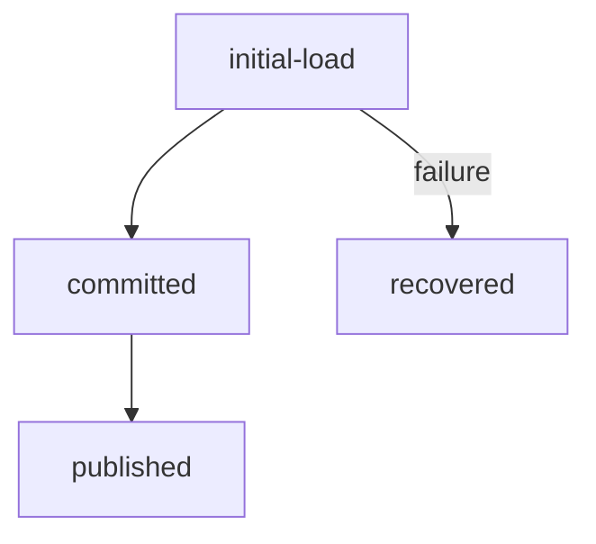
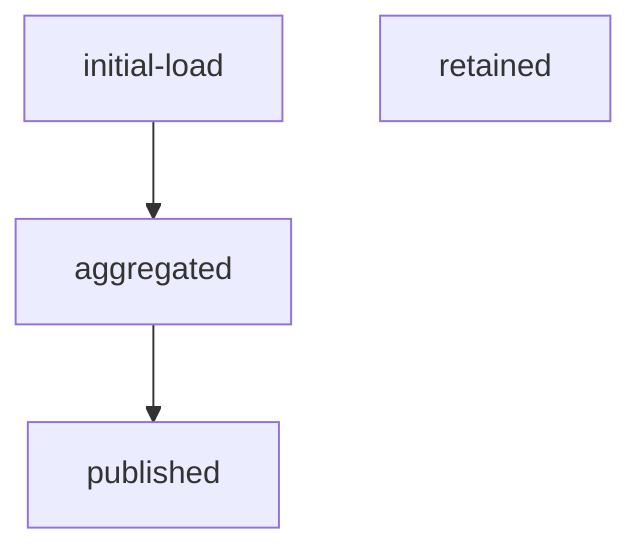
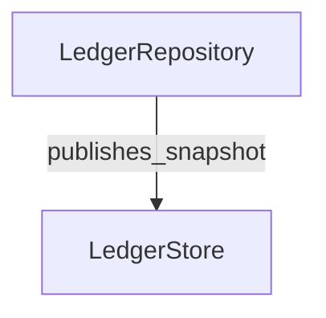
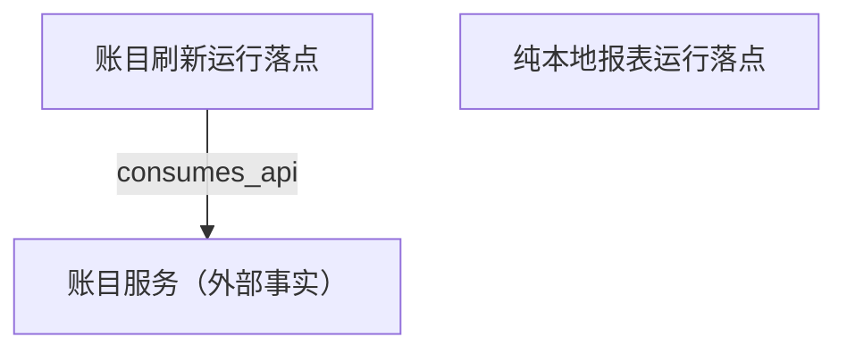
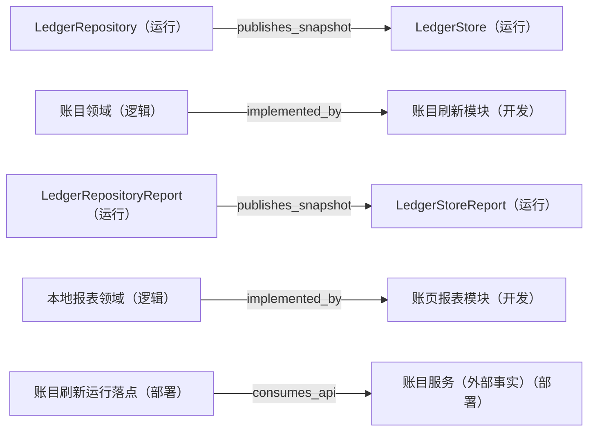

---
derived_from:
  artifact: component-blueprint@1
  component_id: ledger
  blueprint_id: ledger-app-blueprint
  revision: 2
  source_fingerprint: sha256:5beb80530314d04f1267e9bda9f4796c572d107b46b6a446a238e24b61e24218
  artifact_sha256: sha256:3c2fd1cd5bed56aa323441499e4c47bc5daa8bca72b584200fdb9d7a19f18b30
  change_units:
    - change_unit_id: ledger-refresh
      binding: bound
      identity_neutral_digest: b68d436854eed3931e13e0f7bfeb22af51ccbc420e58c53632fa2fe75a045a49
    - change_unit_id: ledger-report
      binding: bound
      identity_neutral_digest: 28ae8de49a05459d5c44bb22113d32110099d464701ff2adc59a383494e65654
projection: component-blueprint-review@11
---

# Ledger 完整设计表达样本（非真实需求）

<a id="design-626c75657072696e743a6c65646765722d6170702d626c75657072696e74"></a>
> 尚未补写评审说明；正文按当前已有字段展示。

阅读入口：先阅读方案、旅程、关键流程和交付安排；类型、方法、完整分支与验收全文见同文档的[技术与追溯参考](#reference)。

<a id="summary"></a>
## 1 方案摘要

以 Repository 为持久账目真源，Store 重放已提交快照；刷新与只读报表拆为两个 CU，共享金额与账号隔离契约。

施工安排见[施工与上线](#delivery)。

<a id="background"></a>
## 2 背景、目标与边界

原先各消费者自行拉取，持久化与缓存发布先后不清，重启后容易看见不同余额。

**当前问题**：提交与发布之间没有可审查的责任边界，报表又复用了一份可变数组。

**方案定位**：本批交付数据及运行语义，不承担首页布局或云侧内部实现。

**目标**：所有消费者读取同一份已提交账目

**成功衡量**：

- AC-1 与 AC-2 通过
- BD-2 验证写失败不发布

**目标**：报表独立消费而不改变账目

**成功衡量**：

- AC-3 通过
- BD-3 验证空月份

**本次范围**

- ledger 模块中的持久化、快照发布与本地报表消费

**不做什么**

- 首页视觉实现
- 云侧内部存储与运营配置台施工
- 未来多进程同步

<a id="terms"></a>
## 3 术语

**账目**：当前登录账号已经持久化提交的金额记录。

<a id="journey"></a>
## 4 用户旅程与界面

### 记一笔后跨消费者刷新

1. 登录后打开账页；先读取持久快照，再建立重放订阅
2. 输入有效金额并确认；持久化成功后发布；失败保留旧快照
3. 退出并重启 App；重建缓存并消费 Repository 最新已提交快照

**首次使用**：没有本地数据时显示空状态，等待首次成功提交。

**已有账目**：离线可查看旧快照，写失败不清空。

### 纯本地读取月度报表

1. 选择已有月份；本地聚合后发布只读报表快照

**无该月账目**：返回空报表，不请求外部服务。

**LedgerPage**：展示当前账号已提交快照并提供提交入口。

<a id="solution"></a>
## 5 整体方案

定义账目、金额与本地报表的能力边界。

账目与只读报表各有契约，共享金额和账号隔离约束。

Repository、Store、报表读取各有明确职责和接口。

<a id="flows"></a>
## 6 关键流程

### 账目提交、发布与恢复

### 报表首次读取与快照更新

<a id="data"></a>
## 7 数据与存储

**ledger-entry**：已提交账目与账页快照

**隔离**：账号隔离

**有效期**：持久账目按宿主留存政策，缓存随会话

**清理**：退出登录清缓存

**安全**：敏感金额不记录到日志

**ledger-report**：只读月度报表

**隔离**：随账号与月份隔离

**有效期**：当前会话

**清理**：账号切换时丢弃

**安全**：不复制跨账号账目

<a id="decisions"></a>
## 8 关键取舍

<a id="design-6465636973696f6e3a7365616d2d7368617065"></a>
### seam-shape

| 关切 | 结论 |
| --- | --- |
| 选了什么 | keep\_direct；契约 LedgerDataSource；provider Host LedgerRepository implementations；consumer Host LedgerStore；绑定时机 App composition root；失败语义 Surface source failure and preserve prior projection.；Source variation affects lifecycle, tests, and reconciliation.；再次提取条件 A second source ships in the same release window. |
| 理由 | Repository 提交先于发布，重放 Store 统一首次加载与更新；直接宿主实现足以承担当前两个本地切片。|

被否方案：

| 方案 | 被否理由/缺陷 |
| --- | --- |
| 每个页面独立拉取并写缓存 | 提交与显示顺序不可统一<br>重启、订阅建立期间可能看到旧余额 |
| 立刻抽出 Maison provider | 尚无跨宿主变体证据<br>增加接缝维护面而没有实际复用 |

<a id="recovery"></a>
## 9 失败与恢复

### 账目提交、发布与恢复

**持久化失败**：保留旧快照并提供重试入口

**订阅失败**：重载 Repository 快照后重建订阅

**进程重建**：从持久账目重建 Store

### 报表首次读取与快照更新

**持久化失败**：本地读取失败时保留旧报表

**订阅失败**：重新读取并聚合

**进程重建**：丢弃会话缓存后重新聚合

边界验收：[BD-1](#design-616363657074616e63653a766965773a6c6f676963616c2f6e6f64653a7265766965772d636f6d6d6f6e2f626f756e6461726965733a42442d31)。

边界验收：[BD-2](#design-616363657074616e63653a766965773a646576656c6f706d656e742f6e6f64653a6c65646765722d6d6f64756c652f626f756e6461726965733a42442d32)。

边界验收：[BD-3](#design-616363657074616e63653a766965773a646576656c6f706d656e742f6e6f64653a6c65646765722d7265706f72742d6d6f64756c652f626f756e6461726965733a42442d33)。

<a id="quality"></a>
## 10 质量与安全

**一致性**：已提交状态才可发布

**兼容与隐私**：单进程恢复且账号隔离，退出登录清理缓存

<a id="delivery"></a>
## 11 施工与上线

### ledger-refresh

持久化提交先于发布，首次加载与订阅重放一致，失败时保留上一份账目快照。

- 账目刷新：交付可观察行为与精确预期
- 账目刷新：持久状态和缓存投影责任清楚
- 账目刷新：消费者读取本侧有效快照
- 账目刷新：消费已获准的本侧接口与映射
- 账目刷新：宿主提供直接 Repository 实现
- 账目刷新：失败与进程重建有明确恢复路径

模块分工：ledger。

- 账目刷新模块（责任方：ledger-team）

未声明上游依赖。

安全中间态：刷新切片独立构建；报表切片未上线时，现有账页仍能从 Repository 恢复并刷新。

精确映射见 [施工单元参考](#design-756e69743a6c65646765722d72656672657368)。

### ledger-report

独立交付本地账页报表读取，复用共同金额模型，保留账目刷新切片的安全中间态。

- 只读报表：交付可观察行为与精确预期
- 只读报表：持久状态和缓存投影责任清楚
- 只读报表：消费者读取本侧有效快照
- 只读报表：消费已获准的本侧接口与映射
- 只读报表：宿主提供直接 Repository 实现
- 只读报表：失败与进程重建有明确恢复路径

模块分工：ledger。

- 账页报表模块（责任方：ledger-team）

未声明上游依赖。

安全中间态：报表未接入时保持既有账页；报表失败仅展示上次缓存，不改变持久账目。

精确映射见 [施工单元参考](#design-756e69743a6c65646765722d7265706f7274)。

### 文件与目录

```text
├── src/ledger/
│   ├── LedgerEntry.ets
│   ├── LedgerFeature.ets
│   ├── LedgerReport.ets
│   ├── LedgerReportModel.ets
│   ├── LedgerRepository.ets
│   ├── LedgerShared.ets
│   └── LedgerStore.ets
└── test/ledger/
    ├── LedgerFeature.test.ets
    └── LedgerReport.test.ets
```

| 上线顺序 | 交付单元 | 配套前提 | 说明 |
| --- | --- | --- | --- |
| 1 | 账目服务 v1 | 无 | 现有接口保持兼容；外部施工不属于 CU。|
| 2 | 账目刷新 | 账目服务 v1 | 完成本侧接口回归后上线。|
| 3 | 本地报表 | 账目刷新 | 配套顺序不自动变成 CU requires。|

| 配套方 | 协同关系 |
| --- | --- |
| 运营配置台 | 负责入口开放配置；本部件不消费其施工，未创建根级 contract。|

<a id="acceptance"></a>
## 12 验收

### 共同金额与账户隔离约束

功能结果：[AC-1](#design-616363657074616e63653a766965773a6c6f676963616c2f6e6f64653a7265766965772d636f6d6d6f6e2f63726974657269613a41432d31)。

失败与边界：[BD-1](#design-616363657074616e63653a766965773a6c6f676963616c2f6e6f64653a7265766965772d636f6d6d6f6e2f626f756e6461726965733a42442d31)。

质量要求：[NFR-1](#design-616363657074616e63653a766965773a6c6f676963616c2f6e6f64653a7265766965772d636f6d6d6f6e2f706572666f726d616e63653a4e46522d31)。

### 账目刷新模块

功能结果：[AC-2](#design-616363657074616e63653a766965773a646576656c6f706d656e742f6e6f64653a6c65646765722d6d6f64756c652f63726974657269613a41432d32)。

失败与边界：[BD-2](#design-616363657074616e63653a766965773a646576656c6f706d656e742f6e6f64653a6c65646765722d6d6f64756c652f626f756e6461726965733a42442d32)。

质量要求：[NFR-2](#design-616363657074616e63653a766965773a646576656c6f706d656e742f6e6f64653a6c65646765722d6d6f64756c652f706572666f726d616e63653a4e46522d32)。

### 账页报表模块

功能结果：[AC-3](#design-616363657074616e63653a766965773a646576656c6f706d656e742f6e6f64653a6c65646765722d7265706f72742d6d6f64756c652f63726974657269613a41432d33)。

失败与边界：[BD-3](#design-616363657074616e63653a766965773a646576656c6f706d656e742f6e6f64653a6c65646765722d7265706f72742d6d6f64756c652f626f756e6461726965733a42442d33)。

质量要求：[NFR-3](#design-616363657074616e63653a766965773a646576656c6f706d656e742f6e6f64653a6c65646765722d7265706f72742d6d6f64756c652f706572666f726d616e63653a4e46522d33)。

<a id="questions"></a>
## 13 待补问题

### 缺口及当前状态

| 问题 | 状态 | 责任方 | 解除条件 |
| --- | --- | --- | --- |
| [cloud-sync-future](#design-6761703a636c6f75642d73796e632d667574757265) | 待决 | cloud-contract-owner | Approved cloud sync contract becomes accessible. |


<a id="reference"></a>
## 技术与追溯参考

部件 ledger · 蓝图 ledger-app-blueprint · revision 2 · 准入 通过

本文根据 canonical 蓝图与当前施工单元确定性生成，文首保留精确来源身份。是否通过设计交接见 readiness；施工授权、映射与完成结论由原责任阶段确认。可选说明缺失或过期不改变这些结论。

参考保留全部声明；不从名称、目录或数组顺序推断调用、依赖与未声明存储设计。正文的验收链接按来源目标与条目编号定位。

### A 字段与类型

<a id="review-summary-details"></a>
#### 原概述与目标

| 关切 | 设计说明 |
| --- | --- |
| 背景 | 原先各消费者自行拉取，持久化与缓存发布先后不清，重启后容易看见不同余额。 |
| 问题 | 提交与发布之间没有可审查的责任边界，报表又复用了一份可变数组。 |
| 本次改变 | 以 Repository 为持久账目真源，Store 重放已提交快照；刷新与只读报表拆为两个 CU，共享金额与账号隔离契约。 |
| 整体定位 | 本批交付数据及运行语义，不承担首页布局或云侧内部实现。 |
| 范围 | ledger 模块中的持久化、快照发布与本地报表消费 |
| 不做什么 | 首页视觉实现；云侧内部存储与运营配置台施工；未来多进程同步 |

| 目标 | 目标说明 | 成功衡量 |
| --- | --- | --- |
| G-1 | 所有消费者读取同一份已提交账目 | [AC-1](#design-616363657074616e63653a766965773a6c6f676963616c2f6e6f64653a7265766965772d636f6d6d6f6e2f63726974657269613a41432d31) 与 [AC-2](#design-616363657074616e63653a766965773a646576656c6f706d656e742f6e6f64653a6c65646765722d6d6f64756c652f63726974657269613a41432d32) 通过<br>[BD-2](#design-616363657074616e63653a766965773a646576656c6f706d656e742f6e6f64653a6c65646765722d6d6f64756c652f626f756e6461726965733a42442d32) 验证写失败不发布 |
| G-2 | 报表独立消费而不改变账目 | [AC-3](#design-616363657074616e63653a766965773a646576656c6f706d656e742f6e6f64653a6c65646765722d7265706f72742d6d6f64756c652f63726974657269613a41432d33) 通过<br>[BD-3](#design-616363657074616e63653a766965773a646576656c6f706d656e742f6e6f64653a6c65646765722d7265706f72742d6d6f64756c652f626f756e6461726965733a42442d33) 验证空月份 |

<a id="review-terms"></a>
#### 完整术语

| 术语 | 含义 | 模块 | 易混项 | 确认依据 |
| --- | --- | --- | --- | --- |
| 账目 | 当前登录账号已经持久化提交的金额记录。 | ledger | 报表缓存 | doc/glossary.yaml#账目 |

#### 领域模型、字段与枚举

<a id="design-6d6f64656c3a766965773a6c6f676963616c2f6e6f64653a7265766965772d636f6d6d6f6e2f416d6f756e74"></a>
内容承载于：[共同金额与账户隔离约束](#design-766965773a6c6f676963616c2f6e6f64653a7265766965772d636f6d6d6f6e) · 契约设计

#### Amount · 接口

模块 ledger；文件 src/ledger/LedgerShared.ets

| 字段 | 类型 | 必需 | 约束/说明 | 来源 |
| --- | --- | --- | --- | --- |
| minorUnits | string | 是 | 整数分的十进制字符串，禁止浮点金额；最大长度由获准接口定义。 | contracts/ledger-api.yaml#/dtos/CreateEntryRequestV1/fields/0 |

未记录：可空；默认值；补充约束；验证引用。

<a id="design-6d6f64656c3a766965773a646576656c6f706d656e742f6e6f64653a6c65646765722d6d6f64756c652f4c6564676572456e747279"></a>
内容承载于：[账目刷新模块](#design-766965773a646576656c6f706d656e742f6e6f64653a6c65646765722d6d6f64756c65) · 契约设计

#### LedgerEntry · 接口

模块 ledger；文件 src/ledger/LedgerEntry.ets

| 字段 | 类型 | 必需 | 约束/说明 | 来源 |
| --- | --- | --- | --- | --- |
| id | string | 是 | 稳定账目 ID，提交后不可改变。 | contracts/ledger-api.yaml#/dtos/CreateEntryResponseV1/fields/0 |
| amount | Amount | 是 | 共享金额模型，单位分。 | contract:create-entry-v1 |

未记录：可空；默认值；补充约束；验证引用。

<a id="design-6d6f64656c3a766965773a646576656c6f706d656e742f6e6f64653a6c65646765722d6d6f64756c652f4c65646765725374616765"></a>


#### LedgerStage · 枚举

模块 ledger；文件 src/ledger/LedgerEntry.ets

枚举：

| 名称 | 值 |
| --- | --- |
| COLD | cold |
| CURRENT | current |

<a id="design-6d6f64656c3a766965773a646576656c6f706d656e742f6e6f64653a6c65646765722d7265706f72742d6d6f64756c652f4c65646765725265706f7274536e617073686f74"></a>
内容承载于：[账页报表模块](#design-766965773a646576656c6f706d656e742f6e6f64653a6c65646765722d7265706f72742d6d6f64756c65) · 契约设计

#### LedgerReportSnapshot · 接口

模块 ledger；文件 src/ledger/LedgerReportModel.ets

| 字段 | 类型 | 必需 | 约束/说明 | 来源 |
| --- | --- | --- | --- | --- |
| month | string | 是 | yyyy-MM，当前账号的查询月份。 | contract:read-report-v1 |
| total | Amount | 是 | 单位分，仅聚合已提交账目。 | contract:read-report-v1 |

未记录：可空；默认值；补充约束；验证引用。

### B 接口与存储明细

#### 本部件实际消费或提供的操作与 DTO

<a id="design-636f6e74726163743a6372656174652d656e7472792d7631"></a>
#### create-entry-v1

操作：createEntry · v1 · app-to-ledger-service；责任方 ledger-contract-owner；需要方 cu-ledger-refresh

<a id="design-64746f3a6372656174652d656e7472792d76312f726571756573745f64746f"></a>
**请求 DTO：CreateEntryRequestV1**

来源：[CreateEntryRequestV1](../../../../contracts/ledger-api.yaml#/dtos/CreateEntryRequestV1)
验证引用：verify:create-entry-request

| 字段 | 类型 | 必需 | 可空 | 语义 | 来源 |
| --- | --- | --- | --- | --- | --- |
| amount | decimal-string | 是 | 否 | signed ledger amount | contracts/ledger-api.yaml#/dtos/CreateEntryRequestV1/fields/0 |
| currency | iso-4217 | 是 | 否 | entry currency | contracts/ledger-api.yaml#/dtos/CreateEntryRequestV1/fields/1 |
| parent\_id | string | 否 | 是 | optional parent category | contracts/ledger-api.yaml#/dtos/CreateEntryRequestV1/fields/2 |

未记录：默认值；约束；验证引用。

<a id="design-64746f3a6372656174652d656e7472792d76312f726573706f6e73655f64746f"></a>
**响应 DTO：CreateEntryResponseV1**

来源：[CreateEntryResponseV1](../../../../contracts/ledger-api.yaml#/dtos/CreateEntryResponseV1)
验证引用：verify:create-entry-response

| 字段 | 类型 | 必需 | 可空 | 语义 | 来源 |
| --- | --- | --- | --- | --- | --- |
| entry\_id | string | 是 | 否 | stable entry identity | contracts/ledger-api.yaml#/dtos/CreateEntryResponseV1/fields/0 |

映射：

| 映射 | 类型 | 源字段 | 目标字段 | 规则 |
| --- | --- | --- | --- | --- |
| request-amount | 直接映射 | amount | LedgerEntry.amount | Parse decimal without changing currency scale. |
| request-parent-level | 推导映射 | parent\_id | LedgerEntry.parent\_level\_id | Resolve parent hierarchy level from parent\_id; this is not a wire field. |
| request-currency | 直接映射 | currency | LedgerEntry.currency | Preserve the ISO-4217 currency code. |
| response-entry-id | 直接映射 | entry\_id | LedgerEntry.id | Preserve stable identity. |

错误：validation\_error：request rejected without mutation；conflict：idempotent replay returns existing entry
来源：[createEntry](../../../../contracts/ledger-api.yaml#/errors/createEntry)
验证：verify:create-entry-errors
幂等：client\_request\_id scoped to active account
来源：[createEntry](../../../../contracts/ledger-api.yaml#/idempotency/createEntry)
验证：verify:create-entry-idempotency
非功能要求：freshness：UI refresh within one publication turn；durability：repository commit precedes publication
来源：[createEntry](../../../../contracts/ledger-api.yaml#/nfr/createEntry)
验证：verify:create-entry-nfr

未记录：默认值；约束；验证引用。

<a id="design-636f6e74726163743a726561642d7265706f72742d7631"></a>
#### read-report-v1

操作：readReport · v1 · app-to-local-report；责任方 ledger-contract-owner；需要方 cu-ledger-report

<a id="design-64746f3a726561642d7265706f72742d76312f726571756573745f64746f"></a>
**请求 DTO：ReportRequestV1**

来源：[ReportRequestV1](../../../../contracts/report-api.yaml#/dtos/ReportRequestV1)
验证引用：test/ledger/closure.test.ts#verifyExternalContract

| 字段 | 类型 | 必需 | 可空 | 语义 | 来源 |
| --- | --- | --- | --- | --- | --- |
| month | yyyy-MM | 是 | 否 | 按当前账号查询的月份 | contracts/report-api.yaml#/dtos/ReportRequestV1/fields/0 |

未记录：默认值；约束；验证引用。

<a id="design-64746f3a726561642d7265706f72742d76312f726573706f6e73655f64746f"></a>
**响应 DTO：ReportResponseV1**

来源：[ReportResponseV1](../../../../contracts/report-api.yaml#/dtos/ReportResponseV1)
验证引用：test/ledger/closure.test.ts#verifyExternalContract

| 字段 | 类型 | 必需 | 可空 | 语义 | 来源 |
| --- | --- | --- | --- | --- | --- |
| total | decimal-string | 是 | 否 | 该月已提交账目合计，单位分 | contracts/report-api.yaml#/dtos/ReportResponseV1/fields/0 |

映射：

| 映射 | 类型 | 源字段 | 目标字段 | 规则 |
| --- | --- | --- | --- | --- |
| report-month | 直接映射 | month | ReportRequest.month | 保持 yyyy-MM 格式，不跨账号查询。 |
| report-total | 直接映射 | total | LedgerReportSnapshot.total | 保留十进制字符串，不经浮点数转换。 |

错误：storage\_unavailable：保留上一份报表快照并报告重试，不写账目
来源：[readReport](../../../../contracts/report-api.yaml#/errors/readReport)
验证：test/ledger/closure.test.ts#verifyExternalContract
幂等：同一账号、月份和账目版本得到相同只读快照。
来源：[readReport](../../../../contracts/report-api.yaml#/idempotency/readReport)
验证：test/ledger/closure.test.ts#verifyExternalContract
非功能要求：isolation：不读取其它账号账目；freshness：仅使用已提交数据
来源：[readReport](../../../../contracts/report-api.yaml#/nfr/readReport)
验证：test/ledger/closure.test.ts#verifyExternalContract

未记录：默认值；约束；验证引用。

内容承载于：[共同金额与账户隔离约束](#design-766965773a6c6f676963616c2f6e6f64653a7265766965772d636f6d6d6f6e) · 契约设计

内容承载于：[账目刷新模块](#design-766965773a646576656c6f706d656e742f6e6f64653a6c65646765722d6d6f64756c65) · 契约设计

| 模块 | DSL 分层 | 形式 | 变化 | 目录 |
| --- | --- | --- | --- | --- |
| ledger | 02-Feature | 源码 | 修改 | src/ledger |

模块依赖：无。

<a id="design-696e746572666163653a766965773a646576656c6f706d656e742f6e6f64653a6c65646765722d6d6f64756c652f4c65646765725265706f7369746f7279"></a>
接口 LedgerRepository · ledger / data · src/ledger/LedgerRepository.ets

| 方法 | 参数 | 返回 | 异步 | 职责/失败语义 |
| --- | --- | --- | --- | --- |
| commit | entry: LedgerEntry | Promise&lt;LedgerEntry&gt; | 是 | 原子持久化成功后返回；失败抛错，缓存不发布。 |
| load | 无 | Promise&lt;LedgerEntry\[\]&gt; | 是 | 按当前账号读取已提交集合。 |

组件 LedgerStore · state-owner · src/ledger/LedgerStore.ets

重放最近已提交快照，订阅清理归生命周期 owner。

| 状态/属性 | 类型 | 宿主声明 |
| --- | --- | --- |
| stage | LedgerStage | none |

| 事件 | 职责 |
| --- | --- |
| snapshot | 持久化成功后只发布一次。 |

组件 LedgerPage · 页面 · src/ledger/LedgerFeature.ets

展示当前账号已提交快照并提供提交入口。

内容承载于：[账页报表模块](#design-766965773a646576656c6f706d656e742f6e6f64653a6c65646765722d7265706f72742d6d6f64756c65) · 契约设计

| 模块 | DSL 分层 | 形式 | 变化 | 目录 |
| --- | --- | --- | --- | --- |
| ledger | 02-Feature | 源码 | 修改 | src/ledger |

模块依赖：无。

#### 运行流与状态明细

<a id="design-766965773a72756e74696d652f666c6f773a6c65646765722d726566726573682d666c6f77"></a>
##### 账目提交、发布与恢复

数据域：data-domain:ledger-entry；契约：contract:create-entry-v1；开发责任：view:development/node:ledger-module

触发：

| 触发 | 类型 | 时机 | 幂等 |
| --- | --- | --- | --- |
| committed-user-mutation | user\_mutation | 用户提交账目或进程重建后 | 按账号和请求 ID 去重提交 |
| cold-start-load | 冷启动 | 用户提交账目或进程重建后 | 按账号和请求 ID 去重提交 |

首次加载：repository-snapshot · 先读取持久快照，再建立订阅；责任方 app-state-team；范围 当前登录账号的账目；新鲜度 读取当前 Repository 版本后建立重放订阅

权威状态：view:runtime/node:ledger-repository；持久化 sqlite:ledger-entry；投影/缓存 view:runtime/node:ledger-store；调和 已提交 Repository 版本为准；失败写操作不发布。
状态责任方：view:runtime/node:ledger-repository；状态 durable-ledger

写入与发布：

| 写入 | 类型 | 持久化 | 发布 | 恢复 |
| --- | --- | --- | --- | --- |
| add-entry | user | sqlite:ledger-entry | publication:ledger-changed | recovery:reload-ledger |

| 发布 | 快照/语义 |
| --- | --- |
| ledger-changed | full-current-ledger |

订阅与消费者：

| 订阅 | 消费者 | 建立/解除 | 快照/重放 | 清理 | 顺序 |
| --- | --- | --- | --- | --- | --- |
| ledger-page-subscription | consumer:ledger-page | 首次加载后建立订阅 / 页面卸载或账号切换 | 最近已提交的账目 | 移除 observer token | 按 Repository 版本顺序消费 |

| 消费者 | 首次加载 | 更新 |
| --- | --- | --- |
| ledger-page | initial-load:repository-snapshot | publication:ledger-changed |

失败与恢复：reload-ledger

| 恢复关切 | 处理 |
| --- | --- |
| 持久化失败 | 保留旧快照并提供重试入口 |
| 订阅失败 | 重载 Repository 快照后重建订阅 |
| 进程重建 | 从持久账目重建 Store |

生命周期：

| 场景 | 覆盖裁决 | 依据 |
| --- | --- | --- |
| 冷启动 | 已覆盖 | test/ledger/closure.test.ts#verifyColdStartLifecycle |
| 热恢复 | 已覆盖 | test/ledger/closure.test.ts#verifyWarmResumeLifecycle |
| 页面挂载 | 已覆盖 | test/ledger/closure.test.ts#verifyPageAttachLifecycle |
| 页面卸载 | 已覆盖 | test/ledger/closure.test.ts#verifyPageDetachLifecycle |
| 账号切换 | 已覆盖 | test/ledger/closure.test.ts#verifyAccountSwitchLifecycle |
| 进程重建 | 已覆盖 | test/ledger/closure.test.ts#verifyProcessRecreationLifecycle |
| 后台写入 | 不适用 | decision:no-background-writer |

验证关注：test/ledger/closure.test.ts#verifyLedgerFlow

未记录：时机；载荷；发布；消费语义；处理。

<a id="design-766965773a72756e74696d652f666c6f773a6c65646765722d7265706f72742d666c6f77"></a>
##### 报表首次读取与快照更新

数据域：data-domain:ledger-report；契约：contract:read-report-v1；开发责任：view:development/node:ledger-report-module

触发：

| 触发 | 类型 | 时机 | 幂等 |
| --- | --- | --- | --- |
| committed-user-mutation | user\_mutation | 用户按月查看或账目快照更新后 | 按账号、月份、账目版本去重聚合 |
| cold-start-load | 冷启动 | 用户按月查看或账目快照更新后 | 按账号、月份、账目版本去重聚合 |

首次加载：repository-snapshot · 本地读取并按月份聚合；责任方 app-state-team；范围 当前账号、当前月份；新鲜度 读取当前 Repository 版本后建立重放订阅

权威状态：view:runtime/node:ledger-repository-report；持久化 账号内已提交账目；报表缓存不回写账目。；投影/缓存 view:runtime/node:ledger-store-report；调和 账目版本更新后重新聚合，不调用远程写接口。
状态责任方：view:runtime/node:ledger-repository-report；状态 empty；current；stale

写入与发布：

| 写入 | 类型 | 发布 | 恢复 |
| --- | --- | --- | --- |
| aggregate-report | user | publication:report-ready | recovery:reload-ledger |

| 发布 | 快照/语义 |
| --- | --- |
| report-ready | 按月聚合的不可变报表 |

订阅与消费者：

| 订阅 | 发布 | 消费者 | 建立/解除 | 快照/重放 | 清理 | 顺序 |
| --- | --- | --- | --- | --- | --- | --- |
| report-panel-subscription | publication:report-ready | consumer:report-panel | 首次加载后建立订阅 / 页面卸载或账号切换 | 最近已聚合的报表 | 移除 observer token | 按 Repository 版本顺序消费 |

| 消费者 | 首次加载 | 更新 |
| --- | --- | --- |
| report-panel | initial-load:repository-snapshot | publication:report-ready |

失败与恢复：reload-ledger

| 恢复关切 | 处理 |
| --- | --- |
| 持久化失败 | 本地读取失败时保留旧报表 |
| 订阅失败 | 重新读取并聚合 |
| 进程重建 | 丢弃会话缓存后重新聚合 |

生命周期：

| 场景 | 覆盖裁决 | 依据 |
| --- | --- | --- |
| 冷启动 | 已覆盖 | test/ledger/closure.test.ts#verifyColdStartLifecycle |
| 热恢复 | 已覆盖 | test/ledger/closure.test.ts#verifyWarmResumeLifecycle |
| 页面挂载 | 已覆盖 | test/ledger/closure.test.ts#verifyPageAttachLifecycle |
| 页面卸载 | 已覆盖 | test/ledger/closure.test.ts#verifyPageDetachLifecycle |
| 账号切换 | 已覆盖 | test/ledger/closure.test.ts#verifyAccountSwitchLifecycle |
| 进程重建 | 已覆盖 | test/ledger/closure.test.ts#verifyProcessRecreationLifecycle |
| 后台写入 | 不适用 | decision:no-background-writer |

验证关注：test/ledger/closure.test.ts#verifyLedgerFlow

未记录：持久化；时机；载荷；消费语义；处理。

内容承载于：[账目提交、发布与恢复](#design-766965773a72756e74696d652f666c6f773a6c65646765722d726566726573682d666c6f77) · 契约设计

#### 施工状态与有序步骤

状态 ledger；持有者 LedgerStore；作用域 component；责任方 view:runtime/node:ledger-repository

| 顺序 | 行为 |
| --- | --- |
| 1 | 读取账号隔离的持久集合 |
| 2 | 提交或聚合成功后生成不可变快照 |
| 3 | 发布快照后由订阅者消费 |
| 4 | 失败保留旧快照；重启重新加载 |

生命周期触发：进程重建

| 失败/恢复场景 | 处理 |
| --- | --- |
| 策略 | 重新读取已提交持久快照 |

内容承载于：[报表首次读取与快照更新](#design-766965773a72756e74696d652f666c6f773a6c65646765722d7265706f72742d666c6f77) · 契约设计

#### 施工状态与有序步骤

状态 report；持有者 LedgerReportStore；作用域 component；责任方 view:runtime/node:ledger-repository-report

| 顺序 | 行为 |
| --- | --- |
| 1 | 读取当前账号已提交账目 |
| 2 | 按月份聚合金额 |
| 3 | 发布不可变报表快照 |
| 4 | 失败保留旧报表；账号切换丢弃缓存 |

生命周期触发：进程重建

| 失败/恢复场景 | 处理 |
| --- | --- |
| 策略 | 重新聚合或保留上次报表 |

### C 完整验收

内容承载于：[共同金额与账户隔离约束](#design-766965773a6c6f676963616c2f6e6f64653a7265766965772d636f6d6d6f6e) · 验收设计

<a id="design-616363657074616e63653a766965773a6c6f676963616c2f6e6f64653a7265766965772d636f6d6d6f6e2f63726974657269613a41432d31"></a>
<a id="design-616363657074616e63653a766965773a6c6f676963616c2f6e6f64653a7265766965772d636f6d6d6f6e2f626f756e6461726965733a42442d31"></a>
<a id="design-616363657074616e63653a766965773a6c6f676963616c2f6e6f64653a7265766965772d636f6d6d6f6e2f706572666f726d616e63653a4e46522d31"></a>
功能验收：

| AC | 优先级/功能 | 验收标准 | 验证步骤（按序） | 预期 | 分层/关注点 | 已有流程关联 | CU 谓词直接引用 |
| --- | --- | --- | --- | --- | --- | --- | --- |
| AC-1 | P0 / — | 金额保留十进制字符串，两个切片只读取当前账号 | 1. 建立账号内测试数据<br>2. 执行本切片动作并检查结果 | 金额保留十进制字符串，两个切片只读取当前账号 | 单元测试；UT：持久化、发布与账号隔离 | 未声明；无 UI 依据时由 spec 不冲突补充 | 未登记直接谓词引用 |

边界验收：

| BD | 优先级 | 异常场景 | 处理 | 可见结果/预期 | 分层/关注点 | CU 谓词直接引用 |
| --- | --- | --- | --- | --- | --- | --- |
| BD-1 | P1 | 账号切换 | 旧账号缓存全部丢弃 | 旧账号缓存全部丢弃 | 单元测试；UT：状态保持与恢复 | 未登记直接谓词引用 |

质量阈值：

| NFR | 指标 | 阈值 | 单位 | 说明 | 分层/关注点 |
| --- | --- | --- | --- | --- | --- |
| NFR-1 | 本地首次读取时间 | &lt;= 500 | ms | 本地首次读取时间 | 单元测试；UT：可重复的计时样本 |

内容承载于：[账目刷新模块](#design-766965773a646576656c6f706d656e742f6e6f64653a6c65646765722d6d6f64756c65) · 验收设计

<a id="design-616363657074616e63653a766965773a646576656c6f706d656e742f6e6f64653a6c65646765722d6d6f64756c652f63726974657269613a41432d32"></a>
<a id="design-616363657074616e63653a766965773a646576656c6f706d656e742f6e6f64653a6c65646765722d6d6f64756c652f626f756e6461726965733a42442d32"></a>
<a id="design-616363657074616e63653a766965773a646576656c6f706d656e742f6e6f64653a6c65646765722d6d6f64756c652f706572666f726d616e63653a4e46522d32"></a>
功能验收：

| AC | 优先级/功能 | 验收标准 | 验证步骤（按序） | 预期 | 分层/关注点 | 已有流程关联 | CU 谓词直接引用 |
| --- | --- | --- | --- | --- | --- | --- | --- |
| AC-2 | P0 / — | 提交成功后账页显示新余额，重启后保持一致 | 1. 建立账号内测试数据<br>2. 执行本切片动作并检查结果 | 提交成功后账页显示新余额，重启后保持一致 | 真机；device：账页显示新余额且重启后保留 | 未声明；无 UI 依据时由 spec 不冲突补充 | ledger-refresh/refresh-behavior；ledger-refresh/runtime-owner；ledger-refresh/page-consumer；ledger-refresh/source-contract；ledger-refresh/repository-provider；ledger-refresh/lifecycle-recovery |

边界验收：

| BD | 优先级 | 异常场景 | 处理 | 可见结果/预期 | 分层/关注点 | CU 谓词直接引用 |
| --- | --- | --- | --- | --- | --- | --- |
| BD-2 | P1 | 持久化失败 | 保留旧快照，不发布新余额 | 保留旧快照，不发布新余额 | 单元测试；UT：状态保持与恢复 | 未登记直接谓词引用 |

质量阈值：

| NFR | 指标 | 阈值 | 单位 | 说明 | 分层/关注点 |
| --- | --- | --- | --- | --- | --- |
| NFR-2 | 提交到消费者可见时间 | &lt;= 500 | ms | 提交到消费者可见时间 | 单元测试；UT：可重复的计时样本 |

内容承载于：[账页报表模块](#design-766965773a646576656c6f706d656e742f6e6f64653a6c65646765722d7265706f72742d6d6f64756c65) · 验收设计

<a id="design-616363657074616e63653a766965773a646576656c6f706d656e742f6e6f64653a6c65646765722d7265706f72742d6d6f64756c652f63726974657269613a41432d33"></a>
<a id="design-616363657074616e63653a766965773a646576656c6f706d656e742f6e6f64653a6c65646765722d7265706f72742d6d6f64756c652f626f756e6461726965733a42442d33"></a>
<a id="design-616363657074616e63653a766965773a646576656c6f706d656e742f6e6f64653a6c65646765722d7265706f72742d6d6f64756c652f706572666f726d616e63653a4e46522d33"></a>
功能验收：

| AC | 优先级/功能 | 验收标准 | 验证步骤（按序） | 预期 | 分层/关注点 | 已有流程关联 | CU 谓词直接引用 |
| --- | --- | --- | --- | --- | --- | --- | --- |
| AC-3 | P0 / — | 月度报表等于本地已提交账目聚合 | 1. 建立账号内测试数据<br>2. 执行本切片动作并检查结果 | 月度报表等于本地已提交账目聚合 | 单元测试；UT：持久化、发布与账号隔离 | 未声明；无 UI 依据时由 spec 不冲突补充 | ledger-report/refresh-behavior-report；ledger-report/runtime-owner-report；ledger-report/page-consumer-report；ledger-report/source-contract-report；ledger-report/repository-provider-report；ledger-report/lifecycle-recovery-report |

边界验收：

| BD | 优先级 | 异常场景 | 处理 | 可见结果/预期 | 分层/关注点 | CU 谓词直接引用 |
| --- | --- | --- | --- | --- | --- | --- |
| BD-3 | P1 | 月份无账目 | 返回空报表，不修改账目 | 返回空报表，不修改账目 | 单元测试；UT：状态保持与恢复 | 未登记直接谓词引用 |

质量阈值：

| NFR | 指标 | 阈值 | 单位 | 说明 | 分层/关注点 |
| --- | --- | --- | --- | --- | --- |
| NFR-3 | 本地报表聚合时间 | &lt;= 500 | ms | 本地报表聚合时间 | 单元测试；UT：可重复的计时样本 |

### D 全部用例分支与界面调用

#### 用例、数据边界与分支

内容承载于：[账目提交、发布与恢复](#design-766965773a72756e74696d652f666c6f773a6c65646765722d726566726573682d666c6f77) · 用例设计

#### 用例 ledger-refresh

提交、发布与恢复

编排入口：LedgerFeature.run；文件 src/ledger/LedgerFeature.ets

| 状态集合 |
| --- |
| initial-load |
| committed |
| published |
| recovered |

阶段流转（展示基准：success；基准已出现的边不标标签，其余边标分支，完整来源见下方分支表）：



数据边界：repository · LedgerRepository · storage

| 方法 | 参数 | 返回 | 异步 |
| --- | --- | --- | --- |
| load | 无 | LedgerEntry\[\] | 是 |

主路径及分支去向：

| 分支 | 条件 | 关联验收 |
| --- | --- | --- |
| success | 有效账号与已提交数据 | [AC-2](#design-616363657074616e63653a766965773a646576656c6f706d656e742f6e6f64653a6c65646765722d6d6f64756c652f63726974657269613a41432d32) |
| failure | 本地数据不可用或写失败 | [BD-2](#design-616363657074616e63653a766965773a646576656c6f706d656e742f6e6f64653a6c65646765722d6d6f64756c652f626f756e6461726965733a42442d32) |

**分支 success 的行为与去向**

| 关切 | 声明内容 |
| --- | --- |
| 动作顺序 | flow.load；flow.commit；flow.publish |
| 阶段去向 | initial-load；committed；published |
| 端口调用 | repository.load；repository.commit |
| 预期状态 | stage：published；snapshot：本次提交的不可变集合 |
| 不得调用 | — |

**分支 failure 的行为与去向**

| 关切 | 声明内容 |
| --- | --- |
| 动作顺序 | flow.load |
| 阶段去向 | initial-load；recovered |
| 端口调用 | — |
| 预期状态 | snapshot：上一份快照 |
| 不得调用 | flow.publish |

未记录：不得调用（声明内容）；端口调用（声明内容）。

内容承载于：[报表首次读取与快照更新](#design-766965773a72756e74696d652f666c6f773a6c65646765722d7265706f72742d666c6f77) · 用例设计

#### 用例 ledger-report

纯本地月度聚合

编排入口：LedgerReport.run；文件 src/ledger/LedgerReport.ets

| 状态集合 |
| --- |
| initial-load |
| aggregated |
| published |
| retained |

阶段流转（展示基准：success；基准已出现的边不标标签，其余边标分支，完整来源见下方分支表）：



数据边界：repository · LedgerRepository · storage

| 方法 | 参数 | 返回 | 异步 |
| --- | --- | --- | --- |
| load | 无 | LedgerEntry\[\] | 是 |

主路径及分支去向：

| 分支 | 条件 | 关联验收 |
| --- | --- | --- |
| success | 当前账号该月存在已提交账目 | [AC-3](#design-616363657074616e63653a766965773a646576656c6f706d656e742f6e6f64653a6c65646765722d7265706f72742d6d6f64756c652f63726974657269613a41432d33) |
| empty | 该月无账目 | [BD-3](#design-616363657074616e63653a766965773a646576656c6f706d656e742f6e6f64653a6c65646765722d7265706f72742d6d6f64756c652f626f756e6461726965733a42442d33) |

**分支 success 的行为与去向**

| 关切 | 声明内容 |
| --- | --- |
| 动作顺序 | flow.load；flow.aggregate；flow.publish |
| 阶段去向 | initial-load；aggregated；published |
| 端口调用 | repository.load |
| 预期状态 | total：该月已提交金额总和 |
| 不得调用 | repository.commit |

**分支 empty 的行为与去向**

| 关切 | 声明内容 |
| --- | --- |
| 动作顺序 | flow.load；flow.aggregate |
| 阶段去向 | initial-load；aggregated |
| 端口调用 | — |
| 预期状态 | total：0 |
| 不得调用 | repository.commit |

未记录：端口调用（声明内容）。

### E 施工精确映射

#### 声明文件（完整施工写集）

<a id="design-66696c653a7372632f6c65646765722f4c65646765725368617265642e657473"></a>
<a id="design-66696c653a7372632f6c65646765722f4c6564676572466561747572652e657473"></a>
<a id="design-66696c653a746573742f6c65646765722f4c6564676572466561747572652e746573742e657473"></a>
<a id="design-66696c653a7372632f6c65646765722f4c6564676572456e7472792e657473"></a>
<a id="design-66696c653a7372632f6c65646765722f4c65646765725265706f7369746f72792e657473"></a>
<a id="design-66696c653a7372632f6c65646765722f4c656467657253746f72652e657473"></a>
<a id="design-66696c653a7372632f6c65646765722f4c65646765725265706f72742e657473"></a>
<a id="design-66696c653a746573742f6c65646765722f4c65646765725265706f72742e746573742e657473"></a>
<a id="design-66696c653a7372632f6c65646765722f4c65646765725265706f72744d6f64656c2e657473"></a>
<a id="design-7772697465733a766965773a6c6f676963616c2f6e6f64653a7265766965772d636f6d6d6f6e"></a>
<a id="design-7772697465733a766965773a646576656c6f706d656e742f6e6f64653a6c65646765722d6d6f64756c65"></a>
<a id="design-7772697465733a766965773a646576656c6f706d656e742f6e6f64653a6c65646765722d7265706f72742d6d6f64756c65"></a>
| 文件 | 声明目标 |
| --- | --- |
| src/ledger/LedgerShared.ets | [共同金额与账户隔离约束](#design-766965773a6c6f676963616c2f6e6f64653a7265766965772d636f6d6d6f6e) |
| src/ledger/LedgerFeature.ets | [账目刷新模块](#design-766965773a646576656c6f706d656e742f6e6f64653a6c65646765722d6d6f64756c65) |
| test/ledger/LedgerFeature.test.ets | [账目刷新模块](#design-766965773a646576656c6f706d656e742f6e6f64653a6c65646765722d6d6f64756c65) |
| src/ledger/LedgerEntry.ets | [账目刷新模块](#design-766965773a646576656c6f706d656e742f6e6f64653a6c65646765722d6d6f64756c65) |
| src/ledger/LedgerRepository.ets | [账目刷新模块](#design-766965773a646576656c6f706d656e742f6e6f64653a6c65646765722d6d6f64756c65) |
| src/ledger/LedgerStore.ets | [账目刷新模块](#design-766965773a646576656c6f706d656e742f6e6f64653a6c65646765722d6d6f64756c65) |
| src/ledger/LedgerReport.ets | [账页报表模块](#design-766965773a646576656c6f706d656e742f6e6f64653a6c65646765722d7265706f72742d6d6f64756c65) |
| test/ledger/LedgerReport.test.ets | [账页报表模块](#design-766965773a646576656c6f706d656e742f6e6f64653a6c65646765722d7265706f72742d6d6f64756c65) |
| src/ledger/LedgerReportModel.ets | [账页报表模块](#design-766965773a646576656c6f706d656e742f6e6f64653a6c65646765722d7265706f72742d6d6f64756c65) |

#### 文件用途与已声明关联

| 文件 | 已声明用途或关联 |
| --- | --- |
| [src/ledger/LedgerShared.ets](#design-66696c653a7372632f6c65646765722f4c65646765725368617265642e657473) | 声明模型：[Amount](#design-6d6f64656c3a766965773a6c6f676963616c2f6e6f64653a7265766965772d636f6d6d6f6e2f416d6f756e74) |
| [src/ledger/LedgerFeature.ets](#design-66696c653a7372632f6c65646765722f4c6564676572466561747572652e657473) | 展示当前账号已提交快照并提供提交入口。 |
| [test/ledger/LedgerFeature.test.ets](#design-66696c653a746573742f6c65646765722f4c6564676572466561747572652e746573742e657473) | 未声明用途或接口/模型关联 |
| [src/ledger/LedgerEntry.ets](#design-66696c653a7372632f6c65646765722f4c6564676572456e7472792e657473) | 声明模型：[LedgerEntry](#design-6d6f64656c3a766965773a646576656c6f706d656e742f6e6f64653a6c65646765722d6d6f64756c652f4c6564676572456e747279)；声明模型：[LedgerStage](#design-6d6f64656c3a766965773a646576656c6f706d656e742f6e6f64653a6c65646765722d6d6f64756c652f4c65646765725374616765) |
| [src/ledger/LedgerRepository.ets](#design-66696c653a7372632f6c65646765722f4c65646765725265706f7369746f72792e657473) | 接口：[LedgerRepository](#design-696e746572666163653a766965773a646576656c6f706d656e742f6e6f64653a6c65646765722d6d6f64756c652f4c65646765725265706f7369746f7279) |
| [src/ledger/LedgerStore.ets](#design-66696c653a7372632f6c65646765722f4c656467657253746f72652e657473) | 重放最近已提交快照，订阅清理归生命周期 owner。 |
| [src/ledger/LedgerReport.ets](#design-66696c653a7372632f6c65646765722f4c65646765725265706f72742e657473) | 未声明用途或接口/模型关联 |
| [test/ledger/LedgerReport.test.ets](#design-66696c653a746573742f6c65646765722f4c65646765725265706f72742e746573742e657473) | 未声明用途或接口/模型关联 |
| [src/ledger/LedgerReportModel.ets](#design-66696c653a7372632f6c65646765722f4c65646765725265706f72744d6f64656c2e657473) | 声明模型：[LedgerReportSnapshot](#design-6d6f64656c3a766965773a646576656c6f706d656e742f6e6f64653a6c65646765722d7265706f72742d6d6f64756c652f4c65646765725265706f7274536e617073686f74) |

<a id="design-756e69743a6c65646765722d72656672657368"></a>
#### ledger-refresh

持久化提交先于发布，首次加载与订阅重放一致，失败时保留上一份账目快照。

来源绑定：已绑定。

交付结果：

| 谓词 | 职责 | 交付语义 | 提供项 | 验证关注 |
| --- | --- | --- | --- | --- |
| refresh-behavior | 行为责任 | 账目刷新：交付可观察行为与精确预期 | ledger-refresh-vertical-slice | verify:ledger-flow；[AC-2](#design-616363657074616e63653a766965773a646576656c6f706d656e742f6e6f64653a6c65646765722d6d6f64756c652f63726974657269613a41432d32) |
| runtime-owner | 主责 | 账目刷新：持久状态和缓存投影责任清楚 | ledger-refresh-vertical-slice | verify:state-owner；[AC-2](#design-616363657074616e63653a766965773a646576656c6f706d656e742f6e6f64653a6c65646765722d6d6f64756c652f63726974657269613a41432d32) |
| page-consumer | 消费方 | 账目刷新：消费者读取本侧有效快照 | ledger-refresh-vertical-slice | verify:add-entry-scenario；[AC-2](#design-616363657074616e63653a766965773a646576656c6f706d656e742f6e6f64653a6c65646765722d6d6f64756c652f63726974657269613a41432d32) |
| source-contract | 契约责任 | 账目刷新：消费已获准的本侧接口与映射 | ledger-refresh-vertical-slice | verify:create-entry-operation；[AC-2](#design-616363657074616e63653a766965773a646576656c6f706d656e742f6e6f64653a6c65646765722d6d6f64756c652f63726974657269613a41432d32) |
| repository-provider | 提供方 | 账目刷新：宿主提供直接 Repository 实现 | ledger-refresh-vertical-slice | verify:ledger-source-contract；[AC-2](#design-616363657074616e63653a766965773a646576656c6f706d656e742f6e6f64653a6c65646765722d6d6f64756c652f63726974657269613a41432d32) |
| lifecycle-recovery | 恢复责任 | 账目刷新：失败与进程重建有明确恢复路径 | ledger-refresh-vertical-slice | verify:process-recreation；[AC-2](#design-616363657074616e63653a766965773a646576656c6f706d656e742f6e6f64653a6c65646765722d6d6f64756c652f63726974657269613a41432d32) |

| 提供项 | 交付说明 |
| --- | --- |
| ledger-refresh-vertical-slice | Ledger mutation, publication, consumer refresh, recovery and host seam are constructable. |

显式依赖：

未声明上游依赖。

可修改模块：ledger。

| 修改责任方 | 写入范围 | 设计引用 |
| --- | --- | --- |
| ledger-team | planned:src/ledger；planned:test/ledger | view:development/node:ledger-module |

保留约束：

| 说明 | 依据 |
| --- | --- |
| Repository commit remains authoritative and precedes publication. | verify:ledger-flow |

安全中间态：刷新切片独立构建；报表切片未上线时，现有账页仍能从 Repository 恢复并刷新。
构建：verify:feature-build；兼容：verify:standalone-feature；恢复：verify:process-recreation

设计与执行阻塞项：无。

设计引用：

- [账目领域](#design-766965773a6c6f676963616c2f6e6f64653a6c65646765722d646f6d61696e)
- [LedgerRepository](#design-766965773a72756e74696d652f6e6f64653a6c65646765722d7265706f7369746f7279)
- [LedgerStore](#design-766965773a72756e74696d652f6e6f64653a6c65646765722d73746f7265)
- [账目提交、发布与恢复](#design-766965773a72756e74696d652f666c6f773a6c65646765722d726566726573682d666c6f77)
- [账目刷新模块](#design-766965773a646576656c6f706d656e742f6e6f64653a6c65646765722d6d6f64756c65)
- [记一笔后跨消费者刷新](#design-766965773a7363656e6172696f732f6e6f64653a6164642d656e7472792d7363656e6172696f)
- [repository-publishes-store](#design-72656c6174696f6e3a7265706f7369746f72792d7075626c69736865732d73746f7265)
- [domain-owned-by-module](#design-72656c6174696f6e3a646f6d61696e2d6f776e65642d62792d6d6f64756c65)
- [create-entry-v1](#design-636f6e74726163743a6372656174652d656e7472792d7631)
- [seam-shape](#design-6465636973696f6e3a7365616d2d7368617065)
- [共同金额与账户隔离约束](#design-766965773a6c6f676963616c2f6e6f64653a7265766965772d636f6d6d6f6e)
- [账目刷新运行落点](#design-766965773a6465706c6f796d656e742f6e6f64653a6c6f63616c2d6c6564676572)
- [账目服务（外部事实）](#design-766965773a6465706c6f796d656e742f6e6f64653a6c65646765722d73657276696365)
- [local-ledger-consumes-service](#design-72656c6174696f6e3a6c6f63616c2d6c65646765722d636f6e73756d65732d73657276696365)

验证关注：verify:ledger-flow；verify:ledger-source-contract

合并所得声明集合：

| 内容 | 本 CU 整体继承的编号/文件 |
| --- | --- |
| AC | [AC-2](#design-616363657074616e63653a766965773a646576656c6f706d656e742f6e6f64653a6c65646765722d6d6f64756c652f63726974657269613a41432d32)；[AC-1](#design-616363657074616e63653a766965773a6c6f676963616c2f6e6f64653a7265766965772d636f6d6d6f6e2f63726974657269613a41432d31) |
| BD | [BD-2](#design-616363657074616e63653a766965773a646576656c6f706d656e742f6e6f64653a6c65646765722d6d6f64756c652f626f756e6461726965733a42442d32)；[BD-1](#design-616363657074616e63653a766965773a6c6f676963616c2f6e6f64653a7265766965772d636f6d6d6f6e2f626f756e6461726965733a42442d31) |
| NFR | [NFR-2](#design-616363657074616e63653a766965773a646576656c6f706d656e742f6e6f64653a6c65646765722d6d6f64756c652f706572666f726d616e63653a4e46522d32)；[NFR-1](#design-616363657074616e63653a766965773a6c6f676963616c2f6e6f64653a7265766965772d636f6d6d6f6e2f706572666f726d616e63653a4e46522d31) |
| contracts.files 声明写集 | 6 个文件；[LedgerFeature.ets](#design-66696c653a7372632f6c65646765722f4c6564676572466561747572652e657473)；[LedgerFeature.test.ets](#design-66696c653a746573742f6c65646765722f4c6564676572466561747572652e746573742e657473)；[LedgerEntry.ets](#design-66696c653a7372632f6c65646765722f4c6564676572456e7472792e657473)；[LedgerRepository.ets](#design-66696c653a7372632f6c65646765722f4c65646765725265706f7369746f72792e657473)；[LedgerStore.ets](#design-66696c653a7372632f6c65646765722f4c656467657253746f72652e657473)；[LedgerShared.ets](#design-66696c653a7372632f6c65646765722f4c65646765725368617265642e657473) |
| 用例 | ledger-refresh |

<a id="design-756e69743a6c65646765722d7265706f7274"></a>
#### ledger-report

独立交付本地账页报表读取，复用共同金额模型，保留账目刷新切片的安全中间态。

来源绑定：已绑定。

交付结果：

| 谓词 | 职责 | 交付语义 | 提供项 | 验证关注 |
| --- | --- | --- | --- | --- |
| refresh-behavior-report | 行为责任 | 只读报表：交付可观察行为与精确预期 | ledger-report-slice | verify:ledger-flow；[AC-3](#design-616363657074616e63653a766965773a646576656c6f706d656e742f6e6f64653a6c65646765722d7265706f72742d6d6f64756c652f63726974657269613a41432d33) |
| runtime-owner-report | 主责 | 只读报表：持久状态和缓存投影责任清楚 | ledger-report-slice | verify:state-owner；[AC-3](#design-616363657074616e63653a766965773a646576656c6f706d656e742f6e6f64653a6c65646765722d7265706f72742d6d6f64756c652f63726974657269613a41432d33) |
| page-consumer-report | 消费方 | 只读报表：消费者读取本侧有效快照 | ledger-report-slice | verify:add-entry-scenario；[AC-3](#design-616363657074616e63653a766965773a646576656c6f706d656e742f6e6f64653a6c65646765722d7265706f72742d6d6f64756c652f63726974657269613a41432d33) |
| source-contract-report | 契约责任 | 只读报表：消费已获准的本侧接口与映射 | ledger-report-slice | verify:create-entry-operation；[AC-3](#design-616363657074616e63653a766965773a646576656c6f706d656e742f6e6f64653a6c65646765722d7265706f72742d6d6f64756c652f63726974657269613a41432d33) |
| repository-provider-report | 提供方 | 只读报表：宿主提供直接 Repository 实现 | ledger-report-slice | verify:ledger-source-contract；[AC-3](#design-616363657074616e63653a766965773a646576656c6f706d656e742f6e6f64653a6c65646765722d7265706f72742d6d6f64756c652f63726974657269613a41432d33) |
| lifecycle-recovery-report | 恢复责任 | 只读报表：失败与进程重建有明确恢复路径 | ledger-report-slice | verify:process-recreation；[AC-3](#design-616363657074616e63653a766965773a646576656c6f706d656e742f6e6f64653a6c65646765722d7265706f72742d6d6f64756c652f63726974657269613a41432d33) |

| 提供项 | 交付说明 |
| --- | --- |
| ledger-report-slice | 报表加载、缓存快照和失败回退可以独立施工。 |

显式依赖：

未声明上游依赖。

可修改模块：ledger。

| 修改责任方 | 写入范围 | 设计引用 |
| --- | --- | --- |
| ledger-team | planned:src/ledger；planned:test/ledger | view:development/node:ledger-report-module |

保留约束：

| 说明 | 依据 |
| --- | --- |
| Repository commit remains authoritative and precedes publication. | verify:ledger-flow |

安全中间态：报表未接入时保持既有账页；报表失败仅展示上次缓存，不改变持久账目。
构建：verify:feature-build；兼容：verify:standalone-feature；恢复：verify:process-recreation

设计与执行阻塞项：无。

设计引用：

- [共同金额与账户隔离约束](#design-766965773a6c6f676963616c2f6e6f64653a7265766965772d636f6d6d6f6e)
- [本地报表领域](#design-766965773a6c6f676963616c2f6e6f64653a7265706f72742d646f6d61696e)
- [LedgerRepositoryReport](#design-766965773a72756e74696d652f6e6f64653a6c65646765722d7265706f7369746f72792d7265706f7274)
- [LedgerStoreReport](#design-766965773a72756e74696d652f6e6f64653a6c65646765722d73746f72652d7265706f7274)
- [报表首次读取与快照更新](#design-766965773a72756e74696d652f666c6f773a6c65646765722d7265706f72742d666c6f77)
- [账页报表模块](#design-766965773a646576656c6f706d656e742f6e6f64653a6c65646765722d7265706f72742d6d6f64756c65)
- [纯本地读取月度报表](#design-766965773a7363656e6172696f732f6e6f64653a7265706f72742d7363656e6172696f)
- [纯本地报表运行落点](#design-766965773a6465706c6f796d656e742f6e6f64653a6c6f63616c2d7265706f7274)
- [read-report-v1](#design-636f6e74726163743a726561642d7265706f72742d7631)
- [report-repository-publishes-store](#design-72656c6174696f6e3a7265706f72742d7265706f7369746f72792d7075626c69736865732d73746f7265)
- [report-domain-owned-by-module](#design-72656c6174696f6e3a7265706f72742d646f6d61696e2d6f776e65642d62792d6d6f64756c65)
- [seam-shape](#design-6465636973696f6e3a7365616d2d7368617065)

验证关注：verify:ledger-flow；verify:ledger-source-contract

合并所得声明集合：

| 内容 | 本 CU 整体继承的编号/文件 |
| --- | --- |
| AC | [AC-1](#design-616363657074616e63653a766965773a6c6f676963616c2f6e6f64653a7265766965772d636f6d6d6f6e2f63726974657269613a41432d31)；[AC-3](#design-616363657074616e63653a766965773a646576656c6f706d656e742f6e6f64653a6c65646765722d7265706f72742d6d6f64756c652f63726974657269613a41432d33) |
| BD | [BD-1](#design-616363657074616e63653a766965773a6c6f676963616c2f6e6f64653a7265766965772d636f6d6d6f6e2f626f756e6461726965733a42442d31)；[BD-3](#design-616363657074616e63653a766965773a646576656c6f706d656e742f6e6f64653a6c65646765722d7265706f72742d6d6f64756c652f626f756e6461726965733a42442d33) |
| NFR | [NFR-1](#design-616363657074616e63653a766965773a6c6f676963616c2f6e6f64653a7265766965772d636f6d6d6f6e2f706572666f726d616e63653a4e46522d31)；[NFR-3](#design-616363657074616e63653a766965773a646576656c6f706d656e742f6e6f64653a6c65646765722d7265706f72742d6d6f64756c652f706572666f726d616e63653a4e46522d33) |
| contracts.files 声明写集 | 4 个文件；[LedgerShared.ets](#design-66696c653a7372632f6c65646765722f4c65646765725368617265642e657473)；[LedgerReport.ets](#design-66696c653a7372632f6c65646765722f4c65646765725265706f72742e657473)；[LedgerReport.test.ets](#design-66696c653a746573742f6c65646765722f4c65646765725265706f72742e746573742e657473)；[LedgerReportModel.ets](#design-66696c653a7372632f6c65646765722f4c65646765725265706f72744d6f64656c2e657473) |
| 用例 | ledger-report |

### F 需求追溯

#### 需求追溯总表

| 需求项 | 类型 | 原始来源 |
| --- | --- | --- |
| req-ledger-refresh | requirement | requirements/ledger.md#REQ-LEDGER-REFRESH |

- req-ledger-refresh：[来源](../../../../requirements/ledger.md#REQ-LEDGER-REFRESH)

| 需求项 | 蓝图登记地址 | 当前 CU 直接引用 |
| --- | --- | --- |
| req-ledger-refresh | [记一笔后跨消费者刷新](#design-766965773a7363656e6172696f732f6e6f64653a6164642d656e7472792d7363656e6172696f) | ledger-refresh |
| req-ledger-refresh | [账目提交、发布与恢复](#design-766965773a72756e74696d652f666c6f773a6c65646765722d726566726573682d666c6f77) | ledger-refresh |
| req-ledger-refresh | [create-entry-v1](#design-636f6e74726163743a6372656174652d656e7472792d7631) | ledger-refresh |

### G 质询、决定与稳定地址

<a id="reader-source-details"></a>
#### 决策精确声明

##### seam-shape

| 关切 | 声明 |
| --- | --- |
| 正文解释 | [seam-shape](#design-6465636973696f6e3a7365616d2d7368617065) |
| 类型 | 演进候选 |
| 状态 | 已授权裁决 |
| 责任方 | architecture-owner |

<a id="review-quality"></a>
#### 质量属性与数据生命周期

| 要求 | 类别 | 要求说明 | 落点 | 来源 | 验证引用 |
| --- | --- | --- | --- | --- | --- |
| QA-1 | 一致性 | 已提交状态才可发布 | Repository → Store | requirements/ledger.md#REQ-LEDGER-REFRESH | [AC-1](#design-616363657074616e63653a766965773a6c6f676963616c2f6e6f64653a7265766965772d636f6d6d6f6e2f63726974657269613a41432d31)；[BD-2](#design-616363657074616e63653a766965773a646576656c6f706d656e742f6e6f64653a6c65646765722d6d6f64756c652f626f756e6461726965733a42442d32) |
| QA-2 | 兼容与隐私 | 单进程恢复且账号隔离，退出登录清理缓存 | App 生命周期与 LedgerShared | requirements/ledger.md#REQ-LEDGER-REFRESH | [BD-1](#design-616363657074616e63653a766965773a6c6f676963616c2f6e6f64653a7265766965772d636f6d6d6f6e2f626f756e6461726965733a42442d31)；[NFR-1](#design-616363657074616e63653a766965773a6c6f676963616c2f6e6f64653a7265766965772d636f6d6d6f6e2f706572666f726d616e63653a4e46522d31) |

<a id="review-data-domains"></a>
#### 数据用途与生命周期

| 数据域 | 用途 | 有效期 | 隔离 | 清理 | 安全 | 使用流 |
| --- | --- | --- | --- | --- | --- | --- |
| data-domain:ledger-entry | 已提交账目与账页快照 | 持久账目按宿主留存政策，缓存随会话 | 账号隔离 | 退出登录清缓存 | 敏感金额不记录到日志 | 账目提交、发布与恢复 |
| data-domain:ledger-report | 只读月度报表 | 当前会话 | 随账号与月份隔离 | 账号切换时丢弃 | 不复制跨账号账目 | 报表首次读取与快照更新 |

#### 风险、缺口与诊断

准入 通过；切片 cu-ledger-refresh；阻塞 无

<a id="design-6761703a636c6f75642d73796e632d667574757265"></a>
| 缺口 | 状态 | 责任方 | 需要方 | 解除条件 |
| --- | --- | --- | --- | --- |
| cloud-sync-future | 待决 | cloud-contract-owner | cu-cloud-sync-future | Approved cloud sync contract becomes accessible. |

#### 来源不可用与降级影响

| 来源能力 | 可用 | 实际处置 |
| --- | --- | --- |
| conventions-knowledge | 否 | 不适用 |
| component-assets | 否 | 不适用 |

#### 设计内容与表达诊断（非阻断）

- $.review\_summary.reader\_guide：尚未补写评审说明；按当前设计字段展示。

#### App 根问题

| 问题 | 回答 | 裁决 | 依据 |
| --- | --- | --- | --- |
| 模块边界是什么？ | ledger 模块承担本地持久化、快照和只读报表；云侧内部存储与运营配置不属于本批。 | 已据证回答 | src/ledger |
| 哪些能力通过接缝消费？ | 当前直接消费宿主 Repository，尚无跨宿主变体证据；保留原 keep\_direct 决定。 | 已据证回答 | src/ledger |
| 功能开关如何影响本切片？ | 本批不改变入口开关；运营配置台按已有配套协同开放入口。 | 已据证回答 | src/ledger |
| 谁生产、谁消费数据？ | Repository 生产已提交账目，LedgerStore 消费账页快照，ReportStore 消费本地聚合快照。 | 已据证回答 | src/ledger |
| 生命周期有哪些触发？ | 冷启动、恢复、页面建立/解除、账号切换和进程重建有明确读取与清理路径；本批无后台写入。 | 已据证回答 | src/ledger |
| 谁拥有状态？ | Repository 拥有持久账目；各 Store 只拥有可丢弃的消费者投影，不反向写成真源。 | 已据证回答 | src/ledger |
| 如何初始化？ | 先读取账号内持久集合，再建立可重放订阅；没有历史数据时返回空集合。 | 已据证回答 | src/ledger |
| 如何发布与订阅？ | 持久化成功或本地聚合完成后发布；订阅建立重放最新快照，解除时清理 observer。 | 已据证回答 | src/ledger |
| 界面如何刷新？ | 账页只展示已提交快照；报表刷新独立进行，失败保留上次缓存；此样本没有视觉布局设计。 | 已据证回答 | src/ledger |
| 进程如何恢复？ | 重建 Repository/Store 并重新加载；不凭旧内存快照证明提交完成。 | 已据证回答 | src/ledger |

#### 独立质询

| 范围 | 问题 | 裁决 | 回答 |
| --- | --- | --- | --- |
| view:logical | 核实 view:logical 的设计依据与责任是否闭合？ | 已据证回答 | 账目与只读报表各有契约，共享金额和账号隔离约束。 |
| view:runtime | 核实 view:runtime 的设计依据与责任是否闭合？ | 已据证回答 | 提交后发布不可变账目快照；报表本地聚合后发布独立快照。 |
| view:development | 核实 view:development 的设计依据与责任是否闭合？ | 已据证回答 | Repository、Store、报表读取各有明确职责和接口。 |
| view:scenarios | 核实 view:scenarios 的设计依据与责任是否闭合？ | 已据证回答 | 记账更新与纯本地报表分别可追溯和验收。 |
| flow:ledger-refresh-flow | 核实 flow:ledger-refresh-flow 的设计依据与责任是否闭合？ | 已据证回答 | 先持久化提交，再发布快照并通知消费者；重启重新加载。 |
| relation:repository-publishes-store | 核实 relation:repository-publishes-store 的设计依据与责任是否闭合？ | 已据证回答 | view:runtime/node:ledger-repository 通过 publishes\_snapshot 关联 view:runtime/node:ledger-store，对应消费 CU 承担本侧证据。 |
| relation:domain-owned-by-module | 核实 relation:domain-owned-by-module 的设计依据与责任是否闭合？ | 已据证回答 | view:logical/node:ledger-domain 通过 implemented\_by 关联 view:development/node:ledger-module，对应消费 CU 承担本侧证据。 |
| app\_lens:module\_boundaries | 核实 app\_lens:module\_boundaries 的设计依据与责任是否闭合？ | 已据证回答 | ledger 模块承担本地持久化、快照和只读报表；云侧内部存储与运营配置不属于本批。 |
| app\_lens:capability\_seams | 核实 app\_lens:capability\_seams 的设计依据与责任是否闭合？ | 已据证回答 | 当前直接消费宿主 Repository，尚无跨宿主变体证据；保留原 keep\_direct 决定。 |
| app\_lens:feature\_flags | 核实 app\_lens:feature\_flags 的设计依据与责任是否闭合？ | 已据证回答 | 本批不改变入口开关；运营配置台按已有配套协同开放入口。 |
| app\_lens:data\_producers\_consumers | 核实 app\_lens:data\_producers\_consumers 的设计依据与责任是否闭合？ | 已据证回答 | Repository 生产已提交账目，LedgerStore 消费账页快照，ReportStore 消费本地聚合快照。 |
| app\_lens:lifecycle\_triggers | 核实 app\_lens:lifecycle\_triggers 的设计依据与责任是否闭合？ | 已据证回答 | 冷启动、恢复、页面建立/解除、账号切换和进程重建有明确读取与清理路径；本批无后台写入。 |
| app\_lens:state\_owners | 核实 app\_lens:state\_owners 的设计依据与责任是否闭合？ | 已据证回答 | Repository 拥有持久账目；各 Store 只拥有可丢弃的消费者投影，不反向写成真源。 |
| app\_lens:initialization | 核实 app\_lens:initialization 的设计依据与责任是否闭合？ | 已据证回答 | 先读取账号内持久集合，再建立可重放订阅；没有历史数据时返回空集合。 |
| app\_lens:publication\_subscription | 核实 app\_lens:publication\_subscription 的设计依据与责任是否闭合？ | 已据证回答 | 持久化成功或本地聚合完成后发布；订阅建立重放最新快照，解除时清理 observer。 |
| app\_lens:ui\_refresh | 核实 app\_lens:ui\_refresh 的设计依据与责任是否闭合？ | 已据证回答 | 账页只展示已提交快照；报表刷新独立进行，失败保留上次缓存；此样本没有视觉布局设计。 |
| app\_lens:process\_recovery | 核实 app\_lens:process\_recovery 的设计依据与责任是否闭合？ | 已据证回答 | 重建 Repository/Store 并重新加载；不凭旧内存快照证明提交完成。 |
| terminology:current\_scope\_items | 核实 terminology:current\_scope\_items 的设计依据与责任是否闭合？ | 已据证回答 | 账目是当前账号已提交金额记录，映射 ledger；报表缓存是可丢弃的投影，不能当持久真源。 |
| flow:ledger-report-flow | 核实 flow:ledger-report-flow 的设计依据与责任是否闭合？ | 已据证回答 | 先读取本地账目，再按月聚合并发布；失败保留报表，绝不提交账目。 |
| view:deployment | 核实 view:deployment 的设计依据与责任是否闭合？ | 已据证回答 | 保持固有拓扑，刷新与报表在各自本地消费点落盘。 |
| relation:report-repository-publishes-store | 核实 relation:report-repository-publishes-store 的设计依据与责任是否闭合？ | 已据证回答 | view:runtime/node:ledger-repository-report 通过 publishes\_snapshot 关联 view:runtime/node:ledger-store-report，对应消费 CU 承担本侧证据。 |
| relation:report-domain-owned-by-module | 核实 relation:report-domain-owned-by-module 的设计依据与责任是否闭合？ | 已据证回答 | view:logical/node:report-domain 通过 implemented\_by 关联 view:development/node:ledger-report-module，对应消费 CU 承担本侧证据。 |
| relation:local-ledger-consumes-service | 核实 relation:local-ledger-consumes-service 的设计依据与责任是否闭合？ | 已据证回答 | view:deployment/node:local-ledger 通过 consumes\_api 关联 view:deployment/node:ledger-service，对应消费 CU 承担本侧证据。 |

#### 编号速查

| 编号 | 类别 | 主责来源 |
| --- | --- | --- |
| AC-1 | 功能验收 | [AC-1](#design-616363657074616e63653a766965773a6c6f676963616c2f6e6f64653a7265766965772d636f6d6d6f6e2f63726974657269613a41432d31) |
| BD-1 | 边界验收 | [BD-1](#design-616363657074616e63653a766965773a6c6f676963616c2f6e6f64653a7265766965772d636f6d6d6f6e2f626f756e6461726965733a42442d31) |
| NFR-1 | 质量阈值 | [NFR-1](#design-616363657074616e63653a766965773a6c6f676963616c2f6e6f64653a7265766965772d636f6d6d6f6e2f706572666f726d616e63653a4e46522d31) |
| Amount | 领域模型 | [Amount](#design-6d6f64656c3a766965773a6c6f676963616c2f6e6f64653a7265766965772d636f6d6d6f6e2f416d6f756e74) |
| ledger-refresh | 用例 | [账目提交、发布与恢复](#design-766965773a72756e74696d652f666c6f773a6c65646765722d726566726573682d666c6f77) |
| ledger-report | 用例 | [报表首次读取与快照更新](#design-766965773a72756e74696d652f666c6f773a6c65646765722d7265706f72742d666c6f77) |
| AC-2 | 功能验收 | [AC-2](#design-616363657074616e63653a766965773a646576656c6f706d656e742f6e6f64653a6c65646765722d6d6f64756c652f63726974657269613a41432d32) |
| BD-2 | 边界验收 | [BD-2](#design-616363657074616e63653a766965773a646576656c6f706d656e742f6e6f64653a6c65646765722d6d6f64756c652f626f756e6461726965733a42442d32) |
| NFR-2 | 质量阈值 | [NFR-2](#design-616363657074616e63653a766965773a646576656c6f706d656e742f6e6f64653a6c65646765722d6d6f64756c652f706572666f726d616e63653a4e46522d32) |
| LedgerEntry | 领域模型 | [LedgerEntry](#design-6d6f64656c3a766965773a646576656c6f706d656e742f6e6f64653a6c65646765722d6d6f64756c652f4c6564676572456e747279) |
| LedgerStage | 领域模型 | [LedgerStage](#design-6d6f64656c3a766965773a646576656c6f706d656e742f6e6f64653a6c65646765722d6d6f64756c652f4c65646765725374616765) |
| AC-3 | 功能验收 | [AC-3](#design-616363657074616e63653a766965773a646576656c6f706d656e742f6e6f64653a6c65646765722d7265706f72742d6d6f64756c652f63726974657269613a41432d33) |
| BD-3 | 边界验收 | [BD-3](#design-616363657074616e63653a766965773a646576656c6f706d656e742f6e6f64653a6c65646765722d7265706f72742d6d6f64756c652f626f756e6461726965733a42442d33) |
| NFR-3 | 质量阈值 | [NFR-3](#design-616363657074616e63653a766965773a646576656c6f706d656e742f6e6f64653a6c65646765722d7265706f72742d6d6f64756c652f706572666f726d616e63653a4e46522d33) |
| LedgerReportSnapshot | 领域模型 | [LedgerReportSnapshot](#design-6d6f64656c3a766965773a646576656c6f706d656e742f6e6f64653a6c65646765722d7265706f72742d6d6f64756c652f4c65646765725265706f7274536e617073686f74) |

#### 稳定设计地址

- blueprint:ledger-app-blueprint：[ledger-app-blueprint](#design-626c75657072696e743a6c65646765722d6170702d626c75657072696e74)
- view:logical：[逻辑视图](#design-766965773a6c6f676963616c)
- view:logical/node:ledger-domain：[账目领域](#design-766965773a6c6f676963616c2f6e6f64653a6c65646765722d646f6d61696e)
- view:logical/node:review-common：[共同金额与账户隔离约束](#design-766965773a6c6f676963616c2f6e6f64653a7265766965772d636f6d6d6f6e)
- view:logical/node:report-domain：[本地报表领域](#design-766965773a6c6f676963616c2f6e6f64653a7265706f72742d646f6d61696e)
- view:runtime：[运行时视图](#design-766965773a72756e74696d65)
- view:runtime/node:ledger-repository：[LedgerRepository](#design-766965773a72756e74696d652f6e6f64653a6c65646765722d7265706f7369746f7279)
- view:runtime/node:ledger-store：[LedgerStore](#design-766965773a72756e74696d652f6e6f64653a6c65646765722d73746f7265)
- view:runtime/node:ledger-repository-report：[LedgerRepositoryReport](#design-766965773a72756e74696d652f6e6f64653a6c65646765722d7265706f7369746f72792d7265706f7274)
- view:runtime/node:ledger-store-report：[LedgerStoreReport](#design-766965773a72756e74696d652f6e6f64653a6c65646765722d73746f72652d7265706f7274)
- view:runtime/flow:ledger-refresh-flow：[账目提交、发布与恢复](#design-766965773a72756e74696d652f666c6f773a6c65646765722d726566726573682d666c6f77)
- view:runtime/flow:ledger-report-flow：[报表首次读取与快照更新](#design-766965773a72756e74696d652f666c6f773a6c65646765722d7265706f72742d666c6f77)
- view:development：[开发视图](#design-766965773a646576656c6f706d656e74)
- view:development/node:ledger-module：[账目刷新模块](#design-766965773a646576656c6f706d656e742f6e6f64653a6c65646765722d6d6f64756c65)
- view:development/node:ledger-report-module：[账页报表模块](#design-766965773a646576656c6f706d656e742f6e6f64653a6c65646765722d7265706f72742d6d6f64756c65)
- view:deployment：[部署视图](#design-766965773a6465706c6f796d656e74)
- view:deployment/node:local-ledger：[账目刷新运行落点](#design-766965773a6465706c6f796d656e742f6e6f64653a6c6f63616c2d6c6564676572)
- view:deployment/node:local-report：[纯本地报表运行落点](#design-766965773a6465706c6f796d656e742f6e6f64653a6c6f63616c2d7265706f7274)
- view:deployment/node:ledger-service：[账目服务（外部事实）](#design-766965773a6465706c6f796d656e742f6e6f64653a6c65646765722d73657276696365)
- view:scenarios：[场景视图](#design-766965773a7363656e6172696f73)
- view:scenarios/node:add-entry-scenario：[记一笔后跨消费者刷新](#design-766965773a7363656e6172696f732f6e6f64653a6164642d656e7472792d7363656e6172696f)
- view:scenarios/node:report-scenario：[纯本地读取月度报表](#design-766965773a7363656e6172696f732f6e6f64653a7265706f72742d7363656e6172696f)
- relation:repository-publishes-store：[repository-publishes-store](#design-72656c6174696f6e3a7265706f7369746f72792d7075626c69736865732d73746f7265)
- relation:domain-owned-by-module：[domain-owned-by-module](#design-72656c6174696f6e3a646f6d61696e2d6f776e65642d62792d6d6f64756c65)
- relation:report-repository-publishes-store：[report-repository-publishes-store](#design-72656c6174696f6e3a7265706f72742d7265706f7369746f72792d7075626c69736865732d73746f7265)
- relation:report-domain-owned-by-module：[report-domain-owned-by-module](#design-72656c6174696f6e3a7265706f72742d646f6d61696e2d6f776e65642d62792d6d6f64756c65)
- relation:local-ledger-consumes-service：[local-ledger-consumes-service](#design-72656c6174696f6e3a6c6f63616c2d6c65646765722d636f6e73756d65732d73657276696365)
- decision:seam-shape：[seam-shape](#design-6465636973696f6e3a7365616d2d7368617065)
- gap:cloud-sync-future：[cloud-sync-future](#design-6761703a636c6f75642d73796e632d667574757265)
- contract:create-entry-v1：[create-entry-v1](#design-636f6e74726163743a6372656174652d656e7472792d7631)
- contract:read-report-v1：[read-report-v1](#design-636f6e74726163743a726561642d7265706f72742d7631)

通过 /component-design 提出意见。

### H 4+1 与章节对照

| 建模视图 | 正文阅读位置 |
| --- | --- |
| 场景（+1） | [用户旅程与界面](#journey)、[验收](#acceptance) |
| 逻辑 | [整体方案](#solution)、[数据与存储](#data) |
| 运行时 | [关键流程](#flows)、[失败与恢复](#recovery) |
| 开发 | [整体方案](#solution)、[施工与上线](#delivery) |
| 部署 | [质量与安全](#quality)、[施工与上线](#delivery) |

#### 场景视图（+1）

<a id="design-766965773a7363656e6172696f73"></a>
从用户动作追到领域对象、运行流与真实进程落点。

| 适用性 | 本次影响 | 当前 | 目标 | 变化/依据 |
| --- | --- | --- | --- | --- |
| 适用 | 有变化 | 已有记账与按月查看入口。 | 记账更新与纯本地报表分别可追溯和验收。 | 补齐首次使用、账号切换、失败和重启路径。 |

<a id="design-766965773a7363656e6172696f732f6e6f64653a6164642d656e7472792d7363656e6172696f"></a><a id="design-766965773a7363656e6172696f732f6e6f64653a7265706f72742d7363656e6172696f"></a>
| 设计对象 | 模块/责任方 | 当前 | 目标 |
| --- | --- | --- | --- |
| 记一笔后跨消费者刷新 | — / ledger-team | 登录用户手动记账。 | 账页消费已提交快照，重启仍一致。 |
| 纯本地读取月度报表 | — / ledger-team | 用户已有按月查看需求。 | 离线读取当前账号的月度报表，空月份返回空集合。 |

未记录：依据。

#### 逻辑视图

<a id="design-766965773a6c6f676963616c"></a>
定义账目、金额与本地报表的能力边界。

| 适用性 | 本次影响 | 当前 | 目标 | 变化/依据 |
| --- | --- | --- | --- | --- |
| 适用 | 有变化 | 已存在账目实体和提交操作。 | 账目与只读报表各有契约，共享金额和账号隔离约束。 | 冻结本侧接口与明确领域模型。 |

<a id="design-766965773a6c6f676963616c2f6e6f64653a6c65646765722d646f6d61696e"></a><a id="design-766965773a6c6f676963616c2f6e6f64653a7265766965772d636f6d6d6f6e"></a><a id="design-766965773a6c6f676963616c2f6e6f64653a7265706f72742d646f6d61696e"></a>
| 设计对象 | 模块/责任方 | 当前 | 目标 |
| --- | --- | --- | --- |
| 账目领域 | — / ledger-team | Repository entities | 稳定账目投影，提交成功后消费者才能读取。 |
| 共同金额与账户隔离约束 | — / ledger-team | 金额为十进制字符串，按账号隔离。 | 两切片共享上述契约。 |
| 本地报表领域 | — / ledger-team | 已有只读账目集合。 | 提供按月聚合的只读快照。 |

未记录：依据。

#### 运行时视图

<a id="design-766965773a72756e74696d65"></a>
说明首次加载、发布、订阅、恢复的责任与先后顺序。

| 适用性 | 本次影响 | 当前 | 目标 | 变化/依据 |
| --- | --- | --- | --- | --- |
| 适用 | 有变化 | 账页读取持久账目并自行建立订阅。 | 提交后发布不可变账目快照；报表本地聚合后发布独立快照。 | 明确重放与失败保留旧快照。 |

<a id="design-766965773a72756e74696d652f6e6f64653a6c65646765722d7265706f7369746f7279"></a><a id="design-766965773a72756e74696d652f6e6f64653a6c65646765722d73746f7265"></a><a id="design-766965773a72756e74696d652f6e6f64653a6c65646765722d7265706f7369746f72792d7265706f7274"></a><a id="design-766965773a72756e74696d652f6e6f64653a6c65646765722d73746f72652d7265706f7274"></a>
| 设计对象 | 模块/责任方 | 当前 | 目标 | 依据 |
| --- | --- | --- | --- | --- |
| LedgerRepository | — / ledger-team | 已持久化的账号内账目。 | 持久化提交成功才允许发布。 | view:logical/node:ledger-domain |
| LedgerStore | — / app-state-team | 消费者各自保留可变缓存。 | 重放最近已提交的不可变快照。 | view:logical/node:ledger-domain |
| LedgerRepositoryReport | — / ledger-team | 已持久化的账号内账目。 | 只读报表快照；不回写账目。 | view:logical/node:report-domain |
| LedgerStoreReport | — / app-state-team | 消费者各自保留可变缓存。 | 只读报表快照；不回写账目。 | view:logical/node:report-domain |



#### 开发视图

<a id="design-766965773a646576656c6f706d656e74"></a>
将两个切片分配到 ledger 模块的明确目录和文件。

| 适用性 | 本次影响 | 当前 | 目标 | 变化/依据 |
| --- | --- | --- | --- | --- |
| 适用 | 有变化 | 文件按技术类型混放。 | Repository、Store、报表读取各有明确职责和接口。 | 复用共同金额定义；其余写集按 CU 专属目标声明。 |

<a id="design-766965773a646576656c6f706d656e742f6e6f64653a6c65646765722d6d6f64756c65"></a><a id="design-766965773a646576656c6f706d656e742f6e6f64653a6c65646765722d7265706f72742d6d6f64756c65"></a>
| 设计对象 | 模块/责任方 | 当前 | 目标 | 依据 |
| --- | --- | --- | --- | --- |
| 账目刷新模块 | ledger / ledger-team | Existing source package | Host-owned ledger seam | view:logical/node:ledger-domain |
| 账页报表模块 | ledger / ledger-team | 报表直接读取数组。 | 报表消费独立只读缓存。 | view:logical/node:report-domain |

#### 部署视图

<a id="design-766965773a6465706c6f796d656e74"></a>
Decide whether deployment topology is in this component boundary.

| 适用性 | 本次影响 | 当前 | 目标 | 变化/依据 |
| --- | --- | --- | --- | --- |
| 适用 | 有变化 | 一个 App 进程、独立持久化及账目服务接口边界。 | 保持固有拓扑，刷新与报表在各自本地消费点落盘。 | 明确两个本地切片落点及端云配套。 |

<a id="design-766965773a6465706c6f796d656e742f6e6f64653a6c6f63616c2d6c6564676572"></a><a id="design-766965773a6465706c6f796d656e742f6e6f64653a6c6f63616c2d7265706f7274"></a><a id="design-766965773a6465706c6f796d656e742f6e6f64653a6c65646765722d73657276696365"></a>
| 设计对象 | 模块/责任方 | 当前 | 目标 |
| --- | --- | --- | --- |
| 账目刷新运行落点 | — / ledger-team | 现有 App 进程 | 账目刷新运行落点接入该进程 |
| 纯本地报表运行落点 | — / ledger-team | 现有 App 进程 | 纯本地报表运行落点接入该进程 |
| 账目服务（外部事实） | — / service-owner | 已提供 createEntry v1 | 已提供 createEntry v1 |



未记录：依据。

#### 本部件落点与外部参与方

| 参与方 | 职责 | 输入 | 输出 | 不负责范围 | 失败影响 |
| --- | --- | --- | --- | --- | --- |
| 账目刷新运行落点 | 本部件侧实现与回归 | 登录账号、账目快照 | 本地消费者快照 | 云侧存储实现；运营台配置施工 | 只保留上一份快照并显示重试入口。 |
| 纯本地报表运行落点 | 本部件侧实现与回归 | 登录账号、账目快照 | 本地消费者快照 | 云侧存储实现；运营台配置施工 | 只保留上一份快照并显示重试入口。 |
| 账目服务（外部事实） | 提供获准 API | 金额、币种、请求 ID | 稳定 entry\_id 或错误码 | 本部件缓存和 UI 发布 | 本地旧快照仍可消费，写操作失败不发布。 |

#### 外部契约与关系的本侧责任

| 契约 | 责任方 | 本侧需要方 | 认领 CU |
| --- | --- | --- | --- |
| create-entry-v1 | ledger-contract-owner | cu-ledger-refresh | ledger-refresh |
| read-report-v1 | ledger-contract-owner | cu-ledger-report | ledger-report |

#### 各视图的显式联系

<a id="design-72656c6174696f6e3a7265706f7369746f72792d7075626c69736865732d73746f7265"></a><a id="design-72656c6174696f6e3a646f6d61696e2d6f776e65642d62792d6d6f64756c65"></a><a id="design-72656c6174696f6e3a7265706f72742d7265706f7369746f72792d7075626c69736865732d73746f7265"></a><a id="design-72656c6174696f6e3a7265706f72742d646f6d61696e2d6f776e65642d62792d6d6f64756c65"></a><a id="design-72656c6174696f6e3a6c6f63616c2d6c65646765722d636f6e73756d65732d73657276696365"></a>
| 关系 | 起点 | 终点 | 类型 | 责任方 | 认领 CU |
| --- | --- | --- | --- | --- | --- |
| repository-publishes-store | view:runtime/node:ledger-repository | view:runtime/node:ledger-store | publishes\_snapshot | app-state-team | ledger-refresh |
| domain-owned-by-module | view:logical/node:ledger-domain | view:development/node:ledger-module | implemented\_by | ledger-team | ledger-refresh |
| report-repository-publishes-store | view:runtime/node:ledger-repository-report | view:runtime/node:ledger-store-report | publishes\_snapshot | app-state-team | ledger-report |
| report-domain-owned-by-module | view:logical/node:report-domain | view:development/node:ledger-report-module | implemented\_by | ledger-team | ledger-report |
| local-ledger-consumes-service | view:deployment/node:local-ledger | view:deployment/node:ledger-service | consumes\_api | ledger-team | ledger-refresh |



##### 记一笔后跨消费者刷新

| 旅程步骤 | 阶段 | 前置条件 | 用户动作 | 系统行为 |
| --- | --- | --- | --- | --- |
| J-A1 | 进入 | 账号已登录 | 登录后打开账页 | 先读取持久快照，再建立重放订阅 |
| J-A2 | 提交 | 服务可用；金额大于 0 | 输入有效金额并确认 | 持久化成功后发布；失败保留旧快照 |
| J-A3 | 恢复 | 已有持久账目 | 退出并重启 App | 重建缓存并消费 Repository 最新已提交快照 |

| 适用人群/路径 | 差异 |
| --- | --- |
| 首次使用 | 没有本地数据时显示空状态，等待首次成功提交。 |
| 已有账目 | 离线可查看旧快照，写失败不清空。 |

| 逻辑对象/契约 | 运行流 | 开发落点 | 部署落点 |
| --- | --- | --- | --- |
| view:logical/node:ledger-domain | view:runtime/flow:ledger-refresh-flow | view:development/node:ledger-module | view:deployment/node:local-ledger |

##### 纯本地读取月度报表

| 旅程步骤 | 阶段 | 前置条件 | 用户动作 | 系统行为 |
| --- | --- | --- | --- | --- |
| J-B1 | 读取 | 本地有该月账目 | 选择已有月份 | 本地聚合后发布只读报表快照 |

| 适用人群/路径 | 差异 |
| --- | --- |
| 无该月账目 | 返回空报表，不请求外部服务。 |

| 逻辑对象/契约 | 运行流 | 开发落点 | 部署落点 |
| --- | --- | --- | --- |
| view:logical/node:report-domain | view:runtime/flow:ledger-report-flow | view:development/node:ledger-report-module | view:deployment/node:local-report |

#### 正文引用地址

- data-domain:ledger-entry：ledger-entry
- data-domain:ledger-report：ledger-report
