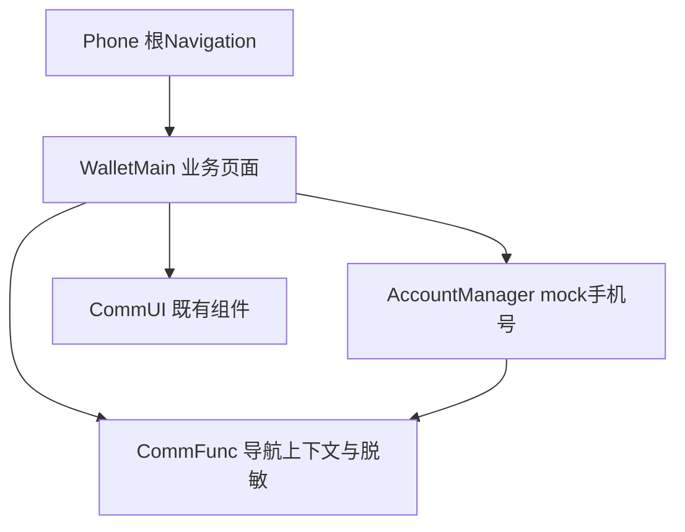
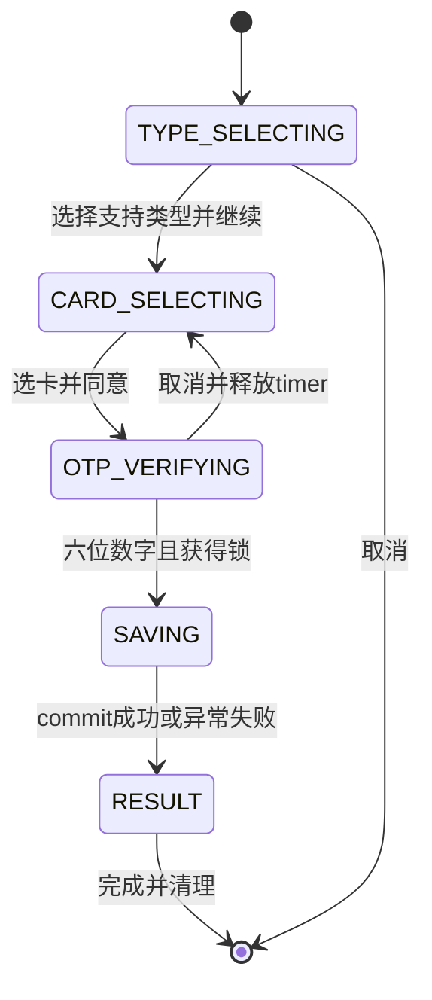

# 银行卡开卡流程 — 施工计划

> 模块标识：cu-YmMtb3BlbkNhcmQtMgBiYW5rLWNhcmQtb3BlbmluZy1mbG93
> 对应 spec：../spec/spec.md；版本：1.0；日期：2026-10-16
> 状态：上游设计冲突待修复；plan 尚未闭环，不作为编码依据。
> 真源：../contracts.yaml、../use-cases.yaml；上游：bc-openCard-2 蓝图 revision 1 / canonical CU revision 4。

## Scope 声明与继承

```yaml
inherited_from_prd: true
in_scope_modules: [WalletMain, AccountManager, Phone]
out_of_scope_modules: [CommUI, CommFunc]
expansions_with_user_approval: []
rationale: 来源=蓝图CU touches；钱包负责流程与RDB，账号负责mock手机号，Phone负责根导航装配和备份配置。
```

### 架构影响声明

```yaml
architecture_impact:
  impact: none
  affected_items: []
  architecture_md_updates: []
  catalog_updates: []
```

蓝图没有 architecture_impact 决策，不改 DSL、架构文档、模块画像。沿 spec 已裁决：成功暂回钱包首页，失败回最初添加银行卡实例；不做卡详情、NFC、真实短信、真实银行或支付开通、首页卡包读模型改造。参考背景搜索和100家银行不变成新功能。

## 1. 模块架构图



| 模块 | 所属层 | 物理路径 | 格式 | 变更类型 | 职责 |
|---|---|---|---|---|---|
| WalletMain | 02-Feature | 02-Feature/WalletMain | HAR | 修改 | 银行数据、领域会话、四屏、写库、流程导航 |
| AccountManager | 04-BusinessBase | 04-BusinessBase/AccountManager | HAR | 修改 | 给现有UserProfile增加mock手机号 |
| Phone | 01-Product | 01-Product/Phone | HAP | 修改 | 新builder注册、首页完成参数消费、关闭备份 |

模块内仍是 presentation → domain → data → shared。协调器不直接 import BankOpeningNavigator：页面提供 configure 的 onResult 回调，领域取得保存结果后调用回调，回调关闭半模态并调用导航。这样保留蓝图的调用先后，同时满足既有依赖方向；UI回调不是数据边界。

## 2. 目录/文件结构规划

精确写集以 contracts.files 的原蓝图26项为准，已有资源只读复用。下述 BankInfo 字段改动是U3所需的上游写集修订候选，当前未授权；其余新增业务文件已有上游声明。

```text
02-Feature/WalletMain/src/main/ets/
├── shared/constant/BankConstants.ets          扩充卡类型/路由常量
├── data/model/BankInfo.ets                   U3修订候选：支持类型，当前未授权
├── data/model/BankCardRecord.ets             记录与保存结果
├── data/model/MockBankCard.ets               完整mock卡、掩码、toRecord
├── data/repository/BankRepository.ets        保留getBanks，新增getCards
├── data/repository/BankCardRepository.ets    加密RDB及唯一写入点
├── domain/model/BankOpeningSession.ets       单一前台会话
├── domain/service/BankOpeningCoordinator.ets 开始、OTP、保存协调
├── domain/service/OtpCountdown.ets           绝对deadline与timer释放
├── presentation/components/CardTypeSheet.ets
├── presentation/components/OtpVerificationSheet.ets
├── presentation/pages/AddBankCardPage.ets    原handleBankTap接线
├── presentation/pages/AllBanksPage.ets       同一流程接线
├── presentation/pages/BankCardSelectionPage.ets
├── presentation/pages/BankCardResultPage.ets
├── presentation/navigation/BankOpeningNavigator.ets
└── index.ets                                导出新builder及宿主消费符号
02-Feature/WalletMain/src/main/resources/base/
├── element/string.json                      ui-spec文字、动态格式、失败/重发文案
├── element/color.json                       已有颜色复用
├── element/float.json                       几何/字号资源
└── profile/route_map.json                   保留旧项并追加两个新路由
02-Feature/WalletMain/src/ohosTest/ets/test/
└── bank_open_card_2_ut.test.ets               本轮业务UT
04-BusinessBase/AccountManager/src/main/ets/
├── data/model/UserProfile.ets
├── domain/service/AccountService.ets
└── index.ets
01-Product/Phone/src/main/
├── ets/pages/index.ets                       根宿主装配
└── resources/base/profile/backup_config.json 关闭系统备份
```

上游以 `Index.ets` 指代 git 中的 `index.ets`，本机是同一个文件；机器契约保留上游引用拼写，不新建大小写副本。无需新增模块、依赖包、权限或另一套路由。WalletMain 的 module.json5 未启用 routerMap，运行分发须修改 Phone.navDestinationMap，不能只改镜像 JSON。

## 3. 数据模型定义

```typescript
enum BankCardType { DEBIT = 'DEBIT', CREDIT = 'CREDIT' }
enum WalletCardCategory { BANK_CARD = 'BANK_CARD' }
interface BankCardRecord {
  id?: number;
  accountScope: string;
  fullCardNumber: string;
  walletCardCategory: WalletCardCategory;
  bankName: string;
  bankCardType: BankCardType;
  addedAt: number;
  huaweiPayEnabled: boolean;
  unionPayQuickPassEnabled: boolean;
  transactionsJson: string;
}
interface BankCardSaveOutcome {
  success: boolean;
  fullCardNumber: string;
}
```

枚举位于 shared/constant，数据记录与 outcome 位于 data/model，避免 data 反向依赖 domain。BankInfo 增加可选 supportedCardTypes，生产 mock 全部显式填 DEBIT+CREDIT；旧fixture省略时沿mock默认双类型。显式单类型数组必须原样生效。具体卡数据完整卡号稳定且按银行/类型区分，每组1–2张；界面只取 maskedNumber，禁止把参考图掩码当完整卡号。

MockBankCard.toRecord() 填 local_mock_wallet、BANK_CARD、Unix毫秒添加时间、两个支付标记false、交易JSON `[]`。协议授权不等于已经开通支付。UserProfile 增加 phoneNumber 默认空串、可选构造参数；AccountService 在登录和未登录档案中给同一mock号码，不从脱敏账号串反解。

存储逐项实施蓝图 `contract:bank-card-persistence.table_schema`：wallet_cards.db / version 1 / S4 / encrypt=true；bank_cards 的联合唯一键为 account_scope+full_card_number。首次开库创建表并设置版本；save在事务内查询后update或insert，commit后才success；已开启事务遇异常rollback，查询ResultSet在finally释放。重复添加更新原记录，不增加第二行；不删除表或静默重建旧库。初始化失败也返回false及原完整卡号。App清数据/卸载清除数据库；logout不删除本地钱包。

## 4. 页面组件树

```text
原AddBankCardPage / AllBanksPage（既有Navigation背景）
└── CardTypeSheet（同一session，Column）
    ├── Row：标题ct_title / 关闭ct_close
    ├── 银行卡片：Image(ct_logo) / 银行名(ct_bank)
    ├── 支持类型Radio：ct_debit / ct_credit（显式单选）
    ├── Text：ct_explanation / ct_agreement
    └── Button：ct_continue（选择后启用）
BankCardSelectionPage（NavDestination）
├── Row：cs_back / cs_title
├── Text：cs_hint
├── List：1–2个卡片行（logo、cs_card_1_number、cs_card_1_radio）
├── Checkbox(cs_agree) + Text(cs_agreement)
├── Button(cs_next)
└── OtpVerificationSheet（Column）
    ├── Row：otp_title / otp_close
    ├── Text：otp_hint / otp_phone（账号脱敏）
    ├── Row：TextInput(otp_input) / Button(otp_resend)
    └── Button(otp_next)
BankCardResultPage（NavDestination，无title/返回按钮）
└── Column：result_icon / result_title / result_message
    ├── 成功时result_guide引导图形
    └── Button(result_finish，唯一退出动作)
```

完整文本、顺序、bbox、资源与节点绑定消费 spec/ui-spec.yaml，不重写视觉规格。使用真实Radio/Checkbox/TextInput及可见按钮，所有必需测试锚点绑定到真实节点。OTP数字键盘由系统IME提供；otp_keyboard为系统验证目标，不绘制假键盘。背景搜索节点仅记录参考上下文，不实施不存在的搜索功能。

plan/visual-parity.yaml 映射四图全部节点、assets、tokens。保留 `fidelity_target: pixel_1to1`、`asset_acquisition_mode: approximate` 和 `verified: unverified`。logo沿BankRepository资源引用；结果引导以可见的手机轮廓代码图形占位，状态用平台可用成功/失败符号。两者仍是placeholder，不冒充已验真资源。V-01至V-05沿用，major视觉债务在best_effort不硬阻断阶段，但修复重验前不得发布；本阶段不看图、不采色、不联网获取图形。

## 5. 状态管理方案

| 数据 | 作用域 | 装饰器/机制 | 持有者 | 生命周期 |
|---|---|---|---|---|
| 银行/类型/卡片/协议/OTP/保存结果/起始索引 | 单次开卡 | @Observed，同引用@ObjectLink | BankOpeningSession | start创建，取消/完成释放，不持久化 |
| 根导航栈 | 应用根 | 既有@State、首页@Link、NavPathContext | Phone.Index | 根attach；不通过@Prop复制 |
| otpDeadlineMs | 当前session | Date.now墙钟；剩余秒派生 | session，由OtpCountdown更新 | 首次发送/允许重发更新；detach清timer |
| 页面显示状态 | 当前页面 | @State与具名事件方法 | presentation | 页面/弹层attach-detach |
| 银行卡记录 | 本地钱包 | RDB transaction | BankCardRepository | commit后跨进程保留 |

tryBeginSaving(code) 同步检查精确六位ASCII数字、已选卡及协议、当前OTP_VERIFYING后进入SAVING；同一事件循环锁生效，再await保存。SAVING禁重发/关闭/提交，不提前退出后留下后台结果回调。结果回调只触发一次。OTP关闭释放timer，清OTP与未提交选择/协议，回CARD_SELECTING；重新操作仍须选择并同意。类型关闭清会话并回承载页。前台恢复按deadline重算，不累积后台tick。

### 业务流程 UseCase 清单



| 用户动作 | 具名入口 | 验证职责 |
|---|---|---|
| 两入口点击银行 | BankOpeningCoordinator.start | 设备验证原入口及同一栈 |
| 选类型/选卡/同意 | session.selectType/selectCard/setAgreementAccepted | UT验证支持集合、单选和协议门槛 |
| 打开/输入/重发/提交OTP | openOtp/setOtp/OtpCountdown.restart/submitOtp | UT验证六位、防重入、墙钟；设备验证输入法/可达性 |
| 完成结果 | BankOpeningNavigator.finish | 设备验证拦截返回、真实清栈和目标页 |

成功、持久化失败、OTP取消分支沿蓝图；补保存防重入、60秒重发、手机号/隐私、commit后重启、类型取消分支，分别关联AC-9、AC-4/NFR-1、AC-3/8/NFR-2、AC-5/BD-3、BD-2。领域状态和repository结果由UT证明；真实系统路由、弹层、返回手势、键盘、截图由device_focus证明，不让UT重建ArkUI。

**上游施工缺口 U1（设计owner）**：蓝图runtime flow的use_cases.data_boundaries把NavPathStack声明为system数据边界，并把wallet_cards.db类型写成relationalStore.RdbStore、方法却写BankCardRepository.save/findByCardNumber。它们不能与contracts.interfaces的真实数据边界逐项匹配；profile明确禁止UI运行时能力进入data_boundaries。use-cases.yaml保留上游字段以保证可定位和不擅改权威，不能被当作已消除此缺口。所需最小修订是原蓝图将存储边界指向BankCardRepository，移出导航边界并同步调用断言到真实业务边界；导航义务仍由已有device_focus保留。本轮不改蓝图或验收、不造假的RdbStore/NavPathStack业务接口。

**上游施工缺口 U2（设计owner）**：wallet-opening-ui.contracts.components中四个UI组件的asset_selection.rationale各有具体描述，与decision:wallet-ui-custom的统一rationale不同。机器门禁同时要求保留typed字段和精确投影decision，当前源内矛盾导致component_asset_projection失败。应在原蓝图将组件字段与已裁决的选型理由统一，不改变custom选择；plan不能自行覆盖任一权威字段。

**上游施工缺口 U3（设计owner）**：原蓝图contracts.files未列BankInfo.ets，但计划要求为银行补支持卡类型字段。该文件仍需由原设计明确纳入合法写集。20个bank_logo是BankRepository已存在的只读资源，本轮不修改其字节，也不把它们登记为resource_keys交付项；页面继续通过现有BankInfo.logo引用复用。U1/U2/U3均只登记，不在本阶段修改蓝图/CU/spec。

## 6. 服务层接口定义

完整强契约及补充签名在contracts.interfaces；关键调用如下。

```typescript
start(bank: BankInfo, stack: NavPathStack): BankOpeningSession;
openOtp(session: BankOpeningSession): void;
submitOtp(code: string): Promise<BankCardSaveOutcome>;
configure(repository: BankCardRepository,
  onResult: (outcome: BankCardSaveOutcome, originAddBankCardIndex: number) => void): void;
getCards(bankCode: string, type: BankCardType): Promise<MockBankCard[]>;
save(record: BankCardRecord): Promise<BankCardSaveOutcome>;
findByCardNumber(fullCardNumber: string): Promise<BankCardRecord | null>;
openCardSelection(session: BankOpeningSession): void;
openResult(outcome: BankCardSaveOutcome, originAddBankCardIndex: number): void;
finish(outcome: BankCardSaveOutcome, originAddBankCardIndex: number): void;
```

repository从页面提供的合法应用context打开真实RDB，复用打开Promise避免重复初始化。仅UT通过现有repository类的方法替身制造失败，不添加默认启用的快通道。卡号/手机号/OTP不进入日志、AppStorage、preferences或序列化路由快照；结果路由传内存typed对象。root成功回调使用完整卡号完成交接后释放参数，不增加首页列表读模型。

## 7. 路由/导航设计

| 页面/浮层 | 所属模块与容器 | 参数/进入动作 | 返回/完成 |
|---|---|---|---|
| AddBankCardPage / AllBanksPage | WalletMain，既有NavDestination | 既有builder和handleBankTap | 旧返回行为保留；点击银行记录原AddBankCard最后索引 |
| CardTypeSheet | WalletMain，入口内半模态 | 同一BankOpeningSession | 取消回原入口；继续关闭sheet并push选卡 |
| BankCardSelectionPage | WalletMain，NavDestination | session内存引用 | 普通返回回原银行页，清未完成会话 |
| OtpVerificationSheet | WalletMain，选卡页半模态 | 同一session | 取消回选卡；保存后关闭，再push结果 |
| BankCardResultPage | WalletMain，NavDestination | outcome + originAddBankCardIndex | hideTitleBar；系统返回消费、禁侧滑；仅finish退出 |
| 根首页 | Phone既有Navigation宿主 | 成功完成handler收到完整卡号，currentTabIndex=0 | stack.clear(false)，之后无过程页 |

失败finish重新取当前names，移除origin+1至last，保留原始AddBankCardPage实例；不能重新push同名页代替保留。AllBanks入口失败同样回原AddBankCard。成功clear包含旧CardPack/AddCardEntry与全部过程页，按需求回根首页。前提为现有两入口都经AddBankCard进入；若参数失效，不显示含敏感字段的错误或伪造成功。结果页显示前保存outcome即使失败也含原完整卡号。

新旧路由回归矩阵：根首页→添卡→添加银行卡→全部银行→返回；根首页→卡包→添卡；两种银行入口→类型关闭/继续；选卡返回；OTP取消/重发；两入口成功完成→根首页且返回不能重入；两入口保存失败完成→原AddBankCard且旧返回仍正常。继续使用同一NavPathContext，不建立第二栈。

## 8. spec 功能映射表

| spec编号 | 功能名称 | 优先级 | 实现模块 | 实现层级 | 关键文件 |
|---|---|---|---|---|---|
| F1 | 双入口开卡 | P0 | WalletMain | presentation/domain | AddBankCardPage.ets、AllBanksPage.ets、BankOpeningCoordinator.ets |
| F2 | 类型及卡片选择 | P0 | WalletMain | data/presentation | BankInfo.ets、BankRepository.ets、MockBankCard.ets、CardTypeSheet.ets、BankCardSelectionPage.ets |
| F3 | 卡号完整性与脱敏 | P0 | WalletMain | data/presentation | BankCardRecord.ets、MockBankCard.ets、BankCardResultPage.ets |
| F4 | 模拟短信验证 | P0 | WalletMain | domain/presentation | OtpCountdown.ets、BankOpeningSession.ets、OtpVerificationSheet.ets |
| F5 | 银行卡持久化 | P0 | WalletMain | data | BankCardRepository.ets、BankCardRecord.ets |
| F6 | 结果及清栈 | P0 | WalletMain、Phone | presentation | BankOpeningNavigator.ets、BankCardResultPage.ets、index.ets |
| F7 | 既有路由兼容 | P1 | WalletMain、Phone | presentation | AddBankCardPage.ets、AllBanksPage.ets、index.ets、route_map.json |
| F8 | 账号手机号 | P1 | AccountManager、WalletMain | data/domain/presentation | UserProfile.ets、AccountService.ets、OtpVerificationSheet.ets |
| F9 | 保存防重入 | P0 | WalletMain | domain/presentation | BankOpeningSession.ets、BankOpeningCoordinator.ets、OtpVerificationSheet.ets |
| F10 | 四图视觉验收 | P0 | WalletMain | presentation/resources | CardTypeSheet.ets、BankCardSelectionPage.ets、OtpVerificationSheet.ets、BankCardResultPage.ets |

NFR-1对应OtpCountdown的60秒deadline；NFR-2对应掩码输出、日志零敏感字段、RDB encrypt=true/S4、Phone backup_config=false。六个CU predicates、provide及25个design_refs均通过contracts.change_unit映射真实计划文件与本轮UT文件。引用为planned表示尚未施工，不是当前已有证据。

验证范围：本阶段只跑plan harness及其真实request签发的独立verifier，再查receipt。后续编码须走逐文件lint和框架compile；UT与设备义务由冻结链执行。本轮不运行产品编译/测试，不把视觉映射完整等同于视觉验收通过。

## 重试修正记录（2026-10-16）

本轮核实：Git相对trace.start_commit无跟踪文件差异，Feature文档被忽略，不能从空diff判断阶段文档历史。当前contracts.change_unit已完整存在，不再按入口的过期missing提示重建。

本次按门禁建议仅尝试补齐20个真实bank_logo路径的文件闭包，并让四组件的选型理由采用既有wallet-ui-custom决策原文；custom方案、三模块Scope和产品行为不变。该尝试需由authoritative_content_aligned与component_asset_projection共同验证，不将本记录视为扩大写集的授权。上文U2/U3为前次结果；若上游不接受此投影，本次修正撤回，原缺口继续由设计owner处理。

本轮实测结论：2026-10-16T07:45:24Z 的 plan harness 返回 FAIL，authoritative_content_aligned 同时拒绝新增20项媒体文件和四组件rationale修改。四条具体差异分别为 CardTypeSheet.asset_selection.rationale、OtpVerificationSheet.asset_selection.rationale、BankCardSelectionPage.asset_selection.rationale、BankCardResultPage.asset_selection.rationale。由此确认原诊断U2/U3是当前源内矛盾，不是缺少change_unit sidecar，也不是源文件缺失。已逐字节恢复本次修改前的contracts，避免把未获上游支持的尝试传给coding。

最小责任修复：由蓝图owner统一 wallet-opening-ui.contracts.components 的四个rationale与 decision:wallet-ui-custom；在原蓝图精确files中收编既有20个bank_logo媒体路径（来自本Feature resource_keys.WalletMain.media），并沿原设计流程处理已登记的BankInfo支持类型落点和U1用例边界。仍保持三模块Scope、custom方案、原验收与路由语义。随后由框架更新canonical引用，plan重新消费，原地修正不能替代此权威链。

边界依据：framework/skills/reference/plan-workflow-detail.md:75 的“不复制定义、不改写设计、不扩大授权”；framework/skills/feature/plan/SKILL.md:24 的“发现上游缺口只记录事实”。本轮不修改蓝图/CU/spec、产品源码、框架或goal-runs证据；不签写质量结论。最终结论以恢复后再跑的plan/reports/summary.json为准，FAIL不声称阶段完成，也不进入coding。

### 重试核实与责任交接（2026-10-16T08:03:22Z）

当前蓝图仍为 revision 1，canonical CU 为 revision 4。只读核对确认：Feature files 与蓝图投影26项集合相同，20个真实logo路径仍未包含；四组件 rationale 保留了蓝图原文，却仍与该蓝图 wallet-ui-custom 决策不一致。现有 change_unit sidecar 完整，不能把缺少sidecar的早期提示当成本轮根因。前一轮已撤回的补文件/改理由尝试不重复执行。

本轮沿用上文U1/U2/U3，未新增问题或扩展修复范围。修复入口仍是原蓝图owner：统一四组件与选型决策、收编需要引用的媒体路径，并处理已登记的BankInfo落点及用例数据边界；随后沿原流程更新canonical引用，plan再消费。当前调用只执行plan，不修改上游、产品源码或框架控制面。

约束原文：`framework/skills/reference/plan-workflow-detail.md:75`：“不复制定义、不改写设计、不扩大授权”；`framework/docs/concepts/component-assets.md:37`：“前三项与 decision 严格相等”。两项要求共同作用于当前有矛盾的上游字段，单独改Feature契约无法形成有效交接。只运行本阶段harness刷新真实summary；最终verdict及next_action由其输出裁决，记录本身不授权放行。

### 本次 plan 侧闭包修正（2026-10-16）

20个bank_logo属于既有BankRepository的只读输入，不是本轮要新建或修改的资源。已从`contracts.resource_keys`移除这组非交付声明，保留原蓝图26项精确写集；实现仍沿现有`BankInfo.logo`使用这些资源，不改变资源字节或银行列表行为。此修正只消除错误的文件引用授权，不掩盖实际交付文件。

四个UI组件的选型冲突不做同类降级：它们确实由`decision:wallet-ui-custom`映射到具体组件，而Feature逐组件字段又必须与蓝图development节点对齐，当前两份蓝图权威rationale不同。保持原映射与原typed字段，交由harness刷新剩余裁定。
