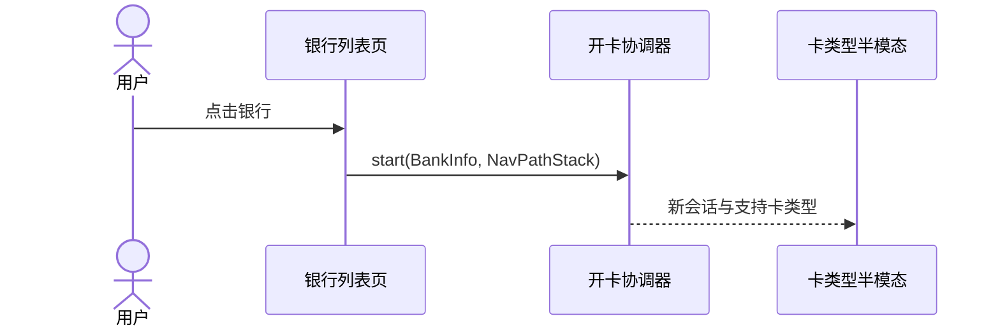
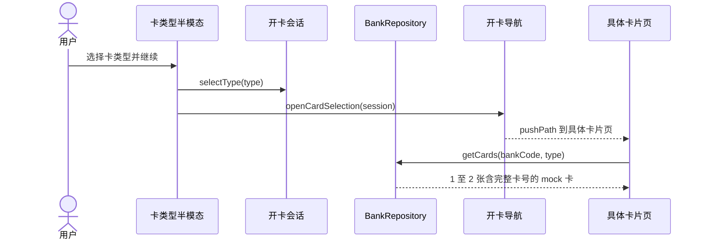
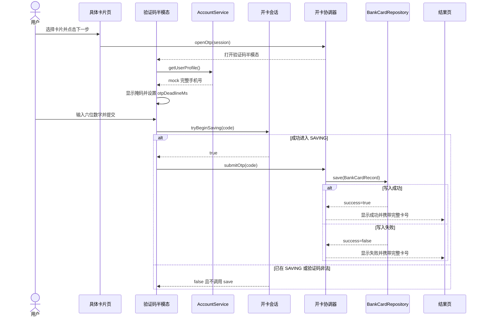
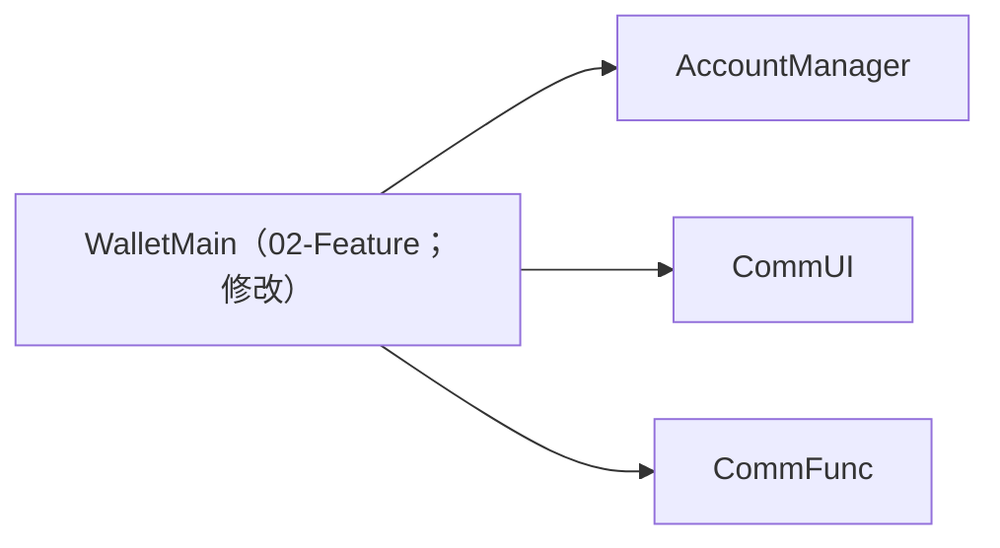
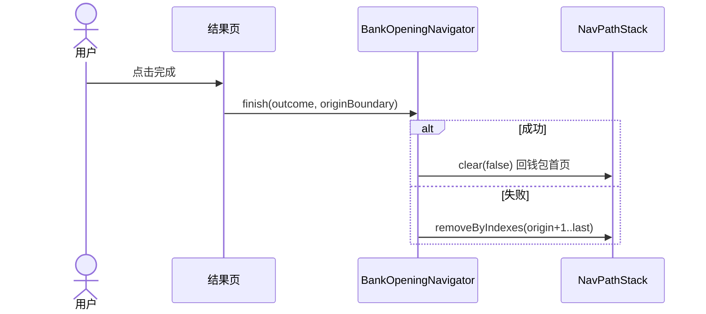
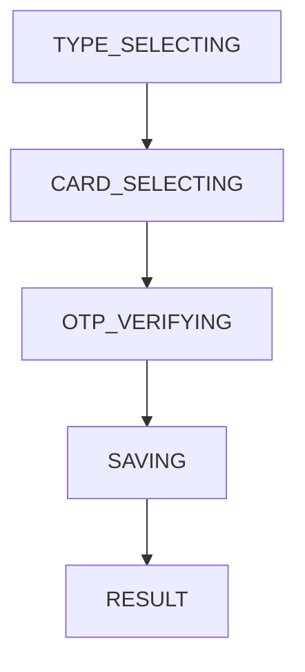
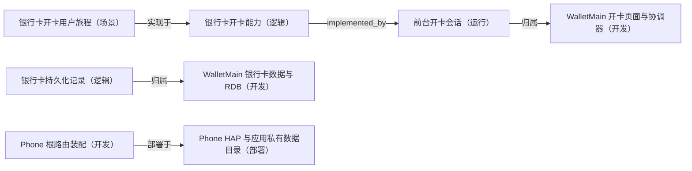

---
derived_from:
  artifact: component-blueprint@1
  component_id: wallet-bank-card-opening
  blueprint_id: bc-openCard-2
  revision: 1
  source_fingerprint: sha256:de3708c28bdc3fde2cfd27fa7109b58eac488c8acd638a0a9df8e73eeb0d0693
  artifact_sha256: sha256:c1a68d6dc8e37a7608b0d402da9ec7c50359de74a3e7403786986dc1f0a90808
  change_units:
    - change_unit_id: bank-card-opening-flow
      binding: bound
      identity_neutral_digest: 90b42d220a0172b868d51425abdec847e901b548c432ff6bf4873b67f51bc3f3
projection: component-blueprint-review@10
---

# 银行卡模拟开卡完整流程

<a id="design-626c75657072696e743a62632d6f70656e436172642d32"></a>
阅读入口：先阅读方案、旅程、关键流程和交付安排；类型、方法、完整分支与验收全文见同文档的[技术与追溯参考](#reference)。

<a id="summary"></a>
## 1 方案摘要

### 这次用户会得到什么

现有两个银行列表不再停在“暂不支持”。用户从任一入口点击银行后，可以依次选择卡类型和具体卡片、输入六位验证码、看到保存结果，并用唯一的“完成”按钮退出。成功记录会进入应用私有银行卡数据库；失败不会留下脏记录。


[设计依据](#reader-guide-source-1)

施工安排见[施工与上线](#delivery)。

<a id="background"></a>
## 2 背景、目标与边界

bc-openCard-1 已完成银行列表、全部银行页面与既有导航，但点击银行仍只提示暂不支持，尚无开卡流程和银行卡持久化。

**当前问题**：用户无法从任一银行继续选择银行卡，钱包也没有本地银行卡数据库、验证码交互或清栈完成语义。

**方案定位**：本轮是 WalletMain 的 feature 内演进；Phone 只扩展路由装配，AccountManager 只补齐账号 mock 的可读手机号，不改变外层架构。

**目标**：从两个既有银行列表入口完成同一条模拟开卡旅程。

**成功衡量**：

- 四个目标界面与参考图语义一致
- 任意六位验证码可继续
- 成功写入后可按完整卡号从 RDB 重新查询

**目标**：完整卡号仅用于领域处理和应用私有数据库，所有用户可见位置只展示前四后四。

**成功衡量**：

- UI 与日志无完整卡号
- RDB 保存完整卡号
- 失败结果仍保持正确交接

**本次范围**

- 银行卡类型半模态、具体卡片页、验证码半模态、结果页
- 银行卡 mock 数据、完整卡号脱敏显示与 RDB 持久化
- 添加银行卡页和全部银行页到新流程的路由接线
- 成功与失败结果、禁止结果页返回、完成后清理整段开卡栈
- 相关业务 UT、路由回归与真机视觉/交互验收

**不做什么**

- 不接真实银行、短信网关、支付清算或 NFC 激活
- 不实现银行卡详情页；成功完成暂回钱包首页
- 协议文本不做富文本点击
- 不设计独立密钥管理或字段级加密；仅使用 relationalStore 的加密 store，并关闭 Phone 应用备份恢复
- 首页与卡包的现有 mock 读模型不在本轮改造；成功完成仅回到首页，不承诺首页立即展示新增银行卡

<a id="terms"></a>
## 3 术语

### 关键业务词

“添卡”是 WalletMain 内的完整业务旅程；“卡包”是保存后银行卡的业务列表与读模型。完整卡号属于领域与存储数据，不属于界面展示数据。


[设计依据](#reader-guide-source-2)

<a id="journey"></a>
## 4 用户旅程与界面

### 选择银行与卡片

用户从添加银行卡页或全部银行页点击银行，系统建立一次新的开卡会话并展示卡类型半模态。继续后进入具体卡片页，页面只展示前四后四，完整卡号继续留在会话中供保存使用。


<a id="design-696d6167653a646f632f66656174757265732fe58e9fe5a78be99c80e6b1822f312d322de993b6e8a18ce58da12f332de782b9e587bbe4bbbbe6848fe993b6e8a18ce68b89e8b5b7e6b7bbe58da1e98089e58da1e58d8ae6a8a1e680812e6a7067"></a>


<a id="design-696d6167653a646f632f66656174757265732fe58e9fe5a78be99c80e6b1822f312d322de993b6e8a18ce58da12f342de782b9e587bbe4bfa1e794a8e58da1e68896e582a8e89384e58da1e5908ee68b89e8b5b7e98089e58da1e9a1b5e99da22e6a7067"></a>


[设计依据](#reader-guide-source-3)

<a id="design-67726170683a73657175656e63653a73746172742d616e642d73656c6563742d74797065"></a>
完整调用时序：sequence:start-and-select-type



<a id="design-67726170683a73657175656e63653a73656c6563742d747970652d616e642d63617264"></a>
完整调用时序：sequence:select-type-and-card



<a id="design-696d6167653a646f632f66656174757265732fe58e9fe5a78be99c80e6b1822f312d322de993b6e8a18ce58da12f352de98089e4b8ade69f90e5bca0e58da1e78987e5908ee68b89e8b5b7e79fade4bfa1e9aa8ce8af812e6a7067"></a>


<a id="design-696d6167653a646f632f66656174757265732fe58e9fe5a78be99c80e6b1822f312d322de993b6e8a18ce58da12f362de79fade4bfa1e9aa8ce8af81e5ae8ce68890e5908ee7bb93e69e9ce9a1b52e6a7067"></a>


<a id="solution"></a>
## 5 整体方案

定义开卡能力边界、领域对象、数据隐私和持久化契约。

建立 OpeningSession、BankCardRecord、BankCardRepository 与 mock 银行卡数据边界。

WalletMain 内完成绝大部分开卡能力；AccountManager 提供 mock 完整手机号；Phone 注册新 builder。

<a id="flows"></a>
## 6 关键流程

### 验证码、保存与结果

具体卡片页打开验证码半模态后，从 AccountService 取得 mock 手机号并开始 60 秒倒计时。六位数字提交后，协调器等待 BankCardRepository 的 RDB 事务结果；无论成功还是失败，都携带保存结果和完整卡号进入不可返回的结果页。


[设计依据](#reader-guide-source-4)

<a id="design-67726170683a73657175656e63653a6f74702d616e642d73617665"></a>
完整调用时序：sequence:otp-and-save



<a id="data"></a>
## 7 数据与存储

### 数据与隐私边界

`wallet_cards.db` 以 `StoreConfig.encrypt=true`、S4、版本 1 打开。`bank_cards.id` 是自增整数主键，`account_scope + full_card_number` 是联合唯一约束；其余列均声明了 SQL 类型、nullable 与默认值。`save()` 在事务内查询后 update 或 insert，成功 commit，异常 rollback；未来升级在同一事务内增量迁移后才提升 `user_version`。UI 和日志只使用掩码，Phone 将 `allowToBackupRestore` 设为 false；已提交记录可跨进程恢复，未完成会话不恢复。


[设计依据](#reader-guide-source-5)

<a id="decisions"></a>
## 8 关键取舍

### 关键设计取舍

方案以单一 BankOpeningSession 避免页面间复制状态；以 relationalStore 而不是 AppStorage 承载结构化卡片；OTP 用绝对 deadline 且 SAVING 防重入；导航仍复用 Phone 的根 NavPathStack，成功 clear 回首页，失败只移除起点之后的页面。


[设计依据](#reader-guide-source-6)

<a id="design-6465636973696f6e3a73696e676c652d6f70656e696e672d73657373696f6e"></a>
### single-opening-session

| 关切 | 结论 |
| --- | --- |
| 选了什么 | 使用单个 BankOpeningSession 贯穿四个 UI 节点，页面不复制完整卡对象。|
| 理由 | 统一状态所有权可以避免半模态关闭、页面跳转和保存结果之间产生平行真源。|

被否方案：

| 方案 | 被否理由/缺陷 |
| --- | --- |
| 每页独立传散字段 | 完整卡号、协议态和保存结果会在多个页面重复维护。<br>容易出现清栈或失败分支丢字段。|

<a id="design-6465636973696f6e3a6d61736b65642d646973706c61792d66756c6c2d73746f72616765"></a>
### masked-display-full-storage

| 关切 | 结论 |
| --- | --- |
| 选了什么 | 完整卡号仅保存在领域记录、结果交接对象和应用私有 RDB；UI 与日志统一使用前四后四掩码。|
| 理由 | 同时满足显示脱敏与后台按完整卡号处理的明确要求。|

被否方案：

未记录；不推测被否选择。

<a id="design-6465636973696f6e3a7264622d707269766174652d73746f72616765"></a>
### rdb-private-storage

| 关切 | 结论 |
| --- | --- |
| 选了什么 | 在 WalletMain 内用 HarmonyOS relationalStore 建立 encrypt=true 的 wallet\_cards.db，以 account\_scope+full\_card\_number 唯一，版本 1 首次建表；事务内查询后 update 或 insert，异常 rollback。|
| 理由 | 数据归银行卡 feature 所有，避免把卡片域扩散到账号或宿主壳；加密 store 与关闭备份降低完整卡号泄露面。|

被否方案：

| 方案 | 被否理由/缺陷 |
| --- | --- |
| AppStorage 保存卡片 | 不适合结构化记录、唯一约束与后续详情查询。<br>进程恢复和数据演进缺少可靠 schema。|

<a id="design-6465636973696f6e3a6465766963652d6c6f63616c2d6163636f756e742d73636f7065"></a>
### device-local-account-scope

| 关切 | 结论 |
| --- | --- |
| 选了什么 | 银行卡属于设备本地钱包作用域 local\_mock\_wallet，与 AccountManager 的登录展示态解耦；logout 不删除卡片，当前无账号切换入口。|
| 理由 | 当前工程只有模拟登录且需求未定义多账号钱包。显式固定作用域避免错误地用脱敏手机号作数据库账号键，并为未来真实账号迁移保留字段。|

被否方案：

| 方案 | 被否理由/缺陷 |
| --- | --- |
| 以手机号作为 account\_scope | 当前手机号是 mock，且登录/未登录都需要完成本地演示。<br>logout 或 mock 值变化会制造孤儿记录。|

<a id="design-6465636973696f6e3a6f74702d77616c6c2d636c6f636b2d616e642d736176696e672d6c6f636b"></a>
### otp-wall-clock-and-saving-lock

| 关切 | 结论 |
| --- | --- |
| 选了什么 | OtpCountdown 保存绝对 otpDeadlineMs；前后台切换后按墙钟重算。提交成功进入 SAVING 后一次性锁住关闭、重发和再次提交，直到 repository 返回。|
| 理由 | setInterval tick 不是时间真源，绝对 deadline 可避免后台暂停造成倒计时延长；SAVING 锁防止重复卡写入和重复结果页。|

被否方案：

未记录；不推测被否选择。

<a id="design-6465636973696f6e3a726573756c742d706167652d737461636b2d6f776e657273686970"></a>
### result-page-stack-ownership

| 关切 | 结论 |
| --- | --- |
| 选了什么 | WalletMain 的 BankOpeningNavigator 记录流程出生时的栈边界，结果页完成按钮按结果清理；结果页拦截系统返回。|
| 理由 | 根 Navigation 仍由 Phone 所有，但流程内页面集合和退出语义由 WalletMain 最清楚。|

被否方案：

未记录；不推测被否选择。

<a id="design-6465636973696f6e3a77616c6c65742d75692d637573746f6d"></a>
### WalletMain 开卡页面与协调器

| 关切 | 结论 |
| --- | --- |
| 选了什么 | 选型结果：自定义实现；选型目标：[WalletMain 开卡页面与协调器](#design-766965773a646576656c6f706d656e742f6e6f64653a77616c6c65742d6f70656e696e672d7569) |
| 理由 | component-index 只有旧银行列表页面和通用 SectionCard/ActionListItem，不含开卡半模态、OTP 或结果清栈组件。|

被否方案：

未记录；不推测被否选择。

<a id="design-6465636973696f6e3a70686f6e652d726f7574652d637573746f6d"></a>
### Phone 根路由装配

| 关切 | 结论 |
| --- | --- |
| 选了什么 | 选型结果：兼容演进共享定义；选型目标：[Phone 根路由装配](#design-766965773a646576656c6f706d656e742f6e6f64653a70686f6e652d726f7574652d686f7374)；组件：WalletMain/src/main/ets/presentation/pages/AddBankCardPage.ets#buildAddBankCardPage |
| 理由 | 延续现有 Phone navDestinationMap 加 WalletMain builder 的模式，只扩展两个路由，不另造导航系统。|

被否方案：

未记录；不推测被否选择。

<a id="recovery"></a>
## 9 失败与恢复

### 失败与恢复速查

| 情况 | 用户看到什么 | 数据是否保存 | 如何继续 |
|---|---|---|---|
| [BD-1](#design-616363657074616e63653a766965773a7363656e6172696f732f6e6f64653a62616e6b2d6f70656e696e672d6a6f75726e65792f626f756e6461726965733a42442d31)：RDB 初始化或写入失败 | 失败结果页 | 否 | 点击完成回到最初添加银行卡页后重试 |
| [BD-2](#design-616363657074616e63653a766965773a7363656e6172696f732f6e6f64653a62616e6b2d6f70656e696e672d6a6f75726e65792f626f756e6461726965733a42442d32)：关闭卡类型或验证码半模态 | 回到承载页 | 否 | 重新点击银行或再次进入验证码步骤 |


[设计依据](#reader-guide-source-7)

边界验收：[BD-1](#design-616363657074616e63653a766965773a7363656e6172696f732f6e6f64653a62616e6b2d6f70656e696e672d6a6f75726e65792f626f756e6461726965733a42442d31)；[BD-2](#design-616363657074616e63653a766965773a7363656e6172696f732f6e6f64653a62616e6b2d6f70656e696e672d6a6f75726e65792f626f756e6461726965733a42442d32)；[BD-3](#design-616363657074616e63653a766965773a7363656e6172696f732f6e6f64653a62616e6b2d6f70656e696e672d6a6f75726e65792f626f756e6461726965733a42442d33)。

<a id="quality"></a>
## 10 质量与安全

**security_privacy**：完整卡号和手机号不得出现在界面、日志或系统备份；数据库使用加密 store。

**usability_accessibility**：按参考图保持大触控目标、明确选中态、禁用态和结果状态；系统字体缩放下文本可读。

**reliability**：保存中禁止重入，重复卡在同一设备本地钱包作用域内只保留一条记录。

**observability**：错误日志只记录阶段、银行 code 和错误类别，不记录完整卡号、OTP 或完整手机号。

<a id="delivery"></a>
## 11 施工与上线

### 施工边界

WalletMain 负责页面、状态机、mock 卡数据和加密 RDB；AccountManager 只补 mock 手机号字段；Phone 注册两个新页面 builder 并关闭备份恢复。施工不新增模块、不改变架构依赖方向，也不接真实银行或短信服务；首页现有 mock 读模型保持不变。

| 文件或文件组 | 用途 |
|---|---|
| `presentation/components/CardTypeSheet.ets` | 卡类型单选、银行信息、协议和继续按钮半模态 |
| `presentation/components/OtpVerificationSheet.ets` | 掩码手机号、六位输入、绝对 deadline、重发与 SAVING 禁用 |
| `presentation/pages/BankCardSelectionPage.ets` | 具体 mock 卡选择和协议确认 |
| `presentation/pages/BankCardResultPage.ets` | 成功/失败结果、返回拦截和唯一完成动作 |
| `domain/model/BankOpeningSession.ets` | 单一流程状态、起始栈边界与敏感数据清理 |
| `domain/service/BankOpeningCoordinator.ets` | 选卡、OTP 与 repository 保存编排 |
| `domain/service/OtpCountdown.ets` | 绝对截止时间和 timer 生命周期 |
| `presentation/navigation/BankOpeningNavigator.ets` | 新页面入栈、成功 `clear`、失败 `removeByIndexes` |
| `data/model/BankCardRecord.ets`、`MockBankCard.ets` | 持久化实体与完整 mock 卡/掩码派生 |
| `data/repository/BankCardRepository.ets`、`BankRepository.ets` | 加密 RDB 事务与银行支持卡数据 |
| `AddBankCardPage.ets`、`AllBanksPage.ets` | 两个既有入口改接同一 coordinator |
| `WalletMain/index.ets`、`route_map.json`、`Phone/pages/Index.ets` | 跨模块导出与两个 NavDestination 注册 |
| `string.json`、`color.json`、`float.json` | 新页面资源化文案、颜色和尺寸 |
| `UserProfile.ets`、`AccountService.ets`、`AccountManager/index.ets` | 完整 mock 手机号字段、服务赋值与既有导出 |
| `Phone/backup_config.json` | 关闭系统备份恢复，避免完整卡号数据库被导出 |
| `bank_open_card_2_ut.test.ets` | 状态机、OTP、RDB、清栈计划和旧路由回归 |


[设计依据](#reader-guide-source-8)

### bank-card-opening-flow

在一个可独立验收的垂直切片内完成双银行入口、卡类型与具体卡片选择、手机号与六位验证码、加密 RDB 保存、成功/失败结果和精确清栈，同时保持既有路由兼容。

- 两个银行入口可完成选择、OTP、保存和结果旅程，成功与失败目标正确。
- OpeningSession 单一拥有未完成流程，BankCardRepository 单一拥有加密 RDB 写入。
- 结果页消费唯一保存 outcome，完成按钮消费起始栈边界并清理流程。
- RDB schema、事务、幂等、加密与敏感字段映射按 bank-card-persistence 契约落地。
- BankRepository 提供按银行/类型的 mock 卡，AccountService 提供 mock 手机号。
- 保存失败 rollback 并进入失败结果；commit 后进程终止保留记录但不恢复 UI session。

模块分工：AccountManager；Phone；WalletMain。

- WalletMain 开卡页面与协调器（责任方：WalletMain）
- WalletMain 银行卡数据与 RDB（责任方：WalletMain）
- AccountManager mock 手机号来源（责任方：AccountManager）
- Phone 根路由装配（责任方：Phone）

未声明上游依赖。

安全中间态：单 CU 内按模型/RDB→session/coordinator→UI→Phone 路由顺序落地；每一步保持既有入口可编译，只有新 builder 全部导出后才注册 Phone 路由，完成时旧页面与新流程可共同运行。

精确映射见 [施工单元参考](#design-756e69743a62616e6b2d636172642d6f70656e696e672d666c6f77)。

### 文件与目录

```text
├── 01-Product/Phone/src/main/
│   ├── ets/pages/
│   │   └── Index.ets
│   └── resources/base/profile/
│       └── backup_config.json
├── 02-Feature/WalletMain/src/
│   ├── main/
│   │   ├── ets/
│   │   │   ├── data/
│   │   │   │   ├── model/
│   │   │   │   │   ├── BankCardRecord.ets
│   │   │   │   │   └── MockBankCard.ets
│   │   │   │   └── repository/
│   │   │   │       ├── BankCardRepository.ets
│   │   │   │       └── BankRepository.ets
│   │   │   ├── domain/
│   │   │   │   ├── model/
│   │   │   │   │   └── BankOpeningSession.ets
│   │   │   │   └── service/
│   │   │   │       ├── BankOpeningCoordinator.ets
│   │   │   │       └── OtpCountdown.ets
│   │   │   ├── index.ets
│   │   │   ├── presentation/
│   │   │   │   ├── components/
│   │   │   │   │   ├── CardTypeSheet.ets
│   │   │   │   │   └── OtpVerificationSheet.ets
│   │   │   │   ├── navigation/
│   │   │   │   │   └── BankOpeningNavigator.ets
│   │   │   │   └── pages/
│   │   │   │       ├── AddBankCardPage.ets
│   │   │   │       ├── AllBanksPage.ets
│   │   │   │       ├── BankCardResultPage.ets
│   │   │   │       └── BankCardSelectionPage.ets
│   │   │   └── shared/constant/
│   │   │       └── BankConstants.ets
│   │   └── resources/base/
│   │       ├── element/
│   │       │   ├── color.json
│   │       │   ├── float.json
│   │       │   └── string.json
│   │       └── profile/
│   │           └── route_map.json
│   └── ohosTest/ets/test/
│       └── bank_open_card_2_ut.test.ets
└── 04-BusinessBase/AccountManager/src/main/ets/
    ├── data/model/
    │   └── UserProfile.ets
    ├── domain/service/
    │   └── AccountService.ets
    └── index.ets
```

| 上线顺序 | 交付单元 | 配套前提 | 说明 |
| --- | --- | --- | --- |
| 1 | AccountManager HAR | 无 | 先提供 UserProfile.phoneNumber 契约。|
| 2 | WalletMain HAR | AccountManager HAR | 页面、领域与 RDB 一次交付，旧银行页面继续兼容。|
| 3 | Phone HAP | WalletMain HAR | 注册新页面 builder 后整包安装验收。|

| 配套方 | 协同关系 |
| --- | --- |
| HarmonyOS relationalStore | 应用私有本地数据库 API；无服务端依赖。|

<a id="acceptance"></a>
## 12 验收

### 验收重点

P0 重点是双入口一致、卡号脱敏但完整保存、60 秒验证码状态机、RDB 字段完整、成功/失败结果与不可返回清栈；原有页面路由矩阵作为回归验证。


[设计依据](#reader-guide-source-9)

<a id="questions"></a>
## 13 待补问题

### 当前待补问题

当前需求、参考图和代码事实足以施工，没有阻断性产品待决项。银行卡详情页、真实短信、真实银行协议和 NFC 激活均明确不在本轮范围。


[设计依据](#reader-guide-source-10)

### 必须关注的评审问题


<a id="reference"></a>
## 技术与追溯参考

部件 wallet-bank-card-opening · 蓝图 bc-openCard-2 · revision 1 · 准入 通过

本文根据 canonical 蓝图与当前施工单元确定性生成，文首保留精确来源身份。是否通过设计交接见 readiness；施工授权、映射与完成结论由原责任阶段确认。可选说明缺失或过期不改变这些结论。

参考保留全部声明；不从名称、目录或数组顺序推断调用、依赖与未声明存储设计。正文的验收链接按来源目标与条目编号定位。

### A 字段与类型

<a id="review-summary-details"></a>
#### 原概述与目标

| 关切 | 设计说明 |
| --- | --- |
| 背景 | bc-openCard-1 已完成银行列表、全部银行页面与既有导航，但点击银行仍只提示暂不支持，尚无开卡流程和银行卡持久化。 |
| 问题 | 用户无法从任一银行继续选择银行卡，钱包也没有本地银行卡数据库、验证码交互或清栈完成语义。 |
| 本次改变 | 在既有添加银行卡与全部银行入口上接通选卡类型、具体卡片、短信验证、RDB 持久化和不可返回的结果页，形成可完整演示和验证的模拟开卡闭环。 |
| 整体定位 | 本轮是 WalletMain 的 feature 内演进；Phone 只扩展路由装配，AccountManager 只补齐账号 mock 的可读手机号，不改变外层架构。 |
| 范围 | 银行卡类型半模态、具体卡片页、验证码半模态、结果页；银行卡 mock 数据、完整卡号脱敏显示与 RDB 持久化；添加银行卡页和全部银行页到新流程的路由接线；成功与失败结果、禁止结果页返回、完成后清理整段开卡栈；相关业务 UT、路由回归与真机视觉/交互验收 |
| 不做什么 | 不接真实银行、短信网关、支付清算或 NFC 激活；不实现银行卡详情页；成功完成暂回钱包首页；协议文本不做富文本点击；不设计独立密钥管理或字段级加密；仅使用 relationalStore 的加密 store，并关闭 Phone 应用备份恢复；首页与卡包的现有 mock 读模型不在本轮改造；成功完成仅回到首页，不承诺首页立即展示新增银行卡 |

| 目标 | 目标说明 | 成功衡量 |
| --- | --- | --- |
| G1 | 从两个既有银行列表入口完成同一条模拟开卡旅程。 | 四个目标界面与参考图语义一致<br>任意六位验证码可继续<br>成功写入后可按完整卡号从 RDB 重新查询 |
| G2 | 完整卡号仅用于领域处理和应用私有数据库，所有用户可见位置只展示前四后四。 | UI 与日志无完整卡号<br>RDB 保存完整卡号<br>失败结果仍保持正确交接 |

<a id="review-terms"></a>
#### 完整术语

| 术语 | 含义 | 模块 | 易混项 | 确认依据 |
| --- | --- | --- | --- | --- |
| 卡包 | 钱包内银行卡等卡片的业务列表、读模型与入口编排，不是通用 UI 容器或账号会话。 | WalletMain | AccountManager；CommUI；Phone | doc/glossary.yaml#卡包 |
| 添卡 | 钱包 feature 内从卡种或银行入口开始，完成选卡、验证、保存与结果反馈的业务流程。 | WalletMain | AccountManager；CommUI；Phone | doc/glossary.yaml#添卡 |

#### 必须关注的评审问题

见正文[必须关注的评审问题](#questions)。

#### 领域模型、字段与枚举

<a id="design-6d6f64656c3a766965773a646576656c6f706d656e742f6e6f64653a77616c6c65742d636172642d646174612f42616e6b436172645265636f7264"></a>
内容承载于：[WalletMain 银行卡数据与 RDB](#design-766965773a646576656c6f706d656e742f6e6f64653a77616c6c65742d636172642d64617461) · 契约设计

#### BankCardRecord · entity

模块 未记录；文件 02-Feature/WalletMain/src/main/ets/data/model/BankCardRecord.ets

| 字段 | 类型 | 必需 | 约束/说明 |
| --- | --- | --- | --- |
| id | number | 否 | RDB 自动生成主键；新记录入参不要求，查询结果回填。 |
| accountScope | string | 是 | 设备本地钱包作用域；当前 mock 应用固定为 local\_mock\_wallet，与登录展示态解耦。 |
| fullCardNumber | string | 是 | 完整卡号；UI 禁止直接展示。 |
| walletCardCategory | WalletCardCategory | 是 | 钱包卡片大类，本轮 BANK\_CARD。 |
| bankName | string | 是 | 银行名称。 |
| bankCardType | BankCardType | 是 | DEBIT 或 CREDIT。 |
| addedAt | number | 是 | Unix 毫秒时间戳。 |
| huaweiPayEnabled | boolean | 是 | 华为支付开通状态。 |
| unionPayQuickPassEnabled | boolean | 是 | 银联手机闪付开通状态。 |
| transactionsJson | string | 是 | 交易记录 JSON。 |

未记录：可空；默认值；补充约束；验证引用；来源。

### B 接口与存储明细

#### 本部件实际消费或提供的操作与 DTO

<a id="design-636f6e74726163743a62616e6b2d636172642d70657273697374656e6365"></a>
#### bank-card-persistence

操作：saveBankCard · 1 · WalletMain-domain-to-RDB；责任方 WalletMain；需要方 bc-openCard-2

<a id="design-64746f3a62616e6b2d636172642d70657273697374656e63652f726571756573745f64746f"></a>
**请求 DTO：SaveBankCardRequest**

来源：[request\_dto](../../../../doc/features/bc-openCard-2/blueprint/contracts/internal-contracts.yaml#/contracts/0/request_dto)
验证引用：doc/features/原始需求/1-2-银行卡/原始需求.md#需求规格-5

| 字段 | 类型 | 可空 | 语义 | 来源 |
| --- | --- | --- | --- | --- |
| record | BankCardRecord | 否 | 包含完整卡号、钱包卡大类、银行、银行卡类型、添加时间、支付状态与交易记录的持久化对象。 | doc/features/bc-openCard-2/blueprint/contracts/internal-contracts.yaml#/contracts/0/request\_dto/fields/0 |

未记录：必需；默认值；约束；验证引用。

<a id="design-64746f3a62616e6b2d636172642d70657273697374656e63652f726573706f6e73655f64746f"></a>
**响应 DTO：SaveBankCardResult**

来源：[response\_dto](../../../../doc/features/bc-openCard-2/blueprint/contracts/internal-contracts.yaml#/contracts/0/response_dto)
验证引用：doc/features/原始需求/1-2-银行卡/原始需求.md#需求规格-5

| 字段 | 类型 | 可空 | 语义 | 来源 |
| --- | --- | --- | --- | --- |
| success | boolean | 否 | RDB 写入是否成功。 | doc/features/bc-openCard-2/blueprint/contracts/internal-contracts.yaml#/contracts/0/response\_dto/fields/0 |
| fullCardNumber | string | 否 | 无论成功或失败都向结果页交接本次完整卡号，但结果页不得展示明文。 | doc/features/bc-openCard-2/blueprint/contracts/internal-contracts.yaml#/contracts/0/response\_dto/fields/1 |

映射：

| 映射 | 类型 | 源字段 | 目标字段 | 规则 |
| --- | --- | --- | --- | --- |
| map-record | 直接映射 | record | BankCardRepository.save.record | 将领域记录交给 RDB repository；完整卡号只进入应用私有数据库，UI 使用派生掩码。 |
| map-success | 直接映射 | success | BankCardSaveOutcome.success | 原样交给结果页决定成功或失败状态。 |
| map-full-card-number | 直接映射 | fullCardNumber | BankCardSaveOutcome.fullCardNumber | 原样交接但不显示，用于成功完成后的目标页参数。 |

错误：behavior：RDB 初始化或写入失败时返回 success=false，不把失败记录视为已持久化，并继续进入失败结果页。
来源：[errors](../../../../doc/features/bc-openCard-2/blueprint/contracts/internal-contracts.yaml#/contracts/0/errors)
验证：doc/features/原始需求/1-2-银行卡/原始需求.md#需求规格-5
幂等：key：accountScope+fullCardNumber；scope：wallet\_bank\_card\_table；behavior：以设备本地钱包作用域与完整卡号的联合唯一索引避免重复卡；事务内先查后 update-or-insert，重复添加更新同一记录而不新增副本。
来源：[idempotency](../../../../doc/features/bc-openCard-2/blueprint/contracts/internal-contracts.yaml#/contracts/0/idempotency)
验证：doc/features/原始需求/1-2-银行卡/原始需求.md#需求规格-5
非功能要求：privacy：日志和界面不得输出完整卡号；数据库为 encrypt=true 的应用私有 RDB，Phone 关闭系统备份恢复。
来源：[nfr](../../../../doc/features/bc-openCard-2/blueprint/contracts/internal-contracts.yaml#/contracts/0/nfr)
验证：doc/features/原始需求/1-2-银行卡/原始需求.md#需求规格-4

未记录：必需；默认值；约束；验证引用。

#### 持久化表结构

表结构来自根级接口契约；领域模型见字段与类型，存储约束和编码保留此处原始声明。

##### bank-card-persistence 的存储设计

| 存储关切 | 声明 |
| --- | --- |
| 数据库 | wallet\_cards.db |
| 版本 | 1 |
| 安全级别 | S4 |
| 加密 | — |
| 升级策略 | user\_version=1 为当前唯一版本；未来版本必须在同一 transaction 内执行增量 migration，成功后再提升 user\_version，不删除已有记录。 |

未记录：加密（声明）。

###### 表 bank\_cards

| 表关切 | 声明 |
| --- | --- |
| 主键 | id |
| 约束 | — |
| 升级策略 | — |
| 来源 | — |

| 列 | 类型与声明约束 | 显式默认值 |
| --- | --- | --- |
| id | INTEGER | — |
| account\_scope | TEXT | local\_mock\_wallet |
| full\_card\_number | TEXT | — |
| wallet\_card\_category | TEXT | BANK\_CARD |
| bank\_name | TEXT | — |
| bank\_card\_type | TEXT | — |
| added\_at | INTEGER | — |
| huawei\_pay\_enabled | INTEGER | 0 |
| unionpay\_quick\_pass\_enabled | INTEGER | 0 |
| transactions\_json | TEXT | \[\] |

未记录：约束（声明）；升级策略（声明）；来源（声明）；来源字段；编码；显式默认值；说明；补充约束；来源。

内容承载于：[bank-card-opening-flow](#design-766965773a72756e74696d652f666c6f773a62616e6b2d636172642d6f70656e696e672d666c6f77) · 契约设计

内容承载于：[WalletMain 开卡页面与协调器](#design-766965773a646576656c6f706d656e742f6e6f64653a77616c6c65742d6f70656e696e672d7569) · 契约设计

| 模块 | DSL 分层 | 变化 | 目录 |
| --- | --- | --- | --- |
| WalletMain | 02-Feature | 修改 | 02-Feature/WalletMain |

模块依赖：



<!-- module-edge-source:view:development/node:wallet-opening-ui.contracts.module_dependencies.WalletMain[0] -->
<!-- module-edge-source:view:development/node:wallet-opening-ui.contracts.module_dependencies.WalletMain[1] -->
<!-- module-edge-source:view:development/node:wallet-opening-ui.contracts.module_dependencies.WalletMain[2] -->
未记录：形式。

<a id="design-696e746572666163653a766965773a646576656c6f706d656e742f6e6f64653a77616c6c65742d6f70656e696e672d75692f42616e6b4f70656e696e67436f6f7264696e61746f72"></a>
接口 BankOpeningCoordinator · 未记录 / 未记录 · 02-Feature/WalletMain/src/main/ets/domain/service/BankOpeningCoordinator.ets

| 方法 | 参数 | 返回 |
| --- | --- | --- |
| start | bank: BankInfo；stack: NavPathStack | BankOpeningSession |
| openOtp | session: BankOpeningSession | void |
| submitOtp | code: string | Promise&lt;BankCardSaveOutcome&gt; |

未记录：异步；职责/失败语义。

<a id="design-696e746572666163653a766965773a646576656c6f706d656e742f6e6f64653a77616c6c65742d6f70656e696e672d75692f42616e6b4f70656e696e6753657373696f6e"></a>
接口 BankOpeningSession · 未记录 / 未记录 · 02-Feature/WalletMain/src/main/ets/domain/model/BankOpeningSession.ets

| 方法 | 参数 | 返回 |
| --- | --- | --- |
| selectType | type: BankCardType | void |
| selectCard | card: MockBankCard | void |
| setAgreementAccepted | accepted: boolean | void |
| setOtp | code: string | void |
| tryBeginSaving | code: string | boolean |
| cancelOtp | 无 | void |
| clearSensitiveData | 无 | void |

未记录：异步；职责/失败语义。

<a id="design-696e746572666163653a766965773a646576656c6f706d656e742f6e6f64653a77616c6c65742d6f70656e696e672d75692f42616e6b4f70656e696e674e6176696761746f72"></a>
接口 BankOpeningNavigator · 未记录 / 未记录 · 02-Feature/WalletMain/src/main/ets/presentation/navigation/BankOpeningNavigator.ets

| 方法 | 参数 | 返回 |
| --- | --- | --- |
| openCardSelection | session: BankOpeningSession | void |
| openResult | outcome: BankCardSaveOutcome；originAddBankCardIndex: number | void |
| finish | outcome: BankCardSaveOutcome；originAddBankCardIndex: number | void |

组件 CardTypeSheet · 组件 · 02-Feature/WalletMain/src/main/ets/presentation/components/CardTypeSheet.ets

未记录

组件 OtpVerificationSheet · 组件 · 02-Feature/WalletMain/src/main/ets/presentation/components/OtpVerificationSheet.ets

未记录

组件 BankCardSelectionPage · builder · 02-Feature/WalletMain/src/main/ets/presentation/pages/BankCardSelectionPage.ets

未记录

组件 BankCardResultPage · builder · 02-Feature/WalletMain/src/main/ets/presentation/pages/BankCardResultPage.ets

未记录

组件 BankOpeningSession · domain\_state · 02-Feature/WalletMain/src/main/ets/domain/model/BankOpeningSession.ets

未记录

组件 BankOpeningNavigator · navigation\_helper · 02-Feature/WalletMain/src/main/ets/presentation/navigation/BankOpeningNavigator.ets

未记录

未记录：异步；职责/失败语义。

内容承载于：[WalletMain 银行卡数据与 RDB](#design-766965773a646576656c6f706d656e742f6e6f64653a77616c6c65742d636172642d64617461) · 契约设计

<a id="design-696e746572666163653a766965773a646576656c6f706d656e742f6e6f64653a77616c6c65742d636172642d646174612f42616e6b436172645265706f7369746f7279"></a>
接口 BankCardRepository · 未记录 / 未记录 · 02-Feature/WalletMain/src/main/ets/data/repository/BankCardRepository.ets

| 方法 | 参数 | 返回 |
| --- | --- | --- |
| save | record: BankCardRecord | Promise&lt;BankCardSaveOutcome&gt; |
| findByCardNumber | fullCardNumber: string | Promise&lt;BankCardRecord &#124; null&gt; |

未记录：异步；职责/失败语义。

内容承载于：[AccountManager mock 手机号来源](#design-766965773a646576656c6f706d656e742f6e6f64653a6163636f756e742d70686f6e652d736f75726365) · 契约设计

内容承载于：[Phone 根路由装配](#design-766965773a646576656c6f706d656e742f6e6f64653a70686f6e652d726f7574652d686f7374) · 契约设计

#### 运行流与状态明细

<a id="design-766965773a72756e74696d652f666c6f773a62616e6b2d636172642d6f70656e696e672d666c6f77"></a>
##### bank-card-opening-flow

数据域：view:logical/node:bank-card-record；契约：contract:bank-card-persistence；开发责任：view:development/node:wallet-opening-ui

触发：

| 类型 | 时机 | 幂等 |
| --- | --- | --- |
| user\_submit\_otp | foreground | fullCardNumber 唯一键保证重复提交不产生副本。 |

首次加载：session · 用户点击银行时由所选 BankInfo 和 BankRepository mock 卡数据建立 OpeningSession。；责任方 view:runtime/node:opening-session；范围 单次开卡流程；新鲜度 每次点击银行均建立新 session，不复用上次未完成选择。

权威状态：view:development/node:wallet-card-data；持久化 wallet-bank-card-rdb；投影/缓存 view:runtime/node:opening-session；调和 页面只消费当前 session；保存成功后 repository 的 RDB 记录成为银行卡真源，结果页不自行改写。
状态责任方：view:runtime/node:opening-session；状态 TYPE\_SELECTING；CARD\_SELECTING；OTP\_VERIFYING；SAVING；RESULT

写入与发布：

| 写入 | 类型 | 持久化 | 发布 | 恢复 |
| --- | --- | --- | --- | --- |
| persist-card | foreground | wallet-bank-card-rdb | publication:save-outcome | recovery:save-card |

| 发布 | 载荷 |
| --- | --- |
| save-outcome | BankCardSaveOutcome(success, fullCardNumber) |

订阅与消费者：

未声明订阅。

| 消费者 | 首次加载 | 更新 |
| --- | --- | --- |
| result-page | initial-load:session | publication:save-outcome |

失败与恢复：save-card

| 恢复关切 | 处理 |
| --- | --- |
| 失败处理 | RDB 初始化或事务写入异常先 rollback，再转换为 success=false，关闭 OTP modal 后进入失败结果页；commit 后进程终止则以 RDB 为权威保留记录，不恢复 UI session。 |
| 重试 | 结果页不自动重试；失败完成后回添加银行卡页重新发起。重复提交由 SAVING 状态拦截，跨会话重复卡由 account\_scope+full\_card\_number 唯一键执行事务内 update-or-insert。 |

生命周期：

| 场景 | 覆盖裁决 | 依据 |
| --- | --- | --- |
| 冷启动 | 已覆盖 | AC-5 |
| 热恢复 | 已覆盖 | AC-4；BD-2 |
| 页面挂载 | 已覆盖 | AC-1 |
| 页面卸载 | 已覆盖 | BD-2 |
| 账号切换 | 不适用 | doc/features/原始需求/1-2-银行卡/原始需求.md |
| 进程重建 | 已覆盖 | AC-5；BD-3 |
| 后台写入 | 不适用 | doc/features/原始需求/1-2-银行卡/原始需求.md |

验证关注：[AC-4](#design-616363657074616e63653a766965773a7363656e6172696f732f6e6f64653a62616e6b2d6f70656e696e672d6a6f75726e65792f63726974657269613a41432d34)；[AC-5](#design-616363657074616e63653a766965773a7363656e6172696f732f6e6f64653a62616e6b2d6f70656e696e672d6a6f75726e65792f63726974657269613a41432d35)；[AC-6](#design-616363657074616e63653a766965773a7363656e6172696f732f6e6f64653a62616e6b2d6f70656e696e672d6a6f75726e65792f63726974657269613a41432d36)；[BD-1](#design-616363657074616e63653a766965773a7363656e6172696f732f6e6f64653a62616e6b2d6f70656e696e672d6a6f75726e65792f626f756e6461726965733a42442d31)

未记录：触发；时机；快照/语义；消费语义；处理。

<a id="design-67726170683a73657175656e63653a66696e6973682d616e642d636c6561722d737461636b"></a>
完整调用时序：sequence:finish-and-clear-stack



内容承载于：[bank-card-opening-flow](#design-766965773a72756e74696d652f666c6f773a62616e6b2d636172642d6f70656e696e672d666c6f77) · 契约设计

#### 施工状态与有序步骤

状态 未记录；持有者 未记录；作用域 未记录；责任方 view:runtime/node:opening-session

| 顺序 | 行为 |
| --- | --- |
| 1 | AddBankCardPage 或 AllBanksPage 调用 BankOpeningCoordinator.start(bank, stack)，记录 stack.getAllPathName().lastIndexOf('AddBankCardPage') 为 originAddBankCardIndex，得到新的 OpeningSession 并展示 CardTypeSheet。 |
| 2 | CardTypeSheet 调用 session.selectType(type)，校验银行支持后调用 BankOpeningNavigator.openCardSelection(session)，由 navigator 使用 NavPathContext.stack().pushPath 进入 BankCardSelectionPage。 |
| 3 | BankCardSelectionPage 调用 BankRepository.getCards(bank.code, type)，只渲染 maskedNumber；用户选择后调用 session.selectCard(card)，点击下一步调用 BankOpeningCoordinator.openOtp(session) 展示 OtpVerificationSheet。 |
| 4 | OtpVerificationSheet attach 时调用 AccountService.getUserProfile() 取得 mock 手机号，只渲染 MaskUtil.maskPhone(phoneNumber)；OtpCountdown.start(60) 写入 otpDeadlineMs=Date.now()+60000，页面每秒从绝对截止时间派生剩余秒数，detach 清理 timer。 |
| 5 | 用户提交时 session.tryBeginSaving(code) 原子校验六位数字并从 OTP\_VERIFYING 进入 SAVING；SAVING 期间禁用提交、重发和关闭。成功取得锁后 coordinator 仅调用一次 BankCardRepository.save(session.selectedCard.toRecord()) 并等待 RDB transaction 返回。 |
| 6 | repository 返回 BankCardSaveOutcome 后 coordinator 关闭 modal 并调用 BankOpeningNavigator.openResult(outcome, originAddBankCardIndex) push BankCardResultPage；结果页拦截返回。 |
| 7 | 完成按钮调用 BankOpeningNavigator.finish(outcome, originAddBankCardIndex)：成功执行 stack.clear(false) 回根首页；失败重新读取 names，构造 originAddBankCardIndex+1..names.length-1 的索引数组并调用 removeByIndexes，保留初始 AddBankCardPage；最后清空 session 中的完整卡号与 OTP。 |

生命周期触发：—

### C 完整验收

内容承载于：[银行卡开卡用户旅程](#design-766965773a7363656e6172696f732f6e6f64653a62616e6b2d6f70656e696e672d6a6f75726e6579) · 验收设计

<a id="design-616363657074616e63653a766965773a7363656e6172696f732f6e6f64653a62616e6b2d6f70656e696e672d6a6f75726e65792f63726974657269613a41432d31"></a>
<a id="design-616363657074616e63653a766965773a7363656e6172696f732f6e6f64653a62616e6b2d6f70656e696e672d6a6f75726e65792f63726974657269613a41432d32"></a>
<a id="design-616363657074616e63653a766965773a7363656e6172696f732f6e6f64653a62616e6b2d6f70656e696e672d6a6f75726e65792f63726974657269613a41432d33"></a>
<a id="design-616363657074616e63653a766965773a7363656e6172696f732f6e6f64653a62616e6b2d6f70656e696e672d6a6f75726e65792f63726974657269613a41432d34"></a>
<a id="design-616363657074616e63653a766965773a7363656e6172696f732f6e6f64653a62616e6b2d6f70656e696e672d6a6f75726e65792f63726974657269613a41432d35"></a>
<a id="design-616363657074616e63653a766965773a7363656e6172696f732f6e6f64653a62616e6b2d6f70656e696e672d6a6f75726e65792f63726974657269613a41432d36"></a>
<a id="design-616363657074616e63653a766965773a7363656e6172696f732f6e6f64653a62616e6b2d6f70656e696e672d6a6f75726e65792f63726974657269613a41432d37"></a>
<a id="design-616363657074616e63653a766965773a7363656e6172696f732f6e6f64653a62616e6b2d6f70656e696e672d6a6f75726e65792f63726974657269613a41432d38"></a>
<a id="design-616363657074616e63653a766965773a7363656e6172696f732f6e6f64653a62616e6b2d6f70656e696e672d6a6f75726e65792f63726974657269613a41432d39"></a>
<a id="design-616363657074616e63653a766965773a7363656e6172696f732f6e6f64653a62616e6b2d6f70656e696e672d6a6f75726e65792f626f756e6461726965733a42442d31"></a>
<a id="design-616363657074616e63653a766965773a7363656e6172696f732f6e6f64653a62616e6b2d6f70656e696e672d6a6f75726e65792f626f756e6461726965733a42442d32"></a>
<a id="design-616363657074616e63653a766965773a7363656e6172696f732f6e6f64653a62616e6b2d6f70656e696e672d6a6f75726e65792f626f756e6461726965733a42442d33"></a>
<a id="design-616363657074616e63653a766965773a7363656e6172696f732f6e6f64653a62616e6b2d6f70656e696e672d6a6f75726e65792f706572666f726d616e63653a4e46522d31"></a>
<a id="design-616363657074616e63653a766965773a7363656e6172696f732f6e6f64653a62616e6b2d6f70656e696e672d6a6f75726e65792f706572666f726d616e63653a4e46522d32"></a>
功能验收：

| AC | 优先级/功能 | 验收标准 | 验证步骤（按序） | 预期 | 分层/关注点 | 已有流程关联 | CU 谓词直接引用 |
| --- | --- | --- | --- | --- | --- | --- | --- |
| AC-1 | P0 / — | 两个既有银行列表入口点击任一银行都打开该银行的卡类型半模态。 | 1. 从添加银行卡页点击银行<br>2. 从全部银行页点击银行<br>3. 比较两个入口的 modal 内容与会话参数 | 都显示所选银行及其支持的卡类型，不再提示暂不支持。 | 单测与真机；UT：两入口复用同一开卡 session 初始化。；device：两入口均可见半模态且背景页面保持。 | 未声明；无 UI 依据时由 spec 不冲突补充 | bank-card-opening-flow/behavior-opening-journey |
| AC-2 | P0 / — | 卡类型按银行支持列表展示且只能单选，继续后只显示所选银行和类型的 1 至 2 张 mock 卡。 | 1. 对双类型银行切换储蓄卡与信用卡<br>2. 对单类型银行确认只显示一个选项<br>3. 继续进入具体卡片页并核对过滤结果 | 只存在一个选中项，卡片集合与选择条件一致。 | 单测与真机；UT：过滤、单选和继续按钮状态。；device：半模态与全屏卡片页布局、选中反馈和按钮状态。 | 未声明；无 UI 依据时由 spec 不冲突补充 | bank-card-opening-flow/behavior-opening-journey；bank-card-opening-flow/provider-mock-bank-and-account |
| AC-3 | P0 / — | 具体卡片页只显示卡号前四后四，业务与存储链保留完整卡号。 | 1. 用固定 mock 卡渲染具体卡片页<br>2. 断言 UI 只含前四后四<br>3. 提交后断言 repository 收到完整卡号 | UI 不出现完整卡号，repository 接收完整卡号。 | 单元测试；UT：脱敏函数与完整领域字段不丢失。；device："" | 未声明；无 UI 依据时由 spec 不冲突补充 | 未登记直接谓词引用 |
| AC-4 | P0 / — | 验证码半模态打开即模拟发送，60 秒倒计时期间不可重发，归零后可重新发送；仅六位数字允许下一步。 | 1. 打开 modal 并确认自动发送<br>2. 用可控时钟推进 60 秒<br>3. 倒计时结束后点击重发<br>4. 分别输入五位、六位和非数字内容 | 倒计时和按钮可用性与规则一致。 | 单测与真机；UT：OTP 过滤、六位校验、倒计时状态机和销毁清理。；device：自动弹出数字键盘、倒计时文案和禁用按钮视觉。 | 未声明；无 UI 依据时由 spec 不冲突补充 | bank-card-opening-flow/behavior-opening-journey |
| AC-5 | P0 / — | 合法验证码提交后把完整卡片记录写入应用私有 RDB，字段覆盖需求指定的卡号、类别、银行、银行卡类型、时间、两种支付状态与交易记录。 | 1. 提交一张 mock 卡<br>2. 等待 repository 返回成功<br>3. 按完整卡号重新查询并逐字段核对 | 写入成功返回 success=true，字段值完整且唯一。 | 单测与真机；UT：schema、映射、幂等唯一键和失败返回。；device：真机 RDB 初始化、写入与重启后读取。 | 未声明；无 UI 依据时由 spec 不冲突补充 | bank-card-opening-flow/owner-single-session-and-rdb；bank-card-opening-flow/contract-persistence |
| AC-6 | P0 / — | 结果页无返回入口并拦截系统返回；只有完成按钮退出，成功回钱包首页，失败回最初添加银行卡页，并移除本轮所有开卡过程页面。 | 1. 在结果页触发系统返回并确认无效<br>2. 构造成功结果点击完成并检查首页栈<br>3. 构造失败结果点击完成并检查添加银行卡页栈 | 返回动作无效；完成后目标页正确且过程页不可再返回。 | 单测与真机；UT：目标路由和 removeByIndexes 清栈计划。；device：左滑/系统返回屏蔽、完成后连续返回不出现过程页。 | 未声明；无 UI 依据时由 spec 不冲突补充 | bank-card-opening-flow/behavior-opening-journey；bank-card-opening-flow/consumer-result-page |
| AC-7 | P1 / — | 原有 CardPackPage、AddCardEntryPage、AddBankCardPage 和 AllBanksPage 路由仍可正常前进与返回。 | 1. 从首页进入卡包和添卡入口<br>2. 进入添加银行卡与全部银行后逐级返回<br>3. 再从两个银行入口分别进入新开卡流程 | 无旧路由损坏或重复入栈。 | 真机；UT：""；device：真实 Navigation 路由回归。 | 未声明；无 UI 依据时由 spec 不冲突补充 | 未登记直接谓词引用 |
| AC-8 | P1 / — | 验证码半模态从 AccountService 取得 mock 完整手机号后只显示前三后四掩码，日志不输出完整手机号。 | 1. 为 UserProfile 注入固定手机号<br>2. 打开验证码半模态<br>3. 核对显示值和日志参数 | 页面显示 185\*\*\*\*3841 形态，完整手机号仅保留在账号领域对象中。 | 单测与真机；UT：MaskUtil.maskPhone 与账号 DTO 交接。；device：参考图对应的手机号掩码文案。 | 未声明；无 UI 依据时由 spec 不冲突补充 | bank-card-opening-flow/provider-mock-bank-and-account |
| AC-9 | P0 / — | 验证码提交后立即进入 SAVING 并禁用提交、重发和关闭动作，单次 session 最多发起一个未完成保存调用。 | 1. 输入六位验证码<br>2. 连续点击下一步<br>3. 在 repository promise 未完成时尝试重发与关闭 | BankCardRepository.save 只调用一次，所有会造成重入的控件保持禁用直到结果返回。 | 单测与真机；UT：SAVING 状态防重入和一次性提交。；device：保存期间按钮禁用与无重复导航。 | 未声明；无 UI 依据时由 spec 不冲突补充 | 未登记直接谓词引用 |

边界验收：

| BD | 优先级 | 异常场景 | 处理 | 可见结果/预期 | 分层/关注点 | CU 谓词直接引用 |
| --- | --- | --- | --- | --- | --- | --- |
| BD-1 | P0 | repository 抛出异常或返回失败。 | 捕获错误并构造 success=false 与完整卡号的结果对象。 | 用户看到失败状态，点击完成回最初添加银行卡页。 | 单测与真机；UT：异常映射与无脏记录。；device：失败结果页与返回目标。 | bank-card-opening-flow/recovery-rollback-and-restart |
| BD-2 | P1 | 点击关闭或系统取消半模态。 | 丢弃 session 中未提交的 OTP 与选择态，清理定时器。 | 无 RDB 写入，可重新发起流程。 | 单测与真机；UT：session reset 与 timer cleanup。；device：modal 关闭后背景页仍可操作。 | bank-card-opening-flow/recovery-rollback-and-restart |
| BD-3 | P1 | repository 已 commit，应用在 push 结果页之前被系统终止。 | 重启后从根首页开始；后续查询可读到已提交卡片，不重放验证码或重复写入。 | 数据最多保存一次，页面流程不伪造恢复中的结果状态。 | 单测与真机；UT：commit 后幂等重查和 session 不持久化。；device：强制终止并重启后无过程页残留，数据库记录仍存在。 | bank-card-opening-flow/recovery-rollback-and-restart |

质量阈值：

| NFR | 指标 | 阈值 | 单位 | 说明 | 分层/关注点 |
| --- | --- | --- | --- | --- | --- |
| NFR-1 | OTP resend duration | 60 | seconds | 每次模拟发送后显示 60 秒倒计时，倒计时结束才允许重新发送。 | 单元测试；UT：使用 fake clock 精确验证 60 次 tick。；device："" |
| NFR-2 | sensitive data exposure | 0 | full PAN or full phone occurrences in UI/log/backup | 完整卡号和完整手机号不得出现在 UI、日志或系统备份；银行卡 RDB 使用加密 store 且 Phone 禁止应用备份恢复。 | 单测与真机；UT：脱敏输出、日志参数与 StoreConfig.encrypt。；device：检查界面、系统日志和 backup\_config。 |

### D 全部用例分支与界面调用

<a id="design-75693a766965773a72756e74696d652f666c6f773a62616e6b2d636172642d6f70656e696e672d666c6f772f55432d4f50454e2d42414e4b2d43415244"></a>
#### 用例 UC-OPEN-BANK-CARD 的界面与交互

内容承载于：[bank-card-opening-flow](#design-766965773a72756e74696d652f666c6f773a62616e6b2d636172642d6f70656e696e672d666c6f77) · 用例设计

| 界面/交互 | 职责 | 用户动作与调用 |
| --- | --- | --- |
| CardTypeSheet | 对话框 | selectType → BankOpeningSession.selectType；continue → BankOpeningNavigator.openCardSelection |
| BankCardSelectionPage | 过程 | selectCard → BankOpeningSession.selectCard；agree → BankOpeningSession.setAgreementAccepted；next → BankOpeningCoordinator.openOtp |
| OtpVerificationSheet | 对话框 | inputOtp → BankOpeningSession.setOtp；resend → OtpCountdown.restart；submit → BankOpeningCoordinator.submitOtp |
| BankCardResultPage | 结果 | finish → BankOpeningNavigator.finish |

未记录：订阅。

#### 用例、数据边界与分支


#### 用例 UC-OPEN-BANK-CARD

未记录

编排入口：BankOpeningCoordinator；文件 未记录

| 状态集合 |
| --- |
| TYPE\_SELECTING |
| CARD\_SELECTING |
| OTP\_VERIFYING |
| SAVING |
| RESULT |

阶段流转（展示基准：success；基准已出现的边不标标签，其余边标分支，完整来源见下方分支表）：



界面职责、动作、调用与订阅见 [用例 UC-OPEN-BANK-CARD 的交互表](#design-75693a766965773a72756e74696d652f666c6f773a62616e6b2d636172642d6f70656e696e672d666c6f772f55432d4f50454e2d42414e4b2d43415244)。

数据边界：wallet\_cards.db · relationalStore.RdbStore · storage

数据边界：NavPathStack · system navigation stack · system

主路径及分支去向：

| 分支 | 条件 | 关联验收 |
| --- | --- | --- |
| success | 保存成功 | [AC-1](#design-616363657074616e63653a766965773a7363656e6172696f732f6e6f64653a62616e6b2d6f70656e696e672d6a6f75726e65792f63726974657269613a41432d31)；[AC-2](#design-616363657074616e63653a766965773a7363656e6172696f732f6e6f64653a62616e6b2d6f70656e696e672d6a6f75726e65792f63726974657269613a41432d32)；[AC-3](#design-616363657074616e63653a766965773a7363656e6172696f732f6e6f64653a62616e6b2d6f70656e696e672d6a6f75726e65792f63726974657269613a41432d33)；[AC-4](#design-616363657074616e63653a766965773a7363656e6172696f732f6e6f64653a62616e6b2d6f70656e696e672d6a6f75726e65792f63726974657269613a41432d34)；[AC-5](#design-616363657074616e63653a766965773a7363656e6172696f732f6e6f64653a62616e6b2d6f70656e696e672d6a6f75726e65792f63726974657269613a41432d35)；[AC-6](#design-616363657074616e63653a766965773a7363656e6172696f732f6e6f64653a62616e6b2d6f70656e696e672d6a6f75726e65792f63726974657269613a41432d36) |
| persistence-failure | RDB 保存失败 | [BD-1](#design-616363657074616e63653a766965773a7363656e6172696f732f6e6f64653a62616e6b2d6f70656e696e672d6a6f75726e65792f626f756e6461726965733a42442d31)；[AC-6](#design-616363657074616e63653a766965773a7363656e6172696f732f6e6f64653a62616e6b2d6f70656e696e672d6a6f75726e65792f63726974657269613a41432d36) |
| otp-cancel | 用户关闭验证码半模态 | [BD-2](#design-616363657074616e63653a766965773a7363656e6172696f732f6e6f64653a62616e6b2d6f70656e696e672d6a6f75726e65792f626f756e6461726965733a42442d32) |

**分支 success 的行为与去向**

| 关切 | 声明内容 |
| --- | --- |
| 动作顺序 | — |
| 阶段去向 | TYPE\_SELECTING；CARD\_SELECTING；OTP\_VERIFYING；SAVING；RESULT |
| 端口调用 | BankRepository.getCards；AccountService.getUserProfile；BankCardRepository.save；BankOpeningNavigator.openResult；BankOpeningNavigator.finish |
| 预期状态 | — |
| 不得调用 | second BankCardRepository.save while SAVING |

**分支 persistence-failure 的行为与去向**

| 关切 | 声明内容 |
| --- | --- |
| 动作顺序 | — |
| 阶段去向 | TYPE\_SELECTING；CARD\_SELECTING；OTP\_VERIFYING；SAVING；RESULT |
| 端口调用 | BankCardRepository.save；BankOpeningNavigator.openResult；BankOpeningNavigator.finish |
| 预期状态 | — |
| 不得调用 | BankCardRepository.publishPersistedCard |

**分支 otp-cancel 的行为与去向**

| 关切 | 声明内容 |
| --- | --- |
| 动作顺序 | — |
| 阶段去向 | TYPE\_SELECTING；CARD\_SELECTING；OTP\_VERIFYING |
| 端口调用 | OtpCountdown.dispose；BankOpeningSession.cancelOtp |
| 预期状态 | — |
| 不得调用 | BankCardRepository.save；BankOpeningNavigator.openResult |

未记录：动作顺序（声明内容）；预期状态（声明内容）。

### E 施工精确映射

#### 声明文件（完整施工写集）

<a id="design-66696c653a30322d466561747572652f57616c6c65744d61696e2f7372632f6d61696e2f6574732f646f6d61696e2f736572766963652f42616e6b4f70656e696e67436f6f7264696e61746f722e657473"></a>
<a id="design-66696c653a30322d466561747572652f57616c6c65744d61696e2f7372632f6d61696e2f6574732f646174612f7265706f7369746f72792f42616e6b436172645265706f7369746f72792e657473"></a>
<a id="design-66696c653a30322d466561747572652f57616c6c65744d61696e2f7372632f6d61696e2f6574732f70726573656e746174696f6e2f636f6d706f6e656e74732f436172645479706553686565742e657473"></a>
<a id="design-66696c653a30322d466561747572652f57616c6c65744d61696e2f7372632f6d61696e2f6574732f70726573656e746174696f6e2f636f6d706f6e656e74732f4f7470566572696669636174696f6e53686565742e657473"></a>
<a id="design-66696c653a30322d466561747572652f57616c6c65744d61696e2f7372632f6d61696e2f6574732f70726573656e746174696f6e2f70616765732f42616e6b4361726453656c656374696f6e506167652e657473"></a>
<a id="design-66696c653a30322d466561747572652f57616c6c65744d61696e2f7372632f6d61696e2f6574732f70726573656e746174696f6e2f70616765732f42616e6b43617264526573756c74506167652e657473"></a>
<a id="design-66696c653a30322d466561747572652f57616c6c65744d61696e2f7372632f6d61696e2f6574732f70726573656e746174696f6e2f70616765732f41646442616e6b43617264506167652e657473"></a>
<a id="design-66696c653a30322d466561747572652f57616c6c65744d61696e2f7372632f6d61696e2f6574732f70726573656e746174696f6e2f70616765732f416c6c42616e6b73506167652e657473"></a>
<a id="design-66696c653a30322d466561747572652f57616c6c65744d61696e2f7372632f6d61696e2f6574732f646f6d61696e2f736572766963652f4f7470436f756e74646f776e2e657473"></a>
<a id="design-66696c653a30322d466561747572652f57616c6c65744d61696e2f7372632f6d61696e2f6574732f646f6d61696e2f6d6f64656c2f42616e6b4f70656e696e6753657373696f6e2e657473"></a>
<a id="design-66696c653a30322d466561747572652f57616c6c65744d61696e2f7372632f6d61696e2f6574732f70726573656e746174696f6e2f6e617669676174696f6e2f42616e6b4f70656e696e674e6176696761746f722e657473"></a>
<a id="design-66696c653a30322d466561747572652f57616c6c65744d61696e2f7372632f6d61696e2f6574732f7368617265642f636f6e7374616e742f42616e6b436f6e7374616e74732e657473"></a>
<a id="design-66696c653a30322d466561747572652f57616c6c65744d61696e2f7372632f6d61696e2f6574732f696e6465782e657473"></a>
<a id="design-66696c653a30322d466561747572652f57616c6c65744d61696e2f7372632f6d61696e2f7265736f75726365732f626173652f656c656d656e742f737472696e672e6a736f6e"></a>
<a id="design-66696c653a30322d466561747572652f57616c6c65744d61696e2f7372632f6d61696e2f7265736f75726365732f626173652f656c656d656e742f636f6c6f722e6a736f6e"></a>
<a id="design-66696c653a30322d466561747572652f57616c6c65744d61696e2f7372632f6d61696e2f7265736f75726365732f626173652f656c656d656e742f666c6f61742e6a736f6e"></a>
<a id="design-66696c653a30322d466561747572652f57616c6c65744d61696e2f7372632f6d61696e2f7265736f75726365732f626173652f70726f66696c652f726f7574655f6d61702e6a736f6e"></a>
<a id="design-66696c653a30322d466561747572652f57616c6c65744d61696e2f7372632f6f686f73546573742f6574732f746573742f62616e6b5f6f70656e5f636172645f325f75742e746573742e657473"></a>
<a id="design-66696c653a30322d466561747572652f57616c6c65744d61696e2f7372632f6d61696e2f6574732f646174612f6d6f64656c2f42616e6b436172645265636f72642e657473"></a>
<a id="design-66696c653a30322d466561747572652f57616c6c65744d61696e2f7372632f6d61696e2f6574732f646174612f6d6f64656c2f4d6f636b42616e6b436172642e657473"></a>
<a id="design-66696c653a30322d466561747572652f57616c6c65744d61696e2f7372632f6d61696e2f6574732f646174612f7265706f7369746f72792f42616e6b5265706f7369746f72792e657473"></a>
<a id="design-66696c653a30342d427573696e657373426173652f4163636f756e744d616e616765722f7372632f6d61696e2f6574732f646174612f6d6f64656c2f5573657250726f66696c652e657473"></a>
<a id="design-66696c653a30342d427573696e657373426173652f4163636f756e744d616e616765722f7372632f6d61696e2f6574732f646f6d61696e2f736572766963652f4163636f756e74536572766963652e657473"></a>
<a id="design-66696c653a30342d427573696e657373426173652f4163636f756e744d616e616765722f7372632f6d61696e2f6574732f696e6465782e657473"></a>
<a id="design-66696c653a30312d50726f647563742f50686f6e652f7372632f6d61696e2f6574732f70616765732f496e6465782e657473"></a>
<a id="design-66696c653a30312d50726f647563742f50686f6e652f7372632f6d61696e2f7265736f75726365732f626173652f70726f66696c652f6261636b75705f636f6e6669672e6a736f6e"></a>
<a id="design-7772697465733a766965773a72756e74696d652f666c6f773a62616e6b2d636172642d6f70656e696e672d666c6f77"></a>
<a id="design-7772697465733a766965773a646576656c6f706d656e742f6e6f64653a77616c6c65742d6f70656e696e672d7569"></a>
<a id="design-7772697465733a766965773a646576656c6f706d656e742f6e6f64653a77616c6c65742d636172642d64617461"></a>
<a id="design-7772697465733a766965773a646576656c6f706d656e742f6e6f64653a6163636f756e742d70686f6e652d736f75726365"></a>
<a id="design-7772697465733a766965773a646576656c6f706d656e742f6e6f64653a70686f6e652d726f7574652d686f7374"></a>
| 文件 | 声明目标 |
| --- | --- |
| 02-Feature/WalletMain/src/main/ets/domain/service/BankOpeningCoordinator.ets | [bank-card-opening-flow](#design-766965773a72756e74696d652f666c6f773a62616e6b2d636172642d6f70656e696e672d666c6f77)；[WalletMain 开卡页面与协调器](#design-766965773a646576656c6f706d656e742f6e6f64653a77616c6c65742d6f70656e696e672d7569) |
| 02-Feature/WalletMain/src/main/ets/data/repository/BankCardRepository.ets | [bank-card-opening-flow](#design-766965773a72756e74696d652f666c6f773a62616e6b2d636172642d6f70656e696e672d666c6f77)；[WalletMain 银行卡数据与 RDB](#design-766965773a646576656c6f706d656e742f6e6f64653a77616c6c65742d636172642d64617461) |
| 02-Feature/WalletMain/src/main/ets/presentation/components/CardTypeSheet.ets | [WalletMain 开卡页面与协调器](#design-766965773a646576656c6f706d656e742f6e6f64653a77616c6c65742d6f70656e696e672d7569) |
| 02-Feature/WalletMain/src/main/ets/presentation/components/OtpVerificationSheet.ets | [WalletMain 开卡页面与协调器](#design-766965773a646576656c6f706d656e742f6e6f64653a77616c6c65742d6f70656e696e672d7569) |
| 02-Feature/WalletMain/src/main/ets/presentation/pages/BankCardSelectionPage.ets | [WalletMain 开卡页面与协调器](#design-766965773a646576656c6f706d656e742f6e6f64653a77616c6c65742d6f70656e696e672d7569) |
| 02-Feature/WalletMain/src/main/ets/presentation/pages/BankCardResultPage.ets | [WalletMain 开卡页面与协调器](#design-766965773a646576656c6f706d656e742f6e6f64653a77616c6c65742d6f70656e696e672d7569) |
| 02-Feature/WalletMain/src/main/ets/presentation/pages/AddBankCardPage.ets | [WalletMain 开卡页面与协调器](#design-766965773a646576656c6f706d656e742f6e6f64653a77616c6c65742d6f70656e696e672d7569) |
| 02-Feature/WalletMain/src/main/ets/presentation/pages/AllBanksPage.ets | [WalletMain 开卡页面与协调器](#design-766965773a646576656c6f706d656e742f6e6f64653a77616c6c65742d6f70656e696e672d7569) |
| 02-Feature/WalletMain/src/main/ets/domain/service/OtpCountdown.ets | [WalletMain 开卡页面与协调器](#design-766965773a646576656c6f706d656e742f6e6f64653a77616c6c65742d6f70656e696e672d7569) |
| 02-Feature/WalletMain/src/main/ets/domain/model/BankOpeningSession.ets | [WalletMain 开卡页面与协调器](#design-766965773a646576656c6f706d656e742f6e6f64653a77616c6c65742d6f70656e696e672d7569) |
| 02-Feature/WalletMain/src/main/ets/presentation/navigation/BankOpeningNavigator.ets | [WalletMain 开卡页面与协调器](#design-766965773a646576656c6f706d656e742f6e6f64653a77616c6c65742d6f70656e696e672d7569) |
| 02-Feature/WalletMain/src/main/ets/shared/constant/BankConstants.ets | [WalletMain 开卡页面与协调器](#design-766965773a646576656c6f706d656e742f6e6f64653a77616c6c65742d6f70656e696e672d7569) |
| 02-Feature/WalletMain/src/main/ets/index.ets | [WalletMain 开卡页面与协调器](#design-766965773a646576656c6f706d656e742f6e6f64653a77616c6c65742d6f70656e696e672d7569) |
| 02-Feature/WalletMain/src/main/resources/base/element/string.json | [WalletMain 开卡页面与协调器](#design-766965773a646576656c6f706d656e742f6e6f64653a77616c6c65742d6f70656e696e672d7569) |
| 02-Feature/WalletMain/src/main/resources/base/element/color.json | [WalletMain 开卡页面与协调器](#design-766965773a646576656c6f706d656e742f6e6f64653a77616c6c65742d6f70656e696e672d7569) |
| 02-Feature/WalletMain/src/main/resources/base/element/float.json | [WalletMain 开卡页面与协调器](#design-766965773a646576656c6f706d656e742f6e6f64653a77616c6c65742d6f70656e696e672d7569) |
| 02-Feature/WalletMain/src/main/resources/base/profile/route\_map.json | [WalletMain 开卡页面与协调器](#design-766965773a646576656c6f706d656e742f6e6f64653a77616c6c65742d6f70656e696e672d7569) |
| 02-Feature/WalletMain/src/ohosTest/ets/test/bank\_open\_card\_2\_ut.test.ets | [WalletMain 开卡页面与协调器](#design-766965773a646576656c6f706d656e742f6e6f64653a77616c6c65742d6f70656e696e672d7569) |
| 02-Feature/WalletMain/src/main/ets/data/model/BankCardRecord.ets | [WalletMain 银行卡数据与 RDB](#design-766965773a646576656c6f706d656e742f6e6f64653a77616c6c65742d636172642d64617461) |
| 02-Feature/WalletMain/src/main/ets/data/model/MockBankCard.ets | [WalletMain 银行卡数据与 RDB](#design-766965773a646576656c6f706d656e742f6e6f64653a77616c6c65742d636172642d64617461) |
| 02-Feature/WalletMain/src/main/ets/data/repository/BankRepository.ets | [WalletMain 银行卡数据与 RDB](#design-766965773a646576656c6f706d656e742f6e6f64653a77616c6c65742d636172642d64617461) |
| 04-BusinessBase/AccountManager/src/main/ets/data/model/UserProfile.ets | [AccountManager mock 手机号来源](#design-766965773a646576656c6f706d656e742f6e6f64653a6163636f756e742d70686f6e652d736f75726365) |
| 04-BusinessBase/AccountManager/src/main/ets/domain/service/AccountService.ets | [AccountManager mock 手机号来源](#design-766965773a646576656c6f706d656e742f6e6f64653a6163636f756e742d70686f6e652d736f75726365) |
| 04-BusinessBase/AccountManager/src/main/ets/index.ets | [AccountManager mock 手机号来源](#design-766965773a646576656c6f706d656e742f6e6f64653a6163636f756e742d70686f6e652d736f75726365) |
| 01-Product/Phone/src/main/ets/pages/Index.ets | [Phone 根路由装配](#design-766965773a646576656c6f706d656e742f6e6f64653a70686f6e652d726f7574652d686f7374) |
| 01-Product/Phone/src/main/resources/base/profile/backup\_config.json | [Phone 根路由装配](#design-766965773a646576656c6f706d656e742f6e6f64653a70686f6e652d726f7574652d686f7374) |

#### 文件用途与已声明关联

| 文件 | 已声明用途或关联 |
| --- | --- |
| [02-Feature/WalletMain/src/main/ets/domain/service/BankOpeningCoordinator.ets](#design-66696c653a30322d466561747572652f57616c6c65744d61696e2f7372632f6d61696e2f6574732f646f6d61696e2f736572766963652f42616e6b4f70656e696e67436f6f7264696e61746f722e657473) | 接口：[BankOpeningCoordinator](#design-696e746572666163653a766965773a646576656c6f706d656e742f6e6f64653a77616c6c65742d6f70656e696e672d75692f42616e6b4f70656e696e67436f6f7264696e61746f72) |
| [02-Feature/WalletMain/src/main/ets/data/repository/BankCardRepository.ets](#design-66696c653a30322d466561747572652f57616c6c65744d61696e2f7372632f6d61696e2f6574732f646174612f7265706f7369746f72792f42616e6b436172645265706f7369746f72792e657473) | 接口：[BankCardRepository](#design-696e746572666163653a766965773a646576656c6f706d656e742f6e6f64653a77616c6c65742d636172642d646174612f42616e6b436172645265706f7369746f7279) |
| [02-Feature/WalletMain/src/main/ets/presentation/components/CardTypeSheet.ets](#design-66696c653a30322d466561747572652f57616c6c65744d61696e2f7372632f6d61696e2f6574732f70726573656e746174696f6e2f636f6d706f6e656e74732f436172645479706553686565742e657473) | 未声明用途或接口/模型关联 |
| [02-Feature/WalletMain/src/main/ets/presentation/components/OtpVerificationSheet.ets](#design-66696c653a30322d466561747572652f57616c6c65744d61696e2f7372632f6d61696e2f6574732f70726573656e746174696f6e2f636f6d706f6e656e74732f4f7470566572696669636174696f6e53686565742e657473) | 未声明用途或接口/模型关联 |
| [02-Feature/WalletMain/src/main/ets/presentation/pages/BankCardSelectionPage.ets](#design-66696c653a30322d466561747572652f57616c6c65744d61696e2f7372632f6d61696e2f6574732f70726573656e746174696f6e2f70616765732f42616e6b4361726453656c656374696f6e506167652e657473) | 未声明用途或接口/模型关联 |
| [02-Feature/WalletMain/src/main/ets/presentation/pages/BankCardResultPage.ets](#design-66696c653a30322d466561747572652f57616c6c65744d61696e2f7372632f6d61696e2f6574732f70726573656e746174696f6e2f70616765732f42616e6b43617264526573756c74506167652e657473) | 未声明用途或接口/模型关联 |
| [02-Feature/WalletMain/src/main/ets/presentation/pages/AddBankCardPage.ets](#design-66696c653a30322d466561747572652f57616c6c65744d61696e2f7372632f6d61696e2f6574732f70726573656e746174696f6e2f70616765732f41646442616e6b43617264506167652e657473) | 未声明用途或接口/模型关联 |
| [02-Feature/WalletMain/src/main/ets/presentation/pages/AllBanksPage.ets](#design-66696c653a30322d466561747572652f57616c6c65744d61696e2f7372632f6d61696e2f6574732f70726573656e746174696f6e2f70616765732f416c6c42616e6b73506167652e657473) | 未声明用途或接口/模型关联 |
| [02-Feature/WalletMain/src/main/ets/domain/service/OtpCountdown.ets](#design-66696c653a30322d466561747572652f57616c6c65744d61696e2f7372632f6d61696e2f6574732f646f6d61696e2f736572766963652f4f7470436f756e74646f776e2e657473) | 未声明用途或接口/模型关联 |
| [02-Feature/WalletMain/src/main/ets/domain/model/BankOpeningSession.ets](#design-66696c653a30322d466561747572652f57616c6c65744d61696e2f7372632f6d61696e2f6574732f646f6d61696e2f6d6f64656c2f42616e6b4f70656e696e6753657373696f6e2e657473) | 接口：[BankOpeningSession](#design-696e746572666163653a766965773a646576656c6f706d656e742f6e6f64653a77616c6c65742d6f70656e696e672d75692f42616e6b4f70656e696e6753657373696f6e) |
| [02-Feature/WalletMain/src/main/ets/presentation/navigation/BankOpeningNavigator.ets](#design-66696c653a30322d466561747572652f57616c6c65744d61696e2f7372632f6d61696e2f6574732f70726573656e746174696f6e2f6e617669676174696f6e2f42616e6b4f70656e696e674e6176696761746f722e657473) | 接口：[BankOpeningNavigator](#design-696e746572666163653a766965773a646576656c6f706d656e742f6e6f64653a77616c6c65742d6f70656e696e672d75692f42616e6b4f70656e696e674e6176696761746f72) |
| [02-Feature/WalletMain/src/main/ets/shared/constant/BankConstants.ets](#design-66696c653a30322d466561747572652f57616c6c65744d61696e2f7372632f6d61696e2f6574732f7368617265642f636f6e7374616e742f42616e6b436f6e7374616e74732e657473) | 未声明用途或接口/模型关联 |
| [02-Feature/WalletMain/src/main/ets/index.ets](#design-66696c653a30322d466561747572652f57616c6c65744d61696e2f7372632f6d61696e2f6574732f696e6465782e657473) | 未声明用途或接口/模型关联 |
| [02-Feature/WalletMain/src/main/resources/base/element/string.json](#design-66696c653a30322d466561747572652f57616c6c65744d61696e2f7372632f6d61696e2f7265736f75726365732f626173652f656c656d656e742f737472696e672e6a736f6e) | 未声明用途或接口/模型关联 |
| [02-Feature/WalletMain/src/main/resources/base/element/color.json](#design-66696c653a30322d466561747572652f57616c6c65744d61696e2f7372632f6d61696e2f7265736f75726365732f626173652f656c656d656e742f636f6c6f722e6a736f6e) | 未声明用途或接口/模型关联 |
| [02-Feature/WalletMain/src/main/resources/base/element/float.json](#design-66696c653a30322d466561747572652f57616c6c65744d61696e2f7372632f6d61696e2f7265736f75726365732f626173652f656c656d656e742f666c6f61742e6a736f6e) | 未声明用途或接口/模型关联 |
| [02-Feature/WalletMain/src/main/resources/base/profile/route\_map.json](#design-66696c653a30322d466561747572652f57616c6c65744d61696e2f7372632f6d61696e2f7265736f75726365732f626173652f70726f66696c652f726f7574655f6d61702e6a736f6e) | 未声明用途或接口/模型关联 |
| [02-Feature/WalletMain/src/ohosTest/ets/test/bank\_open\_card\_2\_ut.test.ets](#design-66696c653a30322d466561747572652f57616c6c65744d61696e2f7372632f6f686f73546573742f6574732f746573742f62616e6b5f6f70656e5f636172645f325f75742e746573742e657473) | 未声明用途或接口/模型关联 |
| [02-Feature/WalletMain/src/main/ets/data/model/BankCardRecord.ets](#design-66696c653a30322d466561747572652f57616c6c65744d61696e2f7372632f6d61696e2f6574732f646174612f6d6f64656c2f42616e6b436172645265636f72642e657473) | 声明模型：[BankCardRecord](#design-6d6f64656c3a766965773a646576656c6f706d656e742f6e6f64653a77616c6c65742d636172642d646174612f42616e6b436172645265636f7264) |
| [02-Feature/WalletMain/src/main/ets/data/model/MockBankCard.ets](#design-66696c653a30322d466561747572652f57616c6c65744d61696e2f7372632f6d61696e2f6574732f646174612f6d6f64656c2f4d6f636b42616e6b436172642e657473) | 未声明用途或接口/模型关联 |
| [02-Feature/WalletMain/src/main/ets/data/repository/BankRepository.ets](#design-66696c653a30322d466561747572652f57616c6c65744d61696e2f7372632f6d61696e2f6574732f646174612f7265706f7369746f72792f42616e6b5265706f7369746f72792e657473) | 未声明用途或接口/模型关联 |
| [04-BusinessBase/AccountManager/src/main/ets/data/model/UserProfile.ets](#design-66696c653a30342d427573696e657373426173652f4163636f756e744d616e616765722f7372632f6d61696e2f6574732f646174612f6d6f64656c2f5573657250726f66696c652e657473) | 未声明用途或接口/模型关联 |
| [04-BusinessBase/AccountManager/src/main/ets/domain/service/AccountService.ets](#design-66696c653a30342d427573696e657373426173652f4163636f756e744d616e616765722f7372632f6d61696e2f6574732f646f6d61696e2f736572766963652f4163636f756e74536572766963652e657473) | 未声明用途或接口/模型关联 |
| [04-BusinessBase/AccountManager/src/main/ets/index.ets](#design-66696c653a30342d427573696e657373426173652f4163636f756e744d616e616765722f7372632f6d61696e2f6574732f696e6465782e657473) | 未声明用途或接口/模型关联 |
| [01-Product/Phone/src/main/ets/pages/Index.ets](#design-66696c653a30312d50726f647563742f50686f6e652f7372632f6d61696e2f6574732f70616765732f496e6465782e657473) | 未声明用途或接口/模型关联 |
| [01-Product/Phone/src/main/resources/base/profile/backup\_config.json](#design-66696c653a30312d50726f647563742f50686f6e652f7372632f6d61696e2f7265736f75726365732f626173652f70726f66696c652f6261636b75705f636f6e6669672e6a736f6e) | 未声明用途或接口/模型关联 |

<a id="design-756e69743a62616e6b2d636172642d6f70656e696e672d666c6f77"></a>
#### bank-card-opening-flow

在一个可独立验收的垂直切片内完成双银行入口、卡类型与具体卡片选择、手机号与六位验证码、加密 RDB 保存、成功/失败结果和精确清栈，同时保持既有路由兼容。

来源绑定：已绑定。

交付结果：

| 谓词 | 职责 | 交付语义 | 提供项 | 验证关注 |
| --- | --- | --- | --- | --- |
| behavior-opening-journey | 行为责任 | 两个银行入口可完成选择、OTP、保存和结果旅程，成功与失败目标正确。 | bank-card-opening-complete | [AC-1](#design-616363657074616e63653a766965773a7363656e6172696f732f6e6f64653a62616e6b2d6f70656e696e672d6a6f75726e65792f63726974657269613a41432d31)；[AC-2](#design-616363657074616e63653a766965773a7363656e6172696f732f6e6f64653a62616e6b2d6f70656e696e672d6a6f75726e65792f63726974657269613a41432d32)；[AC-4](#design-616363657074616e63653a766965773a7363656e6172696f732f6e6f64653a62616e6b2d6f70656e696e672d6a6f75726e65792f63726974657269613a41432d34)；[AC-6](#design-616363657074616e63653a766965773a7363656e6172696f732f6e6f64653a62616e6b2d6f70656e696e672d6a6f75726e65792f63726974657269613a41432d36) |
| owner-single-session-and-rdb | 主责 | OpeningSession 单一拥有未完成流程，BankCardRepository 单一拥有加密 RDB 写入。 | bank-card-opening-complete | decision:single-opening-session；decision:rdb-private-storage；[AC-5](#design-616363657074616e63653a766965773a7363656e6172696f732f6e6f64653a62616e6b2d6f70656e696e672d6a6f75726e65792f63726974657269613a41432d35) |
| consumer-result-page | 消费方 | 结果页消费唯一保存 outcome，完成按钮消费起始栈边界并清理流程。 | bank-card-opening-complete | [AC-6](#design-616363657074616e63653a766965773a7363656e6172696f732f6e6f64653a62616e6b2d6f70656e696e672d6a6f75726e65792f63726974657269613a41432d36) |
| contract-persistence | 契约责任 | RDB schema、事务、幂等、加密与敏感字段映射按 bank-card-persistence 契约落地。 | bank-card-opening-complete | contract:bank-card-persistence；[AC-5](#design-616363657074616e63653a766965773a7363656e6172696f732f6e6f64653a62616e6b2d6f70656e696e672d6a6f75726e65792f63726974657269613a41432d35)；[NFR-2](#design-616363657074616e63653a766965773a7363656e6172696f732f6e6f64653a62616e6b2d6f70656e696e672d6a6f75726e65792f706572666f726d616e63653a4e46522d32) |
| provider-mock-bank-and-account | 提供方 | BankRepository 提供按银行/类型的 mock 卡，AccountService 提供 mock 手机号。 | bank-card-opening-complete | [AC-2](#design-616363657074616e63653a766965773a7363656e6172696f732f6e6f64653a62616e6b2d6f70656e696e672d6a6f75726e65792f63726974657269613a41432d32)；[AC-8](#design-616363657074616e63653a766965773a7363656e6172696f732f6e6f64653a62616e6b2d6f70656e696e672d6a6f75726e65792f63726974657269613a41432d38) |
| recovery-rollback-and-restart | 恢复责任 | 保存失败 rollback 并进入失败结果；commit 后进程终止保留记录但不恢复 UI session。 | bank-card-opening-complete | [BD-1](#design-616363657074616e63653a766965773a7363656e6172696f732f6e6f64653a62616e6b2d6f70656e696e672d6a6f75726e65792f626f756e6461726965733a42442d31)；[BD-2](#design-616363657074616e63653a766965773a7363656e6172696f732f6e6f64653a62616e6b2d6f70656e696e672d6a6f75726e65792f626f756e6461726965733a42442d32)；[BD-3](#design-616363657074616e63653a766965773a7363656e6172696f732f6e6f64653a62616e6b2d6f70656e696e672d6a6f75726e65792f626f756e6461726965733a42442d33) |

| 提供项 | 交付说明 |
| --- | --- |
| bank-card-opening-complete | 两个银行入口均可完成模拟银行卡开卡；数据库、验证码、结果与清栈行为满足蓝图验收。 |

显式依赖：

未声明上游依赖。

可修改模块：AccountManager；Phone；WalletMain。

| 修改责任方 | 写入范围 | 设计引用 |
| --- | --- | --- |
| WalletMain | 02-Feature/WalletMain/src/main/ets/presentation；02-Feature/WalletMain/src/main/ets/domain；02-Feature/WalletMain/src/main/ets/shared；02-Feature/WalletMain/src/main/resources/base；02-Feature/WalletMain/src/ohosTest | view:development/node:wallet-opening-ui |
| WalletMain | 02-Feature/WalletMain/src/main/ets/data | view:development/node:wallet-card-data |
| AccountManager | 04-BusinessBase/AccountManager/src/main/ets | view:development/node:account-phone-source |
| Phone | [Index.ets](#design-66696c653a30312d50726f647563742f50686f6e652f7372632f6d61696e2f6574732f70616765732f496e6465782e657473)；[backup\_config.json](#design-66696c653a30312d50726f647563742f50686f6e652f7372632f6d61696e2f7265736f75726365732f626173652f70726f66696c652f6261636b75705f636f6e6669672e6a736f6e) | view:development/node:phone-route-host |

前置条件：

| 说明 | 依据 |
| --- | --- |
| bc-openCard-1 已提供 AddBankCardPage、AllBanksPage、BankRepository 与 Phone 根 Navigation。 | 02-Feature/WalletMain/src/main/ets/presentation/pages/AddBankCardPage.ets；02-Feature/WalletMain/src/main/ets/presentation/pages/AllBanksPage.ets；01-Product/Phone/src/main/ets/pages/Index.ets |

保留约束：

| 说明 | 依据 |
| --- | --- |
| 既有 CardPackPage、AddCardEntryPage、AddBankCardPage 与 AllBanksPage 的前进/返回语义不受损。 | AC-7 |
| 完整卡号、完整手机号与 OTP 不进入 UI、日志或系统备份。 | AC-3；AC-8；NFR-2 |

安全中间态：单 CU 内按模型/RDB→session/coordinator→UI→Phone 路由顺序落地；每一步保持既有入口可编译，只有新 builder 全部导出后才注册 Phone 路由，完成时旧页面与新流程可共同运行。
构建：compile；targeted UT；兼容：AC-7；existing BankConstants routes；恢复：[BD-1](#design-616363657074616e63653a766965773a7363656e6172696f732f6e6f64653a62616e6b2d6f70656e696e672d6a6f75726e65792f626f756e6461726965733a42442d31)；[BD-2](#design-616363657074616e63653a766965773a7363656e6172696f732f6e6f64653a62616e6b2d6f70656e696e672d6a6f75726e65792f626f756e6461726965733a42442d32)；[BD-3](#design-616363657074616e63653a766965773a7363656e6172696f732f6e6f64653a62616e6b2d6f70656e696e672d6a6f75726e65792f626f756e6461726965733a42442d33)

设计与执行阻塞项：无。

设计引用：

- [银行卡开卡用户旅程](#design-766965773a7363656e6172696f732f6e6f64653a62616e6b2d6f70656e696e672d6a6f75726e6579)
- [银行卡开卡能力](#design-766965773a6c6f676963616c2f6e6f64653a62616e6b2d636172642d6f70656e696e672d6361706162696c697479)
- [银行卡持久化记录](#design-766965773a6c6f676963616c2f6e6f64653a62616e6b2d636172642d7265636f7264)
- [前台开卡会话](#design-766965773a72756e74696d652f6e6f64653a6f70656e696e672d73657373696f6e)
- [结果导航与清栈](#design-766965773a72756e74696d652f6e6f64653a726573756c742d6e617669676174696f6e)
- [bank-card-opening-flow](#design-766965773a72756e74696d652f666c6f773a62616e6b2d636172642d6f70656e696e672d666c6f77)
- [WalletMain 开卡页面与协调器](#design-766965773a646576656c6f706d656e742f6e6f64653a77616c6c65742d6f70656e696e672d7569)
- [WalletMain 银行卡数据与 RDB](#design-766965773a646576656c6f706d656e742f6e6f64653a77616c6c65742d636172642d64617461)
- [AccountManager mock 手机号来源](#design-766965773a646576656c6f706d656e742f6e6f64653a6163636f756e742d70686f6e652d736f75726365)
- [Phone 根路由装配](#design-766965773a646576656c6f706d656e742f6e6f64653a70686f6e652d726f7574652d686f7374)
- [Phone HAP 与应用私有数据目录](#design-766965773a6465706c6f796d656e742f6e6f64653a70686f6e652d6170702d7061636b616765)
- [scenario-realized-by-logical](#design-72656c6174696f6e3a7363656e6172696f2d7265616c697a65642d62792d6c6f676963616c)
- [logical-executed-by-runtime](#design-72656c6174696f6e3a6c6f676963616c2d65786563757465642d62792d72756e74696d65)
- [runtime-owned-by-wallet-ui](#design-72656c6174696f6e3a72756e74696d652d6f776e65642d62792d77616c6c65742d7569)
- [record-owned-by-data](#design-72656c6174696f6e3a7265636f72642d6f776e65642d62792d64617461)
- [app-deployed-in-phone](#design-72656c6174696f6e3a6170702d6465706c6f7965642d696e2d70686f6e65)
- [single-opening-session](#design-6465636973696f6e3a73696e676c652d6f70656e696e672d73657373696f6e)
- [masked-display-full-storage](#design-6465636973696f6e3a6d61736b65642d646973706c61792d66756c6c2d73746f72616765)
- [rdb-private-storage](#design-6465636973696f6e3a7264622d707269766174652d73746f72616765)
- [device-local-account-scope](#design-6465636973696f6e3a6465766963652d6c6f63616c2d6163636f756e742d73636f7065)
- [otp-wall-clock-and-saving-lock](#design-6465636973696f6e3a6f74702d77616c6c2d636c6f636b2d616e642d736176696e672d6c6f636b)
- [result-page-stack-ownership](#design-6465636973696f6e3a726573756c742d706167652d737461636b2d6f776e657273686970)
- [wallet-ui-custom](#design-6465636973696f6e3a77616c6c65742d75692d637573746f6d)
- [phone-route-custom](#design-6465636973696f6e3a70686f6e652d726f7574652d637573746f6d)
- [bank-card-persistence](#design-636f6e74726163743a62616e6b2d636172642d70657273697374656e6365)

验证关注：[AC-1](#design-616363657074616e63653a766965773a7363656e6172696f732f6e6f64653a62616e6b2d6f70656e696e672d6a6f75726e65792f63726974657269613a41432d31)；[AC-2](#design-616363657074616e63653a766965773a7363656e6172696f732f6e6f64653a62616e6b2d6f70656e696e672d6a6f75726e65792f63726974657269613a41432d32)；[AC-3](#design-616363657074616e63653a766965773a7363656e6172696f732f6e6f64653a62616e6b2d6f70656e696e672d6a6f75726e65792f63726974657269613a41432d33)；[AC-4](#design-616363657074616e63653a766965773a7363656e6172696f732f6e6f64653a62616e6b2d6f70656e696e672d6a6f75726e65792f63726974657269613a41432d34)；[AC-5](#design-616363657074616e63653a766965773a7363656e6172696f732f6e6f64653a62616e6b2d6f70656e696e672d6a6f75726e65792f63726974657269613a41432d35)；[AC-6](#design-616363657074616e63653a766965773a7363656e6172696f732f6e6f64653a62616e6b2d6f70656e696e672d6a6f75726e65792f63726974657269613a41432d36)；[AC-7](#design-616363657074616e63653a766965773a7363656e6172696f732f6e6f64653a62616e6b2d6f70656e696e672d6a6f75726e65792f63726974657269613a41432d37)；[AC-8](#design-616363657074616e63653a766965773a7363656e6172696f732f6e6f64653a62616e6b2d6f70656e696e672d6a6f75726e65792f63726974657269613a41432d38)；[AC-9](#design-616363657074616e63653a766965773a7363656e6172696f732f6e6f64653a62616e6b2d6f70656e696e672d6a6f75726e65792f63726974657269613a41432d39)；[BD-1](#design-616363657074616e63653a766965773a7363656e6172696f732f6e6f64653a62616e6b2d6f70656e696e672d6a6f75726e65792f626f756e6461726965733a42442d31)；[BD-2](#design-616363657074616e63653a766965773a7363656e6172696f732f6e6f64653a62616e6b2d6f70656e696e672d6a6f75726e65792f626f756e6461726965733a42442d32)；[BD-3](#design-616363657074616e63653a766965773a7363656e6172696f732f6e6f64653a62616e6b2d6f70656e696e672d6a6f75726e65792f626f756e6461726965733a42442d33)；[NFR-1](#design-616363657074616e63653a766965773a7363656e6172696f732f6e6f64653a62616e6b2d6f70656e696e672d6a6f75726e65792f706572666f726d616e63653a4e46522d31)；[NFR-2](#design-616363657074616e63653a766965773a7363656e6172696f732f6e6f64653a62616e6b2d6f70656e696e672d6a6f75726e65792f706572666f726d616e63653a4e46522d32)

合并所得声明集合：

| 内容 | 本 CU 整体继承的编号/文件 |
| --- | --- |
| AC | [AC-1](#design-616363657074616e63653a766965773a7363656e6172696f732f6e6f64653a62616e6b2d6f70656e696e672d6a6f75726e65792f63726974657269613a41432d31)；[AC-2](#design-616363657074616e63653a766965773a7363656e6172696f732f6e6f64653a62616e6b2d6f70656e696e672d6a6f75726e65792f63726974657269613a41432d32)；[AC-3](#design-616363657074616e63653a766965773a7363656e6172696f732f6e6f64653a62616e6b2d6f70656e696e672d6a6f75726e65792f63726974657269613a41432d33)；[AC-4](#design-616363657074616e63653a766965773a7363656e6172696f732f6e6f64653a62616e6b2d6f70656e696e672d6a6f75726e65792f63726974657269613a41432d34)；[AC-5](#design-616363657074616e63653a766965773a7363656e6172696f732f6e6f64653a62616e6b2d6f70656e696e672d6a6f75726e65792f63726974657269613a41432d35)；[AC-6](#design-616363657074616e63653a766965773a7363656e6172696f732f6e6f64653a62616e6b2d6f70656e696e672d6a6f75726e65792f63726974657269613a41432d36)；[AC-7](#design-616363657074616e63653a766965773a7363656e6172696f732f6e6f64653a62616e6b2d6f70656e696e672d6a6f75726e65792f63726974657269613a41432d37)；[AC-8](#design-616363657074616e63653a766965773a7363656e6172696f732f6e6f64653a62616e6b2d6f70656e696e672d6a6f75726e65792f63726974657269613a41432d38)；[AC-9](#design-616363657074616e63653a766965773a7363656e6172696f732f6e6f64653a62616e6b2d6f70656e696e672d6a6f75726e65792f63726974657269613a41432d39) |
| BD | [BD-1](#design-616363657074616e63653a766965773a7363656e6172696f732f6e6f64653a62616e6b2d6f70656e696e672d6a6f75726e65792f626f756e6461726965733a42442d31)；[BD-2](#design-616363657074616e63653a766965773a7363656e6172696f732f6e6f64653a62616e6b2d6f70656e696e672d6a6f75726e65792f626f756e6461726965733a42442d32)；[BD-3](#design-616363657074616e63653a766965773a7363656e6172696f732f6e6f64653a62616e6b2d6f70656e696e672d6a6f75726e65792f626f756e6461726965733a42442d33) |
| NFR | [NFR-1](#design-616363657074616e63653a766965773a7363656e6172696f732f6e6f64653a62616e6b2d6f70656e696e672d6a6f75726e65792f706572666f726d616e63653a4e46522d31)；[NFR-2](#design-616363657074616e63653a766965773a7363656e6172696f732f6e6f64653a62616e6b2d6f70656e696e672d6a6f75726e65792f706572666f726d616e63653a4e46522d32) |
| contracts.files 声明写集 | 26 个文件；[BankOpeningCoordinator.ets](#design-66696c653a30322d466561747572652f57616c6c65744d61696e2f7372632f6d61696e2f6574732f646f6d61696e2f736572766963652f42616e6b4f70656e696e67436f6f7264696e61746f722e657473)；[BankCardRepository.ets](#design-66696c653a30322d466561747572652f57616c6c65744d61696e2f7372632f6d61696e2f6574732f646174612f7265706f7369746f72792f42616e6b436172645265706f7369746f72792e657473)；[CardTypeSheet.ets](#design-66696c653a30322d466561747572652f57616c6c65744d61696e2f7372632f6d61696e2f6574732f70726573656e746174696f6e2f636f6d706f6e656e74732f436172645479706553686565742e657473)；[OtpVerificationSheet.ets](#design-66696c653a30322d466561747572652f57616c6c65744d61696e2f7372632f6d61696e2f6574732f70726573656e746174696f6e2f636f6d706f6e656e74732f4f7470566572696669636174696f6e53686565742e657473)；[BankCardSelectionPage.ets](#design-66696c653a30322d466561747572652f57616c6c65744d61696e2f7372632f6d61696e2f6574732f70726573656e746174696f6e2f70616765732f42616e6b4361726453656c656374696f6e506167652e657473)；[BankCardResultPage.ets](#design-66696c653a30322d466561747572652f57616c6c65744d61696e2f7372632f6d61696e2f6574732f70726573656e746174696f6e2f70616765732f42616e6b43617264526573756c74506167652e657473)；[AddBankCardPage.ets](#design-66696c653a30322d466561747572652f57616c6c65744d61696e2f7372632f6d61696e2f6574732f70726573656e746174696f6e2f70616765732f41646442616e6b43617264506167652e657473)；[AllBanksPage.ets](#design-66696c653a30322d466561747572652f57616c6c65744d61696e2f7372632f6d61696e2f6574732f70726573656e746174696f6e2f70616765732f416c6c42616e6b73506167652e657473)；[OtpCountdown.ets](#design-66696c653a30322d466561747572652f57616c6c65744d61696e2f7372632f6d61696e2f6574732f646f6d61696e2f736572766963652f4f7470436f756e74646f776e2e657473)；[BankOpeningSession.ets](#design-66696c653a30322d466561747572652f57616c6c65744d61696e2f7372632f6d61696e2f6574732f646f6d61696e2f6d6f64656c2f42616e6b4f70656e696e6753657373696f6e2e657473)；[BankOpeningNavigator.ets](#design-66696c653a30322d466561747572652f57616c6c65744d61696e2f7372632f6d61696e2f6574732f70726573656e746174696f6e2f6e617669676174696f6e2f42616e6b4f70656e696e674e6176696761746f722e657473)；[BankConstants.ets](#design-66696c653a30322d466561747572652f57616c6c65744d61696e2f7372632f6d61696e2f6574732f7368617265642f636f6e7374616e742f42616e6b436f6e7374616e74732e657473)；[index.ets](#design-66696c653a30322d466561747572652f57616c6c65744d61696e2f7372632f6d61696e2f6574732f696e6465782e657473)；[string.json](#design-66696c653a30322d466561747572652f57616c6c65744d61696e2f7372632f6d61696e2f7265736f75726365732f626173652f656c656d656e742f737472696e672e6a736f6e)；[color.json](#design-66696c653a30322d466561747572652f57616c6c65744d61696e2f7372632f6d61696e2f7265736f75726365732f626173652f656c656d656e742f636f6c6f722e6a736f6e)；[float.json](#design-66696c653a30322d466561747572652f57616c6c65744d61696e2f7372632f6d61696e2f7265736f75726365732f626173652f656c656d656e742f666c6f61742e6a736f6e)；[route\_map.json](#design-66696c653a30322d466561747572652f57616c6c65744d61696e2f7372632f6d61696e2f7265736f75726365732f626173652f70726f66696c652f726f7574655f6d61702e6a736f6e)；[bank\_open\_card\_2\_ut.test.ets](#design-66696c653a30322d466561747572652f57616c6c65744d61696e2f7372632f6f686f73546573742f6574732f746573742f62616e6b5f6f70656e5f636172645f325f75742e746573742e657473)；[BankCardRecord.ets](#design-66696c653a30322d466561747572652f57616c6c65744d61696e2f7372632f6d61696e2f6574732f646174612f6d6f64656c2f42616e6b436172645265636f72642e657473)；[MockBankCard.ets](#design-66696c653a30322d466561747572652f57616c6c65744d61696e2f7372632f6d61696e2f6574732f646174612f6d6f64656c2f4d6f636b42616e6b436172642e657473)；[BankRepository.ets](#design-66696c653a30322d466561747572652f57616c6c65744d61696e2f7372632f6d61696e2f6574732f646174612f7265706f7369746f72792f42616e6b5265706f7369746f72792e657473)；[UserProfile.ets](#design-66696c653a30342d427573696e657373426173652f4163636f756e744d616e616765722f7372632f6d61696e2f6574732f646174612f6d6f64656c2f5573657250726f66696c652e657473)；[AccountService.ets](#design-66696c653a30342d427573696e657373426173652f4163636f756e744d616e616765722f7372632f6d61696e2f6574732f646f6d61696e2f736572766963652f4163636f756e74536572766963652e657473)；[index.ets](#design-66696c653a30342d427573696e657373426173652f4163636f756e744d616e616765722f7372632f6d61696e2f6574732f696e6465782e657473)；[Index.ets](#design-66696c653a30312d50726f647563742f50686f6e652f7372632f6d61696e2f6574732f70616765732f496e6465782e657473)；[backup\_config.json](#design-66696c653a30312d50726f647563742f50686f6e652f7372632f6d61696e2f7265736f75726365732f626173652f70726f66696c652f6261636b75705f636f6e6669672e6a736f6e) |
| 用例 | UC-OPEN-BANK-CARD |

### F 需求追溯

#### 需求追溯总表

| 需求项 | 类型 | 原始来源 |
| --- | --- | --- |
| requirement-bc-openCard-2 | requirement | doc/features/原始需求/1-2-银行卡/原始需求.md |

- requirement-bc-openCard-2：[来源](../../../../doc/features/%E5%8E%9F%E5%A7%8B%E9%9C%80%E6%B1%82/1-2-%E9%93%B6%E8%A1%8C%E5%8D%A1/%E5%8E%9F%E5%A7%8B%E9%9C%80%E6%B1%82.md)

| 需求项 | 蓝图登记地址 | 当前 CU 直接引用 |
| --- | --- | --- |
| requirement-bc-openCard-2 | [银行卡开卡用户旅程](#design-766965773a7363656e6172696f732f6e6f64653a62616e6b2d6f70656e696e672d6a6f75726e6579) | bank-card-opening-flow |
| requirement-bc-openCard-2 | [银行卡开卡能力](#design-766965773a6c6f676963616c2f6e6f64653a62616e6b2d636172642d6f70656e696e672d6361706162696c697479) | bank-card-opening-flow |
| requirement-bc-openCard-2 | [bank-card-opening-flow](#design-766965773a72756e74696d652f666c6f773a62616e6b2d636172642d6f70656e696e672d666c6f77) | bank-card-opening-flow |
| requirement-bc-openCard-2 | [WalletMain 开卡页面与协调器](#design-766965773a646576656c6f706d656e742f6e6f64653a77616c6c65742d6f70656e696e672d7569) | bank-card-opening-flow |
| requirement-bc-openCard-2 | [WalletMain 银行卡数据与 RDB](#design-766965773a646576656c6f706d656e742f6e6f64653a77616c6c65742d636172642d64617461) | bank-card-opening-flow |
| requirement-bc-openCard-2 | [AccountManager mock 手机号来源](#design-766965773a646576656c6f706d656e742f6e6f64653a6163636f756e742d70686f6e652d736f75726365) | bank-card-opening-flow |
| requirement-bc-openCard-2 | [Phone 根路由装配](#design-766965773a646576656c6f706d656e742f6e6f64653a70686f6e652d726f7574652d686f7374) | bank-card-opening-flow |
| requirement-bc-openCard-2 | [bank-card-persistence](#design-636f6e74726163743a62616e6b2d636172642d70657273697374656e6365) | bank-card-opening-flow |

### G 质询、决定与稳定地址

<a id="reader-source-details"></a>
#### 读者说明完整来源

<a id="reader-guide-source-1"></a>
##### 这次用户会得到什么

| 完整来源位置 |
| --- |
| /review\_summary/summary |
| /design\_views/0/nodes/0/journey\_steps |

图引用：未引用图

<a id="reader-guide-source-2"></a>
##### 关键业务词

| 完整来源位置 |
| --- |
| /discovery/facts/3 |
| /discovery/facts/4 |
| /decisions\_and\_gaps/decisions/1 |

图引用：未引用图

<a id="reader-guide-source-3"></a>
##### 选择银行与卡片

| 完整来源位置 |
| --- |
| /design\_views/0/nodes/0/journey\_steps/0 |
| /design\_views/0/nodes/0/journey\_steps/1 |

图引用：sequence:start-and-select-type；sequence:select-type-and-card

<a id="reader-guide-source-4"></a>
##### 验证码、保存与结果

| 完整来源位置 |
| --- |
| /design\_views/2/runtime\_data\_flows/0/contracts/state\_management/0/ordered\_steps |
| /contracts/0 |

图引用：sequence:otp-and-save

<a id="reader-guide-source-5"></a>
##### 数据与隐私边界

| 完整来源位置 |
| --- |
| /contracts/0/table\_schema |
| /decisions\_and\_gaps/decisions/1 |
| /decisions\_and\_gaps/decisions/2 |

图引用：未引用图

<a id="reader-guide-source-6"></a>
##### 关键设计取舍

| 完整来源位置 |
| --- |
| /decisions\_and\_gaps/decisions/0 |
| /decisions\_and\_gaps/decisions/2 |
| /decisions\_and\_gaps/decisions/3 |

图引用：未引用图

<a id="reader-guide-source-7"></a>
##### 失败与恢复速查

| 完整来源位置 |
| --- |
| /design\_views/0/nodes/0/acceptance/boundaries/0 |
| /design\_views/0/nodes/0/acceptance/boundaries/1 |

图引用：未引用图

<a id="reader-guide-source-8"></a>
##### 施工边界

| 完整来源位置 |
| --- |
| /design\_views/3/nodes/0/contracts/files |
| /design\_views/3/nodes/1/contracts/files |
| /design\_views/3/nodes/2/contracts/files |
| /design\_views/3/nodes/3/contracts/files |
| /review\_summary/non\_goals |

图引用：未引用图

<a id="reader-guide-source-9"></a>
##### 验收重点

| 完整来源位置 |
| --- |
| /design\_views/0/nodes/0/acceptance/criteria |
| /design\_views/0/nodes/0/acceptance/boundaries |

图引用：未引用图

<a id="reader-guide-source-10"></a>
##### 当前待补问题

| 完整来源位置 |
| --- |
| /review\_summary/non\_goals |
| /decisions\_and\_gaps/gaps |

图引用：未引用图

#### 已有 DSL 演进与组件选型

| 决策 | 主责说明 |
| --- | --- |
| wallet-ui-custom | [wallet-ui-custom](#design-6465636973696f6e3a77616c6c65742d75692d637573746f6d) |
| phone-route-custom | [phone-route-custom](#design-6465636973696f6e3a70686f6e652d726f7574652d637573746f6d) |

#### 决策精确声明

##### single-opening-session

| 关切 | 声明 |
| --- | --- |
| 正文解释 | [single-opening-session](#design-6465636973696f6e3a73696e676c652d6f70656e696e672d73657373696f6e) |
| 类型 | state\_ownership |
| 状态 | 已据证回答 |
| 责任方 | WalletMain |

##### masked-display-full-storage

| 关切 | 声明 |
| --- | --- |
| 正文解释 | [masked-display-full-storage](#design-6465636973696f6e3a6d61736b65642d646973706c61792d66756c6c2d73746f72616765) |
| 类型 | privacy |
| 状态 | 已授权裁决 |
| 责任方 | WalletMain |

##### rdb-private-storage

| 关切 | 声明 |
| --- | --- |
| 正文解释 | [rdb-private-storage](#design-6465636973696f6e3a7264622d707269766174652d73746f72616765) |
| 类型 | persistence |
| 状态 | 已据证回答 |
| 责任方 | WalletMain |

##### device-local-account-scope

| 关切 | 声明 |
| --- | --- |
| 正文解释 | [device-local-account-scope](#design-6465636973696f6e3a6465766963652d6c6f63616c2d6163636f756e742d73636f7065) |
| 类型 | account\_isolation |
| 状态 | 已据证回答 |
| 责任方 | WalletMain |

##### otp-wall-clock-and-saving-lock

| 关切 | 声明 |
| --- | --- |
| 正文解释 | [otp-wall-clock-and-saving-lock](#design-6465636973696f6e3a6f74702d77616c6c2d636c6f636b2d616e642d736176696e672d6c6f636b) |
| 类型 | lifecycle |
| 状态 | 已据证回答 |
| 责任方 | WalletMain |

##### result-page-stack-ownership

| 关切 | 声明 |
| --- | --- |
| 正文解释 | [result-page-stack-ownership](#design-6465636973696f6e3a726573756c742d706167652d737461636b2d6f776e657273686970) |
| 类型 | navigation |
| 状态 | 已据证回答 |
| 责任方 | WalletMain |

##### WalletMain 开卡页面与协调器

| 关切 | 声明 |
| --- | --- |
| 正文解释 | [wallet-ui-custom](#design-6465636973696f6e3a77616c6c65742d75692d637573746f6d) |
| 类型 | 组件选型 |
| 状态 | 已据证回答 |
| 责任方 | WalletMain |

##### Phone 根路由装配

| 关切 | 声明 |
| --- | --- |
| 正文解释 | [phone-route-custom](#design-6465636973696f6e3a70686f6e652d726f7574652d637573746f6d) |
| 类型 | 组件选型 |
| 状态 | 已据证回答 |
| 责任方 | Phone |

<a id="review-quality"></a>
#### 质量属性与数据生命周期

| 要求 | 类别 | 要求说明 | 落点 | 来源 | 验证引用 |
| --- | --- | --- | --- | --- | --- |
| QA-privacy | security\_privacy | 完整卡号和手机号不得出现在界面、日志或系统备份；数据库使用加密 store。 | MaskUtil、BankCardRepository StoreConfig.encrypt、Phone backup\_config 与 NFR-2。 | doc/features/原始需求/1-2-银行卡/原始需求.md | [AC-3](#design-616363657074616e63653a766965773a7363656e6172696f732f6e6f64653a62616e6b2d6f70656e696e672d6a6f75726e65792f63726974657269613a41432d33)；[AC-8](#design-616363657074616e63653a766965773a7363656e6172696f732f6e6f64653a62616e6b2d6f70656e696e672d6a6f75726e65792f63726974657269613a41432d38)；[NFR-2](#design-616363657074616e63653a766965773a7363656e6172696f732f6e6f64653a62616e6b2d6f70656e696e672d6a6f75726e65792f706572666f726d616e63653a4e46522d32) |
| QA-ux | usability\_accessibility | 按参考图保持大触控目标、明确选中态、禁用态和结果状态；系统字体缩放下文本可读。 | 四个目标 UI 与资源化尺寸/颜色/文案。 | doc/features/原始需求/1-2-银行卡/原始需求.md | [AC-1](#design-616363657074616e63653a766965773a7363656e6172696f732f6e6f64653a62616e6b2d6f70656e696e672d6a6f75726e65792f63726974657269613a41432d31)；[AC-2](#design-616363657074616e63653a766965773a7363656e6172696f732f6e6f64653a62616e6b2d6f70656e696e672d6a6f75726e65792f63726974657269613a41432d32)；[AC-4](#design-616363657074616e63653a766965773a7363656e6172696f732f6e6f64653a62616e6b2d6f70656e696e672d6a6f75726e65792f63726974657269613a41432d34)；[AC-6](#design-616363657074616e63653a766965773a7363656e6172696f732f6e6f64653a62616e6b2d6f70656e696e672d6a6f75726e65792f63726974657269613a41432d36) |
| QA-idempotency | reliability | 保存中禁止重入，重复卡在同一设备本地钱包作用域内只保留一条记录。 | BankOpeningSession.SAVING 与 BankCardRepository 事务 update-or-insert。 | doc/features/原始需求/1-2-银行卡/原始需求.md | [AC-5](#design-616363657074616e63653a766965773a7363656e6172696f732f6e6f64653a62616e6b2d6f70656e696e672d6a6f75726e65792f63726974657269613a41432d35)；[AC-9](#design-616363657074616e63653a766965773a7363656e6172696f732f6e6f64653a62616e6b2d6f70656e696e672d6a6f75726e65792f63726974657269613a41432d39)；[BD-3](#design-616363657074616e63653a766965773a7363656e6172696f732f6e6f64653a62616e6b2d6f70656e696e672d6a6f75726e65792f626f756e6461726965733a42442d33) |
| QA-observability | observability | 错误日志只记录阶段、银行 code 和错误类别，不记录完整卡号、OTP 或完整手机号。 | CommFunc.Logger 调用约束。 | doc/features/原始需求/1-2-银行卡/原始需求.md | [NFR-2](#design-616363657074616e63653a766965773a7363656e6172696f732f6e6f64653a62616e6b2d6f70656e696e672d6a6f75726e65792f706572666f726d616e63653a4e46522d32) |

<a id="review-data-domains"></a>
#### 数据用途与生命周期

| 数据域 | 用途 | 有效期 | 隔离 | 清理 | 安全 | 使用流 |
| --- | --- | --- | --- | --- | --- | --- |
| opening-session | 单次前台开卡选择、OTP deadline、保存状态和结果交接。 | 仅当前进程内存；完成、取消或进程终止即清理。 | 每次银行点击创建新 session；SAVING 后拒绝重入。 | 完成后 clearSensitiveData，modal detach 释放 timer。 | 完整卡号与 OTP 不写日志；UI 只用掩码字段。 | 未登记使用流 |
| persisted-bank-card | 设备本地钱包内的银行卡记录，供后续卡详情需求读取。 | 直到应用清除数据或卸载；当前不提供单卡删除。 | 固定 account\_scope=local\_mock\_wallet，与登录展示态解耦。 | Phone 禁止系统备份恢复；卸载/清数据由系统删除加密 RDB。 | relationalStore encrypt=true，S4；界面和日志不得输出完整卡号。 | 未登记使用流 |

#### 风险、缺口与诊断

准入 通过；切片 bc-openCard-2；阻塞 无

#### 来源不可用与降级影响

| 来源能力 | 可用 | 实际处置 |
| --- | --- | --- |
| conventions-knowledge | 否 | 不适用 |

#### App 根问题

| 问题 | 回答 | 裁决 | 依据 |
| --- | --- | --- | --- |
| 模块边界是什么？ | WalletMain 主责页面、领域与 RDB；AccountManager 只提供手机号；Phone 只装配路由。 | 已据证回答 | doc/module-catalog.yaml；doc/architecture.md |
| 哪些能力通过接缝消费？ | UI 经 BankOpeningCoordinator 调 BankCardRepository；BankOpeningSession 在 domain/model 单一持有状态；BankOpeningNavigator 在 presentation/navigation 用 getAllPathName、removeByIndexes 与 clear 精确清栈；验证码手机号经 AccountService 读取。 | 已据证回答 | contract:bank-card-persistence；view:development/node:wallet-opening-ui；01-Product/Phone/src/main/ets/pages/Index.ets |
| 功能开关如何影响本切片？ | 本地模拟应用无远程开关；旧页面行为由同一版本整体升级。 | 不适用 | doc/features/原始需求/1-2-银行卡/原始需求.md |
| 谁生产、谁消费数据？ | BankRepository 生产 mock 银行卡，OpeningSession 消费选择，BankCardRepository 写加密 RDB，结果页消费一次性保存结果；首页仍保持既有 mock 读模型，本轮不宣称读取新增卡。 | 已据证回答 | view:runtime/flow:bank-card-opening-flow；/review\_summary/non\_goals |
| 生命周期有哪些触发？ | 用户点击银行建立 session，OTP 以绝对 deadline 计时；提交先原子进入 SAVING 并拦截重入，完成按钮终止 session。 | 已据证回答 | view:scenarios/node:bank-opening-journey；decision:otp-wall-clock-and-saving-lock |
| 谁拥有状态？ | 未完成流程由 OpeningSession 所有，已保存卡片由 local\_mock\_wallet 作用域的 wallet\_cards.db 所有，导航栈由 Phone 根 Navigation 所有；logout 不删除设备本地钱包数据。 | 已据证回答 | view:runtime/node:opening-session；view:development/node:wallet-card-data；view:development/node:phone-route-host；decision:device-local-account-scope |
| 如何初始化？ | 每次银行点击初始化 session；首次 repository 使用时以 encrypt=true/S4 初始化 schema v1，事务内 create/query/update-or-insert，异常 rollback。 | 已据证回答 | view:runtime/flow:bank-card-opening-flow；contract:bank-card-persistence |
| 如何发布与订阅？ | save outcome 是一次前台 publication，由结果页消费；无后台订阅。 | 已据证回答 | view:runtime/flow:bank-card-opening-flow |
| 界面如何刷新？ | 卡类型、卡片选择、OTP 墙钟倒计时、SAVING 禁用与保存结果由当前 session 的 ArkUI 可观察字段驱动；成功完成回首页但不改变首页 mock 读模型。 | 已据证回答 | view:runtime/node:opening-session；AC-4；AC-9 |
| 进程如何恢复？ | 未完成流程不跨进程恢复；事务 commit 是数据完成边界，commit 后被杀则记录保留且重启到根首页；Phone 禁止系统备份恢复，失败 rollback 不留脏记录。 | 已据证回答 | AC-5；BD-1；BD-3；01-Product/Phone/src/main/resources/base/profile/backup\_config.json |

#### 独立质询

| 范围 | 问题 | 裁决 | 回答 |
| --- | --- | --- | --- |
| view:scenarios | 用户旅程、成功失败分支与需求验收是否闭合？ | 已据证回答 | AC-1 至 AC-9、BD-1 至 BD-3、NFR-1 至 NFR-2 和逐需求映射覆盖双入口、选卡、验证码、保存、结果清栈与路由回归；首页读新增卡未被误纳入范围。 |
| view:logical | 领域对象、隐私、账号作用域和持久化模型是否完整？ | 已据证回答 | BankCardRecord、联合唯一键、加密 RDB、local\_mock\_wallet、logout、backup、事务 update-or-insert 与升级策略均已明确。 |
| view:runtime | session、保存、结果和清栈运行闭环是否一致？ | 已据证回答 | Coordinator、Session、Repository 与 Navigator 的接口、ordered steps、use case 和四张时序图使用同一方法集；false saving lock 明确阻断保存。 |
| view:development | 模块、接口和文件用途是否形成单一可施工声明？ | 已据证回答 | 三模块边界、接口签名、精确文件集和 reader guide 文件用途表形成单一施工输入。 |
| view:deployment | HAR、HAP、加密 RDB 与备份边界是否明确？ | 已据证回答 | 同一 HAP 部署、encrypt=true、S4、backup\_config=false 和卸载/清数据语义已明确。 |
| flow:bank-card-opening-flow | 触发、状态、写入、发布、恢复与调用链是否一致？ | 已据证回答 | 双入口建立 session，OTP deadline 与 SAVING 锁、事务保存、一次性结果发布、commit/rollback 和精确完成导航闭合。 |
| relation:scenario-realized-by-logical | 场景是否由开卡逻辑能力实现？ | 已据证回答 | 用户旅程由 WalletMain 开卡能力实现，关系端点与责任一致。 |
| relation:logical-executed-by-runtime | 开卡逻辑是否由运行时 session 执行？ | 已据证回答 | 单一 OpeningSession 执行领域状态并由 coordinator 编排。 |
| relation:runtime-owned-by-wallet-ui | runtime 状态与导航是否有明确开发所有权？ | 已据证回答 | BankOpeningSession 与 BankOpeningNavigator 分别落在 WalletMain domain/model 和 presentation/navigation，接口单一。 |
| relation:record-owned-by-data | BankCardRecord 是否由 WalletMain 数据层拥有？ | 已据证回答 | 模型、repository、schema 与文件用途一致归 WalletMain data。 |
| relation:app-deployed-in-phone | 路由和加密数据库是否部署于 Phone HAP？ | 已据证回答 | WalletMain HAR 与路由装配于 Phone HAP，应用私有 RDB 和 backup 策略由同包承载。 |
| app\_lens:module\_boundaries | 模块边界是否符合 catalog 与 architecture？ | 已据证回答 | WalletMain、AccountManager、Phone 的责任与依赖方向合法。 |
| app\_lens:capability\_seams | coordinator、session、repository、account 与 navigation 接缝是否精确一致？ | 已据证回答 | 所有 ordered steps、typed interface、use-case calls 与 Mermaid 使用已声明的同一方法集。 |
| app\_lens:feature\_flags | 是否需要功能开关？ | 不适用 | 本地模拟应用按整体版本升级，需求未要求远程开关。 |
| app\_lens:data\_producers\_consumers | mock 卡、session、RDB、结果页和首页的数据链是否准确？ | 已据证回答 | BankRepository 生产 mock 卡，session 消费，repository 保存，结果页消费 outcome；首页保持既有 mock 读模型且不在本轮承诺内。 |
| app\_lens:lifecycle\_triggers | OTP 墙钟、SAVING 锁与完成触发是否明确？ | 已据证回答 | absolute deadline、恢复重算、detach dispose 与 SAVING 防重入均已验收化。 |
| app\_lens:state\_owners | session、RDB、导航与账号作用域由谁拥有？ | 已据证回答 | session、local\_mock\_wallet RDB 与 Phone NavPathStack 所有权明确；logout 不删除本地钱包数据。 |
| app\_lens:initialization | session 与 RDB 初始化是否可施工？ | 已据证回答 | StoreConfig、S4、encrypt、schema v1、create SQL、事务与升级策略完整。 |
| app\_lens:publication\_subscription | save outcome 如何发布与消费？ | 已据证回答 | save outcome 是一次性前台交接，仅结果页消费，无后台订阅。 |
| app\_lens:ui\_refresh | OTP、SAVING 与结果如何驱动 UI？ | 已据证回答 | session 的可观察状态、墙钟剩余时间与 SAVING 禁用驱动当前流程 UI；首页 mock 读模型不变。 |
| app\_lens:process\_recovery | commit、进程终止、rollback 与 backup 行为是否明确？ | 已据证回答 | commit 后记录保留、session 不恢复、失败 rollback、重启到根首页且系统备份关闭。 |
| terminology:current\_scope\_items | 当前需求来源与关键术语是否可追溯？ | 已据证回答 | 来源文件和四张图哈希匹配；添卡与卡包归 WalletMain，walletCardCategory 与 bankCardType 在模型字段中显式区分。 |

#### 编号速查

| 编号 | 类别 | 主责来源 |
| --- | --- | --- |
| AC-1 | 功能验收 | [AC-1](#design-616363657074616e63653a766965773a7363656e6172696f732f6e6f64653a62616e6b2d6f70656e696e672d6a6f75726e65792f63726974657269613a41432d31) |
| AC-2 | 功能验收 | [AC-2](#design-616363657074616e63653a766965773a7363656e6172696f732f6e6f64653a62616e6b2d6f70656e696e672d6a6f75726e65792f63726974657269613a41432d32) |
| AC-3 | 功能验收 | [AC-3](#design-616363657074616e63653a766965773a7363656e6172696f732f6e6f64653a62616e6b2d6f70656e696e672d6a6f75726e65792f63726974657269613a41432d33) |
| AC-4 | 功能验收 | [AC-4](#design-616363657074616e63653a766965773a7363656e6172696f732f6e6f64653a62616e6b2d6f70656e696e672d6a6f75726e65792f63726974657269613a41432d34) |
| AC-5 | 功能验收 | [AC-5](#design-616363657074616e63653a766965773a7363656e6172696f732f6e6f64653a62616e6b2d6f70656e696e672d6a6f75726e65792f63726974657269613a41432d35) |
| AC-6 | 功能验收 | [AC-6](#design-616363657074616e63653a766965773a7363656e6172696f732f6e6f64653a62616e6b2d6f70656e696e672d6a6f75726e65792f63726974657269613a41432d36) |
| AC-7 | 功能验收 | [AC-7](#design-616363657074616e63653a766965773a7363656e6172696f732f6e6f64653a62616e6b2d6f70656e696e672d6a6f75726e65792f63726974657269613a41432d37) |
| AC-8 | 功能验收 | [AC-8](#design-616363657074616e63653a766965773a7363656e6172696f732f6e6f64653a62616e6b2d6f70656e696e672d6a6f75726e65792f63726974657269613a41432d38) |
| AC-9 | 功能验收 | [AC-9](#design-616363657074616e63653a766965773a7363656e6172696f732f6e6f64653a62616e6b2d6f70656e696e672d6a6f75726e65792f63726974657269613a41432d39) |
| BD-1 | 边界验收 | [BD-1](#design-616363657074616e63653a766965773a7363656e6172696f732f6e6f64653a62616e6b2d6f70656e696e672d6a6f75726e65792f626f756e6461726965733a42442d31) |
| BD-2 | 边界验收 | [BD-2](#design-616363657074616e63653a766965773a7363656e6172696f732f6e6f64653a62616e6b2d6f70656e696e672d6a6f75726e65792f626f756e6461726965733a42442d32) |
| BD-3 | 边界验收 | [BD-3](#design-616363657074616e63653a766965773a7363656e6172696f732f6e6f64653a62616e6b2d6f70656e696e672d6a6f75726e65792f626f756e6461726965733a42442d33) |
| NFR-1 | 质量阈值 | [NFR-1](#design-616363657074616e63653a766965773a7363656e6172696f732f6e6f64653a62616e6b2d6f70656e696e672d6a6f75726e65792f706572666f726d616e63653a4e46522d31) |
| NFR-2 | 质量阈值 | [NFR-2](#design-616363657074616e63653a766965773a7363656e6172696f732f6e6f64653a62616e6b2d6f70656e696e672d6a6f75726e65792f706572666f726d616e63653a4e46522d32) |
| UC-OPEN-BANK-CARD | 用例 | [bank-card-opening-flow](#design-766965773a72756e74696d652f666c6f773a62616e6b2d636172642d6f70656e696e672d666c6f77) |
| BankCardRecord | 领域模型 | [BankCardRecord](#design-6d6f64656c3a766965773a646576656c6f706d656e742f6e6f64653a77616c6c65742d636172642d646174612f42616e6b436172645265636f7264) |

#### 稳定设计地址

- blueprint:bc-openCard-2：[bc-openCard-2](#design-626c75657072696e743a62632d6f70656e436172642d32)
- view:scenarios：[场景视图](#design-766965773a7363656e6172696f73)
- view:scenarios/node:bank-opening-journey：[银行卡开卡用户旅程](#design-766965773a7363656e6172696f732f6e6f64653a62616e6b2d6f70656e696e672d6a6f75726e6579)
- view:logical：[逻辑视图](#design-766965773a6c6f676963616c)
- view:logical/node:bank-card-opening-capability：[银行卡开卡能力](#design-766965773a6c6f676963616c2f6e6f64653a62616e6b2d636172642d6f70656e696e672d6361706162696c697479)
- view:logical/node:bank-card-record：[银行卡持久化记录](#design-766965773a6c6f676963616c2f6e6f64653a62616e6b2d636172642d7265636f7264)
- view:runtime：[运行时视图](#design-766965773a72756e74696d65)
- view:runtime/node:opening-session：[前台开卡会话](#design-766965773a72756e74696d652f6e6f64653a6f70656e696e672d73657373696f6e)
- view:runtime/node:result-navigation：[结果导航与清栈](#design-766965773a72756e74696d652f6e6f64653a726573756c742d6e617669676174696f6e)
- view:runtime/flow:bank-card-opening-flow：[bank-card-opening-flow](#design-766965773a72756e74696d652f666c6f773a62616e6b2d636172642d6f70656e696e672d666c6f77)
- view:development：[开发视图](#design-766965773a646576656c6f706d656e74)
- view:development/node:wallet-opening-ui：[WalletMain 开卡页面与协调器](#design-766965773a646576656c6f706d656e742f6e6f64653a77616c6c65742d6f70656e696e672d7569)
- view:development/node:wallet-card-data：[WalletMain 银行卡数据与 RDB](#design-766965773a646576656c6f706d656e742f6e6f64653a77616c6c65742d636172642d64617461)
- view:development/node:account-phone-source：[AccountManager mock 手机号来源](#design-766965773a646576656c6f706d656e742f6e6f64653a6163636f756e742d70686f6e652d736f75726365)
- view:development/node:phone-route-host：[Phone 根路由装配](#design-766965773a646576656c6f706d656e742f6e6f64653a70686f6e652d726f7574652d686f7374)
- view:deployment：[部署视图](#design-766965773a6465706c6f796d656e74)
- view:deployment/node:phone-app-package：[Phone HAP 与应用私有数据目录](#design-766965773a6465706c6f796d656e742f6e6f64653a70686f6e652d6170702d7061636b616765)
- relation:scenario-realized-by-logical：[scenario-realized-by-logical](#design-72656c6174696f6e3a7363656e6172696f2d7265616c697a65642d62792d6c6f676963616c)
- relation:logical-executed-by-runtime：[logical-executed-by-runtime](#design-72656c6174696f6e3a6c6f676963616c2d65786563757465642d62792d72756e74696d65)
- relation:runtime-owned-by-wallet-ui：[runtime-owned-by-wallet-ui](#design-72656c6174696f6e3a72756e74696d652d6f776e65642d62792d77616c6c65742d7569)
- relation:record-owned-by-data：[record-owned-by-data](#design-72656c6174696f6e3a7265636f72642d6f776e65642d62792d64617461)
- relation:app-deployed-in-phone：[app-deployed-in-phone](#design-72656c6174696f6e3a6170702d6465706c6f7965642d696e2d70686f6e65)
- decision:single-opening-session：[single-opening-session](#design-6465636973696f6e3a73696e676c652d6f70656e696e672d73657373696f6e)
- decision:masked-display-full-storage：[masked-display-full-storage](#design-6465636973696f6e3a6d61736b65642d646973706c61792d66756c6c2d73746f72616765)
- decision:rdb-private-storage：[rdb-private-storage](#design-6465636973696f6e3a7264622d707269766174652d73746f72616765)
- decision:device-local-account-scope：[device-local-account-scope](#design-6465636973696f6e3a6465766963652d6c6f63616c2d6163636f756e742d73636f7065)
- decision:otp-wall-clock-and-saving-lock：[otp-wall-clock-and-saving-lock](#design-6465636973696f6e3a6f74702d77616c6c2d636c6f636b2d616e642d736176696e672d6c6f636b)
- decision:result-page-stack-ownership：[result-page-stack-ownership](#design-6465636973696f6e3a726573756c742d706167652d737461636b2d6f776e657273686970)
- decision:wallet-ui-custom：[wallet-ui-custom](#design-6465636973696f6e3a77616c6c65742d75692d637573746f6d)
- decision:phone-route-custom：[phone-route-custom](#design-6465636973696f6e3a70686f6e652d726f7574652d637573746f6d)
- contract:bank-card-persistence：[bank-card-persistence](#design-636f6e74726163743a62616e6b2d636172642d70657273697374656e6365)

通过 /component-design 提出意见。

### H 4+1 与章节对照

| 建模视图 | 正文阅读位置 |
| --- | --- |
| 场景（+1） | [用户旅程与界面](#journey)、[验收](#acceptance) |
| 逻辑 | [整体方案](#solution)、[数据与存储](#data) |
| 运行时 | [关键流程](#flows)、[失败与恢复](#recovery) |
| 开发 | [整体方案](#solution)、[施工与上线](#delivery) |
| 部署 | [质量与安全](#quality)、[施工与上线](#delivery) |

#### 场景视图（+1）

<a id="design-766965773a7363656e6172696f73"></a>
描述用户从选择银行到完成或失败退出的端到端旅程，并绑定参考图和验收。

| 适用性 | 本次影响 | 当前 | 目标 | 变化/依据 |
| --- | --- | --- | --- | --- |
| 适用 | 有变化 | 点击银行后仅提示暂不支持，旅程中止。 | 两个银行入口均进入同一开卡旅程，完成卡类型、具体卡、验证码、保存、结果和清栈。 | 新增完整模拟银行卡开卡旅程与失败分支。 |

<a id="design-766965773a7363656e6172696f732f6e6f64653a62616e6b2d6f70656e696e672d6a6f75726e6579"></a>
| 设计对象 | 模块/责任方 | 当前 | 目标 |
| --- | --- | --- | --- |
| 银行卡开卡用户旅程 | — / WalletMain | 银行行点击后显示不支持提示。 | 用户完成选类型、选卡、六位验证码和结果确认；只有完成按钮可退出结果页。 |

未记录：依据。

#### 逻辑视图

<a id="design-766965773a6c6f676963616c"></a>
定义开卡能力边界、领域对象、数据隐私和持久化契约。

| 适用性 | 本次影响 | 当前 | 目标 | 变化/依据 |
| --- | --- | --- | --- | --- |
| 适用 | 有变化 | 仅有 BankInfo 与银行列表 repository，无银行卡记录模型和数据库。 | 建立 OpeningSession、BankCardRecord、BankCardRepository 与 mock 银行卡数据边界。 | 增加银行卡选择、验证、持久化和结果领域能力。 |

<a id="design-766965773a6c6f676963616c2f6e6f64653a62616e6b2d636172642d6f70656e696e672d6361706162696c697479"></a><a id="design-766965773a6c6f676963616c2f6e6f64653a62616e6b2d636172642d7265636f7264"></a>
| 设计对象 | 模块/责任方 | 当前 | 目标 |
| --- | --- | --- | --- |
| 银行卡开卡能力 | — / WalletMain | 银行选择到此中止。 | 领域服务维护单个开卡 session，校验选择与 OTP 并调用 repository 保存。 |
| 银行卡持久化记录 | — / WalletMain | 不存在。 | 完整卡号作为唯一业务键，记录需求字段并提供查询能力。 |

未记录：依据。

#### 运行时视图

<a id="design-766965773a72756e74696d65"></a>
定义页面、session、账号手机号、repository 和结果导航的调用顺序与失败恢复。

| 适用性 | 本次影响 | 当前 | 目标 | 变化/依据 |
| --- | --- | --- | --- | --- |
| 适用 | 有变化 | 点击银行后只 toast，不产生跨页面状态。 | OpeningSession 跨四个 UI 节点传递，保存结果闭环到结果页和最终导航。 | 新增前台开卡状态机、RDB 写入和结果清栈。 |

<a id="design-766965773a72756e74696d652f6e6f64653a6f70656e696e672d73657373696f6e"></a><a id="design-766965773a72756e74696d652f6e6f64653a726573756c742d6e617669676174696f6e"></a>
| 设计对象 | 模块/责任方 | 当前 | 目标 | 依据 |
| --- | --- | --- | --- | --- |
| 前台开卡会话 | — / WalletMain | 不存在。 | 持有所选银行、卡类型、完整卡记录、OTP 绝对截止时间、SAVING 防重入状态和保存结果；结果完成后清理。 | view:logical/node:bank-card-opening-capability；decision:single-opening-session |
| 结果导航与清栈 | — / WalletMain | 无结果页。 | start() 捕获 AddBankCardPage 在 getAllPathName() 中的最后索引；结果页拦截返回。成功完成调用 clear() 回根首页，失败完成用 removeByIndexes() 删除该索引之后的全部页面并保留初始 AddBankCardPage。 | view:scenarios/node:bank-opening-journey；decision:result-page-stack-ownership |

#### 开发视图

<a id="design-766965773a646576656c6f706d656e74"></a>
把页面、领域、数据、账号与路由修改落到既有模块边界和精确文件集合。

| 适用性 | 本次影响 | 当前 | 目标 | 变化/依据 |
| --- | --- | --- | --- | --- |
| 适用 | 有变化 | WalletMain 只有银行列表页面，Phone 只注册旧页面，AccountManager 只暴露脱敏展示账号。 | WalletMain 内完成绝大部分开卡能力；AccountManager 提供 mock 完整手机号；Phone 注册新 builder。 | 在三个既有模块内新增或扩展文件，不新增模块或架构依赖边。 |

<a id="design-766965773a646576656c6f706d656e742f6e6f64653a77616c6c65742d6f70656e696e672d7569"></a><a id="design-766965773a646576656c6f706d656e742f6e6f64653a77616c6c65742d636172642d64617461"></a><a id="design-766965773a646576656c6f706d656e742f6e6f64653a6163636f756e742d70686f6e652d736f75726365"></a><a id="design-766965773a646576656c6f706d656e742f6e6f64653a70686f6e652d726f7574652d686f7374"></a>
| 设计对象 | 模块/责任方 | 当前 | 目标 | 依据 |
| --- | --- | --- | --- | --- |
| WalletMain 开卡页面与协调器 | WalletMain / WalletMain feature owner | 银行点击只 toast。 | 四个目标界面、单一 OpeningSession、导航与清栈 helper 全部位于 WalletMain。 | view:scenarios/node:bank-opening-journey；view:logical/node:bank-card-opening-capability |
| WalletMain 银行卡数据与 RDB | WalletMain / WalletMain data owner | BankRepository 仅提供银行，无具体银行卡和持久化。 | BankRepository 提供每银行每类型 1 至 2 张 mock 卡，BankCardRepository 管理应用私有 RDB。 | view:logical/node:bank-card-record；contract:bank-card-persistence |
| AccountManager mock 手机号来源 | AccountManager / AccountManager domain owner | UserProfile 只暴露 displayAccount 脱敏串，验证码页无法取得 mock 完整手机号再自行脱敏。 | UserProfile 增加 phoneNumber 字段，AccountService 的现有 mock 登录与未登录档案均提供同一 mock 手机号。 | view:scenarios/node:bank-opening-journey |
| Phone 根路由装配 | Phone / Phone product owner | navDestinationMap 只注册到 AllBanksPage。 | 注册 BankCardSelectionPage 与 BankCardResultPage builder，继续使用同一 NavPathStack。 | view:runtime/node:result-navigation |

#### 部署视图

<a id="design-766965773a6465706c6f796d656e74"></a>
说明 HAR、HAP、RDB 与设备运行时的实际落点和兼容顺序。

| 适用性 | 本次影响 | 当前 | 目标 | 变化/依据 |
| --- | --- | --- | --- | --- |
| 适用 | 有变化 | Phone HAP 聚合 WalletMain/AccountManager，未创建银行卡数据库。 | 同一 Phone HAP 打包更新后的 HAR，首次保存时由 WalletMain 初始化加密应用私有 RDB；Phone 关闭应用备份恢复，避免完整卡号离开应用私有目录。 | 不新增部署单元；增加 HAP 内路由、本地数据库文件，并收紧 backup\_config。 |

<a id="design-766965773a6465706c6f796d656e742f6e6f64653a70686f6e652d6170702d7061636b616765"></a>
| 设计对象 | 模块/责任方 | 当前 | 目标 |
| --- | --- | --- | --- |
| Phone HAP 与应用私有数据目录 | — / Phone product owner | 现有 HAP 与 HAR，无 wallet\_cards.db。 | 同一 HAP 内包含新增路由和加密 WalletMain RDB；allowToBackupRestore=false；卸载或清除数据时由系统清理。 |

未记录：依据。

#### 本部件落点与外部参与方

| 参与方 | 职责 | 输入 | 输出 | 不负责范围 | 失败影响 |
| --- | --- | --- | --- | --- | --- |
| Phone HAP 与应用私有数据目录 | 装配 HAR；注册根导航；承载应用私有 RDB 文件；禁止完整卡号数据库进入系统备份 | WalletMain HAR；AccountManager HAR | 可安装 Phone HAP；wallet\_cards.db | 真实银行网络；短信网关；NFC 激活 | RDB 初始化失败只影响本次保存并进入失败结果页，不阻止应用其它页面启动。 |

#### 外部契约与关系的本侧责任

| 契约 | 责任方 | 本侧需要方 | 认领 CU |
| --- | --- | --- | --- |
| bank-card-persistence | WalletMain | bc-openCard-2 | bank-card-opening-flow |

#### 各视图的显式联系

<a id="design-72656c6174696f6e3a7363656e6172696f2d7265616c697a65642d62792d6c6f676963616c"></a><a id="design-72656c6174696f6e3a6c6f676963616c2d65786563757465642d62792d72756e74696d65"></a><a id="design-72656c6174696f6e3a72756e74696d652d6f776e65642d62792d77616c6c65742d7569"></a><a id="design-72656c6174696f6e3a7265636f72642d6f776e65642d62792d64617461"></a><a id="design-72656c6174696f6e3a6170702d6465706c6f7965642d696e2d70686f6e65"></a>
| 关系 | 起点 | 终点 | 类型 | 责任方 | 认领 CU |
| --- | --- | --- | --- | --- | --- |
| scenario-realized-by-logical | view:scenarios/node:bank-opening-journey | view:logical/node:bank-card-opening-capability | 由其实现 | WalletMain | bank-card-opening-flow |
| logical-executed-by-runtime | view:logical/node:bank-card-opening-capability | view:runtime/node:opening-session | implemented\_by | WalletMain | bank-card-opening-flow |
| runtime-owned-by-wallet-ui | view:runtime/node:opening-session | view:development/node:wallet-opening-ui | 由其持有 | WalletMain | bank-card-opening-flow |
| record-owned-by-data | view:logical/node:bank-card-record | view:development/node:wallet-card-data | 由其持有 | WalletMain | bank-card-opening-flow |
| app-deployed-in-phone | view:development/node:phone-route-host | view:deployment/node:phone-app-package | 部署于 | Phone | bank-card-opening-flow |



##### 银行卡开卡用户旅程

| 旅程步骤 | 阶段 | 前置条件 | 用户动作 | 系统行为 |
| --- | --- | --- | --- | --- |
| J1 | 选择卡类型 | 银行数据加载成功 | 在添加银行卡页或全部银行页点击任一银行。 | 展示银行信息、支持卡类型、提示、协议文本和同意并继续按钮的半模态。 |
| J2 | 选择具体卡片 | 已选择银行与支持的卡类型 | 选择一种卡类型并继续，然后选择该银行的一张 mock 卡并同意协议。 | 全屏页面只显示掩码卡号；领域对象继续持有完整卡号。 |
| J3 | 短信验证 | 已选择具体卡片并同意协议 | 点击下一步并输入任意六位数字验证码。 | 半模态打开即模拟发送短信，60 秒倒计时内禁用重发；六位数字后才可继续。 |
| J4 | 保存与结果 | 验证码为六位数字 | 点击验证码半模态的下一步，再在结果页点击完成。 | 保存成功或失败都进入对应结果页；结果页屏蔽返回。成功完成清理开卡栈并回钱包首页，失败完成清理过程页并回最初添加银行卡页。 |

| 适用人群/路径 | 差异 |
| --- | --- |
| 成功保存 | 结果页显示成功，完成后回钱包首页并携带完整卡号作为后续详情页预留参数。 |
| 保存失败 | 结果页显示失败，完成后回最初添加银行卡页，不产生数据库记录。 |

| 逻辑对象/契约 | 运行流 | 开发落点 | 部署落点 |
| --- | --- | --- | --- |
| view:logical/node:bank-card-opening-capability | view:runtime/flow:bank-card-opening-flow | view:development/node:wallet-opening-ui | view:deployment/node:phone-app-package |
