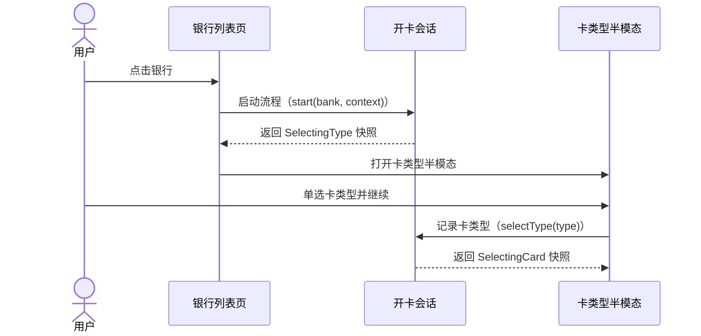
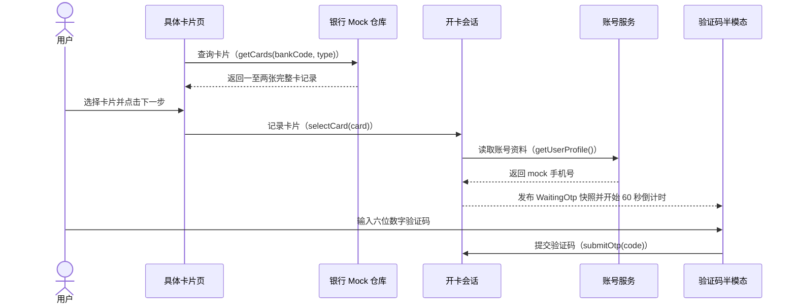
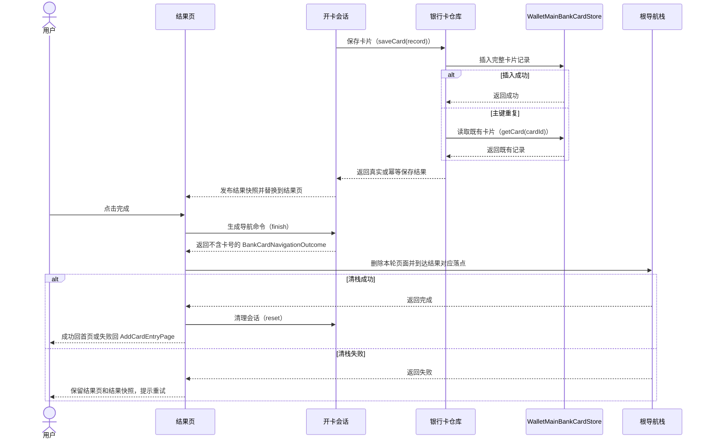
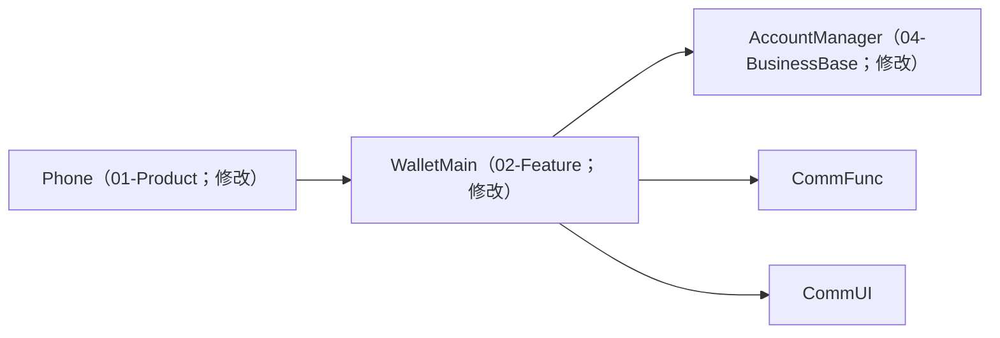
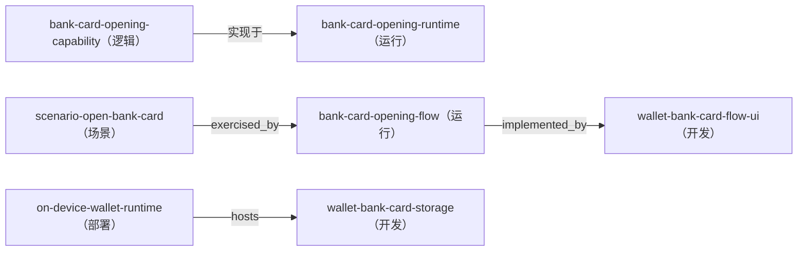

---
derived_from:
  artifact: component-blueprint@1
  component_id: WalletMain
  blueprint_id: bc-openCard-2
  revision: 7
  source_fingerprint: sha256:ad09cb8164f86c79508d0262cfa350038e29f6870123b2f59780fff4f5533aae
  artifact_sha256: sha256:366f54c2b14a5f28e18cd08cc76b669deff9a4ad919762f3bd2c5b012c09cfce
  change_units:
    - change_unit_id: implement-bank-card-opening
      binding: bound
      identity_neutral_digest: 2449b147bd8116d1e626716cba78c67801246304d1ccaa17f435a234adabae29
projection: component-blueprint-review@9
---

# 银行卡开卡与本地卡片入库

<a id="design-626c75657072696e743a62632d6f70656e436172642d32"></a>
阅读入口：先阅读方案、旅程、关键流程和交付安排；类型、方法、完整分支与验收全文见同文档的[技术与追溯参考](#reference)。

<a id="summary"></a>
## 1 方案摘要

在既有两个银行入口上接入统一开卡流程，完成卡类型选择、具体卡片选择、六位验证码校验、RDB 写入与不可侧滑返回的结果页；完成按钮一次性清理本轮开卡页面栈，并按成功或失败返回规定目标。

施工安排见[施工与上线](#delivery)。

<a id="background"></a>
## 2 背景、目标与边界

### 为什么要改

现有两个银行列表入口已经稳定，但点击银行只会显示“暂不支持”。本次把这个终点替换成一条完整的本地模拟开卡链路，同时保留既有列表、分组和路由规则。


[设计依据](#reader-guide-source-1)

<a id="terms"></a>
## 3 术语

**添卡**：从钱包卡包入口选择卡种并完成卡片添加的 feature 内页面、数据与路由编排。

**卡包**：WalletMain 内承载卡片列表、添加入口与后续卡片业务页面的主功能区域。

<a id="journey"></a>
## 4 用户旅程与界面

### 第一步：选择卡类型

用户从添加银行卡页或全部银行页点击任一银行后，先看到卡类型半模态。银行名称与图标来自当前 BankInfo；储蓄卡和信用卡只能单选，协议本次只展示文本。


<a id="design-696d6167653a646f632f66656174757265732fe58e9fe5a78be99c80e6b1822f312d322de993b6e8a18ce58da12f332de782b9e587bbe4bbbbe6848fe993b6e8a18ce68b89e8b5b7e6b7bbe58da1e98089e58da1e58d8ae6a8a1e680812e6a7067"></a>


[设计依据](#reader-guide-source-2)

### 第二步：选择具体银行卡

继续后进入以银行名称为标题的全屏页。每种卡类型提供一至两张 mock 卡，界面只显示前四后四，完整卡号仍保留在流程对象中供最终写库。


<a id="design-696d6167653a646f632f66656174757265732fe58e9fe5a78be99c80e6b1822f312d322de993b6e8a18ce58da12f342de782b9e587bbe4bfa1e794a8e58da1e68896e582a8e89384e58da1e5908ee68b89e8b5b7e98089e58da1e9a1b5e99da22e6a7067"></a>


[设计依据](#reader-guide-source-3)

### 第三步：短信验证

选卡后打开验证码半模态，并立即开始一次 60 秒 mock 发送。手机号由 AccountService 的 mock 资料提供；只有六位数字输入会让下一步可用，倒计时结束后才能重新发送。


<a id="design-696d6167653a646f632f66656174757265732fe58e9fe5a78be99c80e6b1822f312d322de993b6e8a18ce58da12f352de98089e4b8ade69f90e5bca0e58da1e78987e5908ee68b89e8b5b7e79fade4bfa1e9aa8ce8af812e6a7067"></a>


[设计依据](#reader-guide-source-4)

### 第四步：结果与完成

RDB 返回后，无论成功或失败都进入无返回入口的结果页。完成按钮清理从 AddBankCardPage 到结果页的全部页面；成功回钱包首页，失败回最开始的 AddCardEntryPage。


<a id="design-696d6167653a646f632f66656174757265732fe58e9fe5a78be99c80e6b1822f312d322de993b6e8a18ce58da12f362de79fade4bfa1e9aa8ce8af81e5ae8ce68890e5908ee7bb93e69e9ce9a1b52e6a7067"></a>


[设计依据](#reader-guide-source-5)

<a id="solution"></a>
## 5 整体方案

### 责任边界

WalletMain 实现页面、流程和银行卡 RDB；AccountManager 只补充 mock 手机号；Phone 延续现有 navDestinationMap 登记新页面，不复制业务状态或存储实现。


[设计依据](#reader-guide-source-6)

<a id="flows"></a>
## 6 关键流程

### 完整调用与返回

两个入口都把 BankInfo 交给 BankCardOpeningSession 单例会话。会话等待用户完成类型、卡片和验证码选择，再等待 BankCardRepository 的 RDB 返回；insert 成功或重复提交调和为同一记录时产生成功结果。结果页完成时由同一根导航栈执行精确清理，随后到达成功或失败的规定落点。


[设计依据](#reader-guide-source-7)

<a id="design-67726170683a73657175656e63653a656e7472792d616e642d74797065"></a>
完整调用时序：银行入口与卡类型选择



<a id="design-67726170683a73657175656e63653a636172642d616e642d6f7470"></a>
完整调用时序：具体卡片与验证码



<a id="design-67726170683a73657175656e63653a706572736973742d616e642d66696e697368"></a>
完整调用时序：RDB 保存、结果与页面栈收口



<a id="data"></a>
## 7 数据与存储

WalletMainBankCardStore v1 的 bank_cards 表以完整卡号为主键，保存卡片大类、银行、银行卡类型、添加时间、两项支付状态和交易记录 JSON。完整卡号不写日志，界面始终使用掩码值；本需求没有把应用沙箱安全级别解释为额外加密。


[设计依据](#reader-guide-source-8)

<a id="decisions"></a>
## 8 关键取舍

### 关键选择

方案坚持一个流程状态 owner 和一个 RDB 真源，不用页面参数链或 AppStorage 维护平行状态。既有银行入口原位演进，新四段 UI 在 WalletMain 内实现并复用现有资源、导航和公共组件。


[设计依据](#reader-guide-source-9)

<a id="design-6465636973696f6e3a6465636973696f6e2d6c6f63616c2d726462"></a>
### 银行卡持久化采用 WalletMain 端侧 RDB

| 关切 | 结论 |
| --- | --- |
| 选了什么 | BankCardRepository 创建 WalletMainBankCardStore v1 与 bank\_cards 表，card\_id 为主键；不另建模块或第二份存储真源。|
| 理由 | 原始需求明确要求从本需求开始建立卡片数据库；数据只供钱包 feature 后续详情页读取，放在 WalletMain 可保持职责与依赖方向一致。|

被否方案：

| 方案 | 被否理由/缺陷 |
| --- | --- |
| AppStorage 保存完整卡片列表 | 被否理由：不适合作为结构化持久化数据库，也不满足表字段与后续查询扩展需求。；缺陷：缺少表级约束与稳定升级边界。|

<a id="design-6465636973696f6e3a6465636973696f6e2d73696e676c652d666c6f772d6f776e6572"></a>
### 一次开卡由单一流程对象持有状态

| 关切 | 结论 |
| --- | --- |
| 选了什么 | BankCardOpeningSession 单例持有银行、卡类型、完整卡号、验证码与保存结果；页面通过订阅不可变快照渲染，所有退出路径统一 unsubscribe 和 reset。|
| 理由 | 双入口、两个半模态和两个全屏页面共享同一状态与清理责任，单一 owner 可避免平行页面状态和重复写库。|

被否方案：

| 方案 | 被否理由/缺陷 |
| --- | --- |
| 每个页面用路由参数逐级传递全部状态 | 被否理由：完整卡号和验证码会扩散到多个页面参数，清理与重复提交更难集中控制。；缺陷：敏感数据暴露面和状态分叉更大。|

<a id="design-6465636973696f6e3a73656c656374696f6e2d6578697374696e672d62616e6b2d656e747279"></a>
### selection-existing-bank-entry

| 关切 | 结论 |
| --- | --- |
| 选了什么 | 选型结果：evolve；选型目标：[wallet-bank-entry-pages](#design-766965773a646576656c6f706d656e742f6e6f64653a77616c6c65742d62616e6b2d656e7472792d7061676573)；组件：WalletMain/src/main/ets/presentation/pages/AddBankCardPage.ets#buildAddBankCardPage |
| 理由 | 既有 AddBankCardPage 与 AllBanksPage 已是权威银行列表入口，只替换点击行为并接入统一半模态，不复制银行列表页面。|

被否方案：

未记录；不推测被否选择。

<a id="design-6465636973696f6e3a73656c656374696f6e2d6e65772d62616e6b2d666c6f772d7569"></a>
### selection-new-bank-flow-ui

| 关切 | 结论 |
| --- | --- |
| 选了什么 | 选型结果：custom；选型目标：[wallet-bank-card-flow-ui](#design-766965773a646576656c6f706d656e742f6e6f64653a77616c6c65742d62616e6b2d636172642d666c6f772d7569)；组件：未记录 |
| 理由 | 组件索引中没有等价的卡类型选择、银行卡选择、验证码与不可返回结果页组合；新 UI 仍复用项目资源、NavPathContext 与既有页面视觉语言。|

被否方案：

未记录；不推测被否选择。

<a id="recovery"></a>
## 9 失败与恢复

### 失败与恢复速查

| 情况 | 用户看到什么 | 数据是否保存 | 如何继续 |
| --- | --- | --- | --- |
| [BD-1](#design-616363657074616e63653a766965773a6c6f676963616c2f6e6f64653a62616e6b2d636172642d6f70656e696e672d6361706162696c6974792f626f756e6461726965733a42442d31) 关闭半模态 | 回到下方页面 | 否 | 重新选择或退出 |
| [BD-2](#design-616363657074616e63653a766965773a6c6f676963616c2f6e6f64653a62616e6b2d636172642d6f70656e696e672d6361706162696c6974792f626f756e6461726965733a42442d32) RDB 初始化/写入失败 | 失败结果页 | 否 | 点击完成回 AddCardEntryPage |
| [BD-3](#design-616363657074616e63653a766965773a6c6f676963616c2f6e6f64653a62616e6b2d636172642d6f70656e696e672d6361706162696c6974792f626f756e6461726965733a42442d33) 重复卡号或提交后中断 | 同一记录显示成功，冲突记录显示失败 | 既有记录保留且不覆盖 | 点击完成到规定落点 |
| [BD-4](#design-616363657074616e63653a766965773a6c6f676963616c2f6e6f64653a62616e6b2d636172642d6f70656e696e672d6361706162696c6974792f626f756e6461726965733a42442d34) 进程重建 | 未完成流程不恢复 | 已确认成功记录保留 | 重新发起未完成流程 |


[设计依据](#reader-guide-source-10)

边界验收：[BD-1](#design-616363657074616e63653a766965773a6c6f676963616c2f6e6f64653a62616e6b2d636172642d6f70656e696e672d6361706162696c6974792f626f756e6461726965733a42442d31)；[BD-2](#design-616363657074616e63653a766965773a6c6f676963616c2f6e6f64653a62616e6b2d636172642d6f70656e696e672d6361706162696c6974792f626f756e6461726965733a42442d32)；[BD-3](#design-616363657074616e63653a766965773a6c6f676963616c2f6e6f64653a62616e6b2d636172642d6f70656e696e672d6361706162696c6974792f626f756e6461726965733a42442d33)；[BD-4](#design-616363657074616e63653a766965773a6c6f676963616c2f6e6f64653a62616e6b2d636172642d6f70656e696e672d6361706162696c6974792f626f756e6461726965733a42442d34)；[BD-5](#design-616363657074616e63653a766965773a6c6f676963616c2f6e6f64653a62616e6b2d636172642d6f70656e696e672d6361706162696c6974792f626f756e6461726965733a42442d35)；[BD-6](#design-616363657074616e63653a766965773a6c6f676963616c2f6e6f64653a62616e6b2d636172642d6f70656e696e672d6361706162696c6974792f626f756e6461726965733a42442d36)。

<a id="quality"></a>
## 10 质量与安全

### 隐私、视觉与兼容

隐私重点是完整卡号最小暴露；视觉重点是四张参考图、按钮禁用态和结果页返回拦截；兼容重点是既有卡包及银行路由不退化。三类风险分别由 UT、真机截图/交互和路由回归覆盖。


[设计依据](#reader-guide-source-11)

<a id="delivery"></a>
## 11 施工与上线

### 施工范围

施工集中在 WalletMain，另有 AccountManager 的手机号字段和 Phone 的路由登记两处窄改。主要文件职责如下：

- `BankInfo.ets` / `BankCardCandidate.ets` / `BankCardRecord.ets`：支持卡类型、mock 卡片与持久化模型。
- `BankRepository.ets`：按银行和卡类型返回一至两张 mock 卡。
- `BankCardRepository.ets`：Context 绑定、RDB 建表、保存、读回与重复提交调和。
- `BankCardOpeningSession.ets`：跨页面单例状态、订阅、倒计时、保存与敏感数据清理。
- 两个既有银行页：把点击银行接到统一 Session；两个新页面与两个半模态：承担类型、卡片、验证码和结果交互。
- `WalletMain/index.ets` 与 `Phone/pages/index.ets`：只导出和登记新增 builder。
- WalletMain 资源：文案、颜色、尺寸与结果引导图；ohosTest 文件：状态、存储、隐私和导航回归。
- AccountManager 的 `UserProfile.ets` / `AccountService.ets`：提供 mock 手机号，不承载开卡状态。

蓝图不新增模块、不改变分层 DSL，也不引入真实银行、短信或支付服务。单个 CU 先以新增模型/Repository/Session 可编译为安全基础，再接 UI 与宿主路由；任何中间提交都保持旧入口可启动，最终由同一 CU 完成全链验收。


[设计依据](#reader-guide-source-12)

### implement-bank-card-opening

在既有 WalletMain 添卡入口上一次性交付银行卡类型选择、具体卡片选择、验证码、RDB 持久化、结果页与导航栈收口，并补齐账号 mock 手机号和 Phone 路由登记。

- 双入口到结果完成的 AC-1～AC-7 与 BD-1～BD-6 全部成立。
- BankCardOpeningSession 是单次流程唯一状态 owner，RDB 是已添加卡片唯一持久化真源。
- 结果页消费保存快照并按成功或失败精确清理页面栈。
- 存储失败、重复提交、进程中断、账号资料失败与清栈失败均按 BD-2～BD-6 恢复。

模块分工：AccountManager；Phone；WalletMain。

- 设计目标（责任方：wallet-main-team）
- 设计目标（责任方：wallet-main-team）
- 设计目标（责任方：wallet-main-team）
- 设计目标（责任方：account-manager-team）
- 设计目标（责任方：phone-shell-team）

未声明上游依赖。

安全中间态：单个 CU 内先落模型、Repository 与 Session 并保持旧入口可编译，再接四段 UI 与 Phone 路由；最终闭环前旧银行列表仍可启动，失败路径不会写入伪成功记录。

精确映射见 [施工单元参考](#design-756e69743a696d706c656d656e742d62616e6b2d636172642d6f70656e696e67)。

### 文件与目录

```text
├── 01-Product/Phone/src/main/ets/pages/
│   └── index.ets
├── 02-Feature/WalletMain/src/
│   ├── main/
│   │   ├── ets/
│   │   │   ├── data/
│   │   │   │   ├── model/
│   │   │   │   │   ├── BankCardCandidate.ets
│   │   │   │   │   ├── BankCardRecord.ets
│   │   │   │   │   └── BankInfo.ets
│   │   │   │   └── repository/
│   │   │   │       ├── BankCardRepository.ets
│   │   │   │       └── BankRepository.ets
│   │   │   ├── domain/flow/
│   │   │   │   └── BankCardOpeningSession.ets
│   │   │   ├── index.ets
│   │   │   └── presentation/
│   │   │       ├── components/
│   │   │       │   ├── OtpVerificationSheet.ets
│   │   │       │   └── SelectBankCardTypeSheet.ets
│   │   │       └── pages/
│   │   │           ├── AddBankCardPage.ets
│   │   │           ├── AllBanksPage.ets
│   │   │           ├── BankCardResultPage.ets
│   │   │           └── BankCardSelectionPage.ets
│   │   └── resources/base/
│   │       ├── element/
│   │       │   ├── color.json
│   │       │   ├── float.json
│   │       │   └── string.json
│   │       └── media/
│   │           └── bank_card_result_guide.png
│   └── ohosTest/ets/test/
│       └── bank_open_card_2_ut.test.ets
└── 04-BusinessBase/AccountManager/src/main/ets/
    ├── data/model/
    │   └── UserProfile.ets
    └── domain/service/
        └── AccountService.ets
```

<a id="acceptance"></a>
## 12 验收

### 怎么验收

[AC-1](#design-616363657074616e63653a766965773a6c6f676963616c2f6e6f64653a62616e6b2d636172642d6f70656e696e672d6361706162696c6974792f63726974657269613a41432d31) 至 [AC-7](#design-616363657074616e63653a766965773a6c6f676963616c2f6e6f64653a62616e6b2d636172642d6f70656e696e672d6361706162696c6974792f63726974657269613a41432d37) 覆盖双入口、两次单选、验证码倒计时与输入门槛、RDB 成败、结果页拦截和最终栈落点。业务状态与存储错误在 UT 验证，真实 UI、返回手势、导航栈和参考图差异在设备阶段验证。


[设计依据](#reader-guide-source-13)

<a id="questions"></a>
## 13 待补问题

### 当前待补问题

当前没有阻挡本切片施工的业务未决项。短信、银行与支付均为明确的本地 mock；真实服务接入和账号级卡片隔离留给后续独立需求。


[设计依据](#reader-guide-source-14)

### 必须关注的评审问题


<a id="reference"></a>
## 技术与追溯参考

部件 WalletMain · 蓝图 bc-openCard-2 · revision 7 · 准入 通过

本文根据 canonical 蓝图与当前施工单元确定性生成，文首保留精确来源身份。是否通过设计交接见 readiness；施工授权、映射与完成结论由原责任阶段确认。可选说明缺失或过期不改变这些结论。

参考保留全部声明；不从名称、目录或数组顺序推断调用、依赖与未声明存储设计。正文的验收链接按来源目标与条目编号定位。

### A 字段与类型

<a id="review-summary-details"></a>
#### 原概述与目标

| 关切 | 设计说明 |
| --- | --- |
| 背景 | 现有添加银行卡与全部银行页面已经能展示银行列表，但点击银行只提示暂不支持，尚无选卡、短信验证、持久化和结果收口流程。 |
| 问题 | 用户无法从既有银行入口完成银行卡添加；卡片也没有可供后续详情页消费的本地持久化记录。 |
| 本次改变 | 在既有两个银行入口上接入统一开卡流程，完成卡类型选择、具体卡片选择、六位验证码校验、RDB 写入与不可侧滑返回的结果页；完成按钮一次性清理本轮开卡页面栈，并按成功或失败返回规定目标。 |
| 整体定位 | 该能力属于 WalletMain 的添卡业务；AccountManager 只提供 mock 手机号，Phone 只登记新增 NavDestination，RDB 与流程状态均由 WalletMain 持有。 |
| 范围 | 添加银行卡页与全部银行页复用同一开卡入口行为。；卡类型半模态、具体卡片页、验证码半模态与添加结果页。；mock 银行卡数据、账号 mock 手机号、RDB 建库建表与卡片记录写入。；新旧页面之间的导航回归、流程清栈与成功/失败出口。 |
| 不做什么 | 不实现真实短信、真实银行接口、真实华为支付或银联手机闪付开通。；不实现银行卡详情页；成功完成后暂回钱包首页。；不实现参考图中的 NFC 激活区。 |

| 目标 | 目标说明 | 成功衡量 |
| --- | --- | --- |
| goal-complete-bank-card-opening | 用户可从两个既有银行列表入口完成一次可验证、可落库、可正确收口的银行卡添加。 | 任一银行点击后进入与参考图一致的卡类型半模态，且只能选择一个卡类型。<br>六位数字验证码是下一步按钮唯一输入门槛，倒计时归零后可重新发送。<br>写库成功或失败都进入结果页并携带完整卡号与结果，完成后不再回到流程中间页。<br>成功记录可在进程重启后从 RDB 读回，界面和日志不泄露完整卡号。 |

<a id="review-terms"></a>
#### 完整术语

| 术语 | 含义 | 模块 | 易混项 | 确认依据 |
| --- | --- | --- | --- | --- |
| 添卡 | 从钱包卡包入口选择卡种并完成卡片添加的 feature 内页面、数据与路由编排。 | WalletMain | 账号管理；应用入口 | doc/glossary.yaml#添卡 |
| 卡包 | WalletMain 内承载卡片列表、添加入口与后续卡片业务页面的主功能区域。 | WalletMain | 账号管理；公共UI | doc/glossary.yaml#卡包 |

#### 必须关注的评审问题

见正文[必须关注的评审问题](#questions)。

#### 领域模型、字段与枚举

<a id="design-6d6f64656c3a766965773a646576656c6f706d656e742f6e6f64653a77616c6c65742d62616e6b2d636172642d666c6f772d75692f42616e6b496e666f"></a>
内容承载于：[wallet-bank-card-flow-ui](#design-766965773a646576656c6f706d656e742f6e6f64653a77616c6c65742d62616e6b2d636172642d666c6f772d7569) · 契约设计

#### BankInfo · 接口

模块 未记录；文件 02-Feature/WalletMain/src/main/ets/data/model/BankInfo.ets

| 字段 | 类型 | 必需 | 约束/说明 |
| --- | --- | --- | --- |
| supportedTypes | BankCardType\[\] | 是 | 该银行支持的卡类型；默认 mock 银行均为 DEBIT 与 CREDIT。 |

未记录：可空；默认值；补充约束；验证引用；来源。

<a id="design-6d6f64656c3a766965773a646576656c6f706d656e742f6e6f64653a77616c6c65742d62616e6b2d636172642d666c6f772d75692f42616e6b4361726443616e646964617465"></a>


#### BankCardCandidate · 接口

模块 未记录；文件 02-Feature/WalletMain/src/main/ets/data/model/BankCardCandidate.ets

| 字段 | 类型 | 必需 | 约束/说明 |
| --- | --- | --- | --- |
| cardId | string | 是 | 完整 mock 卡号；UI 通过 maskCardNumber 派生前四后四。 |
| bankCode | string | 是 | 关联 BankInfo.code。 |
| bankName | string | 是 | 银行显示名。 |
| bankCardType | BankCardType | 是 | DEBIT 或 CREDIT。 |

未记录：可空；默认值；补充约束；验证引用；来源。

<a id="design-6d6f64656c3a766965773a646576656c6f706d656e742f6e6f64653a77616c6c65742d62616e6b2d636172642d666c6f772d75692f42616e6b436172645265636f7264"></a>


#### BankCardRecord · 接口

模块 未记录；文件 02-Feature/WalletMain/src/main/ets/data/model/BankCardRecord.ets

| 字段 | 类型 | 必需 | 约束/说明 |
| --- | --- | --- | --- |
| cardId | string | 是 | 完整卡号；主键，界面禁止直出。 |
| category | CardCategory | 是 | 卡片大类，本需求为 BANK\_CARD。 |
| bankName | string | 是 | 银行名称。 |
| bankCardType | BankCardType | 是 | DEBIT 或 CREDIT。 |
| addedAt | number | 是 | Unix 毫秒时间戳。 |
| huaweiPayEnabled | boolean | 是 | 华为支付开通状态。 |
| unionPayQuickPassEnabled | boolean | 是 | 银联手机闪付状态。 |
| transactionsJson | string | 是 | 交易记录 JSON。 |

未记录：可空；默认值；补充约束；验证引用；来源。

### B 接口与存储明细

#### 本部件实际消费或提供的操作与 DTO

<a id="design-636f6e74726163743a7361766542616e6b43617264"></a>
#### saveBankCard

操作：saveBankCard · 1.0 · internal；责任方 wallet-main-team；需要方 slice-bank-card-opening

<a id="design-64746f3a7361766542616e6b436172642f726571756573745f64746f"></a>
**请求 DTO：BankCardSaveRequest**

来源：[request\_dto](../../../../doc/features/bc-openCard-2/blueprint/bank-card-contract-authority.yaml#/request_dto)
验证引用：[AC-5](#design-616363657074616e63653a766965773a6c6f676963616c2f6e6f64653a62616e6b2d636172642d6f70656e696e672d6361706162696c6974792f63726974657269613a41432d35)

| 字段 | 类型 | 可空 | 语义 | 来源 |
| --- | --- | --- | --- | --- |
| cardId | string | 否 | 完整银行卡号；仅持久化与业务处理使用，UI 不得直接展示。 | doc/features/bc-openCard-2/blueprint/bank-card-contract-authority.yaml#/request\_dto/fields/0 |
| category | CardCategory | 否 | 卡片大类，本需求固定为 BANK\_CARD。 | doc/features/bc-openCard-2/blueprint/bank-card-contract-authority.yaml#/request\_dto/fields/1 |
| bankName | string | 否 | 发卡银行显示名称。 | doc/features/bc-openCard-2/blueprint/bank-card-contract-authority.yaml#/request\_dto/fields/2 |
| bankCardType | BankCardType | 否 | DEBIT 或 CREDIT。 | doc/features/bc-openCard-2/blueprint/bank-card-contract-authority.yaml#/request\_dto/fields/3 |
| addedAt | number | 否 | 添加完成时的 Unix 毫秒时间戳。 | doc/features/bc-openCard-2/blueprint/bank-card-contract-authority.yaml#/request\_dto/fields/4 |
| huaweiPayEnabled | boolean | 否 | 是否已开通华为支付，本需求 mock 初始值为 false。 | doc/features/bc-openCard-2/blueprint/bank-card-contract-authority.yaml#/request\_dto/fields/5 |
| unionPayQuickPassEnabled | boolean | 否 | 是否已开通银联手机闪付，本需求 mock 初始值为 false。 | doc/features/bc-openCard-2/blueprint/bank-card-contract-authority.yaml#/request\_dto/fields/6 |
| transactionsJson | string | 否 | 交易记录 JSON；本需求初始为空数组。 | doc/features/bc-openCard-2/blueprint/bank-card-contract-authority.yaml#/request\_dto/fields/7 |

未记录：必需；默认值；约束；验证引用。

<a id="design-64746f3a7361766542616e6b436172642f726573706f6e73655f64746f"></a>
**响应 DTO：BankCardSaveResult**

来源：[response\_dto](../../../../doc/features/bc-openCard-2/blueprint/bank-card-contract-authority.yaml#/response_dto)
验证引用：[AC-5](#design-616363657074616e63653a766965773a6c6f676963616c2f6e6f64653a62616e6b2d636172642d6f70656e696e672d6361706162696c6974792f63726974657269613a41432d35)

| 字段 | 类型 | 可空 | 语义 | 来源 |
| --- | --- | --- | --- | --- |
| success | boolean | 否 | RDB 写入是否成功。 | doc/features/bc-openCard-2/blueprint/bank-card-contract-authority.yaml#/response\_dto/fields/0 |
| fullCardNumber | string | 否 | 无论成功或失败都返回本次选择的完整卡号供结果流转。 | doc/features/bc-openCard-2/blueprint/bank-card-contract-authority.yaml#/response\_dto/fields/1 |

映射：

| 映射 | 类型 | 源字段 | 目标字段 | 规则 |
| --- | --- | --- | --- | --- |
| map-card-id | 直接映射 | cardId | bank\_cards.card\_id | 原值写入主键列。 |
| map-category | 直接映射 | category | bank\_cards.category | 枚举原值写入。 |
| map-bank-name | 直接映射 | bankName | bank\_cards.bank\_name | 原值写入。 |
| map-bank-card-type | 直接映射 | bankCardType | bank\_cards.bank\_card\_type | 枚举原值写入。 |
| map-added-at | 直接映射 | addedAt | bank\_cards.added\_at | 毫秒时间戳写入。 |
| map-huawei-pay | 直接映射 | huaweiPayEnabled | bank\_cards.huawei\_pay\_enabled | 布尔值按整数列写入。 |
| map-unionpay | 直接映射 | unionPayQuickPassEnabled | bank\_cards.unionpay\_quickpass\_enabled | 布尔值按整数列写入。 |
| map-transactions | 直接映射 | transactionsJson | bank\_cards.transactions\_json | JSON 字符串原值写入。 |
| map-save-success | 直接映射 | success | result.success | 保存结果原值返回。 |
| map-result-card-number | 直接映射 | fullCardNumber | result.fullCardNumber | 完整卡号原值返回且不写日志。 |

错误：已声明（结构未展开）
来源：[errors](../../../../doc/features/bc-openCard-2/blueprint/bank-card-contract-authority.yaml#/errors)
验证：[BD-2](#design-616363657074616e63653a766965773a6c6f676963616c2f6e6f64653a62616e6b2d636172642d6f70656e696e672d6361706162696c6974792f626f756e6461726965733a42442d32)；[BD-3](#design-616363657074616e63653a766965773a6c6f676963616c2f6e6f64653a62616e6b2d636172642d6f70656e696e672d6361706162696c6974792f626f756e6461726965733a42442d33)
幂等：key：cardId；scope：bank\_cards；equality\_fields：cardId；category；bankName；bankCardType；huaweiPayEnabled；unionPayQuickPassEnabled；transactionsJson；added\_at\_policy：重复提交时沿用既有记录的 addedAt，不参与等价比较，也不覆盖。；behavior：相同完整卡号重复提交时先读取既有记录；关键字段一致则返回幂等成功，不一致才返回冲突失败，且不覆盖既有记录。
来源：[idempotency](../../../../doc/features/bc-openCard-2/blueprint/bank-card-contract-authority.yaml#/idempotency)
验证：[BD-3](#design-616363657074616e63653a766965773a6c6f676963616c2f6e6f64653a62616e6b2d636172642d6f70656e696e672d6361706162696c6974792f626f756e6461726965733a42442d33)；[BD-4](#design-616363657074616e63653a766965773a6c6f676963616c2f6e6f64653a62616e6b2d636172642d6f70656e696e672d6361706162696c6974792f626f756e6461726965733a42442d34)
非功能要求：privacy：完整卡号仅在内存流转与 RDB 中保存，日志和 UI 只使用掩码值。；durability：下一次进程启动可从 RDB 读取已添加卡片。
来源：[nfr](../../../../doc/features/bc-openCard-2/blueprint/bank-card-contract-authority.yaml#/nfr)
验证：[AC-2](#design-616363657074616e63653a766965773a6c6f676963616c2f6e6f64653a62616e6b2d636172642d6f70656e696e672d6361706162696c6974792f63726974657269613a41432d32)；[AC-5](#design-616363657074616e63653a766965773a6c6f676963616c2f6e6f64653a62616e6b2d636172642d6f70656e696e672d6361706162696c6974792f63726974657269613a41432d35)；[BD-4](#design-616363657074616e63653a766965773a6c6f676963616c2f6e6f64653a62616e6b2d636172642d6f70656e696e672d6361706162696c6974792f626f756e6461726965733a42442d34)

未记录：必需；默认值；约束；验证引用。

#### 持久化表结构

表结构来自根级接口契约；领域模型见字段与类型，存储约束和编码保留此处原始声明。

##### saveBankCard 的存储设计

| 存储关切 | 声明 |
| --- | --- |
| 数据库 | WalletMainBankCardStore |
| 版本 | 1 |
| 安全级别 | 应用沙箱内普通 RDB；完整卡号禁止日志与界面直出。 |
| 加密 | 否 |
| 升级策略 | v1 首次使用 CREATE TABLE IF NOT EXISTS；后续版本按旧版本号顺序执行显式迁移，禁止删除重建覆盖用户卡片。 |

###### 表 bank\_cards

| 表关切 | 声明 |
| --- | --- |
| 主键 | card\_id |
| 约束 | — |
| 升级策略 | — |
| 来源 | — |

| 列 | 类型与声明约束 | 显式默认值 |
| --- | --- | --- |
| card\_id | TEXT | — |
| category | TEXT | — |
| bank\_name | TEXT | — |
| bank\_card\_type | TEXT | — |
| added\_at | INTEGER | — |
| huawei\_pay\_enabled | INTEGER | 0 |
| unionpay\_quickpass\_enabled | INTEGER | 0 |
| transactions\_json | TEXT | \[\] |


| 模块 | DSL 分层 | 形式 | 变化 | 目录 |
| --- | --- | --- | --- | --- |
| WalletMain | 02-Feature | HAR | 修改 | 02-Feature/WalletMain |
| AccountManager | 04-BusinessBase | HAR | 修改 | 04-BusinessBase/AccountManager |
| Phone | 01-Product | HAP | 修改 | 01-Product/Phone |

模块依赖：



<!-- module-edge-source:view:development/node:wallet-bank-card-flow-ui.contracts.module_dependencies.WalletMain[0] -->
<!-- module-edge-source:view:development/node:wallet-bank-card-flow-ui.contracts.module_dependencies.WalletMain[1] -->
<!-- module-edge-source:view:development/node:wallet-bank-card-flow-ui.contracts.module_dependencies.WalletMain[2] -->
<!-- module-edge-source:view:development/node:wallet-bank-card-flow-ui.contracts.module_dependencies.Phone[0] -->
未记录：约束（声明）；升级策略（声明）；来源（声明）；来源字段；编码；显式默认值；说明；补充约束；来源。

<a id="design-696e746572666163653a766965773a646576656c6f706d656e742f6e6f64653a77616c6c65742d62616e6b2d636172642d666c6f772d75692f42616e6b436172644f70656e696e6753657373696f6e"></a>
接口 BankCardOpeningSession · WalletMain / 02-Feature · 02-Feature/WalletMain/src/main/ets/domain/flow/BankCardOpeningSession.ets

| 方法 | 参数 | 返回 | 异步 | 职责/失败语义 |
| --- | --- | --- | --- | --- |
| getInstance | 无 | BankCardOpeningSession | 否 | 返回进程内唯一开卡会话。 |
| start | bank: BankInfo；context: Context | boolean | 否 | 初始化一次流程与 Repository；已有活动会话时拒绝重复启动。 |
| subscribe | callback: BankCardOpeningStateCallback | void | 否 | 订阅不可变流程快照并立即回放当前状态。 |
| unsubscribe | callback: BankCardOpeningStateCallback | void | 否 | 页面离开时解除订阅。 |
| finish | 无 | BankCardNavigationOutcome | 否 | 只生成不含卡号的成功/失败导航命令；不清理会话，清栈成功后由调用方执行 reset。 |
| reset | 无 | void | 否 | 取消或完成后停止定时器、清空监听与完整卡号/验证码。 |

<a id="design-696e746572666163653a766965773a646576656c6f706d656e742f6e6f64653a77616c6c65742d62616e6b2d636172642d666c6f772d75692f42616e6b5265706f7369746f7279"></a>
接口 BankRepository · WalletMain / 02-Feature · 02-Feature/WalletMain/src/main/ets/data/repository/BankRepository.ets

| 方法 | 参数 | 返回 | 异步 | 职责/失败语义 |
| --- | --- | --- | --- | --- |
| getCards | bankCode: string；cardType: BankCardType | Promise&lt;BankCardCandidate\[\]&gt; | 是 | 按银行和卡类型返回一至两张 mock 卡；未知银行或不支持类型返回空数组。 |

<a id="design-696e746572666163653a766965773a646576656c6f706d656e742f6e6f64653a77616c6c65742d62616e6b2d636172642d666c6f772d75692f42616e6b436172645265706f7369746f7279"></a>
接口 BankCardRepository · WalletMain / 02-Feature · 02-Feature/WalletMain/src/main/ets/data/repository/BankCardRepository.ets

| 方法 | 参数 | 返回 | 异步 | 职责/失败语义 |
| --- | --- | --- | --- | --- |
| getInstance | context: Context | BankCardRepository | 否 | 绑定应用 Context 并复用单一懒加载 RDB 连接。 |
| saveCard | card: BankCardRecord | Promise&lt;BankCardSaveResult&gt; | 是 | 幂等初始化 RDB/表并插入卡片；重复同记录调和为成功。 |
| getCard | cardId: string | Promise&lt;BankCardRecord&#124;null&gt; | 是 | 按完整卡号读取已提交记录，供重启读回与重复提交调和。 |

<a id="design-696e746572666163653a766965773a646576656c6f706d656e742f6e6f64653a77616c6c65742d62616e6b2d636172642d666c6f772d75692f4163636f756e7453657276696365"></a>
接口 AccountService · AccountManager / 04-BusinessBase · 04-BusinessBase/AccountManager/src/main/ets/domain/service/AccountService.ets

| 方法 | 参数 | 返回 | 异步 | 职责/失败语义 |
| --- | --- | --- | --- | --- |
| getUserProfile | 无 | Promise&lt;UserProfile&gt; | 是 | 返回含 mock 手机号的账号资料。 |

组件 SelectBankCardTypeSheet · sheet · 02-Feature/WalletMain/src/main/ets/presentation/components/SelectBankCardTypeSheet.ets

未记录

组件 BankCardSelectionPage · 页面 · 02-Feature/WalletMain/src/main/ets/presentation/pages/BankCardSelectionPage.ets

未记录

组件 OtpVerificationSheet · sheet · 02-Feature/WalletMain/src/main/ets/presentation/components/OtpVerificationSheet.ets

未记录

组件 BankCardResultPage · 页面 · 02-Feature/WalletMain/src/main/ets/presentation/pages/BankCardResultPage.ets

未记录

#### 运行流与状态明细

<a id="design-766965773a72756e74696d652f666c6f773a62616e6b2d636172642d6f70656e696e672d666c6f77"></a>
##### bank-card-opening-flow

数据域：bank-card-record；契约：contract:saveBankCard；开发责任：view:development/node:wallet-bank-card-flow-ui

触发：

| 类型 | 时机 | 幂等 |
| --- | --- | --- |
| user\_bank\_selection | 从添加银行卡页或全部银行页点击银行 | 同一页面动作窗口只创建一个流程上下文。 |
| user\_otp\_submission | 验证码为六位数字后点击下一步 | 流程进入 Saving 后忽略重复点击。 |

首次加载：load-bank-card-opening · 入口页调用 BankCardOpeningSession.getInstance().start(bank, context) 初始化单例会话；从 AccountService 读取 mock 手机号；不恢复中途草稿。；责任方 BankCardOpeningSession；范围 当前一次开卡流程；新鲜度 每次新流程重新读取银行 mock 数据与账号 mock 手机号。

权威状态：view:development/node:wallet-bank-card-storage；持久化 WalletMainBankCardStore.bank\_cards；投影/缓存 view:development/node:wallet-bank-card-flow-ui；调和 RDB insert 成功或查询到关键字段一致的既有记录才产生成功结果；失败结果不把内存选择提升为已添加卡片。
状态责任方：view:runtime/node:bank-card-opening-runtime；状态 SelectingType；SelectingCard；WaitingOtp；Saving；Success；Failed

写入与发布：

| 写入 | 类型 | 持久化 | 发布 | 恢复 |
| --- | --- | --- | --- | --- |
| persist-selected-bank-card | foreground | WalletMainBankCardStore.bank\_cards | publication:bank-card-save-finished | recovery:bank-card-opening-recovery |

| 发布 | 载荷 |
| --- | --- |
| bank-card-save-finished | fullCardNumber 与 success；只在内存中交给结果页，不写日志。 |

订阅与消费者：

| 订阅 | 消费者 | 建立/解除 | 快照/重放 | 清理 | 顺序 |
| --- | --- | --- | --- | --- | --- |
| result-page-observer | consumer:bank-card-result-page | 进入结果页时绑定当前结果快照。 / 点击完成并清栈时解绑。 | 只读取当前保存动作产生的一次快照。 | 清除流程内完整卡号与验证码。 | RDB 写入返回后先发布结果，再替换到结果页。 |

| 消费者 | 首次加载 | 更新 |
| --- | --- | --- |
| bank-card-result-page | initial-load:load-bank-card-opening | publication:bank-card-save-finished |

失败与恢复：bank-card-opening-recovery

| 恢复关切 | 处理 |
| --- | --- |
| 失败处理 | 写入异常转换为失败结果；重复卡号先 getCard 调和；半模态取消返回下方页面；结果页返回动作一律拦截。 |
| 重试 | 本轮不在结果页自动重试；失败完成后回 AddCardEntryPage 重新发起。 |

生命周期：

| 场景 | 覆盖裁决 | 依据 |
| --- | --- | --- |
| 冷启动 | 已覆盖 | BD-4 |
| 热恢复 | 已覆盖 | BD-4 |
| 页面挂载 | 已覆盖 | AC-1；AC-3 |
| 页面卸载 | 已覆盖 | BD-1；AC-6 |
| 账号切换 | 不适用 | doc/features/原始需求/1-2-银行卡/原始需求.md |
| 进程重建 | 已覆盖 | BD-4 |
| 后台写入 | 不适用 | doc/features/原始需求/1-2-银行卡/原始需求.md |

验证关注：doc/features/原始需求/1-2-银行卡/原始需求.md#路由规格

未记录：触发；时机；快照/语义；发布；消费语义；处理。

内容承载于：[bank-card-opening-flow](#design-766965773a72756e74696d652f666c6f773a62616e6b2d636172642d6f70656e696e672d666c6f77) · 契约设计

#### 施工状态与有序步骤

状态 银行、卡类型、完整卡号、验证码、倒计时与保存结果；持有者 BankCardOpeningSession；作用域 单次银行卡开卡流程；责任方 view:runtime/node:bank-card-opening-runtime

| 顺序 | 行为 |
| --- | --- |
| 1 | AddBankCardPage 或 AllBanksPage 从 UIAbility Context 调用 BankCardOpeningSession.getInstance().start(bank, context)；start 构造 BankCardRepository.getInstance(context)、重置上次会话并发出 SelectingType 快照，活动会话中的重复 start 被拒绝。 |
| 2 | 各页面与半模态只通过 BankCardOpeningSession.getInstance() 取得同一会话，subscribe(callback) 接收不可变快照，aboutToDisappear 时 unsubscribe；用户单选 BankCardType 后调用 selectType(type)。 |
| 3 | 继续按钮调用 NavPathContext.stack().pushPath 进入 BankCardSelectionPage(bankCode, type)，页面从 BankRepository 取得 1 至 2 张完整卡记录并只渲染掩码号。 |
| 4 | 用户选择卡片并同意协议后打开 OtpVerificationSheet；Flow 调 AccountService.getUserProfile() 读取 mock 手机号并立即调用 resendOtp() 开始 60 秒倒计时。 |
| 5 | 输入框每次变化调用 normalizeOtp(input)，只保留最多六位数字；canSubmit 仅在长度为六时成立。 |
| 6 | 用户提交后页面等待 BankCardRepository.saveCard(selectedCard)；Repository 用 start 注入的 Context 懒加载单一 RDB Promise，以 CREATE TABLE IF NOT EXISTS 初始化 v1 表并插入完整字段。 |
| 7 | insert 主键冲突时 Repository 调 getCard(cardId)；关键字段一致返回幂等成功，否则返回冲突失败。进程重启后 getCard 也可读回已确认记录。 |
| 8 | Session 收到成功或失败结果后清理验证码，携 fullCardNumber 与 success 替换到 BankCardResultPage；不在日志输出完整卡号。 |
| 9 | 结果页拦截返回与左滑；点击完成时 Session.finish() 先生成不含卡号的 BankCardNavigationOutcome，再由 NavPathContext.stack() 精确删除 BankCardResultPage、BankCardSelectionPage、AllBanksPage 与 AddBankCardPage；栈操作成功后才 unsubscribe/reset 并清除完整卡号，失败则保留当前结果快照供再次点击完成。成功回首页根目标，失败回 AddCardEntryPage。 |

生命周期触发：start；页面挂载；页面卸载；finish；reset；进程重建

| 失败/恢复场景 | 处理 |
| --- | --- |
| recovery\_ref | recovery:bank-card-opening-recovery |
| description | 存储与导航失败按 BD-2～BD-6 保留或清理确定状态。 |

### C 完整验收

内容承载于：[bank-card-opening-capability](#design-766965773a6c6f676963616c2f6e6f64653a62616e6b2d636172642d6f70656e696e672d6361706162696c697479) · 验收设计

<a id="design-616363657074616e63653a766965773a6c6f676963616c2f6e6f64653a62616e6b2d636172642d6f70656e696e672d6361706162696c6974792f63726974657269613a41432d31"></a>
<a id="design-616363657074616e63653a766965773a6c6f676963616c2f6e6f64653a62616e6b2d636172642d6f70656e696e672d6361706162696c6974792f63726974657269613a41432d32"></a>
<a id="design-616363657074616e63653a766965773a6c6f676963616c2f6e6f64653a62616e6b2d636172642d6f70656e696e672d6361706162696c6974792f63726974657269613a41432d33"></a>
<a id="design-616363657074616e63653a766965773a6c6f676963616c2f6e6f64653a62616e6b2d636172642d6f70656e696e672d6361706162696c6974792f63726974657269613a41432d34"></a>
<a id="design-616363657074616e63653a766965773a6c6f676963616c2f6e6f64653a62616e6b2d636172642d6f70656e696e672d6361706162696c6974792f63726974657269613a41432d35"></a>
<a id="design-616363657074616e63653a766965773a6c6f676963616c2f6e6f64653a62616e6b2d636172642d6f70656e696e672d6361706162696c6974792f63726974657269613a41432d36"></a>
<a id="design-616363657074616e63653a766965773a6c6f676963616c2f6e6f64653a62616e6b2d636172642d6f70656e696e672d6361706162696c6974792f63726974657269613a41432d37"></a>
<a id="design-616363657074616e63653a766965773a6c6f676963616c2f6e6f64653a62616e6b2d636172642d6f70656e696e672d6361706162696c6974792f626f756e6461726965733a42442d31"></a>
<a id="design-616363657074616e63653a766965773a6c6f676963616c2f6e6f64653a62616e6b2d636172642d6f70656e696e672d6361706162696c6974792f626f756e6461726965733a42442d32"></a>
<a id="design-616363657074616e63653a766965773a6c6f676963616c2f6e6f64653a62616e6b2d636172642d6f70656e696e672d6361706162696c6974792f626f756e6461726965733a42442d33"></a>
<a id="design-616363657074616e63653a766965773a6c6f676963616c2f6e6f64653a62616e6b2d636172642d6f70656e696e672d6361706162696c6974792f626f756e6461726965733a42442d34"></a>
<a id="design-616363657074616e63653a766965773a6c6f676963616c2f6e6f64653a62616e6b2d636172642d6f70656e696e672d6361706162696c6974792f626f756e6461726965733a42442d35"></a>
<a id="design-616363657074616e63653a766965773a6c6f676963616c2f6e6f64653a62616e6b2d636172642d6f70656e696e672d6361706162696c6974792f626f756e6461726965733a42442d36"></a>
功能验收：

| AC | 优先级/功能 | 验收标准 | 验证步骤（按序） | 预期 | 分层/关注点 | 已有流程关联 | CU 谓词直接引用 |
| --- | --- | --- | --- | --- | --- | --- | --- |
| AC-1 | P0 / — | 添加银行卡页和全部银行页点击任一银行均打开同一张卡类型选择半模态。 | 1. 分别从两个入口点击银行 | 半模态展示银行信息与该银行支持的卡类型，且一次只能选择一种。 | 单测与真机；UT：两入口传递同一 BankInfo，卡类型单选状态互斥。；device：半模态布局、关闭与继续动作符合参考图。 | 未声明；无 UI 依据时由 spec 不冲突补充 | implement-bank-card-opening/bank-card-flow-behavior；implement-bank-card-opening/bank-card-state-owner |
| AC-2 | P0 / — | 选择卡类型后进入该银行的具体卡片页，卡号界面仅显示前四后四。 | 1. 选择储蓄卡或信用卡并继续<br>2. 选择一张具体卡片 | 页面标题为银行名称，展示 1 至 2 张相应类型卡片并保持完整卡号在业务对象中。 | 单测与真机；UT：卡类型过滤、单选与卡号掩码。；device：页面层级、协议和下一步状态符合参考图。 | 未声明；无 UI 依据时由 spec 不冲突补充 | implement-bank-card-opening/bank-card-flow-behavior |
| AC-3 | P0 / — | 验证码半模态首次出现即模拟发送短信，60 秒内不可重复发送，归零后可重发。 | 1. 从具体卡片页点击下一步<br>2. 观察倒计时<br>3. 归零后点击重新发送 | 手机号来自账号 mock 数据并脱敏，倒计时重置为 60 秒。 | 单测与真机；UT：倒计时状态机与重发门槛。；device：半模态、数字键盘、按钮禁用与倒计时文案。 | 未声明；无 UI 依据时由 spec 不冲突补充 | implement-bank-card-opening/bank-card-flow-behavior |
| AC-4 | P0 / — | 只有恰好六位数字验证码才能提交；任意六位数字均视为通过。 | 1. 输入少于六位<br>2. 尝试输入非数字<br>3. 输入任意六位数字 | 输入控件只接收最多六位数字，非数字不进入状态；恰好六位数字时下一步启用。 | 单测与真机；UT：输入归一化与 canSubmit 派生。；device：输入长度、键盘类型和按钮视觉状态。 | 未声明；无 UI 依据时由 spec 不冲突补充 | implement-bank-card-opening/bank-card-flow-behavior |
| AC-5 | P0 / — | 提交验证码后以完整卡号写入 RDB，并无论成功或失败都进入结果页。 | 1. 分别模拟写入成功和失败<br>2. 重新创建 Repository 并按完整卡号读取成功记录 | 结果携带完整卡号与真实写入结果；成功记录字段完整且可跨 Repository 实例读回，失败不产生成功记录。 | 单测与真机；UT：Repository 成功/失败返回、表字段、主键冲突与隐私日志。；device：成功与失败结果页文案和图标。 | 未声明；无 UI 依据时由 spec 不冲突补充 | implement-bank-card-opening/bank-card-flow-behavior；implement-bank-card-opening/bank-card-state-owner |
| AC-6 | P0 / — | 结果页无返回入口并拦截系统返回；只有完成按钮可以退出。 | 1. 在结果页执行系统返回和左滑<br>2. 点击完成 | 返回和左滑均被拦截；完成后清除本轮开卡栈。 | 真机；device：返回拦截、页面栈清理与最终落点。 | 未声明；无 UI 依据时由 spec 不冲突补充 | implement-bank-card-opening/bank-card-flow-behavior；implement-bank-card-opening/bank-card-result-consumer |
| AC-7 | P0 / — | 成功完成回钱包首页，失败完成回开卡流程开始前的 AddCardEntryPage，且两者都不能回退到开卡中间页。 | 1. 分别完成成功与失败流程后连续执行返回 | 页面栈只保留规定落点及其之前页面。 | 单测与真机；UT：结果到导航命令的确定性映射。；device：真实 Navigation 栈行为和旧路由回归。 | 未声明；无 UI 依据时由 spec 不冲突补充 | implement-bank-card-opening/bank-card-flow-behavior；implement-bank-card-opening/bank-card-result-consumer |

边界验收：

| BD | 优先级 | 异常场景 | 处理 | 可见结果/预期 | 分层/关注点 | CU 谓词直接引用 |
| --- | --- | --- | --- | --- | --- | --- |
| BD-1 | P0 | 用户关闭卡类型或验证码半模态。 | 关闭当前半模态并保留下方页面与已完成选择。 | 不写数据库，可重新选择或退出。 | 单测与真机；UT：关闭动作不调用 saveCard，Session 保留或清理状态符合页面位置。；device：关闭半模态后下方页面、选择状态和页面栈正确。 | 未登记直接谓词引用 |
| BD-2 | P0 | RDB 初始化或写入抛出异常。 | 转换为失败结果并禁止完整卡号日志。 | 进入失败结果页，完成后回 AddCardEntryPage，且不产生成功记录。 | 单测与真机；UT：RDB 异常映射为失败结果且不产成功记录。；device：失败结果页与完成后 AddCardEntryPage 落点。 | implement-bank-card-opening/bank-card-recovery |
| BD-3 | P0 | 相同完整卡号重复添加或写入提交后结果尚未展示时进程中断。 | 读取既有记录并按 equality\_fields 比较，addedAt 沿用既有值。 | 同记录返回幂等成功，不同记录返回冲突失败且不覆盖。 | 单元测试；UT：equality\_fields、addedAt 沿用和同记录/冲突记录分支。 | implement-bank-card-opening/bank-card-recovery |
| BD-4 | P0 | 页面重建或进程重启发生在结果提交前。 | 丢弃未完成内存流程，已提交记录仍通过 getCard 读取。 | 未完成流程需重新发起，已确认记录可读回。 | 单测与真机；UT：新 Repository 实例可读回已提交记录，未完成 Session 不恢复。；device：进程重启后既有卡片记录仍可读取，未完成流程从入口重开。 | implement-bank-card-opening/bank-card-recovery |
| BD-5 | P0 | AccountService.getUserProfile 读取手机号失败。 | 关闭验证码半模态并提示账号资料暂不可用。 | 不进入可提交态，不触发 RDB 写入。 | 单测与真机；UT：账号资料失败不进入可提交态且不调用 saveCard。；device：账号资料失败提示与半模态关闭行为。 | implement-bank-card-opening/bank-card-recovery |
| BD-6 | P0 | 完成按钮执行页面栈清理失败。 | 保留结果页与结果快照并提示重试，不执行 reset。 | 用户可再次点击完成；系统返回仍被拦截，已持久化结果不变。 | 单测与真机；UT：清栈失败不 reset，重试成功后才清理 Session。；device：结果页保留、返回拦截和第二次完成重试。 | implement-bank-card-opening/bank-card-recovery |

### D 全部用例分支与界面调用

<a id="design-75693a766965773a72756e74696d652f666c6f773a62616e6b2d636172642d6f70656e696e672d666c6f772f62616e6b5f636172645f6f70656e696e67"></a>
#### 用例 bank\_card\_opening 的界面与交互

内容承载于：[bank-card-opening-flow](#design-766965773a72756e74696d652f666c6f773a62616e6b2d636172642d6f70656e696e672d666c6f77) · 用例设计

| 界面/交互 | 职责 | 用户动作与调用 | 订阅 |
| --- | --- | --- | --- |
| AddBankCardPage/AllBanksPage | 入口 | 点击银行 → flow.start | 无 |
| SelectBankCardTypeSheet | 过程 | 选择卡类型并继续 → flow.selectType | flow.state.phase=SelectingType |
| BankCardSelectionPage | 过程 | 选择卡片并点击下一步 → flow.selectCard | flow.state.phase=SelectingCard |
| OtpVerificationSheet | 对话框 | 输入六位验证码并点击下一步 → flow.submitOtp | flow.state.phase=WaitingOtp |
| BankCardResultPage | 结果 | 点击完成 → flow.finish | flow.state.phase=Success；flow.state.phase=Failed |

#### 用例、数据边界与分支


#### 用例 bank\_card\_opening

银行选择到结果页完成的完整银行卡开卡流程。

编排入口：BankCardOpeningSession；文件 02-Feature/WalletMain/src/main/ets/domain/flow/BankCardOpeningSession.ets

| 状态集合 |
| --- |
| SelectingType |
| SelectingCard |
| WaitingOtp |
| Saving |
| Success |
| Failed |

未声明阶段相邻流转；只列已有阶段。

| 状态字段 | 类型 |
| --- | --- |
| selectedBankCode | string |
| selectedType | BankCardType&#124;null |
| selectedFullCardNumber | string&#124;null |
| otp | string |
| saveSuccess | boolean&#124;null |

界面职责、动作、调用与订阅见 [用例 bank\_card\_opening 的交互表](#design-75693a766965773a72756e74696d652f666c6f773a62616e6b2d636172642d6f70656e696e672d666c6f772f62616e6b5f636172645f6f70656e696e67)。

数据边界：cards · BankCardRepository · storage

| 方法 | 参数 | 返回 | 异步 |
| --- | --- | --- | --- |
| saveCard | BankCardRecord | BankCardSaveResult | 是 |

数据边界：account · AccountService · system

| 方法 | 参数 | 返回 | 异步 |
| --- | --- | --- | --- |
| getUserProfile | 无 | UserProfile | 是 |

主路径及分支去向：

| 分支 | 条件 | 关联验收 |
| --- | --- | --- |
| happy\_path | 六位验证码后 RDB 写入成功。 | [AC-1](#design-616363657074616e63653a766965773a6c6f676963616c2f6e6f64653a62616e6b2d636172642d6f70656e696e672d6361706162696c6974792f63726974657269613a41432d31)；[AC-2](#design-616363657074616e63653a766965773a6c6f676963616c2f6e6f64653a62616e6b2d636172642d6f70656e696e672d6361706162696c6974792f63726974657269613a41432d32)；[AC-3](#design-616363657074616e63653a766965773a6c6f676963616c2f6e6f64653a62616e6b2d636172642d6f70656e696e672d6361706162696c6974792f63726974657269613a41432d33)；[AC-4](#design-616363657074616e63653a766965773a6c6f676963616c2f6e6f64653a62616e6b2d636172642d6f70656e696e672d6361706162696c6974792f63726974657269613a41432d34)；[AC-5](#design-616363657074616e63653a766965773a6c6f676963616c2f6e6f64653a62616e6b2d636172642d6f70656e696e672d6361706162696c6974792f63726974657269613a41432d35)；[AC-6](#design-616363657074616e63653a766965773a6c6f676963616c2f6e6f64653a62616e6b2d636172642d6f70656e696e672d6361706162696c6974792f63726974657269613a41432d36)；[AC-7](#design-616363657074616e63653a766965773a6c6f676963616c2f6e6f64653a62616e6b2d636172642d6f70656e696e672d6361706162696c6974792f63726974657269613a41432d37) |
| storage\_failure | 六位验证码后 RDB 写入失败。 | [AC-5](#design-616363657074616e63653a766965773a6c6f676963616c2f6e6f64653a62616e6b2d636172642d6f70656e696e672d6361706162696c6974792f63726974657269613a41432d35)；[AC-6](#design-616363657074616e63653a766965773a6c6f676963616c2f6e6f64653a62616e6b2d636172642d6f70656e696e672d6361706162696c6974792f63726974657269613a41432d36)；[AC-7](#design-616363657074616e63653a766965773a6c6f676963616c2f6e6f64653a62616e6b2d636172642d6f70656e696e672d6361706162696c6974792f63726974657269613a41432d37)；[BD-2](#design-616363657074616e63653a766965773a6c6f676963616c2f6e6f64653a62616e6b2d636172642d6f70656e696e672d6361706162696c6974792f626f756e6461726965733a42442d32) |
| duplicate\_after\_commit | 上次 insert 已提交但结果尚未展示，重新提交同一张卡。 | [AC-5](#design-616363657074616e63653a766965773a6c6f676963616c2f6e6f64653a62616e6b2d636172642d6f70656e696e672d6361706162696c6974792f63726974657269613a41432d35)；[BD-3](#design-616363657074616e63653a766965773a6c6f676963616c2f6e6f64653a62616e6b2d636172642d6f70656e696e672d6361706162696c6974792f626f756e6461726965733a42442d33)；[BD-4](#design-616363657074616e63653a766965773a6c6f676963616c2f6e6f64653a62616e6b2d636172642d6f70656e696e672d6361706162696c6974792f626f756e6461726965733a42442d34) |

**分支 happy\_path 的行为与去向**

| 关切 | 声明内容 |
| --- | --- |
| 动作顺序 | — |
| 阶段去向 | — |
| 端口调用 | account.getUserProfile；cards.saveCard |
| 预期状态 | saveSuccess：true |
| 不得调用 | — |

**分支 storage\_failure 的行为与去向**

| 关切 | 声明内容 |
| --- | --- |
| 动作顺序 | — |
| 阶段去向 | — |
| 端口调用 | cards.saveCard |
| 预期状态 | saveSuccess：false |
| 不得调用 | — |

**分支 duplicate\_after\_commit 的行为与去向**

| 关切 | 声明内容 |
| --- | --- |
| 动作顺序 | — |
| 阶段去向 | — |
| 端口调用 | cards.saveCard；cards.getCard |
| 预期状态 | saveSuccess：true |
| 不得调用 | — |

未记录：动作顺序（声明内容）；阶段去向（声明内容）；不得调用（声明内容）。

### E 施工精确映射

#### 声明文件（完整施工写集）

<a id="design-66696c653a30322d466561747572652f57616c6c65744d61696e2f7372632f6d61696e2f6574732f646174612f6d6f64656c2f42616e6b496e666f2e657473"></a>
<a id="design-66696c653a30322d466561747572652f57616c6c65744d61696e2f7372632f6d61696e2f6574732f646174612f6d6f64656c2f42616e6b4361726443616e6469646174652e657473"></a>
<a id="design-66696c653a30322d466561747572652f57616c6c65744d61696e2f7372632f6d61696e2f6574732f646174612f6d6f64656c2f42616e6b436172645265636f72642e657473"></a>
<a id="design-66696c653a30322d466561747572652f57616c6c65744d61696e2f7372632f6d61696e2f6574732f646174612f7265706f7369746f72792f42616e6b5265706f7369746f72792e657473"></a>
<a id="design-66696c653a30322d466561747572652f57616c6c65744d61696e2f7372632f6d61696e2f6574732f646174612f7265706f7369746f72792f42616e6b436172645265706f7369746f72792e657473"></a>
<a id="design-66696c653a30322d466561747572652f57616c6c65744d61696e2f7372632f6d61696e2f6574732f646f6d61696e2f666c6f772f42616e6b436172644f70656e696e6753657373696f6e2e657473"></a>
<a id="design-66696c653a30322d466561747572652f57616c6c65744d61696e2f7372632f6d61696e2f6574732f70726573656e746174696f6e2f70616765732f41646442616e6b43617264506167652e657473"></a>
<a id="design-66696c653a30322d466561747572652f57616c6c65744d61696e2f7372632f6d61696e2f6574732f70726573656e746174696f6e2f70616765732f416c6c42616e6b73506167652e657473"></a>
<a id="design-66696c653a30322d466561747572652f57616c6c65744d61696e2f7372632f6d61696e2f6574732f70726573656e746174696f6e2f636f6d706f6e656e74732f53656c65637442616e6b436172645479706553686565742e657473"></a>
<a id="design-66696c653a30322d466561747572652f57616c6c65744d61696e2f7372632f6d61696e2f6574732f70726573656e746174696f6e2f70616765732f42616e6b4361726453656c656374696f6e506167652e657473"></a>
<a id="design-66696c653a30322d466561747572652f57616c6c65744d61696e2f7372632f6d61696e2f6574732f70726573656e746174696f6e2f636f6d706f6e656e74732f4f7470566572696669636174696f6e53686565742e657473"></a>
<a id="design-66696c653a30322d466561747572652f57616c6c65744d61696e2f7372632f6d61696e2f6574732f70726573656e746174696f6e2f70616765732f42616e6b43617264526573756c74506167652e657473"></a>
<a id="design-66696c653a30322d466561747572652f57616c6c65744d61696e2f7372632f6d61696e2f6574732f696e6465782e657473"></a>
<a id="design-66696c653a30322d466561747572652f57616c6c65744d61696e2f7372632f6d61696e2f7265736f75726365732f626173652f656c656d656e742f737472696e672e6a736f6e"></a>
<a id="design-66696c653a30322d466561747572652f57616c6c65744d61696e2f7372632f6d61696e2f7265736f75726365732f626173652f656c656d656e742f636f6c6f722e6a736f6e"></a>
<a id="design-66696c653a30322d466561747572652f57616c6c65744d61696e2f7372632f6d61696e2f7265736f75726365732f626173652f656c656d656e742f666c6f61742e6a736f6e"></a>
<a id="design-66696c653a30322d466561747572652f57616c6c65744d61696e2f7372632f6d61696e2f7265736f75726365732f626173652f6d656469612f62616e6b5f636172645f726573756c745f67756964652e706e67"></a>
<a id="design-66696c653a30322d466561747572652f57616c6c65744d61696e2f7372632f6f686f73546573742f6574732f746573742f62616e6b5f6f70656e5f636172645f325f75742e746573742e657473"></a>
<a id="design-66696c653a30342d427573696e657373426173652f4163636f756e744d616e616765722f7372632f6d61696e2f6574732f646174612f6d6f64656c2f5573657250726f66696c652e657473"></a>
<a id="design-66696c653a30342d427573696e657373426173652f4163636f756e744d616e616765722f7372632f6d61696e2f6574732f646f6d61696e2f736572766963652f4163636f756e74536572766963652e657473"></a>
<a id="design-66696c653a30312d50726f647563742f50686f6e652f7372632f6d61696e2f6574732f70616765732f696e6465782e657473"></a>
<a id="design-7772697465733a766965773a646576656c6f706d656e742f6e6f64653a77616c6c65742d62616e6b2d636172642d666c6f772d7569"></a>
全表声明来源：[wallet-bank-card-flow-ui](#design-766965773a646576656c6f706d656e742f6e6f64653a77616c6c65742d62616e6b2d636172642d666c6f772d7569)。

| 文件 |
| --- |
| 02-Feature/WalletMain/src/main/ets/data/model/BankInfo.ets |
| 02-Feature/WalletMain/src/main/ets/data/model/BankCardCandidate.ets |
| 02-Feature/WalletMain/src/main/ets/data/model/BankCardRecord.ets |
| 02-Feature/WalletMain/src/main/ets/data/repository/BankRepository.ets |
| 02-Feature/WalletMain/src/main/ets/data/repository/BankCardRepository.ets |
| 02-Feature/WalletMain/src/main/ets/domain/flow/BankCardOpeningSession.ets |
| 02-Feature/WalletMain/src/main/ets/presentation/pages/AddBankCardPage.ets |
| 02-Feature/WalletMain/src/main/ets/presentation/pages/AllBanksPage.ets |
| 02-Feature/WalletMain/src/main/ets/presentation/components/SelectBankCardTypeSheet.ets |
| 02-Feature/WalletMain/src/main/ets/presentation/pages/BankCardSelectionPage.ets |
| 02-Feature/WalletMain/src/main/ets/presentation/components/OtpVerificationSheet.ets |
| 02-Feature/WalletMain/src/main/ets/presentation/pages/BankCardResultPage.ets |
| 02-Feature/WalletMain/src/main/ets/index.ets |
| 02-Feature/WalletMain/src/main/resources/base/element/string.json |
| 02-Feature/WalletMain/src/main/resources/base/element/color.json |
| 02-Feature/WalletMain/src/main/resources/base/element/float.json |
| 02-Feature/WalletMain/src/main/resources/base/media/bank\_card\_result\_guide.png |
| 02-Feature/WalletMain/src/ohosTest/ets/test/bank\_open\_card\_2\_ut.test.ets |
| 04-BusinessBase/AccountManager/src/main/ets/data/model/UserProfile.ets |
| 04-BusinessBase/AccountManager/src/main/ets/domain/service/AccountService.ets |
| 01-Product/Phone/src/main/ets/pages/index.ets |

#### 文件用途与已声明关联

| 文件 | 已声明用途或关联 |
| --- | --- |
| [02-Feature/WalletMain/src/main/ets/data/model/BankInfo.ets](#design-66696c653a30322d466561747572652f57616c6c65744d61696e2f7372632f6d61696e2f6574732f646174612f6d6f64656c2f42616e6b496e666f2e657473) | 声明模型：[BankInfo](#design-6d6f64656c3a766965773a646576656c6f706d656e742f6e6f64653a77616c6c65742d62616e6b2d636172642d666c6f772d75692f42616e6b496e666f) |
| [02-Feature/WalletMain/src/main/ets/data/model/BankCardCandidate.ets](#design-66696c653a30322d466561747572652f57616c6c65744d61696e2f7372632f6d61696e2f6574732f646174612f6d6f64656c2f42616e6b4361726443616e6469646174652e657473) | 声明模型：[BankCardCandidate](#design-6d6f64656c3a766965773a646576656c6f706d656e742f6e6f64653a77616c6c65742d62616e6b2d636172642d666c6f772d75692f42616e6b4361726443616e646964617465) |
| [02-Feature/WalletMain/src/main/ets/data/model/BankCardRecord.ets](#design-66696c653a30322d466561747572652f57616c6c65744d61696e2f7372632f6d61696e2f6574732f646174612f6d6f64656c2f42616e6b436172645265636f72642e657473) | 声明模型：[BankCardRecord](#design-6d6f64656c3a766965773a646576656c6f706d656e742f6e6f64653a77616c6c65742d62616e6b2d636172642d666c6f772d75692f42616e6b436172645265636f7264) |
| [02-Feature/WalletMain/src/main/ets/data/repository/BankRepository.ets](#design-66696c653a30322d466561747572652f57616c6c65744d61696e2f7372632f6d61696e2f6574732f646174612f7265706f7369746f72792f42616e6b5265706f7369746f72792e657473) | 接口：[BankRepository](#design-696e746572666163653a766965773a646576656c6f706d656e742f6e6f64653a77616c6c65742d62616e6b2d636172642d666c6f772d75692f42616e6b5265706f7369746f7279) |
| [02-Feature/WalletMain/src/main/ets/data/repository/BankCardRepository.ets](#design-66696c653a30322d466561747572652f57616c6c65744d61696e2f7372632f6d61696e2f6574732f646174612f7265706f7369746f72792f42616e6b436172645265706f7369746f72792e657473) | 接口：[BankCardRepository](#design-696e746572666163653a766965773a646576656c6f706d656e742f6e6f64653a77616c6c65742d62616e6b2d636172642d666c6f772d75692f42616e6b436172645265706f7369746f7279) |
| [02-Feature/WalletMain/src/main/ets/domain/flow/BankCardOpeningSession.ets](#design-66696c653a30322d466561747572652f57616c6c65744d61696e2f7372632f6d61696e2f6574732f646f6d61696e2f666c6f772f42616e6b436172644f70656e696e6753657373696f6e2e657473) | 接口：[BankCardOpeningSession](#design-696e746572666163653a766965773a646576656c6f706d656e742f6e6f64653a77616c6c65742d62616e6b2d636172642d666c6f772d75692f42616e6b436172644f70656e696e6753657373696f6e) |
| [02-Feature/WalletMain/src/main/ets/presentation/pages/AddBankCardPage.ets](#design-66696c653a30322d466561747572652f57616c6c65744d61696e2f7372632f6d61696e2f6574732f70726573656e746174696f6e2f70616765732f41646442616e6b43617264506167652e657473) | 未声明用途或接口/模型关联 |
| [02-Feature/WalletMain/src/main/ets/presentation/pages/AllBanksPage.ets](#design-66696c653a30322d466561747572652f57616c6c65744d61696e2f7372632f6d61696e2f6574732f70726573656e746174696f6e2f70616765732f416c6c42616e6b73506167652e657473) | 未声明用途或接口/模型关联 |
| [02-Feature/WalletMain/src/main/ets/presentation/components/SelectBankCardTypeSheet.ets](#design-66696c653a30322d466561747572652f57616c6c65744d61696e2f7372632f6d61696e2f6574732f70726573656e746174696f6e2f636f6d706f6e656e74732f53656c65637442616e6b436172645479706553686565742e657473) | 未声明用途或接口/模型关联 |
| [02-Feature/WalletMain/src/main/ets/presentation/pages/BankCardSelectionPage.ets](#design-66696c653a30322d466561747572652f57616c6c65744d61696e2f7372632f6d61696e2f6574732f70726573656e746174696f6e2f70616765732f42616e6b4361726453656c656374696f6e506167652e657473) | 未声明用途或接口/模型关联 |
| [02-Feature/WalletMain/src/main/ets/presentation/components/OtpVerificationSheet.ets](#design-66696c653a30322d466561747572652f57616c6c65744d61696e2f7372632f6d61696e2f6574732f70726573656e746174696f6e2f636f6d706f6e656e74732f4f7470566572696669636174696f6e53686565742e657473) | 未声明用途或接口/模型关联 |
| [02-Feature/WalletMain/src/main/ets/presentation/pages/BankCardResultPage.ets](#design-66696c653a30322d466561747572652f57616c6c65744d61696e2f7372632f6d61696e2f6574732f70726573656e746174696f6e2f70616765732f42616e6b43617264526573756c74506167652e657473) | 未声明用途或接口/模型关联 |
| [02-Feature/WalletMain/src/main/ets/index.ets](#design-66696c653a30322d466561747572652f57616c6c65744d61696e2f7372632f6d61696e2f6574732f696e6465782e657473) | 未声明用途或接口/模型关联 |
| [02-Feature/WalletMain/src/main/resources/base/element/string.json](#design-66696c653a30322d466561747572652f57616c6c65744d61696e2f7372632f6d61696e2f7265736f75726365732f626173652f656c656d656e742f737472696e672e6a736f6e) | 未声明用途或接口/模型关联 |
| [02-Feature/WalletMain/src/main/resources/base/element/color.json](#design-66696c653a30322d466561747572652f57616c6c65744d61696e2f7372632f6d61696e2f7265736f75726365732f626173652f656c656d656e742f636f6c6f722e6a736f6e) | 未声明用途或接口/模型关联 |
| [02-Feature/WalletMain/src/main/resources/base/element/float.json](#design-66696c653a30322d466561747572652f57616c6c65744d61696e2f7372632f6d61696e2f7265736f75726365732f626173652f656c656d656e742f666c6f61742e6a736f6e) | 未声明用途或接口/模型关联 |
| [02-Feature/WalletMain/src/main/resources/base/media/bank\_card\_result\_guide.png](#design-66696c653a30322d466561747572652f57616c6c65744d61696e2f7372632f6d61696e2f7265736f75726365732f626173652f6d656469612f62616e6b5f636172645f726573756c745f67756964652e706e67) | 未声明用途或接口/模型关联 |
| [02-Feature/WalletMain/src/ohosTest/ets/test/bank\_open\_card\_2\_ut.test.ets](#design-66696c653a30322d466561747572652f57616c6c65744d61696e2f7372632f6f686f73546573742f6574732f746573742f62616e6b5f6f70656e5f636172645f325f75742e746573742e657473) | 未声明用途或接口/模型关联 |
| [04-BusinessBase/AccountManager/src/main/ets/data/model/UserProfile.ets](#design-66696c653a30342d427573696e657373426173652f4163636f756e744d616e616765722f7372632f6d61696e2f6574732f646174612f6d6f64656c2f5573657250726f66696c652e657473) | 未声明用途或接口/模型关联 |
| [04-BusinessBase/AccountManager/src/main/ets/domain/service/AccountService.ets](#design-66696c653a30342d427573696e657373426173652f4163636f756e744d616e616765722f7372632f6d61696e2f6574732f646f6d61696e2f736572766963652f4163636f756e74536572766963652e657473) | 接口：[AccountService](#design-696e746572666163653a766965773a646576656c6f706d656e742f6e6f64653a77616c6c65742d62616e6b2d636172642d666c6f772d75692f4163636f756e7453657276696365) |
| [01-Product/Phone/src/main/ets/pages/index.ets](#design-66696c653a30312d50726f647563742f50686f6e652f7372632f6d61696e2f6574732f70616765732f696e6465782e657473) | 未声明用途或接口/模型关联 |

<a id="design-756e69743a696d706c656d656e742d62616e6b2d636172642d6f70656e696e67"></a>
#### implement-bank-card-opening

在既有 WalletMain 添卡入口上一次性交付银行卡类型选择、具体卡片选择、验证码、RDB 持久化、结果页与导航栈收口，并补齐账号 mock 手机号和 Phone 路由登记。

来源绑定：已绑定。

交付结果：

| 谓词 | 职责 | 交付语义 | 提供项 | 验证关注 |
| --- | --- | --- | --- | --- |
| bank-card-flow-behavior | 行为责任 | 双入口到结果完成的 AC-1～AC-7 与 BD-1～BD-6 全部成立。 | bank-card-opening-complete | [AC-1](#design-616363657074616e63653a766965773a6c6f676963616c2f6e6f64653a62616e6b2d636172642d6f70656e696e672d6361706162696c6974792f63726974657269613a41432d31)；[AC-2](#design-616363657074616e63653a766965773a6c6f676963616c2f6e6f64653a62616e6b2d636172642d6f70656e696e672d6361706162696c6974792f63726974657269613a41432d32)；[AC-3](#design-616363657074616e63653a766965773a6c6f676963616c2f6e6f64653a62616e6b2d636172642d6f70656e696e672d6361706162696c6974792f63726974657269613a41432d33)；[AC-4](#design-616363657074616e63653a766965773a6c6f676963616c2f6e6f64653a62616e6b2d636172642d6f70656e696e672d6361706162696c6974792f63726974657269613a41432d34)；[AC-5](#design-616363657074616e63653a766965773a6c6f676963616c2f6e6f64653a62616e6b2d636172642d6f70656e696e672d6361706162696c6974792f63726974657269613a41432d35)；[AC-6](#design-616363657074616e63653a766965773a6c6f676963616c2f6e6f64653a62616e6b2d636172642d6f70656e696e672d6361706162696c6974792f63726974657269613a41432d36)；[AC-7](#design-616363657074616e63653a766965773a6c6f676963616c2f6e6f64653a62616e6b2d636172642d6f70656e696e672d6361706162696c6974792f63726974657269613a41432d37) |
| bank-card-state-owner | 主责 | BankCardOpeningSession 是单次流程唯一状态 owner，RDB 是已添加卡片唯一持久化真源。 | bank-card-opening-complete | [AC-1](#design-616363657074616e63653a766965773a6c6f676963616c2f6e6f64653a62616e6b2d636172642d6f70656e696e672d6361706162696c6974792f63726974657269613a41432d31)；[AC-5](#design-616363657074616e63653a766965773a6c6f676963616c2f6e6f64653a62616e6b2d636172642d6f70656e696e672d6361706162696c6974792f63726974657269613a41432d35)；view:runtime/flow:bank-card-opening-flow |
| bank-card-result-consumer | 消费方 | 结果页消费保存快照并按成功或失败精确清理页面栈。 | bank-card-opening-complete | [AC-6](#design-616363657074616e63653a766965773a6c6f676963616c2f6e6f64653a62616e6b2d636172642d6f70656e696e672d6361706162696c6974792f63726974657269613a41432d36)；[AC-7](#design-616363657074616e63653a766965773a6c6f676963616c2f6e6f64653a62616e6b2d636172642d6f70656e696e672d6361706162696c6974792f63726974657269613a41432d37) |
| bank-card-recovery | 恢复责任 | 存储失败、重复提交、进程中断、账号资料失败与清栈失败均按 BD-2～BD-6 恢复。 | bank-card-opening-complete | [BD-2](#design-616363657074616e63653a766965773a6c6f676963616c2f6e6f64653a62616e6b2d636172642d6f70656e696e672d6361706162696c6974792f626f756e6461726965733a42442d32)；[BD-3](#design-616363657074616e63653a766965773a6c6f676963616c2f6e6f64653a62616e6b2d636172642d6f70656e696e672d6361706162696c6974792f626f756e6461726965733a42442d33)；[BD-4](#design-616363657074616e63653a766965773a6c6f676963616c2f6e6f64653a62616e6b2d636172642d6f70656e696e672d6361706162696c6974792f626f756e6461726965733a42442d34)；[BD-5](#design-616363657074616e63653a766965773a6c6f676963616c2f6e6f64653a62616e6b2d636172642d6f70656e696e672d6361706162696c6974792f626f756e6461726965733a42442d35)；[BD-6](#design-616363657074616e63653a766965773a6c6f676963616c2f6e6f64653a62616e6b2d636172642d6f70656e696e672d6361706162696c6974792f626f756e6461726965733a42442d36) |

| 提供项 | 交付说明 |
| --- | --- |
| bank-card-opening-complete | 用户可从两个既有银行入口完成 mock 银行卡添加，得到可持久化读回的结果，并按成功或失败精确清理开卡页面栈。 |

显式依赖：

未声明上游依赖。

可修改模块：AccountManager；Phone；WalletMain。

| 修改责任方 | 写入范围 | 设计引用 |
| --- | --- | --- |
| wallet-main-team | [AddBankCardPage.ets](#design-66696c653a30322d466561747572652f57616c6c65744d61696e2f7372632f6d61696e2f6574732f70726573656e746174696f6e2f70616765732f41646442616e6b43617264506167652e657473)；[AllBanksPage.ets](#design-66696c653a30322d466561747572652f57616c6c65744d61696e2f7372632f6d61696e2f6574732f70726573656e746174696f6e2f70616765732f416c6c42616e6b73506167652e657473) | view:development/node:wallet-bank-entry-pages |
| wallet-main-team | [BankInfo.ets](#design-66696c653a30322d466561747572652f57616c6c65744d61696e2f7372632f6d61696e2f6574732f646174612f6d6f64656c2f42616e6b496e666f2e657473)；[BankCardCandidate.ets](#design-66696c653a30322d466561747572652f57616c6c65744d61696e2f7372632f6d61696e2f6574732f646174612f6d6f64656c2f42616e6b4361726443616e6469646174652e657473)；[BankCardRecord.ets](#design-66696c653a30322d466561747572652f57616c6c65744d61696e2f7372632f6d61696e2f6574732f646174612f6d6f64656c2f42616e6b436172645265636f72642e657473)；[BankRepository.ets](#design-66696c653a30322d466561747572652f57616c6c65744d61696e2f7372632f6d61696e2f6574732f646174612f7265706f7369746f72792f42616e6b5265706f7369746f72792e657473)；[BankCardOpeningSession.ets](#design-66696c653a30322d466561747572652f57616c6c65744d61696e2f7372632f6d61696e2f6574732f646f6d61696e2f666c6f772f42616e6b436172644f70656e696e6753657373696f6e2e657473)；[SelectBankCardTypeSheet.ets](#design-66696c653a30322d466561747572652f57616c6c65744d61696e2f7372632f6d61696e2f6574732f70726573656e746174696f6e2f636f6d706f6e656e74732f53656c65637442616e6b436172645479706553686565742e657473)；[BankCardSelectionPage.ets](#design-66696c653a30322d466561747572652f57616c6c65744d61696e2f7372632f6d61696e2f6574732f70726573656e746174696f6e2f70616765732f42616e6b4361726453656c656374696f6e506167652e657473)；[OtpVerificationSheet.ets](#design-66696c653a30322d466561747572652f57616c6c65744d61696e2f7372632f6d61696e2f6574732f70726573656e746174696f6e2f636f6d706f6e656e74732f4f7470566572696669636174696f6e53686565742e657473)；[BankCardResultPage.ets](#design-66696c653a30322d466561747572652f57616c6c65744d61696e2f7372632f6d61696e2f6574732f70726573656e746174696f6e2f70616765732f42616e6b43617264526573756c74506167652e657473)；[index.ets](#design-66696c653a30322d466561747572652f57616c6c65744d61696e2f7372632f6d61696e2f6574732f696e6465782e657473)；[string.json](#design-66696c653a30322d466561747572652f57616c6c65744d61696e2f7372632f6d61696e2f7265736f75726365732f626173652f656c656d656e742f737472696e672e6a736f6e)；[color.json](#design-66696c653a30322d466561747572652f57616c6c65744d61696e2f7372632f6d61696e2f7265736f75726365732f626173652f656c656d656e742f636f6c6f722e6a736f6e)；[float.json](#design-66696c653a30322d466561747572652f57616c6c65744d61696e2f7372632f6d61696e2f7265736f75726365732f626173652f656c656d656e742f666c6f61742e6a736f6e)；[bank\_card\_result\_guide.png](#design-66696c653a30322d466561747572652f57616c6c65744d61696e2f7372632f6d61696e2f7265736f75726365732f626173652f6d656469612f62616e6b5f636172645f726573756c745f67756964652e706e67)；[bank\_open\_card\_2\_ut.test.ets](#design-66696c653a30322d466561747572652f57616c6c65744d61696e2f7372632f6f686f73546573742f6574732f746573742f62616e6b5f6f70656e5f636172645f325f75742e746573742e657473) | view:development/node:wallet-bank-card-flow-ui |
| wallet-main-team | [BankCardRepository.ets](#design-66696c653a30322d466561747572652f57616c6c65744d61696e2f7372632f6d61696e2f6574732f646174612f7265706f7369746f72792f42616e6b436172645265706f7369746f72792e657473) | view:development/node:wallet-bank-card-storage |
| account-manager-team | [UserProfile.ets](#design-66696c653a30342d427573696e657373426173652f4163636f756e744d616e616765722f7372632f6d61696e2f6574732f646174612f6d6f64656c2f5573657250726f66696c652e657473)；[AccountService.ets](#design-66696c653a30342d427573696e657373426173652f4163636f756e744d616e616765722f7372632f6d61696e2f6574732f646f6d61696e2f736572766963652f4163636f756e74536572766963652e657473) | view:development/node:account-mock-phone |
| phone-shell-team | [index.ets](#design-66696c653a30312d50726f647563742f50686f6e652f7372632f6d61696e2f6574732f70616765732f696e6465782e657473) | view:development/node:phone-bank-card-routes |

前置条件：

| 说明 | 依据 |
| --- | --- |
| 既有 CardPackPage、AddCardEntryPage、AddBankCardPage 与 AllBanksPage 路由可用，Phone 已 attach 单一 NavPathStack。 | 01-Product/Phone/src/main/ets/pages/index.ets；02-Feature/WalletMain/src/main/ets/presentation/pages/AddBankCardPage.ets |

保留约束：

| 说明 | 依据 |
| --- | --- |
| 既有银行列表、展开态、A-Z 分组与字母索引行为不退化。 | 02-Feature/WalletMain/src/ohosTest/ets/test/bank\_open\_card\_ut.test.ets |
| 完整卡号不写日志且 UI 只显示前四后四。 | QA-PRIVACY；AC-2；AC-5 |
| 沿既有 NavPathContext 与 Phone 根 Navigation 规则，不另建平行路由。 | 01-Product/Phone/src/main/ets/pages/index.ets |

安全中间态：单个 CU 内先落模型、Repository 与 Session 并保持旧入口可编译，再接四段 UI 与 Phone 路由；最终闭环前旧银行列表仍可启动，失败路径不会写入伪成功记录。
构建：framework/harness:harness-runner:coding；兼容：existing-bank-list-layout；single-navigation-stack；恢复：[BD-2](#design-616363657074616e63653a766965773a6c6f676963616c2f6e6f64653a62616e6b2d636172642d6f70656e696e672d6361706162696c6974792f626f756e6461726965733a42442d32)；[BD-3](#design-616363657074616e63653a766965773a6c6f676963616c2f6e6f64653a62616e6b2d636172642d6f70656e696e672d6361706162696c6974792f626f756e6461726965733a42442d33)；[BD-4](#design-616363657074616e63653a766965773a6c6f676963616c2f6e6f64653a62616e6b2d636172642d6f70656e696e672d6361706162696c6974792f626f756e6461726965733a42442d34)；[BD-5](#design-616363657074616e63653a766965773a6c6f676963616c2f6e6f64653a62616e6b2d636172642d6f70656e696e672d6361706162696c6974792f626f756e6461726965733a42442d35)；[BD-6](#design-616363657074616e63653a766965773a6c6f676963616c2f6e6f64653a62616e6b2d636172642d6f70656e696e672d6361706162696c6974792f626f756e6461726965733a42442d36)

设计与执行阻塞项：无。

设计引用：

- [bank-card-opening-capability](#design-766965773a6c6f676963616c2f6e6f64653a62616e6b2d636172642d6f70656e696e672d6361706162696c697479)
- [bank-card-opening-runtime](#design-766965773a72756e74696d652f6e6f64653a62616e6b2d636172642d6f70656e696e672d72756e74696d65)
- [bank-card-opening-flow](#design-766965773a72756e74696d652f666c6f773a62616e6b2d636172642d6f70656e696e672d666c6f77)
- [wallet-bank-entry-pages](#design-766965773a646576656c6f706d656e742f6e6f64653a77616c6c65742d62616e6b2d656e7472792d7061676573)
- [wallet-bank-card-flow-ui](#design-766965773a646576656c6f706d656e742f6e6f64653a77616c6c65742d62616e6b2d636172642d666c6f772d7569)
- [wallet-bank-card-storage](#design-766965773a646576656c6f706d656e742f6e6f64653a77616c6c65742d62616e6b2d636172642d73746f72616765)
- [account-mock-phone](#design-766965773a646576656c6f706d656e742f6e6f64653a6163636f756e742d6d6f636b2d70686f6e65)
- [phone-bank-card-routes](#design-766965773a646576656c6f706d656e742f6e6f64653a70686f6e652d62616e6b2d636172642d726f75746573)
- [on-device-wallet-runtime](#design-766965773a6465706c6f796d656e742f6e6f64653a6f6e2d6465766963652d77616c6c65742d72756e74696d65)
- [scenario-open-bank-card](#design-766965773a7363656e6172696f732f6e6f64653a7363656e6172696f2d6f70656e2d62616e6b2d63617264)
- [logical-to-runtime](#design-72656c6174696f6e3a6c6f676963616c2d746f2d72756e74696d65)
- [runtime-to-wallet-ui](#design-72656c6174696f6e3a72756e74696d652d746f2d77616c6c65742d7569)
- [scenario-to-flow](#design-72656c6174696f6e3a7363656e6172696f2d746f2d666c6f77)
- [deployment-to-storage](#design-72656c6174696f6e3a6465706c6f796d656e742d746f2d73746f72616765)
- [银行卡持久化采用 WalletMain 端侧 RDB](#design-6465636973696f6e3a6465636973696f6e2d6c6f63616c2d726462)
- [一次开卡由单一流程对象持有状态](#design-6465636973696f6e3a6465636973696f6e2d73696e676c652d666c6f772d6f776e6572)
- [selection-existing-bank-entry](#design-6465636973696f6e3a73656c656374696f6e2d6578697374696e672d62616e6b2d656e747279)
- [selection-new-bank-flow-ui](#design-6465636973696f6e3a73656c656374696f6e2d6e65772d62616e6b2d666c6f772d7569)
- [saveBankCard](#design-636f6e74726163743a7361766542616e6b43617264)

验证关注：[AC-1](#design-616363657074616e63653a766965773a6c6f676963616c2f6e6f64653a62616e6b2d636172642d6f70656e696e672d6361706162696c6974792f63726974657269613a41432d31)；[AC-2](#design-616363657074616e63653a766965773a6c6f676963616c2f6e6f64653a62616e6b2d636172642d6f70656e696e672d6361706162696c6974792f63726974657269613a41432d32)；[AC-3](#design-616363657074616e63653a766965773a6c6f676963616c2f6e6f64653a62616e6b2d636172642d6f70656e696e672d6361706162696c6974792f63726974657269613a41432d33)；[AC-4](#design-616363657074616e63653a766965773a6c6f676963616c2f6e6f64653a62616e6b2d636172642d6f70656e696e672d6361706162696c6974792f63726974657269613a41432d34)；[AC-5](#design-616363657074616e63653a766965773a6c6f676963616c2f6e6f64653a62616e6b2d636172642d6f70656e696e672d6361706162696c6974792f63726974657269613a41432d35)；[AC-6](#design-616363657074616e63653a766965773a6c6f676963616c2f6e6f64653a62616e6b2d636172642d6f70656e696e672d6361706162696c6974792f63726974657269613a41432d36)；[AC-7](#design-616363657074616e63653a766965773a6c6f676963616c2f6e6f64653a62616e6b2d636172642d6f70656e696e672d6361706162696c6974792f63726974657269613a41432d37)；[BD-1](#design-616363657074616e63653a766965773a6c6f676963616c2f6e6f64653a62616e6b2d636172642d6f70656e696e672d6361706162696c6974792f626f756e6461726965733a42442d31)；[BD-2](#design-616363657074616e63653a766965773a6c6f676963616c2f6e6f64653a62616e6b2d636172642d6f70656e696e672d6361706162696c6974792f626f756e6461726965733a42442d32)；[BD-3](#design-616363657074616e63653a766965773a6c6f676963616c2f6e6f64653a62616e6b2d636172642d6f70656e696e672d6361706162696c6974792f626f756e6461726965733a42442d33)；[BD-4](#design-616363657074616e63653a766965773a6c6f676963616c2f6e6f64653a62616e6b2d636172642d6f70656e696e672d6361706162696c6974792f626f756e6461726965733a42442d34)；[BD-5](#design-616363657074616e63653a766965773a6c6f676963616c2f6e6f64653a62616e6b2d636172642d6f70656e696e672d6361706162696c6974792f626f756e6461726965733a42442d35)；[BD-6](#design-616363657074616e63653a766965773a6c6f676963616c2f6e6f64653a62616e6b2d636172642d6f70656e696e672d6361706162696c6974792f626f756e6461726965733a42442d36)

合并所得声明集合：

| 内容 | 本 CU 整体继承的编号/文件 |
| --- | --- |
| AC | [AC-1](#design-616363657074616e63653a766965773a6c6f676963616c2f6e6f64653a62616e6b2d636172642d6f70656e696e672d6361706162696c6974792f63726974657269613a41432d31)；[AC-2](#design-616363657074616e63653a766965773a6c6f676963616c2f6e6f64653a62616e6b2d636172642d6f70656e696e672d6361706162696c6974792f63726974657269613a41432d32)；[AC-3](#design-616363657074616e63653a766965773a6c6f676963616c2f6e6f64653a62616e6b2d636172642d6f70656e696e672d6361706162696c6974792f63726974657269613a41432d33)；[AC-4](#design-616363657074616e63653a766965773a6c6f676963616c2f6e6f64653a62616e6b2d636172642d6f70656e696e672d6361706162696c6974792f63726974657269613a41432d34)；[AC-5](#design-616363657074616e63653a766965773a6c6f676963616c2f6e6f64653a62616e6b2d636172642d6f70656e696e672d6361706162696c6974792f63726974657269613a41432d35)；[AC-6](#design-616363657074616e63653a766965773a6c6f676963616c2f6e6f64653a62616e6b2d636172642d6f70656e696e672d6361706162696c6974792f63726974657269613a41432d36)；[AC-7](#design-616363657074616e63653a766965773a6c6f676963616c2f6e6f64653a62616e6b2d636172642d6f70656e696e672d6361706162696c6974792f63726974657269613a41432d37) |
| BD | [BD-1](#design-616363657074616e63653a766965773a6c6f676963616c2f6e6f64653a62616e6b2d636172642d6f70656e696e672d6361706162696c6974792f626f756e6461726965733a42442d31)；[BD-2](#design-616363657074616e63653a766965773a6c6f676963616c2f6e6f64653a62616e6b2d636172642d6f70656e696e672d6361706162696c6974792f626f756e6461726965733a42442d32)；[BD-3](#design-616363657074616e63653a766965773a6c6f676963616c2f6e6f64653a62616e6b2d636172642d6f70656e696e672d6361706162696c6974792f626f756e6461726965733a42442d33)；[BD-4](#design-616363657074616e63653a766965773a6c6f676963616c2f6e6f64653a62616e6b2d636172642d6f70656e696e672d6361706162696c6974792f626f756e6461726965733a42442d34)；[BD-5](#design-616363657074616e63653a766965773a6c6f676963616c2f6e6f64653a62616e6b2d636172642d6f70656e696e672d6361706162696c6974792f626f756e6461726965733a42442d35)；[BD-6](#design-616363657074616e63653a766965773a6c6f676963616c2f6e6f64653a62616e6b2d636172642d6f70656e696e672d6361706162696c6974792f626f756e6461726965733a42442d36) |
| NFR | — |
| contracts.files 声明写集 | 21 个文件；[BankInfo.ets](#design-66696c653a30322d466561747572652f57616c6c65744d61696e2f7372632f6d61696e2f6574732f646174612f6d6f64656c2f42616e6b496e666f2e657473)；[BankCardCandidate.ets](#design-66696c653a30322d466561747572652f57616c6c65744d61696e2f7372632f6d61696e2f6574732f646174612f6d6f64656c2f42616e6b4361726443616e6469646174652e657473)；[BankCardRecord.ets](#design-66696c653a30322d466561747572652f57616c6c65744d61696e2f7372632f6d61696e2f6574732f646174612f6d6f64656c2f42616e6b436172645265636f72642e657473)；[BankRepository.ets](#design-66696c653a30322d466561747572652f57616c6c65744d61696e2f7372632f6d61696e2f6574732f646174612f7265706f7369746f72792f42616e6b5265706f7369746f72792e657473)；[BankCardRepository.ets](#design-66696c653a30322d466561747572652f57616c6c65744d61696e2f7372632f6d61696e2f6574732f646174612f7265706f7369746f72792f42616e6b436172645265706f7369746f72792e657473)；[BankCardOpeningSession.ets](#design-66696c653a30322d466561747572652f57616c6c65744d61696e2f7372632f6d61696e2f6574732f646f6d61696e2f666c6f772f42616e6b436172644f70656e696e6753657373696f6e2e657473)；[AddBankCardPage.ets](#design-66696c653a30322d466561747572652f57616c6c65744d61696e2f7372632f6d61696e2f6574732f70726573656e746174696f6e2f70616765732f41646442616e6b43617264506167652e657473)；[AllBanksPage.ets](#design-66696c653a30322d466561747572652f57616c6c65744d61696e2f7372632f6d61696e2f6574732f70726573656e746174696f6e2f70616765732f416c6c42616e6b73506167652e657473)；[SelectBankCardTypeSheet.ets](#design-66696c653a30322d466561747572652f57616c6c65744d61696e2f7372632f6d61696e2f6574732f70726573656e746174696f6e2f636f6d706f6e656e74732f53656c65637442616e6b436172645479706553686565742e657473)；[BankCardSelectionPage.ets](#design-66696c653a30322d466561747572652f57616c6c65744d61696e2f7372632f6d61696e2f6574732f70726573656e746174696f6e2f70616765732f42616e6b4361726453656c656374696f6e506167652e657473)；[OtpVerificationSheet.ets](#design-66696c653a30322d466561747572652f57616c6c65744d61696e2f7372632f6d61696e2f6574732f70726573656e746174696f6e2f636f6d706f6e656e74732f4f7470566572696669636174696f6e53686565742e657473)；[BankCardResultPage.ets](#design-66696c653a30322d466561747572652f57616c6c65744d61696e2f7372632f6d61696e2f6574732f70726573656e746174696f6e2f70616765732f42616e6b43617264526573756c74506167652e657473)；[index.ets](#design-66696c653a30322d466561747572652f57616c6c65744d61696e2f7372632f6d61696e2f6574732f696e6465782e657473)；[string.json](#design-66696c653a30322d466561747572652f57616c6c65744d61696e2f7372632f6d61696e2f7265736f75726365732f626173652f656c656d656e742f737472696e672e6a736f6e)；[color.json](#design-66696c653a30322d466561747572652f57616c6c65744d61696e2f7372632f6d61696e2f7265736f75726365732f626173652f656c656d656e742f636f6c6f722e6a736f6e)；[float.json](#design-66696c653a30322d466561747572652f57616c6c65744d61696e2f7372632f6d61696e2f7265736f75726365732f626173652f656c656d656e742f666c6f61742e6a736f6e)；[bank\_card\_result\_guide.png](#design-66696c653a30322d466561747572652f57616c6c65744d61696e2f7372632f6d61696e2f7265736f75726365732f626173652f6d656469612f62616e6b5f636172645f726573756c745f67756964652e706e67)；[bank\_open\_card\_2\_ut.test.ets](#design-66696c653a30322d466561747572652f57616c6c65744d61696e2f7372632f6f686f73546573742f6574732f746573742f62616e6b5f6f70656e5f636172645f325f75742e746573742e657473)；[UserProfile.ets](#design-66696c653a30342d427573696e657373426173652f4163636f756e744d616e616765722f7372632f6d61696e2f6574732f646174612f6d6f64656c2f5573657250726f66696c652e657473)；[AccountService.ets](#design-66696c653a30342d427573696e657373426173652f4163636f756e744d616e616765722f7372632f6d61696e2f6574732f646f6d61696e2f736572766963652f4163636f756e74536572766963652e657473)；[index.ets](#design-66696c653a30312d50726f647563742f50686f6e652f7372632f6d61696e2f6574732f70616765732f696e6465782e657473) |
| 用例 | bank\_card\_opening |

未记录：NFR（本 CU 整体继承的编号/文件）。

### F 需求追溯

#### 需求追溯总表

| 需求项 | 类型 | 原始来源 |
| --- | --- | --- |
| req-bc-openCard-2 | requirement | doc/features/原始需求/1-2-银行卡/原始需求.md |

- req-bc-openCard-2：[来源](../../../../doc/features/%E5%8E%9F%E5%A7%8B%E9%9C%80%E6%B1%82/1-2-%E9%93%B6%E8%A1%8C%E5%8D%A1/%E5%8E%9F%E5%A7%8B%E9%9C%80%E6%B1%82.md)

| 需求项 | 蓝图登记地址 | 当前 CU 直接引用 |
| --- | --- | --- |
| req-bc-openCard-2 | [bank-card-opening-capability](#design-766965773a6c6f676963616c2f6e6f64653a62616e6b2d636172642d6f70656e696e672d6361706162696c697479) | implement-bank-card-opening |
| req-bc-openCard-2 | [bank-card-opening-flow](#design-766965773a72756e74696d652f666c6f773a62616e6b2d636172642d6f70656e696e672d666c6f77) | implement-bank-card-opening |
| req-bc-openCard-2 | [scenario-open-bank-card](#design-766965773a7363656e6172696f732f6e6f64653a7363656e6172696f2d6f70656e2d62616e6b2d63617264) | implement-bank-card-opening |
| req-bc-openCard-2 | [saveBankCard](#design-636f6e74726163743a7361766542616e6b43617264) | implement-bank-card-opening |

### G 质询、决定与稳定地址

<a id="reader-source-details"></a>
#### 读者说明完整来源

<a id="reader-guide-source-1"></a>
##### 为什么要改

| 完整来源位置 |
| --- |
| /design\_views/0 |

图引用：未引用图

<a id="reader-guide-source-2"></a>
##### 第一步：选择卡类型

| 完整来源位置 |
| --- |
| /design\_views/2/nodes/1/evidence\_refs/0 |

图引用：未引用图

<a id="reader-guide-source-3"></a>
##### 第二步：选择具体银行卡

| 完整来源位置 |
| --- |
| /design\_views/2/nodes/1/evidence\_refs/1 |

图引用：未引用图

<a id="reader-guide-source-4"></a>
##### 第三步：短信验证

| 完整来源位置 |
| --- |
| /design\_views/2/nodes/1/evidence\_refs/2 |

图引用：未引用图

<a id="reader-guide-source-5"></a>
##### 第四步：结果与完成

| 完整来源位置 |
| --- |
| /design\_views/2/nodes/1/evidence\_refs/3 |

图引用：未引用图

<a id="reader-guide-source-6"></a>
##### 责任边界

| 完整来源位置 |
| --- |
| /design\_views/2 |

图引用：未引用图

<a id="reader-guide-source-7"></a>
##### 完整调用与返回

| 完整来源位置 |
| --- |
| /design\_views/1/runtime\_data\_flows/0/contracts/state\_management/0/ordered\_steps |

图引用：sequence:entry-and-type；sequence:card-and-otp；sequence:persist-and-finish

<a id="reader-guide-source-8"></a>
##### 数据与存储

| 完整来源位置 |
| --- |
| /contracts/0/table\_schema |
| /data\_domains/0 |

图引用：未引用图

<a id="reader-guide-source-9"></a>
##### 关键选择

| 完整来源位置 |
| --- |
| /decisions\_and\_gaps/decisions |

图引用：未引用图

<a id="reader-guide-source-10"></a>
##### 失败与恢复速查

| 完整来源位置 |
| --- |
| /design\_views/0/nodes/0/acceptance/boundaries |

图引用：未引用图

<a id="reader-guide-source-11"></a>
##### 隐私、视觉与兼容

| 完整来源位置 |
| --- |
| /quality\_attributes |

图引用：未引用图

<a id="reader-guide-source-12"></a>
##### 施工范围

| 完整来源位置 |
| --- |
| /design\_views/2/nodes |

图引用：未引用图

<a id="reader-guide-source-13"></a>
##### 怎么验收

| 完整来源位置 |
| --- |
| /design\_views/0/nodes/0/acceptance |

图引用：未引用图

<a id="reader-guide-source-14"></a>
##### 当前待补问题

| 完整来源位置 |
| --- |
| /decisions\_and\_gaps/gaps |

图引用：未引用图

#### 已有 DSL 演进与组件选型

| 决策 | 主责说明 |
| --- | --- |
| selection-existing-bank-entry | [selection-existing-bank-entry](#design-6465636973696f6e3a73656c656374696f6e2d6578697374696e672d62616e6b2d656e747279) |
| selection-new-bank-flow-ui | [selection-new-bank-flow-ui](#design-6465636973696f6e3a73656c656374696f6e2d6e65772d62616e6b2d666c6f772d7569) |

#### 决策精确声明

##### 银行卡持久化采用 WalletMain 端侧 RDB

| 关切 | 声明 |
| --- | --- |
| 正文解释 | [银行卡持久化采用 WalletMain 端侧 RDB](#design-6465636973696f6e3a6465636973696f6e2d6c6f63616c2d726462) |
| 类型 | 设计取舍 |
| 状态 | 已授权裁决 |
| 责任方 | wallet-main-team |

##### 一次开卡由单一流程对象持有状态

| 关切 | 声明 |
| --- | --- |
| 正文解释 | [一次开卡由单一流程对象持有状态](#design-6465636973696f6e3a6465636973696f6e2d73696e676c652d666c6f772d6f776e6572) |
| 类型 | 设计取舍 |
| 状态 | 已据证回答 |
| 责任方 | wallet-main-team |

##### selection-existing-bank-entry

| 关切 | 声明 |
| --- | --- |
| 正文解释 | [selection-existing-bank-entry](#design-6465636973696f6e3a73656c656374696f6e2d6578697374696e672d62616e6b2d656e747279) |
| 类型 | 组件选型 |
| 状态 | 已据证回答 |
| 责任方 | wallet-main-team |

##### selection-new-bank-flow-ui

| 关切 | 声明 |
| --- | --- |
| 正文解释 | [selection-new-bank-flow-ui](#design-6465636973696f6e3a73656c656374696f6e2d6e65772d62616e6b2d666c6f772d7569) |
| 类型 | 组件选型 |
| 状态 | 已据证回答 |
| 责任方 | wallet-main-team |

<a id="review-quality"></a>
#### 质量属性与数据生命周期

| 要求 | 类别 | 要求说明 | 落点 | 来源 | 验证引用 |
| --- | --- | --- | --- | --- | --- |
| QA-PRIVACY | security\_privacy | 完整卡号只在业务对象与 RDB 中使用，UI 仅显示前四后四，日志禁止输出完整卡号。 | BankCardMask、BankCardOpeningSession、BankCardRepository 与 Logger 调用审查。 | doc/features/原始需求/1-2-银行卡/原始需求.md#需求规格 | [AC-2](#design-616363657074616e63653a766965773a6c6f676963616c2f6e6f64653a62616e6b2d636172642d6f70656e696e672d6361706162696c6974792f63726974657269613a41432d32)；[AC-5](#design-616363657074616e63653a766965773a6c6f676963616c2f6e6f64653a62616e6b2d636172642d6f70656e696e672d6361706162696c6974792f63726974657269613a41432d35) |
| QA-UX | ux\_accessibility | 四段界面参考归档图片，按钮具有禁用态，返回拦截只限结果页，文本和控件使用资源键及可缩放单位。 | WalletMain presentation 与资源文件。 | doc/features/原始需求/1-2-银行卡/原始需求.md#页面说明 | [AC-1](#design-616363657074616e63653a766965773a6c6f676963616c2f6e6f64653a62616e6b2d636172642d6f70656e696e672d6361706162696c6974792f63726974657269613a41432d31)；[AC-3](#design-616363657074616e63653a766965773a6c6f676963616c2f6e6f64653a62616e6b2d636172642d6f70656e696e672d6361706162696c6974792f63726974657269613a41432d33)；[AC-4](#design-616363657074616e63653a766965773a6c6f676963616c2f6e6f64653a62616e6b2d636172642d6f70656e696e672d6361706162696c6974792f63726974657269613a41432d34)；[AC-6](#design-616363657074616e63653a766965773a6c6f676963616c2f6e6f64653a62616e6b2d636172642d6f70656e696e672d6361706162696c6974792f63726974657269613a41432d36) |
| QA-COMPAT | compatibility | 既有卡包、添加卡片、添加银行卡与全部银行路由仍可互相跳转，原银行展示和分组不退化。 | Phone navDestinationMap、WalletMain builders 与回归测试。 | doc/features/原始需求/1-2-银行卡/原始需求.md#路由规格 | [AC-1](#design-616363657074616e63653a766965773a6c6f676963616c2f6e6f64653a62616e6b2d636172642d6f70656e696e672d6361706162696c6974792f63726974657269613a41432d31)；[AC-7](#design-616363657074616e63653a766965773a6c6f676963616c2f6e6f64653a62616e6b2d636172642d6f70656e696e672d6361706162696c6974792f63726974657269613a41432d37) |

<a id="review-data-domains"></a>
#### 数据用途与生命周期

| 数据域 | 用途 | 有效期 | 隔离 | 清理 | 安全 | 使用流 |
| --- | --- | --- | --- | --- | --- | --- |
| bank-card-record | 保存已添加银行卡并供后续详情页读取。 | 用户未删除前持久保留；本需求不实现删除流程。 | 当前应用沙箱内单账号 mock 数据；账号切换隔离在后续真实账号接入时扩展。 | 写入失败不留成功记录；流程完成清除内存中的验证码与完整卡号副本。 | 应用沙箱 RDB，未声明额外加密；通过掩码显示与禁止完整卡号日志降低暴露面。 | bank-card-opening-flow |

#### 风险、缺口与诊断

准入 通过；切片 slice-bank-card-opening；阻塞 无

#### 来源不可用与降级影响

| 来源能力 | 可用 | 实际处置 |
| --- | --- | --- |
| conventions-knowledge | 否 | 不适用 |

#### App 根问题

| 问题 | 回答 | 裁决 | 依据 |
| --- | --- | --- | --- |
| 模块边界是什么？ | WalletMain 拥有添卡页面、流程与 RDB；AccountManager 只拥有账号 mock 手机号；Phone 只注册根路由。 | 已据证回答 | doc/module-catalog.yaml；doc/architecture.md |
| 哪些能力通过接缝消费？ | WalletMain 通过 AccountManager index.ets 消费 AccountService，通过 CommFunc 的 NavPathContext 使用宿主已 attach 的同一导航栈；BankCardOpeningSession.getInstance 是跨页面状态接缝，start(bank, context) 是 RDB Context 注入接缝，finish() 返回精确导航结果而 Phone 只登记 builder。 | 已据证回答 | 02-Feature/WalletMain/oh-package.json5；04-BusinessBase/AccountManager/src/main/ets/index.ets |
| 功能开关如何影响本切片？ | — | 不适用 | — |
| 谁生产、谁消费数据？ | BankRepository 以 BankInfo.supportedTypes 和 getCards(bankCode,type) 产生银行与每类型一至两张 mock 卡，AccountService 产生手机号，BankCardRepository.saveCard/getCard 产生并读回持久化结果，结果页与未来卡详情消费卡片记录。 | 已据证回答 | doc/features/原始需求/1-2-银行卡/原始需求.md |
| 生命周期有哪些触发？ | 银行点击启动流程，验证码提交触发写入，结果完成触发流程数据清理和页面栈收口。 | 已据证回答 | doc/features/原始需求/1-2-银行卡/原始需求.md |
| 谁拥有状态？ | BankCardOpeningSession 是一次流程状态 owner；它通过静态 getInstance、subscribe/unsubscribe 和 reset 跨页面共享且不暴露第二份状态。BankCardRepository/RDB 是已添加卡片状态 owner。 | 已据证回答 | view:runtime/flow:bank-card-opening-flow |
| 如何初始化？ | 每次点击银行通过 Session.start(bank, context) 初始化内存流程并注入应用 Context；Repository 缓存单一初始化 Promise，执行 CREATE TABLE IF NOT EXISTS 建立 v1 表，未来版本在版本号分支中迁移。 | 已据证回答 | contract:saveBankCard |
| 如何发布与订阅？ | Session 通过 subscribe 发布不可变快照，页面 aboutToDisappear 时 unsubscribe；保存完成只向当前结果页发布一次结果快照。完成清栈成功后才 unsubscribe/reset 并清理完整卡号与验证码；清栈失败保留结果快照供重试，卡片长期真源在 RDB。 | 已据证回答 | view:runtime/flow:bank-card-opening-flow |
| 界面如何刷新？ | 页面订阅 Session 快照；倒计时由 Session 内部定时器每秒派生，写入返回后单次切换到结果页，不建立全局 UI 事件总线。 | 已据证回答 | view:runtime/flow:bank-card-opening-flow |
| 进程如何恢复？ | 进程重建不恢复未完成草稿；已提交记录可由 getCard 读回。重复提交先读取既有记录，关键字段一致调和为幂等成功，从而闭合写入后、结果发布前的崩溃窗口。 | 已据证回答 | BD-4；contract:saveBankCard |

未记录：回答；依据。

#### 独立质询

| 范围 | 问题 | 裁决 | 回答 |
| --- | --- | --- | --- |
| view:logical | 逻辑能力、数据契约与验收是否闭合？ | 已据证回答 | 开卡能力、表结构、读取契约、明确 equality\_fields 的幂等规则、addedAt 策略以及 AC-1～AC-7、BD-1～BD-6 已形成一致闭环。 |
| view:runtime | 跨页状态、调用、失败和恢复是否确定？ | 已据证回答 | Session 单例、订阅、Context 注入、RDB 等待返回、重复提交调和均明确；finish 只生成无卡号 outcome，清栈成功后 reset，失败保留结果快照。 |
| view:development | 模块、接口、文件和导航落点是否可直接施工？ | 已据证回答 | Session、两个 Repository、数据模型、页面、资源和宿主路由均有明确落点；成功和失败都删除从 AddBankCardPage 到结果页的流程页面。 |
| view:deployment | 部署与端侧存储落点是否明确？ | 已据证回答 | Phone HAP 装配 WalletMain HAR，WalletMain 在应用沙箱内管理 RDB，不依赖网络或后台服务。 |
| view:scenarios | 用户旅程和成功/失败终点是否符合来源？ | 已据证回答 | J1～J5 覆盖双入口、选择、验证码、保存和完成；成功回首页，失败回 AddCardEntryPage，均不能返回开卡中间页。 |
| relation:logical-to-runtime | 逻辑能力是否由运行时实现？ | 已据证回答 | bank-card-opening-capability 明确由 bank-card-opening-runtime 实现。 |
| relation:runtime-to-wallet-ui | 运行流如何落实到 WalletMain UI？ | 已据证回答 | Session.getInstance、subscribe/unsubscribe、不可变快照和四段 UI 将运行流落实到 WalletMain。 |
| relation:scenario-to-flow | 场景是否由运行流完整演练？ | 已据证回答 | 成功、存储失败和提交后中断的重复记录调和分支均已映射到 bank-card-opening-flow。 |
| relation:deployment-to-storage | 部署是否托管 WalletMain 存储？ | 已据证回答 | on-device-wallet-runtime 明确托管 wallet-bank-card-storage。 |
| flow:bank-card-opening-flow | 触发、等待、返回、失败、完成和恢复链是否闭合？ | 已据证回答 | start、选择、OTP、await saveCard、幂等读回、结果发布、finish outcome、根栈清理及成功后 reset 已闭合；清栈失败保留结果页和快照。 |
| app\_lens:module\_boundaries | 模块边界是否正确？ | 已据证回答 | WalletMain、AccountManager、Phone 的责任符合 Catalog 与架构依赖方向。 |
| app\_lens:capability\_seams | 跨模块和跨页面接缝是否明确？ | 已据证回答 | AccountManager export、NavPathContext、Session.getInstance、start(context)、finish outcome 和调用方 reset 均明确。 |
| app\_lens:feature\_flags | 功能开关是否影响本切片？ | 不适用 | 本能力没有 feature flag，所有 mock 银行直接生效。 |
| app\_lens:data\_producers\_consumers | 数据生产和消费契约是否完整？ | 已据证回答 | BankInfo.supportedTypes、BankCardCandidate、getCards、saveCard/getCard、账号手机号和结果消费者均已定义。 |
| app\_lens:lifecycle\_triggers | 生命周期触发和失败重试是否闭合？ | 已据证回答 | 银行点击启动、OTP 提交写入、finish 生成 outcome、清栈成功后 reset；清栈失败保持 Session 快照供重试。 |
| app\_lens:state\_owners | 内存和持久化状态由谁拥有？ | 已据证回答 | BankCardOpeningSession 是单次流程 owner；BankCardRepository/RDB 是持久化 owner，页面只消费不可变快照。 |
| app\_lens:initialization | Session 与 RDB 如何初始化？ | 已据证回答 | start(bank, context) 初始化 Session 并注入 Context；Repository 复用初始化 Promise，以 CREATE TABLE IF NOT EXISTS 建立 v1 表并声明迁移策略。 |
| app\_lens:publication\_subscription | 发布、订阅、解绑和清理是否一致？ | 已据证回答 | Session 发布不可变快照，页面离开时 unsubscribe；完成先保留快照执行清栈，成功后 reset，失败保留快照重试。 |
| app\_lens:ui\_refresh | 页面如何刷新？ | 已据证回答 | Session 快照驱动页面，内部定时器更新倒计时，保存返回后单次切换结果页。 |
| app\_lens:process\_recovery | 提交后中断怎样恢复？ | 已据证回答 | 重复提交按 cardId 读取既有记录，使用 equality\_fields 比较；addedAt 不参与比较且沿用既有值，同记录调和为幂等成功。 |
| terminology:current\_scope\_items | 来源、术语和页面落点是否可追溯且无歧义？ | 已授权裁决 | 需求来源 hash 有效；添卡和卡包映射 WalletMain；AddCardEntryPage、AddBankCardPage 与成功首页/后续详情页已显式区分并登记裁决。 |

#### 编号速查

| 编号 | 类别 | 主责来源 |
| --- | --- | --- |
| AC-1 | 功能验收 | [AC-1](#design-616363657074616e63653a766965773a6c6f676963616c2f6e6f64653a62616e6b2d636172642d6f70656e696e672d6361706162696c6974792f63726974657269613a41432d31) |
| AC-2 | 功能验收 | [AC-2](#design-616363657074616e63653a766965773a6c6f676963616c2f6e6f64653a62616e6b2d636172642d6f70656e696e672d6361706162696c6974792f63726974657269613a41432d32) |
| AC-3 | 功能验收 | [AC-3](#design-616363657074616e63653a766965773a6c6f676963616c2f6e6f64653a62616e6b2d636172642d6f70656e696e672d6361706162696c6974792f63726974657269613a41432d33) |
| AC-4 | 功能验收 | [AC-4](#design-616363657074616e63653a766965773a6c6f676963616c2f6e6f64653a62616e6b2d636172642d6f70656e696e672d6361706162696c6974792f63726974657269613a41432d34) |
| AC-5 | 功能验收 | [AC-5](#design-616363657074616e63653a766965773a6c6f676963616c2f6e6f64653a62616e6b2d636172642d6f70656e696e672d6361706162696c6974792f63726974657269613a41432d35) |
| AC-6 | 功能验收 | [AC-6](#design-616363657074616e63653a766965773a6c6f676963616c2f6e6f64653a62616e6b2d636172642d6f70656e696e672d6361706162696c6974792f63726974657269613a41432d36) |
| AC-7 | 功能验收 | [AC-7](#design-616363657074616e63653a766965773a6c6f676963616c2f6e6f64653a62616e6b2d636172642d6f70656e696e672d6361706162696c6974792f63726974657269613a41432d37) |
| BD-1 | 边界验收 | [BD-1](#design-616363657074616e63653a766965773a6c6f676963616c2f6e6f64653a62616e6b2d636172642d6f70656e696e672d6361706162696c6974792f626f756e6461726965733a42442d31) |
| BD-2 | 边界验收 | [BD-2](#design-616363657074616e63653a766965773a6c6f676963616c2f6e6f64653a62616e6b2d636172642d6f70656e696e672d6361706162696c6974792f626f756e6461726965733a42442d32) |
| BD-3 | 边界验收 | [BD-3](#design-616363657074616e63653a766965773a6c6f676963616c2f6e6f64653a62616e6b2d636172642d6f70656e696e672d6361706162696c6974792f626f756e6461726965733a42442d33) |
| BD-4 | 边界验收 | [BD-4](#design-616363657074616e63653a766965773a6c6f676963616c2f6e6f64653a62616e6b2d636172642d6f70656e696e672d6361706162696c6974792f626f756e6461726965733a42442d34) |
| BD-5 | 边界验收 | [BD-5](#design-616363657074616e63653a766965773a6c6f676963616c2f6e6f64653a62616e6b2d636172642d6f70656e696e672d6361706162696c6974792f626f756e6461726965733a42442d35) |
| BD-6 | 边界验收 | [BD-6](#design-616363657074616e63653a766965773a6c6f676963616c2f6e6f64653a62616e6b2d636172642d6f70656e696e672d6361706162696c6974792f626f756e6461726965733a42442d36) |
| bank\_card\_opening | 用例 | [bank-card-opening-flow](#design-766965773a72756e74696d652f666c6f773a62616e6b2d636172642d6f70656e696e672d666c6f77) |
| BankInfo | 领域模型 | [BankInfo](#design-6d6f64656c3a766965773a646576656c6f706d656e742f6e6f64653a77616c6c65742d62616e6b2d636172642d666c6f772d75692f42616e6b496e666f) |
| BankCardCandidate | 领域模型 | [BankCardCandidate](#design-6d6f64656c3a766965773a646576656c6f706d656e742f6e6f64653a77616c6c65742d62616e6b2d636172642d666c6f772d75692f42616e6b4361726443616e646964617465) |
| BankCardRecord | 领域模型 | [BankCardRecord](#design-6d6f64656c3a766965773a646576656c6f706d656e742f6e6f64653a77616c6c65742d62616e6b2d636172642d666c6f772d75692f42616e6b436172645265636f7264) |

#### 稳定设计地址

- blueprint:bc-openCard-2：[bc-openCard-2](#design-626c75657072696e743a62632d6f70656e436172642d32)
- view:logical：[逻辑视图](#design-766965773a6c6f676963616c)
- view:logical/node:bank-card-opening-capability：[bank-card-opening-capability](#design-766965773a6c6f676963616c2f6e6f64653a62616e6b2d636172642d6f70656e696e672d6361706162696c697479)
- view:runtime：[运行时视图](#design-766965773a72756e74696d65)
- view:runtime/node:bank-card-opening-runtime：[bank-card-opening-runtime](#design-766965773a72756e74696d652f6e6f64653a62616e6b2d636172642d6f70656e696e672d72756e74696d65)
- view:runtime/flow:bank-card-opening-flow：[bank-card-opening-flow](#design-766965773a72756e74696d652f666c6f773a62616e6b2d636172642d6f70656e696e672d666c6f77)
- view:development：[开发视图](#design-766965773a646576656c6f706d656e74)
- view:development/node:wallet-bank-entry-pages：[wallet-bank-entry-pages](#design-766965773a646576656c6f706d656e742f6e6f64653a77616c6c65742d62616e6b2d656e7472792d7061676573)
- view:development/node:wallet-bank-card-flow-ui：[wallet-bank-card-flow-ui](#design-766965773a646576656c6f706d656e742f6e6f64653a77616c6c65742d62616e6b2d636172642d666c6f772d7569)
- view:development/node:wallet-bank-card-storage：[wallet-bank-card-storage](#design-766965773a646576656c6f706d656e742f6e6f64653a77616c6c65742d62616e6b2d636172642d73746f72616765)
- view:development/node:account-mock-phone：[account-mock-phone](#design-766965773a646576656c6f706d656e742f6e6f64653a6163636f756e742d6d6f636b2d70686f6e65)
- view:development/node:phone-bank-card-routes：[phone-bank-card-routes](#design-766965773a646576656c6f706d656e742f6e6f64653a70686f6e652d62616e6b2d636172642d726f75746573)
- view:deployment：[部署视图](#design-766965773a6465706c6f796d656e74)
- view:deployment/node:on-device-wallet-runtime：[on-device-wallet-runtime](#design-766965773a6465706c6f796d656e742f6e6f64653a6f6e2d6465766963652d77616c6c65742d72756e74696d65)
- view:scenarios：[场景视图](#design-766965773a7363656e6172696f73)
- view:scenarios/node:scenario-open-bank-card：[scenario-open-bank-card](#design-766965773a7363656e6172696f732f6e6f64653a7363656e6172696f2d6f70656e2d62616e6b2d63617264)
- relation:logical-to-runtime：[logical-to-runtime](#design-72656c6174696f6e3a6c6f676963616c2d746f2d72756e74696d65)
- relation:runtime-to-wallet-ui：[runtime-to-wallet-ui](#design-72656c6174696f6e3a72756e74696d652d746f2d77616c6c65742d7569)
- relation:scenario-to-flow：[scenario-to-flow](#design-72656c6174696f6e3a7363656e6172696f2d746f2d666c6f77)
- relation:deployment-to-storage：[deployment-to-storage](#design-72656c6174696f6e3a6465706c6f796d656e742d746f2d73746f72616765)
- decision:decision-local-rdb：[银行卡持久化采用 WalletMain 端侧 RDB](#design-6465636973696f6e3a6465636973696f6e2d6c6f63616c2d726462)
- decision:decision-single-flow-owner：[一次开卡由单一流程对象持有状态](#design-6465636973696f6e3a6465636973696f6e2d73696e676c652d666c6f772d6f776e6572)
- decision:selection-existing-bank-entry：[selection-existing-bank-entry](#design-6465636973696f6e3a73656c656374696f6e2d6578697374696e672d62616e6b2d656e747279)
- decision:selection-new-bank-flow-ui：[selection-new-bank-flow-ui](#design-6465636973696f6e3a73656c656374696f6e2d6e65772d62616e6b2d666c6f772d7569)
- contract:saveBankCard：[saveBankCard](#design-636f6e74726163743a7361766542616e6b43617264)

通过 /component-design 提出意见。

### H 4+1 与章节对照

| 建模视图 | 正文阅读位置 |
| --- | --- |
| 场景（+1） | [用户旅程与界面](#journey)、[验收](#acceptance) |
| 逻辑 | [整体方案](#solution)、[数据与存储](#data) |
| 运行时 | [关键流程](#flows)、[失败与恢复](#recovery) |
| 开发 | [整体方案](#solution)、[施工与上线](#delivery) |
| 部署 | [质量与安全](#quality)、[施工与上线](#delivery) |

#### 场景视图（+1）

<a id="design-766965773a7363656e6172696f73"></a>
描述从双入口选择银行到结果完成的用户旅程与失败分支。

| 适用性 | 本次影响 | 当前 | 目标 | 变化/依据 |
| --- | --- | --- | --- | --- |
| 适用 | 有变化 | 用户在银行列表点击后收到暂不支持提示，旅程结束。 | 用户完成类型、卡片、验证码、结果和最终栈收口；存储失败仍可明确退出。 | 新增端到端成功、存储失败、取消和重发旅程。 |

<a id="design-766965773a7363656e6172696f732f6e6f64653a7363656e6172696f2d6f70656e2d62616e6b2d63617264"></a>
| 设计对象 | 模块/责任方 | 当前 | 目标 |
| --- | --- | --- | --- |
| scenario-open-bank-card | — / product-owner | 点击银行后停止。 | 完成开卡或失败退出并到达规定页面。 |

未记录：依据。

#### 逻辑视图

<a id="design-766965773a6c6f676963616c"></a>
定义银行卡开卡能力、核心数据、验收和隐私边界。

| 适用性 | 本次影响 | 当前 | 目标 | 变化/依据 |
| --- | --- | --- | --- | --- |
| 适用 | 有变化 | 银行列表只能展示 BankInfo，点击银行提示暂不支持；没有银行卡记录、验证码流程或结果状态。 | 银行信息带支持卡类型与 mock 卡片，用户经单选、验证码和写库得到明确成功或失败结果；完整卡号只在业务与存储链路使用。 | 新增开卡领域模型、存储契约、流程验收和完整卡号隐私边界。 |

<a id="design-766965773a6c6f676963616c2f6e6f64653a62616e6b2d636172642d6f70656e696e672d6361706162696c697479"></a>
| 设计对象 | 模块/责任方 | 当前 | 目标 |
| --- | --- | --- | --- |
| bank-card-opening-capability | — / wallet-main-team | 银行点击行为终止于暂不支持提示。 | 银行点击进入完整开卡流程并产出持久化结果。 |

未记录：依据。

#### 运行时视图

<a id="design-766965773a72756e74696d65"></a>
定义页面、流程协调器、账号资料和 RDB 之间的调用、状态与恢复。

| 适用性 | 本次影响 | 当前 | 目标 | 变化/依据 |
| --- | --- | --- | --- | --- |
| 适用 | 有变化 | AddBankCardPage 与 AllBanksPage 直接终止点击动作，没有跨页流程状态、写入发布或进程恢复。 | BankCardOpeningSession 单例持有本次选择与验证码状态，BankCardRepository 作为持久化权威，结果页只消费一次性结果并执行栈收口。 | 引入单一流程状态 owner、RDB mutation、完成事件与生命周期处理。 |

<a id="design-766965773a72756e74696d652f6e6f64653a62616e6b2d636172642d6f70656e696e672d72756e74696d65"></a>
| 设计对象 | 模块/责任方 | 当前 | 目标 | 依据 |
| --- | --- | --- | --- | --- |
| bank-card-opening-runtime | — / wallet-main-team | 无开卡状态机。 | 单一 BankCardOpeningSession 协调选择、验证码、保存与结果，并由所有退出路径统一 reset。 | view:logical/node:bank-card-opening-capability |

#### 开发视图

<a id="design-766965773a646576656c6f706d656e74"></a>
把页面、流程、账号 mock 数据、RDB 与根路由登记分配到现有模块。

| 适用性 | 本次影响 | 当前 | 目标 | 变化/依据 |
| --- | --- | --- | --- | --- |
| 适用 | 有变化 | WalletMain 只有银行列表与既有路由；AccountManager 没有 mock 手机号字段；Phone 未登记新开卡目的页。 | WalletMain 实现完整流程与 RDB，AccountManager 提供手机号，Phone 只登记新增页面 builder。 | 修改三个既有模块，不新增模块或架构依赖方向。 |

<a id="design-766965773a646576656c6f706d656e742f6e6f64653a77616c6c65742d62616e6b2d656e7472792d7061676573"></a><a id="design-766965773a646576656c6f706d656e742f6e6f64653a77616c6c65742d62616e6b2d636172642d666c6f772d7569"></a><a id="design-766965773a646576656c6f706d656e742f6e6f64653a77616c6c65742d62616e6b2d636172642d73746f72616765"></a><a id="design-766965773a646576656c6f706d656e742f6e6f64653a6163636f756e742d6d6f636b2d70686f6e65"></a><a id="design-766965773a646576656c6f706d656e742f6e6f64653a70686f6e652d62616e6b2d636172642d726f75746573"></a>
| 设计对象 | 模块/责任方 | 当前 | 目标 | 依据 |
| --- | --- | --- | --- | --- |
| wallet-bank-entry-pages | WalletMain / wallet-main-team | AddBankCardPage 和 AllBanksPage 点击银行只提示暂不支持。 | 两页把 BankInfo 交给统一开卡流程并打开卡类型半模态。 | view:logical/node:bank-card-opening-capability |
| wallet-bank-card-flow-ui | WalletMain / wallet-main-team | 不存在卡类型、具体卡片、验证码和结果页。 | 新增四段 UI 与 BankCardOpeningSession，复用 NavPathContext 和资源系统；页面统一订阅快照并在离开时解绑。 | view:logical/node:bank-card-opening-capability；view:runtime/node:bank-card-opening-runtime |
| wallet-bank-card-storage | WalletMain / wallet-main-team | WalletMain 没有银行卡 RDB。 | WalletMainBankCardStore v1 持久化完整卡片记录并支持按 card\_id 读回；重复同记录幂等成功，冲突记录不覆盖。 | contract:saveBankCard；view:logical/node:bank-card-opening-capability |
| account-mock-phone | AccountManager / account-manager-team | UserProfile 只有 displayAccount 和 avatar，没有手机号。 | UserProfile 与 AccountService mock 资料提供 mobile 字段供验证码提示使用。 | view:logical/node:bank-card-opening-capability |
| phone-bank-card-routes | Phone / phone-shell-team | Phone 仅登记 CardPackPage、AddCardEntryPage、AddBankCardPage 与 AllBanksPage。 | Phone 继续按既有 navDestinationMap 规则登记具体卡片页和结果页 builder。 | view:logical/node:bank-card-opening-capability |

#### 部署视图

<a id="design-766965773a6465706c6f796d656e74"></a>
定义 HAR/HAP 装配、端侧 RDB 与无外部服务依赖的运行落点。

| 适用性 | 本次影响 | 当前 | 目标 | 变化/依据 |
| --- | --- | --- | --- | --- |
| 适用 | 有变化 | Phone 装配 WalletMain，但不存在银行卡本地库和新增路由。 | 同一应用进程内由 Phone 注册页面、WalletMain 管理端侧 RDB；不依赖网络或后台服务。 | 新增端侧持久化和两个宿主路由登记，不改变模块集合或发布拓扑。 |

<a id="design-766965773a6465706c6f796d656e742f6e6f64653a6f6e2d6465766963652d77616c6c65742d72756e74696d65"></a>
| 设计对象 | 模块/责任方 | 当前 | 目标 |
| --- | --- | --- | --- |
| on-device-wallet-runtime | — / wallet-main-team | Phone HAP 装配 WalletMain HAR，无银行卡表。 | Phone HAP 装配新增 builder，WalletMain HAR 在应用沙箱内创建 WalletMainBankCardStore v1。 |

未记录：依据。

#### 本部件落点与外部参与方

| 参与方 | 职责 | 输入 | 输出 | 不负责范围 | 失败影响 |
| --- | --- | --- | --- | --- | --- |
| on-device-wallet-runtime | Phone 只负责根 Navigation 与路由 builder 注册。；WalletMain 负责流程、资源和 RDB 生命周期。 | 用户交互；账号 mock 资料 | 银行卡 RDB 记录；开卡结果 | 真实银行服务；真实短信网关；NFC 激活 | RDB 失败只影响本次卡片添加，既有卡片与旧路由仍可使用。 |

#### 外部契约与关系的本侧责任

| 契约 | 责任方 | 本侧需要方 | 认领 CU |
| --- | --- | --- | --- |
| saveBankCard | wallet-main-team | slice-bank-card-opening | implement-bank-card-opening |

#### 各视图的显式联系

<a id="design-72656c6174696f6e3a6c6f676963616c2d746f2d72756e74696d65"></a><a id="design-72656c6174696f6e3a72756e74696d652d746f2d77616c6c65742d7569"></a><a id="design-72656c6174696f6e3a7363656e6172696f2d746f2d666c6f77"></a><a id="design-72656c6174696f6e3a6465706c6f796d656e742d746f2d73746f72616765"></a>
| 关系 | 起点 | 终点 | 类型 | 责任方 | 认领 CU |
| --- | --- | --- | --- | --- | --- |
| logical-to-runtime | view:logical/node:bank-card-opening-capability | view:runtime/node:bank-card-opening-runtime | 由其实现 | wallet-main-team | implement-bank-card-opening |
| runtime-to-wallet-ui | view:runtime/flow:bank-card-opening-flow | view:development/node:wallet-bank-card-flow-ui | implemented\_by | wallet-main-team | implement-bank-card-opening |
| scenario-to-flow | view:scenarios/node:scenario-open-bank-card | view:runtime/flow:bank-card-opening-flow | exercised\_by | test-team | implement-bank-card-opening |
| deployment-to-storage | view:deployment/node:on-device-wallet-runtime | view:development/node:wallet-bank-card-storage | hosts | wallet-main-team | implement-bank-card-opening |



##### scenario-open-bank-card

| 旅程步骤 | 阶段 | 前置条件 | 用户动作 | 系统行为 |
| --- | --- | --- | --- | --- |
| J1 | 选择银行 | 银行数据已加载 | 在任一银行列表点击银行 | 打开卡类型半模态并展示该银行支持类型 |
| J2 | 选择卡片 | 已选择银行和卡类型 | 单选卡类型后选择具体卡片 | 只显示掩码卡号并在内存保留完整卡号 |
| J3 | 验证短信 | 已选择卡片 | 输入任意六位数字验证码 | 倒计时期间禁止重发且六位后启用下一步 |
| J4 | 保存结果 | 验证码长度为六 | 点击下一步 | 等待 RDB 写入并进入成功或失败结果页 |
| J5 | 完成退出 | 结果页已显示 | 点击完成 | 清除从 AddBankCardPage 到结果页的本轮页面；成功回首页，失败回 AddCardEntryPage |

| 适用人群/路径 | 差异 |
| --- | --- |
| 从全部银行页进入 | J1 前额外存在 AllBanksPage，完成时仍按结果统一清理。 |
| 存储失败 | J4 显示失败状态，J5 回 AddCardEntryPage。 |

| 逻辑对象/契约 | 运行流 | 开发落点 | 部署落点 |
| --- | --- | --- | --- |
| view:logical/node:bank-card-opening-capability；contract:saveBankCard | view:runtime/flow:bank-card-opening-flow | view:development/node:wallet-bank-card-flow-ui | view:deployment/node:on-device-wallet-runtime |
