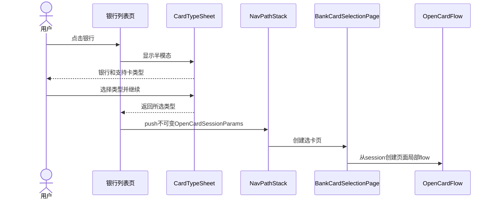
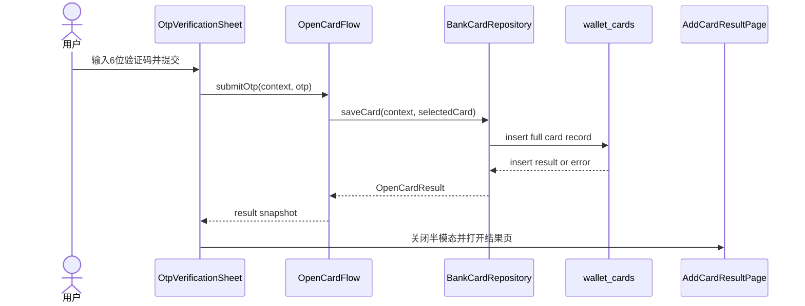
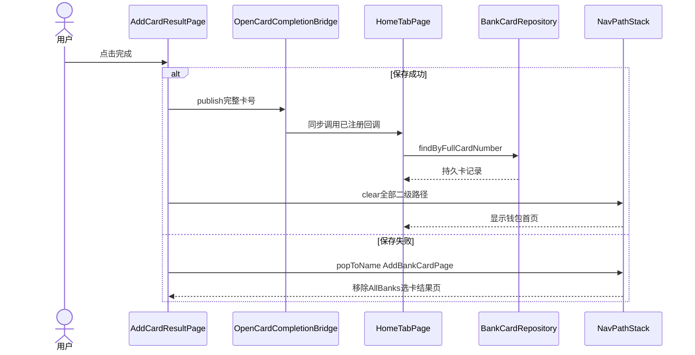
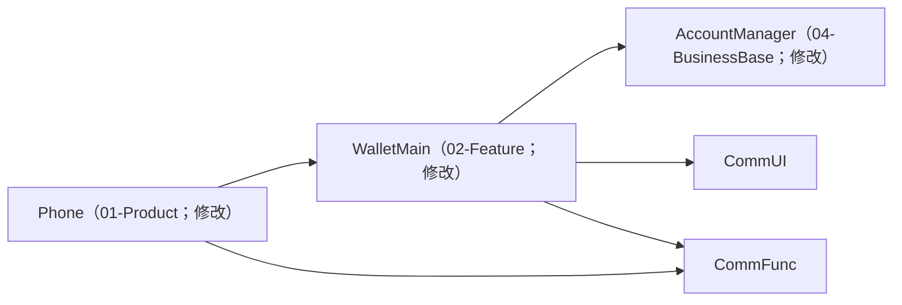
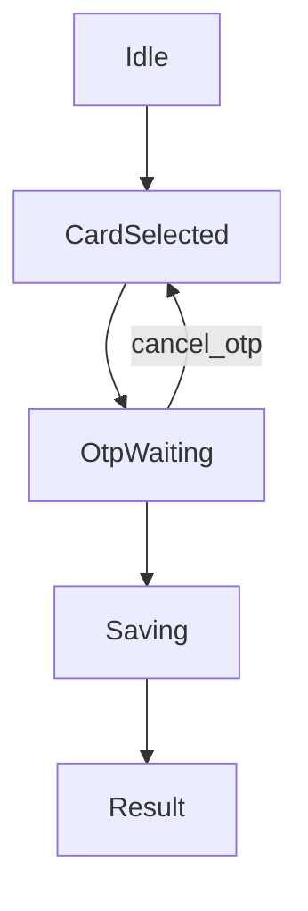
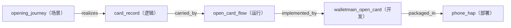

---
derived_from:
  artifact: component-blueprint@1
  component_id: WalletMain
  blueprint_id: bc-openCard-2
  revision: 5
  source_fingerprint: sha256:13e5f89dcf04904d7c6857f7e419acf73c9c0d431aad56073ddffc9b0accd860
  artifact_sha256: sha256:d27ce2d578f76a0cf3ff59896fe9738b26219ef2a750170ff55a85fbcc2ebdf6
  change_units:
    - change_unit_id: open-card-flow
      binding: bound
      identity_neutral_digest: 70651faa85c4ce22d39e69ca67f86fedfd612bc5d5ada31a2c1790c5cc7968ed
projection: component-blueprint-review@12
---

# bc-openCard-2 银行卡开卡闭环

<a id="design-626c75657072696e743a62632d6f70656e436172642d32"></a>
阅读入口：先阅读方案、旅程、关键流程和交付安排；类型、方法、完整分支与验收全文见同文档的[技术与追溯参考](#reference)。

<a id="summary"></a>
## 1 方案摘要

### 一页结论

本次把两个银行列表入口接成一条完整开卡链：选择卡类型和具体卡片，完成 6 位短信验证，等待本地 RDB 写入，再进入只能点击“完成”退出的结果页。成功把完整卡号一次性交给钱包首页后清栈，失败回最初添加银行卡页。

[设计依据](#reader-guide-source-1)

施工安排见[施工与上线](#delivery)。

<a id="background"></a>
## 2 背景、目标与边界

### 现状、问题与范围

bc-openCard-1 已提供银行列表和既有路由，但银行点击仍只提示暂不支持。本轮业务实现集中在 WalletMain，Phone 只增加新目的页注册；AccountManager 仅在既有 UserProfile 增加 mock 手机号，不承载银行卡状态。

[设计依据](#reader-guide-source-2)

<a id="terms"></a>
## 3 术语

### 术语与责任归属

“添卡”“卡包”来自 glossary 并归 WalletMain；“银行卡”尚未策展，按现有模块画像和无人值守授权暂映射到 WalletMain，作为 must-review 明示而不冒充人工确认。

[设计依据](#reader-guide-source-3)

<a id="journey"></a>
## 4 用户旅程与界面

### 用户旅程与四张参考图

J1 卡类型半模态、J2 具体卡片全屏页、J3 验证码半模态、J4 结果页依次对应四张参考图；J5 点击完成负责清栈和最终去向。写库失败只改变 J4/J5 的状态与去向，不跳过前序选择和验证。

<a id="design-696d6167653a646f632f66656174757265732fe58e9fe5a78be99c80e6b1822f312d322de993b6e8a18ce58da12f332de782b9e587bbe4bbbbe6848fe993b6e8a18ce68b89e8b5b7e6b7bbe58da1e98089e58da1e58d8ae6a8a1e680812e6a7067"></a>


<a id="design-696d6167653a646f632f66656174757265732fe58e9fe5a78be99c80e6b1822f312d322de993b6e8a18ce58da12f342de782b9e587bbe4bfa1e794a8e58da1e68896e582a8e89384e58da1e5908ee68b89e8b5b7e98089e58da1e9a1b5e99da22e6a7067"></a>


<a id="design-696d6167653a646f632f66656174757265732fe58e9fe5a78be99c80e6b1822f312d322de993b6e8a18ce58da12f352de98089e4b8ade69f90e5bca0e58da1e78987e5908ee68b89e8b5b7e79fade4bfa1e9aa8ce8af812e6a7067"></a>


<a id="design-696d6167653a646f632f66656174757265732fe58e9fe5a78be99c80e6b1822f312d322de993b6e8a18ce58da12f362de79fade4bfa1e9aa8ce8af81e5ae8ce68890e5908ee7bb93e69e9ce9a1b52e6a7067"></a>


[设计依据](#reader-guide-source-4)

<a id="solution"></a>
## 5 整体方案

页面间只传不可变 OpenCardSessionParams；BankCardSelectionPage 持有当前 OpenCardFlow，HomeTabPage 首次创建时向一次性完成桥接注册回调。BankRepository 提供银行与 1-2 张 mock 卡，BankCardRepository 是 wallet_cards 的唯一写入口。UI 只显示掩码卡号，完整卡号沿业务对象进入 RDB、结果参数与同步首页回调。

[设计依据](#reader-guide-source-5)

<a id="flows"></a>
## 6 关键流程

### 三段关键调用

第一段从银行点击打开卡类型半模态；第二段从验证码提交跨 OpenCardFlow、Repository 和 RDB 得到真实保存结果；第三段只允许结果页“完成”按钮裁剪开卡栈。每段都保留调用、等待和返回次序。

[设计依据](#reader-guide-source-6)

<a id="design-67726170683a6f70656e2d636172642d73656c6563742d74797065"></a>
完整调用时序：打开卡类型半模态



<a id="design-67726170683a6f70656e2d636172642d736176652d726573756c74"></a>
完整调用时序：提交验证码并保存



<a id="design-67726170683a6f70656e2d636172642d636f6d706c657465"></a>
完整调用时序：结果页完成并清栈



<a id="data"></a>
## 7 数据与存储

wallet.db v1 的 wallet_cards 表以 id 为主键、完整卡号为唯一键，保存通用卡类型、银行、银行卡类型、添加时间、华为支付/银联闪付状态和 JSON 交易记录。当前演示版依赖应用沙箱，不记录完整卡号和验证码日志。

[设计依据](#reader-guide-source-7)

<a id="decisions"></a>
## 8 关键取舍

复用唯一 NavPathStack，不再造 Router；RDB 使用单表和唯一约束，不增加缓存或第二真源；结果页成功去首页，因为卡详情明确属于后续需求。两种半模态均在 WalletMain 内做业务组件。

[设计依据](#reader-guide-source-8)

<a id="design-6465636973696f6e3a73636f70652d6d6f64756c6573"></a>
### 模块范围

| 关切 | 结论 |
| --- | --- |
| 选了什么 | WalletMain 承担银行卡业务，Phone 只改根导航注册，AccountManager 仅为既有 UserProfile 增加权威 mock phoneNumber；不修改 CommUI、CommFunc。|
| 理由 | catalog 明确 WalletMain 负责添卡、Phone 负责 navDestination、AccountManager 负责账号 mock/profile 数据，正好覆盖原需求的三个责任点。|

被否方案：

未记录；不推测被否选择。

<a id="design-6465636973696f6e3a6e617669676174696f6e2d737461636b"></a>
### 导航与清栈

| 关切 | 结论 |
| --- | --- |
| 选了什么 | 复用 NavPathContext 的唯一 NavPathStack；失败统一 popToName(AddBankCardPage)，成功 publish 完整卡号后 clear 全部二级路径。|
| 理由 | 现有二级页面均消费同一根栈，另建 Router 会破坏既有路由契约。|

被否方案：

未记录；不推测被否选择。

<a id="design-6465636973696f6e3a66756c6c2d636172642d6e756d626572"></a>
### 完整卡号边界

| 关切 | 结论 |
| --- | --- |
| 选了什么 | 完整卡号仅在 mock 数据、流程对象和 RDB 中传递；所有用户可见卡号都使用前四后四掩码。|
| 理由 | 原始需求同时要求后台完整处理和界面掩码展示。|

被否方案：

未记录；不推测被否选择。

<a id="design-6465636973696f6e3a7264622d736368656d61"></a>
### RDB 真源与幂等

| 关切 | 结论 |
| --- | --- |
| 选了什么 | WalletMain 创建 wallet.db v1 的 wallet\_cards 表，full\_card\_number UNIQUE；写入失败映射失败结果，不自动重试。|
| 理由 | 单表覆盖当前必需字段，唯一约束以最少状态阻止重复卡记录。|

被否方案：

未记录；不推测被否选择。

<a id="design-6465636973696f6e3a726573756c742d64657374696e6174696f6e"></a>
### 结果页完成去向

| 关切 | 结论 |
| --- | --- |
| 选了什么 | 成功完成回钱包首页，失败完成回最初添加银行卡页；卡详情页留待后续需求。|
| 理由 | 需求规格明确说明银行卡详情页开发完成后才替换成功去向。|

被否方案：

未记录；不推测被否选择。

<a id="design-6465636973696f6e3a636f6d706f6e656e742d636172642d747970652d7368656574"></a>
### 卡类型半模态组件选型

| 关切 | 结论 |
| --- | --- |
| 选了什么 | 选型结果：自定义实现；选型目标：[开发视图](#design-766965773a646576656c6f706d656e74)/node:ui\_card\_type\_sheet |
| 理由 | component-index 没有带银行业务语义和半模态状态的现成组件，在 WalletMain 内新建业务组件。|

被否方案：

未记录；不推测被否选择。

<a id="design-6465636973696f6e3a636f6d706f6e656e742d6f74702d7368656574"></a>
### 验证码半模态组件选型

| 关切 | 结论 |
| --- | --- |
| 选了什么 | 选型结果：自定义实现；选型目标：[开发视图](#design-766965773a646576656c6f706d656e74)/node:ui\_otp\_verification\_sheet |
| 理由 | 现有组件不包含 OTP 输入、倒计时和重发状态，新增 WalletMain 业务组件。|

被否方案：

未记录；不推测被否选择。

<a id="design-6465636973696f6e3a636f6d706f6e656e742d62616e6b2d636172642d73656c656374696f6e2d70616765"></a>
### 具体银行卡选择页组件选型

| 关切 | 结论 |
| --- | --- |
| 选了什么 | 选型结果：自定义实现；选型目标：[开发视图](#design-766965773a646576656c6f706d656e74)/node:ui\_bank\_card\_selection\_page |
| 理由 | 组件索引没有银行候选卡、掩码、协议和局部 OpenCardFlow 组合页面。|

被否方案：

未记录；不推测被否选择。

<a id="design-6465636973696f6e3a636f6d706f6e656e742d6164642d636172642d726573756c742d70616765"></a>
### 开卡结果页组件选型

| 关切 | 结论 |
| --- | --- |
| 选了什么 | 选型结果：自定义实现；选型目标：[开发视图](#design-766965773a646576656c6f706d656e74)/node:ui\_add\_card\_result\_page |
| 理由 | 组件索引没有阻止返回、区分保存结果并执行清栈去向的全屏结果页。|

被否方案：

未记录；不推测被否选择。

<a id="design-6465636973696f6e3a636f6d706f6e656e742d6164642d62616e6b2d636172642d70616765"></a>
### 添加银行卡页组件选型

| 关切 | 结论 |
| --- | --- |
| 选了什么 | 选型结果：兼容演进共享定义；选型目标：[开发视图](#design-766965773a646576656c6f706d656e74)/node:ui\_add\_bank\_card\_page；组件：WalletMain/src/main/ets/presentation/pages/AddBankCardPage.ets#buildAddBankCardPage |
| 理由 | 保留已验收布局、路由身份和银行数据，只替换银行行点击后继行为。|

被否方案：

未记录；不推测被否选择。

<a id="design-6465636973696f6e3a636f6d706f6e656e742d616c6c2d62616e6b732d70616765"></a>
### 全部银行页组件选型

| 关切 | 结论 |
| --- | --- |
| 选了什么 | 选型结果：兼容演进共享定义；选型目标：[开发视图](#design-766965773a646576656c6f706d656e74)/node:ui\_all\_banks\_page；组件：WalletMain/src/main/ets/presentation/pages/AllBanksPage.ets#buildAllBanksPage |
| 理由 | 保留已验收 A-Z 页面、返回语义和列表身份，只替换银行行点击后继行为。|

被否方案：

未记录；不推测被否选择。

<a id="design-6465636973696f6e3a636f6d706f6e656e742d686f6d652d7461622d70616765"></a>
### 钱包首页组件选型

| 关切 | 结论 |
| --- | --- |
| 选了什么 | 选型结果：兼容演进共享定义；选型目标：[开发视图](#design-766965773a646576656c6f706d656e74)/node:ui\_home\_tab\_page；组件：WalletMain/src/main/ets/presentation/pages/HomeTabPage.ets#HomeTabPage |
| 理由 | 保留现有 Tab、NavPathStack 和首页结构，只增加一次性开卡完成订阅与 RDB 刷新。|

被否方案：

未记录；不推测被否选择。

<a id="recovery"></a>
## 9 失败与恢复

无效验证码不触发保存；关闭 OTP 半模态回到当前选卡页并释放计时器；RDB 异常进入失败结果页；进程重建只保留已完整提交的 RDB 记录，未保存会话从安全入口重新开始。Saving 为 single-flight，重复卡号不会覆盖旧记录。

[设计依据](#reader-guide-source-9)

边界验收：[BD-1](#design-616363657074616e63653a766965773a646576656c6f706d656e742f6e6f64653a77616c6c65746d61696e5f6f70656e5f636172642f626f756e6461726965733a42442d31)；[BD-2](#design-616363657074616e63653a766965773a646576656c6f706d656e742f6e6f64653a77616c6c65746d61696e5f6f70656e5f636172642f626f756e6461726965733a42442d32)；[BD-3](#design-616363657074616e63653a766965773a646576656c6f706d656e742f6e6f64653a77616c6c65746d61696e5f6f70656e5f636172642f626f756e6461726965733a42442d33)；[BD-4](#design-616363657074616e63653a766965773a646576656c6f706d656e742f6e6f64653a77616c6c65746d61696e5f6f70656e5f636172642f626f756e6461726965733a42442d34)；[BD-5](#design-616363657074616e63653a766965773a646576656c6f706d656e742f6e6f64653a77616c6c65746d61696e5f6f70656e5f636172642f626f756e6461726965733a42442d35)。

<a id="quality"></a>
## 10 质量与安全

### 质量、安全与体验

核心隐私边界是屏幕掩码、验证码不落盘、不打敏感日志；UI 由参考图和真机证据验收，倒计时每秒刷新，新按钮和交互行需有稳定 element id、禁用态和可触控区域。

[设计依据](#reader-guide-source-10)

<a id="delivery"></a>
## 11 施工与上线

一个 Change Unit 足以原子交付：先完成 WalletMain 的模型、Repository、流程、页面、资源和测试，再同步更新 index/route_map 与 Phone 注册。构建、业务 UT 和真机路由/视觉验证均通过后才算完成。

[设计依据](#reader-guide-source-11)

### open-card-flow

原子交付银行卡开卡闭环：双入口卡类型选择、具体卡片、账号 mock 手机号 OTP、RDB 保存、结果页、完成清栈与首页按号刷新。

- 双入口到结果完成的主路径和失败路径符合 AC-1 至 AC-8。
- 选卡页局部 OpenCardFlow 与 wallet\_cards 各自保持单一状态所有者。
- 结果页与 HomeTab 分别消费保存结果和一次性完整卡号。
- RDB 必填字段、唯一约束、手机号接缝和完整卡号映射全部实现。
- OTP 取消、RDB 失败、重复提交和进程重建保持安全中间态。

模块分工：AccountManager；Phone；WalletMain。

- 设计目标（责任方：WalletMain）
- 设计目标（责任方：AccountManager）
- 设计目标（责任方：Phone）

未声明上游依赖。

安全中间态：同一 CU 内先完成模型/Repository/Flow 和 WalletMain builder 导出，再接 Phone 注册；任何阶段均保持既有页面可编译，未完成时不宣称开卡可达。

精确映射见 [施工单元参考](#design-756e69743a6f70656e2d636172642d666c6f77)。

### 文件与目录

```text
├── 01-Product/Phone/src/main/ets/pages/
│   └── index.ets
├── 02-Feature/WalletMain/src/
│   ├── main/
│   │   ├── ets/
│   │   │   ├── data/
│   │   │   │   ├── model/
│   │   │   │   │   ├── BankCardInfo.ets
│   │   │   │   │   ├── BankCardType.ets
│   │   │   │   │   ├── BankInfo.ets
│   │   │   │   │   ├── CardRecord.ets
│   │   │   │   │   ├── OpenCardResult.ets
│   │   │   │   │   └── OpenCardSessionParams.ets
│   │   │   │   └── repository/
│   │   │   │       ├── BankCardRepository.ets
│   │   │   │       └── BankRepository.ets
│   │   │   ├── domain/service/
│   │   │   │   ├── BankCardMaskService.ets
│   │   │   │   └── OpenCardFlow.ets
│   │   │   ├── index.ets
│   │   │   ├── presentation/
│   │   │   │   ├── components/
│   │   │   │   │   ├── CardTypeSheet.ets
│   │   │   │   │   └── OtpVerificationSheet.ets
│   │   │   │   └── pages/
│   │   │   │       ├── AddBankCardPage.ets
│   │   │   │       ├── AddCardResultPage.ets
│   │   │   │       ├── AllBanksPage.ets
│   │   │   │       ├── BankCardSelectionPage.ets
│   │   │   │       └── HomeTabPage.ets
│   │   │   └── shared/
│   │   │       ├── OpenCardCompletionBridge.ets
│   │   │       └── constant/
│   │   │           └── BankConstants.ets
│   │   └── resources/base/
│   │       ├── element/
│   │       │   ├── color.json
│   │       │   ├── float.json
│   │       │   └── string.json
│   │       ├── media/
│   │       │   └── card_open_result_guide.png
│   │       └── profile/
│   │           └── route_map.json
│   └── ohosTest/ets/test/
│       ├── List.test.ets
│       └── bank_open_card_2_ut.test.ets
└── 04-BusinessBase/AccountManager/src/main/ets/
    ├── data/model/
    │   └── UserProfile.ets
    ├── domain/service/
    │   └── AccountService.ets
    └── index.ets
```

| 上线顺序 | 交付单元 | 配套前提 | 说明 |
| --- | --- | --- | --- |
| 1 | WalletMain 数据模型、RDB 与页面 | 无 | 编译期同包交付。|
| 2 | Phone navDestination 注册 | WalletMain builder exports | 同一构建内完成，不允许壳先引用未导出的符号。|

| 配套方 | 协同关系 |
| --- | --- |
| HarmonyOS relationalStore | 本地系统 API；无外部服务发布配套。|

<a id="acceptance"></a>
## 12 验收

### 验收口径

[AC-1](#design-616363657074616e63653a766965773a646576656c6f706d656e742f6e6f64653a77616c6c65746d61696e5f6f70656e5f636172642f63726974657269613a41432d31) 至 [AC-8](#design-616363657074616e63653a766965773a646576656c6f706d656e742f6e6f64653a77616c6c65746d61696e5f6f70656e5f636172642f63726974657269613a41432d38) 覆盖双入口、单选、掩码、OTP、真实写库结果、结果页清栈、既有路由回归和四屏视觉；[BD-1](#design-616363657074616e63653a766965773a646576656c6f706d656e742f6e6f64653a77616c6c65746d61696e5f6f70656e5f636172642f626f756e6461726965733a42442d31) 至 [BD-5](#design-616363657074616e63653a766965773a646576656c6f706d656e742f6e6f64653a77616c6c65746d61696e5f6f70656e5f636172642f626f756e6461726965733a42442d35) 覆盖单类型银行、RDB 故障、取消清理、进程重建和 Saving single-flight。

[设计依据](#reader-guide-source-12)

<a id="questions"></a>
## 13 待补问题

### 当前待复核事项

需人工知道的两点是“银行卡”术语尚未写入 glossary，以及成功去向按需求正文的“详情页后续再做”解释为钱包首页；首轮独立质询提出的跨页会话、手机号、RDB 映射、首页交接和清栈问题已在当前修订中闭合，并由同一质询方复核通过。

[设计依据](#reader-guide-source-13)

### 术语假定

| 术语 | 当前假定解释 | 确认情况 |
| --- | --- | --- |
| 银行卡 | 本需求中的银行候选卡、开卡状态、页面与本地记录，属于钱包主 feature，而非账号域。| 作者自行假定，待确认 |

完整术语与来源见[术语参考](#review-terms)。

### 必须关注的评审问题

- 术语“银行卡”不在 glossary 中，按无人值守授权映射到 WalletMain，需后续人工策展时复核
- 需求同时写了“成功后钱包首页”和“结果页完成跳卡详情”，以后者被明确说明为后续能力，本轮采用钱包首页


<a id="reference"></a>
## 技术与追溯参考

部件 WalletMain · 蓝图 bc-openCard-2 · revision 5 · 准入 通过

本文根据 canonical 蓝图与当前施工单元确定性生成，文首保留精确来源身份。是否通过设计交接见 readiness；施工授权、映射与完成结论由原责任阶段确认。可选说明缺失或过期不改变这些结论。

参考保留全部声明；不从名称、目录或数组顺序推断调用、依赖与未声明存储设计。正文的验收链接按来源目标与条目编号定位。

### A 字段与类型

<a id="review-summary-details"></a>
#### 原概述与目标

| 关切 | 设计说明 |
| --- | --- |
| 背景 | bc-openCard-1 已具备添加银行卡、全部银行列表及统一导航栈。本次把两个银行入口从 “暂不支持”升级为可完成的银行卡开卡流程，并把成功卡片持久化到本地 RDB。 |
| 问题 | 当前银行行点击只显示提示，既没有卡类型、具体卡片、短信验证码和结果界面，也没有可供 后续卡详情读取的银行卡持久化模型。 |
| 本次改变 | — |
| 整体定位 | WalletMain 负责开卡页面、业务状态、mock 数据和 RDB；Phone 仅继续履行根 navDestination 注册职责。AccountManager 扩展既有 UserProfile mock 数据，提供验证码文案所需的完整手机号。 |
| 范围 | WalletMain 的银行 mock 数据、开卡 UI、流程编排、RDB Repository、资源和业务级测试；Phone 根导航对新全屏页面的注册；AccountManager 的 UserProfile mock 手机号字段与既有出口；参考图对应的四个目标界面及既有路径回归 |
| 不做什么 | 生产银行、短信、银联、华为支付和 NFC 接口；银行卡详情页；成功后本轮落到钱包首页；协议富文本点击、交易流水业务和数据库加密 |

| 目标 | 目标说明 | 成功衡量 |
| --- | --- | --- |
| G1 | 用户从任一银行入口完成卡类型选择、具体卡片选择、短信验证和结果确认。 | 两个入口行为一致且既有路由不回归<br>仅 6 位数字验证码可提交，60 秒倒计时可重发<br>写库成功或失败都进入对应结果页 |
| G2 | 新增可持续演进的银行卡 RDB 数据真源。 | 完整卡号只在业务数据与 RDB 中处理，界面只展示前四后四<br>表至少承载银行、银行卡种类、通用卡类型、支付能力、添加时间和交易记录 |

未记录：本次改变（设计说明）。

<a id="review-terms"></a>
#### 完整术语

| 术语 | 含义 | 模块 | 易混项 | 确认依据 |
| --- | --- | --- | --- | --- |
| 卡包 | 钱包中展示和管理卡片的 feature 页面与数据编排。 | WalletMain | AccountManager；CommUI；Phone | doc/glossary.yaml#卡包 |
| 添卡 | 从钱包入口选择卡种并进入新增卡片流程的业务语义。 | WalletMain | AccountManager；CommUI；Phone | doc/glossary.yaml#添卡 |
| 银行卡 | 本需求中的银行候选卡、开卡状态、页面与本地记录，属于钱包主 feature，而非账号域。 | WalletMain | AccountManager；CommUI；Phone | doc/module-catalog.yaml#WalletMain |

#### 必须关注的评审问题

见正文[必须关注的评审问题](#questions)。

#### 领域模型、字段与枚举

<a id="design-6d6f64656c3a766965773a646576656c6f706d656e742f6e6f64653a77616c6c65746d61696e5f6f70656e5f636172642f42616e6b4361726454797065"></a>
内容承载于：[walletmain\_open\_card](#design-766965773a646576656c6f706d656e742f6e6f64653a77616c6c65746d61696e5f6f70656e5f63617264) · 契约设计

#### BankCardType · 枚举

模块 未记录；文件 02-Feature/WalletMain/src/main/ets/data/model/BankCardType.ets

| 字段 | 类型 | 必需 |
| --- | --- | --- |
| DEBIT | string | 是 |
| CREDIT | string | 是 |

未记录：可空；默认值；约束/说明；补充约束；验证引用；来源。

<a id="design-6d6f64656c3a766965773a646576656c6f706d656e742f6e6f64653a77616c6c65746d61696e5f6f70656e5f636172642f42616e6b496e666f"></a>


#### BankInfo · 接口

模块 未记录；文件 02-Feature/WalletMain/src/main/ets/data/model/BankInfo.ets

| 字段 | 类型 | 必需 |
| --- | --- | --- |
| code | string | 是 |
| name | string | 是 |
| supportedCardTypes | BankCardType\[\] | 是 |

未记录：可空；默认值；约束/说明；补充约束；验证引用；来源。

<a id="design-6d6f64656c3a766965773a646576656c6f706d656e742f6e6f64653a77616c6c65746d61696e5f6f70656e5f636172642f42616e6b43617264496e666f"></a>


#### BankCardInfo · 接口

模块 未记录；文件 02-Feature/WalletMain/src/main/ets/data/model/BankCardInfo.ets

| 字段 | 类型 | 必需 |
| --- | --- | --- |
| cardId | string | 是 |
| fullCardNumber | string | 是 |
| bankCode | string | 是 |
| bankName | string | 是 |
| bankCardType | BankCardType | 是 |
| huaweiPayEnabled | boolean | 是 |
| unionPayQuickPassEnabled | boolean | 是 |

未记录：可空；默认值；约束/说明；补充约束；验证引用；来源。

<a id="design-6d6f64656c3a766965773a646576656c6f706d656e742f6e6f64653a77616c6c65746d61696e5f6f70656e5f636172642f4f70656e4361726453657373696f6e506172616d73"></a>


#### OpenCardSessionParams · 接口

模块 未记录；文件 02-Feature/WalletMain/src/main/ets/data/model/OpenCardSessionParams.ets

| 字段 | 类型 | 必需 |
| --- | --- | --- |
| bankCode | string | 是 |
| bankName | string | 是 |
| bankCardType | BankCardType | 是 |
| failureTargetName | string | 是 |

未记录：可空；默认值；约束/说明；补充约束；验证引用；来源。

<a id="design-6d6f64656c3a766965773a646576656c6f706d656e742f6e6f64653a77616c6c65746d61696e5f6f70656e5f636172642f436172645265636f7264"></a>


#### CardRecord · 类

模块 未记录；文件 02-Feature/WalletMain/src/main/ets/data/model/CardRecord.ets

| 字段 | 类型 | 必需 |
| --- | --- | --- |
| id | number | 是 |
| fullCardNumber | string | 是 |
| genericCardType | string | 是 |
| bankName | string | 是 |
| bankCode | string | 是 |
| bankCardType | string | 是 |
| addedAt | number | 是 |
| huaweiPayEnabled | boolean | 是 |
| unionPayQuickPassEnabled | boolean | 是 |
| transactionRecords | string | 是 |

未记录：可空；默认值；约束/说明；补充约束；验证引用；来源。

<a id="design-6d6f64656c3a766965773a646576656c6f706d656e742f6e6f64653a77616c6c65746d61696e5f6f70656e5f636172642f4f70656e43617264526573756c74"></a>


#### OpenCardResult · 类

模块 未记录；文件 02-Feature/WalletMain/src/main/ets/data/model/OpenCardResult.ets

| 字段 | 类型 | 必需 |
| --- | --- | --- |
| success | boolean | 是 |
| fullCardNumber | string | 是 |
| failureReason | string | 否 |

未记录：可空；默认值；约束/说明；补充约束；验证引用；来源。

<a id="design-6d6f64656c3a766965773a646576656c6f706d656e742f6e6f64653a77616c6c65746d61696e5f6f70656e5f636172642f5573657250726f66696c65"></a>


#### UserProfile · 类

模块 未记录；文件 04-BusinessBase/AccountManager/src/main/ets/data/model/UserProfile.ets

| 字段 | 类型 | 必需 |
| --- | --- | --- |
| isLoggedIn | boolean | 是 |
| displayAccount | string | 是 |
| phoneNumber | string | 是 |

未记录：可空；默认值；约束/说明；补充约束；验证引用；来源。

### B 接口与存储明细

#### 本部件实际消费或提供的操作与 DTO

<a id="design-636f6e74726163743a62616e6b2d636172642d656e726f6c6c6d656e74"></a>
#### bank-card-enrollment

操作：enroll\_bank\_card · 1 · ui\_to\_local\_storage；责任方 WalletMain；需要方 open-card-end-to-end

<a id="design-64746f3a62616e6b2d636172642d656e726f6c6c6d656e742f726571756573745f64746f"></a>
**请求 DTO：OpenCardRequest**

来源：[request\_dto](../../../../doc/features/bc-openCard-2/blueprint/component-blueprint.yaml#/contracts/0/request_dto)
验证引用：[AC-3](#design-616363657074616e63653a766965773a646576656c6f706d656e742f6e6f64653a77616c6c65746d61696e5f6f70656e5f636172642f63726974657269613a41432d33)；[AC-4](#design-616363657074616e63653a766965773a646576656c6f706d656e742f6e6f64653a77616c6c65746d61696e5f6f70656e5f636172642f63726974657269613a41432d34)

| 字段 | 类型 | 语义 | 来源 |
| --- | --- | --- | --- |
| bankCode | string | 被选银行短码。 | doc/features/bc-openCard-2/blueprint/component-blueprint.yaml#/contracts/0/request\_dto/fields/0 |
| bankName | string | 被选银行显示名。 | doc/features/bc-openCard-2/blueprint/component-blueprint.yaml#/contracts/0/request\_dto/fields/1 |
| bankCardType | debit&#124;credit | 单选银行卡类型。 | doc/features/bc-openCard-2/blueprint/component-blueprint.yaml#/contracts/0/request\_dto/fields/2 |
| fullCardNumber | string | 仅业务层和 RDB 使用的完整卡号。 | doc/features/bc-openCard-2/blueprint/component-blueprint.yaml#/contracts/0/request\_dto/fields/3 |
| huaweiPayEnabled | boolean | mock 卡的华为支付开通状态。 | doc/features/bc-openCard-2/blueprint/component-blueprint.yaml#/contracts/0/request\_dto/fields/4 |
| unionPayQuickPassEnabled | boolean | mock 卡的银联手机闪付状态。 | doc/features/bc-openCard-2/blueprint/component-blueprint.yaml#/contracts/0/request\_dto/fields/5 |
| otp | string | 恰好 6 位数字的模拟验证码。 | doc/features/bc-openCard-2/blueprint/component-blueprint.yaml#/contracts/0/request\_dto/fields/6 |

未记录：必需；可空；默认值；约束；验证引用。

<a id="design-64746f3a62616e6b2d636172642d656e726f6c6c6d656e742f726573706f6e73655f64746f"></a>
**响应 DTO：OpenCardResult**

来源：[response\_dto](../../../../doc/features/bc-openCard-2/blueprint/component-blueprint.yaml#/contracts/0/response_dto)
验证引用：[AC-5](#design-616363657074616e63653a766965773a646576656c6f706d656e742f6e6f64653a77616c6c65746d61696e5f6f70656e5f636172642f63726974657269613a41432d35)；[AC-6](#design-616363657074616e63653a766965773a646576656c6f706d656e742f6e6f64653a77616c6c65746d61696e5f6f70656e5f636172642f63726974657269613a41432d36)

| 字段 | 类型 | 可空 | 语义 | 来源 |
| --- | --- | --- | --- | --- |
| success | boolean | — | RDB 保存真实结果。 | doc/features/bc-openCard-2/blueprint/component-blueprint.yaml#/contracts/0/response\_dto/fields/0 |
| fullCardNumber | string | — | 结果页完成去向携带的完整卡号。 | doc/features/bc-openCard-2/blueprint/component-blueprint.yaml#/contracts/0/response\_dto/fields/1 |
| failureReason | string&#124;null | 是 | 保存失败诊断，不展示底层异常细节。 | doc/features/bc-openCard-2/blueprint/component-blueprint.yaml#/contracts/0/response\_dto/fields/2 |

映射：

| 映射 | 类型 | 源字段 | 目标字段 | 规则 |
| --- | --- | --- | --- | --- |
| request\_bank | 直接映射 | bankCode | CardRecord.bankCode | 原值写入。 |
| request\_bank\_name | 直接映射 | bankName | CardRecord.bankName | 原值写入。 |
| request\_type | 直接映射 | bankCardType | CardRecord.bankCardType | 原值写入。 |
| request\_number | 直接映射 | fullCardNumber | CardRecord.fullCardNumber | 完整值写入，不使用掩码值。 |
| request\_huawei\_pay | 直接映射 | huaweiPayEnabled | CardRecord.huaweiPayEnabled | 布尔值转 RDB INTEGER 0/1。 |
| request\_unionpay | 直接映射 | unionPayQuickPassEnabled | CardRecord.unionPayQuickPassEnabled | 布尔值转 RDB INTEGER 0/1。 |
| default\_generic\_type | default | 无 | CardRecord.genericCardType | 固定写入 bank\_card。 |
| derive\_added\_at | default | 无 | CardRecord.addedAt | 保存事务开始时取 Date.now()。 |
| default\_transactions | default | 无 | CardRecord.transactionRecords | 固定写入空 JSON 数组字符串 \[\]。 |
| request\_otp\_drop | drop | otp | none | 仅校验格式，不持久化验证码。 |
| response\_success | 直接映射 | success | AddCardResultPage.success | 原值展示结果状态。 |
| response\_number | 直接映射 | fullCardNumber | AddCardResultPage.fullCardNumber | 完整值仅作业务参数，结果页不直接显示。 |
| response\_reason | 直接映射 | failureReason | AddCardResultPage.failureReason | nullable，空值表示成功。 |

错误：已声明（结构未展开）
来源：[errors](../../../../doc/features/bc-openCard-2/blueprint/component-blueprint.yaml#/contracts/0/errors)
验证：[BD-2](#design-616363657074616e63653a766965773a646576656c6f706d656e742f6e6f64653a77616c6c65746d61696e5f6f70656e5f636172642f626f756e6461726965733a42442d32)；[BD-3](#design-616363657074616e63653a766965773a646576656c6f706d656e742f6e6f64653a77616c6c65746d61696e5f6f70656e5f636172642f626f756e6461726965733a42442d33)
幂等：key：fullCardNumber；scope：wallet\_cards；duplicate\_result：返回失败结果，不覆盖既有记录。
来源：[idempotency](../../../../doc/features/bc-openCard-2/blueprint/component-blueprint.yaml#/contracts/0/idempotency)
验证：[AC-5](#design-616363657074616e63653a766965773a646576656c6f706d656e742f6e6f64653a77616c6c65746d61696e5f6f70656e5f636172642f63726974657269613a41432d35)；[BD-4](#design-616363657074616e63653a766965773a646576656c6f706d656e742f6e6f64653a77616c6c65746d61696e5f6f70656e5f636172642f626f756e6461726965733a42442d34)
非功能要求：privacy：UI 仅显示卡号前四后四，验证码不持久化。；performance：OTP 每秒更新，RDB 写入在 UI await 后只发布一次结果。；accessibility：可操作行和按钮提供稳定 id、禁用态和足够触控区域。
来源：[nfr](../../../../doc/features/bc-openCard-2/blueprint/component-blueprint.yaml#/contracts/0/nfr)
验证：[AC-3](#design-616363657074616e63653a766965773a646576656c6f706d656e742f6e6f64653a77616c6c65746d61696e5f6f70656e5f636172642f63726974657269613a41432d33)；[AC-4](#design-616363657074616e63653a766965773a646576656c6f706d656e742f6e6f64653a77616c6c65746d61696e5f6f70656e5f636172642f63726974657269613a41432d34)；[AC-8](#design-616363657074616e63653a766965773a646576656c6f706d656e742f6e6f64653a77616c6c65746d61696e5f6f70656e5f636172642f63726974657269613a41432d38)

未记录：必需；可空；默认值；约束；验证引用。

#### 持久化表结构

表结构来自根级接口契约；领域模型见字段与类型，存储约束和编码保留此处原始声明。

##### bank-card-enrollment 的存储设计

| 存储关切 | 声明 |
| --- | --- |
| 数据库 | wallet.db |
| 版本 | 1 |
| 安全级别 | — |
| 加密 | — |

未记录：安全级别（声明）；加密（声明）。

###### 表 wallet\_cards

| 表关切 | 声明 |
| --- | --- |
| 主键 | id |
| 约束 | — |
| 升级策略 | — |
| 来源 | — |

| 列 | 类型与声明约束 | 显式默认值 | 补充约束 |
| --- | --- | --- | --- |
| id | INTEGER | — | PRIMARY\_KEY；AUTOINCREMENT |
| full\_card\_number | TEXT | — | NOT\_NULL；UNIQUE |
| generic\_card\_type | TEXT | — | NOT\_NULL |
| bank\_name | TEXT | — | NOT\_NULL |
| bank\_code | TEXT | — | NOT\_NULL |
| bank\_card\_type | TEXT | — | NOT\_NULL |
| added\_at | INTEGER | — | NOT\_NULL |
| huawei\_pay\_enabled | INTEGER | — | NOT\_NULL |
| unionpay\_quickpass\_enabled | INTEGER | — | NOT\_NULL |
| transaction\_records | TEXT | \[\] | NOT\_NULL |


| 模块 | DSL 分层 | 变化 | 目录 |
| --- | --- | --- | --- |
| WalletMain | 02-Feature | 修改 | 02-Feature/WalletMain |
| Phone | 01-Product | 修改 | 01-Product/Phone |
| AccountManager | 04-BusinessBase | 修改 | 04-BusinessBase/AccountManager |

模块依赖：



<!-- module-edge-source:view:development/node:walletmain_open_card.contracts.module_dependencies.Phone[0] -->
<!-- module-edge-source:view:development/node:walletmain_open_card.contracts.module_dependencies.Phone[1] -->
<!-- module-edge-source:view:development/node:walletmain_open_card.contracts.module_dependencies.WalletMain[0] -->
<!-- module-edge-source:view:development/node:walletmain_open_card.contracts.module_dependencies.WalletMain[1] -->
<!-- module-edge-source:view:development/node:walletmain_open_card.contracts.module_dependencies.WalletMain[2] -->
未记录：约束（声明）；升级策略（声明）；来源（声明）；来源字段；编码；显式默认值；说明；来源；形式。

<a id="design-696e746572666163653a766965773a646576656c6f706d656e742f6e6f64653a77616c6c65746d61696e5f6f70656e5f636172642f42616e6b5265706f7369746f7279"></a>
接口 BankRepository · 未记录 / 未记录 · 02-Feature/WalletMain/src/main/ets/data/repository/BankRepository.ets

| 方法 | 参数 | 返回 |
| --- | --- | --- |
| getBanks | 无 | Promise&lt;BankInfo\[\]&gt; |
| getCards | bankCode: string；bankCardType: BankCardType | Promise&lt;BankCardInfo\[\]&gt; |

未记录：异步；职责/失败语义。

<a id="design-696e746572666163653a766965773a646576656c6f706d656e742f6e6f64653a77616c6c65746d61696e5f6f70656e5f636172642f42616e6b436172645265706f7369746f7279"></a>
接口 BankCardRepository · 未记录 / 未记录 · 02-Feature/WalletMain/src/main/ets/data/repository/BankCardRepository.ets

| 方法 | 参数 | 返回 |
| --- | --- | --- |
| saveCard | context: Context；card: BankCardInfo | Promise&lt;OpenCardResult&gt; |
| listCards | context: Context | Promise&lt;CardRecord\[\]&gt; |
| findByFullCardNumber | context: Context；fullCardNumber: string | Promise&lt;CardRecord&#124;null&gt; |

未记录：异步；职责/失败语义。

<a id="design-696e746572666163653a766965773a646576656c6f706d656e742f6e6f64653a77616c6c65746d61696e5f6f70656e5f636172642f4f70656e43617264466c6f77"></a>
接口 OpenCardFlow · 未记录 / 未记录 · 02-Feature/WalletMain/src/main/ets/domain/service/OpenCardFlow.ets

| 方法 | 参数 | 返回 |
| --- | --- | --- |
| selectCard | card: BankCardInfo | void |
| openOtp | 无 | void |
| closeOtp | 无 | void |
| normalizeOtp | raw: string | string |
| resendOtp | 无 | void |
| submitOtp | context: Context；otp: string | Promise&lt;OpenCardResult&gt; |
| dispose | 无 | void |

未记录：异步；职责/失败语义。

<a id="design-696e746572666163653a766965773a646576656c6f706d656e742f6e6f64653a77616c6c65746d61696e5f6f70656e5f636172642f4f70656e43617264436f6d706c6574696f6e427269646765"></a>
接口 OpenCardCompletionBridge · 未记录 / 未记录 · 02-Feature/WalletMain/src/main/ets/shared/OpenCardCompletionBridge.ets

| 方法 | 参数 | 返回 |
| --- | --- | --- |
| subscribe | listener: (fullCardNumber: string) =&gt; void | void |
| unsubscribe | listener: (fullCardNumber: string) =&gt; void | void |
| publish | fullCardNumber: string | void |

未记录：异步；职责/失败语义。

<a id="design-696e746572666163653a766965773a646576656c6f706d656e742f6e6f64653a77616c6c65746d61696e5f6f70656e5f636172642f4163636f756e7453657276696365"></a>
接口 AccountService · 未记录 / 未记录 · 04-BusinessBase/AccountManager/src/main/ets/domain/service/AccountService.ets

| 方法 | 参数 | 返回 |
| --- | --- | --- |
| getUserProfile | 无 | Promise&lt;UserProfile&gt; |

组件 CardTypeSheet · 组件 · 02-Feature/WalletMain/src/main/ets/presentation/components/CardTypeSheet.ets

未记录

组件 BankCardSelectionPage · 页面 · 02-Feature/WalletMain/src/main/ets/presentation/pages/BankCardSelectionPage.ets

未记录

组件 OtpVerificationSheet · 组件 · 02-Feature/WalletMain/src/main/ets/presentation/components/OtpVerificationSheet.ets

未记录

组件 AddCardResultPage · 页面 · 02-Feature/WalletMain/src/main/ets/presentation/pages/AddCardResultPage.ets

未记录

组件 AddBankCardPage · builder · 02-Feature/WalletMain/src/main/ets/presentation/pages/AddBankCardPage.ets

未记录

组件 AllBanksPage · builder · 02-Feature/WalletMain/src/main/ets/presentation/pages/AllBanksPage.ets

未记录

组件 HomeTabPage · 组件 · 02-Feature/WalletMain/src/main/ets/presentation/pages/HomeTabPage.ets

未记录

| 消费模块 | 提供模块 |
| --- | --- |
| Phone | WalletMain |
| WalletMain | AccountManager |
| WalletMain | WalletMain |

未记录：异步；职责/失败语义；需修改；入口。

#### 运行流与状态明细

<a id="design-766965773a72756e74696d652f666c6f773a6f70656e5f636172645f666c6f77"></a>
##### open\_card\_flow

数据域：wallet\_bank\_cards；契约：contract:bank-card-enrollment；开发责任：view:development/node:walletmain\_open\_card

触发：

| 类型 | 时机 | 幂等 |
| --- | --- | --- |
| user\_action | 用户在验证码半模态点击下一步 | 同一完整卡号使用唯一约束；重复提交返回确定性失败结果且不写第二条。 |

首次加载：load\_bank\_candidates · BankRepository 按 bankCode 和 bankCardType 返回内存 mock 候选卡。；责任方 WalletMain.BankRepository；范围 当前选择银行和卡类型；新鲜度 单次页面进入时读取，流程结束清理。

权威状态：view:logical/node:card\_record；持久化 WalletMain.BankCardRepository.wallet\_cards；投影/缓存 view:runtime/node:wallet\_card\_projection；调和 RDB insert 返回成功才把结果标为成功；异常映射为失败结果且不伪造已保存记录。
状态责任方：view:runtime/node:opening\_flow\_state；状态 Idle；CardSelected；OtpWaiting；Saving；Result

写入与发布：

| 写入 | 类型 | 持久化 | 发布 | 恢复 |
| --- | --- | --- | --- | --- |
| save\_selected\_card | foreground | WalletMain.BankCardRepository.wallet\_cards | publication:card\_saved | recovery:save\_result |

| 发布 | 时机 | 载荷 |
| --- | --- | --- |
| card\_saved | RDB insert resolve 或 reject 后发布一次 | OpenCardResult(success, fullCardNumber, failureReason) |
| open\_card\_completed | 结果页点击完成且 success=true 时发布，首页消费后清除 | 成功分支的完整卡号一次性载荷 |

订阅与消费者：

| 订阅 | 消费者 | 建立/解除 | 快照/重放 | 清理 | 顺序 |
| --- | --- | --- | --- | --- | --- |
| result\_page\_subscription | consumer:add\_card\_result\_page | push AddCardResultPage 时绑定不可变结果参数 / 完成按钮处理后页面随开卡栈一起移除 | 结果页使用入栈快照，不依赖后续广播 | 释放计时器和 OpenCardFlow 会话引用 | 先完成 RDB await，再 push 结果页 |
| wallet\_home\_completion | consumer:wallet\_home | HomeTabPage.aboutToAppear 首次创建时 subscribe 稳定回调；根组件被二级 NavDestination 覆盖时保持实例和订阅 / HomeTabPage.aboutToDisappear 仅在组件销毁时 unsubscribe 同一函数引用 | 单 listener + 单 pending 快照保证每个完整卡号至多消费一次 | publish 向当前 listener 同步投递一次后清除 pending；无 listener 时保留一份 pending 并在下次 subscribe 投递 | 结果页 publish 同步触发首页 handler 开始按号读 RDB，再 clear 导航栈显示更新后的根页 |

| 消费者 | 首次加载 | 更新 |
| --- | --- | --- |
| add\_card\_result\_page | initial-load:load\_bank\_candidates | publication:card\_saved |
| wallet\_home | initial-load:load\_bank\_candidates | publication:open\_card\_completed |

失败与恢复：save\_result

| 恢复关切 | 处理 |
| --- | --- |
| 失败处理 | 捕获 RDB 异常，构造 success=false 的结果并仍携带完整卡号进入结果页。 |
| 重试 | 本轮不自动重试；用户退出失败结果后可重新发起开卡。 |

生命周期：

| 场景 | 覆盖裁决 | 依据 |
| --- | --- | --- |
| 冷启动 | 已覆盖 | BD-4 |
| 热恢复 | 已覆盖 | BD-4 |
| 页面挂载 | 已覆盖 | AC-1 |
| 页面卸载 | 已覆盖 | BD-3 |
| 账号切换 | 不适用 | decision:scope-modules |
| 进程重建 | 已覆盖 | BD-4 |
| 后台写入 | 不适用 | decision:rdb-schema |

验证关注：[AC-5](#design-616363657074616e63653a766965773a646576656c6f706d656e742f6e6f64653a77616c6c65746d61696e5f6f70656e5f636172642f63726974657269613a41432d35)；[BD-2](#design-616363657074616e63653a766965773a646576656c6f706d656e742f6e6f64653a77616c6c65746d61696e5f6f70656e5f636172642f626f756e6461726965733a42442d32)

未记录：触发；快照/语义；发布；消费语义；处理。

内容承载于：[open\_card\_flow](#design-766965773a72756e74696d652f666c6f773a6f70656e5f636172645f666c6f77) · 契约设计

#### 施工状态与有序步骤

状态 openCardFlow；持有者 BankCardSelectionPage；作用域 BankCardSelectionPage 实例；责任方 view:runtime/node:opening\_flow\_state

| 顺序 | 行为 |
| --- | --- |
| 1 | 银行页本地打开 CardTypeSheet，继续时 push 不可变 OpenCardSessionParams。 |
| 2 | BankCardSelectionPage 创建局部 OpenCardFlow，选择卡片并打开 OTP。 |
| 3 | submitOtp 以 single-flight await BankCardRepository.saveCard。 |
| 4 | 保存结果以 OpenCardResult 快照进入结果页。 |
| 5 | 成功完成 publish 完整卡号后 clear，失败 popToName(AddBankCardPage)。 |

生命周期触发：页面挂载；页面卸载；热恢复；进程重建

| 失败/恢复场景 | 处理 |
| --- | --- |
| 恢复标识 | save\_result |
| 处理 | 保存异常进入失败结果页；未提交会话可安全丢弃并重新开始。 |

### C 完整验收

内容承载于：[walletmain\_open\_card](#design-766965773a646576656c6f706d656e742f6e6f64653a77616c6c65746d61696e5f6f70656e5f63617264) · 验收设计

<a id="design-616363657074616e63653a766965773a646576656c6f706d656e742f6e6f64653a77616c6c65746d61696e5f6f70656e5f636172642f63726974657269613a41432d31"></a>
<a id="design-616363657074616e63653a766965773a646576656c6f706d656e742f6e6f64653a77616c6c65746d61696e5f6f70656e5f636172642f63726974657269613a41432d32"></a>
<a id="design-616363657074616e63653a766965773a646576656c6f706d656e742f6e6f64653a77616c6c65746d61696e5f6f70656e5f636172642f63726974657269613a41432d33"></a>
<a id="design-616363657074616e63653a766965773a646576656c6f706d656e742f6e6f64653a77616c6c65746d61696e5f6f70656e5f636172642f63726974657269613a41432d34"></a>
<a id="design-616363657074616e63653a766965773a646576656c6f706d656e742f6e6f64653a77616c6c65746d61696e5f6f70656e5f636172642f63726974657269613a41432d35"></a>
<a id="design-616363657074616e63653a766965773a646576656c6f706d656e742f6e6f64653a77616c6c65746d61696e5f6f70656e5f636172642f63726974657269613a41432d36"></a>
<a id="design-616363657074616e63653a766965773a646576656c6f706d656e742f6e6f64653a77616c6c65746d61696e5f6f70656e5f636172642f63726974657269613a41432d37"></a>
<a id="design-616363657074616e63653a766965773a646576656c6f706d656e742f6e6f64653a77616c6c65746d61696e5f6f70656e5f636172642f63726974657269613a41432d38"></a>
<a id="design-616363657074616e63653a766965773a646576656c6f706d656e742f6e6f64653a77616c6c65746d61696e5f6f70656e5f636172642f626f756e6461726965733a42442d31"></a>
<a id="design-616363657074616e63653a766965773a646576656c6f706d656e742f6e6f64653a77616c6c65746d61696e5f6f70656e5f636172642f626f756e6461726965733a42442d32"></a>
<a id="design-616363657074616e63653a766965773a646576656c6f706d656e742f6e6f64653a77616c6c65746d61696e5f6f70656e5f636172642f626f756e6461726965733a42442d33"></a>
<a id="design-616363657074616e63653a766965773a646576656c6f706d656e742f6e6f64653a77616c6c65746d61696e5f6f70656e5f636172642f626f756e6461726965733a42442d34"></a>
<a id="design-616363657074616e63653a766965773a646576656c6f706d656e742f6e6f64653a77616c6c65746d61696e5f6f70656e5f636172642f626f756e6461726965733a42442d35"></a>
<a id="design-616363657074616e63653a766965773a646576656c6f706d656e742f6e6f64653a77616c6c65746d61696e5f6f70656e5f636172642f706572666f726d616e63653a504552462d31"></a>
功能验收：

| AC | 优先级/功能 | 验收标准 | 验证步骤（按序） | 预期 | 分层/关注点 | 已有流程关联 | CU 谓词直接引用 |
| --- | --- | --- | --- | --- | --- | --- | --- |
| AC-1 | P0 / — | 添加银行卡页和全部银行页点击任一银行都打开同一张卡类型半模态。 | 1. 分别从 AddBankCardPage 与 AllBanksPage 点击任意银行行。<br>2. 核对半模态银行名称/logo 与被点击项一致，展示该银行支持的卡类型。 | 两个入口不再 Toast 暂不支持，均进入卡类型选择且一次点击只出现一个半模态。 | 单测与真机；UT：BankRepository 的银行到卡类型映射与 OpenCardFlow 单次打开状态。；device：两个真实入口、半模态样式及重复点击防重入。 | 未声明；无 UI 依据时由 spec 不冲突补充 | open-card-flow/behavior-open-card |
| AC-2 | P0 / — | 卡类型只允许单选，未选择时继续按钮不可用，选择后进入对应银行候选卡页。 | 1. 依次选择储蓄卡和信用卡，核对选中态互斥。<br>2. 选择一种类型后点击同意并继续。 | 只保留一个选中类型，目标全屏页标题为银行名称且候选卡匹配所选类型。 | 单测与真机；UT：卡类型互斥状态与候选卡过滤。；device：半模态按钮禁用/启用和到候选卡页的导航。 | 未声明；无 UI 依据时由 spec 不冲突补充 | 未登记直接谓词引用 |
| AC-3 | P0 / — | 候选卡界面仅展示卡号前四后四，但选择和后续写库保留完整卡号。 | 1. 选择一张 mock 卡并核对屏幕掩码。<br>2. 通过 Repository spy 核对保存入参。 | UI 不出现中间位，Repository 收到完整卡号。 | 单测与真机；UT：maskCardNumber 与选择载荷完整性。；device：具体卡片页面视觉、单选和协议勾选。 | 未声明；无 UI 依据时由 spec 不冲突补充 | open-card-flow/contract-storage |
| AC-4 | P0 / — | 验证码半模态自动发送一次并倒计时 60 秒，只允许 6 位数字提交，归零可重发。 | 1. 打开验证码半模态并观察自动倒计时。<br>2. 输入少于 6 位、非数字和 6 位数字。<br>3. 等待或注入计时归零后点击重新发送。 | AccountService.getUserProfile 提供完整 mock 手机号并在 UI 脱敏；仅恰好 6 位数字启用下一步；计时期间不能重发，归零后重发重新从 60 秒开始。 | 单测与真机；UT：OTP 输入归一化、可提交谓词和计时状态转换。；device：手机号脱敏提示、数字键盘、倒计时与按钮状态。 | 未声明；无 UI 依据时由 spec 不冲突补充 | open-card-flow/contract-storage |
| AC-5 | P0 / — | 点击验证码下一步先 await RDB 保存，再把完整卡号和真实保存结果带到结果页。 | 1. 分别令 BankCardRepository.saveCard 成功与抛出异常。<br>2. 核对结果页状态和收到的完整卡号。 | 成功与失败都进入结果页；只有成功分支产生字段齐全的一条 RDB 记录，失败不冒充成功，OpenCardResult.fullCardNumber 与所选完整卡号一致。 | 单测与真机；UT：save 成功/异常分支、唯一约束与调用顺序。；device：成功/失败结果文案及从 Saving 到结果页的顺序。 | 未声明；无 UI 依据时由 spec 不冲突补充 | open-card-flow/consumer-home；open-card-flow/contract-storage |
| AC-6 | P0 / — | 结果页禁用系统返回和左滑，仅完成按钮可退出并清除整个开卡过程页面。 | 1. 分别从 AddBankCardPage 和 AllBanksPage 发起成功与失败四条路径。<br>2. 在每条路径的结果页触发系统返回和左滑，再点击完成并反复返回检查历史栈。<br>3. 成功路径核对已注册 HomeTabPage 回调在 clear 前收到同一完整卡号并能从 RDB 按号读到记录。 | 返回/左滑无效；成功 publish 同步触发首页回调后 clear 全部二级路径并刷新钱包首页，失败 popToName(AddBankCardPage) 且移除 AllBanks/选卡/结果页。 | 真机；device：Navigation 栈清理、手势屏蔽及成功/失败最终去向。 | 未声明；无 UI 依据时由 spec 不冲突补充 | open-card-flow/consumer-home |
| AC-7 | P1 / — | 首页→卡包→添加卡片→添加银行卡及既有全部银行返回链不受损。 | 1. 执行既有两条添卡入口链和全部银行往返。 | 所有既有页面仍可达且返回层级正确。 | 真机；device：老页面与新页面互相跳转回归。 | 未声明；无 UI 依据时由 spec 不冲突补充 | 未登记直接谓词引用 |
| AC-8 | P1 / — | 四个新增界面按同目录参考图保持关键层级、间距、形态和状态表达。 | 1. 采集卡类型、具体卡片、验证码和成功结果四屏截图。<br>2. 与指定参考图逐屏对照关键元素。 | 页面结构与参考图一致；结果页省略需求明确不做的 NFC 区域并保留底部完成按钮。 | 真机；device：四屏真机截图、关键元素身份和视觉差异。 | 未声明；无 UI 依据时由 spec 不冲突补充 | open-card-flow/behavior-open-card |

边界验收：

| BD | 优先级 | 异常场景 | 处理 | 可见结果/预期 | 分层/关注点 | CU 谓词直接引用 |
| --- | --- | --- | --- | --- | --- | --- |
| BD-1 | P1 | 银行支持类型数组只有 debit 或 credit。 | UI 直接渲染实际数组，选择状态初始化为空。 | 不渲染不存在的类型，不造第二个选项。 | 单元测试；UT：单元素类型列表和选择谓词。 | 未登记直接谓词引用 |
| BD-2 | P0 | getRdbStore 或 insert 抛出异常。 | 捕获异常、记录日志并返回 OpenCardResult(false, fullCardNumber, reason)。 | 不崩溃、不丢卡号、不写成功标志。 | 单测与真机；UT：Repository 异常映射。；device：失败结果展示与完成后返回添加银行卡页。 | open-card-flow/recovery-safe |
| BD-3 | P1 | 用户点击关闭或页面离开。 | 卡类型 sheet 关闭时丢弃类型选择；OTP sheet 关闭时取消 timer 并把 flow 从 OtpWaiting 退回 CardSelected，选中卡仍保留。 | 卡类型取消停留银行列表；OTP 取消停留选卡页且不写库，再次打开 OTP 从新的 60 秒开始。 | 单测与真机；UT：dispose 幂等和会话重置。；device：关闭后无残留倒计时或遮罩。 | open-card-flow/owner-state；open-card-flow/recovery-safe |
| BD-4 | P1 | OTP 前、Saving 前或结果页发生进程重建。 | 未成功保存的内存会话丢弃；已成功 RDB 记录保留，页面按导航宿主重建策略回安全入口。 | 数据库只含完整成功记录，用户可重新开始流程。 | 单元测试；UT：Repository 事务边界和无自动恢复会话策略。 | open-card-flow/owner-state；open-card-flow/recovery-safe |
| BD-5 | P1 | 用户在第一次 submitOtp 未返回前再次点击下一步。 | phase=Saving 时 submitOtp 直接复用或拒绝后续调用，按钮保持禁用。 | BankCardRepository.saveCard 只调用一次，只发布一个 OpenCardResult。 | 单测与真机；UT：submit single-flight 与调用计数。；device：Saving 按钮禁用和结果页单实例。 | open-card-flow/recovery-safe |

质量阈值：

| NFR | 指标 | 阈值 | 单位 | 说明 | 分层/关注点 |
| --- | --- | --- | --- | --- | --- |
| PERF-1 | OTP 倒计时刷新间隔 | 1 | second | 倒计时按秒更新，不用高频轮询。 | 未记录；未记录关注点 |

### D 全部用例分支与界面调用

<a id="design-75693a766965773a646576656c6f706d656e742f6e6f64653a77616c6c65746d61696e5f6f70656e5f636172642f62616e6b5f636172645f6f70656e696e67"></a>
#### 用例 bank\_card\_opening 的界面与交互

内容承载于：[walletmain\_open\_card](#design-766965773a646576656c6f706d656e742f6e6f64653a77616c6c65746d61696e5f6f70656e5f63617264) · 用例设计

| 界面/交互 | 职责 | 用户动作与调用 | 订阅 |
| --- | --- | --- | --- |
| AddBankCardPage&#124;AllBanksPage | 入口 | 点击银行 → handleBankTap | CardTypeSheet.visible |
| CardTypeSheet | 对话框 | 选择卡类型 → selectType；同意并继续 → handleContinue | selectedType |
| BankCardSelectionPage | 过程 | 选择银行卡 → flow.selectCard；下一步 → flow.openOtp | OpenCardFlow.selectedCard |
| OtpVerificationSheet | 对话框 | 重新发送 → flow.resendOtp；输入并提交验证码 → flow.submitOtp；关闭验证码 → flow.closeOtp | OpenCardFlow.otpState |
| AddCardResultPage | 结果 | 点击完成 → handleComplete | OpenCardFlow.result |

#### 用例、数据边界与分支


#### 用例 bank\_card\_opening

从银行选择到 RDB 保存、结果展示和完成清栈的开卡流程。

编排入口：OpenCardFlow；文件 02-Feature/WalletMain/src/main/ets/domain/service/OpenCardFlow.ets

| 状态集合 |
| --- |
| Idle |
| CardSelected |
| OtpWaiting |
| Saving |
| Result |

阶段流转（展示基准：happy\_path；基准已出现的边不标标签，其余边标分支，完整来源见下方分支表）：



| 状态字段 | 类型 |
| --- | --- |
| selectedType | BankCardType&#124;null |
| selectedCard | BankCardInfo&#124;null |
| otpSeconds | number |
| result | OpenCardResult&#124;null |

界面职责、动作、调用与订阅见 [用例 bank\_card\_opening 的交互表](#design-75693a766965773a646576656c6f706d656e742f6e6f64653a77616c6c65746d61696e5f6f70656e5f636172642f62616e6b5f636172645f6f70656e696e67)。

数据边界：bankSource · BankRepository · storage

| 方法 | 参数 | 返回 | 异步 |
| --- | --- | --- | --- |
| getCards | string；BankCardType | Promise&lt;BankCardInfo\[\]&gt; | 是 |

数据边界：cardStore · BankCardRepository · storage

| 方法 | 参数 | 返回 | 异步 |
| --- | --- | --- | --- |
| saveCard | Context；BankCardInfo | Promise&lt;OpenCardResult&gt; | 是 |
| findByFullCardNumber | Context；string | Promise&lt;CardRecord&#124;null&gt; | 是 |

数据边界：accountSource · AccountService · storage

| 方法 | 参数 | 返回 | 异步 |
| --- | --- | --- | --- |
| getUserProfile | 无 | Promise&lt;UserProfile&gt; | 是 |

主路径及分支去向：

| 分支 | 条件 | 关联验收 |
| --- | --- | --- |
| happy\_path | 保存成功并回钱包首页。 | [AC-1](#design-616363657074616e63653a766965773a646576656c6f706d656e742f6e6f64653a77616c6c65746d61696e5f6f70656e5f636172642f63726974657269613a41432d31)；[AC-2](#design-616363657074616e63653a766965773a646576656c6f706d656e742f6e6f64653a77616c6c65746d61696e5f6f70656e5f636172642f63726974657269613a41432d32)；[AC-3](#design-616363657074616e63653a766965773a646576656c6f706d656e742f6e6f64653a77616c6c65746d61696e5f6f70656e5f636172642f63726974657269613a41432d33)；[AC-4](#design-616363657074616e63653a766965773a646576656c6f706d656e742f6e6f64653a77616c6c65746d61696e5f6f70656e5f636172642f63726974657269613a41432d34)；[AC-5](#design-616363657074616e63653a766965773a646576656c6f706d656e742f6e6f64653a77616c6c65746d61696e5f6f70656e5f636172642f63726974657269613a41432d35)；[AC-6](#design-616363657074616e63653a766965773a646576656c6f706d656e742f6e6f64653a77616c6c65746d61696e5f6f70656e5f636172642f63726974657269613a41432d36) |
| save\_failed | RDB 写入失败仍进入失败结果页并回添加银行卡页。 | [AC-5](#design-616363657074616e63653a766965773a646576656c6f706d656e742f6e6f64653a77616c6c65746d61696e5f6f70656e5f636172642f63726974657269613a41432d35)；[AC-6](#design-616363657074616e63653a766965773a646576656c6f706d656e742f6e6f64653a77616c6c65746d61696e5f6f70656e5f636172642f63726974657269613a41432d36)；[BD-2](#design-616363657074616e63653a766965773a646576656c6f706d656e742f6e6f64653a77616c6c65746d61696e5f6f70656e5f636172642f626f756e6461726965733a42442d32) |
| cancel\_otp | 用户关闭验证码半模态，不保存卡片并可重新开始。 | [BD-3](#design-616363657074616e63653a766965773a646576656c6f706d656e742f6e6f64653a77616c6c65746d61696e5f6f70656e5f636172642f626f756e6461726965733a42442d33)；[BD-4](#design-616363657074616e63653a766965773a646576656c6f706d656e742f6e6f64653a77616c6c65746d61696e5f6f70656e5f636172642f626f756e6461726965733a42442d34) |
| double\_submit\_while\_saving | Saving 未完成时快速再次提交验证码。 | [BD-5](#design-616363657074616e63653a766965773a646576656c6f706d656e742f6e6f64653a77616c6c65746d61696e5f6f70656e5f636172642f626f756e6461726965733a42442d35) |

**分支 happy\_path 的行为与去向**

| 关切 | 声明内容 |
| --- | --- |
| 动作顺序 | handleBankTap；selectType；handleContinue；selectCard；openOtp；submitOtp；handleComplete |
| 阶段去向 | Idle；CardSelected；OtpWaiting；Saving；Result |
| 端口调用 | bankSource.getCards；accountSource.getUserProfile；cardStore.saveCard；cardStore.findByFullCardNumber |
| 预期状态 | result.success：true |
| 不得调用 | 无 |

**分支 save\_failed 的行为与去向**

| 关切 | 声明内容 |
| --- | --- |
| 动作顺序 | handleBankTap；selectType；handleContinue；selectCard；openOtp；submitOtp；handleComplete |
| 阶段去向 | Idle；CardSelected；OtpWaiting；Saving；Result |
| 端口调用 | bankSource.getCards；accountSource.getUserProfile；cardStore.saveCard |
| 预期状态 | result.success：false |
| 不得调用 | 无 |

**分支 cancel\_otp 的行为与去向**

| 关切 | 声明内容 |
| --- | --- |
| 动作顺序 | handleBankTap；selectType；handleContinue；selectCard；openOtp；closeOtp |
| 阶段去向 | Idle；CardSelected；OtpWaiting；CardSelected |
| 端口调用 | bankSource.getCards；accountSource.getUserProfile |
| 预期状态 | selectedCard：retained |
| 不得调用 | cardStore.saveCard |

**分支 double\_submit\_while\_saving 的行为与去向**

| 关切 | 声明内容 |
| --- | --- |
| 动作顺序 | handleBankTap；selectType；handleContinue；selectCard；openOtp；submitOtp；submitOtp |
| 阶段去向 | Idle；CardSelected；OtpWaiting；Saving；Result |
| 端口调用 | bankSource.getCards；accountSource.getUserProfile；cardStore.saveCard |
| 预期状态 | saveCallCount：1 |
| 不得调用 | 无 |

全表共同外部桩：无。

| 分支 | 本地桩 | 本地预期 |
| --- | --- | --- |
| happy\_path | cardStore.saveCard：ok；cardStore.findByFullCardNumber：ok；accountSource.getUserProfile：ok | accountSource.getUserProfile；cardStore.saveCard；cardStore.findByFullCardNumber |
| save\_failed | cardStore.saveCard：throw:RdbError；accountSource.getUserProfile：ok | accountSource.getUserProfile；cardStore.saveCard |
| cancel\_otp | accountSource.getUserProfile：ok | accountSource.getUserProfile |
| double\_submit\_while\_saving | cardStore.saveCard：ok；accountSource.getUserProfile：ok | accountSource.getUserProfile；cardStore.saveCard |

### E 施工精确映射

#### 声明文件（完整施工写集）

<a id="design-66696c653a30322d466561747572652f57616c6c65744d61696e2f7372632f6d61696e2f6574732f646174612f6d6f64656c2f42616e6b496e666f2e657473"></a>
<a id="design-66696c653a30322d466561747572652f57616c6c65744d61696e2f7372632f6d61696e2f6574732f646174612f6d6f64656c2f42616e6b43617264547970652e657473"></a>
<a id="design-66696c653a30322d466561747572652f57616c6c65744d61696e2f7372632f6d61696e2f6574732f646174612f6d6f64656c2f42616e6b43617264496e666f2e657473"></a>
<a id="design-66696c653a30322d466561747572652f57616c6c65744d61696e2f7372632f6d61696e2f6574732f646174612f6d6f64656c2f436172645265636f72642e657473"></a>
<a id="design-66696c653a30322d466561747572652f57616c6c65744d61696e2f7372632f6d61696e2f6574732f646174612f6d6f64656c2f4f70656e43617264526573756c742e657473"></a>
<a id="design-66696c653a30322d466561747572652f57616c6c65744d61696e2f7372632f6d61696e2f6574732f646174612f6d6f64656c2f4f70656e4361726453657373696f6e506172616d732e657473"></a>
<a id="design-66696c653a30322d466561747572652f57616c6c65744d61696e2f7372632f6d61696e2f6574732f646174612f7265706f7369746f72792f42616e6b5265706f7369746f72792e657473"></a>
<a id="design-66696c653a30322d466561747572652f57616c6c65744d61696e2f7372632f6d61696e2f6574732f646174612f7265706f7369746f72792f42616e6b436172645265706f7369746f72792e657473"></a>
<a id="design-66696c653a30322d466561747572652f57616c6c65744d61696e2f7372632f6d61696e2f6574732f646f6d61696e2f736572766963652f42616e6b436172644d61736b536572766963652e657473"></a>
<a id="design-66696c653a30322d466561747572652f57616c6c65744d61696e2f7372632f6d61696e2f6574732f646f6d61696e2f736572766963652f4f70656e43617264466c6f772e657473"></a>
<a id="design-66696c653a30322d466561747572652f57616c6c65744d61696e2f7372632f6d61696e2f6574732f70726573656e746174696f6e2f636f6d706f6e656e74732f436172645479706553686565742e657473"></a>
<a id="design-66696c653a30322d466561747572652f57616c6c65744d61696e2f7372632f6d61696e2f6574732f70726573656e746174696f6e2f636f6d706f6e656e74732f4f7470566572696669636174696f6e53686565742e657473"></a>
<a id="design-66696c653a30322d466561747572652f57616c6c65744d61696e2f7372632f6d61696e2f6574732f70726573656e746174696f6e2f70616765732f42616e6b4361726453656c656374696f6e506167652e657473"></a>
<a id="design-66696c653a30322d466561747572652f57616c6c65744d61696e2f7372632f6d61696e2f6574732f70726573656e746174696f6e2f70616765732f41646443617264526573756c74506167652e657473"></a>
<a id="design-66696c653a30322d466561747572652f57616c6c65744d61696e2f7372632f6d61696e2f6574732f70726573656e746174696f6e2f70616765732f41646442616e6b43617264506167652e657473"></a>
<a id="design-66696c653a30322d466561747572652f57616c6c65744d61696e2f7372632f6d61696e2f6574732f70726573656e746174696f6e2f70616765732f416c6c42616e6b73506167652e657473"></a>
<a id="design-66696c653a30322d466561747572652f57616c6c65744d61696e2f7372632f6d61696e2f6574732f7368617265642f636f6e7374616e742f42616e6b436f6e7374616e74732e657473"></a>
<a id="design-66696c653a30322d466561747572652f57616c6c65744d61696e2f7372632f6d61696e2f6574732f7368617265642f4f70656e43617264436f6d706c6574696f6e4272696467652e657473"></a>
<a id="design-66696c653a30322d466561747572652f57616c6c65744d61696e2f7372632f6d61696e2f6574732f70726573656e746174696f6e2f70616765732f486f6d65546162506167652e657473"></a>
<a id="design-66696c653a30322d466561747572652f57616c6c65744d61696e2f7372632f6d61696e2f6574732f696e6465782e657473"></a>
<a id="design-66696c653a30322d466561747572652f57616c6c65744d61696e2f7372632f6d61696e2f7265736f75726365732f626173652f70726f66696c652f726f7574655f6d61702e6a736f6e"></a>
<a id="design-66696c653a30322d466561747572652f57616c6c65744d61696e2f7372632f6d61696e2f7265736f75726365732f626173652f656c656d656e742f737472696e672e6a736f6e"></a>
<a id="design-66696c653a30322d466561747572652f57616c6c65744d61696e2f7372632f6d61696e2f7265736f75726365732f626173652f656c656d656e742f636f6c6f722e6a736f6e"></a>
<a id="design-66696c653a30322d466561747572652f57616c6c65744d61696e2f7372632f6d61696e2f7265736f75726365732f626173652f656c656d656e742f666c6f61742e6a736f6e"></a>
<a id="design-66696c653a30322d466561747572652f57616c6c65744d61696e2f7372632f6d61696e2f7265736f75726365732f626173652f6d656469612f636172645f6f70656e5f726573756c745f67756964652e706e67"></a>
<a id="design-66696c653a30312d50726f647563742f50686f6e652f7372632f6d61696e2f6574732f70616765732f696e6465782e657473"></a>
<a id="design-66696c653a30342d427573696e657373426173652f4163636f756e744d616e616765722f7372632f6d61696e2f6574732f646174612f6d6f64656c2f5573657250726f66696c652e657473"></a>
<a id="design-66696c653a30342d427573696e657373426173652f4163636f756e744d616e616765722f7372632f6d61696e2f6574732f646f6d61696e2f736572766963652f4163636f756e74536572766963652e657473"></a>
<a id="design-66696c653a30342d427573696e657373426173652f4163636f756e744d616e616765722f7372632f6d61696e2f6574732f696e6465782e657473"></a>
<a id="design-66696c653a30322d466561747572652f57616c6c65744d61696e2f7372632f6f686f73546573742f6574732f746573742f62616e6b5f6f70656e5f636172645f325f75742e746573742e657473"></a>
<a id="design-66696c653a30322d466561747572652f57616c6c65744d61696e2f7372632f6f686f73546573742f6574732f746573742f4c6973742e746573742e657473"></a>
<a id="design-7772697465733a766965773a646576656c6f706d656e742f6e6f64653a77616c6c65746d61696e5f6f70656e5f63617264"></a>
全表声明来源：[walletmain\_open\_card](#design-766965773a646576656c6f706d656e742f6e6f64653a77616c6c65746d61696e5f6f70656e5f63617264)。

| 文件 |
| --- |
| 02-Feature/WalletMain/src/main/ets/data/model/BankInfo.ets |
| 02-Feature/WalletMain/src/main/ets/data/model/BankCardType.ets |
| 02-Feature/WalletMain/src/main/ets/data/model/BankCardInfo.ets |
| 02-Feature/WalletMain/src/main/ets/data/model/CardRecord.ets |
| 02-Feature/WalletMain/src/main/ets/data/model/OpenCardResult.ets |
| 02-Feature/WalletMain/src/main/ets/data/model/OpenCardSessionParams.ets |
| 02-Feature/WalletMain/src/main/ets/data/repository/BankRepository.ets |
| 02-Feature/WalletMain/src/main/ets/data/repository/BankCardRepository.ets |
| 02-Feature/WalletMain/src/main/ets/domain/service/BankCardMaskService.ets |
| 02-Feature/WalletMain/src/main/ets/domain/service/OpenCardFlow.ets |
| 02-Feature/WalletMain/src/main/ets/presentation/components/CardTypeSheet.ets |
| 02-Feature/WalletMain/src/main/ets/presentation/components/OtpVerificationSheet.ets |
| 02-Feature/WalletMain/src/main/ets/presentation/pages/BankCardSelectionPage.ets |
| 02-Feature/WalletMain/src/main/ets/presentation/pages/AddCardResultPage.ets |
| 02-Feature/WalletMain/src/main/ets/presentation/pages/AddBankCardPage.ets |
| 02-Feature/WalletMain/src/main/ets/presentation/pages/AllBanksPage.ets |
| 02-Feature/WalletMain/src/main/ets/shared/constant/BankConstants.ets |
| 02-Feature/WalletMain/src/main/ets/shared/OpenCardCompletionBridge.ets |
| 02-Feature/WalletMain/src/main/ets/presentation/pages/HomeTabPage.ets |
| 02-Feature/WalletMain/src/main/ets/index.ets |
| 02-Feature/WalletMain/src/main/resources/base/profile/route\_map.json |
| 02-Feature/WalletMain/src/main/resources/base/element/string.json |
| 02-Feature/WalletMain/src/main/resources/base/element/color.json |
| 02-Feature/WalletMain/src/main/resources/base/element/float.json |
| 02-Feature/WalletMain/src/main/resources/base/media/card\_open\_result\_guide.png |
| 01-Product/Phone/src/main/ets/pages/index.ets |
| 04-BusinessBase/AccountManager/src/main/ets/data/model/UserProfile.ets |
| 04-BusinessBase/AccountManager/src/main/ets/domain/service/AccountService.ets |
| 04-BusinessBase/AccountManager/src/main/ets/index.ets |
| 02-Feature/WalletMain/src/ohosTest/ets/test/bank\_open\_card\_2\_ut.test.ets |
| 02-Feature/WalletMain/src/ohosTest/ets/test/List.test.ets |

#### 文件用途与已声明关联

| 文件 | 已声明用途或关联 |
| --- | --- |
| [02-Feature/WalletMain/src/main/ets/data/model/BankInfo.ets](#design-66696c653a30322d466561747572652f57616c6c65744d61696e2f7372632f6d61696e2f6574732f646174612f6d6f64656c2f42616e6b496e666f2e657473) | 声明模型：[BankInfo](#design-6d6f64656c3a766965773a646576656c6f706d656e742f6e6f64653a77616c6c65746d61696e5f6f70656e5f636172642f42616e6b496e666f) |
| [02-Feature/WalletMain/src/main/ets/data/model/BankCardType.ets](#design-66696c653a30322d466561747572652f57616c6c65744d61696e2f7372632f6d61696e2f6574732f646174612f6d6f64656c2f42616e6b43617264547970652e657473) | 声明模型：[BankCardType](#design-6d6f64656c3a766965773a646576656c6f706d656e742f6e6f64653a77616c6c65746d61696e5f6f70656e5f636172642f42616e6b4361726454797065) |
| [02-Feature/WalletMain/src/main/ets/data/model/BankCardInfo.ets](#design-66696c653a30322d466561747572652f57616c6c65744d61696e2f7372632f6d61696e2f6574732f646174612f6d6f64656c2f42616e6b43617264496e666f2e657473) | 声明模型：[BankCardInfo](#design-6d6f64656c3a766965773a646576656c6f706d656e742f6e6f64653a77616c6c65746d61696e5f6f70656e5f636172642f42616e6b43617264496e666f) |
| [02-Feature/WalletMain/src/main/ets/data/model/CardRecord.ets](#design-66696c653a30322d466561747572652f57616c6c65744d61696e2f7372632f6d61696e2f6574732f646174612f6d6f64656c2f436172645265636f72642e657473) | 声明模型：[CardRecord](#design-6d6f64656c3a766965773a646576656c6f706d656e742f6e6f64653a77616c6c65746d61696e5f6f70656e5f636172642f436172645265636f7264) |
| [02-Feature/WalletMain/src/main/ets/data/model/OpenCardResult.ets](#design-66696c653a30322d466561747572652f57616c6c65744d61696e2f7372632f6d61696e2f6574732f646174612f6d6f64656c2f4f70656e43617264526573756c742e657473) | 声明模型：[OpenCardResult](#design-6d6f64656c3a766965773a646576656c6f706d656e742f6e6f64653a77616c6c65746d61696e5f6f70656e5f636172642f4f70656e43617264526573756c74) |
| [02-Feature/WalletMain/src/main/ets/data/model/OpenCardSessionParams.ets](#design-66696c653a30322d466561747572652f57616c6c65744d61696e2f7372632f6d61696e2f6574732f646174612f6d6f64656c2f4f70656e4361726453657373696f6e506172616d732e657473) | 声明模型：[OpenCardSessionParams](#design-6d6f64656c3a766965773a646576656c6f706d656e742f6e6f64653a77616c6c65746d61696e5f6f70656e5f636172642f4f70656e4361726453657373696f6e506172616d73) |
| [02-Feature/WalletMain/src/main/ets/data/repository/BankRepository.ets](#design-66696c653a30322d466561747572652f57616c6c65744d61696e2f7372632f6d61696e2f6574732f646174612f7265706f7369746f72792f42616e6b5265706f7369746f72792e657473) | 接口：[BankRepository](#design-696e746572666163653a766965773a646576656c6f706d656e742f6e6f64653a77616c6c65746d61696e5f6f70656e5f636172642f42616e6b5265706f7369746f7279) |
| [02-Feature/WalletMain/src/main/ets/data/repository/BankCardRepository.ets](#design-66696c653a30322d466561747572652f57616c6c65744d61696e2f7372632f6d61696e2f6574732f646174612f7265706f7369746f72792f42616e6b436172645265706f7369746f72792e657473) | 接口：[BankCardRepository](#design-696e746572666163653a766965773a646576656c6f706d656e742f6e6f64653a77616c6c65746d61696e5f6f70656e5f636172642f42616e6b436172645265706f7369746f7279) |
| [02-Feature/WalletMain/src/main/ets/domain/service/BankCardMaskService.ets](#design-66696c653a30322d466561747572652f57616c6c65744d61696e2f7372632f6d61696e2f6574732f646f6d61696e2f736572766963652f42616e6b436172644d61736b536572766963652e657473) | 未声明用途或接口/模型关联 |
| [02-Feature/WalletMain/src/main/ets/domain/service/OpenCardFlow.ets](#design-66696c653a30322d466561747572652f57616c6c65744d61696e2f7372632f6d61696e2f6574732f646f6d61696e2f736572766963652f4f70656e43617264466c6f772e657473) | 接口：[OpenCardFlow](#design-696e746572666163653a766965773a646576656c6f706d656e742f6e6f64653a77616c6c65746d61696e5f6f70656e5f636172642f4f70656e43617264466c6f77) |
| [02-Feature/WalletMain/src/main/ets/presentation/components/CardTypeSheet.ets](#design-66696c653a30322d466561747572652f57616c6c65744d61696e2f7372632f6d61696e2f6574732f70726573656e746174696f6e2f636f6d706f6e656e74732f436172645479706553686565742e657473) | 未声明用途或接口/模型关联 |
| [02-Feature/WalletMain/src/main/ets/presentation/components/OtpVerificationSheet.ets](#design-66696c653a30322d466561747572652f57616c6c65744d61696e2f7372632f6d61696e2f6574732f70726573656e746174696f6e2f636f6d706f6e656e74732f4f7470566572696669636174696f6e53686565742e657473) | 未声明用途或接口/模型关联 |
| [02-Feature/WalletMain/src/main/ets/presentation/pages/BankCardSelectionPage.ets](#design-66696c653a30322d466561747572652f57616c6c65744d61696e2f7372632f6d61696e2f6574732f70726573656e746174696f6e2f70616765732f42616e6b4361726453656c656374696f6e506167652e657473) | 未声明用途或接口/模型关联 |
| [02-Feature/WalletMain/src/main/ets/presentation/pages/AddCardResultPage.ets](#design-66696c653a30322d466561747572652f57616c6c65744d61696e2f7372632f6d61696e2f6574732f70726573656e746174696f6e2f70616765732f41646443617264526573756c74506167652e657473) | 未声明用途或接口/模型关联 |
| [02-Feature/WalletMain/src/main/ets/presentation/pages/AddBankCardPage.ets](#design-66696c653a30322d466561747572652f57616c6c65744d61696e2f7372632f6d61696e2f6574732f70726573656e746174696f6e2f70616765732f41646442616e6b43617264506167652e657473) | 未声明用途或接口/模型关联 |
| [02-Feature/WalletMain/src/main/ets/presentation/pages/AllBanksPage.ets](#design-66696c653a30322d466561747572652f57616c6c65744d61696e2f7372632f6d61696e2f6574732f70726573656e746174696f6e2f70616765732f416c6c42616e6b73506167652e657473) | 未声明用途或接口/模型关联 |
| [02-Feature/WalletMain/src/main/ets/shared/constant/BankConstants.ets](#design-66696c653a30322d466561747572652f57616c6c65744d61696e2f7372632f6d61696e2f6574732f7368617265642f636f6e7374616e742f42616e6b436f6e7374616e74732e657473) | 未声明用途或接口/模型关联 |
| [02-Feature/WalletMain/src/main/ets/shared/OpenCardCompletionBridge.ets](#design-66696c653a30322d466561747572652f57616c6c65744d61696e2f7372632f6d61696e2f6574732f7368617265642f4f70656e43617264436f6d706c6574696f6e4272696467652e657473) | 接口：[OpenCardCompletionBridge](#design-696e746572666163653a766965773a646576656c6f706d656e742f6e6f64653a77616c6c65746d61696e5f6f70656e5f636172642f4f70656e43617264436f6d706c6574696f6e427269646765) |
| [02-Feature/WalletMain/src/main/ets/presentation/pages/HomeTabPage.ets](#design-66696c653a30322d466561747572652f57616c6c65744d61696e2f7372632f6d61696e2f6574732f70726573656e746174696f6e2f70616765732f486f6d65546162506167652e657473) | 未声明用途或接口/模型关联 |
| [02-Feature/WalletMain/src/main/ets/index.ets](#design-66696c653a30322d466561747572652f57616c6c65744d61696e2f7372632f6d61696e2f6574732f696e6465782e657473) | 未声明用途或接口/模型关联 |
| [02-Feature/WalletMain/src/main/resources/base/profile/route\_map.json](#design-66696c653a30322d466561747572652f57616c6c65744d61696e2f7372632f6d61696e2f7265736f75726365732f626173652f70726f66696c652f726f7574655f6d61702e6a736f6e) | 未声明用途或接口/模型关联 |
| [02-Feature/WalletMain/src/main/resources/base/element/string.json](#design-66696c653a30322d466561747572652f57616c6c65744d61696e2f7372632f6d61696e2f7265736f75726365732f626173652f656c656d656e742f737472696e672e6a736f6e) | 未声明用途或接口/模型关联 |
| [02-Feature/WalletMain/src/main/resources/base/element/color.json](#design-66696c653a30322d466561747572652f57616c6c65744d61696e2f7372632f6d61696e2f7265736f75726365732f626173652f656c656d656e742f636f6c6f722e6a736f6e) | 未声明用途或接口/模型关联 |
| [02-Feature/WalletMain/src/main/resources/base/element/float.json](#design-66696c653a30322d466561747572652f57616c6c65744d61696e2f7372632f6d61696e2f7265736f75726365732f626173652f656c656d656e742f666c6f61742e6a736f6e) | 未声明用途或接口/模型关联 |
| [02-Feature/WalletMain/src/main/resources/base/media/card\_open\_result\_guide.png](#design-66696c653a30322d466561747572652f57616c6c65744d61696e2f7372632f6d61696e2f7265736f75726365732f626173652f6d656469612f636172645f6f70656e5f726573756c745f67756964652e706e67) | 未声明用途或接口/模型关联 |
| [01-Product/Phone/src/main/ets/pages/index.ets](#design-66696c653a30312d50726f647563742f50686f6e652f7372632f6d61696e2f6574732f70616765732f696e6465782e657473) | 未声明用途或接口/模型关联 |
| [04-BusinessBase/AccountManager/src/main/ets/data/model/UserProfile.ets](#design-66696c653a30342d427573696e657373426173652f4163636f756e744d616e616765722f7372632f6d61696e2f6574732f646174612f6d6f64656c2f5573657250726f66696c652e657473) | 声明模型：[UserProfile](#design-6d6f64656c3a766965773a646576656c6f706d656e742f6e6f64653a77616c6c65746d61696e5f6f70656e5f636172642f5573657250726f66696c65) |
| [04-BusinessBase/AccountManager/src/main/ets/domain/service/AccountService.ets](#design-66696c653a30342d427573696e657373426173652f4163636f756e744d616e616765722f7372632f6d61696e2f6574732f646f6d61696e2f736572766963652f4163636f756e74536572766963652e657473) | 接口：[AccountService](#design-696e746572666163653a766965773a646576656c6f706d656e742f6e6f64653a77616c6c65746d61696e5f6f70656e5f636172642f4163636f756e7453657276696365) |
| [04-BusinessBase/AccountManager/src/main/ets/index.ets](#design-66696c653a30342d427573696e657373426173652f4163636f756e744d616e616765722f7372632f6d61696e2f6574732f696e6465782e657473) | 未声明用途或接口/模型关联 |
| [02-Feature/WalletMain/src/ohosTest/ets/test/bank\_open\_card\_2\_ut.test.ets](#design-66696c653a30322d466561747572652f57616c6c65744d61696e2f7372632f6f686f73546573742f6574732f746573742f62616e6b5f6f70656e5f636172645f325f75742e746573742e657473) | 未声明用途或接口/模型关联 |
| [02-Feature/WalletMain/src/ohosTest/ets/test/List.test.ets](#design-66696c653a30322d466561747572652f57616c6c65744d61696e2f7372632f6f686f73546573742f6574732f746573742f4c6973742e746573742e657473) | 未声明用途或接口/模型关联 |

<a id="design-756e69743a6f70656e2d636172642d666c6f77"></a>
#### open-card-flow

原子交付银行卡开卡闭环：双入口卡类型选择、具体卡片、账号 mock 手机号 OTP、RDB 保存、结果页、完成清栈与首页按号刷新。

来源绑定：已绑定。

交付结果：

| 谓词 | 职责 | 交付语义 | 提供项 | 验证关注 |
| --- | --- | --- | --- | --- |
| behavior-open-card | 行为责任 | 双入口到结果完成的主路径和失败路径符合 AC-1 至 AC-8。 | open-card-feature-delivered | [AC-1](#design-616363657074616e63653a766965773a646576656c6f706d656e742f6e6f64653a77616c6c65746d61696e5f6f70656e5f636172642f63726974657269613a41432d31)；[AC-8](#design-616363657074616e63653a766965773a646576656c6f706d656e742f6e6f64653a77616c6c65746d61696e5f6f70656e5f636172642f63726974657269613a41432d38) |
| owner-state | 主责 | 选卡页局部 OpenCardFlow 与 wallet\_cards 各自保持单一状态所有者。 | open-card-feature-delivered | [BD-3](#design-616363657074616e63653a766965773a646576656c6f706d656e742f6e6f64653a77616c6c65746d61696e5f6f70656e5f636172642f626f756e6461726965733a42442d33)；[BD-4](#design-616363657074616e63653a766965773a646576656c6f706d656e742f6e6f64653a77616c6c65746d61696e5f6f70656e5f636172642f626f756e6461726965733a42442d34) |
| consumer-home | 消费方 | 结果页与 HomeTab 分别消费保存结果和一次性完整卡号。 | open-card-feature-delivered | [AC-5](#design-616363657074616e63653a766965773a646576656c6f706d656e742f6e6f64653a77616c6c65746d61696e5f6f70656e5f636172642f63726974657269613a41432d35)；[AC-6](#design-616363657074616e63653a766965773a646576656c6f706d656e742f6e6f64653a77616c6c65746d61696e5f6f70656e5f636172642f63726974657269613a41432d36) |
| contract-storage | 契约责任 | RDB 必填字段、唯一约束、手机号接缝和完整卡号映射全部实现。 | open-card-feature-delivered | [AC-3](#design-616363657074616e63653a766965773a646576656c6f706d656e742f6e6f64653a77616c6c65746d61696e5f6f70656e5f636172642f63726974657269613a41432d33)；[AC-4](#design-616363657074616e63653a766965773a646576656c6f706d656e742f6e6f64653a77616c6c65746d61696e5f6f70656e5f636172642f63726974657269613a41432d34)；[AC-5](#design-616363657074616e63653a766965773a646576656c6f706d656e742f6e6f64653a77616c6c65746d61696e5f6f70656e5f636172642f63726974657269613a41432d35) |
| recovery-safe | 恢复责任 | OTP 取消、RDB 失败、重复提交和进程重建保持安全中间态。 | open-card-feature-delivered | [BD-2](#design-616363657074616e63653a766965773a646576656c6f706d656e742f6e6f64653a77616c6c65746d61696e5f6f70656e5f636172642f626f756e6461726965733a42442d32)；[BD-3](#design-616363657074616e63653a766965773a646576656c6f706d656e742f6e6f64653a77616c6c65746d61696e5f6f70656e5f636172642f626f756e6461726965733a42442d33)；[BD-4](#design-616363657074616e63653a766965773a646576656c6f706d656e742f6e6f64653a77616c6c65746d61696e5f6f70656e5f636172642f626f756e6461726965733a42442d34)；[BD-5](#design-616363657074616e63653a766965773a646576656c6f706d656e742f6e6f64653a77616c6c65746d61696e5f6f70656e5f636172642f626f756e6461726965733a42442d35) |

| 提供项 | 交付说明 |
| --- | --- |
| open-card-feature-delivered | 用户可完成开卡或得到确定失败结果；成功卡片持久化并刷新钱包首页，失败返回添加银行卡页。 |

显式依赖：

未声明上游依赖。

可修改模块：AccountManager；Phone；WalletMain。

| 修改责任方 | 写入范围 | 设计引用 |
| --- | --- | --- |
| WalletMain | 02-Feature/WalletMain/src/main/\*\*；02-Feature/WalletMain/src/ohosTest/\*\* | view:development/node:walletmain\_open\_card |
| AccountManager | [UserProfile.ets](#design-66696c653a30342d427573696e657373426173652f4163636f756e744d616e616765722f7372632f6d61696e2f6574732f646174612f6d6f64656c2f5573657250726f66696c652e657473)；[AccountService.ets](#design-66696c653a30342d427573696e657373426173652f4163636f756e744d616e616765722f7372632f6d61696e2f6574732f646f6d61696e2f736572766963652f4163636f756e74536572766963652e657473)；[index.ets](#design-66696c653a30342d427573696e657373426173652f4163636f756e744d616e616765722f7372632f6d61696e2f6574732f696e6465782e657473) | view:development/node:account\_mock\_phone |
| Phone | [index.ets](#design-66696c653a30312d50726f647563742f50686f6e652f7372632f6d61696e2f6574732f70616765732f696e6465782e657473) | view:development/node:phone\_route\_registration |

前置条件：

| 说明 | 依据 |
| --- | --- |
| bc-openCard-2 revision 1 已通过独立质询和 component-blueprint checker。 | doc/features/bc-openCard-2/blueprint/component-blueprint.yaml |

保留约束：

| 说明 | 依据 |
| --- | --- |
| 继续复用 Phone 根 NavPathStack 和 NavPathContext，不引入平行路由真源。 | decision:navigation-stack；AC-7 |
| 界面只显示掩码卡号与手机号，完整卡号不写日志，验证码不持久化。 | decision:full-card-number；AC-3；AC-4 |

安全中间态：同一 CU 内先完成模型/Repository/Flow 和 WalletMain builder 导出，再接 Phone 注册；任何阶段均保持既有页面可编译，未完成时不宣称开卡可达。
构建：framework/harness:harness-runner:coding；兼容：AC-7；decision:navigation-stack；恢复：[BD-2](#design-616363657074616e63653a766965773a646576656c6f706d656e742f6e6f64653a77616c6c65746d61696e5f6f70656e5f636172642f626f756e6461726965733a42442d32)；[BD-3](#design-616363657074616e63653a766965773a646576656c6f706d656e742f6e6f64653a77616c6c65746d61696e5f6f70656e5f636172642f626f756e6461726965733a42442d33)；[BD-4](#design-616363657074616e63653a766965773a646576656c6f706d656e742f6e6f64653a77616c6c65746d61696e5f6f70656e5f636172642f626f756e6461726965733a42442d34)；[BD-5](#design-616363657074616e63653a766965773a646576656c6f706d656e742f6e6f64653a77616c6c65746d61696e5f6f70656e5f636172642f626f756e6461726965733a42442d35)

设计与执行阻塞项：无。

设计引用：

- [walletmain\_open\_card](#design-766965773a646576656c6f706d656e742f6e6f64653a77616c6c65746d61696e5f6f70656e5f63617264)
- [phone\_route\_registration](#design-766965773a646576656c6f706d656e742f6e6f64653a70686f6e655f726f7574655f726567697374726174696f6e)
- [open\_card\_flow](#design-766965773a72756e74696d652f666c6f773a6f70656e5f636172645f666c6f77)
- [opening\_journey](#design-766965773a7363656e6172696f732f6e6f64653a6f70656e696e675f6a6f75726e6579)
- [bank-card-enrollment](#design-636f6e74726163743a62616e6b2d636172642d656e726f6c6c6d656e74)
- [导航与清栈](#design-6465636973696f6e3a6e617669676174696f6e2d737461636b)
- [RDB 真源与幂等](#design-6465636973696f6e3a7264622d736368656d61)
- [结果页完成去向](#design-6465636973696f6e3a726573756c742d64657374696e6174696f6e)
- [development-to-deployment](#design-72656c6174696f6e3a646576656c6f706d656e742d746f2d6465706c6f796d656e74)
- [logical-to-runtime](#design-72656c6174696f6e3a6c6f676963616c2d746f2d72756e74696d65)
- [runtime-to-development](#design-72656c6174696f6e3a72756e74696d652d746f2d646576656c6f706d656e74)
- [scenario-to-logical](#design-72656c6174696f6e3a7363656e6172696f2d746f2d6c6f676963616c)
- [phone\_hap](#design-766965773a6465706c6f796d656e742f6e6f64653a70686f6e655f686170)
- [bank\_catalog](#design-766965773a6c6f676963616c2f6e6f64653a62616e6b5f636174616c6f67)
- [card\_record](#design-766965773a6c6f676963616c2f6e6f64653a636172645f7265636f7264)
- [opening\_flow\_state](#design-766965773a72756e74696d652f6e6f64653a6f70656e696e675f666c6f775f7374617465)
- [wallet\_card\_projection](#design-766965773a72756e74696d652f6e6f64653a77616c6c65745f636172645f70726f6a656374696f6e)
- [account\_mock\_phone](#design-766965773a646576656c6f706d656e742f6e6f64653a6163636f756e745f6d6f636b5f70686f6e65)
- [模块范围](#design-6465636973696f6e3a73636f70652d6d6f64756c6573)
- [CardTypeSheet](#design-766965773a646576656c6f706d656e742f6e6f64653a75695f636172645f747970655f7368656574)
- [BankCardSelectionPage](#design-766965773a646576656c6f706d656e742f6e6f64653a75695f62616e6b5f636172645f73656c656374696f6e5f70616765)
- [OtpVerificationSheet](#design-766965773a646576656c6f706d656e742f6e6f64653a75695f6f74705f766572696669636174696f6e5f7368656574)
- [AddCardResultPage](#design-766965773a646576656c6f706d656e742f6e6f64653a75695f6164645f636172645f726573756c745f70616765)
- [AddBankCardPage](#design-766965773a646576656c6f706d656e742f6e6f64653a75695f6164645f62616e6b5f636172645f70616765)
- [AllBanksPage](#design-766965773a646576656c6f706d656e742f6e6f64653a75695f616c6c5f62616e6b735f70616765)
- [HomeTabPage](#design-766965773a646576656c6f706d656e742f6e6f64653a75695f686f6d655f7461625f70616765)
- [卡类型半模态组件选型](#design-6465636973696f6e3a636f6d706f6e656e742d636172642d747970652d7368656574)
- [具体银行卡选择页组件选型](#design-6465636973696f6e3a636f6d706f6e656e742d62616e6b2d636172642d73656c656374696f6e2d70616765)
- [验证码半模态组件选型](#design-6465636973696f6e3a636f6d706f6e656e742d6f74702d7368656574)
- [开卡结果页组件选型](#design-6465636973696f6e3a636f6d706f6e656e742d6164642d636172642d726573756c742d70616765)
- [添加银行卡页组件选型](#design-6465636973696f6e3a636f6d706f6e656e742d6164642d62616e6b2d636172642d70616765)
- [全部银行页组件选型](#design-6465636973696f6e3a636f6d706f6e656e742d616c6c2d62616e6b732d70616765)
- [钱包首页组件选型](#design-6465636973696f6e3a636f6d706f6e656e742d686f6d652d7461622d70616765)

验证关注：[AC-1](#design-616363657074616e63653a766965773a646576656c6f706d656e742f6e6f64653a77616c6c65746d61696e5f6f70656e5f636172642f63726974657269613a41432d31)；[AC-2](#design-616363657074616e63653a766965773a646576656c6f706d656e742f6e6f64653a77616c6c65746d61696e5f6f70656e5f636172642f63726974657269613a41432d32)；[AC-3](#design-616363657074616e63653a766965773a646576656c6f706d656e742f6e6f64653a77616c6c65746d61696e5f6f70656e5f636172642f63726974657269613a41432d33)；[AC-4](#design-616363657074616e63653a766965773a646576656c6f706d656e742f6e6f64653a77616c6c65746d61696e5f6f70656e5f636172642f63726974657269613a41432d34)；[AC-5](#design-616363657074616e63653a766965773a646576656c6f706d656e742f6e6f64653a77616c6c65746d61696e5f6f70656e5f636172642f63726974657269613a41432d35)；[AC-6](#design-616363657074616e63653a766965773a646576656c6f706d656e742f6e6f64653a77616c6c65746d61696e5f6f70656e5f636172642f63726974657269613a41432d36)；[AC-7](#design-616363657074616e63653a766965773a646576656c6f706d656e742f6e6f64653a77616c6c65746d61696e5f6f70656e5f636172642f63726974657269613a41432d37)；[AC-8](#design-616363657074616e63653a766965773a646576656c6f706d656e742f6e6f64653a77616c6c65746d61696e5f6f70656e5f636172642f63726974657269613a41432d38)；[BD-1](#design-616363657074616e63653a766965773a646576656c6f706d656e742f6e6f64653a77616c6c65746d61696e5f6f70656e5f636172642f626f756e6461726965733a42442d31)；[BD-2](#design-616363657074616e63653a766965773a646576656c6f706d656e742f6e6f64653a77616c6c65746d61696e5f6f70656e5f636172642f626f756e6461726965733a42442d32)；[BD-3](#design-616363657074616e63653a766965773a646576656c6f706d656e742f6e6f64653a77616c6c65746d61696e5f6f70656e5f636172642f626f756e6461726965733a42442d33)；[BD-4](#design-616363657074616e63653a766965773a646576656c6f706d656e742f6e6f64653a77616c6c65746d61696e5f6f70656e5f636172642f626f756e6461726965733a42442d34)；[BD-5](#design-616363657074616e63653a766965773a646576656c6f706d656e742f6e6f64653a77616c6c65746d61696e5f6f70656e5f636172642f626f756e6461726965733a42442d35)

合并所得声明集合：

| 内容 | 本 CU 整体继承的编号/文件 |
| --- | --- |
| AC | [AC-1](#design-616363657074616e63653a766965773a646576656c6f706d656e742f6e6f64653a77616c6c65746d61696e5f6f70656e5f636172642f63726974657269613a41432d31)；[AC-2](#design-616363657074616e63653a766965773a646576656c6f706d656e742f6e6f64653a77616c6c65746d61696e5f6f70656e5f636172642f63726974657269613a41432d32)；[AC-3](#design-616363657074616e63653a766965773a646576656c6f706d656e742f6e6f64653a77616c6c65746d61696e5f6f70656e5f636172642f63726974657269613a41432d33)；[AC-4](#design-616363657074616e63653a766965773a646576656c6f706d656e742f6e6f64653a77616c6c65746d61696e5f6f70656e5f636172642f63726974657269613a41432d34)；[AC-5](#design-616363657074616e63653a766965773a646576656c6f706d656e742f6e6f64653a77616c6c65746d61696e5f6f70656e5f636172642f63726974657269613a41432d35)；[AC-6](#design-616363657074616e63653a766965773a646576656c6f706d656e742f6e6f64653a77616c6c65746d61696e5f6f70656e5f636172642f63726974657269613a41432d36)；[AC-7](#design-616363657074616e63653a766965773a646576656c6f706d656e742f6e6f64653a77616c6c65746d61696e5f6f70656e5f636172642f63726974657269613a41432d37)；[AC-8](#design-616363657074616e63653a766965773a646576656c6f706d656e742f6e6f64653a77616c6c65746d61696e5f6f70656e5f636172642f63726974657269613a41432d38) |
| BD | [BD-1](#design-616363657074616e63653a766965773a646576656c6f706d656e742f6e6f64653a77616c6c65746d61696e5f6f70656e5f636172642f626f756e6461726965733a42442d31)；[BD-2](#design-616363657074616e63653a766965773a646576656c6f706d656e742f6e6f64653a77616c6c65746d61696e5f6f70656e5f636172642f626f756e6461726965733a42442d32)；[BD-3](#design-616363657074616e63653a766965773a646576656c6f706d656e742f6e6f64653a77616c6c65746d61696e5f6f70656e5f636172642f626f756e6461726965733a42442d33)；[BD-4](#design-616363657074616e63653a766965773a646576656c6f706d656e742f6e6f64653a77616c6c65746d61696e5f6f70656e5f636172642f626f756e6461726965733a42442d34)；[BD-5](#design-616363657074616e63653a766965773a646576656c6f706d656e742f6e6f64653a77616c6c65746d61696e5f6f70656e5f636172642f626f756e6461726965733a42442d35) |
| NFR | [PERF-1](#design-616363657074616e63653a766965773a646576656c6f706d656e742f6e6f64653a77616c6c65746d61696e5f6f70656e5f636172642f706572666f726d616e63653a504552462d31) |
| contracts.files 声明写集 | 31 个文件；[BankInfo.ets](#design-66696c653a30322d466561747572652f57616c6c65744d61696e2f7372632f6d61696e2f6574732f646174612f6d6f64656c2f42616e6b496e666f2e657473)；[BankCardType.ets](#design-66696c653a30322d466561747572652f57616c6c65744d61696e2f7372632f6d61696e2f6574732f646174612f6d6f64656c2f42616e6b43617264547970652e657473)；[BankCardInfo.ets](#design-66696c653a30322d466561747572652f57616c6c65744d61696e2f7372632f6d61696e2f6574732f646174612f6d6f64656c2f42616e6b43617264496e666f2e657473)；[CardRecord.ets](#design-66696c653a30322d466561747572652f57616c6c65744d61696e2f7372632f6d61696e2f6574732f646174612f6d6f64656c2f436172645265636f72642e657473)；[OpenCardResult.ets](#design-66696c653a30322d466561747572652f57616c6c65744d61696e2f7372632f6d61696e2f6574732f646174612f6d6f64656c2f4f70656e43617264526573756c742e657473)；[OpenCardSessionParams.ets](#design-66696c653a30322d466561747572652f57616c6c65744d61696e2f7372632f6d61696e2f6574732f646174612f6d6f64656c2f4f70656e4361726453657373696f6e506172616d732e657473)；[BankRepository.ets](#design-66696c653a30322d466561747572652f57616c6c65744d61696e2f7372632f6d61696e2f6574732f646174612f7265706f7369746f72792f42616e6b5265706f7369746f72792e657473)；[BankCardRepository.ets](#design-66696c653a30322d466561747572652f57616c6c65744d61696e2f7372632f6d61696e2f6574732f646174612f7265706f7369746f72792f42616e6b436172645265706f7369746f72792e657473)；[BankCardMaskService.ets](#design-66696c653a30322d466561747572652f57616c6c65744d61696e2f7372632f6d61696e2f6574732f646f6d61696e2f736572766963652f42616e6b436172644d61736b536572766963652e657473)；[OpenCardFlow.ets](#design-66696c653a30322d466561747572652f57616c6c65744d61696e2f7372632f6d61696e2f6574732f646f6d61696e2f736572766963652f4f70656e43617264466c6f772e657473)；[CardTypeSheet.ets](#design-66696c653a30322d466561747572652f57616c6c65744d61696e2f7372632f6d61696e2f6574732f70726573656e746174696f6e2f636f6d706f6e656e74732f436172645479706553686565742e657473)；[OtpVerificationSheet.ets](#design-66696c653a30322d466561747572652f57616c6c65744d61696e2f7372632f6d61696e2f6574732f70726573656e746174696f6e2f636f6d706f6e656e74732f4f7470566572696669636174696f6e53686565742e657473)；[BankCardSelectionPage.ets](#design-66696c653a30322d466561747572652f57616c6c65744d61696e2f7372632f6d61696e2f6574732f70726573656e746174696f6e2f70616765732f42616e6b4361726453656c656374696f6e506167652e657473)；[AddCardResultPage.ets](#design-66696c653a30322d466561747572652f57616c6c65744d61696e2f7372632f6d61696e2f6574732f70726573656e746174696f6e2f70616765732f41646443617264526573756c74506167652e657473)；[AddBankCardPage.ets](#design-66696c653a30322d466561747572652f57616c6c65744d61696e2f7372632f6d61696e2f6574732f70726573656e746174696f6e2f70616765732f41646442616e6b43617264506167652e657473)；[AllBanksPage.ets](#design-66696c653a30322d466561747572652f57616c6c65744d61696e2f7372632f6d61696e2f6574732f70726573656e746174696f6e2f70616765732f416c6c42616e6b73506167652e657473)；[BankConstants.ets](#design-66696c653a30322d466561747572652f57616c6c65744d61696e2f7372632f6d61696e2f6574732f7368617265642f636f6e7374616e742f42616e6b436f6e7374616e74732e657473)；[OpenCardCompletionBridge.ets](#design-66696c653a30322d466561747572652f57616c6c65744d61696e2f7372632f6d61696e2f6574732f7368617265642f4f70656e43617264436f6d706c6574696f6e4272696467652e657473)；[HomeTabPage.ets](#design-66696c653a30322d466561747572652f57616c6c65744d61696e2f7372632f6d61696e2f6574732f70726573656e746174696f6e2f70616765732f486f6d65546162506167652e657473)；[index.ets](#design-66696c653a30322d466561747572652f57616c6c65744d61696e2f7372632f6d61696e2f6574732f696e6465782e657473)；[route\_map.json](#design-66696c653a30322d466561747572652f57616c6c65744d61696e2f7372632f6d61696e2f7265736f75726365732f626173652f70726f66696c652f726f7574655f6d61702e6a736f6e)；[string.json](#design-66696c653a30322d466561747572652f57616c6c65744d61696e2f7372632f6d61696e2f7265736f75726365732f626173652f656c656d656e742f737472696e672e6a736f6e)；[color.json](#design-66696c653a30322d466561747572652f57616c6c65744d61696e2f7372632f6d61696e2f7265736f75726365732f626173652f656c656d656e742f636f6c6f722e6a736f6e)；[float.json](#design-66696c653a30322d466561747572652f57616c6c65744d61696e2f7372632f6d61696e2f7265736f75726365732f626173652f656c656d656e742f666c6f61742e6a736f6e)；[card\_open\_result\_guide.png](#design-66696c653a30322d466561747572652f57616c6c65744d61696e2f7372632f6d61696e2f7265736f75726365732f626173652f6d656469612f636172645f6f70656e5f726573756c745f67756964652e706e67)；[index.ets](#design-66696c653a30312d50726f647563742f50686f6e652f7372632f6d61696e2f6574732f70616765732f696e6465782e657473)；[UserProfile.ets](#design-66696c653a30342d427573696e657373426173652f4163636f756e744d616e616765722f7372632f6d61696e2f6574732f646174612f6d6f64656c2f5573657250726f66696c652e657473)；[AccountService.ets](#design-66696c653a30342d427573696e657373426173652f4163636f756e744d616e616765722f7372632f6d61696e2f6574732f646f6d61696e2f736572766963652f4163636f756e74536572766963652e657473)；[index.ets](#design-66696c653a30342d427573696e657373426173652f4163636f756e744d616e616765722f7372632f6d61696e2f6574732f696e6465782e657473)；[bank\_open\_card\_2\_ut.test.ets](#design-66696c653a30322d466561747572652f57616c6c65744d61696e2f7372632f6f686f73546573742f6574732f746573742f62616e6b5f6f70656e5f636172645f325f75742e746573742e657473)；[List.test.ets](#design-66696c653a30322d466561747572652f57616c6c65744d61696e2f7372632f6f686f73546573742f6574732f746573742f4c6973742e746573742e657473) |
| 用例 | bank\_card\_opening |

### F 需求追溯

#### 需求追溯总表

| 需求项 | 类型 | 原始来源 |
| --- | --- | --- |
| req-bc-openCard-2 | requirement | doc/features/原始需求/1-2-银行卡/原始需求.md |
| visual-card-type | invariant | [截图来源](#design-696d6167653a646f632f66656174757265732fe58e9fe5a78be99c80e6b1822f312d322de993b6e8a18ce58da12f332de782b9e587bbe4bbbbe6848fe993b6e8a18ce68b89e8b5b7e6b7bbe58da1e98089e58da1e58d8ae6a8a1e680812e6a7067) |
| visual-card-selection | invariant | [截图来源](#design-696d6167653a646f632f66656174757265732fe58e9fe5a78be99c80e6b1822f312d322de993b6e8a18ce58da12f342de782b9e587bbe4bfa1e794a8e58da1e68896e582a8e89384e58da1e5908ee68b89e8b5b7e98089e58da1e9a1b5e99da22e6a7067) |
| visual-otp | invariant | [截图来源](#design-696d6167653a646f632f66656174757265732fe58e9fe5a78be99c80e6b1822f312d322de993b6e8a18ce58da12f352de98089e4b8ade69f90e5bca0e58da1e78987e5908ee68b89e8b5b7e79fade4bfa1e9aa8ce8af812e6a7067) |
| visual-result | invariant | [截图来源](#design-696d6167653a646f632f66656174757265732fe58e9fe5a78be99c80e6b1822f312d322de993b6e8a18ce58da12f362de79fade4bfa1e9aa8ce8af81e5ae8ce68890e5908ee7bb93e69e9ce9a1b52e6a7067) |

- req-bc-openCard-2：[来源](../../../../doc/features/%E5%8E%9F%E5%A7%8B%E9%9C%80%E6%B1%82/1-2-%E9%93%B6%E8%A1%8C%E5%8D%A1/%E5%8E%9F%E5%A7%8B%E9%9C%80%E6%B1%82.md)
- visual-card-type：[截图来源](#design-696d6167653a646f632f66656174757265732fe58e9fe5a78be99c80e6b1822f312d322de993b6e8a18ce58da12f332de782b9e587bbe4bbbbe6848fe993b6e8a18ce68b89e8b5b7e6b7bbe58da1e98089e58da1e58d8ae6a8a1e680812e6a7067)
- visual-card-selection：[截图来源](#design-696d6167653a646f632f66656174757265732fe58e9fe5a78be99c80e6b1822f312d322de993b6e8a18ce58da12f342de782b9e587bbe4bfa1e794a8e58da1e68896e582a8e89384e58da1e5908ee68b89e8b5b7e98089e58da1e9a1b5e99da22e6a7067)
- visual-otp：[截图来源](#design-696d6167653a646f632f66656174757265732fe58e9fe5a78be99c80e6b1822f312d322de993b6e8a18ce58da12f352de98089e4b8ade69f90e5bca0e58da1e78987e5908ee68b89e8b5b7e79fade4bfa1e9aa8ce8af812e6a7067)
- visual-result：[截图来源](#design-696d6167653a646f632f66656174757265732fe58e9fe5a78be99c80e6b1822f312d322de993b6e8a18ce58da12f362de79fade4bfa1e9aa8ce8af81e5ae8ce68890e5908ee7bb93e69e9ce9a1b52e6a7067)

| 需求项 | 蓝图登记地址 | 当前 CU 直接引用 |
| --- | --- | --- |
| req-bc-openCard-2 | [opening\_journey](#design-766965773a7363656e6172696f732f6e6f64653a6f70656e696e675f6a6f75726e6579) | open-card-flow |
| req-bc-openCard-2 | [bank-card-enrollment](#design-636f6e74726163743a62616e6b2d636172642d656e726f6c6c6d656e74) | open-card-flow |
| req-bc-openCard-2 | [walletmain\_open\_card](#design-766965773a646576656c6f706d656e742f6e6f64653a77616c6c65746d61696e5f6f70656e5f63617264) | open-card-flow |
| visual-card-type | [opening\_journey](#design-766965773a7363656e6172696f732f6e6f64653a6f70656e696e675f6a6f75726e6579) | open-card-flow |
| visual-card-selection | [opening\_journey](#design-766965773a7363656e6172696f732f6e6f64653a6f70656e696e675f6a6f75726e6579) | open-card-flow |
| visual-otp | [opening\_journey](#design-766965773a7363656e6172696f732f6e6f64653a6f70656e696e675f6a6f75726e6579) | open-card-flow |
| visual-result | [opening\_journey](#design-766965773a7363656e6172696f732f6e6f64653a6f70656e696e675f6a6f75726e6579) | open-card-flow |

### G 质询、决定与稳定地址

<a id="reader-source-details"></a>
#### 读者说明完整来源

<a id="reader-guide-source-1"></a>
##### 一页结论

| 完整来源位置 |
| --- |
| /review\_summary/background |
| /review\_summary/goals |
| /decisions\_and\_gaps/decisions/4 |

图引用：未引用图

<a id="reader-guide-source-2"></a>
##### 现状、问题与范围

| 完整来源位置 |
| --- |
| /review\_summary/problem |
| /review\_summary/in\_scope |
| /review\_summary/non\_goals |
| /decisions\_and\_gaps/decisions/0 |

图引用：未引用图

<a id="reader-guide-source-3"></a>
##### 术语与责任归属

| 完整来源位置 |
| --- |
| /discovery/facts/3 |
| /discovery/facts/4 |
| /discovery/facts/5 |
| /review\_summary/must\_review |

图引用：未引用图

<a id="reader-guide-source-4"></a>
##### 用户旅程与四张参考图

| 完整来源位置 |
| --- |
| /design\_views/4/nodes/0/journey\_steps |
| /design\_views/4/nodes/0/path\_variants |
| /design\_views/4/nodes/0/reference\_images |

图引用：未引用图

<a id="reader-guide-source-5"></a>
##### 整体方案

| 完整来源位置 |
| --- |
| /design\_views/0 |
| /design\_views/1/nodes |
| /decisions\_and\_gaps/decisions/2 |
| /decisions\_and\_gaps/decisions/3 |

图引用：未引用图

<a id="reader-guide-source-6"></a>
##### 三段关键调用

| 完整来源位置 |
| --- |
| /design\_views/1/runtime\_data\_flows/0/contracts/state\_management/0/ordered\_steps |
| /design\_views/1/runtime\_data\_flows/0 |

图引用：open-card-select-type；open-card-save-result；open-card-complete

<a id="reader-guide-source-7"></a>
##### 数据与存储

| 完整来源位置 |
| --- |
| /contracts/0/table\_schema |
| /design\_views/2/nodes/0/contracts/data\_models |

图引用：未引用图

<a id="reader-guide-source-8"></a>
##### 关键取舍

| 完整来源位置 |
| --- |
| /decisions\_and\_gaps/decisions |

图引用：未引用图

<a id="reader-guide-source-9"></a>
##### 失败与恢复

| 完整来源位置 |
| --- |
| /design\_views/2/nodes/0/acceptance/boundaries |
| /design\_views/1/runtime\_data\_flows/0/failure\_recovery |
| /contracts/0/idempotency |

图引用：未引用图

<a id="reader-guide-source-10"></a>
##### 质量、安全与体验

| 完整来源位置 |
| --- |
| /contracts/0/nfr |
| /design\_views/2/nodes/0/acceptance/performance |
| /design\_views/2/nodes/0/acceptance/criteria/7 |

图引用：未引用图

<a id="reader-guide-source-11"></a>
##### 施工与上线

| 完整来源位置 |
| --- |
| /design\_views/2/nodes/0/contracts/files |
| /design\_views/3/rollout |

图引用：未引用图

<a id="reader-guide-source-12"></a>
##### 验收口径

| 完整来源位置 |
| --- |
| /design\_views/2/nodes/0/acceptance |

图引用：未引用图

<a id="reader-guide-source-13"></a>
##### 当前待复核事项

| 完整来源位置 |
| --- |
| /review\_summary/must\_review |
| /review\_summary/admission |
| /decisions\_and\_gaps/gaps |

图引用：未引用图

#### 已有 DSL 演进与组件选型

| 决策 | 主责说明 |
| --- | --- |
| component-card-type-sheet | [卡类型半模态组件选型](#design-6465636973696f6e3a636f6d706f6e656e742d636172642d747970652d7368656574) |
| component-otp-sheet | [验证码半模态组件选型](#design-6465636973696f6e3a636f6d706f6e656e742d6f74702d7368656574) |
| component-bank-card-selection-page | [具体银行卡选择页组件选型](#design-6465636973696f6e3a636f6d706f6e656e742d62616e6b2d636172642d73656c656374696f6e2d70616765) |
| component-add-card-result-page | [开卡结果页组件选型](#design-6465636973696f6e3a636f6d706f6e656e742d6164642d636172642d726573756c742d70616765) |
| component-add-bank-card-page | [添加银行卡页组件选型](#design-6465636973696f6e3a636f6d706f6e656e742d6164642d62616e6b2d636172642d70616765) |
| component-all-banks-page | [全部银行页组件选型](#design-6465636973696f6e3a636f6d706f6e656e742d616c6c2d62616e6b732d70616765) |
| component-home-tab-page | [钱包首页组件选型](#design-6465636973696f6e3a636f6d706f6e656e742d686f6d652d7461622d70616765) |

#### 决策精确声明

##### 模块范围

| 关切 | 声明 |
| --- | --- |
| 正文解释 | [模块范围](#design-6465636973696f6e3a73636f70652d6d6f64756c6573) |
| 类型 | — |
| 状态 | 已据证回答 |
| 责任方 | component-design |

未记录：类型（声明）。

##### 导航与清栈

| 关切 | 声明 |
| --- | --- |
| 正文解释 | [导航与清栈](#design-6465636973696f6e3a6e617669676174696f6e2d737461636b) |
| 类型 | — |
| 状态 | 已据证回答 |
| 责任方 | component-design |

未记录：类型（声明）。

##### 完整卡号边界

| 关切 | 声明 |
| --- | --- |
| 正文解释 | [完整卡号边界](#design-6465636973696f6e3a66756c6c2d636172642d6e756d626572) |
| 类型 | — |
| 状态 | 已授权裁决 |
| 责任方 | product-requirement |

未记录：类型（声明）。

##### RDB 真源与幂等

| 关切 | 声明 |
| --- | --- |
| 正文解释 | [RDB 真源与幂等](#design-6465636973696f6e3a7264622d736368656d61) |
| 类型 | — |
| 状态 | 已据证回答 |
| 责任方 | component-design |

未记录：类型（声明）。

##### 结果页完成去向

| 关切 | 声明 |
| --- | --- |
| 正文解释 | [结果页完成去向](#design-6465636973696f6e3a726573756c742d64657374696e6174696f6e) |
| 类型 | — |
| 状态 | 已授权裁决 |
| 责任方 | product-requirement |

未记录：类型（声明）。

##### 卡类型半模态组件选型

| 关切 | 声明 |
| --- | --- |
| 正文解释 | [卡类型半模态组件选型](#design-6465636973696f6e3a636f6d706f6e656e742d636172642d747970652d7368656574) |
| 类型 | 组件选型 |
| 状态 | 已据证回答 |
| 责任方 | component-design |

##### 验证码半模态组件选型

| 关切 | 声明 |
| --- | --- |
| 正文解释 | [验证码半模态组件选型](#design-6465636973696f6e3a636f6d706f6e656e742d6f74702d7368656574) |
| 类型 | 组件选型 |
| 状态 | 已据证回答 |
| 责任方 | component-design |

##### 具体银行卡选择页组件选型

| 关切 | 声明 |
| --- | --- |
| 正文解释 | [具体银行卡选择页组件选型](#design-6465636973696f6e3a636f6d706f6e656e742d62616e6b2d636172642d73656c656374696f6e2d70616765) |
| 类型 | 组件选型 |
| 状态 | 已据证回答 |
| 责任方 | component-design |

##### 开卡结果页组件选型

| 关切 | 声明 |
| --- | --- |
| 正文解释 | [开卡结果页组件选型](#design-6465636973696f6e3a636f6d706f6e656e742d6164642d636172642d726573756c742d70616765) |
| 类型 | 组件选型 |
| 状态 | 已据证回答 |
| 责任方 | component-design |

##### 添加银行卡页组件选型

| 关切 | 声明 |
| --- | --- |
| 正文解释 | [添加银行卡页组件选型](#design-6465636973696f6e3a636f6d706f6e656e742d6164642d62616e6b2d636172642d70616765) |
| 类型 | 组件选型 |
| 状态 | 已据证回答 |
| 责任方 | component-design |

##### 全部银行页组件选型

| 关切 | 声明 |
| --- | --- |
| 正文解释 | [全部银行页组件选型](#design-6465636973696f6e3a636f6d706f6e656e742d616c6c2d62616e6b732d70616765) |
| 类型 | 组件选型 |
| 状态 | 已据证回答 |
| 责任方 | component-design |

##### 钱包首页组件选型

| 关切 | 声明 |
| --- | --- |
| 正文解释 | [钱包首页组件选型](#design-6465636973696f6e3a636f6d706f6e656e742d686f6d652d7461622d70616765) |
| 类型 | 组件选型 |
| 状态 | 已据证回答 |
| 责任方 | component-design |

<a id="review-quality"></a>
#### 质量属性与数据生命周期

部件级质量属性未记录；精确阈值见已有 NFR。

<a id="review-data-domains"></a>
#### 数据用途与生命周期

数据生命周期未记录。

#### 风险、缺口与诊断

准入 通过；切片 open-card-end-to-end；阻塞 无

#### 来源不可用与降级影响

| 来源能力 | 可用 | 实际处置 |
| --- | --- | --- |
| conventions-knowledge | 否 | 不适用 |

#### App 根问题

| 问题 | 回答 | 裁决 | 依据 |
| --- | --- | --- | --- |
| 模块边界是什么？ | WalletMain owns card behavior/data; Phone only registers routes; AccountManager owns and supplies the mock phone profile field. | 已据证回答 | doc/module-catalog.yaml#WalletMain；doc/module-catalog.yaml#Phone；doc/module-catalog.yaml#AccountManager |
| 哪些能力通过接缝消费？ | Reuse NavPathContext | 已据证回答 | doc/architecture.md；05-SystemBase/CommFunc/src/main/ets/shared/navigation/NavPathContext.ets；04-BusinessBase/AccountManager/src/main/ets/index.ets |
| 功能开关如何影响本切片？ | Local demo feature ships atomically and has no existing flag contract. | 不适用 | 02-Feature/WalletMain/oh-package.json5 |
| 谁生产、谁消费数据？ | BankRepository produces typed mock cards; AccountService produces the mock phone; BankCardRepository persists; result page consumes save result and HomeTab consumes a one-shot full-card-number completion then reads RDB. | 已据证回答 | contract:bank-card-enrollment；view:runtime/flow:open\_card\_flow |
| 生命周期有哪些触发？ | Bank tap opens type sheet; selection page owns flow; OTP close returns CardSelected; Saving is single-flight; page detach disposes timers; result completion popToName or publish+clear. | 已据证回答 | view:runtime/flow:open\_card\_flow；BD-3；BD-5 |
| 谁拥有状态？ | BankCardSelectionPage-local OpenCardFlow owns transient selection/OTP state | 已据证回答 | view:runtime/node:opening\_flow\_state；view:logical/node:card\_record |
| 如何初始化？ | Bank data loads on entry; selection page validates session params; AccountService loads phone before OTP; RDB opens lazily on first save/list. | 已据证回答 | view:runtime/flow:open\_card\_flow |
| 如何发布与订阅？ | Save publishes immutable OpenCardResult to result page; HomeTab registers a stable callback when its root component is created; success completion synchronously publishes one-shot fullCardNumber before navigation clear. | 已据证回答 | view:runtime/flow:open\_card\_flow |
| 界面如何刷新？ | ArkUI state drives type/card selection | 已据证回答 | view:development/node:walletmain\_open\_card；view:runtime/flow:open\_card\_flow |
| 进程如何恢复？ | Unsaved transient flow is discarded; committed RDB records remain complete and duplicate-safe. | 已据证回答 | BD-4；decision:rdb-schema |

#### 独立质询

| 范围 | 问题 | 裁决 | 回答 |
| --- | --- | --- | --- |
| view:logical | 银行能力、候选卡和持久记录的逻辑设计是否闭合？ | 已据证回答 | BankCardType、BankInfo.supportedCardTypes、完整 BankCardInfo 与 CardRecord 已形成一致模型，完整卡号仅在业务对象和持久化链中使用。 |
| view:runtime | 跨页会话、OTP、保存、结果和完成运行链是否明确？ | 已据证回答 | 页面间传不可变 OpenCardSessionParams，选卡页创建并持有局部 OpenCardFlow；保存完成后进入结果页，成功与失败采用不同完成链。 |
| flow:open\_card\_flow | 调用、等待、返回、失败、取消和完成链是否完整一致？ | 已据证回答 | 银行页不持有 Flow；选卡页局部 Flow 管理 CardSelected 至 Result，OTP 取消回 CardSelected，Saving single-flight，保存结果 await 后才打开结果页。 |
| view:development | 模型、Repository、Flow、页面、桥接和测试写集是否足以施工？ | 已据证回答 | WalletMain、Phone 和 AccountManager 的文件写集完整列出；typed models、interfaces、components、导航和完成桥接均有明确落点。 |
| view:deployment | 部署落点、建库和装配顺序是否明确？ | 已据证回答 | 变更仍在同一 Phone HAP 内交付，WalletMain 先提供模型、页面和 builder，Phone 随同一构建注册；wallet.db v1 本地创建，无外部配套。 |
| view:scenarios | 双入口、四个界面、保存结果和最终去向是否覆盖原旅程？ | 已据证回答 | J1-J5 覆盖双入口、四图、OTP、RDB 成败和完成；成功同步交付完整卡号后回首页，失败回 AddBankCardPage。 |
| relation:scenario-to-logical | 用户旅程是否落实为银行卡逻辑记录？ | 已据证回答 | 选银行、选卡、OTP 和保存旅程最终产生 card\_record，失败分支不伪造成功记录。 |
| relation:logical-to-runtime | 逻辑记录是否由唯一运行流和持久化入口承载？ | 已据证回答 | OpenCardFlow 携带选中卡，BankCardRepository 是 wallet\_cards 的唯一写入与按号读取入口。 |
| relation:runtime-to-development | 运行调用是否映射到真实 typed 类、方法和页面？ | 已据证回答 | OpenCardSessionParams、OpenCardFlow、BankCardRepository、OpenCardCompletionBridge 及四个页面均有一致接口和文件落点。 |
| relation:development-to-deployment | WalletMain 与 AccountManager 的变更是否由 Phone HAP 正确装配？ | 已据证回答 | WalletMain builder 经 index.ets 导出并由 Phone navDestination 注册，AccountManager 继续作为既有 HAR 提供 UserProfile。 |
| app\_lens:module\_boundaries | WalletMain、Phone、AccountManager 和基座模块责任是否清楚？ | 已据证回答 | WalletMain 负责银行卡行为和数据，Phone 只注册根导航，AccountManager 只提供权威 mock phoneNumber，CommUI/CommFunc 不承载银行卡状态。 |
| app\_lens:capability\_seams | 导航、账号、RDB 和跨页状态是否通过明确接缝消费？ | 已据证回答 | 复用 NavPathContext、AccountService 和 relationalStore；跨页只传不可变参数，不新增 Router、数据库真源或全局 Flow 单例。 |
| app\_lens:feature\_flags | 本切片是否依赖功能开关？ | 不适用 | 本地 demo 随同一构建原子交付，当前没有功能开关契约。 |
| app\_lens:data\_producers\_consumers | 银行、手机号、卡片记录和完成结果由谁生产消费？ | 已据证回答 | BankRepository 生产银行和候选卡，AccountService 生产 mock phone，BankCardRepository 持久化，结果页消费保存结果，HomeTab 回调消费完整卡号并按号读 RDB。 |
| app\_lens:lifecycle\_triggers | 打开、关闭、保存、完成和组件销毁触发是否明确？ | 已据证回答 | 银行点击打开类型 sheet；选卡页持有 Flow；OTP 关闭回 CardSelected；Saving single-flight；HomeTab 创建时 subscribe、销毁时 unsubscribe；完成时 popToName 或 publish+clear。 |
| app\_lens:state\_owners | 路由输入、瞬态流程、完成载荷和持久记录分别由谁拥有？ | 已据证回答 | OpenCardSessionParams 持有不可变输入，选卡页局部 OpenCardFlow 持有瞬态状态，CompletionBridge 持有至多一个待投递快照，wallet\_cards 持有持久记录。 |
| app\_lens:initialization | 银行数据、Flow、账号手机号、RDB 和首页订阅如何初始化？ | 已据证回答 | 入口加载银行数据；选卡页校验 session 后创建 Flow；AccountService 在 OTP 前提供手机号；RDB 懒打开；HomeTab 首次创建时注册稳定回调。 |
| app\_lens:publication\_subscription | 保存结果和成功完成卡号如何发布与消费？ | 已据证回答 | 保存结果以不可变 OpenCardResult 交给结果页；成功完成同步 publish 给已注册 HomeTab 回调，无 listener 时保留一个 pending 快照供下次 subscribe。 |
| app\_lens:ui\_refresh | 选择、倒计时、结果和首页有卡态如何刷新？ | 已据证回答 | ArkUI 状态驱动选择、OTP 与结果；HomeTab 回调在 clear 前收到完整卡号并启动按号读取，RDB 记录驱动持久有卡态。 |
| app\_lens:process\_recovery | 进程重建后未保存会话、pending 载荷与已提交记录如何处理？ | 已据证回答 | 未保存 Flow 和内存完成载荷可丢弃并从安全入口重开；成功提交的 RDB 记录保持完整、唯一且可再次读取。 |
| terminology:current\_scope\_items | 原始需求、四张视觉 invariant 与业务术语是否完整追溯？ | 待决 | requirement 与四张图均有 current\_scope\_item 和蓝图追溯；“银行卡”映射 WalletMain 仍为 headless\_assumed，保留人工策展 WARN。 |

#### 编号速查

| 编号 | 类别 | 主责来源 |
| --- | --- | --- |
| AC-1 | 功能验收 | [AC-1](#design-616363657074616e63653a766965773a646576656c6f706d656e742f6e6f64653a77616c6c65746d61696e5f6f70656e5f636172642f63726974657269613a41432d31) |
| AC-2 | 功能验收 | [AC-2](#design-616363657074616e63653a766965773a646576656c6f706d656e742f6e6f64653a77616c6c65746d61696e5f6f70656e5f636172642f63726974657269613a41432d32) |
| AC-3 | 功能验收 | [AC-3](#design-616363657074616e63653a766965773a646576656c6f706d656e742f6e6f64653a77616c6c65746d61696e5f6f70656e5f636172642f63726974657269613a41432d33) |
| AC-4 | 功能验收 | [AC-4](#design-616363657074616e63653a766965773a646576656c6f706d656e742f6e6f64653a77616c6c65746d61696e5f6f70656e5f636172642f63726974657269613a41432d34) |
| AC-5 | 功能验收 | [AC-5](#design-616363657074616e63653a766965773a646576656c6f706d656e742f6e6f64653a77616c6c65746d61696e5f6f70656e5f636172642f63726974657269613a41432d35) |
| AC-6 | 功能验收 | [AC-6](#design-616363657074616e63653a766965773a646576656c6f706d656e742f6e6f64653a77616c6c65746d61696e5f6f70656e5f636172642f63726974657269613a41432d36) |
| AC-7 | 功能验收 | [AC-7](#design-616363657074616e63653a766965773a646576656c6f706d656e742f6e6f64653a77616c6c65746d61696e5f6f70656e5f636172642f63726974657269613a41432d37) |
| AC-8 | 功能验收 | [AC-8](#design-616363657074616e63653a766965773a646576656c6f706d656e742f6e6f64653a77616c6c65746d61696e5f6f70656e5f636172642f63726974657269613a41432d38) |
| BD-1 | 边界验收 | [BD-1](#design-616363657074616e63653a766965773a646576656c6f706d656e742f6e6f64653a77616c6c65746d61696e5f6f70656e5f636172642f626f756e6461726965733a42442d31) |
| BD-2 | 边界验收 | [BD-2](#design-616363657074616e63653a766965773a646576656c6f706d656e742f6e6f64653a77616c6c65746d61696e5f6f70656e5f636172642f626f756e6461726965733a42442d32) |
| BD-3 | 边界验收 | [BD-3](#design-616363657074616e63653a766965773a646576656c6f706d656e742f6e6f64653a77616c6c65746d61696e5f6f70656e5f636172642f626f756e6461726965733a42442d33) |
| BD-4 | 边界验收 | [BD-4](#design-616363657074616e63653a766965773a646576656c6f706d656e742f6e6f64653a77616c6c65746d61696e5f6f70656e5f636172642f626f756e6461726965733a42442d34) |
| BD-5 | 边界验收 | [BD-5](#design-616363657074616e63653a766965773a646576656c6f706d656e742f6e6f64653a77616c6c65746d61696e5f6f70656e5f636172642f626f756e6461726965733a42442d35) |
| PERF-1 | 质量阈值 | [PERF-1](#design-616363657074616e63653a766965773a646576656c6f706d656e742f6e6f64653a77616c6c65746d61696e5f6f70656e5f636172642f706572666f726d616e63653a504552462d31) |
| BankCardType | 领域模型 | [BankCardType](#design-6d6f64656c3a766965773a646576656c6f706d656e742f6e6f64653a77616c6c65746d61696e5f6f70656e5f636172642f42616e6b4361726454797065) |
| BankInfo | 领域模型 | [BankInfo](#design-6d6f64656c3a766965773a646576656c6f706d656e742f6e6f64653a77616c6c65746d61696e5f6f70656e5f636172642f42616e6b496e666f) |
| BankCardInfo | 领域模型 | [BankCardInfo](#design-6d6f64656c3a766965773a646576656c6f706d656e742f6e6f64653a77616c6c65746d61696e5f6f70656e5f636172642f42616e6b43617264496e666f) |
| OpenCardSessionParams | 领域模型 | [OpenCardSessionParams](#design-6d6f64656c3a766965773a646576656c6f706d656e742f6e6f64653a77616c6c65746d61696e5f6f70656e5f636172642f4f70656e4361726453657373696f6e506172616d73) |
| CardRecord | 领域模型 | [CardRecord](#design-6d6f64656c3a766965773a646576656c6f706d656e742f6e6f64653a77616c6c65746d61696e5f6f70656e5f636172642f436172645265636f7264) |
| OpenCardResult | 领域模型 | [OpenCardResult](#design-6d6f64656c3a766965773a646576656c6f706d656e742f6e6f64653a77616c6c65746d61696e5f6f70656e5f636172642f4f70656e43617264526573756c74) |
| UserProfile | 领域模型 | [UserProfile](#design-6d6f64656c3a766965773a646576656c6f706d656e742f6e6f64653a77616c6c65746d61696e5f6f70656e5f636172642f5573657250726f66696c65) |
| bank\_card\_opening | 用例 | [walletmain\_open\_card](#design-766965773a646576656c6f706d656e742f6e6f64653a77616c6c65746d61696e5f6f70656e5f63617264) |

#### 稳定设计地址

- blueprint:bc-openCard-2：[bc-openCard-2](#design-626c75657072696e743a62632d6f70656e436172642d32)
- view:logical：[逻辑视图](#design-766965773a6c6f676963616c)
- view:logical/node:bank\_catalog：[bank\_catalog](#design-766965773a6c6f676963616c2f6e6f64653a62616e6b5f636174616c6f67)
- view:logical/node:card\_record：[card\_record](#design-766965773a6c6f676963616c2f6e6f64653a636172645f7265636f7264)
- view:runtime：[运行时视图](#design-766965773a72756e74696d65)
- view:runtime/node:opening\_flow\_state：[opening\_flow\_state](#design-766965773a72756e74696d652f6e6f64653a6f70656e696e675f666c6f775f7374617465)
- view:runtime/node:wallet\_card\_projection：[wallet\_card\_projection](#design-766965773a72756e74696d652f6e6f64653a77616c6c65745f636172645f70726f6a656374696f6e)
- view:runtime/flow:open\_card\_flow：[open\_card\_flow](#design-766965773a72756e74696d652f666c6f773a6f70656e5f636172645f666c6f77)
- view:development：[开发视图](#design-766965773a646576656c6f706d656e74)
- view:development/node:walletmain\_open\_card：[walletmain\_open\_card](#design-766965773a646576656c6f706d656e742f6e6f64653a77616c6c65746d61696e5f6f70656e5f63617264)
- view:development/node:ui\_card\_type\_sheet：[CardTypeSheet](#design-766965773a646576656c6f706d656e742f6e6f64653a75695f636172645f747970655f7368656574)
- view:development/node:ui\_bank\_card\_selection\_page：[BankCardSelectionPage](#design-766965773a646576656c6f706d656e742f6e6f64653a75695f62616e6b5f636172645f73656c656374696f6e5f70616765)
- view:development/node:ui\_otp\_verification\_sheet：[OtpVerificationSheet](#design-766965773a646576656c6f706d656e742f6e6f64653a75695f6f74705f766572696669636174696f6e5f7368656574)
- view:development/node:ui\_add\_card\_result\_page：[AddCardResultPage](#design-766965773a646576656c6f706d656e742f6e6f64653a75695f6164645f636172645f726573756c745f70616765)
- view:development/node:ui\_add\_bank\_card\_page：[AddBankCardPage](#design-766965773a646576656c6f706d656e742f6e6f64653a75695f6164645f62616e6b5f636172645f70616765)
- view:development/node:ui\_all\_banks\_page：[AllBanksPage](#design-766965773a646576656c6f706d656e742f6e6f64653a75695f616c6c5f62616e6b735f70616765)
- view:development/node:ui\_home\_tab\_page：[HomeTabPage](#design-766965773a646576656c6f706d656e742f6e6f64653a75695f686f6d655f7461625f70616765)
- view:development/node:phone\_route\_registration：[phone\_route\_registration](#design-766965773a646576656c6f706d656e742f6e6f64653a70686f6e655f726f7574655f726567697374726174696f6e)
- view:development/node:account\_mock\_phone：[account\_mock\_phone](#design-766965773a646576656c6f706d656e742f6e6f64653a6163636f756e745f6d6f636b5f70686f6e65)
- view:deployment：[部署视图](#design-766965773a6465706c6f796d656e74)
- view:deployment/node:phone\_hap：[phone\_hap](#design-766965773a6465706c6f796d656e742f6e6f64653a70686f6e655f686170)
- view:scenarios：[场景视图](#design-766965773a7363656e6172696f73)
- view:scenarios/node:opening\_journey：[opening\_journey](#design-766965773a7363656e6172696f732f6e6f64653a6f70656e696e675f6a6f75726e6579)
- relation:scenario-to-logical：[scenario-to-logical](#design-72656c6174696f6e3a7363656e6172696f2d746f2d6c6f676963616c)
- relation:logical-to-runtime：[logical-to-runtime](#design-72656c6174696f6e3a6c6f676963616c2d746f2d72756e74696d65)
- relation:runtime-to-development：[runtime-to-development](#design-72656c6174696f6e3a72756e74696d652d746f2d646576656c6f706d656e74)
- relation:development-to-deployment：[development-to-deployment](#design-72656c6174696f6e3a646576656c6f706d656e742d746f2d6465706c6f796d656e74)
- decision:scope-modules：[模块范围](#design-6465636973696f6e3a73636f70652d6d6f64756c6573)
- decision:navigation-stack：[导航与清栈](#design-6465636973696f6e3a6e617669676174696f6e2d737461636b)
- decision:full-card-number：[完整卡号边界](#design-6465636973696f6e3a66756c6c2d636172642d6e756d626572)
- decision:rdb-schema：[RDB 真源与幂等](#design-6465636973696f6e3a7264622d736368656d61)
- decision:result-destination：[结果页完成去向](#design-6465636973696f6e3a726573756c742d64657374696e6174696f6e)
- decision:component-card-type-sheet：[卡类型半模态组件选型](#design-6465636973696f6e3a636f6d706f6e656e742d636172642d747970652d7368656574)
- decision:component-otp-sheet：[验证码半模态组件选型](#design-6465636973696f6e3a636f6d706f6e656e742d6f74702d7368656574)
- decision:component-bank-card-selection-page：[具体银行卡选择页组件选型](#design-6465636973696f6e3a636f6d706f6e656e742d62616e6b2d636172642d73656c656374696f6e2d70616765)
- decision:component-add-card-result-page：[开卡结果页组件选型](#design-6465636973696f6e3a636f6d706f6e656e742d6164642d636172642d726573756c742d70616765)
- decision:component-add-bank-card-page：[添加银行卡页组件选型](#design-6465636973696f6e3a636f6d706f6e656e742d6164642d62616e6b2d636172642d70616765)
- decision:component-all-banks-page：[全部银行页组件选型](#design-6465636973696f6e3a636f6d706f6e656e742d616c6c2d62616e6b732d70616765)
- decision:component-home-tab-page：[钱包首页组件选型](#design-6465636973696f6e3a636f6d706f6e656e742d686f6d652d7461622d70616765)
- contract:bank-card-enrollment：[bank-card-enrollment](#design-636f6e74726163743a62616e6b2d636172642d656e726f6c6c6d656e74)

通过 /component-design 提出意见。

### H 4+1 与章节对照

| 建模视图 | 正文阅读位置 |
| --- | --- |
| 场景（+1） | [用户旅程与界面](#journey)、[验收](#acceptance) |
| 逻辑 | [整体方案](#solution)、[数据与存储](#data) |
| 运行时 | [关键流程](#flows)、[失败与恢复](#recovery) |
| 开发 | [整体方案](#solution)、[施工与上线](#delivery) |
| 部署 | [质量与安全](#quality)、[施工与上线](#delivery) |

#### 场景视图（+1）

<a id="design-766965773a7363656e6172696f73"></a>
以用户旅程串联四个参考界面、保存结果和最终去向。

| 适用性 | 本次影响 | 当前 | 目标 | 变化/依据 |
| --- | --- | --- | --- | --- |
| 适用 | 有变化 | 用户在银行行结束于暂不支持提示。 | 用户可完成开卡或收到可解释失败，并通过完成按钮离开清理后的流程。 | 新增完整开卡旅程及失败分支。 |

<a id="design-766965773a7363656e6172696f732f6e6f64653a6f70656e696e675f6a6f75726e6579"></a>
| 设计对象 | 模块/责任方 | 当前 | 目标 |
| --- | --- | --- | --- |
| opening\_journey | — / WalletMain | 银行点击后无后继旅程。 | 银行→卡类型→具体卡→验证码→结果→完成。 |

未记录：依据。

#### 逻辑视图

<a id="design-766965773a6c6f676963616c"></a>
定义开卡实体、能力边界、敏感数据与结果语义。

| 适用性 | 本次影响 | 当前 | 目标 | 变化/依据 |
| --- | --- | --- | --- | --- |
| 适用 | 有变化 | 银行仅有展示信息，点击不产生开卡业务对象。 | 银行支持卡类型和候选卡；CardRecord 成为本地持久化真源，展示与完整卡号分离。 | 新增银行卡开卡领域模型、mock 候选卡和结果语义。 |

<a id="design-766965773a6c6f676963616c2f6e6f64653a62616e6b5f636174616c6f67"></a><a id="design-766965773a6c6f676963616c2f6e6f64653a636172645f7265636f7264"></a>
| 设计对象 | 模块/责任方 | 当前 | 目标 |
| --- | --- | --- | --- |
| bank\_catalog | — / WalletMain | BankInfo 只有银行展示字段。 | 新增 BankCardType.DEBIT/CREDIT；BankInfo.supportedCardTypes 是唯一支持类型字段，默认 20 家 mock 银行都含两种类型； BankRepository.getCards(bankCode,type) 为每家每类型返回 1-2 张完整 mock 卡。 |
| card\_record | — / WalletMain | 不存在银行卡持久化记录。 | CardRecord 包含 id、fullCardNumber、genericCardType、bankName、bankCode、bankCardType、 addedAt、huaweiPayEnabled、unionPayQuickPassEnabled、transactionRecords。 |

未记录：依据。

#### 运行时视图

<a id="design-766965773a72756e74696d65"></a>
描述从银行点击到持久化、结果页及清栈返回的完整运行时调用。

| 适用性 | 本次影响 | 当前 | 目标 | 变化/依据 |
| --- | --- | --- | --- | --- |
| 适用 | 有变化 | 点击银行仅 Toast，运行时没有开卡状态和持久化调用。 | 流程状态跨半模态和全屏页传递，OTP 提交等待 RDB 返回后再进入结果页。 | 新增 OpenCardFlow、OTP 计时器、CardRepository RDB 调用和结果导航。 |

<a id="design-766965773a72756e74696d652f6e6f64653a6f70656e696e675f666c6f775f7374617465"></a><a id="design-766965773a72756e74696d652f6e6f64653a77616c6c65745f636172645f70726f6a656374696f6e"></a>
| 设计对象 | 模块/责任方 | 当前 | 目标 | 依据 |
| --- | --- | --- | --- | --- |
| opening\_flow\_state | — / WalletMain.BankCardSelectionPage.OpenCardFlow | 不存在。 | 卡类型页到选卡页只传不可变 OpenCardSessionParams(bankCode,bankName,bankCardType,failureTargetName)； BankCardSelectionPage 据此创建唯一 OpenCardFlow，状态为 Idle→CardSelected→OtpWaiting→Saving→Result。 | contract:bank-card-enrollment |
| wallet\_card\_projection | — / WalletMain.BankCardRepository | WalletMain 当前没有银行卡 RDB Repository。 | RDB 写入完成后可按卡号读取；首页/后续详情以此为数据源。 | contract:bank-card-enrollment |

#### 开发视图

<a id="design-766965773a646576656c6f706d656e74"></a>
定义文件写集、模块依赖、类型、接口、页面和测试接缝。

| 适用性 | 本次影响 | 当前 | 目标 | 变化/依据 |
| --- | --- | --- | --- | --- |
| 适用 | 有变化 | WalletMain 有银行列表与路由，Phone 注册现有四个钱包目的页。 | WalletMain 新增开卡实现和测试，AccountManager 为既有 UserProfile 增加 mock 手机号，Phone 仅注册新增全屏页；跨模块仍走 index.ets。 | 修改 WalletMain、AccountManager 和 Phone，不新增模块或依赖边。 |

<a id="design-766965773a646576656c6f706d656e742f6e6f64653a77616c6c65746d61696e5f6f70656e5f63617264"></a><a id="design-766965773a646576656c6f706d656e742f6e6f64653a75695f636172645f747970655f7368656574"></a><a id="design-766965773a646576656c6f706d656e742f6e6f64653a75695f62616e6b5f636172645f73656c656374696f6e5f70616765"></a><a id="design-766965773a646576656c6f706d656e742f6e6f64653a75695f6f74705f766572696669636174696f6e5f7368656574"></a><a id="design-766965773a646576656c6f706d656e742f6e6f64653a75695f6164645f636172645f726573756c745f70616765"></a><a id="design-766965773a646576656c6f706d656e742f6e6f64653a75695f6164645f62616e6b5f636172645f70616765"></a><a id="design-766965773a646576656c6f706d656e742f6e6f64653a75695f616c6c5f62616e6b735f70616765"></a><a id="design-766965773a646576656c6f706d656e742f6e6f64653a75695f686f6d655f7461625f70616765"></a><a id="design-766965773a646576656c6f706d656e742f6e6f64653a70686f6e655f726f7574655f726567697374726174696f6e"></a><a id="design-766965773a646576656c6f706d656e742f6e6f64653a6163636f756e745f6d6f636b5f70686f6e65"></a>
| 设计对象 | 模块/责任方 | 当前 | 目标 | 依据 |
| --- | --- | --- | --- | --- |
| walletmain\_open\_card | WalletMain / WalletMain | 银行入口只显示暂不支持。 | 完整开卡页面、RDB、资源、路由 map 和业务级 UT 都位于 WalletMain 四层目录。 | contract:bank-card-enrollment；decision:rdb-schema |
| CardTypeSheet | WalletMain / WalletMain | 不存在卡类型半模态。 | 自定义业务半模态展示银行信息、实际支持类型、互斥选择、协议文本和继续按钮。 | contract:bank-card-enrollment |
| BankCardSelectionPage | WalletMain / WalletMain | 不存在具体银行卡选择页。 | 自定义 NavDestination 页面消费 OpenCardSessionParams，展示掩码卡号并持有页面局部 OpenCardFlow。 | contract:bank-card-enrollment；view:runtime/flow:open\_card\_flow |
| OtpVerificationSheet | WalletMain / WalletMain | 不存在验证码半模态。 | 自定义业务半模态展示账号 mock 手机号、6 位数字输入、60 秒倒计时和重发/提交状态。 | contract:bank-card-enrollment；view:runtime/flow:open\_card\_flow |
| AddCardResultPage | WalletMain / WalletMain | 不存在开卡结果页。 | 自定义全屏结果页展示成功/失败，阻止返回手势，只允许完成按钮执行 publish+clear 或 popToName。 | contract:bank-card-enrollment；decision:navigation-stack |
| AddBankCardPage | WalletMain / WalletMain | 银行点击显示暂不支持。 | 保留既有布局与路由，银行点击改为打开 CardTypeSheet。 | decision:navigation-stack |
| AllBanksPage | WalletMain / WalletMain | 银行点击显示暂不支持。 | 保留既有 A-Z 页面与返回语义，银行点击改为打开 CardTypeSheet。 | decision:navigation-stack |
| HomeTabPage | WalletMain / WalletMain | 首页不消费银行卡 RDB 或开卡完成卡号。 | 演进既有首页，注册一次性完成回调并按完整卡号读取 RDB，刷新有卡态。 | contract:bank-card-enrollment |
| phone\_route\_registration | Phone / Phone | navDestinationMap 注册 CardPack、AddCardEntry、AddBankCard、AllBanks。 | 增加 BankCardSelectionPage 和 AddCardResultPage builder 分支，根栈仍唯一。 | decision:navigation-stack |
| account\_mock\_phone | AccountManager / AccountManager | UserProfile 只有登录态、展示账号和头像，AccountService mock 不提供手机号。 | UserProfile 增加完整 phoneNumber，AccountService 的 mock profile 返回固定手机号并经 index.ets 继续导出既有类型。 | decision:scope-modules |

#### 部署视图

<a id="design-766965773a6465706c6f796d656e74"></a>
说明同一 Phone HAP 内的 HAR 变化、RDB 首次建库和兼容顺序。

| 适用性 | 本次影响 | 当前 | 目标 | 变化/依据 |
| --- | --- | --- | --- | --- |
| 适用 | 有变化 | Phone HAP 打包 WalletMain，但没有银行卡 RDB schema。 | 同一 HAP 首次按版本 1 创建 wallet\_cards，旧安装升级时保留既有页面和其它数据。 | 新增 WalletMain 代码与资源，无新系统权限和独立进程。 |

<a id="design-766965773a6465706c6f796d656e742f6e6f64653a70686f6e655f686170"></a>
| 设计对象 | 模块/责任方 | 当前 | 目标 |
| --- | --- | --- | --- |
| phone\_hap | — / Phone | 现有单 HAP。 | 仍为单 HAP，打入 WalletMain 新页面、资源和 RDB 调用。 |

未记录：依据。

#### 本部件落点与外部参与方

| 参与方 | 职责 | 输入 | 输出 | 不负责范围 | 失败影响 |
| --- | --- | --- | --- | --- | --- |
| phone\_hap | 装配 WalletMain HAR；注册导航 builder | WalletMain/index.ets exports | 可安装 HAP | 银行卡业务状态；RDB schema 实现 | builder 导出或注册缺失会导致页面不可达，由编译和路由回归阻断。 |

#### 外部契约与关系的本侧责任

| 契约 | 责任方 | 本侧需要方 | 认领 CU |
| --- | --- | --- | --- |
| bank-card-enrollment | WalletMain | open-card-end-to-end | open-card-flow |

#### 各视图的显式联系

<a id="design-72656c6174696f6e3a7363656e6172696f2d746f2d6c6f676963616c"></a><a id="design-72656c6174696f6e3a6c6f676963616c2d746f2d72756e74696d65"></a><a id="design-72656c6174696f6e3a72756e74696d652d746f2d646576656c6f706d656e74"></a><a id="design-72656c6174696f6e3a646576656c6f706d656e742d746f2d6465706c6f796d656e74"></a>
| 关系 | 起点 | 终点 | 类型 | 责任方 | 认领 CU |
| --- | --- | --- | --- | --- | --- |
| scenario-to-logical | view:scenarios/node:opening\_journey | view:logical/node:card\_record | realizes | WalletMain | open-card-flow |
| logical-to-runtime | view:logical/node:card\_record | view:runtime/flow:open\_card\_flow | carried\_by | WalletMain.OpenCardFlow | open-card-flow |
| runtime-to-development | view:runtime/flow:open\_card\_flow | view:development/node:walletmain\_open\_card | implemented\_by | WalletMain | open-card-flow |
| development-to-deployment | view:development/node:walletmain\_open\_card | view:deployment/node:phone\_hap | packaged\_in | Phone | open-card-flow |



##### opening\_journey

| 旅程步骤 | 阶段 | 前置条件 | 用户动作 | 系统行为 |
| --- | --- | --- | --- | --- |
| J1 | 卡类型 | 银行数据已加载 | 在添加银行卡页或全部银行页点击银行。 | 打开卡类型半模态，展示实际支持类型。 |
| J2 | 具体卡片 | 卡类型已选择 | 选类型并点击同意并继续。 | 打开银行命名的全屏候选卡页，卡号只显示前四后四。 |
| J3 | 短信验证 | 具体卡已选择；协议已同意 | 选择卡片、同意协议并点击下一步。 | 从 AccountService 的 UserProfile.phoneNumber 取账号 mock 手机号、脱敏展示，打开验证码半模态并自动开始 60 秒倒计时。 |
| J4 | 保存结果 | 验证码格式有效 | 输入任意 6 位数字并点击下一步。 | await RDB 保存后打开成功或失败结果页。 |
| J5 | 完成 | 结果页已展示 | 点击完成。 | 成功 publish 完整卡号后 clear 全部二级路径并由首页按号读 RDB；失败 popToName(AddBankCardPage)，同时移除 AllBanks 和后续中间页。 |

| 适用人群/路径 | 差异 |
| --- | --- |
| 银行只支持一种卡类型 | J1 只显示一个可选项，其余旅程不变。 |
| RDB 写入失败 | J4 展示失败结果，J5 回添加银行卡页且无新增记录。 |
| 从全部银行页发起 | 失败完成会连同 AllBanks 一起移除并回其下的 AddBankCardPage；成功完成清空所有二级路径。 |

| 逻辑对象/契约 | 运行流 | 开发落点 | 部署落点 |
| --- | --- | --- | --- |
| view:logical/node:bank\_catalog；view:logical/node:card\_record；contract:bank-card-enrollment | view:runtime/flow:open\_card\_flow | view:development/node:walletmain\_open\_card | view:deployment/node:phone\_hap |
