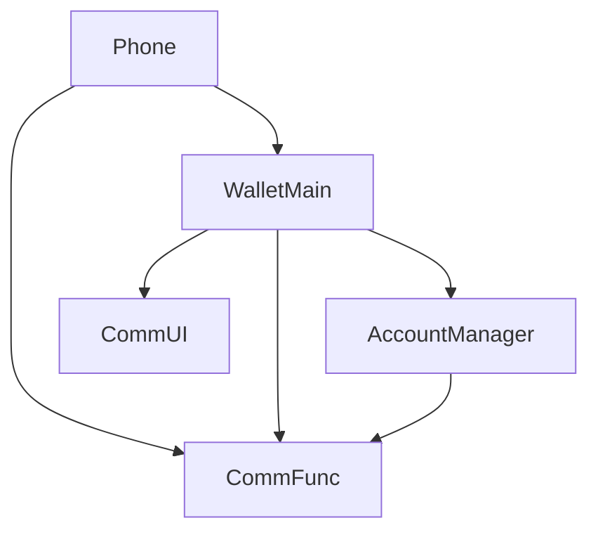
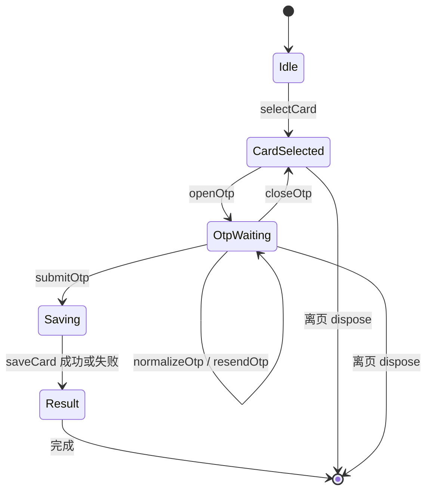
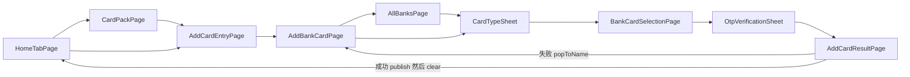

# bc-openCard-2 — 银行卡开卡施工计划

本轮仅 plan。依据原始需求、蓝图 revision 5、canonical open-card-flow CU revision 7、已闭环 spec/spec.md 与 acceptance.yaml。contracts.yaml/use-cases.yaml 是下游机器契约真源；本文件解释实现落位。当前无产品代码改动。

## Scope 声明与继承

```yaml
inherited_from_prd: true
in_scope_modules: [WalletMain, Phone, AccountManager]
out_of_scope_modules: [CommUI, CommFunc]
rationale: 来源=蓝图 touches 的可修改 development 节点。WalletMain 承载开卡；AccountManager 仅增加 mock 手机号；Phone 仅接新增页面 builder。
expansions_with_user_approval: []
```

### 架构影响声明

```yaml
architecture_impact:
  impact: none
  affected_items: []
  architecture_md_updates: []
  catalog_updates: []
```

蓝图无 architecture_impact 决策，不变更模块、依赖、DSL。裁决沿用 result-destination：本期成功回钱包首页，银行卡详情页后续开发；NFC 激活区明确不做。保留既有登录行为、银行排序/折叠/索引及旧页面路由。

## 1. 模块架构图



| 模块 | 所属层 | 物理路径 | 格式 | 变更类型 | 职责 |
|---|---|---|---|---|---|
| WalletMain | 02-Feature | 02-Feature/WalletMain | HAR | 修改 | 本地卡源、RDB、流程、页面、资源与 UT |
| Phone | 01-Product | 01-Product/Phone | HAP | 修改 | 同根 Navigation 注册两个新全屏页 |
| AccountManager | 04-BusinessBase | 04-BusinessBase/AccountManager | HAR | 修改 | UserProfile.phoneNumber 与 mock profile |

模块内依赖遵守 presentation → domain → data → shared；data 不依赖 domain。BankCardMaskService 在 domain，UI 调用它；Repository 不引用 UI。共享完成通知只携带 string，不依赖 CardRecord 或 ArkUI。跨模块只经现有 `src/main/ets/index.ets` 包出口。没有新依赖包、模块配置或权限。

## 2. 目录/文件结构规划

精确授权以 contracts.files 为准（直接继承蓝图，未扩大）。新增文件不存在是施工输入，不是本阶段假称已交付。

```text
02-Feature/WalletMain/src/main/
├── ets/data/model/
│   ├── BankInfo.ets                 增量 supportedCardTypes，保留原字段
│   ├── BankCardType.ets             新增 debit/credit
│   ├── BankCardInfo.ets             新增完整候选卡
│   ├── CardRecord.ets               新增持久记录
│   ├── OpenCardResult.ets           新增真实保存结果
│   └── OpenCardSessionParams.ets    新增选卡入栈参数
├── ets/data/repository/
│   ├── BankRepository.ets           扩展支持类型及候选卡
│   └── BankCardRepository.ets       新增 RDB 保存/列表/按号查询
├── ets/domain/service/
│   ├── BankCardMaskService.ets      新增前四后四掩码
│   └── OpenCardFlow.ets             新增局部流程、OTP、单次保存
├── ets/presentation/components/
│   ├── CardTypeSheet.ets            新增卡类型半模态
│   └── OtpVerificationSheet.ets     新增验证码半模态
├── ets/presentation/pages/
│   ├── BankCardSelectionPage.ets    新增选卡全屏页
│   ├── AddCardResultPage.ets        新增结果全屏页
│   ├── AddBankCardPage.ets          接双入口之一，保留原状态
│   ├── AllBanksPage.ets             接双入口之二，保留字母索引
│   └── HomeTabPage.ets              完成通知与按号刷新
├── ets/shared/constant/BankConstants.ets
├── ets/shared/OpenCardCompletionBridge.ets
├── ets/index.ets                   导出两个新 builder
├── resources/base/profile/route_map.json
├── resources/base/element/string.json
├── resources/base/element/color.json
├── resources/base/element/float.json
└── resources/base/media/card_open_result_guide.png
02-Feature/WalletMain/src/ohosTest/ets/test/
├── bank_open_card_2_ut.test.ets      新增本 CU UT
└── List.test.ets                    保留旧注册并加入本 CU
01-Product/Phone/src/main/ets/pages/index.ets
04-BusinessBase/AccountManager/src/main/ets/
├── data/model/UserProfile.ets
├── domain/service/AccountService.ets
└── index.ets
```

旧 HomeRepository 不在写集内；首页的本轮持久卡消费在 HomeTabPage 接入，不修改 mock 数据源。旧 UT 不改行为预期以掩盖回归，新 UT 在既有 ohosTest 载体增量实现。

## 3. 数据模型定义

完整字段/类型见 contracts.data_models，保留蓝图原字段与源码已有字段。BankInfo 原有 pinyin/initial/logo/badgeRes 保留；UserProfile 保留 avatar、可选构造参数和 accountText，新增手机号不改变旧调用的必填参数。

```typescript
enum BankCardType { DEBIT = 'debit', CREDIT = 'credit' }
interface OpenCardSessionParams {
  bankCode: string;
  bankName: string;
  bankCardType: BankCardType;
  failureTargetName: string;
}
interface BankCardInfo {
  cardId: string;
  fullCardNumber: string;
  bankCode: string;
  bankName: string;
  bankCardType: BankCardType;
  huaweiPayEnabled: boolean;
  unionPayQuickPassEnabled: boolean;
}
```

BankRepository 默认每家支持双类型，每类型 1–2 张稳定 mock 卡；单类型由实际数组驱动。候选完整卡号跨银行/类型唯一，显示掩码不能反写 fullCardNumber。类型继续按钮只在 selectedType 属于银行支持数组时启用。

RDB 使用蓝图 `bank-card-enrollment.table_schema`：wallet.db v1 / wallet_cards。id 自增；full_card_number 非空唯一；generic_card_type、bank_name、bank_code、bank_card_type、added_at、huawei_pay_enabled、unionpay_quickpass_enabled、transaction_records 完整落库。通用类型为银行卡、时间为当前毫秒、交易记录初始 `[]`，两个布尔按 0/1 存储。首次幂等建表，版本升级不删旧数据；单条卡记录原子插入，失败回滚、重复卡返回失败且不覆盖已有记录。查询 resultSet 必须关闭。完整卡号按参数绑定查询，验证码不入库，日志不得包含全卡号、手机号或验证码。

OpenCardResult 保留 success/fullCardNumber/failureReason；成功不设置原因，失败仅业务原因，不展示底层异常。逻辑契约的 nullable 原因在实现模型中以可选字段表达无失败原因。结果导航额外携带既有会话 failureTargetName，不为路由副作用建 Port。

## 4. 页面组件树

```text
AddBankCardPage / AllBanksPage（既有 NavDestination）
└── CardTypeSheet（本页 bindSheet，局部单选，关闭不入栈）
    ├── 标题/关闭、银行 logo/名称、支持类型单选
    ├── 提示与纯文本协议
    └── 同意并继续
BankCardSelectionPage（NavDestination）
├── 银行名标题、提示
├── List：1–2 张掩码卡号单选
├── 协议文本与同意状态、下一步
└── OtpVerificationSheet（本页 bindSheet）
    ├── 标题/关闭、账号脱敏手机号提示
    ├── Row：数字 TextInput + 发送/倒计时
    └── 下一步
AddCardResultPage（NavDestination，无 title/back）
├── 成功/失败状态、说明
├── 结果引导图（按 spec 占位声明，尚未视觉验证）
└── 完成按钮
```

组件 props/events/state 见 contracts.components。CardTypeSheet 接 bank，onContinue 传 OpenCardSessionParams，onClose 清理选择；重复点击银行只打开一个 sheet。选卡页唯一持有 OpenCardFlow，sheet 复用其状态，不能复制完整业务会话。约束通过命名 handler 执行，UI 回调仅转发。

组件选型沿蓝图：CardTypeSheet、OtpVerificationSheet 为 WalletMain 业务组件；SectionCard 只有固定内距/圆角，ActionListItem 是带箭头通用行，均不能代表当前半模态业务。既有银行行继续使用 BankListRow，既有页面只局部接线。对外仅导出新页面 builder，避免把私有 sheet 扩大成共享 API。

视觉映射见 plan/visual-parity.yaml：逐节点绑定 contracts 组件，全部 asset/token 有映射。`fidelity_target=pixel_1to1`、`asset_acquisition_mode=approximate`、`verified=unverified`。银行 logo 复用已有资源键；引导插画落在已授权 media 路径，保持占位披露。四张参考图均沿 spec 的 ref_type/ref_cards/ref_otp/ref_result，结果页不包含 NFC。沿用已声明 OCR/需求文字，不补造原图文案；几何、字体、色彩、完整元素枚举与插画保留 spec blind_review_pending。原生控件的触控区至少 44vp，文本 fp；这些是实现约束，不是声称读图量测。

## 5. 状态管理方案

| 数据 | 作用域 | 装饰器/机制 | 持有者 | 生命周期 |
|---|---|---|---|---|
| selectedBank/selectedType/sheetVisible | 单银行入口 | @State | 银行页/CardTypeSheet | 每次打开为空选择，关闭销毁 |
| selectedCard/phase/otpSeconds/result | 选卡会话 | 单个可观察业务实例；UI 订阅快照 | OpenCardFlow | 选卡页建立；退出 dispose |
| agreementAccepted/otpDigits | 当前表单 | @State | 选卡页/OTP sheet | 关闭 OTP 清输入；选卡保留 |
| 完成卡号 | 一次投递 | 单 listener + 单 pending | OpenCardCompletionBridge | 同步投递或下次订阅即消费并清除 |
| 卡记录 | 持久 | RDB 唯一真源 | BankCardRepository | 不随页面销毁 |
| 首页有卡态 | 根组件 | @State | HomeTabPage | 按号查询后刷新，销毁取消订阅 |

Flow 是 OTP 计时与 Saving 状态的唯一所有者。sheet `sendMockSms` 调用 flow.openOtp，首次建立 60 秒倒计时，幂等保护避免双启动；每秒更新，resendOtp 在归零前无操作，归零重新启动 60 秒。输入只保留数字、至多六位，submitOtp 再校验恰好六位以及已选卡，校验不通过不写库不导航。关闭 OTP 释放 timer 并回 CardSelected；dispose 幂等。Saving 禁止再次提交、关闭或更换卡片，异步完成后只 push 一个结果页。业务 single-flight 可返回同一 promise，但 UI 自身也必须以 pending guard 防止两个 await continuation 重复入栈。页面真正销毁时释放订阅与 timer，失效页不得在 await 后导航。

成功通知 subscribe 使用稳定函数引用，publish 在 clear 前同步发起首页按完整卡号查询；有 listener 则投递后清 pending，无 listener 则只保留一次待消费值。首页原 loadHomeData 不能在旧异步任务完成时覆盖新有卡态：在 HomeTabPage 将此次查库得到的卡片/刷新版本作为渲染依据，再加载配套服务与提示。不通过 HomeRepository.launchOverride 伪装持久结果。冷启动读取已有完整记录，内存会话不自动恢复，不自动跳过 OTP。数据库失败、重复卡和未提交会话均不得产生成功通知。

### 业务流程 UseCase 清单

use-cases.yaml 保留蓝图四分支，并补同一验收内单类型与 OTP 校验/重发。UT 通过真实 BankRepository、OpenCardFlow、BankCardMaskService、OpenCardCompletionBridge 的命名入口验证业务；仅 RDB 与计时等外部边界隔离，保留正常默认行为，不新增测试快捷路径。



| 分支 | UT 证明 | 真机证明 | 验收 |
|---|---|---|---|
| happy_path | 完整卡号、数据映射、保存后结果、完成通知一次消费 | 两个入口成功，结果返回屏蔽、完成清栈和首页按号刷新 | AC-1～AC-6 |
| save_failed | 打开/插入异常均失败，重复卡不覆盖 | 两个入口失败，完成回添加银行卡 | AC-5/AC-6、BD-2 |
| cancel_otp | timer 清理、保留选卡、不保存，重新打开从60秒开始 | 半模态遮罩消失、仍在选卡页 | BD-3/BD-4 |
| double_submit_while_saving | 延迟 save promise，仅一次调用/结果 | 按钮禁用、单结果页 | BD-5 |
| single_supported_type | 单元素支持数组及选择谓词 | 复用正常双入口检查 | AC-2、BD-1 |
| otp_validation_and_resend | 空/不足/非数字/6位输入、归零与重发 | 数字键盘、60秒禁用及恢复 | AC-4、BD-3 |

BD-4 在 Repository 成功持久化/失败不落半条及新建 Flow 不继承旧内存会话上验证，不把真实进程模拟成纯函数成功。Navigation/Toast 属设备验证，不进 data_boundaries。AccountService 是已存在账号服务，自然接缝仍按蓝图使用，不新增账号 Port。

## 6. 服务层接口定义

精确签名见 contracts.interfaces。`Context` 为当前工程已用 `@kit.AbilityKit` 类型；Promise 均 await。方法摘要如下：

```typescript
BankRepository.getBanks(): Promise<BankInfo[]>
BankRepository.getCards(bankCode: string, bankCardType: BankCardType): Promise<BankCardInfo[]>
BankCardRepository.saveCard(context: Context, card: BankCardInfo): Promise<OpenCardResult>
BankCardRepository.listCards(context: Context): Promise<CardRecord[]>
BankCardRepository.findByFullCardNumber(context: Context, fullCardNumber: string): Promise<CardRecord | null>
BankCardMaskService.maskCardNumber(fullCardNumber: string): string
OpenCardFlow.selectCard(card: BankCardInfo): void
OpenCardFlow.openOtp(): void
OpenCardFlow.closeOtp(): void
OpenCardFlow.normalizeOtp(raw: string): string
OpenCardFlow.resendOtp(): void
OpenCardFlow.submitOtp(context: Context, otp: string): Promise<OpenCardResult>
OpenCardFlow.dispose(): void
OpenCardCompletionBridge.subscribe(listener: (fullCardNumber: string) => void): void
OpenCardCompletionBridge.unsubscribe(listener: (fullCardNumber: string) => void): void
OpenCardCompletionBridge.publish(fullCardNumber: string): void
AccountService.getUserProfile(): Promise<UserProfile>
```

AccountService 在 getUserProfile/login 的 mock 返回独立完整 phoneNumber，UI 只用 MaskUtil.maskPhone 展示；不得将掩码邮箱或示例图号码作为业务手机号。BankCardRepository 自身映射数据库异常；Flow 也防御边界意外 rejection 并归一失败结果。失败日志用固定错误类别，不 stringify 整个 card/result。

## 7. 路由/导航设计



sheet 不是路由项；根 Navigation 和 NavPathContext 保持同源。所有旧路由名保留。新增 `BankCardSelectionPage` / `AddCardResultPage` 同时进入 route_map.json、Phone.navDestinationMap 和 WalletMain 出口，builder 为 buildBankCardSelectionPage/buildAddCardResultPage。route_map 仅元数据，不引入第二个 Router。

| 页面/路由 | 参数与读取 | 退出 |
|---|---|---|
| BankCardSelectionPage | onReady 从 destination pathInfo 读取并校验 OpenCardSessionParams；failureTargetName 固定 AddBankCardPage | 普通返回仍 pop，关闭 sheet 不 pop |
| AddCardResultPage | onReady 读取不可变结果快照和 failureTargetName，成功失败均保留全卡号但不展示 | hideTitleBar，onBackPressed 消费返回和左滑；仅 handleComplete |

成功先通知完整卡号，后 clear 根栈全部二级路径；失败 popToName(AddBankCardPage)，因此 AllBanks/选卡/结果都移除且添加银行卡保留。handleComplete 防重入。导航失败保留当前页并显示资源提示，禁止以新建栈补救。旧添加卡片/卡包/全部银行往返、折叠状态及四条双入口×结果路径列入真机回归。

## 8. spec 功能映射表

| spec 编号 | 功能 | 优先级 | 所属层/模块 | 内层级 | 关键文件 | 验收 |
|---|---|---|---|---|---|---|
| F1 | 双银行入口 | P0 | 02-Feature/WalletMain | presentation | AddBankCardPage、AllBanksPage、CardTypeSheet | AC-1 |
| F2 | 单选类型与候选 | P0 | 02-Feature/WalletMain | data/presentation | BankInfo、BankRepository、CardTypeSheet | AC-2、BD-1 |
| F3 | 完整卡号与掩码 | P0 | 02-Feature/WalletMain | data/domain/presentation | BankCardInfo、BankCardMaskService、BankCardSelectionPage | AC-3 |
| F4 | 手机号和 OTP | P0 | 02-Feature/WalletMain；04-BusinessBase/AccountManager | domain/presentation | OpenCardFlow、OtpVerificationSheet、AccountService、UserProfile | AC-4、BD-3 |
| F5 | RDB 保存和结果 | P0 | 02-Feature/WalletMain | data/domain/presentation | BankCardRepository、CardRecord、OpenCardResult、AddCardResultPage | AC-5、BD-2/4/5 |
| F6 | 完成与首页刷新 | P0 | 02-Feature/WalletMain | shared/presentation | OpenCardCompletionBridge、HomeTabPage、AddCardResultPage | AC-6 |
| F7 | 旧路由兼容 | P1 | 01-Product/Phone；02-Feature/WalletMain | presentation/出口 | Phone index、WalletMain index、route_map.json | AC-7 |
| F8 | 四屏视觉 | P1 | 02-Feature/WalletMain | presentation/resources | 两 sheet、选卡与结果页、string/color/float/media | AC-8 |

验收通过的定义仍为各阶段真实证据：本阶段只验证契约、映射、架构和可施工性；coding 编译、业务 UT 和真机交互/视觉验收由冻结后续链承担。major 视觉债务不能当发布通过，确定性信号与缺锚点回 coding，参考图未知项不以自报已验证清除。

## 本轮修正记录

本轮 run=20261019T033030Z-1b91ba。原组件选型缺口已由当前蓝图/CU 修复，本阶段经 canonical resolver 重新消费并比较权威内容：contracts 与 use-cases 均 aligned。保留模型、接口、生命周期和原 files；更新精确 CU/设计引用并补齐组件决定到 file#component 的施工映射。旧失败报告保留作历史，不再当作当前阻断事实。

| 施工组件 | 当前蓝图决定 | 施工方式 |
|---|---|---|
| CardTypeSheet | component-card-type-sheet | custom；WalletMain 私有半模态 |
| BankCardSelectionPage | component-bank-card-selection-page | custom；单个 NavDestination |
| OtpVerificationSheet | component-otp-sheet | custom；复用本页 Flow |
| AddCardResultPage | component-add-card-result-page | custom；真实保存结果快照 |
| AddBankCardPage | component-add-bank-card-page | evolve；沿 buildAddBankCardPage 入口保留页面结构 |
| AllBanksPage | component-all-banks-page | evolve；沿 buildAllBanksPage 入口保留字母索引 |
| HomeTabPage | component-home-tab-page | evolve；保留 @Link，仅接完成订阅与 RDB 读取 |

### 当前视觉输入的施工落位

以下来自 spec/ui-spec 的 OCR 和机器 observation，不是执行者亲见。所有新增节点/token 均已加入 visual-parity；参考图分母仍为四张。文字资源采用 spec 的可靠文本，动态银行名/手机号/卡号由模型绑定，OCR 文本框不能直接当作按钮外框。

| 界面 | 实现约束 | 必须保留的定位/状态 |
|---|---|---|
| 卡类型 | 标题关闭同行；银行与两类型共用白卡；半宽蓝色继续按钮；协议纯文本 | ct_root/ct_close/ct_bank_surface/ct_types/ct_continue，初始未选 |
| 选卡 | 返回按钮与银行名；logo/掩码/单选同行；协议勾选；半宽按钮紧随协议，不吸附底部 | cs_back/cs_card_1/cs_card_2/cs_agreement/cs_next；不存在第二张时不渲染 |
| OTP | 数字 TextInput；手机号前缀/动态掩码/后缀；输入行与按钮均为屏宽0.85；键盘避让 | otp_phone_suffix/otp_input/otp_resend/otp_next；系统数字键盘可见，禁止画假键盘 |
| 结果 | 成功/失败各有图标、文案、说明、引导图；底部0.92屏宽灰底蓝字完成按钮 | rs_* 与 rf_icon/rf_status/rf_hint/rf_guide/rf_complete；无 NFC/返回入口 |

otp_system_keyboard 是系统输入法状态的语义观察节点，归 OtpVerificationSheet 的聚焦/避让责任；不能把应用内占位控件命名成此 ID 冒充键盘，设备校验使用真实系统窗口。背景页观察节点同样映射到 sheet 的背景保留责任，不重新绘制上游页面。选卡品牌红、成功绿以及插画仍为 spec 明示的未验证近似；当前 open_card_bank_accent/open_card_success 中性 token 不是参考颜色，后续机器观察或采样后在已授权 color.json 落实。major 残差记视觉债务并阻止发布，不能因 plan 映射完整清除此债务。

本轮只写 plan 所属产物及 facts 增量，未写 spec、蓝图、CU、产品源或 goal-runs。阶段是否闭环由本 run 的 harness 和所需 verifier/receipt 判定。