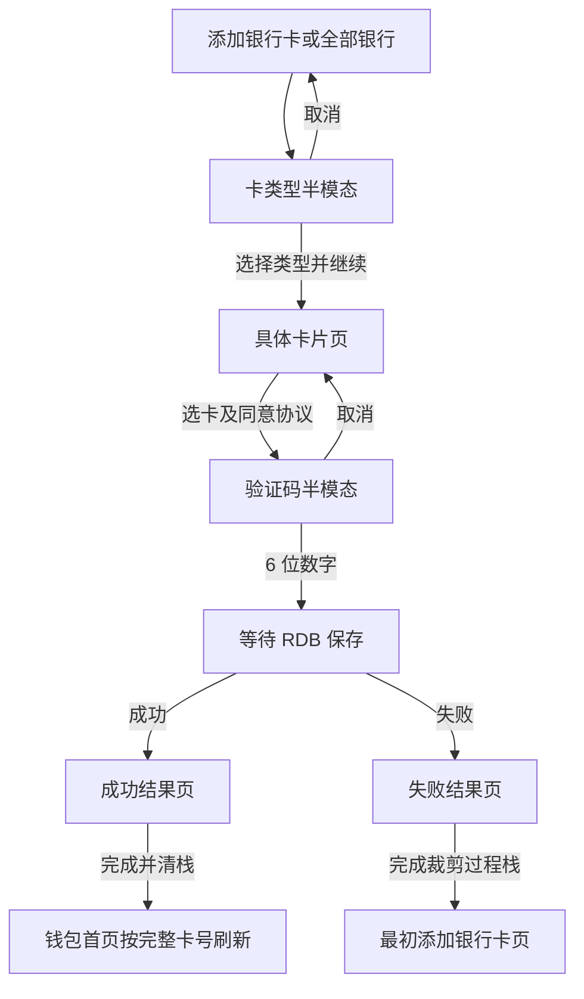

# bc-openCard-2 — 银行卡开卡需求规格

本阶段只补 spec；输入为 component-blueprint revision 5 与 open-card-flow CU revision 7。目标 predicate：behavior-open-card、owner-state、consumer-home、contract-storage、recovery-safe；provide：open-card-feature-delivered。具体定义引用上游，不改写蓝图或 CU。

## 0. 术语映射表

| 原始术语 | 权威模块 | 所属层 | 置信度 | 易混项 | 用户确认 |
|---|---|---|---|---|---|
| 卡包 | WalletMain | 02-Feature | high | AccountManager、CommUI、Phone | [x] |
| 添卡 | WalletMain | 02-Feature | high | AccountManager、CommUI、Phone | [x] |
| 银行卡 | WalletMain | 02-Feature | medium | AccountManager、CommUI、Phone | [x] |

[x] 为蓝图事实投影，不代表新增人工确认。银行卡为 headless_assumed/medium，保留 must-review；不回写 glossary。

## 1. 功能概述

把已有银行列表的暂不支持提示接为选择卡类型、具体卡片、短信验证、真实本地 RDB 保存与结果完成闭环。银行候选卡、短信和账号手机号使用模拟数据；不连接生产银行、短信或支付服务。

## 2. Scope 声明

```yaml
in_scope_modules: [WalletMain, AccountManager, Phone]
out_of_scope_modules: [CommUI, CommFunc]
expansions_with_user_approval: []
rationale: |
  集合与 CU touches 一致。WalletMain 拥有页面、瞬态流程与持久卡数据；AccountManager 仅补 UserProfile mock 手机号及既有服务出口；Phone 仅接新目的页。
  复用 CommUI/CommFunc 现有出口，不同意把银行卡逻辑下沉公共模块；不得新建平行路由或修改公共模块。架构影响为 none。
```

```yaml
ui_change: new_or_changed
fidelity_target: pixel_1to1
asset_acquisition_mode: approximate
visual_handoff:
  kind: screenshot_pack
  authoritative_refs:
    - id: ref_type
      path: doc/features/bc-openCard-2/open-card-flow/ux-reference/3-点击任意银行拉起添卡选卡半模态.jpg
    - id: ref_cards
      path: doc/features/bc-openCard-2/open-card-flow/ux-reference/4-点击信用卡或储蓄卡后拉起选卡页面.jpg
    - id: ref_otp
      path: doc/features/bc-openCard-2/open-card-flow/ux-reference/5-选中某张卡片后拉起短信验证.jpg
    - id: ref_result
      path: doc/features/bc-openCard-2/open-card-flow/ux-reference/6-短信验证完成后结果页.jpg
```

裁决：原始需求“后续等银行卡详情页开发完”优先于页面说明末尾的跳卡详情，本轮成功回钱包首页；NFC 激活区域明确排除。result_failure 无独立参考图，只验明确失败语义。图片存在不等于本执行者看过；本次无视觉，已消费四份 OCR 和四份 visual-observations 机器旁证，按需求、可靠 OCR 文案和注明来源的结构观察建模，verified 保持 unverified，pixel_1to1 / best_effort / approximate 沿用 fidelity-intent。

## 3. 目标用户与使用场景

| 场景 | 用户目标 | 前置 |
|---|---|---|
| S1 | 从添加银行卡直接选银行完成开卡 | 现有钱包首页/卡包入口可用 |
| S2 | 从全部银行选银行完成同一开卡流程 | AddBankCardPage 可进入 AllBanksPage |
| S3 | 取消、写入失败或重复提交后安全返回 | 保留原始导航栈；本地 mock 可重复测试 |

## 4. 功能清单

| 编号 | 功能 | 优先级 | 描述 |
|---|---|---|---|
| F1 | 添加银行卡页和全部银行页点击任一银行都打开同一张卡类型半模态。 | P0 | 两个入口不再 Toast 暂不支持，均进入卡类型选择且一次点击只出现一个半模态。 |
| F2 | 卡类型只允许单选，未选择时继续按钮不可用，选择后进入对应银行候选卡页。 | P0 | 只保留一个选中类型，目标全屏页标题为银行名称且候选卡匹配所选类型。 |
| F3 | 候选卡界面仅展示卡号前四后四，但选择和后续写库保留完整卡号。 | P0 | UI 不出现中间位，Repository 收到完整卡号。 |
| F4 | 验证码半模态自动发送一次并倒计时 60 秒，只允许 6 位数字提交，归零可重发。 | P0 | AccountService.getUserProfile 提供完整 mock 手机号并在 UI 脱敏；仅恰好 6 位数字启用下一步；计时期间不能重发，归零后重发重新从 60 秒开始。 |
| F5 | 点击验证码下一步先 await RDB 保存，再把完整卡号和真实保存结果带到结果页。 | P0 | 成功与失败都进入结果页；只有成功分支产生字段齐全的一条 RDB 记录，失败不冒充成功，OpenCardResult.fullCardNumber 与所选完整卡号一致。 |
| F6 | 结果页禁用系统返回和左滑，仅完成按钮可退出并清除整个开卡过程页面。 | P0 | 返回/左滑无效；成功 publish 同步触发首页回调后 clear 全部二级路径并刷新钱包首页，失败 popToName(AddBankCardPage) 且移除 AllBanks/选卡/结果页。 |
| F7 | 首页→卡包→添加卡片→添加银行卡及既有全部银行返回链不受损。 | P1 | 所有既有页面仍可达且返回层级正确。 |
| F8 | 四个新增界面按同目录参考图保持关键层级、间距、形态和状态表达。 | P1 | 页面结构与参考图一致；结果页省略需求明确不做的 NFC 区域并保留底部完成按钮。 |

## 5. 页面/界面描述

| 页面 | 需求文字定义的从上到下结构 | 状态与交互 |
|---|---|---|
| 卡类型半模态 | 银行信息；支持的储蓄卡/信用卡单选；小字提示；纯文本协议；同意并继续 | 初始未选、禁用；选择唯一类型后可继续；取消留在原银行页 |
| 具体卡片全屏页 | 银行名标题；小字提示；该类型 1–2 张 mock 卡；协议；下一步 | 卡号前四后四；选中一张且同意协议后下一步；完整卡号留在业务数据 |
| 验证码半模态 | 账号 mock 手机号脱敏提示；左输入右发送/倒计时；下一步 | 首次自动假发送，60 秒内禁止重发；恰好 6 位数字有效；Saving 不可重复提交 |
| 结果全屏页 | 成功/失败图标、文案、小字；引导插画；底部完成 | 无标题和返回箭头；系统返回/左滑无效；只完成退出；不显示 NFC 激活 |

ui-spec 的稳定 element id 同时交付下游测试定位。可靠文本的 bbox 由当前 OCR 词框并集机械计算，只表示文本框，不是按钮外框。四份 visual-observations 提供共容器、按钮变体、背景页和键盘状态等结构线索，不是本执行者亲见，也不是质量终签。协议识别冲突、OTP 提示首字、非文本几何和精确颜色登记于 asset-manifest.blind_review_pending。银行 logo 用途由 BankRepository 证明，复用不等于视觉验证。

## 6. 业务流程图



## 7. 异常/边界场景处理

| 编号 | 对应功能 | 场景 | 处理及预期 |
|---|---|---|---|
| E1 | F2 | 银行支持类型数组只有 debit 或 credit。 | UI 直接渲染实际数组，选择状态初始化为空。 不渲染不存在的类型，不造第二个选项。 |
| E2 | F5 | getRdbStore 或 insert 抛出异常。 | 捕获异常、记录日志并返回 OpenCardResult(false, fullCardNumber, reason)。 不崩溃、不丢卡号、不写成功标志。 |
| E3 | F4 | 用户点击关闭或页面离开。 | 卡类型 sheet 关闭时丢弃类型选择；OTP sheet 关闭时取消 timer 并把 flow 从 OtpWaiting 退回 CardSelected，选中卡仍保留。 卡类型取消停留银行列表；OTP 取消停留选卡页且不写库，再次打开 OTP 从新的 60 秒开始。 |
| E4 | F5 | OTP 前、Saving 前或结果页发生进程重建。 | 未成功保存的内存会话丢弃；已成功 RDB 记录保留，页面按导航宿主重建策略回安全入口。 数据库只含完整成功记录，用户可重新开始流程。 |
| E5 | F5 | 用户在第一次 submitOtp 未返回前再次点击下一步。 | phase=Saving 时 submitOtp 直接复用或拒绝后续调用，按钮保持禁用。 BankCardRepository.saveCard 只调用一次，只发布一个 OpenCardResult。 |

## 8. 非功能性需求

OTP 按 1 秒刷新、60 秒后可重发。任何 6 位数字均为模拟验证码；不保存验证码。RDB 以完整卡号唯一，包含银行、通用卡类型、银行卡类型、添加时间、华为支付/银联闪付状态与交易记录，保持完整记录原子保存。UI 不展示全卡号或完整手机号，日志不包含二者与验证码。兼容当前工程 HarmonyOS 手机工具链和唯一 Navigation 栈，不扩大到其它终端。

## 9. 验收标准

- [ ] **AC-1** (F1): 添加银行卡页和全部银行页点击任一银行都打开同一张卡类型半模态。 两个入口不再 Toast 暂不支持，均进入卡类型选择且一次点击只出现一个半模态。
- [ ] **AC-2** (F2): 卡类型只允许单选，未选择时继续按钮不可用，选择后进入对应银行候选卡页。 只保留一个选中类型，目标全屏页标题为银行名称且候选卡匹配所选类型。
- [ ] **AC-3** (F3): 候选卡界面仅展示卡号前四后四，但选择和后续写库保留完整卡号。 UI 不出现中间位，Repository 收到完整卡号。
- [ ] **AC-4** (F4): 验证码半模态自动发送一次并倒计时 60 秒，只允许 6 位数字提交，归零可重发。 AccountService.getUserProfile 提供完整 mock 手机号并在 UI 脱敏；仅恰好 6 位数字启用下一步；计时期间不能重发，归零后重发重新从 60 秒开始。
- [ ] **AC-5** (F5): 点击验证码下一步先 await RDB 保存，再把完整卡号和真实保存结果带到结果页。 成功与失败都进入结果页；只有成功分支产生字段齐全的一条 RDB 记录，失败不冒充成功，OpenCardResult.fullCardNumber 与所选完整卡号一致。
- [ ] **AC-6** (F6): 结果页禁用系统返回和左滑，仅完成按钮可退出并清除整个开卡过程页面。 返回/左滑无效；成功 publish 同步触发首页回调后 clear 全部二级路径并刷新钱包首页，失败 popToName(AddBankCardPage) 且移除 AllBanks/选卡/结果页。
- [ ] **AC-7** (F7): 首页→卡包→添加卡片→添加银行卡及既有全部银行返回链不受损。 所有既有页面仍可达且返回层级正确。
- [ ] **AC-8** (F8): 四个新增界面按同目录参考图保持关键层级、间距、形态和状态表达。 页面结构与参考图一致；结果页省略需求明确不做的 NFC 区域并保留底部完成按钮。

acceptance.yaml 保留蓝图 AC/BD 的预期与 UT/device 分层。AC-1 至 AC-6 补稳定屏幕/动作/结果锚点；一个 checkpoint 代表主边，不免除同条验证步骤中的双入口、失败、倒计时和返回矩阵。AC-8 对四图逐屏采集；精确视觉质量由当前机器证据决定，自报 major 债务阻止发布，缺锚点及确定性错误仍回 coding。

## 参考与裁决记录

- 原始需求：doc/features/原始需求/1-2-银行卡/原始需求.md
- 设计真源：doc/features/bc-openCard-2/blueprint/component-blueprint.yaml
- CU：doc/features/bc-openCard-2/open-card-flow/change-unit.yaml
- 本次 facts：context/facts.md；无人值守自动决策：spec/headless-assumptions.jsonl。

参考图物化：ux-reference 内四图为原始需求同目录原图的逐字节副本，复制后以 Buffer.equals 全部校验相等；handoff 指向此标准引用目录，原始文件保持不变。

## 本轮修正记录

本轮仅同步 revision 5 / CU revision 7 的有效依据与四图机器旁证，不改变 AC-1..8、BD-1..5 的预期。参考图卡类型已选中并不覆盖 AC-2 初始未选的要求；参考图 55 秒不覆盖 60 秒倒计时初值；参考图号码只作脱敏样式，数据来自账号 mock 与完整候选卡。NFC 明确 excluded。OTP 键盘由系统提供，底部完成键不能绕过页面六位校验。失败结果同样展示图标、说明和引导图，且只允许完成退出。

卡类型继续按钮为机器观察的窄蓝色实心胶囊，具体卡片下一步为窄红色圆角按钮，OTP 下一步与输入行等宽，结果完成为灰底蓝字宽胶囊。红/绿色没有可信精确采样，不以世界知识填品牌 hex，暂用中性 token 并登记待复核；此状态不构成视觉验收完成。
