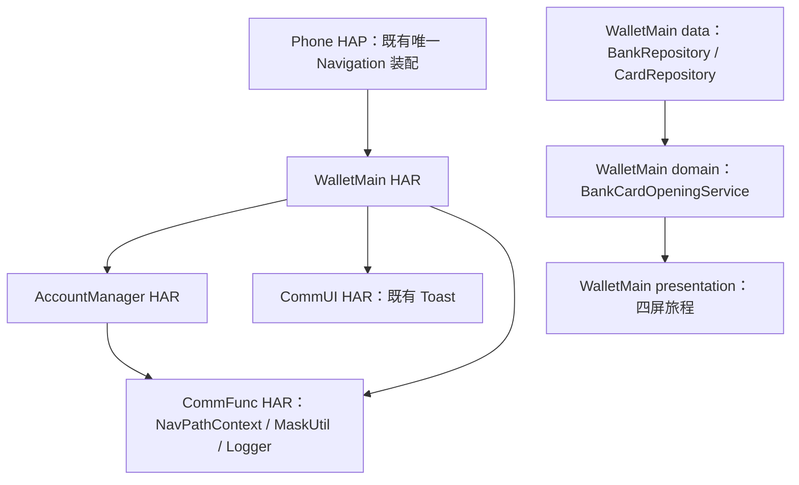
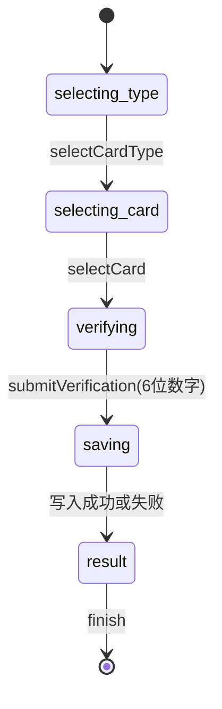
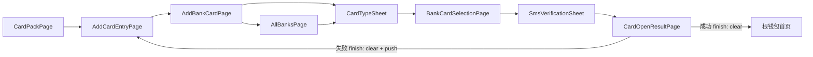

# 银行卡完整开卡流程 — 实现计划

> **模块标识**: `complete-bank-card-opening`  
> **对应 spec**: `doc/features/bc-openCard-2/complete-bank-card-opening/spec/spec.md`  
> **Change Unit**: `bc-openCard-2/complete-bank-card-opening` revision 4  
> **版本**: v1.0  
> **创建日期**: 2026-10-20  
> **状态**: 已确认（headless 蓝图投影）

`contracts.yaml` 与 `use-cases.yaml` 是 coding、review、UT、testing 的机器真源；本文只解释施工映射。

## Scope 声明与继承

| 字段 | 取值 | 说明 |
|---|---|---|
| 继承自 spec | 是 | CU-bound 范围只投影蓝图 touches |
| 本计划允许修改的模块 | WalletMain、AccountManager | 与可修改模块集合相等 |
| 明确不修改的模块 | Phone、CommUI、CommFunc | 不承载开卡业务责任；Phone 文件只按蓝图既有 HAP 装配写集接线 |
| 已获用户批准的扩展 | 无 | CU-bound plan 无扩展出口 |

```yaml
inherited_from_prd: true
in_scope_modules:
  - WalletMain
  - AccountManager
out_of_scope_modules:
  - Phone
  - CommUI
  - CommFunc
rationale: |
  WalletMain 承载开卡 UI、业务编排、Mock 候选卡和 RDB；AccountManager 只提供账号 Mock 手机号。
  Phone、CommUI、CommFunc 的责任不变，不新增模块或平行能力；Phone 根页接线仅保留蓝图授权文件映射。
expansions_with_user_approval: []
```

### 架构影响声明 (architecture_impact)

```yaml
architecture_impact:
  impact: none
  affected_items: []
  architecture_md_updates: []
  catalog_updates: []
```

蓝图没有 `architecture_impact` 决策。本次只在既有模块与依赖边内施工，不修改 DSL、模块集合或职责。

## 1. 模块架构图



| 模块 | 所属层 | 格式 | 变更类型 | 职责 |
|---|---|---|---|---|
| WalletMain | 02-Feature | HAR | 修改 | 开卡 UI、会话编排、候选卡与 RDB |
| AccountManager | 04-BusinessBase | HAR | 修改 | 为 Mock profile 增加唯一手机号真源 |

没有新增依赖边。WalletMain 继续通过 AccountManager `index.ets` 读取 `AccountService`，跨模块访问不走深路径。

## 2. 目录/文件结构规划

### WalletMain

```text
02-Feature/WalletMain/src/main/ets/
├── data/
│   ├── model/BankCandidate.ets                 # 新增：BankCardType、BankCandidate
│   ├── model/StoredCard.ets                    # 新增：StoredCard、SaveBankCardRequest、CardOpenResult
│   └── repository/
│       ├── BankRepository.ets                  # 修改：支持类型与每类 1–2 张候选卡
│       └── CardRepository.ets                  # 修改：wallet_cards.db schema v1 与读写
├── domain/service/BankCardOpeningService.ets   # 新增：唯一开卡状态机与清栈策略
├── presentation/
│   ├── components/
│   │   ├── CardTypeSheet.ets                   # 新增：卡类型半模态
│   │   └── SmsVerificationSheet.ets            # 新增：验证码半模态、60 秒计时
│   └── pages/
│       ├── AddBankCardPage.ets                 # 修改：银行点击进入统一流程
│       ├── AllBanksPage.ets                    # 修改：银行点击进入统一流程
│       ├── BankCardSelectionPage.ets           # 新增：具体银行卡全屏页
│       └── CardOpenResultPage.ets              # 新增：不可返回结果页
├── shared/constant/BankConstants.ets           # 修改：路由名、计时与数据库常量
└── index.ets                                   # 修改：导出两个新页面 builder
```

蓝图还授权 `01-Product/Phone/src/main/ets/pages/index.ets` 作为既有 HAP 路由装配接线：只追加两个 builder import 和 `navDestinationMap` 分支，不改变 Phone 业务责任、根栈或 Tab。

### AccountManager

```text
04-BusinessBase/AccountManager/src/main/ets/
├── data/model/UserProfile.ets                  # 修改：phoneNumber
├── domain/service/AccountService.ets           # 修改：登录/未登录返回同一 Mock 手机号
└── index.ets                                   # 修改：保持跨模块导出闭合
```

完整授权文件集合以 `contracts.files` 为准。蓝图未授权资源文件，本阶段不自行扩写写集；现有颜色、字号、圆角和银行 logo 通过已有资源键复用，结果引导图使用 `ui-spec` 已登记的可见中性占位构图。

## 3. 数据模型定义

```arkts
export enum BankCardType {
  DEBIT = 'DEBIT',
  CREDIT = 'CREDIT'
}

export interface BankCandidate {
  fullCardNumber: string;
  bankCode: string;
  bankCardType: BankCardType;
}

export interface StoredCard {
  fullCardNumber: string;
  entityCategory: string;
  bankName: string;
  bankCardType: BankCardType;
  addedAt: number;
  huaweiPayEnabled: boolean;
  unionPayQuickPassEnabled: boolean;
  transactionsJson: string;
}

export interface SaveBankCardRequest {
  fullCardNumber: string;
  bankCode: string;
  bankCardType: BankCardType;
}

export interface CardOpenResult {
  success: boolean;
  fullCardNumber: string;
  errorMessage: string;
}

export class UserProfile {
  phoneNumber: string = '';
}
```

`wallet_cards.db` 使用 schema version 1，表 `wallet_cards`：`id INTEGER PRIMARY KEY AUTOINCREMENT`、`full_card_number TEXT UNIQUE NOT NULL`、`entity_category`、`bank_name`、`bank_card_type`、`added_at`、两个支付状态整数列与 `transactions_json`。单条 INSERT await 成功后才发布成功结果；异常或唯一约束冲突映射为失败且不留下部分记录。

## 4. 页面组件树

### 4.1 选择卡类型半模态

```text
AddBankCardPage / AllBanksPage
└── CardTypeSheet
    ├── 银行 logo 与名称
    ├── 储蓄卡/信用卡单选分组
    ├── 授权说明与协议纯文本
    └── 同意并继续按钮
```

`selectedType` 为空时继续按钮禁用；关闭只撤销半模态，不新增栈层。

### 4.2 具体银行卡全屏页

```text
BankCardSelectionPage (NavDestination)
├── 自绘导航栏（银行名称）
├── 候选卡列表（只渲染 maskCardNumber）
├── 协议勾选行
├── 下一步按钮
└── SmsVerificationSheet
```

完整卡号只存在于 `BankCandidate` 和后续后台参数；页面元素、日志、Toast 与诊断不输出连续完整卡号。

### 4.3 验证码半模态

```text
SmsVerificationSheet
├── 标题与关闭按钮
├── AccountService 手机号脱敏提示
├── 六位数字输入框
├── 60 秒倒计时/重新发送动作
└── 下一步按钮
```

挂载时自动模拟发送并启动唯一计时器；关闭或销毁清理计时器和输入；提交中禁用按钮。

### 4.4 添加结果页

```text
CardOpenResultPage (NavDestination)
├── 成功/失败状态图标
├── 状态标题与说明
├── 可见中性引导插画占位
└── 完成按钮（唯一出口）
```

`onBackPressed` 始终返回 `true`，不渲染标题栏或 NFC 激活区；完成动作委托 `BankCardOpeningService.finish`。

## 5. 状态管理方案

| 数据 | 作用域 | 装饰器/机制 | 持有者 | 生命周期 | 说明 |
|---|---|---|---|---|---|
| openingFlow.phase | 单次开卡旅程 | 普通服务状态 | BankCardOpeningService | start 至 finish | selecting_type → selecting_card → verifying → saving → result |
| selectedType | 卡类型半模态 | @State | CardTypeSheet | 半模态实例 | 单选，关闭丢弃 |
| selectedCandidate/agreementAccepted | 具体卡片页 | @State | BankCardSelectionPage | 页面实例 | 同时决定下一步可用性 |
| code/remainingSeconds/submitting | 验证码半模态 | @State + 单一 timer | SmsVerificationSheet | 挂载至销毁 | 销毁清计时器，六位数字且非提交中才可提交 |
| CardOpenResult | 结果页不可变快照 | NavPath 参数 | CardOpenResultPage | 结果页实例 | 写库完成后发布一次，不设全局监听 |
| wallet_cards | 应用持久态 | RDB | CardRepository | 跨会话 | 已写入卡的唯一真源 |
| phoneNumber | 账号域 | UserProfile | AccountService | profile 生命周期 | WalletMain 只读并通过 MaskUtil 脱敏 |

运行时严格按 `contracts.state_management` 的 mutation → publication → subscription → consumer 链执行；进程重建后已写入卡以 RDB 为准，未提交会话不恢复。

### 业务流程 UseCase 清单



| 入口/节点 | 命名动作 | 数据边界 | 失败/恢复 |
|---|---|---|---|
| AddBankCardPage / AllBanksPage | BankCardOpeningService.start | BankRepository | 数据空时留在当前页并禁用继续 |
| CardTypeSheet | selectCardType | BankRepository | 无候选卡时展示空态 |
| BankCardSelectionPage | selectCard | 无 | 未选卡或未同意协议不进入验证码 |
| SmsVerificationSheet | resendCode / submitVerification | CardRepository、AccountService | 非法验证码不写库；RDB 失败发布失败结果 |
| CardOpenResultPage | finish | NavPathContext | 成功 clear 回根首页；失败 clear 后只 push AddCardEntryPage |

规范化分支、UI binding 与 acceptance 关联见 `use-cases.yaml`。

## 6. 服务层接口定义

```arkts
export class BankRepository {
  async getBanks(): Promise<BankInfo[]>;
  async getSupportedCardTypes(bankCode: string): Promise<BankCardType[]>;
  async getBankCandidates(bankCode: string, bankCardType: BankCardType): Promise<BankCandidate[]>;
}

export class CardRepository {
  async saveBankCard(request: SaveBankCardRequest): Promise<boolean>;
  async getBankCardByNumber(fullCardNumber: string): Promise<StoredCard | null>;
}

export class BankCardOpeningService {
  start(bank: BankInfo): void;
  selectCardType(type: BankCardType): void;
  selectCard(candidate: BankCandidate): void;
  resendCode(): void;
  async submitVerification(candidate: BankCandidate, code: string): Promise<CardOpenResult>;
  finish(result: CardOpenResult): void;
}

export class AccountService {
  async getUserProfile(): Promise<UserProfile>;
}
```

`CardRepository` 独占 RDB schema 和完整卡号落库；`BankCardOpeningService` 不复制 SQL 或账号数据，只编排命名动作、结果快照和清栈。

## 7. 路由/导航设计



| 页面/容器 | 路由名 | 参数 | 注册/承载 | 返回策略 |
|---|---|---|---|---|
| CardTypeSheet | 半模态，无栈名 | BankInfo、BankCardType[] | 入口页 overlay | 关闭回当前入口 |
| BankCardSelectionPage | `BankCardSelectionPage` | bankCode、bankName、BankCardType | Phone 既有 `navDestinationMap` 接线 | pop 回入口/半模态上下文 |
| SmsVerificationSheet | 半模态，无栈名 | BankCandidate | 具体卡片页 overlay | 关闭回选卡页并清 timer |
| CardOpenResultPage | `CardOpenResultPage` | CardOpenResult | Phone 既有 `navDestinationMap` 接线 | 所有返回被消费；成功回首页，失败回 AddCardEntryPage |

不建立第二个 `NavPathStack`。所有 push/pop/clear 继续通过 Phone 已 attach 的 `NavPathContext.stack()`；Phone 文件只新增两个 builder 映射。失败落点按原始需求和 acceptance checkpoint 裁决为最初的 `AddCardEntryPage`，不保留任何开卡中间页。

## 8. spec 功能映射表

| spec 编号 | 功能名称 | 优先级 | 实现模块 | 实现层级 | 关键文件 | 实现说明 |
|---|---|---|---|---|---|---|
| F1 | 双入口统一开卡 | P0 | WalletMain | presentation/domain | `AddBankCardPage.ets`、`AllBanksPage.ets`、`CardTypeSheet.ets` | 两入口调用同一 start |
| F2 | 卡类型单选 | P0 | WalletMain | data/presentation | `BankRepository.ets`、`CardTypeSheet.ets` | 按银行支持集合单选 |
| F3 | 候选银行卡选择与隐私展示 | P0 | WalletMain | data/presentation | `BankCandidate.ets`、`BankCardSelectionPage.ets` | 1–2 张候选，UI 仅前四后四 |
| F4 | 短信验证码状态机 | P0 | WalletMain | domain/presentation | `SmsVerificationSheet.ets`、`BankCardOpeningService.ets` | 自动发送、60 秒、六位数字、清 timer |
| F5 | 卡片 RDB 持久化 | P0 | WalletMain | data/domain | `StoredCard.ets`、`CardRepository.ets`、`BankCardOpeningService.ets` | schema v1、唯一卡号、失败原子性 |
| F6 | 成功/失败结果与清栈 | P0 | WalletMain | domain/presentation | `CardOpenResultPage.ets`、`BankCardOpeningService.ets` | 不可返回、完成唯一收口 |
| F7 | 账号手机号来源 | P1 | AccountManager | data/domain | `UserProfile.ets`、`AccountService.ets` | profile 唯一真源，UI 脱敏 |
| F8 | 新旧路由回归 | P0 | WalletMain | presentation/export | `index.ets`、`01-Product/Phone/src/main/ets/pages/index.ets` | 复用唯一栈并接入新 builder |

覆盖率：P0 `7/7`，P1 `1/1`。AC-1 至 AC-8、BD-1 至 BD-5 与 NFR-1 的实现/测试落点由 `contracts.change_unit`、`use-cases.yaml` 和下游专项测试共同闭合。

## 9. 施工顺序与质量自检

1. 先新增模型，扩展 AccountManager 手机号与 BankRepository 候选数据；逐文件 lint。
2. 扩展 CardRepository RDB，再实现 BankCardOpeningService；先使数据与状态机可单测。
3. 实现四个目标 UI 文件，最后改两个既有入口、WalletMain 出口与 Phone 路由装配，避免暴露半完成路径。
4. coding 阶段按 `contracts.files` 逐文件闭环；不得修改未授权资源或 framework。
5. UT 覆盖成功、RDB 失败、重复卡号、非法验证码、重复提交、计时清理和手机号来源；device testing 覆盖两入口、新旧路由、返回拦截与四屏视觉。

自检结论：Scope、分层、依赖、数据类型、接口签名、组件树、状态、路由、P0/P1 追溯均已明确；架构影响为 none。唯一已知施工约束是蓝图写集不包含资源文件，plan 保持原授权，不自行扩大。
