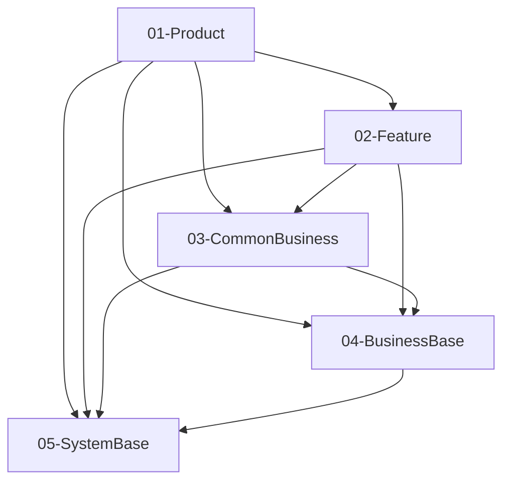

# Goal run phase: plan
Feature: cu-YmMtb3BlbkNhcmQtMgBvcGVuLWNhcmQtZmxvdw
Requirement:
# BankCard原始需求描述

> **需求名**: `bc-openCard-2`
> **创建日期**: 2026-06-10

---

## 一、需求描述

### 需求内容

本次需求内容是银行卡开卡需求，我把原始图片都归档到了本文件同级目录下。

#### 需求规格：

1.用户进入已有的添加卡片页面，之前已经开发过了。之前点击任一银行点击后，提示暂不支持，本次需求改为拉起选择卡类型半模态页面。

2.用户在全部银行页面，任一银行点击后，效果与添加银行卡页面效果一致。

3.选择卡类型半模态页面，会展示本银行支持的储蓄卡+信用卡，如果只支持储蓄卡或者信用卡则只展示一个即可。最多只能选择一种卡类型添加，选择后，下方可点击同意并继续按钮进入对应银行的选择具体卡片页面。

4.银行的选择具体卡片页面，展示该银行支持的银行卡信息，卡号只显示前四后四，但实际后台数据要按完整卡号处理。用户选择一张银行卡后，同意协议，点击下一步，拉起输入验证码半模态页面。

5.输入验证码半模态页面，拉起后默认触发一次假的短信发送，之后右侧按钮变为倒计时，用户必须输入6位验证码才能点击下一步。当前6位验证码可随意输入。倒计时归零后，右侧按钮从倒计时变成重新发送。点击后再次变为倒计时。用户输入完成验证码后，后台将完整卡数据写入RDB（本需求开始要创建卡片数据库和对应卡片数据表，将添加的卡片存入数据库中，数据库中字段至少包含卡号、卡类型[比如银行卡、交通卡、门禁卡等]、银行名称、卡类型、添加时间、开通华为支付状态、开通银联手机闪付状态、交易记录等内容），无论写入成功还是失败，将本次添加的卡片卡号（全卡号）和开卡结果带着跳转到添加结果页。

6.添加结果页是个全屏页面，没有左滑箭头，也禁止左滑事件。添加结果页根据带过来的添卡结果，展示成功或者失败状态。同时本页面只有点击完成按钮才能退出页面，并且在页面退出时，关闭当前栈中1-6的所有页面（都是本轮银行卡添卡页面）。如果本次添加是成功状态，则带着卡片卡号跳转到钱包首页（后续等银行卡详情页开发完，这里会引导跳到银行卡详情页，并携带当前卡片参数）。如果本次添加失败则仅将过程中的页面全部退出，回到最开始的添加卡片页面。

#### 页面说明：

- 1）选择卡类型半模态：页面布局完全参考'3-点击任意银行拉起添卡选卡半模态.jpg'。在添加银行卡或全部银行页面，点击某个银行后，拉起选择卡类型半模态（默认所有mock银行都支持储蓄卡和信用卡，该数据随银行数据走），上方是银行信息，然后是储蓄卡/信用卡二选一，下方有小字提示，然后是协议内容（本次默认按文本展示，不需要可点击富文本），最下方是同意并继续按钮。

- 2）选择具体卡片页面：页面布局完全参考'4-点击信用卡或储蓄卡后拉起选卡页面.jpg'。在第3步选择银行+卡类型后点击继续，跳转全屏的银行内部选卡页面，页面title就是银行名称，上方是小字提示，中间是可选择的不同卡片（每个银行，储蓄卡/信用卡，分别mock 1-2张卡数据），下方是协议（文本即可，不需要富文本），最下方是下一步。

- 3）输入验证码半模态：页面布局完全参考'5-选中某张卡片后拉起短信验证.jpg'。第4步选择具体卡片下一步后，拉起短语输入弹框，上方是小字提示（里面要展示用户手机号，从账号mock数据读），中间是输入框，左边输入右边发送按钮，用户点击发送后，需要将按钮变为60s倒计时，倒计时过程中按钮不允许再次点击。倒计时清零后，按钮重新变成再次发送，并且可再次点击。用户在短信输入框中，只能输入6位数字（需要校验），只有输入正确，下方下一步按钮才从置灰状态变为可点击。点击下一步后，则绑卡完成，进入添卡成功结果页。

- 4）添加结果页：页面布局完全参考'6-短信验证完成后结果页.jpg'。无title，全屏页面。上方根据前一个页面传递的添卡结果，控制上方图标/文案/下方小字的提示内容，然后附一张引导图片（大差不差就行了），再往下的激活nfc部分本次先不需要。最下方是完成按钮。点击完成按钮后，跳转到卡详情页。并且本次添加的卡片数据则需要写入数据库中，数据库要包含卡片的详细数据，比如卡号/类型/哪家银行/支持华为支付或银联手机闪付/交易记录，后续的卡详情等页面都是根据数据库读取卡数据并展示。有一点要注意：到了添加结果页，要屏蔽左滑事件，并且在点击完成按钮后，要把整个开卡过程中的所有开卡相关页面全部从页面栈中剔除（从添加银行卡页面开始，一直到结果页自身）。避免开卡完成后还能一直左滑看到开卡过程页面。

#### 路由规格

1. 所有页面跳转要遵循已有路由规则，相关代码参考模块画像去找，不要自由发挥或者另外写一套。
2. 测试用例要包含老代码和本轮新开发代码的页面互相跳转功能，不能导致原有路由受损。
## 目标简报（goal brief）

### 明确不做

需求原文里明确写了不要或本次不做的内容同样是排除项，即使尚未登记。
- 参考图元素 result_nfc_info：「再往下的激活nfc部分本次先不需要」
- 参考图元素 result_nfc_action：「再往下的激活nfc部分本次先不需要」

### 判定办法

目标以当前有效的授权与明确修订为准；候选缺陷、参考图、下位产物与目标冲突时按目标裁决并留一行裁决记录，只有目标本身冲突或缺失且无法裁决时才问人。详见 framework 行为规约 skills/reference/agent-behavioral-principles.md「权威判定」。
## Visual capability advisory (auto-detected — trust this over assumptions or phase SKILL defaults)
- Vision (can read images): **NO**
- OCR assistance available: **YES**
- Selected fidelity contract (write this to fidelity_target): **pixel_1to1**
- Effective execution fidelity ceiling for this run: **pixel_1to1**
- Acceptance strictness: **best_effort** (quality gaps are recorded as visual debt: write self-reported style/layout residuals as defects (major/minor); a screen with a self-reported major is recorded as visual debt that does NOT hard-block phase progress or drive backtrack but STILL blocks release until fixed and re-verified (minor-only residuals stay disclosure); fail, blocker, deterministic signals and missing test anchors still go back to coding; do not stop to ask about them)
- Asset acquisition mode (from fidelity-intent SSOT): **approximate** — mirror this into ui-spec verbatim.
Authoritative reference images (runner-discovered — the spec MUST declare and model ALL of
them; omitting any fails verification; do not shrink this denominator):
- doc/features/原始需求/1-2-银行卡/3-点击任意银行拉起添卡选卡半模态.jpg
- doc/features/原始需求/1-2-银行卡/4-点击信用卡或储蓄卡后拉起选卡页面.jpg
- doc/features/原始需求/1-2-银行卡/5-选中某张卡片后拉起短信验证.jpg
- doc/features/原始需求/1-2-银行卡/6-短信验证完成后结果页.jpg
**Delegated visual review is active for this run** (provider: adapter=codex, model=gpt-6.1-sol).
- You still have NO vision. Everything in the blind working method below applies to you unchanged.
- After each device capture, a **read-only** reviewer with that identity looks at every target screen
  and returns structured per-screen defects + must_fix items for YOU to fix. It cannot write anything
  in this project — not source, not artifacts, not gate files, and never a human confirmation signature.
- Observation sidecars for the reference images (machine-produced context, NOT a verdict and NOT
  your own seeing — treat them exactly like OCR JSON):
  - doc/features/bc-openCard-2/open-card-flow/spec/reports/visual-observations/3-点击任意银行拉起添卡选卡半模态.visual.json
  - doc/features/bc-openCard-2/open-card-flow/spec/reports/visual-observations/4-点击信用卡或储蓄卡后拉起选卡页面.visual.json
  - doc/features/bc-openCard-2/open-card-flow/spec/reports/visual-observations/5-选中某张卡片后拉起短信验证.visual.json
  - doc/features/bc-openCard-2/open-card-flow/spec/reports/visual-observations/6-短信验证完成后结果页.visual.json
- You remain the single writer of every project artifact. Do NOT wait for the reviewer, do NOT ask for it,
  and do NOT claim you saw anything yourself. If a round produces no review, keep working blind.
**You do NOT have vision.** Do NOT pretend to look at reference images or describe their visual
content from imagination — that is fabrication and will be caught by verification. Work like this instead:
- Structure and screen layout: infer from the requirement text and any structured hints available.
- Text copy and text positions: if OCR JSON files are listed below, treat them as ground truth — copy
  text verbatim from there, do NOT invent wording.
- Icons/logos/illustrations: first reuse existing project assets as `acquisition: repo_ref` when their
  purpose is established by code/resource references. No vision does not mean no usable assets.
  Only when an asset is missing or its purpose cannot be established, use placeholder assets +
  asset-manifest.yaml and disclose the gap. Keep `verified: unverified`; reuse is NOT visual verification.
- Anything you genuinely cannot determine without seeing the image: register it in the structured
  blind-review pending list (see phase SKILL reference/ui-spec.md「盲档工作法」) instead of guessing
  or endlessly re-attempting — that is the correct way to close this out at your capability level.
OCR JSON for reference images (text + confidence + normalized bbox per word):
- doc/features/bc-openCard-2/open-card-flow/spec/reports/ocr/3-点击任意银行拉起添卡选卡半模态.ocr.json
- doc/features/bc-openCard-2/open-card-flow/spec/reports/ocr/4-点击信用卡或储蓄卡后拉起选卡页面.ocr.json
- doc/features/bc-openCard-2/open-card-flow/spec/reports/ocr/5-选中某张卡片后拉起短信验证.ocr.json
- doc/features/bc-openCard-2/open-card-flow/spec/reports/ocr/6-短信验证完成后结果页.ocr.json
## Unattended execution (headless goal-mode) (BLOCKER — overrides phase SKILL stop-and-ask)
This run is **headless / unattended**. There is **no interactive user** in this session.
- approval_mode: **never**
**BLOCKER**: You MUST NOT stop to ask the user for confirmation, clarification, or approval.
Stopping to ask the user in headless mode = **task failure** (runner will halt the goal run).
This block **overrides** every phase SKILL instruction that says "停下来等用户确认",
"不启用 auto-approve", "must wait for user", or equivalent — **including spec Step 1.5**.
For every **in-phase** confirmation gate (registry class gate/enum/matrix/artifact_checkbox):
- Resolve automatically per `skills/reference/user-confirmation-ux.md` **§9 Goal/headless**.
- Record **every** auto-decision as one JSON line in `doc/features/bc-openCard-2/open-card-flow/plan/headless-assumptions.jsonl` (machine SSOT; the ledger is an
  audit trail — it is not authorization, and a missing ledger line does not by itself veto phase closure):
  `{"decision_id":"<unique>","run_id":"<this run id>","phase":"<phase>","gate_id":"<registry id>","class":"<gate|enum|matrix|artifact_checkbox|freeform>","decision":"<what you chose, or n/a: reason>","must_review":true|false,"source":"agent","ts":"<ISO 8601>"}`
- Optionally mirror a human-readable table in `doc/features/bc-openCard-2/open-card-flow/plan/headless-assumptions.md` (projection only — never the SSOT).
- Ledger records are **not** authorization: hard quality gates cannot be lowered by fidelity/P0/review/
  behavior waivers or any confirmation receipt. Repair the owning phase, defer for a real missing capability,
  or submit a changed requirement as a correction/successor run.
- `freeform_approval` gates (scope expansion, src mutation): **conservative default** — do NOT expand scope / do NOT mutate protected src; log the deferred request as a ledger line (must_review=true).
- gap-notes `approved_src_mutations[]` entries written by an agent are SELF-REPORTED intent, NOT
  authorization: the runner three-source chain will still HALT on any protected-source change they
  "approve". Even if a gap-note claims a seam was approved, do NOT (re-)implement it — log the request
  as must_review and continue without the mutation.
- Product source after review closure is reconciled against the closure attestation: a drift is graded by
  risk and reported as a WARN naming the review it still owes (`review_closure_attestation` in testing,
  `ut_no_src_mutation` in ut) — it does not silently pass, and it is not a licence to keep editing.
  You still own the drift: fold it back into coding and re-close review, or do the graded review it names.
  Test seams MUST NOT alter user-visible flows or default behavior — a `*_FAST_PATH`-style switch
  defaulting to true is a blocker, not a workaround.
After auto-resolving gates: **continue producing phase artifacts** and run harness. Do NOT halt at confirmation gates.
**Gate-integrity red lines (BLOCKER — violations are task failure, not a path to completion):**
- NEVER write legacy quality-signature fields such as `confirmed_by`; current quality conclusions require machine evidence.
- `bbox_verified_by` / `approved_by` / `user_requirement` may only carry their narrowly defined provenance or external-authority semantics; they never override quality FAIL.
- NEVER tamper with gate artifacts (visual-diff.json / summary.json / receipts) via process injection
  (NODE_OPTIONS --require/-r/--import/--loader, .node-options, .npmrc node-options, fs monkey-patching)
  or verdict-filling/resetting scripts; never instruct the operator to set up such bypasses.
- NEVER modify the framework control plane. There is no approval field that unlocks it: integrity.drift_allowlist
  and allow_local_drift are retired and ignored on read. Found a framework bug? HALT and report it upstream.
- Deterministic detectors (node_options_injection / visual_diff_tamper_artifact / receipt command scan /
  drift approval validation) turn any attempt into BLOCKER evidence. The only path through pixel_1to1 P0
  screens is: fix deterministic signals, then produce current native/delegated machine visual evidence.
## Orchestrator constraints (BLOCKER)
- Do NOT invoke goal-runner, --resume, or --manifest; the orchestrator is already running this goal run.
- goal-runs/ evidence directory is read-only for you: do NOT write, append, or patch events.jsonl or any run artifacts.
**Phase write boundary (recorded around this invocation):**
- Current phase: `plan`. Registered paths this phase owns:
  - `doc/features/bc-openCard-2/open-card-flow/contracts.yaml`
  - `doc/features/bc-openCard-2/open-card-flow/design.md`
  - `doc/features/bc-openCard-2/open-card-flow/design/design.md`
  - `doc/features/bc-openCard-2/open-card-flow/design/plan.md`
  - `doc/features/bc-openCard-2/open-card-flow/plan.md`
  - `doc/features/bc-openCard-2/open-card-flow/plan/context-exploration.md`
  - `doc/features/bc-openCard-2/open-card-flow/plan/headless-assumptions.jsonl`
  - `doc/features/bc-openCard-2/open-card-flow/plan/headless-assumptions.md`
  - `doc/features/bc-openCard-2/open-card-flow/plan/plan.md`
  - `doc/features/bc-openCard-2/open-card-flow/plan/visual-parity.yaml`
  - `doc/features/bc-openCard-2/open-card-flow/use-cases.yaml`
  - `doc/features/bc-openCard-2/open-card-flow/visual-parity.yaml`
- Writing a registered artifact owned by an earlier phase invalidates this invocation: the bytes are preserved as untrusted and the runner backtracks to that owner for full revalidation. Do not repair an earlier phase's artifact in place.
- Pre-existing dirty bytes are not attributed to this invocation.
- Other changes are recorded and judged by the checks that own them (scope, drift, and closure gates); they are not silently permitted.
- `goal-runs/**`, closure state, manifests, pointers, summaries, and evidence refreshes are runner-owned. Do not edit them.
Read and follow the phase skill: skills/feature/plan/SKILL.md
Skill absolute path: D:\1.code\SimulatedWalletForHmos\framework\skills\feature\plan\SKILL.md
Before writing this phase's artifacts, read the knowledge inputs below that apply to this phase.
## Knowledge inputs

动笔前读取适用原文；索引/候选不是事实确认或已读证明。维护写入须沿原授权与时点，不在 run 内擅自刷新图谱。

- `doc/module-catalog.yaml` — 模块职责、反例与易混项；完整索引可继续探索；候选画像过大，按原路径读取相关模块
- `doc/glossary.yaml` — 术语与 alias 候选；字面命中不替代语义消歧

[
  {
    "term": "添卡",
    "canonical_module": "WalletMain",
    "owner_layer": "02-Feature",
    "aliases": [],
    "sample_usage": "当 PRD 说「`buildAddCardEntryPage`、卡种引导/选卡入口、进入卡包前的加卡流程」时，多指**本 feature 的添卡路由与业务页**；不是 `CommUI` 里无卡种语义的通用按钮行、也不是 `AccountService` 自身的接口定义。",
    "confidence_hint": "精确命中 `WalletMain.typical_business_terms`；与 NOT 不冲突（已扫）。",
    "easily_confused_with": [
      {
        "term": "账号管理",
        "module": "AccountManager",
        "disambiguation": "若讨论 **`AccountService` / 登录与登出 / `UserProfile` / `LoginState` / AppStorage 中账号态** 的**领域服务与数据模型** → **AccountManager**（权威域）。\n若讨论**「我的」页怎么摆、和首页如何跳转、卡包/添卡流程 UI** 等**feature 内页面与路由编排** → **WalletMain**（本模块），即使代码里在「我的」调用了 `AccountService`。\n"
      },
      {
        "term": "公共 UI 组件",
        "module": "CommUI",
        "disambiguation": "可复用、无钱包业务名状的 **ListItem/卡片容器/主题色/Toast** → **CommUI**。\n**卡引导、卡分类列表、与「卡包」强绑定的 feature 专页/区块** → **WalletMain**（本模块）；可 import `CommUI`，但**业务组件与数据绑定**的归属在仓库路径 `02-Feature/WalletMain`。\n"
      },
      {
        "term": "系统功能封装",
        "module": "CommFunc",
        "disambiguation": "**纯工具与日志/脱敏**、与卡包/首页/我的的**产品语义**无关 → **CommFunc**。\n与**钱包 Tab、卡种入口、服务宫格/活动与导航**强相关 → **WalletMain**（本模块）；本 feature 在少数路径可能调用 `CommFunc`（如日志），**禁止**用 `CommFunc` 当「主功能 feature」的挡箭牌。\n"
      },
      {
        "term": "主应用",
        "module": "Phone",
        "disambiguation": "**卡种/服务宫格/卡包/添卡、feature 内 Repository 与用例** → **WalletMain**（本模块）。\n**Entry HAP、`PhoneAbility`、`loadContent`、根 `Navigation`+双 Tab 壳、HAP 级多模块依赖装配** → **Phone**；`Phone` 的 `pages/Index` 从本模块 import 子页，**本模块不实现** Ability 与 HAP 壳。\n"
      }
    ]
  },
  {
    "term": "首页",
    "canonical_module": "WalletMain",
    "owner_layer": "02-Feature",
    "aliases": [],
    "sample_usage": "当 PRD 说「`HomeTabPage` 里的服务宫格/活动/卡引导、`HomeRepository` 提供的数据、双 Tab 里偏『首页』那一屏的内容」时，多指**本 feature 的首页子页**；不是 `Phone` 的 `loadContent` 或根 `Navigation` 壳、也不是 `AccountService` 的 API 面。",
    "confidence_hint": "精确命中 `WalletMain.typical_business_terms`；与 NOT 不冲突（已扫）。",
    "easily_confused_with": [
      {
        "term": "账号管理",
        "module": "AccountManager",
        "disambiguation": "若讨论 **`AccountService` / 登录与登出 / `UserProfile` / `LoginState` / AppStorage 中账号态** 的**领域服务与数据模型** → **AccountManager**（权威域）。\n若讨论**「我的」页怎么摆、和首页如何跳转、卡包/添卡流程 UI** 等**feature 内页面与路由编排** → **WalletMain**（本模块），即使代码里在「我的」调用了 `AccountService`。\n"
      },
      {
        "term": "公共 UI 组件",
        "module": "CommUI",
        "disambiguation": "可复用、无钱包业务名状的 **ListItem/卡片容器/主题色/Toast** → **CommUI**。\n**卡引导、卡分类列表、与「卡包」强绑定的 feature 专页/区块** → **WalletMain**（本模块）；可 import `CommUI`，但**业务组件与数据绑定**的归属在仓库路径 `02-Feature/WalletMain`。\n"
      },
      {
        "term": "系统功能封装",
        "module": "CommFunc",
        "disambiguation": "**纯工具与日志/脱敏**、与卡包/首页/我的的**产品语义**无关 → **CommFunc**。\n与**钱包 Tab、卡种入口、服务宫格/活动与导航**强相关 → **WalletMain**（本模块）；本 feature 在少数路径可能调用 `CommFunc`（如日志），**禁止**用 `CommFunc` 当「主功能 feature」的挡箭牌。\n"
      },
      {
        "term": "主应用",
        "module": "Phone",
        "disambiguation": "**卡种/服务宫格/卡包/添卡、feature 内 Repository 与用例** → **WalletMain**（本模块）。\n**Entry HAP、`PhoneAbility`、`loadContent`、根 `Navigation`+双 Tab 壳、HAP 级多模块依赖装配** → **Phone**；`Phone` 的 `pages/Index` 从本模块 import 子页，**本模块不实现** Ability 与 HAP 壳。\n"
      }
    ]
  }
]

- `doc/architecture.md` — 架构背景；设计依据仍按原权威链引用

# SimulatedWalletForHmos — 模块与分层架构

> 本文档描述本工程的模块分层与依赖约定，是架构设计的单一事实源之一。  
> **机器可读结构**见工程根目录 [framework.config.json](../framework.config.json) 的 `architecture` 段；修改分层后请同步更新本文与 config。

---

## 生成说明

- 本文档由 **Skill `00-framework-init`** 基于 `framework` 模板首次生成。
- **后续仅架构级变更才更新本文**（`dsl_change` / `module_set_change` / `responsibility_rewrite` 三类，详见下方「变更触发条件」）；feature 级变更（既有模块内新增页面 / 接口 / 数据模型 / 修复）不写入本文，变更历史由 git 与 [doc/features/](features/) 承担。
- 若调整了外层 / 内层 / 出口文件名，必须同步 `framework.config.json` 并通过 harness 相关检查。

### 变更触发条件（写入/修改本文前先对号入座）

| impact 等级 | 触发场景 | 本文需同步的小节 |
|-------------|----------|------------------|
| `dsl_change` | `framework.config.json > architecture` 结构变化（分层 / 依赖边 / 同层策略 / 内层顺序 / 出口约定） | 外层架构 Mermaid、层间依赖表、模块内分层、物理目录 |
| `module_set_change` | 模块集合变化（新增 / 下线 / 迁层） | 业务模块清单增删一行、架构级变更记录 |
| `responsibility_rewrite` | [module-catalog.yaml](module-catalog.yaml) 中某模块 `primary_responsibility` 大幅重写 | 业务模块清单该模块的"一句话职责"、架构级变更记录 |
| `none` | 任何普通 feature 需求 | **不写入本文** |

---

## 外层架构（outer_layers）

依赖方向以 `framework.config.json` → `architecture.outer_layers` 为准：**仅允许声明过的层间依赖**，禁止逆向。



### 层间依赖表（摘录）

| 外层 id | 允许依赖的其它外层（can_depend_on） | 同层策略（intra_layer_deps） |
|---------|--------------------------------------|------------------------------|
| 01-Product | 02-Feature, 03-CommonBusiness, 04-BusinessBase, 05-SystemBase | dag |
| 02-Feature | 03-CommonBusiness, 04-BusinessBase, 05-SystemBase | dag |
| 03-CommonBusiness | 04-BusinessBase, 05-SystemBase | dag |
| 04-BusinessBase | 05-SystemBase | dag |
| 05-SystemBase | （无） | sublayer（CommUI → CommFunc） |

**05-SystemBase 子层**：`CommUI` 可依赖 `CommFunc`；`CommFunc` 不依赖 `CommUI`。成员模块见 `architecture.outer_layers[].sublayers`。

---

## 模块内分层（module_inner_layers）

模块代码目录内部采用以下分层（**数组顺序 = upward 依赖方向**，索引小的可被索引大的 import）：

`shared, data, domain, presentation`

跨模块引用必须通过各模块根目录下、与 `framework.config.json` → `architecture.cross_module_exports_file` 一致的导出入口（默认 **`index.ets`**）导出，禁止深路径 import 到其它模块内部实现。

---

## 物理目录与构建

`build-profile.json5` 中 `modules` 与源码路径对应关系（摘录）：

| 模块名 | srcPath |
|--------|---------|
| Phone | `./01-Product/Phone` |
| WalletMain | `./02-Feature/WalletMain` |
| AccountManager | `./04-BusinessBase/AccountManager` |
| CommUI | `./05-SystemBase/CommUI` |
| CommFunc | `./05-SystemBase/CommFunc` |

---

## 业务模块清单

> 本表仅作架构图的图例，**仅在 `module_set_change` 或 `responsibility_rewrite` 时更新**。
> 模块职责 / 公共能力 / 易混点 / `NOT_responsible_for` 等详情以 [module-catalog.yaml](module-catalog.yaml) 为 SSOT，**不要**在此重复复制。

| 模块名 | 所属外层 | 一句话职责 |
|--------|----------|-----------|
| CommFunc | 05-SystemBase（子层 CommFunc） | 系统侧通用能力：日志封装、脱敏/格式化等无 UI 工具 |
| CommUI | 05-SystemBase（子层 CommUI） | 公共 ArkUI 组件、主题色与 Toast 等可复用 UI 积木；依赖 CommFunc |
| AccountManager | 04-BusinessBase | 账号域：登录态、UserProfile、AccountService 等 |
| WalletMain | 02-Feature | 钱包主 feature：首页/我的/卡包/添卡等页面与路由 |
| Phone | 01-Product | 入口 HAP：PhoneAbility + 根页壳，聚合各 HAR |

---

## 架构级变更记录

> **准入条件**：仅记录 `dsl_change` / `module_set_change` / `responsibility_rewrite` 三类架构级事件。
> **禁入内容**：feature 级变更（页面新增 / 接口新增 / 数据模型扩展 / bug 修复 / 样式调整等）一律不记录，由 git history 与 [doc/features/](features/) 承担。

| 日期 | 影响等级 | 说明 |
|------|----------|------|
| （无） |  |  |


- `doc/conventions.md` — 存在时读全文；review 独立选适用项并打开范例（文件缺失 / 未启用；不声称已消费）
- `doc/component-index.yaml` — 完整组件库存；与策展按 id 联合读取并反查源码
- `doc/component-catalog.yaml` — 组件适用/不适用与易混项；不覆盖源码事实（文件缺失 / 未启用；不声称已消费）
- `framework/docs/README.md` — 框架背景索引，按当前任务跟随相关原始链接
- `framework/profiles/hmos-app/skills/README.md` — 当前 profile 知识与 Skill 资产协议
- `framework/profiles/hmos-app/skills/plan/profile-addendum.md` — 执行 plan 前阅读当前 profile 补充

# `hmos-app` · Skill `plan` profile addendum

宿主默认技术栈：**ArkTS / ArkUI、模块分层 outer_layers + shared→presentation、跨模块导出入口文件名由 DSL `cross_module_exports_file` 定义**。

### hmos-app 设计约定

- 常见模块格式为 `HAP` / `HAR` / `HSP`，模块配置通常涉及 `build-profile.json5`、`oh-package.json5`、`module.json5`。
- 实现文件通常为 `.ets`，数据模型与接口签名必须使用 ArkTS 合法类型。
- 模块内部常见目录为 `shared/`、`data/`、`domain/`、`presentation/`，跨模块导出入口文件名以 `framework.config.json > architecture.cross_module_exports_file` 为准。
- UI 设计可使用 ArkUI 组件术语（如 `Column`、`Row`、`List`、`Tabs`、`Navigation`），但 plan 的 scope、contracts 与 architecture 仍以实例 SSOT 为准。

## Context Exploration Gate（profile 补充）

设计前除中立 SKILL 要求外，建议结合：**工程根 `build-profile.json5`**（模块列表与 `srcPath`）、各相关模块 **`module.json5`**、**`oh-package.json5`**；路由与页面注册参见下文「presentation / 路由」中的 **`main_pages.json` / `route_map.json`**（若启用），避免凭记忆臆造入口文件名。

## 权威资产清单

| 用途 | 路径 |
|------|------|
| design 规则 overlay | `framework/profiles/hmos-app/phase-rules-overlays/plan-rules.overlay.yaml`（由 harness 与中立 `plan-rules.yaml` 合并消费） |
| 设计阶段模板/示例（宿主相关） | 见下文 skill-assets 键表与本目录 `templates/`、`examples/` |

设计中 **architecture_impact、dsl_change、contracts.yaml** 的写法须同时满足：`doc/architecture.md`、中立阶段规则与被合并 overlay 条目。

### skill-assets.yaml 键

本 skill 的 asset 键与相对路径**唯一声明**在机器清单 `framework/profiles/hmos-app/skills/skill-assets.yaml`（`assets.plan` 段）。根 `SKILL.md` 用 `` `profile-skill-asset:plan/<键>` `` 引用，解析规则见 `framework/skills/README.md` 的 “Profile skill asset protocol”。**本 addendum 不再罗列键与路径**，以清单为单一真相（SSOT），避免散文与清单漂移。

### 示例（仅在 hmos-app 下）

根 `framework/skills/feature/plan/SKILL.md` 中述及的 **Navigation + `NavPathStack` + `NavDestination` 页面容器**、**`@Prop` / `@Link` / `@ObjectLink`** 等，均以本 addendum 下文「presentation / 路由」为准，避免在中立 SKILL 正文中写死宿主专名。

## presentation / 路由（ArkUI 细节）

- **典型页面容器**：Feature 模块 `presentation/pages/` 内常见 **`NavDestination`** 页面；产品壳模块（如 `Phone`）侧配合 **`Navigation` + `NavPathStack`**。
- **组件树描述**可使用 ArkUI 状态装饰器术语（`@State` / `@Prop` / `@Link` / `@ObjectLink`、`LazyForEach` 等），与 **profile overlay** 中的 design 规则一致即可。
- **禁止写进 `data_boundaries` 的反例**：`NavPathStack`、`PromptAction`、Toast 等 **UI 运行时能力** —— UI 副作用归入 **`ui_subscription`（design）与 acceptance `device_focus`（spec）**，不进 UT 边界清单。
- **路由/导航设计草稿**应覆盖：页面跳转关系、`NavPathStack` 用法、路由参数；页面路径须在后续 `contracts.yaml > navigation` 与资源侧 `main_pages.json` / `route_map.json`（若启用）中对齐。

## 参考图示（示意，非强制命名）

```
<HomePage> (NavDestination)
├── <SectionA> (复杂组件)
│   └── <Widget> (基础组件)
└── <SectionB> (复杂组件)
```


- CodeGraph WalletMain: Cannot read properties of undefined (reading 'find')；回目标源码探索。
- CodeGraph AccountManager: Cannot read properties of undefined (reading 'find')；回目标源码探索。
- CodeGraph Phone: Cannot read properties of undefined (reading 'find')；回目标源码探索。
After producing artifacts, run harness for this phase and ensure summary.json is written.
Do NOT claim phase complete if harness verdict is INCOMPLETE or FAIL.
After this phase, only the frozen remaining chain applies: coding→review→ut→testing.

## Frozen execution scope / P1 input protocol 1.1
Completion target: feature; requested results: 完成 bc-openCard-2 的实现、业务 UT、代码检视与真机视觉/导航验收，满足蓝图 AC-1..AC-6、BD-1..BD-3、NFR-1
Frozen phase chain: plan→coding→review→ut→testing; execute only plan in this invocation.
Before substantive work, establish or adopt real facts at D:\1.code\SimulatedWalletForHmos\doc\features\bc-openCard-2\open-card-flow\context\facts.md. The first phase in this run is plan.
Preserve a validated predecessor baseline and its actual established_by; append only this phase_delta. Never invent spec/change execution.
New facts belong to the responsible Skill/checker; do not edit the frozen manifest or cancel obligations because a check failed.
design-context:candidate: required; plan 尚未交付当前 CU 的施工映射：change_unit_contracts_sidecar_missing: Feature cu-YmMtb3BlbkNhcmQtMgBvcGVuLWNhcmQtZmxvdw 由 canonical CU bc-openCard-2/open-card-flow 派生，必须在 contracts.yaml 提供 change_unit sidecar（change_unit_ref + predicate/provide/design_ref mappings）；lite 轨同样不免除该机器契约。
## Validated facts baseline
Preserve the baseline body and its original identity. For current owned source targets within this phase's write boundary, registering each changed or newly created source in a path | fact | impact table in ## phase_delta: plan is recommended; missing exact rows disclose weaker traceability and do not block the phase. Prefer project-relative paths; equivalent absolute paths, backslashes, ./ and repeated same-phase sections are recognized. Existing unexplored targets and requirement/contracts/config or unauthorized-source drift remain strict. Do not rewrite the baseline, even when this run starts at or backtracks to plan.
