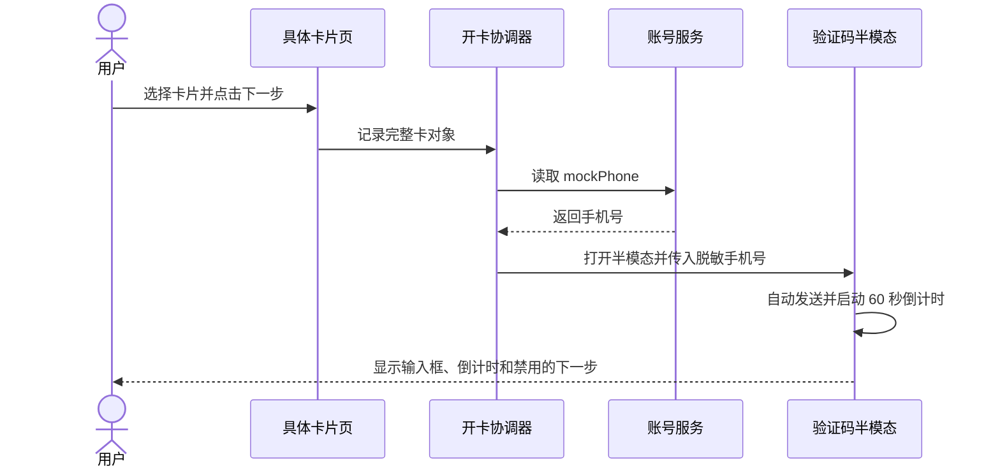
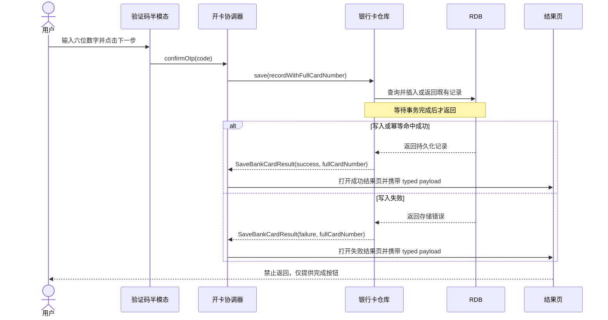
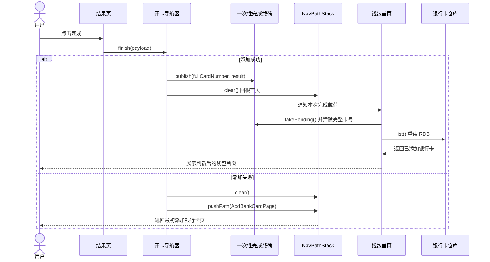
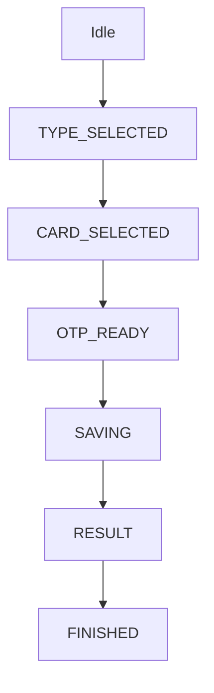
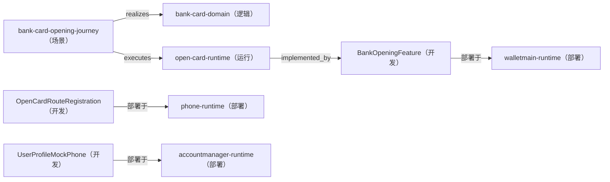

---
derived_from:
  artifact: component-blueprint@1
  component_id: bank-card-opening
  blueprint_id: bc-openCard-2
  revision: 2
  source_fingerprint: sha256:96ea30c89b36fb15596d576060e6f5317169ed9fc445c6360547e8065835a5c7
  artifact_sha256: sha256:2267a825e892b3187df369459005e1d85ebd375aa1c7053cc43cf7924dcd19b7
  change_units:
    - change_unit_id: open-card-flow
      binding: bound
      identity_neutral_digest: 6ec1cb674332dbfc28f070b3ab6b585346ee46cd6e8aaa26566b9238980b8da6
projection: component-blueprint-review@12
---

# 银行卡开卡、验证码与持久化闭环

<a id="design-626c75657072696e743a62632d6f70656e436172642d32"></a>
阅读入口：先阅读方案、旅程、关键流程和交付安排；类型、方法、完整分支与验收全文见同文档的[技术与追溯参考](#reference)。

<a id="summary"></a>
## 1 方案摘要

在既有两处银行入口接入统一开卡流程：选择卡类型、选择具体卡、校验六位短信验证码、等待 RDB 写入结果、展示不可侧滑退出的结果页，并在完成时清除整段开卡栈。

施工安排见[施工与上线](#delivery)。

<a id="background"></a>
## 2 背景、目标与边界

现有添加银行卡页与全部银行页已经可展示银行列表，但点击银行仍只提示暂不支持，也没有卡类型选择、具体银行卡选择、验证码、RDB 保存和结果页。

**当前问题**：用户无法从已有银行入口完成银行卡添加；当前数据模型也不足以保存完整卡号、支付能力状态和交易记录。

**方案定位**：本轮保持单机 mock 银行、卡片与短信发送，不接真实银行或短信服务；RDB 是已添加卡片的唯一持久化真源。

**目标**：两处银行入口都能进入一致的开卡流程

**成功衡量**：

- 任意银行可打开卡类型半模态
- 旧的全部银行与返回路径不回归

**目标**：验证码与卡片保存具备确定状态和恢复边界

**成功衡量**：

- 只接受六位数字
- 60 秒发送倒计时可重发
- 写入完成或失败后才进入结果页

**目标**：完成后导航栈不再暴露开卡过程页

**成功衡量**：

- 结果页屏蔽返回手势
- 成功回钱包首页并携带卡号
- 失败回最初添加卡片页

**本次范围**

- WalletMain 开卡页面、领域服务、RDB Repository 与资源
- AccountManager mock 手机号字段
- Phone 新增 NavDestination 注册与完成后的栈收敛
- UT 与真机视觉/导航验收

**不做什么**

- 真实短信网关
- 真实银行接口
- NFC 激活
- 银行卡详情页
- 真实交易流水生成

<a id="terms"></a>
## 3 术语

**银行卡开卡**：在钱包 feature 内从银行选择到卡片持久化与结果收口的用户流程

<a id="journey"></a>
## 4 用户旅程与界面

### 四个界面如何衔接

用户可从添加银行卡页或全部银行页点击任意银行。卡类型半模态只允许在银行支持的储蓄卡/信用卡中单选；继续后进入具体卡片页，界面只显示前四后四。选择卡后打开验证码半模态，自动发送一次并开始 60 秒倒计时；六位数字提交后等待 RDB 返回，最终进入禁止返回的结果页。

[设计依据](#reader-guide-source-1)

<a id="solution"></a>
## 5 整体方案

### 三模块责任边界

WalletMain 负责开卡页面、状态编排、银行卡 RDB 和首页刷新；AccountManager 只给 UserProfile 增加账号 mock 手机号；Phone 只在根 Navigation 注册新增页面 builder。完整卡号不会放入字符串路由参数，而通过 WalletMain 的一次性 typed 载荷交给已挂载首页，消费后立即清除。

[设计依据](#reader-guide-source-2)

<a id="flows"></a>
## 6 关键流程

### 选择卡片并打开验证码

具体卡片页把完整 MockBankCard 交给协调器。协调器从 AccountService 读取 mockPhone，向验证码组件只传脱敏手机号；组件出现时自动发送并启动计时器，消失时停止计时器。

[设计依据](#reader-guide-source-3)

<a id="design-67726170683a73657175656e63653a6f70656e2d6f7470"></a>
完整调用时序：选择具体卡并打开验证码



### 提交、保存与结果

验证码组件只调用协调器的命名方法。协调器校验六位数字后调用 Repository 并等待事务结束；无论成功或失败，Repository 都把完整卡号和结果返回给协调器，再以 typed payload 打开对应结果页。

[设计依据](#reader-guide-source-4)

<a id="design-67726170683a73657175656e63653a736176652d726573756c74"></a>
完整调用时序：提交验证码、保存并显示结果



### 完成、清栈与首页刷新

成功时先发布一次性完成载荷，再清空路径栈回根首页；首页取走本次完整卡号后立即清除载荷，并从 RDB 重读展示数据。失败时清空路径栈后重新压入 AddBankCardPage，因此无论用户从添加银行卡页还是全部银行页开始，都不会保留 AllBanks、选类型、选卡、验证码或结果页。

[设计依据](#reader-guide-source-5)

<a id="design-67726170683a73657175656e63653a66696e6973682d72656672657368"></a>
完整调用时序：结果页完成、清栈并刷新首页



<a id="data"></a>
## 7 数据与存储

### RDB 结构、安全与幂等

bank_card.db v1 的 bank_card 表以自增 id 为主键、card_number 为唯一键，保存银行、银行卡类型、添加时间、两种支付状态和交易记录 JSON。当前演示是单账号应用沙箱，不伪造 owner 列；完整卡号不写日志、不直接展示，本轮未取得额外加密要求。重复卡按唯一键读取既有记录并返回成功。

[设计依据](#reader-guide-source-6)

<a id="decisions"></a>
## 8 关键取舍

<a id="design-6465636973696f6e3a636172642d6e756d6265722d70726976616379"></a>
### card-number-privacy

| 关切 | 结论 |
| --- | --- |
| 选了什么 | 完整卡号只进入领域对象与 RDB；UI、日志和测试截图只使用脱敏值。|
| 理由 | 需求明确后台处理全卡号而 UI 只显示前四后四。|

被否方案：

未记录；不推测被否选择。

<a id="design-6465636973696f6e3a7264622d6f776e657273686970"></a>
### rdb-ownership

| 关切 | 结论 |
| --- | --- |
| 选了什么 | BankCardRepository 创建 bank\_card.db v1 与 bank\_card 表，id 主键、card\_number 唯一；当前单账号演示不新增虚假 owner 列。|
| 理由 | 银行卡是钱包 feature 数据，数据库由 WalletMain data 层唯一持有。|

被否方案：

| 方案 | 被否理由/缺陷 |
| --- | --- |
| 把银行卡存入 AccountManager | 账号模块不负责卡业务数据<br>越过模块职责 |
| 仅保存在页面内存 | 无法供后续详情和冷启动读取<br>不满足持久化要求 |

<a id="design-6465636973696f6e3a6e617669676174696f6e2d636c65616e7570"></a>
### navigation-cleanup

| 关切 | 结论 |
| --- | --- |
| 选了什么 | 结果页拦截返回；成功发布完成载荷后 NavPathStack.clear() 回根首页；失败 clear() 后 push AddBankCardPage，避免逐页 pop 暴露中间 UI并且不保留 AllBanksPage。|
| 理由 | 结果页必须不可返回并在完成时剔除整个开卡过程。|

被否方案：

| 方案 | 被否理由/缺陷 |
| --- | --- |
| 逐页 pop | 会短暂暴露中间页面且双入口计数易错<br>不满足一次性清除过程页 |
| 失败 popTo AllBanksPage | 失败必须回最初添加银行卡页<br>保留了错误入口页 |

<a id="design-6465636973696f6e3a636f6d706c6574696f6e2d7061796c6f6164"></a>
### completion-payload

| 关切 | 结论 |
| --- | --- |
| 选了什么 | BankOpeningCompletionBridge 只在进程内持有一条 typed BankOpeningResultPayload；结果页与首页完成通知复用同一模型，HomeTabPage 消费后立即清除并从 RDB 重读。|
| 理由 | 原需求要求成功时携带完整卡号回首页，同时完整卡号不得出现在 UI、日志或字符串路由参数。|

被否方案：

| 方案 | 被否理由/缺陷 |
| --- | --- |
| 把完整卡号拼进字符串路由参数 | 易进入日志或诊断输出<br>扩大敏感数据暴露面 |
| 不携带卡号只重读数据库 | 删除了原需求明确的数据交接<br>无法确认本次完成对象 |

<a id="design-6465636973696f6e3a75692d636f6d706f6e656e7473"></a>
### BankOpeningFeature

| 关切 | 结论 |
| --- | --- |
| 选了什么 | 选型结果：自定义实现；选型目标：[BankOpeningFeature](#design-766965773a646576656c6f706d656e742f6e6f64653a77616c6c65746d61696e2d6f70656e2d63617264) |
| 理由 | 现有组件索引只有通用卡片和既有页面 builder，没有与银行卡类型、验证码或结果页语义相同的可配置组件；在 WalletMain 内创建业务组件并复用既有资源风格。|

被否方案：

未记录；不推测被否选择。

<a id="recovery"></a>
## 9 失败与恢复

### 失败与中断速查

| 场景 | 用户看到什么 | 数据状态 | 如何继续 |
| --- | --- | --- | --- |
| RDB 写入失败（[BD-1](#design-616363657074616e63653a766965773a6c6f676963616c2f6e6f64653a62616e6b2d636172642d646f6d61696e2f626f756e6461726965733a42442d31)）| 失败结果页 | 无新增记录 | 点击完成回添加银行卡页后重试 |
| 关闭验证码（[BD-2](#design-616363657074616e63653a766965773a6c6f676963616c2f6e6f64653a62616e6b2d636172642d646f6d61696e2f626f756e6461726965733a42442d32)）| 回到具体卡片页 | 未写入 | 保留选卡并可重新打开验证码 |
| 同卡重复提交（[BD-3](#design-616363657074616e63653a766965773a6c6f676963616c2f6e6f64653a62616e6b2d636172642d646f6d61696e2f626f756e6461726965733a42442d33)）| 成功结果页 | 复用既有唯一记录 | 正常完成回首页 |
| 写入成功后进程终止 | 下次启动回普通入口 | RDB 已有记录 | 重加同卡时按幂等成功恢复 |

[设计依据](#reader-guide-source-7)

边界验收：[BD-1](#design-616363657074616e63653a766965773a6c6f676963616c2f6e6f64653a62616e6b2d636172642d646f6d61696e2f626f756e6461726965733a42442d31)；[BD-2](#design-616363657074616e63653a766965773a6c6f676963616c2f6e6f64653a62616e6b2d636172642d646f6d61696e2f626f756e6461726965733a42442d32)；[BD-3](#design-616363657074616e63653a766965773a6c6f676963616c2f6e6f64653a62616e6b2d636172642d646f6d61696e2f626f756e6461726965733a42442d33)。

<a id="quality"></a>
## 10 质量与安全

**security_privacy**：完整卡号不出现在 UI、日志和截图

**ux**：四个新界面按参考图保持主要结构、交互禁用态和导航行为

**compatibility**：旧添加银行卡、全部银行与原有根路由不回归

<a id="delivery"></a>
## 11 施工与上线

### 施工拆分与文件责任

一个 CU 原子交付三模块协作：WalletMain 完成数据模型、Repository、协调器、页面组件、首页完成载荷消费和资源；AccountManager 只扩展 UserProfile/AccountService；Phone 只追加两条 NavDestination builder。CU 完成前不发布半套导航，因而中间状态保持旧入口仍可编译运行。

[设计依据](#reader-guide-source-8)

### open-card-flow

在一个可独立验收的施工单元内完成两处银行入口、卡类型与具体卡选择、六位验证码、RDB 幂等保存、成败结果页、一次性全卡号交接和全过程清栈，同时保持既有银行卡列表与旧路由可用。

- WalletMain 的 BankOpeningCoordinator 与 BankCardRepository 分别持有瞬时流程状态和持久化银行卡真理，Phone 与 AccountManager 不复制该状态。
- 两处入口均打开银行对应的单选卡类型半模态。
- 具体卡筛选、前四后四脱敏、六位验证码和 60 秒重发状态符合要求。
- RDB 成败均返回完整卡号和结果，成功记录可重读且重复卡不新增。
- 结果页禁返回；成功/失败按规定清栈到首页或添加银行卡页。
- 旧页面互跳、字母索引、逐层返回和根 Navigation 注册保持可用。

模块分工：AccountManager；Phone；WalletMain。

- BankOpeningFeature（责任方：WalletMain）
- UserProfileMockPhone（责任方：AccountManager）
- OpenCardRouteRegistration（责任方：Phone）

未声明上游依赖。

安全中间态：单 CU 未完成前不对外声称交付；各模块均保持可编译，Phone 只在 WalletMain builder 已导出后接线，失败可回退到原有银行列表入口。

精确映射见 [施工单元参考](#design-756e69743a6f70656e2d636172642d666c6f77)。

### 文件与目录

```text
├── 01-Product/Phone/src/main/ets/pages/
│   └── index.ets
├── 02-Feature/WalletMain/src/
│   ├── main/
│   │   ├── ets/
│   │   │   ├── data/
│   │   │   │   ├── model/
│   │   │   │   │   ├── BankCardRecord.ets
│   │   │   │   │   ├── BankCardType.ets
│   │   │   │   │   ├── BankInfo.ets
│   │   │   │   │   ├── MockBankCard.ets
│   │   │   │   │   └── SaveBankCardResult.ets
│   │   │   │   └── repository/
│   │   │   │       ├── BankCardRepository.ets
│   │   │   │       └── BankRepository.ets
│   │   │   ├── domain/
│   │   │   │   ├── model/
│   │   │   │   │   ├── BankOpeningResultPayload.ets
│   │   │   │   │   └── OtpSession.ets
│   │   │   │   └── service/
│   │   │   │       ├── BankOpeningCoordinator.ets
│   │   │   │       └── BankOpeningNavigator.ets
│   │   │   ├── index.ets
│   │   │   ├── presentation/
│   │   │   │   ├── components/
│   │   │   │   │   ├── CardTypeSheet.ets
│   │   │   │   │   └── OtpVerificationSheet.ets
│   │   │   │   └── pages/
│   │   │   │       ├── AddBankCardPage.ets
│   │   │   │       ├── AllBanksPage.ets
│   │   │   │       ├── BankCardResultPage.ets
│   │   │   │       ├── BankCardSelectionPage.ets
│   │   │   │       └── HomeTabPage.ets
│   │   │   └── shared/
│   │   │       ├── BankOpeningCompletionBridge.ets
│   │   │       └── constant/
│   │   │           └── BankConstants.ets
│   │   └── resources/base/element/
│   │       ├── color.json
│   │       ├── float.json
│   │       └── string.json
│   └── ohosTest/ets/test/
│       └── bank_open_card_ut.test.ets
└── 04-BusinessBase/AccountManager/src/main/ets/
    ├── data/model/
    │   └── UserProfile.ets
    ├── domain/service/
    │   └── AccountService.ets
    └── index.ets
```

| 上线顺序 | 交付单元 | 配套前提 | 说明 |
| --- | --- | --- | --- |
| 1 | bc-openCard-2-open-flow | 无 | 单 CU 原子交付 |

| 配套方 | 协同关系 |
| --- | --- |
| AccountManager | 提供 mock 手机号字段，不持有开卡状态 |

<a id="acceptance"></a>
## 12 验收

### 验收分层

[AC-1](#design-616363657074616e63653a766965773a6c6f676963616c2f6e6f64653a62616e6b2d636172642d646f6d61696e2f63726974657269613a41432d31)/2/3/4 的筛选、脱敏、验证码状态机、RDB 映射和幂等以 UT 验证，并在真机核对四张参考图与交互；[AC-5](#design-616363657074616e63653a766965773a6c6f676963616c2f6e6f64653a62616e6b2d636172642d646f6d61696e2f63726974657269613a41432d35) 只以真机验证禁止返回、成功/失败清栈去向；[AC-6](#design-616363657074616e63653a766965773a6c6f676963616c2f6e6f64653a62616e6b2d636172642d646f6d61696e2f63726974657269613a41432d36) 同时跑旧页面互跳 UT 和真机回归。

[设计依据](#reader-guide-source-9)

<a id="questions"></a>
## 13 待补问题

### 术语假定

| 术语 | 当前假定解释 | 确认情况 |
| --- | --- | --- |
| 银行卡开卡 | 在钱包 feature 内从银行选择到卡片持久化与结果收口的用户流程 | 作者自行假定，待确认 |

完整术语与来源见[术语参考](#review-terms)。


<a id="reference"></a>
## 技术与追溯参考

部件 bank-card-opening · 蓝图 bc-openCard-2 · revision 2 · 准入 通过

本文根据 canonical 蓝图与当前施工单元确定性生成，文首保留精确来源身份。是否通过设计交接见 readiness；施工授权、映射与完成结论由原责任阶段确认。可选说明缺失或过期不改变这些结论。

参考保留全部声明；不从名称、目录或数组顺序推断调用、依赖与未声明存储设计。正文的验收链接按来源目标与条目编号定位。

### A 字段与类型

<a id="review-summary-details"></a>
#### 原概述与目标

| 关切 | 设计说明 |
| --- | --- |
| 背景 | 现有添加银行卡页与全部银行页已经可展示银行列表，但点击银行仍只提示暂不支持，也没有卡类型选择、具体银行卡选择、验证码、RDB 保存和结果页。 |
| 问题 | 用户无法从已有银行入口完成银行卡添加；当前数据模型也不足以保存完整卡号、支付能力状态和交易记录。 |
| 本次改变 | 在既有两处银行入口接入统一开卡流程：选择卡类型、选择具体卡、校验六位短信验证码、等待 RDB 写入结果、展示不可侧滑退出的结果页，并在完成时清除整段开卡栈。 |
| 整体定位 | 本轮保持单机 mock 银行、卡片与短信发送，不接真实银行或短信服务；RDB 是已添加卡片的唯一持久化真源。 |
| 范围 | WalletMain 开卡页面、领域服务、RDB Repository 与资源；AccountManager mock 手机号字段；Phone 新增 NavDestination 注册与完成后的栈收敛；UT 与真机视觉/导航验收 |
| 不做什么 | 真实短信网关；真实银行接口；NFC 激活；银行卡详情页；真实交易流水生成 |

| 目标 | 目标说明 | 成功衡量 |
| --- | --- | --- |
| G1 | 两处银行入口都能进入一致的开卡流程 | 任意银行可打开卡类型半模态<br>旧的全部银行与返回路径不回归 |
| G2 | 验证码与卡片保存具备确定状态和恢复边界 | 只接受六位数字<br>60 秒发送倒计时可重发<br>写入完成或失败后才进入结果页 |
| G3 | 完成后导航栈不再暴露开卡过程页 | 结果页屏蔽返回手势<br>成功回钱包首页并携带卡号<br>失败回最初添加卡片页 |

<a id="review-terms"></a>
#### 完整术语

| 术语 | 含义 | 模块 | 易混项 | 确认依据 |
| --- | --- | --- | --- | --- |
| 银行卡开卡 | 在钱包 feature 内从银行选择到卡片持久化与结果收口的用户流程 | WalletMain | AccountManager；Phone | doc/module-catalog.yaml#WalletMain |

#### 领域模型、字段与枚举

<a id="design-6d6f64656c3a766965773a646576656c6f706d656e742f6e6f64653a77616c6c65746d61696e2d6f70656e2d636172642f42616e6b4361726454797065"></a>
内容承载于：[BankOpeningFeature](#design-766965773a646576656c6f706d656e742f6e6f64653a77616c6c65746d61696e2d6f70656e2d63617264) · 契约设计

#### BankCardType · 枚举

模块 未记录；文件 02-Feature/WalletMain/src/main/ets/data/model/BankCardType.ets

| 字段 | 类型 | 必需 |
| --- | --- | --- |
| DEBIT | string | 是 |
| CREDIT | string | 是 |

未记录：可空；默认值；约束/说明；补充约束；验证引用；来源。

<a id="design-6d6f64656c3a766965773a646576656c6f706d656e742f6e6f64653a77616c6c65746d61696e2d6f70656e2d636172642f4d6f636b42616e6b43617264"></a>


#### MockBankCard · 接口

模块 未记录；文件 02-Feature/WalletMain/src/main/ets/data/model/MockBankCard.ets

| 字段 | 类型 | 必需 |
| --- | --- | --- |
| cardNumber | string | 是 |
| bankCode | string | 是 |
| bankName | string | 是 |
| cardType | BankCardType | 是 |

未记录：可空；默认值；约束/说明；补充约束；验证引用；来源。

<a id="design-6d6f64656c3a766965773a646576656c6f706d656e742f6e6f64653a77616c6c65746d61696e2d6f70656e2d636172642f4f747053657373696f6e"></a>


#### OtpSession · 接口

模块 未记录；文件 02-Feature/WalletMain/src/main/ets/domain/model/OtpSession.ets

| 字段 | 类型 | 必需 |
| --- | --- | --- |
| maskedPhone | string | 是 |
| remainingSeconds | number | 是 |
| code | string | 是 |

未记录：可空；默认值；约束/说明；补充约束；验证引用；来源。

<a id="design-6d6f64656c3a766965773a646576656c6f706d656e742f6e6f64653a77616c6c65746d61696e2d6f70656e2d636172642f5361766542616e6b43617264526573756c74"></a>


#### SaveBankCardResult · 接口

模块 未记录；文件 02-Feature/WalletMain/src/main/ets/data/model/SaveBankCardResult.ets

| 字段 | 类型 | 必需 |
| --- | --- | --- |
| success | boolean | 是 |
| cardNumber | string | 是 |
| errorMessage | string | 是 |

未记录：可空；默认值；约束/说明；补充约束；验证引用；来源。

<a id="design-6d6f64656c3a766965773a646576656c6f706d656e742f6e6f64653a77616c6c65746d61696e2d6f70656e2d636172642f42616e6b4f70656e696e67526573756c745061796c6f6164"></a>


#### BankOpeningResultPayload · 接口

模块 未记录；文件 02-Feature/WalletMain/src/main/ets/domain/model/BankOpeningResultPayload.ets

| 字段 | 类型 | 必需 |
| --- | --- | --- |
| fullCardNumber | string | 是 |
| result | SaveBankCardResult | 是 |

未记录：可空；默认值；约束/说明；补充约束；验证引用；来源。

<a id="design-6d6f64656c3a766965773a646576656c6f706d656e742f6e6f64653a77616c6c65746d61696e2d6f70656e2d636172642f42616e6b436172645265636f7264"></a>


#### BankCardRecord · 接口

模块 未记录；文件 02-Feature/WalletMain/src/main/ets/data/model/BankCardRecord.ets

| 字段 | 类型 | 必需 | 约束/说明 |
| --- | --- | --- | --- |
| cardNumber | string | 是 | 完整卡号，UI 不得直接展示 |
| cardKind | string | 是 | 银行卡大类 |
| bankName | string | 是 | 银行名称 |
| bankCardType | BankCardType | 是 | 储蓄卡或信用卡 |
| addedAt | number | 是 | Unix 毫秒添加时间 |
| huaweiPayEnabled | boolean | 是 | 华为支付开通状态 |
| unionPayQuickPassEnabled | boolean | 是 | 银联手机闪付状态 |
| transactionsJson | string | 是 | 交易记录 JSON，初始为空数组 |

未记录：可空；默认值；补充约束；验证引用；来源。

<a id="design-6d6f64656c3a766965773a646576656c6f706d656e742f6e6f64653a6163636f756e746d616e616765722d6d6f636b2d70686f6e652f5573657250726f66696c65"></a>
内容承载于：[UserProfileMockPhone](#design-766965773a646576656c6f706d656e742f6e6f64653a6163636f756e746d616e616765722d6d6f636b2d70686f6e65) · 契约设计

#### UserProfile · 类

模块 未记录；文件 04-BusinessBase/AccountManager/src/main/ets/data/model/UserProfile.ets

| 字段 | 类型 | 必需 | 约束/说明 |
| --- | --- | --- | --- |
| mockPhone | string | 是 | 账号 mock 原始手机号，仅供需要脱敏展示的业务读取 |

未记录：可空；默认值；补充约束；验证引用；来源。

### B 接口与存储明细

#### 本部件实际消费或提供的操作与 DTO

<a id="design-636f6e74726163743a62616e6b2d636172642d73746f72616765"></a>
#### bank-card-storage

操作：saveBankCard · 1 · internal；责任方 WalletMain；需要方 open-card-flow

<a id="design-64746f3a62616e6b2d636172642d73746f726167652f726571756573745f64746f"></a>
**请求 DTO：SaveBankCardRequest**

来源：[request\_dto](../../../../doc/features/bc-openCard-2/blueprint/contract-authority.yaml#/request_dto)
验证引用：[AC-4](#design-616363657074616e63653a766965773a6c6f676963616c2f6e6f64653a62616e6b2d636172642d646f6d61696e2f63726974657269613a41432d34)

| 字段 | 类型 | 可空 | 语义 | 来源 |
| --- | --- | --- | --- | --- |
| card\_number | string | 否 | 完整银行卡号，仅持久化层处理，展示层不得直接显示 | doc/features/bc-openCard-2/blueprint/contract-authority.yaml#/request\_dto/fields/0 |
| card\_kind | string | 否 | 银行卡大类，固定为 BANK\_CARD | doc/features/bc-openCard-2/blueprint/contract-authority.yaml#/request\_dto/fields/1 |
| bank\_name | string | 否 | 发卡银行名称 | doc/features/bc-openCard-2/blueprint/contract-authority.yaml#/request\_dto/fields/2 |
| bank\_card\_type | string | 否 | 储蓄卡或信用卡 | doc/features/bc-openCard-2/blueprint/contract-authority.yaml#/request\_dto/fields/3 |

未记录：必需；默认值；约束；验证引用。

<a id="design-64746f3a62616e6b2d636172642d73746f726167652f726573706f6e73655f64746f"></a>
**响应 DTO：SaveBankCardResult**

来源：[response\_dto](../../../../doc/features/bc-openCard-2/blueprint/contract-authority.yaml#/response_dto)
验证引用：[AC-4](#design-616363657074616e63653a766965773a6c6f676963616c2f6e6f64653a62616e6b2d636172642d646f6d61696e2f63726974657269613a41432d34)

| 字段 | 类型 | 可空 | 语义 | 来源 |
| --- | --- | --- | --- | --- |
| success | boolean | 否 | RDB 写入是否成功 | doc/features/bc-openCard-2/blueprint/contract-authority.yaml#/response\_dto/fields/0 |
| card\_number | string | 否 | 无论成功失败均回传本次完整卡号供结果流程携带 | doc/features/bc-openCard-2/blueprint/contract-authority.yaml#/response\_dto/fields/1 |
| error\_message | string | 否 | 失败时的本地错误摘要，成功时为空字符串 | doc/features/bc-openCard-2/blueprint/contract-authority.yaml#/response\_dto/fields/2 |

映射：

| 映射 | 类型 | 源字段 | 目标字段 | 规则 |
| --- | --- | --- | --- | --- |
| map\_card\_number | 直接映射 | card\_number | BankCardRecord.cardNumber | 原值写入 RDB，UI 仅使用 maskCardNumber 生成前四后四展示串 |
| map\_card\_kind | 直接映射 | card\_kind | BankCardRecord.cardKind | 原值写入 |
| map\_bank\_name | 直接映射 | bank\_name | BankCardRecord.bankName | 原值写入 |
| map\_bank\_card\_type | 直接映射 | bank\_card\_type | BankCardRecord.bankCardType | 原值写入 |
| map\_success | 直接映射 | success | SaveBankCardResult.success | RDB insert 返回值映射为布尔结果 |
| map\_result\_card\_number | 直接映射 | card\_number | SaveBankCardResult.cardNumber | 无论写入结果均保留本次完整卡号 |
| map\_error\_message | 直接映射 | error\_message | SaveBankCardResult.errorMessage | 本地异常转为可展示摘要 |

错误：storage\_failure：返回 success=false、完整 card\_number 与错误摘要；进入失败结果页，不把失败记录当作已添加卡片
来源：[errors](../../../../doc/features/bc-openCard-2/blueprint/contract-authority.yaml#/errors)
验证：[BD-1](#design-616363657074616e63653a766965773a6c6f676963616c2f6e6f64653a62616e6b2d636172642d646f6d61696e2f626f756e6461726965733a42442d31)
幂等：key：card\_number；behavior：card\_number 唯一约束；重复提交返回既有记录对应的成功结果，不新增重复卡
来源：[idempotency](../../../../doc/features/bc-openCard-2/blueprint/contract-authority.yaml#/idempotency)
验证：[BD-3](#design-616363657074616e63653a766965773a6c6f676963616c2f6e6f64653a62616e6b2d636172642d646f6d61696e2f626f756e6461726965733a42442d33)
非功能要求：privacy：完整卡号只在内存与 RDB 数据层流转，日志和 UI 均使用脱敏值；durability：下一步仅在 insert 完成或抛错后进入结果页
来源：[nfr](../../../../doc/features/bc-openCard-2/blueprint/contract-authority.yaml#/nfr)
验证：[NFR-1](#design-616363657074616e63653a766965773a6c6f676963616c2f6e6f64653a62616e6b2d636172642d646f6d61696e2f706572666f726d616e63653a4e46522d31)；[AC-4](#design-616363657074616e63653a766965773a6c6f676963616c2f6e6f64653a62616e6b2d636172642d646f6d61696e2f63726974657269613a41432d34)

未记录：必需；默认值；约束；验证引用。

#### 持久化表结构

表结构来自根级接口契约；领域模型见字段与类型，存储约束和编码保留此处原始声明。

##### bank-card-storage 的存储设计

| 存储关切 | 声明 |
| --- | --- |
| 数据库 | bank\_card.db |
| 版本 | 1 |
| 安全级别 | — |
| 加密 | — |
| 升级策略 | 首版仅执行 CREATE TABLE IF NOT EXISTS；后续版本通过显式 version migration 升级，不执行破坏性重建 |

未记录：安全级别（声明）；加密（声明）。

###### 表 bank\_card

| 表关切 | 声明 |
| --- | --- |
| 主键 | id |
| 约束 | — |
| 升级策略 | — |
| 来源 | — |

| 列 | 类型与声明约束 | 显式默认值 |
| --- | --- | --- |
| id | INTEGER | — |
| card\_number | TEXT | — |
| card\_kind | TEXT | BANK\_CARD |
| bank\_name | TEXT | — |
| bank\_card\_type | TEXT | — |
| added\_at | INTEGER | — |
| huawei\_pay\_enabled | INTEGER | 0 |
| unionpay\_quickpass\_enabled | INTEGER | 0 |
| transactions\_json | TEXT | \[\] |

未记录：约束（声明）；升级策略（声明）；来源（声明）；来源字段；编码；显式默认值；说明；补充约束；来源。

内容承载于：[BankOpeningFeature](#design-766965773a646576656c6f706d656e742f6e6f64653a77616c6c65746d61696e2d6f70656e2d63617264) · 契约设计

<a id="design-696e746572666163653a766965773a646576656c6f706d656e742f6e6f64653a77616c6c65746d61696e2d6f70656e2d636172642f42616e6b436172645265706f7369746f7279"></a>
接口 BankCardRepository · 未记录 / 未记录 · 02-Feature/WalletMain/src/main/ets/data/repository/BankCardRepository.ets

| 方法 | 参数 | 返回 |
| --- | --- | --- |
| save | record: BankCardRecord | Promise&lt;SaveBankCardResult&gt; |
| list | 无 | Promise&lt;BankCardRecord\[\]&gt; |

未记录：异步；职责/失败语义。

<a id="design-696e746572666163653a766965773a646576656c6f706d656e742f6e6f64653a77616c6c65746d61696e2d6f70656e2d636172642f42616e6b4f70656e696e674e6176696761746f72"></a>
接口 BankOpeningNavigator · 未记录 / 未记录 · 02-Feature/WalletMain/src/main/ets/domain/service/BankOpeningNavigator.ets

| 方法 | 参数 | 返回 |
| --- | --- | --- |
| finish | payload: BankOpeningResultPayload | void |

未记录：异步；职责/失败语义。

<a id="design-696e746572666163653a766965773a646576656c6f706d656e742f6e6f64653a77616c6c65746d61696e2d6f70656e2d636172642f42616e6b4f70656e696e67436f6f7264696e61746f72"></a>
接口 BankOpeningCoordinator · 未记录 / 未记录 · 02-Feature/WalletMain/src/main/ets/domain/service/BankOpeningCoordinator.ets

| 方法 | 参数 | 返回 |
| --- | --- | --- |
| start | bank: BankInfo | void |
| selectCardType | cardType: BankCardType | Promise&lt;MockBankCard\[\]&gt; |
| selectCard | card: MockBankCard | void |
| confirmOtp | code: string | Promise&lt;BankOpeningResultPayload&gt; |
| finish | 无 | void |

组件 CardTypeSheet · 组件 · 02-Feature/WalletMain/src/main/ets/presentation/components/CardTypeSheet.ets

未记录

组件 OtpVerificationSheet · 组件 · 02-Feature/WalletMain/src/main/ets/presentation/components/OtpVerificationSheet.ets

未记录

组件 BankCardSelectionPage · 页面 · 02-Feature/WalletMain/src/main/ets/presentation/pages/BankCardSelectionPage.ets

未记录

组件 BankCardResultPage · 页面 · 02-Feature/WalletMain/src/main/ets/presentation/pages/BankCardResultPage.ets

未记录

未记录：异步；职责/失败语义。

内容承载于：[UserProfileMockPhone](#design-766965773a646576656c6f706d656e742f6e6f64653a6163636f756e746d616e616765722d6d6f636b2d70686f6e65) · 契约设计

内容承载于：[OpenCardRouteRegistration](#design-766965773a646576656c6f706d656e742f6e6f64653a70686f6e652d6f70656e2d636172642d726f75746573) · 契约设计

#### 运行流与状态明细

<a id="design-766965773a72756e74696d652f666c6f773a62616e6b2d636172642d7265636f72642d666c6f77"></a>
##### bank-card-record-flow

数据域：bank-card-records；契约：contract:bank-card-storage；开发责任：view:development/node:walletmain-open-card

触发：

| 类型 | 时机 | 幂等 |
| --- | --- | --- |
| user\_submit\_otp | 用户提交六位验证码后 | card\_number 唯一；重复提交读取既有记录并返回成功 |

首次加载：load-cards · HomeTabPage attach 时调用 BankCardRepository.list()；责任方 WalletMain；范围 全部已添加银行卡；新鲜度 每次页面 attach 及完成通知后重读 RDB

权威状态：contract:bank-card-storage；持久化 bank\_card.db/bank\_card；投影/缓存 view:runtime/node:open-card-runtime；调和 保存完成载荷只触发通知；HomeTabPage 收到通知后从 RDB 重读，随后清除一次性全卡号。
状态责任方：view:development/node:walletmain-open-card；状态 BankOpeningCoordinator.phase；BankCardRepository persisted records；BankOpeningCompletionBridge one-shot payload

写入与发布：

| 写入 | 类型 | 持久化 | 发布 | 恢复 |
| --- | --- | --- | --- | --- |
| save-card | foreground | bank\_card.db/bank\_card | publication:cards-changed | recovery:open-card-recovery |

| 发布 | 载荷 |
| --- | --- |
| cards-changed | BankOpeningResultPayload(fullCardNumber, result) |

订阅与消费者：

| 订阅 | 消费者 | 建立/解除 | 快照/重放 | 清理 | 顺序 |
| --- | --- | --- | --- | --- | --- |
| home-card-refresh | consumer:home-tab | HomeTabPage.aboutToAppear 注册 / HomeTabPage.aboutToDisappear 注销 | 晚订阅时 takePending() 至多消费一条，然后重读 RDB | 消费后立即清空 payload；页面销毁时移除 listener | publish payload -&gt; clear nav stack -&gt; consumer reload RDB |

| 消费者 | 首次加载 | 更新 |
| --- | --- | --- |
| home-tab | initial-load:load-cards | publication:cards-changed |

失败与恢复：open-card-recovery

| 恢复关切 | 处理 |
| --- | --- |
| 失败处理 | 保存失败进入失败结果页且不发布成功通知；保存已成功但进程在结果页前终止时，下次重试同一卡号按唯一约束返回幂等成功；未保存选择与 OTP 不跨进程恢复。 |
| 重试 | 用户重新从 AddBankCardPage 发起；Repository 先按 card\_number 查询 |

生命周期：

| 场景 | 覆盖裁决 | 依据 |
| --- | --- | --- |
| 冷启动 | 已覆盖 | BankCardRepository.list |
| 热恢复 | 已覆盖 | HomeTabPage.aboutToAppear |
| 页面挂载 | 已覆盖 | HomeTabPage subscription |
| 页面卸载 | 已覆盖 | listener cleanup |
| 账号切换 | 不适用 | 当前单账号演示边界 |
| 进程重建 | 已覆盖 | RDB reload and duplicate idempotency |
| 后台写入 | 不适用 | 原需求仅前台提交 |

验证关注：[AC-4](#design-616363657074616e63653a766965773a6c6f676963616c2f6e6f64653a62616e6b2d636172642d646f6d61696e2f63726974657269613a41432d34)；[AC-5](#design-616363657074616e63653a766965773a6c6f676963616c2f6e6f64653a62616e6b2d636172642d646f6d61696e2f63726974657269613a41432d35)；[BD-1](#design-616363657074616e63653a766965773a6c6f676963616c2f6e6f64653a62616e6b2d636172642d646f6d61696e2f626f756e6461726965733a42442d31)；[BD-3](#design-616363657074616e63653a766965773a6c6f676963616c2f6e6f64653a62616e6b2d636172642d646f6d61696e2f626f756e6461726965733a42442d33)

未记录：触发；时机；快照/语义；发布；消费语义；处理。

内容承载于：[open-card-runtime](#design-766965773a72756e74696d652f6e6f64653a6f70656e2d636172642d72756e74696d65) · 契约设计

#### 施工状态与有序步骤

状态 未记录；持有者 未记录；作用域 未记录；责任方 未记录

| 顺序 | 行为 |
| --- | --- |
| 1 | AddBankCardPage 或 AllBanksPage 调用 BankOpeningCoordinator.start(bank) 并返回 CardTypeSheetState。 |
| 2 | 用户选择 cardType 并同意后，Coordinator 调用 BankRepository.getMockCards(bank.code, cardType)，页面收到候选卡列表。 |
| 3 | 用户选择卡并同意后，页面打开 OtpVerificationSheet；aboutToAppear 调用 OtpController.send() 并启动 60 秒倒计时。 |
| 4 | 六位数字提交时 OtpVerificationSheet 调用 BankOpeningCoordinator.confirmOtp(code)；Coordinator 校验 code 后调用 BankCardRepository.save(selectedCard.toRecord()) 并等待 RDB 结果。 |
| 5 | BankCardRepository 成功或失败都返回 SaveBankCardResult；Coordinator 以 BankOpeningResultPayload(fullCardNumber, result) 打开 BankCardResultPage。 |
| 6 | 结果页点击完成后调用 BankOpeningNavigator.finish(payload)：成功先发布一次性完成载荷再 clear 路径栈回根首页；失败 clear 后 push AddBankCardPage；两条路径都不逐页暴露中间 UI。 |
| 7 | HomeTabPage 预先订阅 BankOpeningCompletionBridge；收到成功载荷后立即消费并清空一次性全卡号，再从 BankCardRepository.list() 重读 RDB 作为展示真源。 |

生命周期触发：—

内容承载于：[bank-card-record-flow](#design-766965773a72756e74696d652f666c6f773a62616e6b2d636172642d7265636f72642d666c6f77) · 契约设计

#### 施工状态与有序步骤

状态 bank-card-records；持有者 BankOpeningCoordinator/BankCardRepository/BankOpeningCompletionBridge；作用域 WalletMain process + bank\_card.db；责任方 view:development/node:walletmain-open-card

| 顺序 | 行为 |
| --- | --- |
| 1 | 提交六位验证码 |
| 2 | 等待 RDB 保存或幂等查询 |
| 3 | 发布成功载荷或返回失败结果 |
| 4 | 清栈并由首页重读 RDB |

生命周期触发：页面挂载；页面卸载；热恢复；进程重建

| 失败/恢复场景 | 处理 |
| --- | --- |
| 恢复标识 | open-card-recovery |
| 处理 | 写入失败不发布；已写入后中断以唯一卡号幂等恢复 |

### C 完整验收

内容承载于：[bank-card-domain](#design-766965773a6c6f676963616c2f6e6f64653a62616e6b2d636172642d646f6d61696e) · 验收设计

<a id="design-616363657074616e63653a766965773a6c6f676963616c2f6e6f64653a62616e6b2d636172642d646f6d61696e2f63726974657269613a41432d31"></a>
<a id="design-616363657074616e63653a766965773a6c6f676963616c2f6e6f64653a62616e6b2d636172642d646f6d61696e2f63726974657269613a41432d32"></a>
<a id="design-616363657074616e63653a766965773a6c6f676963616c2f6e6f64653a62616e6b2d636172642d646f6d61696e2f63726974657269613a41432d33"></a>
<a id="design-616363657074616e63653a766965773a6c6f676963616c2f6e6f64653a62616e6b2d636172642d646f6d61696e2f63726974657269613a41432d34"></a>
<a id="design-616363657074616e63653a766965773a6c6f676963616c2f6e6f64653a62616e6b2d636172642d646f6d61696e2f63726974657269613a41432d35"></a>
<a id="design-616363657074616e63653a766965773a6c6f676963616c2f6e6f64653a62616e6b2d636172642d646f6d61696e2f63726974657269613a41432d36"></a>
<a id="design-616363657074616e63653a766965773a6c6f676963616c2f6e6f64653a62616e6b2d636172642d646f6d61696e2f626f756e6461726965733a42442d31"></a>
<a id="design-616363657074616e63653a766965773a6c6f676963616c2f6e6f64653a62616e6b2d636172642d646f6d61696e2f626f756e6461726965733a42442d32"></a>
<a id="design-616363657074616e63653a766965773a6c6f676963616c2f6e6f64653a62616e6b2d636172642d646f6d61696e2f626f756e6461726965733a42442d33"></a>
<a id="design-616363657074616e63653a766965773a6c6f676963616c2f6e6f64653a62616e6b2d636172642d646f6d61696e2f706572666f726d616e63653a4e46522d31"></a>
功能验收：

| AC | 优先级/功能 | 验收标准 | 验证步骤（按序） | 预期 | 分层/关注点 | 已有流程关联 | CU 谓词直接引用 |
| --- | --- | --- | --- | --- | --- | --- | --- |
| AC-1 | P0 / — | 已有添加银行卡页和全部银行页点击任意银行均打开该银行卡类型半模态 | 1. 从添加银行卡页点击任意银行<br>2. 从全部银行页点击任意银行<br>3. 检查银行信息、支持类型和单选状态 | 银行信息与支持的储蓄卡/信用卡选项一致，最多单选一种 | 单测与真机；UT：入口统一与单选状态；device：半模态布局和真实导航 | 未声明；无 UI 依据时由 spec 不冲突补充 | open-card-flow/p-entry-type |
| AC-2 | P0 / — | 选择卡类型并同意后进入银行具体卡片页，卡号仅显示前四后四 | 1. 选择储蓄卡进入具体卡页<br>2. 选择信用卡进入具体卡页<br>3. 核对候选数量与卡号脱敏 | 只展示该银行该类型的 1-2 张 mock 卡，完整卡号不出现在 UI 与日志 | 单测与真机；UT：按银行和类型筛选、脱敏；device：页面布局与选择状态 | 未声明；无 UI 依据时由 spec 不冲突补充 | open-card-flow/p-card-otp |
| AC-3 | P0 / — | 验证码半模态打开即模拟发送并倒计时，只允许六位数字启用下一步 | 1. 打开验证码半模态<br>2. 依次输入非数字、少于六位和六位数字<br>3. 等待倒计时归零并重新发送 | 无效输入不可提交，60 秒归零后出现重新发送并可再次倒计时 | 单测与真机；UT：输入校验与倒计时状态机；device：键盘、按钮禁用态与半模态 | 未声明；无 UI 依据时由 spec 不冲突补充 | open-card-flow/p-runtime-owner；open-card-flow/p-card-otp |
| AC-4 | P0 / — | 提交验证码后等待 RDB 写入结果并携带完整卡号进入结果页 | 1. 模拟 RDB 写入成功<br>2. 模拟 RDB 写入失败<br>3. 重复提交同一卡号 | 成功或失败均携带完整卡号与结果；成功记录可重新读取且重复卡不新增 | 单测与真机；UT：RDB mapping、唯一约束与结果传递；device：结果页面状态 | 未声明；无 UI 依据时由 spec 不冲突补充 | open-card-flow/p-runtime-owner；open-card-flow/p-rdb-result |
| AC-5 | P0 / — | 结果页禁止系统返回并且只能通过完成按钮退出 | 1. 在结果页执行左滑和系统返回<br>2. 成功结果点击完成<br>3. 失败结果点击完成 | 返回手势不退出；成功清除开卡流程并回钱包首页，失败清除后回最初添加卡片页 | 真机；UT：导航决策纯函数；device：真实 NavPathStack 清栈与返回手势 | 未声明；无 UI 依据时由 spec 不冲突补充 | open-card-flow/p-finish-stack |
| AC-6 | P1 / — | 旧的添加银行卡展开、全部银行索引与原有路由保持可用 | 1. 执行 Home 到 AddCardEntry 到 AddBankCard 到 AllBanks 的旧链路<br>2. 逐层返回<br>3. 再执行新页面跳转 | 旧行为无回归且新路由均由既有 Navigation 注册 | 单测与真机；UT：旧新路由注册与调用；device：真机回退路径 | 未声明；无 UI 依据时由 spec 不冲突补充 | open-card-flow/p-old-route |

边界验收：

| BD | 优先级 | 异常场景 | 处理 | 可见结果/预期 | 分层/关注点 | CU 谓词直接引用 |
| --- | --- | --- | --- | --- | --- | --- |
| BD-1 | P0 | insert 抛错或返回失败 | 构造失败结果并进入失败结果页 | 数据库无新增记录，完成后回添加卡片页 | 单测与真机；UT：Repository 异常到失败结果映射；device：失败结果页与完成回退 | open-card-flow/p-rdb-result |
| BD-2 | P0 | 用户关闭验证码半模态 | 取消计时器并保留具体卡片页选择 | 不写数据库，可重新打开验证码 | 单测与真机；UT：timer cleanup 与选择保留；device：关闭半模态后页面状态 | 未登记直接谓词引用 |
| BD-3 | P0 | 同一卡号跨会话再次添加 | 按 card\_number 唯一约束返回既有成功结果 | 不产生重复卡记录 | 单元测试；UT：唯一约束与幂等返回 | open-card-flow/p-rdb-result |

质量阈值：

| NFR | 指标 | 阈值 | 单位 | 说明 | 分层/关注点 |
| --- | --- | --- | --- | --- | --- |
| NFR-1 | OTP 倒计时步长 | 1 | second | 倒计时每秒更新一次且页面消失时停止 | 未记录；未记录关注点 |

### D 全部用例分支与界面调用

<a id="design-75693a766965773a72756e74696d652f6e6f64653a6f70656e2d636172642d72756e74696d652f55432d4f50454e2d43415244"></a>
#### 用例 UC-OPEN-CARD 的界面与交互

内容承载于：[open-card-runtime](#design-766965773a72756e74696d652f6e6f64653a6f70656e2d636172642d72756e74696d65) · 用例设计

| 界面/交互 | 职责 | 用户动作与调用 | 订阅 |
| --- | --- | --- | --- |
| AddBankCardPage&#124;AllBanksPage | 入口 | 点击银行 → coordinator.start | 无 |
| CardTypeSheet | 对话框 | 选择卡类型并继续 → coordinator.selectCardType | phase=TYPE\_SELECTED |
| BankCardSelectionPage | 过程 | 选择具体卡并下一步 → coordinator.selectCard | phase=CARD\_SELECTED |
| OtpVerificationSheet | 对话框 | 重新发送 → coordinator.resendOtp；提交六位验证码 → coordinator.confirmOtp | phase=OTP\_READY |
| BankCardResultPage | 结果 | 点击完成 → coordinator.finish | phase=RESULT |

#### 用例、数据边界与分支


#### 用例 UC-OPEN-CARD

从银行入口完成选类型、选卡、验证码、保存和结果收口

编排入口：BankOpeningCoordinator；文件 02-Feature/WalletMain/src/main/ets/domain/service/BankOpeningCoordinator.ets

| 状态集合 |
| --- |
| Idle |
| TYPE\_SELECTED |
| CARD\_SELECTED |
| OTP\_READY |
| SAVING |
| RESULT |
| FINISHED |

阶段流转（展示基准：happy\_path；基准已出现的边不标标签，其余边标分支，完整来源见下方分支表）：



| 状态字段 | 类型 |
| --- | --- |
| selectedCardNumber | string &#124; null |
| saveResult | SaveBankCardResult &#124; null |

界面职责、动作、调用与订阅见 [用例 UC-OPEN-CARD 的交互表](#design-75693a766965773a72756e74696d652f6e6f64653a6f70656e2d636172642d72756e74696d652f55432d4f50454e2d43415244)。

数据边界：bankRepo · BankRepository · storage

| 方法 | 参数 | 返回 | 异步 |
| --- | --- | --- | --- |
| getMockCards | string；BankCardType | MockBankCard\[\] | 是 |

数据边界：cardRepo · BankCardRepository · storage

| 方法 | 参数 | 返回 | 异步 |
| --- | --- | --- | --- |
| save | BankCardRecord | SaveBankCardResult | 是 |

主路径及分支去向：

| 分支 | 条件 | 关联验收 |
| --- | --- | --- |
| happy\_path | 写入成功并回首页 | [AC-1](#design-616363657074616e63653a766965773a6c6f676963616c2f6e6f64653a62616e6b2d636172642d646f6d61696e2f63726974657269613a41432d31)；[AC-2](#design-616363657074616e63653a766965773a6c6f676963616c2f6e6f64653a62616e6b2d636172642d646f6d61696e2f63726974657269613a41432d32)；[AC-3](#design-616363657074616e63653a766965773a6c6f676963616c2f6e6f64653a62616e6b2d636172642d646f6d61696e2f63726974657269613a41432d33)；[AC-4](#design-616363657074616e63653a766965773a6c6f676963616c2f6e6f64653a62616e6b2d636172642d646f6d61696e2f63726974657269613a41432d34)；[AC-5](#design-616363657074616e63653a766965773a6c6f676963616c2f6e6f64653a62616e6b2d636172642d646f6d61696e2f63726974657269613a41432d35) |
| storage\_failure | 写入失败并回添加银行卡页 | [AC-4](#design-616363657074616e63653a766965773a6c6f676963616c2f6e6f64653a62616e6b2d636172642d646f6d61696e2f63726974657269613a41432d34)；[AC-5](#design-616363657074616e63653a766965773a6c6f676963616c2f6e6f64653a62616e6b2d636172642d646f6d61696e2f63726974657269613a41432d35)；[BD-1](#design-616363657074616e63653a766965773a6c6f676963616c2f6e6f64653a62616e6b2d636172642d646f6d61696e2f626f756e6461726965733a42442d31) |

**分支 happy\_path 的行为与去向**

| 关切 | 声明内容 |
| --- | --- |
| 动作顺序 | start；selectCardType；selectCard；confirmOtp；finish |
| 阶段去向 | Idle；TYPE\_SELECTED；CARD\_SELECTED；OTP\_READY；SAVING；RESULT；FINISHED |
| 端口调用 | BankRepository.getMockCards；BankCardRepository.save；BankOpeningNavigator.finish |
| 预期状态 | saveResult.success：true |
| 不得调用 | 无 |

**分支 storage\_failure 的行为与去向**

| 关切 | 声明内容 |
| --- | --- |
| 动作顺序 | start；selectCardType；selectCard；confirmOtp；finish |
| 阶段去向 | Idle；TYPE\_SELECTED；CARD\_SELECTED；OTP\_READY；SAVING；RESULT；FINISHED |
| 端口调用 | BankRepository.getMockCards；BankCardRepository.save；BankOpeningNavigator.finish |
| 预期状态 | saveResult.success：false |
| 不得调用 | 无 |

| 分支 | 本地桩 | 本地预期 |
| --- | --- | --- |
| happy\_path | bankRepo.getMockCards：ok\_nonempty；cardRepo.save：ok | bankRepo.getMockCards；cardRepo.save |
| storage\_failure | bankRepo.getMockCards：ok\_nonempty；cardRepo.save：throw:StorageError | bankRepo.getMockCards；cardRepo.save |

未记录：外部桩。

### E 施工精确映射

#### 声明文件（完整施工写集）

<a id="design-66696c653a30322d466561747572652f57616c6c65744d61696e2f7372632f6d61696e2f6574732f646174612f6d6f64656c2f42616e6b496e666f2e657473"></a>
<a id="design-66696c653a30322d466561747572652f57616c6c65744d61696e2f7372632f6d61696e2f6574732f646174612f6d6f64656c2f42616e6b43617264547970652e657473"></a>
<a id="design-66696c653a30322d466561747572652f57616c6c65744d61696e2f7372632f6d61696e2f6574732f646174612f6d6f64656c2f42616e6b436172645265636f72642e657473"></a>
<a id="design-66696c653a30322d466561747572652f57616c6c65744d61696e2f7372632f6d61696e2f6574732f646174612f6d6f64656c2f4d6f636b42616e6b436172642e657473"></a>
<a id="design-66696c653a30322d466561747572652f57616c6c65744d61696e2f7372632f6d61696e2f6574732f646174612f6d6f64656c2f5361766542616e6b43617264526573756c742e657473"></a>
<a id="design-66696c653a30322d466561747572652f57616c6c65744d61696e2f7372632f6d61696e2f6574732f646174612f7265706f7369746f72792f42616e6b5265706f7369746f72792e657473"></a>
<a id="design-66696c653a30322d466561747572652f57616c6c65744d61696e2f7372632f6d61696e2f6574732f646174612f7265706f7369746f72792f42616e6b436172645265706f7369746f72792e657473"></a>
<a id="design-66696c653a30322d466561747572652f57616c6c65744d61696e2f7372632f6d61696e2f6574732f646f6d61696e2f6d6f64656c2f4f747053657373696f6e2e657473"></a>
<a id="design-66696c653a30322d466561747572652f57616c6c65744d61696e2f7372632f6d61696e2f6574732f646f6d61696e2f6d6f64656c2f42616e6b4f70656e696e67526573756c745061796c6f61642e657473"></a>
<a id="design-66696c653a30322d466561747572652f57616c6c65744d61696e2f7372632f6d61696e2f6574732f646f6d61696e2f736572766963652f42616e6b4f70656e696e67436f6f7264696e61746f722e657473"></a>
<a id="design-66696c653a30322d466561747572652f57616c6c65744d61696e2f7372632f6d61696e2f6574732f646f6d61696e2f736572766963652f42616e6b4f70656e696e674e6176696761746f722e657473"></a>
<a id="design-66696c653a30322d466561747572652f57616c6c65744d61696e2f7372632f6d61696e2f6574732f7368617265642f42616e6b4f70656e696e67436f6d706c6574696f6e4272696467652e657473"></a>
<a id="design-66696c653a30322d466561747572652f57616c6c65744d61696e2f7372632f6d61696e2f6574732f70726573656e746174696f6e2f636f6d706f6e656e74732f436172645479706553686565742e657473"></a>
<a id="design-66696c653a30322d466561747572652f57616c6c65744d61696e2f7372632f6d61696e2f6574732f70726573656e746174696f6e2f636f6d706f6e656e74732f4f7470566572696669636174696f6e53686565742e657473"></a>
<a id="design-66696c653a30322d466561747572652f57616c6c65744d61696e2f7372632f6d61696e2f6574732f70726573656e746174696f6e2f70616765732f41646442616e6b43617264506167652e657473"></a>
<a id="design-66696c653a30322d466561747572652f57616c6c65744d61696e2f7372632f6d61696e2f6574732f70726573656e746174696f6e2f70616765732f416c6c42616e6b73506167652e657473"></a>
<a id="design-66696c653a30322d466561747572652f57616c6c65744d61696e2f7372632f6d61696e2f6574732f70726573656e746174696f6e2f70616765732f42616e6b4361726453656c656374696f6e506167652e657473"></a>
<a id="design-66696c653a30322d466561747572652f57616c6c65744d61696e2f7372632f6d61696e2f6574732f70726573656e746174696f6e2f70616765732f42616e6b43617264526573756c74506167652e657473"></a>
<a id="design-66696c653a30322d466561747572652f57616c6c65744d61696e2f7372632f6d61696e2f6574732f70726573656e746174696f6e2f70616765732f486f6d65546162506167652e657473"></a>
<a id="design-66696c653a30322d466561747572652f57616c6c65744d61696e2f7372632f6d61696e2f6574732f7368617265642f636f6e7374616e742f42616e6b436f6e7374616e74732e657473"></a>
<a id="design-66696c653a30322d466561747572652f57616c6c65744d61696e2f7372632f6d61696e2f6574732f696e6465782e657473"></a>
<a id="design-66696c653a30322d466561747572652f57616c6c65744d61696e2f7372632f6d61696e2f7265736f75726365732f626173652f656c656d656e742f737472696e672e6a736f6e"></a>
<a id="design-66696c653a30322d466561747572652f57616c6c65744d61696e2f7372632f6d61696e2f7265736f75726365732f626173652f656c656d656e742f636f6c6f722e6a736f6e"></a>
<a id="design-66696c653a30322d466561747572652f57616c6c65744d61696e2f7372632f6d61696e2f7265736f75726365732f626173652f656c656d656e742f666c6f61742e6a736f6e"></a>
<a id="design-66696c653a30322d466561747572652f57616c6c65744d61696e2f7372632f6f686f73546573742f6574732f746573742f62616e6b5f6f70656e5f636172645f75742e746573742e657473"></a>
<a id="design-66696c653a30342d427573696e657373426173652f4163636f756e744d616e616765722f7372632f6d61696e2f6574732f646174612f6d6f64656c2f5573657250726f66696c652e657473"></a>
<a id="design-66696c653a30342d427573696e657373426173652f4163636f756e744d616e616765722f7372632f6d61696e2f6574732f646f6d61696e2f736572766963652f4163636f756e74536572766963652e657473"></a>
<a id="design-66696c653a30342d427573696e657373426173652f4163636f756e744d616e616765722f7372632f6d61696e2f6574732f696e6465782e657473"></a>
<a id="design-66696c653a30312d50726f647563742f50686f6e652f7372632f6d61696e2f6574732f70616765732f696e6465782e657473"></a>
<a id="design-7772697465733a766965773a646576656c6f706d656e742f6e6f64653a77616c6c65746d61696e2d6f70656e2d63617264"></a>
<a id="design-7772697465733a766965773a646576656c6f706d656e742f6e6f64653a6163636f756e746d616e616765722d6d6f636b2d70686f6e65"></a>
<a id="design-7772697465733a766965773a646576656c6f706d656e742f6e6f64653a70686f6e652d6f70656e2d636172642d726f75746573"></a>
| 文件 | 声明目标 |
| --- | --- |
| 02-Feature/WalletMain/src/main/ets/data/model/BankInfo.ets | [BankOpeningFeature](#design-766965773a646576656c6f706d656e742f6e6f64653a77616c6c65746d61696e2d6f70656e2d63617264) |
| 02-Feature/WalletMain/src/main/ets/data/model/BankCardType.ets | [BankOpeningFeature](#design-766965773a646576656c6f706d656e742f6e6f64653a77616c6c65746d61696e2d6f70656e2d63617264) |
| 02-Feature/WalletMain/src/main/ets/data/model/BankCardRecord.ets | [BankOpeningFeature](#design-766965773a646576656c6f706d656e742f6e6f64653a77616c6c65746d61696e2d6f70656e2d63617264) |
| 02-Feature/WalletMain/src/main/ets/data/model/MockBankCard.ets | [BankOpeningFeature](#design-766965773a646576656c6f706d656e742f6e6f64653a77616c6c65746d61696e2d6f70656e2d63617264) |
| 02-Feature/WalletMain/src/main/ets/data/model/SaveBankCardResult.ets | [BankOpeningFeature](#design-766965773a646576656c6f706d656e742f6e6f64653a77616c6c65746d61696e2d6f70656e2d63617264) |
| 02-Feature/WalletMain/src/main/ets/data/repository/BankRepository.ets | [BankOpeningFeature](#design-766965773a646576656c6f706d656e742f6e6f64653a77616c6c65746d61696e2d6f70656e2d63617264) |
| 02-Feature/WalletMain/src/main/ets/data/repository/BankCardRepository.ets | [BankOpeningFeature](#design-766965773a646576656c6f706d656e742f6e6f64653a77616c6c65746d61696e2d6f70656e2d63617264) |
| 02-Feature/WalletMain/src/main/ets/domain/model/OtpSession.ets | [BankOpeningFeature](#design-766965773a646576656c6f706d656e742f6e6f64653a77616c6c65746d61696e2d6f70656e2d63617264) |
| 02-Feature/WalletMain/src/main/ets/domain/model/BankOpeningResultPayload.ets | [BankOpeningFeature](#design-766965773a646576656c6f706d656e742f6e6f64653a77616c6c65746d61696e2d6f70656e2d63617264) |
| 02-Feature/WalletMain/src/main/ets/domain/service/BankOpeningCoordinator.ets | [BankOpeningFeature](#design-766965773a646576656c6f706d656e742f6e6f64653a77616c6c65746d61696e2d6f70656e2d63617264) |
| 02-Feature/WalletMain/src/main/ets/domain/service/BankOpeningNavigator.ets | [BankOpeningFeature](#design-766965773a646576656c6f706d656e742f6e6f64653a77616c6c65746d61696e2d6f70656e2d63617264) |
| 02-Feature/WalletMain/src/main/ets/shared/BankOpeningCompletionBridge.ets | [BankOpeningFeature](#design-766965773a646576656c6f706d656e742f6e6f64653a77616c6c65746d61696e2d6f70656e2d63617264) |
| 02-Feature/WalletMain/src/main/ets/presentation/components/CardTypeSheet.ets | [BankOpeningFeature](#design-766965773a646576656c6f706d656e742f6e6f64653a77616c6c65746d61696e2d6f70656e2d63617264) |
| 02-Feature/WalletMain/src/main/ets/presentation/components/OtpVerificationSheet.ets | [BankOpeningFeature](#design-766965773a646576656c6f706d656e742f6e6f64653a77616c6c65746d61696e2d6f70656e2d63617264) |
| 02-Feature/WalletMain/src/main/ets/presentation/pages/AddBankCardPage.ets | [BankOpeningFeature](#design-766965773a646576656c6f706d656e742f6e6f64653a77616c6c65746d61696e2d6f70656e2d63617264) |
| 02-Feature/WalletMain/src/main/ets/presentation/pages/AllBanksPage.ets | [BankOpeningFeature](#design-766965773a646576656c6f706d656e742f6e6f64653a77616c6c65746d61696e2d6f70656e2d63617264) |
| 02-Feature/WalletMain/src/main/ets/presentation/pages/BankCardSelectionPage.ets | [BankOpeningFeature](#design-766965773a646576656c6f706d656e742f6e6f64653a77616c6c65746d61696e2d6f70656e2d63617264) |
| 02-Feature/WalletMain/src/main/ets/presentation/pages/BankCardResultPage.ets | [BankOpeningFeature](#design-766965773a646576656c6f706d656e742f6e6f64653a77616c6c65746d61696e2d6f70656e2d63617264) |
| 02-Feature/WalletMain/src/main/ets/presentation/pages/HomeTabPage.ets | [BankOpeningFeature](#design-766965773a646576656c6f706d656e742f6e6f64653a77616c6c65746d61696e2d6f70656e2d63617264) |
| 02-Feature/WalletMain/src/main/ets/shared/constant/BankConstants.ets | [BankOpeningFeature](#design-766965773a646576656c6f706d656e742f6e6f64653a77616c6c65746d61696e2d6f70656e2d63617264) |
| 02-Feature/WalletMain/src/main/ets/index.ets | [BankOpeningFeature](#design-766965773a646576656c6f706d656e742f6e6f64653a77616c6c65746d61696e2d6f70656e2d63617264) |
| 02-Feature/WalletMain/src/main/resources/base/element/string.json | [BankOpeningFeature](#design-766965773a646576656c6f706d656e742f6e6f64653a77616c6c65746d61696e2d6f70656e2d63617264) |
| 02-Feature/WalletMain/src/main/resources/base/element/color.json | [BankOpeningFeature](#design-766965773a646576656c6f706d656e742f6e6f64653a77616c6c65746d61696e2d6f70656e2d63617264) |
| 02-Feature/WalletMain/src/main/resources/base/element/float.json | [BankOpeningFeature](#design-766965773a646576656c6f706d656e742f6e6f64653a77616c6c65746d61696e2d6f70656e2d63617264) |
| 02-Feature/WalletMain/src/ohosTest/ets/test/bank\_open\_card\_ut.test.ets | [BankOpeningFeature](#design-766965773a646576656c6f706d656e742f6e6f64653a77616c6c65746d61696e2d6f70656e2d63617264) |
| 04-BusinessBase/AccountManager/src/main/ets/data/model/UserProfile.ets | [UserProfileMockPhone](#design-766965773a646576656c6f706d656e742f6e6f64653a6163636f756e746d616e616765722d6d6f636b2d70686f6e65) |
| 04-BusinessBase/AccountManager/src/main/ets/domain/service/AccountService.ets | [UserProfileMockPhone](#design-766965773a646576656c6f706d656e742f6e6f64653a6163636f756e746d616e616765722d6d6f636b2d70686f6e65) |
| 04-BusinessBase/AccountManager/src/main/ets/index.ets | [UserProfileMockPhone](#design-766965773a646576656c6f706d656e742f6e6f64653a6163636f756e746d616e616765722d6d6f636b2d70686f6e65) |
| 01-Product/Phone/src/main/ets/pages/index.ets | [OpenCardRouteRegistration](#design-766965773a646576656c6f706d656e742f6e6f64653a70686f6e652d6f70656e2d636172642d726f75746573) |

#### 文件用途与已声明关联

| 文件 | 已声明用途或关联 |
| --- | --- |
| [02-Feature/WalletMain/src/main/ets/data/model/BankInfo.ets](#design-66696c653a30322d466561747572652f57616c6c65744d61696e2f7372632f6d61696e2f6574732f646174612f6d6f64656c2f42616e6b496e666f2e657473) | 未声明用途或接口/模型关联 |
| [02-Feature/WalletMain/src/main/ets/data/model/BankCardType.ets](#design-66696c653a30322d466561747572652f57616c6c65744d61696e2f7372632f6d61696e2f6574732f646174612f6d6f64656c2f42616e6b43617264547970652e657473) | 声明模型：[BankCardType](#design-6d6f64656c3a766965773a646576656c6f706d656e742f6e6f64653a77616c6c65746d61696e2d6f70656e2d636172642f42616e6b4361726454797065) |
| [02-Feature/WalletMain/src/main/ets/data/model/BankCardRecord.ets](#design-66696c653a30322d466561747572652f57616c6c65744d61696e2f7372632f6d61696e2f6574732f646174612f6d6f64656c2f42616e6b436172645265636f72642e657473) | 声明模型：[BankCardRecord](#design-6d6f64656c3a766965773a646576656c6f706d656e742f6e6f64653a77616c6c65746d61696e2d6f70656e2d636172642f42616e6b436172645265636f7264) |
| [02-Feature/WalletMain/src/main/ets/data/model/MockBankCard.ets](#design-66696c653a30322d466561747572652f57616c6c65744d61696e2f7372632f6d61696e2f6574732f646174612f6d6f64656c2f4d6f636b42616e6b436172642e657473) | 声明模型：[MockBankCard](#design-6d6f64656c3a766965773a646576656c6f706d656e742f6e6f64653a77616c6c65746d61696e2d6f70656e2d636172642f4d6f636b42616e6b43617264) |
| [02-Feature/WalletMain/src/main/ets/data/model/SaveBankCardResult.ets](#design-66696c653a30322d466561747572652f57616c6c65744d61696e2f7372632f6d61696e2f6574732f646174612f6d6f64656c2f5361766542616e6b43617264526573756c742e657473) | 声明模型：[SaveBankCardResult](#design-6d6f64656c3a766965773a646576656c6f706d656e742f6e6f64653a77616c6c65746d61696e2d6f70656e2d636172642f5361766542616e6b43617264526573756c74) |
| [02-Feature/WalletMain/src/main/ets/data/repository/BankRepository.ets](#design-66696c653a30322d466561747572652f57616c6c65744d61696e2f7372632f6d61696e2f6574732f646174612f7265706f7369746f72792f42616e6b5265706f7369746f72792e657473) | 未声明用途或接口/模型关联 |
| [02-Feature/WalletMain/src/main/ets/data/repository/BankCardRepository.ets](#design-66696c653a30322d466561747572652f57616c6c65744d61696e2f7372632f6d61696e2f6574732f646174612f7265706f7369746f72792f42616e6b436172645265706f7369746f72792e657473) | 接口：[BankCardRepository](#design-696e746572666163653a766965773a646576656c6f706d656e742f6e6f64653a77616c6c65746d61696e2d6f70656e2d636172642f42616e6b436172645265706f7369746f7279) |
| [02-Feature/WalletMain/src/main/ets/domain/model/OtpSession.ets](#design-66696c653a30322d466561747572652f57616c6c65744d61696e2f7372632f6d61696e2f6574732f646f6d61696e2f6d6f64656c2f4f747053657373696f6e2e657473) | 声明模型：[OtpSession](#design-6d6f64656c3a766965773a646576656c6f706d656e742f6e6f64653a77616c6c65746d61696e2d6f70656e2d636172642f4f747053657373696f6e) |
| [02-Feature/WalletMain/src/main/ets/domain/model/BankOpeningResultPayload.ets](#design-66696c653a30322d466561747572652f57616c6c65744d61696e2f7372632f6d61696e2f6574732f646f6d61696e2f6d6f64656c2f42616e6b4f70656e696e67526573756c745061796c6f61642e657473) | 声明模型：[BankOpeningResultPayload](#design-6d6f64656c3a766965773a646576656c6f706d656e742f6e6f64653a77616c6c65746d61696e2d6f70656e2d636172642f42616e6b4f70656e696e67526573756c745061796c6f6164) |
| [02-Feature/WalletMain/src/main/ets/domain/service/BankOpeningCoordinator.ets](#design-66696c653a30322d466561747572652f57616c6c65744d61696e2f7372632f6d61696e2f6574732f646f6d61696e2f736572766963652f42616e6b4f70656e696e67436f6f7264696e61746f722e657473) | 接口：[BankOpeningCoordinator](#design-696e746572666163653a766965773a646576656c6f706d656e742f6e6f64653a77616c6c65746d61696e2d6f70656e2d636172642f42616e6b4f70656e696e67436f6f7264696e61746f72) |
| [02-Feature/WalletMain/src/main/ets/domain/service/BankOpeningNavigator.ets](#design-66696c653a30322d466561747572652f57616c6c65744d61696e2f7372632f6d61696e2f6574732f646f6d61696e2f736572766963652f42616e6b4f70656e696e674e6176696761746f722e657473) | 接口：[BankOpeningNavigator](#design-696e746572666163653a766965773a646576656c6f706d656e742f6e6f64653a77616c6c65746d61696e2d6f70656e2d636172642f42616e6b4f70656e696e674e6176696761746f72) |
| [02-Feature/WalletMain/src/main/ets/shared/BankOpeningCompletionBridge.ets](#design-66696c653a30322d466561747572652f57616c6c65744d61696e2f7372632f6d61696e2f6574732f7368617265642f42616e6b4f70656e696e67436f6d706c6574696f6e4272696467652e657473) | 未声明用途或接口/模型关联 |
| [02-Feature/WalletMain/src/main/ets/presentation/components/CardTypeSheet.ets](#design-66696c653a30322d466561747572652f57616c6c65744d61696e2f7372632f6d61696e2f6574732f70726573656e746174696f6e2f636f6d706f6e656e74732f436172645479706553686565742e657473) | 未声明用途或接口/模型关联 |
| [02-Feature/WalletMain/src/main/ets/presentation/components/OtpVerificationSheet.ets](#design-66696c653a30322d466561747572652f57616c6c65744d61696e2f7372632f6d61696e2f6574732f70726573656e746174696f6e2f636f6d706f6e656e74732f4f7470566572696669636174696f6e53686565742e657473) | 未声明用途或接口/模型关联 |
| [02-Feature/WalletMain/src/main/ets/presentation/pages/AddBankCardPage.ets](#design-66696c653a30322d466561747572652f57616c6c65744d61696e2f7372632f6d61696e2f6574732f70726573656e746174696f6e2f70616765732f41646442616e6b43617264506167652e657473) | 未声明用途或接口/模型关联 |
| [02-Feature/WalletMain/src/main/ets/presentation/pages/AllBanksPage.ets](#design-66696c653a30322d466561747572652f57616c6c65744d61696e2f7372632f6d61696e2f6574732f70726573656e746174696f6e2f70616765732f416c6c42616e6b73506167652e657473) | 未声明用途或接口/模型关联 |
| [02-Feature/WalletMain/src/main/ets/presentation/pages/BankCardSelectionPage.ets](#design-66696c653a30322d466561747572652f57616c6c65744d61696e2f7372632f6d61696e2f6574732f70726573656e746174696f6e2f70616765732f42616e6b4361726453656c656374696f6e506167652e657473) | 未声明用途或接口/模型关联 |
| [02-Feature/WalletMain/src/main/ets/presentation/pages/BankCardResultPage.ets](#design-66696c653a30322d466561747572652f57616c6c65744d61696e2f7372632f6d61696e2f6574732f70726573656e746174696f6e2f70616765732f42616e6b43617264526573756c74506167652e657473) | 未声明用途或接口/模型关联 |
| [02-Feature/WalletMain/src/main/ets/presentation/pages/HomeTabPage.ets](#design-66696c653a30322d466561747572652f57616c6c65744d61696e2f7372632f6d61696e2f6574732f70726573656e746174696f6e2f70616765732f486f6d65546162506167652e657473) | 未声明用途或接口/模型关联 |
| [02-Feature/WalletMain/src/main/ets/shared/constant/BankConstants.ets](#design-66696c653a30322d466561747572652f57616c6c65744d61696e2f7372632f6d61696e2f6574732f7368617265642f636f6e7374616e742f42616e6b436f6e7374616e74732e657473) | 未声明用途或接口/模型关联 |
| [02-Feature/WalletMain/src/main/ets/index.ets](#design-66696c653a30322d466561747572652f57616c6c65744d61696e2f7372632f6d61696e2f6574732f696e6465782e657473) | 未声明用途或接口/模型关联 |
| [02-Feature/WalletMain/src/main/resources/base/element/string.json](#design-66696c653a30322d466561747572652f57616c6c65744d61696e2f7372632f6d61696e2f7265736f75726365732f626173652f656c656d656e742f737472696e672e6a736f6e) | 未声明用途或接口/模型关联 |
| [02-Feature/WalletMain/src/main/resources/base/element/color.json](#design-66696c653a30322d466561747572652f57616c6c65744d61696e2f7372632f6d61696e2f7265736f75726365732f626173652f656c656d656e742f636f6c6f722e6a736f6e) | 未声明用途或接口/模型关联 |
| [02-Feature/WalletMain/src/main/resources/base/element/float.json](#design-66696c653a30322d466561747572652f57616c6c65744d61696e2f7372632f6d61696e2f7265736f75726365732f626173652f656c656d656e742f666c6f61742e6a736f6e) | 未声明用途或接口/模型关联 |
| [02-Feature/WalletMain/src/ohosTest/ets/test/bank\_open\_card\_ut.test.ets](#design-66696c653a30322d466561747572652f57616c6c65744d61696e2f7372632f6f686f73546573742f6574732f746573742f62616e6b5f6f70656e5f636172645f75742e746573742e657473) | 未声明用途或接口/模型关联 |
| [04-BusinessBase/AccountManager/src/main/ets/data/model/UserProfile.ets](#design-66696c653a30342d427573696e657373426173652f4163636f756e744d616e616765722f7372632f6d61696e2f6574732f646174612f6d6f64656c2f5573657250726f66696c652e657473) | 声明模型：[UserProfile](#design-6d6f64656c3a766965773a646576656c6f706d656e742f6e6f64653a6163636f756e746d616e616765722d6d6f636b2d70686f6e652f5573657250726f66696c65) |
| [04-BusinessBase/AccountManager/src/main/ets/domain/service/AccountService.ets](#design-66696c653a30342d427573696e657373426173652f4163636f756e744d616e616765722f7372632f6d61696e2f6574732f646f6d61696e2f736572766963652f4163636f756e74536572766963652e657473) | 未声明用途或接口/模型关联 |
| [04-BusinessBase/AccountManager/src/main/ets/index.ets](#design-66696c653a30342d427573696e657373426173652f4163636f756e744d616e616765722f7372632f6d61696e2f6574732f696e6465782e657473) | 未声明用途或接口/模型关联 |
| [01-Product/Phone/src/main/ets/pages/index.ets](#design-66696c653a30312d50726f647563742f50686f6e652f7372632f6d61696e2f6574732f70616765732f696e6465782e657473) | 未声明用途或接口/模型关联 |

<a id="design-756e69743a6f70656e2d636172642d666c6f77"></a>
#### open-card-flow

在一个可独立验收的施工单元内完成两处银行入口、卡类型与具体卡选择、六位验证码、RDB 幂等保存、成败结果页、一次性全卡号交接和全过程清栈，同时保持既有银行卡列表与旧路由可用。

来源绑定：已绑定。

交付结果：

| 谓词 | 职责 | 交付语义 | 提供项 | 验证关注 |
| --- | --- | --- | --- | --- |
| p-runtime-owner | 主责 | WalletMain 的 BankOpeningCoordinator 与 BankCardRepository 分别持有瞬时流程状态和持久化银行卡真理，Phone 与 AccountManager 不复制该状态。 | open-card-end-to-end；bank-card-rdb | [AC-3](#design-616363657074616e63653a766965773a6c6f676963616c2f6e6f64653a62616e6b2d636172642d646f6d61696e2f63726974657269613a41432d33)；[AC-4](#design-616363657074616e63653a766965773a6c6f676963616c2f6e6f64653a62616e6b2d636172642d646f6d61696e2f63726974657269613a41432d34) |
| p-entry-type | 行为责任 | 两处入口均打开银行对应的单选卡类型半模态。 | open-card-end-to-end | [AC-1](#design-616363657074616e63653a766965773a6c6f676963616c2f6e6f64653a62616e6b2d636172642d646f6d61696e2f63726974657269613a41432d31) |
| p-card-otp | 行为责任 | 具体卡筛选、前四后四脱敏、六位验证码和 60 秒重发状态符合要求。 | open-card-end-to-end | [AC-2](#design-616363657074616e63653a766965773a6c6f676963616c2f6e6f64653a62616e6b2d636172642d646f6d61696e2f63726974657269613a41432d32)；[AC-3](#design-616363657074616e63653a766965773a6c6f676963616c2f6e6f64653a62616e6b2d636172642d646f6d61696e2f63726974657269613a41432d33) |
| p-rdb-result | 契约责任 | RDB 成败均返回完整卡号和结果，成功记录可重读且重复卡不新增。 | bank-card-rdb | [AC-4](#design-616363657074616e63653a766965773a6c6f676963616c2f6e6f64653a62616e6b2d636172642d646f6d61696e2f63726974657269613a41432d34)；[BD-1](#design-616363657074616e63653a766965773a6c6f676963616c2f6e6f64653a62616e6b2d636172642d646f6d61696e2f626f756e6461726965733a42442d31)；[BD-3](#design-616363657074616e63653a766965773a6c6f676963616c2f6e6f64653a62616e6b2d636172642d646f6d61696e2f626f756e6461726965733a42442d33) |
| p-finish-stack | 恢复责任 | 结果页禁返回；成功/失败按规定清栈到首页或添加银行卡页。 | safe-navigation-finish | [AC-5](#design-616363657074616e63653a766965773a6c6f676963616c2f6e6f64653a62616e6b2d636172642d646f6d61696e2f63726974657269613a41432d35) |
| p-old-route | 消费方 | 旧页面互跳、字母索引、逐层返回和根 Navigation 注册保持可用。 | safe-navigation-finish | [AC-6](#design-616363657074616e63653a766965773a6c6f676963616c2f6e6f64653a62616e6b2d636172642d646f6d61696e2f63726974657269613a41432d36) |

| 提供项 | 交付说明 |
| --- | --- |
| open-card-end-to-end | 用户可从任一既有银行入口完成选类型、选卡、验证码、持久化与结果收口。 |
| bank-card-rdb | bank\_card.db v1 以 card\_number 唯一保存完整银行卡记录并支持首页重读。 |
| safe-navigation-finish | 结果页禁止返回；成功回首页并消费一次性完整卡号，失败回添加银行卡页，过程页全部清除。 |

显式依赖：

未声明上游依赖。

可修改模块：AccountManager；Phone；WalletMain。

| 修改责任方 | 写入范围 | 设计引用 |
| --- | --- | --- |
| WalletMain | [BankInfo.ets](#design-66696c653a30322d466561747572652f57616c6c65744d61696e2f7372632f6d61696e2f6574732f646174612f6d6f64656c2f42616e6b496e666f2e657473)；[BankCardType.ets](#design-66696c653a30322d466561747572652f57616c6c65744d61696e2f7372632f6d61696e2f6574732f646174612f6d6f64656c2f42616e6b43617264547970652e657473)；[BankCardRecord.ets](#design-66696c653a30322d466561747572652f57616c6c65744d61696e2f7372632f6d61696e2f6574732f646174612f6d6f64656c2f42616e6b436172645265636f72642e657473)；[MockBankCard.ets](#design-66696c653a30322d466561747572652f57616c6c65744d61696e2f7372632f6d61696e2f6574732f646174612f6d6f64656c2f4d6f636b42616e6b436172642e657473)；[SaveBankCardResult.ets](#design-66696c653a30322d466561747572652f57616c6c65744d61696e2f7372632f6d61696e2f6574732f646174612f6d6f64656c2f5361766542616e6b43617264526573756c742e657473)；[BankRepository.ets](#design-66696c653a30322d466561747572652f57616c6c65744d61696e2f7372632f6d61696e2f6574732f646174612f7265706f7369746f72792f42616e6b5265706f7369746f72792e657473)；[BankCardRepository.ets](#design-66696c653a30322d466561747572652f57616c6c65744d61696e2f7372632f6d61696e2f6574732f646174612f7265706f7369746f72792f42616e6b436172645265706f7369746f72792e657473)；[OtpSession.ets](#design-66696c653a30322d466561747572652f57616c6c65744d61696e2f7372632f6d61696e2f6574732f646f6d61696e2f6d6f64656c2f4f747053657373696f6e2e657473)；[BankOpeningResultPayload.ets](#design-66696c653a30322d466561747572652f57616c6c65744d61696e2f7372632f6d61696e2f6574732f646f6d61696e2f6d6f64656c2f42616e6b4f70656e696e67526573756c745061796c6f61642e657473)；[BankOpeningCoordinator.ets](#design-66696c653a30322d466561747572652f57616c6c65744d61696e2f7372632f6d61696e2f6574732f646f6d61696e2f736572766963652f42616e6b4f70656e696e67436f6f7264696e61746f722e657473)；[BankOpeningNavigator.ets](#design-66696c653a30322d466561747572652f57616c6c65744d61696e2f7372632f6d61696e2f6574732f646f6d61696e2f736572766963652f42616e6b4f70656e696e674e6176696761746f722e657473)；[BankOpeningCompletionBridge.ets](#design-66696c653a30322d466561747572652f57616c6c65744d61696e2f7372632f6d61696e2f6574732f7368617265642f42616e6b4f70656e696e67436f6d706c6574696f6e4272696467652e657473)；[CardTypeSheet.ets](#design-66696c653a30322d466561747572652f57616c6c65744d61696e2f7372632f6d61696e2f6574732f70726573656e746174696f6e2f636f6d706f6e656e74732f436172645479706553686565742e657473)；[OtpVerificationSheet.ets](#design-66696c653a30322d466561747572652f57616c6c65744d61696e2f7372632f6d61696e2f6574732f70726573656e746174696f6e2f636f6d706f6e656e74732f4f7470566572696669636174696f6e53686565742e657473)；[AddBankCardPage.ets](#design-66696c653a30322d466561747572652f57616c6c65744d61696e2f7372632f6d61696e2f6574732f70726573656e746174696f6e2f70616765732f41646442616e6b43617264506167652e657473)；[AllBanksPage.ets](#design-66696c653a30322d466561747572652f57616c6c65744d61696e2f7372632f6d61696e2f6574732f70726573656e746174696f6e2f70616765732f416c6c42616e6b73506167652e657473)；[BankCardSelectionPage.ets](#design-66696c653a30322d466561747572652f57616c6c65744d61696e2f7372632f6d61696e2f6574732f70726573656e746174696f6e2f70616765732f42616e6b4361726453656c656374696f6e506167652e657473)；[BankCardResultPage.ets](#design-66696c653a30322d466561747572652f57616c6c65744d61696e2f7372632f6d61696e2f6574732f70726573656e746174696f6e2f70616765732f42616e6b43617264526573756c74506167652e657473)；[HomeTabPage.ets](#design-66696c653a30322d466561747572652f57616c6c65744d61696e2f7372632f6d61696e2f6574732f70726573656e746174696f6e2f70616765732f486f6d65546162506167652e657473)；[BankConstants.ets](#design-66696c653a30322d466561747572652f57616c6c65744d61696e2f7372632f6d61696e2f6574732f7368617265642f636f6e7374616e742f42616e6b436f6e7374616e74732e657473)；[index.ets](#design-66696c653a30322d466561747572652f57616c6c65744d61696e2f7372632f6d61696e2f6574732f696e6465782e657473)；[string.json](#design-66696c653a30322d466561747572652f57616c6c65744d61696e2f7372632f6d61696e2f7265736f75726365732f626173652f656c656d656e742f737472696e672e6a736f6e)；[color.json](#design-66696c653a30322d466561747572652f57616c6c65744d61696e2f7372632f6d61696e2f7265736f75726365732f626173652f656c656d656e742f636f6c6f722e6a736f6e)；[float.json](#design-66696c653a30322d466561747572652f57616c6c65744d61696e2f7372632f6d61696e2f7265736f75726365732f626173652f656c656d656e742f666c6f61742e6a736f6e)；[bank\_open\_card\_ut.test.ets](#design-66696c653a30322d466561747572652f57616c6c65744d61696e2f7372632f6f686f73546573742f6574732f746573742f62616e6b5f6f70656e5f636172645f75742e746573742e657473) | view:development/node:walletmain-open-card |
| AccountManager | [UserProfile.ets](#design-66696c653a30342d427573696e657373426173652f4163636f756e744d616e616765722f7372632f6d61696e2f6574732f646174612f6d6f64656c2f5573657250726f66696c652e657473)；[AccountService.ets](#design-66696c653a30342d427573696e657373426173652f4163636f756e744d616e616765722f7372632f6d61696e2f6574732f646f6d61696e2f736572766963652f4163636f756e74536572766963652e657473)；[index.ets](#design-66696c653a30342d427573696e657373426173652f4163636f756e744d616e616765722f7372632f6d61696e2f6574732f696e6465782e657473) | view:development/node:accountmanager-mock-phone |
| Phone | [index.ets](#design-66696c653a30312d50726f647563742f50686f6e652f7372632f6d61696e2f6574732f70616765732f696e6465782e657473) | view:development/node:phone-open-card-routes |

前置条件：

| 说明 | 依据 |
| --- | --- |
| bc-openCard-2 蓝图通过机器检查与独立质询。 | doc/features/bc-openCard-2/blueprint/component-blueprint.yaml；doc/features/bc-openCard-2/blueprint/component-blueprint.review.md |

保留约束：

| 说明 | 依据 |
| --- | --- |
| 添加银行卡收起/展开态、全部银行索引与旧返回链不回归。 | AC-6；02-Feature/WalletMain/src/main/ets/presentation/pages/AddBankCardPage.ets；02-Feature/WalletMain/src/main/ets/presentation/pages/AllBanksPage.ets |
| 完整卡号不得出现在 UI、日志和截图，只在 typed 内存载荷与 RDB 数据层流转。 | AC-2；AC-4；decision:card-number-privacy |

安全中间态：单 CU 未完成前不对外声称交付；各模块均保持可编译，Phone 只在 WalletMain builder 已导出后接线，失败可回退到原有银行列表入口。
构建：compile；targeted-ut；兼容：AC-6；恢复：[BD-1](#design-616363657074616e63653a766965773a6c6f676963616c2f6e6f64653a62616e6b2d636172642d646f6d61696e2f626f756e6461726965733a42442d31)；[BD-2](#design-616363657074616e63653a766965773a6c6f676963616c2f6e6f64653a62616e6b2d636172642d646f6d61696e2f626f756e6461726965733a42442d32)；[BD-3](#design-616363657074616e63653a766965773a6c6f676963616c2f6e6f64653a62616e6b2d636172642d646f6d61696e2f626f756e6461726965733a42442d33)

设计与执行阻塞项：无。

设计引用：

- [bank-card-domain](#design-766965773a6c6f676963616c2f6e6f64653a62616e6b2d636172642d646f6d61696e)
- [open-card-runtime](#design-766965773a72756e74696d652f6e6f64653a6f70656e2d636172642d72756e74696d65)
- [bank-card-record-flow](#design-766965773a72756e74696d652f666c6f773a62616e6b2d636172642d7265636f72642d666c6f77)
- [BankOpeningFeature](#design-766965773a646576656c6f706d656e742f6e6f64653a77616c6c65746d61696e2d6f70656e2d63617264)
- [UserProfileMockPhone](#design-766965773a646576656c6f706d656e742f6e6f64653a6163636f756e746d616e616765722d6d6f636b2d70686f6e65)
- [OpenCardRouteRegistration](#design-766965773a646576656c6f706d656e742f6e6f64653a70686f6e652d6f70656e2d636172642d726f75746573)
- [bank-card-storage](#design-636f6e74726163743a62616e6b2d636172642d73746f72616765)
- [rdb-ownership](#design-6465636973696f6e3a7264622d6f776e657273686970)
- [navigation-cleanup](#design-6465636973696f6e3a6e617669676174696f6e2d636c65616e7570)
- [completion-payload](#design-6465636973696f6e3a636f6d706c6574696f6e2d7061796c6f6164)
- [ui-components](#design-6465636973696f6e3a75692d636f6d706f6e656e7473)
- [bank-card-opening-journey](#design-766965773a7363656e6172696f732f6e6f64653a62616e6b2d636172642d6f70656e696e672d6a6f75726e6579)
- [scenario-logical](#design-72656c6174696f6e3a7363656e6172696f2d6c6f676963616c)
- [scenario-runtime](#design-72656c6174696f6e3a7363656e6172696f2d72756e74696d65)
- [runtime-development](#design-72656c6174696f6e3a72756e74696d652d646576656c6f706d656e74)
- [walletmain-deployment](#design-72656c6174696f6e3a77616c6c65746d61696e2d6465706c6f796d656e74)
- [phone-deployment](#design-72656c6174696f6e3a70686f6e652d6465706c6f796d656e74)
- [accountmanager-deployment](#design-72656c6174696f6e3a6163636f756e746d616e616765722d6465706c6f796d656e74)
- [walletmain-runtime](#design-766965773a6465706c6f796d656e742f6e6f64653a77616c6c65746d61696e2d72756e74696d65)
- [phone-runtime](#design-766965773a6465706c6f796d656e742f6e6f64653a70686f6e652d72756e74696d65)
- [accountmanager-runtime](#design-766965773a6465706c6f796d656e742f6e6f64653a6163636f756e746d616e616765722d72756e74696d65)

验证关注：[AC-1](#design-616363657074616e63653a766965773a6c6f676963616c2f6e6f64653a62616e6b2d636172642d646f6d61696e2f63726974657269613a41432d31)；[AC-2](#design-616363657074616e63653a766965773a6c6f676963616c2f6e6f64653a62616e6b2d636172642d646f6d61696e2f63726974657269613a41432d32)；[AC-3](#design-616363657074616e63653a766965773a6c6f676963616c2f6e6f64653a62616e6b2d636172642d646f6d61696e2f63726974657269613a41432d33)；[AC-4](#design-616363657074616e63653a766965773a6c6f676963616c2f6e6f64653a62616e6b2d636172642d646f6d61696e2f63726974657269613a41432d34)；[AC-5](#design-616363657074616e63653a766965773a6c6f676963616c2f6e6f64653a62616e6b2d636172642d646f6d61696e2f63726974657269613a41432d35)；[AC-6](#design-616363657074616e63653a766965773a6c6f676963616c2f6e6f64653a62616e6b2d636172642d646f6d61696e2f63726974657269613a41432d36)；[BD-1](#design-616363657074616e63653a766965773a6c6f676963616c2f6e6f64653a62616e6b2d636172642d646f6d61696e2f626f756e6461726965733a42442d31)；[BD-2](#design-616363657074616e63653a766965773a6c6f676963616c2f6e6f64653a62616e6b2d636172642d646f6d61696e2f626f756e6461726965733a42442d32)；[BD-3](#design-616363657074616e63653a766965773a6c6f676963616c2f6e6f64653a62616e6b2d636172642d646f6d61696e2f626f756e6461726965733a42442d33)；[NFR-1](#design-616363657074616e63653a766965773a6c6f676963616c2f6e6f64653a62616e6b2d636172642d646f6d61696e2f706572666f726d616e63653a4e46522d31)

合并所得声明集合：

| 内容 | 本 CU 整体继承的编号/文件 |
| --- | --- |
| AC | [AC-1](#design-616363657074616e63653a766965773a6c6f676963616c2f6e6f64653a62616e6b2d636172642d646f6d61696e2f63726974657269613a41432d31)；[AC-2](#design-616363657074616e63653a766965773a6c6f676963616c2f6e6f64653a62616e6b2d636172642d646f6d61696e2f63726974657269613a41432d32)；[AC-3](#design-616363657074616e63653a766965773a6c6f676963616c2f6e6f64653a62616e6b2d636172642d646f6d61696e2f63726974657269613a41432d33)；[AC-4](#design-616363657074616e63653a766965773a6c6f676963616c2f6e6f64653a62616e6b2d636172642d646f6d61696e2f63726974657269613a41432d34)；[AC-5](#design-616363657074616e63653a766965773a6c6f676963616c2f6e6f64653a62616e6b2d636172642d646f6d61696e2f63726974657269613a41432d35)；[AC-6](#design-616363657074616e63653a766965773a6c6f676963616c2f6e6f64653a62616e6b2d636172642d646f6d61696e2f63726974657269613a41432d36) |
| BD | [BD-1](#design-616363657074616e63653a766965773a6c6f676963616c2f6e6f64653a62616e6b2d636172642d646f6d61696e2f626f756e6461726965733a42442d31)；[BD-2](#design-616363657074616e63653a766965773a6c6f676963616c2f6e6f64653a62616e6b2d636172642d646f6d61696e2f626f756e6461726965733a42442d32)；[BD-3](#design-616363657074616e63653a766965773a6c6f676963616c2f6e6f64653a62616e6b2d636172642d646f6d61696e2f626f756e6461726965733a42442d33) |
| NFR | [NFR-1](#design-616363657074616e63653a766965773a6c6f676963616c2f6e6f64653a62616e6b2d636172642d646f6d61696e2f706572666f726d616e63653a4e46522d31) |
| contracts.files 声明写集 | 29 个文件；[BankInfo.ets](#design-66696c653a30322d466561747572652f57616c6c65744d61696e2f7372632f6d61696e2f6574732f646174612f6d6f64656c2f42616e6b496e666f2e657473)；[BankCardType.ets](#design-66696c653a30322d466561747572652f57616c6c65744d61696e2f7372632f6d61696e2f6574732f646174612f6d6f64656c2f42616e6b43617264547970652e657473)；[BankCardRecord.ets](#design-66696c653a30322d466561747572652f57616c6c65744d61696e2f7372632f6d61696e2f6574732f646174612f6d6f64656c2f42616e6b436172645265636f72642e657473)；[MockBankCard.ets](#design-66696c653a30322d466561747572652f57616c6c65744d61696e2f7372632f6d61696e2f6574732f646174612f6d6f64656c2f4d6f636b42616e6b436172642e657473)；[SaveBankCardResult.ets](#design-66696c653a30322d466561747572652f57616c6c65744d61696e2f7372632f6d61696e2f6574732f646174612f6d6f64656c2f5361766542616e6b43617264526573756c742e657473)；[BankRepository.ets](#design-66696c653a30322d466561747572652f57616c6c65744d61696e2f7372632f6d61696e2f6574732f646174612f7265706f7369746f72792f42616e6b5265706f7369746f72792e657473)；[BankCardRepository.ets](#design-66696c653a30322d466561747572652f57616c6c65744d61696e2f7372632f6d61696e2f6574732f646174612f7265706f7369746f72792f42616e6b436172645265706f7369746f72792e657473)；[OtpSession.ets](#design-66696c653a30322d466561747572652f57616c6c65744d61696e2f7372632f6d61696e2f6574732f646f6d61696e2f6d6f64656c2f4f747053657373696f6e2e657473)；[BankOpeningResultPayload.ets](#design-66696c653a30322d466561747572652f57616c6c65744d61696e2f7372632f6d61696e2f6574732f646f6d61696e2f6d6f64656c2f42616e6b4f70656e696e67526573756c745061796c6f61642e657473)；[BankOpeningCoordinator.ets](#design-66696c653a30322d466561747572652f57616c6c65744d61696e2f7372632f6d61696e2f6574732f646f6d61696e2f736572766963652f42616e6b4f70656e696e67436f6f7264696e61746f722e657473)；[BankOpeningNavigator.ets](#design-66696c653a30322d466561747572652f57616c6c65744d61696e2f7372632f6d61696e2f6574732f646f6d61696e2f736572766963652f42616e6b4f70656e696e674e6176696761746f722e657473)；[BankOpeningCompletionBridge.ets](#design-66696c653a30322d466561747572652f57616c6c65744d61696e2f7372632f6d61696e2f6574732f7368617265642f42616e6b4f70656e696e67436f6d706c6574696f6e4272696467652e657473)；[CardTypeSheet.ets](#design-66696c653a30322d466561747572652f57616c6c65744d61696e2f7372632f6d61696e2f6574732f70726573656e746174696f6e2f636f6d706f6e656e74732f436172645479706553686565742e657473)；[OtpVerificationSheet.ets](#design-66696c653a30322d466561747572652f57616c6c65744d61696e2f7372632f6d61696e2f6574732f70726573656e746174696f6e2f636f6d706f6e656e74732f4f7470566572696669636174696f6e53686565742e657473)；[AddBankCardPage.ets](#design-66696c653a30322d466561747572652f57616c6c65744d61696e2f7372632f6d61696e2f6574732f70726573656e746174696f6e2f70616765732f41646442616e6b43617264506167652e657473)；[AllBanksPage.ets](#design-66696c653a30322d466561747572652f57616c6c65744d61696e2f7372632f6d61696e2f6574732f70726573656e746174696f6e2f70616765732f416c6c42616e6b73506167652e657473)；[BankCardSelectionPage.ets](#design-66696c653a30322d466561747572652f57616c6c65744d61696e2f7372632f6d61696e2f6574732f70726573656e746174696f6e2f70616765732f42616e6b4361726453656c656374696f6e506167652e657473)；[BankCardResultPage.ets](#design-66696c653a30322d466561747572652f57616c6c65744d61696e2f7372632f6d61696e2f6574732f70726573656e746174696f6e2f70616765732f42616e6b43617264526573756c74506167652e657473)；[HomeTabPage.ets](#design-66696c653a30322d466561747572652f57616c6c65744d61696e2f7372632f6d61696e2f6574732f70726573656e746174696f6e2f70616765732f486f6d65546162506167652e657473)；[BankConstants.ets](#design-66696c653a30322d466561747572652f57616c6c65744d61696e2f7372632f6d61696e2f6574732f7368617265642f636f6e7374616e742f42616e6b436f6e7374616e74732e657473)；[index.ets](#design-66696c653a30322d466561747572652f57616c6c65744d61696e2f7372632f6d61696e2f6574732f696e6465782e657473)；[string.json](#design-66696c653a30322d466561747572652f57616c6c65744d61696e2f7372632f6d61696e2f7265736f75726365732f626173652f656c656d656e742f737472696e672e6a736f6e)；[color.json](#design-66696c653a30322d466561747572652f57616c6c65744d61696e2f7372632f6d61696e2f7265736f75726365732f626173652f656c656d656e742f636f6c6f722e6a736f6e)；[float.json](#design-66696c653a30322d466561747572652f57616c6c65744d61696e2f7372632f6d61696e2f7265736f75726365732f626173652f656c656d656e742f666c6f61742e6a736f6e)；[bank\_open\_card\_ut.test.ets](#design-66696c653a30322d466561747572652f57616c6c65744d61696e2f7372632f6f686f73546573742f6574732f746573742f62616e6b5f6f70656e5f636172645f75742e746573742e657473)；[UserProfile.ets](#design-66696c653a30342d427573696e657373426173652f4163636f756e744d616e616765722f7372632f6d61696e2f6574732f646174612f6d6f64656c2f5573657250726f66696c652e657473)；[AccountService.ets](#design-66696c653a30342d427573696e657373426173652f4163636f756e744d616e616765722f7372632f6d61696e2f6574732f646f6d61696e2f736572766963652f4163636f756e74536572766963652e657473)；[index.ets](#design-66696c653a30342d427573696e657373426173652f4163636f756e744d616e616765722f7372632f6d61696e2f6574732f696e6465782e657473)；[index.ets](#design-66696c653a30312d50726f647563742f50686f6e652f7372632f6d61696e2f6574732f70616765732f696e6465782e657473) |
| 用例 | UC-OPEN-CARD |

### F 需求追溯

#### 需求追溯总表

| 需求项 | 类型 | 原始来源 |
| --- | --- | --- |
| req:bc-openCard-2 | requirement | doc/features/原始需求/1-2-银行卡/原始需求.md |

- req:bc-openCard-2：[来源](../../../../doc/features/%E5%8E%9F%E5%A7%8B%E9%9C%80%E6%B1%82/1-2-%E9%93%B6%E8%A1%8C%E5%8D%A1/%E5%8E%9F%E5%A7%8B%E9%9C%80%E6%B1%82.md)

| 需求项 | 蓝图登记地址 | 当前 CU 直接引用 |
| --- | --- | --- |
| req:bc-openCard-2 | [bank-card-domain](#design-766965773a6c6f676963616c2f6e6f64653a62616e6b2d636172642d646f6d61696e) | open-card-flow |
| req:bc-openCard-2 | [open-card-runtime](#design-766965773a72756e74696d652f6e6f64653a6f70656e2d636172642d72756e74696d65) | open-card-flow |
| req:bc-openCard-2 | [bank-card-record-flow](#design-766965773a72756e74696d652f666c6f773a62616e6b2d636172642d7265636f72642d666c6f77) | open-card-flow |
| req:bc-openCard-2 | [BankOpeningFeature](#design-766965773a646576656c6f706d656e742f6e6f64653a77616c6c65746d61696e2d6f70656e2d63617264) | open-card-flow |
| req:bc-openCard-2 | [UserProfileMockPhone](#design-766965773a646576656c6f706d656e742f6e6f64653a6163636f756e746d616e616765722d6d6f636b2d70686f6e65) | open-card-flow |
| req:bc-openCard-2 | [OpenCardRouteRegistration](#design-766965773a646576656c6f706d656e742f6e6f64653a70686f6e652d6f70656e2d636172642d726f75746573) | open-card-flow |
| req:bc-openCard-2 | [bank-card-opening-journey](#design-766965773a7363656e6172696f732f6e6f64653a62616e6b2d636172642d6f70656e696e672d6a6f75726e6579) | open-card-flow |
| req:bc-openCard-2 | [navigation-cleanup](#design-6465636973696f6e3a6e617669676174696f6e2d636c65616e7570) | open-card-flow |
| req:bc-openCard-2 | [rdb-ownership](#design-6465636973696f6e3a7264622d6f776e657273686970) | open-card-flow |
| req:bc-openCard-2 | [completion-payload](#design-6465636973696f6e3a636f6d706c6574696f6e2d7061796c6f6164) | open-card-flow |
| req:bc-openCard-2 | [bank-card-storage](#design-636f6e74726163743a62616e6b2d636172642d73746f72616765) | open-card-flow |

### G 质询、决定与稳定地址

<a id="reader-source-details"></a>
#### 读者说明完整来源

<a id="reader-guide-source-1"></a>
##### 四个界面如何衔接

| 完整来源位置 |
| --- |
| /design\_views/4/nodes/0 |

图引用：未引用图

<a id="reader-guide-source-2"></a>
##### 三模块责任边界

| 完整来源位置 |
| --- |
| /design\_views/2/nodes/0 |
| /design\_views/2/nodes/1 |
| /design\_views/2/nodes/2 |
| /decisions\_and\_gaps/decisions/3 |

图引用：未引用图

<a id="reader-guide-source-3"></a>
##### 选择卡片并打开验证码

| 完整来源位置 |
| --- |
| /design\_views/1/nodes/0/contracts/state\_management/0/ordered\_steps |

图引用：sequence:open-otp

<a id="reader-guide-source-4"></a>
##### 提交、保存与结果

| 完整来源位置 |
| --- |
| /design\_views/1/nodes/0/contracts/state\_management/0/ordered\_steps |
| /contracts/0 |

图引用：sequence:save-result

<a id="reader-guide-source-5"></a>
##### 完成、清栈与首页刷新

| 完整来源位置 |
| --- |
| /design\_views/1/runtime\_data\_flows/0 |
| /decisions\_and\_gaps/decisions/2 |
| /decisions\_and\_gaps/decisions/3 |

图引用：sequence:finish-refresh

<a id="reader-guide-source-6"></a>
##### RDB 结构、安全与幂等

| 完整来源位置 |
| --- |
| /contracts/0/table\_schema |
| /data\_domains/0 |
| /decisions\_and\_gaps/decisions/1 |

图引用：未引用图

<a id="reader-guide-source-7"></a>
##### 失败与中断速查

| 完整来源位置 |
| --- |
| /design\_views/0/nodes/0/acceptance/boundaries |
| /design\_views/1/runtime\_data\_flows/0/failure\_recovery |

图引用：未引用图

<a id="reader-guide-source-8"></a>
##### 施工拆分与文件责任

| 完整来源位置 |
| --- |
| /design\_views/2/nodes |
| /design\_views/3/rollout |

图引用：未引用图

<a id="reader-guide-source-9"></a>
##### 验收分层

| 完整来源位置 |
| --- |
| /design\_views/0/nodes/0/acceptance |

图引用：未引用图

#### 已有 DSL 演进与组件选型

| 决策 | 主责说明 |
| --- | --- |
| ui-components | [ui-components](#design-6465636973696f6e3a75692d636f6d706f6e656e7473) |

#### 决策精确声明

##### card-number-privacy

| 关切 | 声明 |
| --- | --- |
| 正文解释 | [card-number-privacy](#design-6465636973696f6e3a636172642d6e756d6265722d70726976616379) |
| 类型 | design |
| 状态 | 已授权裁决 |
| 责任方 | WalletMain |

##### rdb-ownership

| 关切 | 声明 |
| --- | --- |
| 正文解释 | [rdb-ownership](#design-6465636973696f6e3a7264622d6f776e657273686970) |
| 类型 | design |
| 状态 | 已授权裁决 |
| 责任方 | WalletMain |

##### navigation-cleanup

| 关切 | 声明 |
| --- | --- |
| 正文解释 | [navigation-cleanup](#design-6465636973696f6e3a6e617669676174696f6e2d636c65616e7570) |
| 类型 | design |
| 状态 | 已授权裁决 |
| 责任方 | Phone+WalletMain |

##### completion-payload

| 关切 | 声明 |
| --- | --- |
| 正文解释 | [completion-payload](#design-6465636973696f6e3a636f6d706c6574696f6e2d7061796c6f6164) |
| 类型 | design |
| 状态 | 已授权裁决 |
| 责任方 | WalletMain |

##### BankOpeningFeature

| 关切 | 声明 |
| --- | --- |
| 正文解释 | [ui-components](#design-6465636973696f6e3a75692d636f6d706f6e656e7473) |
| 类型 | 组件选型 |
| 状态 | 已授权裁决 |
| 责任方 | WalletMain |

<a id="review-quality"></a>
#### 质量属性与数据生命周期

| 要求 | 类别 | 要求说明 | 落点 | 来源 | 验证引用 |
| --- | --- | --- | --- | --- | --- |
| QA-PRIVACY | security\_privacy | 完整卡号不出现在 UI、日志和截图 | BankCardRepository 与 maskCardNumber | doc/features/原始需求/1-2-银行卡/原始需求.md | [AC-2](#design-616363657074616e63653a766965773a6c6f676963616c2f6e6f64653a62616e6b2d636172642d646f6d61696e2f63726974657269613a41432d32)；[AC-4](#design-616363657074616e63653a766965773a6c6f676963616c2f6e6f64653a62616e6b2d636172642d646f6d61696e2f63726974657269613a41432d34) |
| QA-UX | ux | 四个新界面按参考图保持主要结构、交互禁用态和导航行为 | WalletMain presentation | doc/features/原始需求/1-2-银行卡/原始需求.md | [AC-1](#design-616363657074616e63653a766965773a6c6f676963616c2f6e6f64653a62616e6b2d636172642d646f6d61696e2f63726974657269613a41432d31)；[AC-2](#design-616363657074616e63653a766965773a6c6f676963616c2f6e6f64653a62616e6b2d636172642d646f6d61696e2f63726974657269613a41432d32)；[AC-3](#design-616363657074616e63653a766965773a6c6f676963616c2f6e6f64653a62616e6b2d636172642d646f6d61696e2f63726974657269613a41432d33)；[AC-5](#design-616363657074616e63653a766965773a6c6f676963616c2f6e6f64653a62616e6b2d636172642d646f6d61696e2f63726974657269613a41432d35) |
| QA-COMPAT | compatibility | 旧添加银行卡、全部银行与原有根路由不回归 | Phone route map 与现有页面 | doc/features/原始需求/1-2-银行卡/原始需求.md | [AC-6](#design-616363657074616e63653a766965773a6c6f676963616c2f6e6f64653a62616e6b2d636172642d646f6d61696e2f63726974657269613a41432d36) |

<a id="review-data-domains"></a>
#### 数据用途与生命周期

| 数据域 | 用途 | 有效期 | 隔离 | 清理 | 安全 | 使用流 |
| --- | --- | --- | --- | --- | --- | --- |
| bank-card-records | 已添加银行卡持久化与后续详情读取 | 用户卸载应用或未来删除卡时清理 | 当前单账号演示仅依赖应用沙箱，不创建无真实账号 ID 的 owner 列；引入多账号前必须升级 schema | 写入失败不留记录；重复卡不新增；一次性完成载荷消费后立即清除 | 应用沙箱 RDB；不写日志，UI 只展示前四后四；本轮未获额外加密要求，风险由设备沙箱边界承载 | bank-card-record-flow |

#### 风险、缺口与诊断

准入 通过；切片 open-card-flow；阻塞 无

#### 来源不可用与降级影响

| 来源能力 | 可用 | 实际处置 |
| --- | --- | --- |
| se-manual-contracts | 否 | 不适用 |
| conventions-knowledge | 否 | 不适用 |

#### App 根问题

| 问题 | 回答 | 裁决 | 依据 |
| --- | --- | --- | --- |
| 模块边界是什么？ | WalletMain 持有开卡业务/RDB，AccountManager 只提供 mock 手机号，Phone 只装配 Navigation。 | 已据证回答 | doc/module-catalog.yaml#WalletMain；doc/module-catalog.yaml#AccountManager；doc/module-catalog.yaml#Phone |
| 哪些能力通过接缝消费？ | 跨模块仅经 AccountManager/WalletMain index.ets；导航继续复用 NavPathContext。 | 已据证回答 | doc/architecture.md#模块内分层（module\_inner\_layers） |
| 功能开关如何影响本切片？ | 原需求要求直接替换暂不支持路径，无 feature flag。 | 不适用 | doc/features/原始需求/1-2-银行卡/原始需求.md |
| 谁生产、谁消费数据？ | BankRepository 产出 mock 候选卡，BankCardRepository 写入；BankOpeningCompletionBridge 通知已挂载的 HomeTabPage，首页消费一次性完整卡号后清空载荷并重读 RDB。 | 已据证回答 | view:runtime/flow:bank-card-record-flow；decision:completion-payload |
| 生命周期有哪些触发？ | 页面点击推进；OTP sheet 出现即发送并启动计时，消失清理 timer；结果完成触发清栈。 | 已据证回答 | view:runtime/node:open-card-runtime |
| 谁拥有状态？ | BankOpeningCoordinator 持有瞬时选择/OTP 状态，BankCardRepository/RDB 持有已添加卡片真理，BankOpeningCompletionBridge 至多持有一条待消费载荷，NavPathStack 持有导航真理。 | 已据证回答 | view:runtime/flow:bank-card-record-flow；decision:navigation-cleanup |
| 如何初始化？ | Repository 首次访问创建 bank\_card.db v1 和完整表；页面首次出现读取银行与账号 mock；HomeTabPage attach 注册完成通知并初始读取 RDB。 | 已据证回答 | contract:bank-card-storage；view:development/node:accountmanager-mock-phone；view:runtime/flow:bank-card-record-flow |
| 如何发布与订阅？ | BankOpeningCompletionBridge 发布一次性成功载荷；HomeTabPage attach/detach 管理订阅，消费后清除载荷并重读 RDB；失败不发布。 | 已据证回答 | view:runtime/flow:bank-card-record-flow；decision:completion-payload |
| 界面如何刷新？ | 选择状态、倒计时和按钮 enabled 由页面 State 驱动；写库结果一次性导航到结果页。 | 已据证回答 | AC-1；AC-3；AC-4 |
| 进程如何恢复？ | 未提交的选择/验证码会话不跨进程恢复；若写库已成功但结果页前进程终止，用户重新添加同一卡号时按唯一约束读取既有记录并返回幂等成功；冷启动首页只从 RDB 恢复。 | 已据证回答 | view:runtime/flow:bank-card-record-flow；BD-2；BD-3 |

#### 独立质询

| 范围 | 问题 | 裁决 | 回答 |
| --- | --- | --- | --- |
| view:logical | 领域模型、全卡号脱敏边界与存储结果是否完整？ | 已据证回答 | 领域模型、全卡号仅数据层流转和验收定义已经形成闭环。 |
| view:runtime | 调用、等待、返回、失败与完成链是否一致？ | 已据证回答 | 验证码统一调用协调器，保存结果和完成清栈链一致，三张时序图与 ordered\_steps 对齐。 |
| view:development | 三模块责任和 typed 构造内容是否可施工？ | 已据证回答 | WalletMain、AccountManager、Phone 已分节点，文件写集与模型/接口签名完整且来源为权威需求设计。 |
| view:deployment | 运行落点和外部责任是否清楚？ | 已据证回答 | Phone、WalletMain、AccountManager 的 HAP/HAR 装配与本地 RDB 责任明确，无真实网络服务。 |
| view:scenarios | 两入口到结果清栈的旅程是否保留原行为？ | 已据证回答 | 两入口、单选、脱敏、OTP、成败结果与双去向均与原需求和四张参考图一致。 |
| flow:bank-card-record-flow | RDB 真源、发布订阅和恢复是否闭合？ | 已据证回答 | 保存 mutation、一次性同型 BankOpeningResultPayload、Home 消费、清理、重读和进程恢复均已闭合。 |
| relation:scenario-logical | 旅程是否追到领域目标？ | 已据证回答 | 旅程每步由 bank-card-domain 的选择、OTP、保存与结果语义支撑。 |
| relation:scenario-runtime | 旅程是否追到完整运行链？ | 已据证回答 | 旅程引用运行节点和持久化 flow，完成载荷与清栈无悬空类型。 |
| relation:runtime-development | 运行责任是否由正确开发节点实现？ | 已据证回答 | 开卡运行链由 WalletMain 节点实现，AccountManager/Phone 通过独立节点协作。 |
| relation:walletmain-deployment | WalletMain 施工是否落到 WalletMain HAR？ | 已据证回答 | 业务、RDB、页面与首页刷新均落在 WalletMain HAR。 |
| relation:phone-deployment | Phone 变更是否仅为宿主装配？ | 已据证回答 | Phone 只注册新增 builder 并继续持有根 NavPathStack。 |
| relation:accountmanager-deployment | AccountManager 变更是否保持账号职责？ | 已据证回答 | 只提供 mockPhone，不持有 OTP 或银行卡数据。 |
| app\_lens:module\_boundaries | 模块责任是否越界？ | 已据证回答 | 三个 development 节点与文件写集按 Catalog 边界拆分。 |
| app\_lens:capability\_seams | 跨模块接缝是否复用既有出口？ | 已据证回答 | 跨模块经 index.ets，导航复用 NavPathContext，完成载荷留在 WalletMain 内。 |
| app\_lens:feature\_flags | 是否需要 feature flag？ | 已据证回答 | 原需求明确替换暂不支持路径，不需要 feature flag。 |
| app\_lens:data\_producers\_consumers | 生产者与消费者是否明确？ | 已据证回答 | BankRepository 产 mock 卡，BankCardRepository 持久化，Home 消费一次性载荷后重读。 |
| app\_lens:lifecycle\_triggers | 页面与计时生命周期是否闭合？ | 已据证回答 | OTP appear/detach、保存、结果完成、Home attach/detach 均有责任和清理。 |
| app\_lens:state\_owners | 状态真源是否唯一？ | 已据证回答 | Coordinator 持瞬时态、RDB 持卡真理、Bridge 持一条待消费载荷、NavPathStack 持导航真理。 |
| app\_lens:initialization | 建库、账号与首页初始化是否有落点？ | 已据证回答 | RDB v1 建表、mockPhone 和 Home 初读均有明确节点。 |
| app\_lens:publication\_subscription | 发布订阅是否清理敏感载荷？ | 已据证回答 | 成功发布 BankOpeningResultPayload，Home 消费即清除；失败不发布，晚订阅只取一条。 |
| app\_lens:ui\_refresh | 界面和首页如何刷新？ | 已据证回答 | 页面 State 驱动选择/倒计时，结果完成后 Home 从 RDB 重读。 |
| app\_lens:process\_recovery | 中断后如何恢复？ | 已据证回答 | 未提交会话丢弃；已写入记录由 RDB 恢复，同卡重试按唯一键幂等成功。 |
| terminology:current\_scope\_items | 当前需求术语与范围是否可追溯？ | 已据证回答 | 原需求路径和 SHA 已核对；银行卡开卡归 WalletMain 的含义合理，但仍保留 headless\_assumed 提醒。 |

#### 编号速查

| 编号 | 类别 | 主责来源 |
| --- | --- | --- |
| AC-1 | 功能验收 | [AC-1](#design-616363657074616e63653a766965773a6c6f676963616c2f6e6f64653a62616e6b2d636172642d646f6d61696e2f63726974657269613a41432d31) |
| AC-2 | 功能验收 | [AC-2](#design-616363657074616e63653a766965773a6c6f676963616c2f6e6f64653a62616e6b2d636172642d646f6d61696e2f63726974657269613a41432d32) |
| AC-3 | 功能验收 | [AC-3](#design-616363657074616e63653a766965773a6c6f676963616c2f6e6f64653a62616e6b2d636172642d646f6d61696e2f63726974657269613a41432d33) |
| AC-4 | 功能验收 | [AC-4](#design-616363657074616e63653a766965773a6c6f676963616c2f6e6f64653a62616e6b2d636172642d646f6d61696e2f63726974657269613a41432d34) |
| AC-5 | 功能验收 | [AC-5](#design-616363657074616e63653a766965773a6c6f676963616c2f6e6f64653a62616e6b2d636172642d646f6d61696e2f63726974657269613a41432d35) |
| AC-6 | 功能验收 | [AC-6](#design-616363657074616e63653a766965773a6c6f676963616c2f6e6f64653a62616e6b2d636172642d646f6d61696e2f63726974657269613a41432d36) |
| BD-1 | 边界验收 | [BD-1](#design-616363657074616e63653a766965773a6c6f676963616c2f6e6f64653a62616e6b2d636172642d646f6d61696e2f626f756e6461726965733a42442d31) |
| BD-2 | 边界验收 | [BD-2](#design-616363657074616e63653a766965773a6c6f676963616c2f6e6f64653a62616e6b2d636172642d646f6d61696e2f626f756e6461726965733a42442d32) |
| BD-3 | 边界验收 | [BD-3](#design-616363657074616e63653a766965773a6c6f676963616c2f6e6f64653a62616e6b2d636172642d646f6d61696e2f626f756e6461726965733a42442d33) |
| NFR-1 | 质量阈值 | [NFR-1](#design-616363657074616e63653a766965773a6c6f676963616c2f6e6f64653a62616e6b2d636172642d646f6d61696e2f706572666f726d616e63653a4e46522d31) |
| UC-OPEN-CARD | 用例 | [open-card-runtime](#design-766965773a72756e74696d652f6e6f64653a6f70656e2d636172642d72756e74696d65) |
| BankCardType | 领域模型 | [BankCardType](#design-6d6f64656c3a766965773a646576656c6f706d656e742f6e6f64653a77616c6c65746d61696e2d6f70656e2d636172642f42616e6b4361726454797065) |
| MockBankCard | 领域模型 | [MockBankCard](#design-6d6f64656c3a766965773a646576656c6f706d656e742f6e6f64653a77616c6c65746d61696e2d6f70656e2d636172642f4d6f636b42616e6b43617264) |
| OtpSession | 领域模型 | [OtpSession](#design-6d6f64656c3a766965773a646576656c6f706d656e742f6e6f64653a77616c6c65746d61696e2d6f70656e2d636172642f4f747053657373696f6e) |
| SaveBankCardResult | 领域模型 | [SaveBankCardResult](#design-6d6f64656c3a766965773a646576656c6f706d656e742f6e6f64653a77616c6c65746d61696e2d6f70656e2d636172642f5361766542616e6b43617264526573756c74) |
| BankOpeningResultPayload | 领域模型 | [BankOpeningResultPayload](#design-6d6f64656c3a766965773a646576656c6f706d656e742f6e6f64653a77616c6c65746d61696e2d6f70656e2d636172642f42616e6b4f70656e696e67526573756c745061796c6f6164) |
| BankCardRecord | 领域模型 | [BankCardRecord](#design-6d6f64656c3a766965773a646576656c6f706d656e742f6e6f64653a77616c6c65746d61696e2d6f70656e2d636172642f42616e6b436172645265636f7264) |
| UserProfile | 领域模型 | [UserProfile](#design-6d6f64656c3a766965773a646576656c6f706d656e742f6e6f64653a6163636f756e746d616e616765722d6d6f636b2d70686f6e652f5573657250726f66696c65) |

#### 稳定设计地址

- blueprint:bc-openCard-2：[bc-openCard-2](#design-626c75657072696e743a62632d6f70656e436172642d32)
- view:logical：[逻辑视图](#design-766965773a6c6f676963616c)
- view:logical/node:bank-card-domain：[bank-card-domain](#design-766965773a6c6f676963616c2f6e6f64653a62616e6b2d636172642d646f6d61696e)
- view:runtime：[运行时视图](#design-766965773a72756e74696d65)
- view:runtime/node:open-card-runtime：[open-card-runtime](#design-766965773a72756e74696d652f6e6f64653a6f70656e2d636172642d72756e74696d65)
- view:runtime/flow:bank-card-record-flow：[bank-card-record-flow](#design-766965773a72756e74696d652f666c6f773a62616e6b2d636172642d7265636f72642d666c6f77)
- view:development：[开发视图](#design-766965773a646576656c6f706d656e74)
- view:development/node:walletmain-open-card：[BankOpeningFeature](#design-766965773a646576656c6f706d656e742f6e6f64653a77616c6c65746d61696e2d6f70656e2d63617264)
- view:development/node:accountmanager-mock-phone：[UserProfileMockPhone](#design-766965773a646576656c6f706d656e742f6e6f64653a6163636f756e746d616e616765722d6d6f636b2d70686f6e65)
- view:development/node:phone-open-card-routes：[OpenCardRouteRegistration](#design-766965773a646576656c6f706d656e742f6e6f64653a70686f6e652d6f70656e2d636172642d726f75746573)
- view:deployment：[部署视图](#design-766965773a6465706c6f796d656e74)
- view:deployment/node:phone-runtime：[phone-runtime](#design-766965773a6465706c6f796d656e742f6e6f64653a70686f6e652d72756e74696d65)
- view:deployment/node:walletmain-runtime：[walletmain-runtime](#design-766965773a6465706c6f796d656e742f6e6f64653a77616c6c65746d61696e2d72756e74696d65)
- view:deployment/node:accountmanager-runtime：[accountmanager-runtime](#design-766965773a6465706c6f796d656e742f6e6f64653a6163636f756e746d616e616765722d72756e74696d65)
- view:scenarios：[场景视图](#design-766965773a7363656e6172696f73)
- view:scenarios/node:bank-card-opening-journey：[bank-card-opening-journey](#design-766965773a7363656e6172696f732f6e6f64653a62616e6b2d636172642d6f70656e696e672d6a6f75726e6579)
- relation:scenario-logical：[scenario-logical](#design-72656c6174696f6e3a7363656e6172696f2d6c6f676963616c)
- relation:scenario-runtime：[scenario-runtime](#design-72656c6174696f6e3a7363656e6172696f2d72756e74696d65)
- relation:runtime-development：[runtime-development](#design-72656c6174696f6e3a72756e74696d652d646576656c6f706d656e74)
- relation:walletmain-deployment：[walletmain-deployment](#design-72656c6174696f6e3a77616c6c65746d61696e2d6465706c6f796d656e74)
- relation:phone-deployment：[phone-deployment](#design-72656c6174696f6e3a70686f6e652d6465706c6f796d656e74)
- relation:accountmanager-deployment：[accountmanager-deployment](#design-72656c6174696f6e3a6163636f756e746d616e616765722d6465706c6f796d656e74)
- decision:card-number-privacy：[card-number-privacy](#design-6465636973696f6e3a636172642d6e756d6265722d70726976616379)
- decision:rdb-ownership：[rdb-ownership](#design-6465636973696f6e3a7264622d6f776e657273686970)
- decision:navigation-cleanup：[navigation-cleanup](#design-6465636973696f6e3a6e617669676174696f6e2d636c65616e7570)
- decision:completion-payload：[completion-payload](#design-6465636973696f6e3a636f6d706c6574696f6e2d7061796c6f6164)
- decision:ui-components：[ui-components](#design-6465636973696f6e3a75692d636f6d706f6e656e7473)
- contract:bank-card-storage：[bank-card-storage](#design-636f6e74726163743a62616e6b2d636172642d73746f72616765)

通过 /component-design 提出意见。

### H 4+1 与章节对照

| 建模视图 | 正文阅读位置 |
| --- | --- |
| 场景（+1） | [用户旅程与界面](#journey)、[验收](#acceptance) |
| 逻辑 | [整体方案](#solution)、[数据与存储](#data) |
| 运行时 | [关键流程](#flows)、[失败与恢复](#recovery) |
| 开发 | [整体方案](#solution)、[施工与上线](#delivery) |
| 部署 | [质量与安全](#quality)、[施工与上线](#delivery) |

#### 场景视图（+1）

<a id="design-766965773a7363656e6172696f73"></a>
串联两处入口到完成清栈的用户旅程和失败分支。

| 适用性 | 本次影响 | 当前 | 目标 | 变化/依据 |
| --- | --- | --- | --- | --- |
| 适用 | 有变化 | 用户点击银行后只能看到暂不支持。 | 用户可依参考图完成选类型、选卡、验证码、结果和完成退出。 | 新增完整端到端旅程与失败结果分支。 |

<a id="design-766965773a7363656e6172696f732f6e6f64653a62616e6b2d636172642d6f70656e696e672d6a6f75726e6579"></a>
| 设计对象 | 模块/责任方 | 当前 | 目标 |
| --- | --- | --- | --- |
| bank-card-opening-journey | — / product | 入口终止 | 完成开卡或失败回退 |

未记录：依据。

#### 逻辑视图

<a id="design-766965773a6c6f676963616c"></a>
定义银行、卡类型、银行卡记录、验证码会话和结果的业务边界。

| 适用性 | 本次影响 | 当前 | 目标 | 变化/依据 |
| --- | --- | --- | --- | --- |
| 适用 | 有变化 | BankInfo 仅包含银行展示信息，点击后终止于暂不支持。 | 银行数据声明支持的卡类型与 mock 卡；完整卡号只进入领域/RDB，UI 仅显示前四后四；验证码会话与保存结果均为显式模型。 | 新增 BankCardType、MockBankCard、BankCardRecord、OtpSession 与 SaveBankCardResult，并扩展 BankInfo 支持卡类型。 |

<a id="design-766965773a6c6f676963616c2f6e6f64653a62616e6b2d636172642d646f6d61696e"></a>
| 设计对象 | 模块/责任方 | 当前 | 目标 |
| --- | --- | --- | --- |
| bank-card-domain | — / WalletMain | 无开卡领域模型和持久化契约 | 完整覆盖银行支持类型、mock 卡、验证码会话和持久化记录 |

未记录：依据。

#### 运行时视图

<a id="design-766965773a72756e74696d65"></a>
说明入口、卡类型、选卡、验证码、写库、结果和完成清栈的调用顺序。

| 适用性 | 本次影响 | 当前 | 目标 | 变化/依据 |
| --- | --- | --- | --- | --- |
| 适用 | 有变化 | 银行点击只 Toast，运行链在入口处终止。 | 页面状态按选择和验证码逐步推进，Repository 确认写入后返回结果，结果页完成操作收敛导航栈并由首页读取新增卡。 | 新增开卡 coordinator、OTP timer 生命周期、RDB 保存与结果导航链。 |

<a id="design-766965773a72756e74696d652f6e6f64653a6f70656e2d636172642d72756e74696d65"></a>
| 设计对象 | 模块/责任方 | 当前 | 目标 | 依据 |
| --- | --- | --- | --- | --- |
| open-card-runtime | — / WalletMain | 银行点击无后续状态 | 选择、验证码、保存和结果是单向状态链 | view:logical/node:bank-card-domain；decision:navigation-cleanup |

#### 开发视图

<a id="design-766965773a646576656c6f706d656e74"></a>
冻结三模块的文件职责、依赖方向和可测试构造面。

| 适用性 | 本次影响 | 当前 | 目标 | 变化/依据 |
| --- | --- | --- | --- | --- |
| 适用 | 有变化 | WalletMain 只有银行列表页面；AccountManager 无手机号；Phone 只注册旧四条钱包路由。 | WalletMain 内新增开卡数据/领域/presentation 分层，AccountManager 提供 mockPhone，Phone 仅装配新 builder 路由。 | 在既有模块内新增文件并扩展导出，不改变模块集合或层间依赖。 |

<a id="design-766965773a646576656c6f706d656e742f6e6f64653a77616c6c65746d61696e2d6f70656e2d63617264"></a><a id="design-766965773a646576656c6f706d656e742f6e6f64653a6163636f756e746d616e616765722d6d6f636b2d70686f6e65"></a><a id="design-766965773a646576656c6f706d656e742f6e6f64653a70686f6e652d6f70656e2d636172642d726f75746573"></a>
| 设计对象 | 模块/责任方 | 当前 | 目标 | 依据 |
| --- | --- | --- | --- | --- |
| BankOpeningFeature | WalletMain / WalletMain | 银行点击仅提示暂不支持，未持久化银行卡 | 完成 UI、领域、RDB、一次性完成载荷和首页刷新闭环 | view:logical/node:bank-card-domain；view:runtime/node:open-card-runtime；contract:bank-card-storage |
| UserProfileMockPhone | AccountManager / AccountManager | UserProfile 只有登录态、displayAccount 和 avatar | UserProfile 增加 mockPhone，AccountService 的 mock 登录与默认档案均提供可脱敏手机号 | view:runtime/node:open-card-runtime |
| OpenCardRouteRegistration | Phone / Phone | 只注册 CardPack/AddCardEntry/AddBankCard/AllBanks | 追加 BankCardSelectionPage 和 BankCardResultPage builder 注册；根 Navigation 继续持有同一 NavPathStack | view:runtime/node:open-card-runtime；decision:navigation-cleanup |

#### 部署视图

<a id="design-766965773a6465706c6f796d656e74"></a>
说明本地 HAP/HAR 装配、RDB 落点和无外部服务依赖。

| 适用性 | 本次影响 | 当前 | 目标 | 变化/依据 |
| --- | --- | --- | --- | --- |
| 适用 | 有变化 | Phone 装配 WalletMain/AccountManager；WalletMain 没有银行卡 RDB。 | 依赖图不变，Phone 增加页面 builder 注册，WalletMain 在应用沙箱创建 bank\_card.db。 | 只增加宿主路由装配和本地数据库文件。 |

<a id="design-766965773a6465706c6f796d656e742f6e6f64653a70686f6e652d72756e74696d65"></a><a id="design-766965773a6465706c6f796d656e742f6e6f64653a77616c6c65746d61696e2d72756e74696d65"></a><a id="design-766965773a6465706c6f796d656e742f6e6f64653a6163636f756e746d616e616765722d72756e74696d65"></a>
| 设计对象 | 模块/责任方 | 当前 | 目标 |
| --- | --- | --- | --- |
| phone-runtime | — / Phone | 旧路由集合 | 追加选卡页和结果页 builder |
| walletmain-runtime | — / WalletMain | HAR 无银行卡库 | HAR 负责页面、领域与本地 bank\_card.db |
| accountmanager-runtime | — / AccountManager | UserProfile 无手机号 | 账号 mock 提供手机号，WalletMain 只读后脱敏显示 |

未记录：依据。

#### 本部件落点与外部参与方

| 参与方 | 职责 | 输入 | 输出 | 不负责范围 | 失败影响 |
| --- | --- | --- | --- | --- | --- |
| phone-runtime | 注册 NavDestination | WalletMain exported builders | Navigation destinations | 银行卡业务与 RDB | 路由未注册时开卡无法推进 |
| walletmain-runtime | 开卡业务；RDB 持久化 | BankInfo；UserProfile.mockPhone | SaveBankCardResult；新增银行卡记录 | 真实短信与银行网络 | 写库失败进入失败结果页 |
| accountmanager-runtime | 账号 mock 手机号真源 | mock profile construction | UserProfile.mockPhone | OTP 状态与银行卡数据 | 手机号缺失时验证码页显示通用掩码并记录非敏感错误 |

#### 外部契约与关系的本侧责任

| 契约 | 责任方 | 本侧需要方 | 认领 CU |
| --- | --- | --- | --- |
| bank-card-storage | WalletMain | open-card-flow | open-card-flow |

#### 各视图的显式联系

<a id="design-72656c6174696f6e3a7363656e6172696f2d6c6f676963616c"></a><a id="design-72656c6174696f6e3a7363656e6172696f2d72756e74696d65"></a><a id="design-72656c6174696f6e3a72756e74696d652d646576656c6f706d656e74"></a><a id="design-72656c6174696f6e3a77616c6c65746d61696e2d6465706c6f796d656e74"></a><a id="design-72656c6174696f6e3a70686f6e652d6465706c6f796d656e74"></a><a id="design-72656c6174696f6e3a6163636f756e746d616e616765722d6465706c6f796d656e74"></a>
| 关系 | 起点 | 终点 | 类型 | 责任方 | 认领 CU |
| --- | --- | --- | --- | --- | --- |
| scenario-logical | view:scenarios/node:bank-card-opening-journey | view:logical/node:bank-card-domain | realizes | design | open-card-flow |
| scenario-runtime | view:scenarios/node:bank-card-opening-journey | view:runtime/node:open-card-runtime | executes | design | open-card-flow |
| runtime-development | view:runtime/node:open-card-runtime | view:development/node:walletmain-open-card | implemented\_by | implementation | open-card-flow |
| walletmain-deployment | view:development/node:walletmain-open-card | view:deployment/node:walletmain-runtime | 部署于 | WalletMain | open-card-flow |
| phone-deployment | view:development/node:phone-open-card-routes | view:deployment/node:phone-runtime | 部署于 | Phone | open-card-flow |
| accountmanager-deployment | view:development/node:accountmanager-mock-phone | view:deployment/node:accountmanager-runtime | 部署于 | AccountManager | open-card-flow |



##### bank-card-opening-journey

| 旅程步骤 | 阶段 | 前置条件 | 用户动作 | 系统行为 |
| --- | --- | --- | --- | --- |
| J1 | 选择类型 | 银行列表已加载 | 从任一银行入口点击银行并单选卡类型 | 显示银行信息、协议和继续按钮 |
| J2 | 选择银行卡 | 已选卡类型 | 选择一张脱敏卡并同意协议 | 保留完整卡对象并打开验证码半模态 |
| J3 | 短信验证 | 账号 mock 手机号可读 | 输入任意六位数字并提交 | 倒计时期间禁重发，提交后等待 RDB |
| J4 | 结果与完成 | 已取得保存结果 | 查看成功/失败并点击完成 | 屏蔽返回；成功回首页，失败回添加卡片页，开卡中间页均移除 |

| 适用人群/路径 | 差异 |
| --- | --- |
| 成功用户 | 完成后回钱包首页并携带完整卡号 |
| 写库失败用户 | 完成后回添加银行卡页且数据库无新增 |

| 逻辑对象/契约 | 运行流 | 开发落点 | 部署落点 |
| --- | --- | --- | --- |
| view:logical/node:bank-card-domain | view:runtime/node:open-card-runtime；view:runtime/flow:bank-card-record-flow | view:development/node:walletmain-open-card | view:deployment/node:phone-runtime；view:deployment/node:walletmain-runtime；view:deployment/node:accountmanager-runtime |
