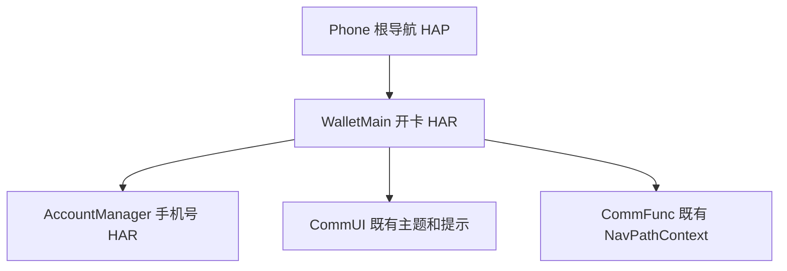
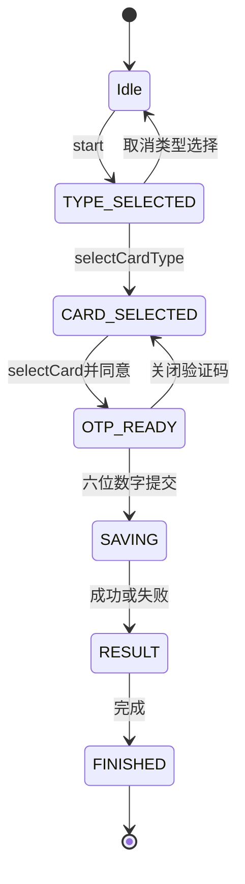
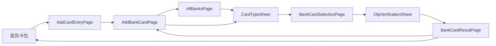

# bc-openCard-2 — 开卡流程施工计划

机器真源为 ../contracts.yaml 与 ../use-cases.yaml。依据 canonical CU open-card-flow revision 4、蓝图 revision 2、当前 acceptance.yaml 与 spec/ui-spec.yaml；本阶段不改变上游预期。原始需求成功到首页的当期规则优先于页面说明中的未来详情页，无 NFC 激活内容。

## Scope 声明与继承

```yaml
inherited_from_prd: true
in_scope_modules: [WalletMain, AccountManager, Phone]
out_of_scope_modules: [CommUI, CommFunc]
expansions_with_user_approval: []
rationale: 沿 canonical CU touches 的三模块职责施工；公共模块仅消费既有出口。
architecture_impact:
  impact: none
  affected_items: []
  architecture_md_updates: []
  catalog_updates: []
```

### 架构影响声明

来源为蓝图：没有 architecture_impact 决策。本次仅既有模块内扩充页面、模型和持久化，依赖边已存在，不修改 architecture.md、Catalog 或 DSL。实施预测见 contracts.files；原需求、公共契约和当前阶段边界决定实际权限。

| 模块 | 功能拆分 | 验收 |
|---|---|---|
| WalletMain | 双入口、选卡、验证码、RDB、结果页、完成载荷与首页重读 | AC-1..AC-7、BD-1..BD-3、NFR-1 |
| AccountManager | UserProfile.mockPhone 来源 | AC-3 |
| Phone | 既有根 Navigation 追加两个 builder 注册，成功回根时确保首页 Tab | AC-5、AC-6 |

## 1. 模块架构图



模块内 presentation → domain → data → shared。跨模块仅 index.ets 出口；AccountManager 不依赖 WalletMain，Phone 不存流程副本，data 不依赖 domain。新四组件沿 decision:ui-components 为 custom；已核 BankListRow 的资源与回调用法，保持原行组件、索引与页面 builder。

## 2. 目录/文件结构规划

精确路径清单由 contracts.files 承载。WalletMain 内：

```text
data/model/ BankInfo、BankCardType、MockBankCard、BankCardRecord、SaveBankCardResult
data/repository/ BankRepository、BankCardRepository
domain/model/ OtpSession（并承载 OtpController）、BankOpeningResultPayload
domain/service/ BankOpeningCoordinator、BankOpeningNavigator
shared/ BankOpeningCompletionBridge（泛型容器，不导入 domain）
presentation/components/ CardTypeSheet、OtpVerificationSheet
presentation/pages/ AddBankCardPage、AllBanksPage、BankCardSelectionPage、BankCardResultPage、HomeTabPage
shared/constant/ BankConstants
resources/base/element/ string.json、color.json、float.json
index.ets
```

AccountManager 仅扩 UserProfile、AccountService 与出口；Phone 仅 pages/index.ets 新增路由注册和首页激活回调。无新模块、依赖包、权限或配置文件；根已有 navDestinationMap 是注册真源，不另建 route_map.json。下游 UT 在既有 bank_open_card_ut.test.ets 增量保留旧用例。

## 3. 数据模型定义

| 模型 | 类型与字段 | 约束 |
|---|---|---|
| BankInfo | 保留 code/name/pinyin/initial/logo/badgeRes，增加 supportedCardTypes: BankCardType[] | 默认银行均支持 DEBIT/CREDIT，单类型输入仅显示其支持项 |
| BankCardType | string enum DEBIT/CREDIT | 与银行筛选、数据库映射一致 |
| MockBankCard | cardNumber/bankCode/bankName: string，cardType: BankCardType | 每银行每类型 1-2 张，稳定 mock；不直接呈现完整号 |
| BankCardRecord | cardNumber/cardKind/bankName/transactionsJson: string，bankCardType: BankCardType，addedAt: number，两个支付状态: boolean | cardKind=BANK_CARD；首次支付状态 false，交易=[]；完整号唯一 |
| SaveBankCardResult | success: boolean，cardNumber/errorMessage: string | 失败也保留本次完整号，摘要不含数据库原始异常/卡号 |
| BankOpeningResultPayload | fullCardNumber: string，result: SaveBankCardResult | 仅 typed 内存传递；不编码到字符串路由、日志或 UI |
| OtpSession | maskedPhone/code: string，remainingSeconds: number | 原手机号来自账号 mock，展示前三后四；验证码不持久化 |
| UserProfile | 增 mockPhone: string，保留既有字段与构造参数 | 账号域唯一来源，不把 displayAccount 邮箱当手机号 |

BankCardRepository 为 bank_card.db v1 / bank_card 表唯一 owner，表结构与 DTO→模型映射严格引用 blueprint/contract-authority.yaml。id INTEGER PRIMARY KEY AUTOINCREMENT；card_number TEXT NOT NULL UNIQUE；其余 bank_name/card_kind/bank_card_type/transactions_json 为 TEXT、added_at 为 INTEGER、两个支付开通标记为 INTEGER 0/1。CREATE TABLE IF NOT EXISTS 成功后再操作；首版不破坏性重建，不吞掉初始化失败。

保存等待初始化和 insert；同卡号冲突后按完整号查询到已有行才返回幂等成功，不把任意存储异常当重复成功，不覆盖原 addedAt/状态/交易。查询 ResultSet 必须 finally 关闭。异常及无效 insert 结果转失败，list 异常由首页显示原有可恢复提示，不伪造已保存卡。并发提交由 coordinator 的 in-flight 状态与数据库唯一约束共同处理；不新增持久化 pending 状态。

## 4. 页面组件树

```text
AddBankCardPage / AllBanksPage
  既有 BankListRow → CardTypeSheet（bindSheet）
    银行 logo/名称 + 储蓄/信用单选 + 提示 + 协议文本 + 同意并继续
BankCardSelectionPage（NavDestination）
  银行标题/返回 + 提示 + 候选卡单选行（脱敏） + 协议选择 + 下一步
  OtpVerificationSheet（bindSheet）
    标题/关闭 + 手机号提示 + 数字输入/倒计时重发同行 + 下一步 + 系统数字键盘
BankCardResultPage（NavDestination，无 title，无返回箭头）
  成败图标 + 文案/摘要 + 引导占位图 + 完成按钮
```

CardTypeSheet 接收当前 BankInfo、当前选中类型、选择/继续/关闭回调；选项不得多选，未选类型不可继续。同意并继续为同意动作，不新增不必要协议跳转。选卡页未选卡或未同意协议不可下一步。OTP 接收账号脱敏手机、session 和提交/重发/关闭回调；UI 输入约束只接受数字最多六位，领域再次校验 `/^[0-9]{6}$/`，提交中禁重复点击。结果页只读 payload，仅完成回调可离开。

所有文案/布局/元素 id 逐项取 spec/ui-spec.yaml 与其 OCR/观察来源；plan/visual-parity.yaml 将全部节点映射到宿主组件。fidelity_target=pixel_1to1，asset acquisition=approximate，verified=unverified。复用 BankRepository 对应银行 logo；引导插图按上游标记 placeholder，有可见语义框与手机/刷卡说明，不用空白或 1px 素材冒充。该 major 风格差距保留视觉债务，待真机与只读视觉证据核验；不宣称看过原图。系统状态栏、键盘和手势条由系统渲染。排除 result_nfc_info/result_nfc_action。

## 5. 状态管理方案

BankOpeningCoordinator 唯一拥有一次流程的银行、类型、候选卡、选卡、OTP、saveResult 与 phase；页面 @State 只存可观察快照与局部协议状态。再次 start 清理上轮 timer/敏感状态；半模态关闭只清理所属瞬时状态，具体选卡保留。协议状态不能绕过领域输入合法性。异步候选加载期间禁重复继续；过期响应不得覆盖新银行/新类型。



OtpController 在 OtpSession.ets 内实现 send/stop 与每秒更新；打开即 send，剩余 60 秒。用截止时间计算 remainingSeconds，1 秒刷新以避免后台漂移；仅 0 时可重发。关闭、离页、重启流程时 stop 并解除回调；重新打开模拟再次发送。保存中停止输入和重复提交；结果由同一 in-flight promise 决定一次。迟到回调不可修改已销毁页面。

BankOpeningCompletionBridge 是单条、一次性进程内载荷，不是银行卡事实源。shared 文件定义泛型容器及回调，不导入 domain 模型；coordinator 持有 BankOpeningCompletionBridge<BankOpeningResultPayload> 的唯一实例供 Navigator 与 Home 使用。Home 先订阅，再 takePending；消费时先取出并清空，立即丢弃全号后 list() 重读 RDB。取消订阅在 detach，warm resume 与 process recreation 均重读 RDB；完成 payload 不持久化、不重播。失败不发布。所有应用内页面关闭不模拟进程强杀后的持久化路由恢复。

### 业务流程 UseCase 清单

UC-OPEN-CARD 保留蓝图已有 happy_path 和 storage_failure 分支，入口命名调用见 use-cases.yaml；BankRepository.getMockCards 与 BankCardRepository.save 为唯二 data 边界，前者为本地 mock 隔离、后者为 RDB 隔离。NavPathStack、半模态与 Toast 属 UI 副作用，不加入 data_boundaries。用例中的 BankOpeningNavigator.finish 调用序列由 device 验证，不据此把导航变成 data port。

| 分支/行为 | 验证责任 | 验收 |
|---|---|---|
| 成功、存储失败 | UT 用真实 coordinator + 可替换 repository 方法；device 验结果及完成落点 | AC-1..AC-5、BD-1 |
| 关闭 OTP 不写库且再开 | 目标 UT 断言 timer 取消/无 save；device 验选卡保留 | BD-2、NFR-1 |
| 同号重复、并发重复 | RDB 唯一约束与重读 UT；device 至少验证保存后能重读 | AC-4、BD-3 |
| 旧入口、单类型、非法验证码、计时重发 | UT 断言状态和筛选；真机核输入/导航/秒级更新 | AC-1..AC-3、AC-6、NFR-1 |

## 6. 服务层接口定义

精确签名以 contracts.interfaces 为准：BankRepository.getBanks(): Promise<BankInfo[]>，getMockCards(bankCode: string, cardType: BankCardType): Promise<MockBankCard[]>；BankCardRepository.save(record: BankCardRecord): Promise<SaveBankCardResult>，list(): Promise<BankCardRecord[]>；coordinator.start(bank): void、selectCardType(type): Promise<MockBankCard[]>、selectCard(card): void、confirmOtp(code): Promise<BankOpeningResultPayload>、resendOtp(): void、finish(): void；Navigator.finish(payload): void。

start 的 void 返回兼容蓝图接口，CardTypeSheetState 通过 coordinator 状态快照读取，不把叙述中的“返回”改造成平行签名。confirmOtp 捕获存储失败并保留 cardNumber；非法输入不调用存储也不跳结果。mock 卡到记录转换由 coordinator 构造对象完成（MockBankCard 是 interface，不强造 toRecord 方法）。AccountService.getUserProfile 保留 Promise<UserProfile>，补 mockPhone；通过 @aspect/AccountManager 公共出口读取。repository 接受真实宿主 Context 用于初始化 RDB，不由 Phone 直接持有数据库。

## 7. 路由/导航设计



沿 NavPathContext.stack() 获取根同一栈。Phone.navDestinationMap 保留四个旧分支并追加 BankCardSelectionPage / BankCardResultPage，WalletMain.index.ets 先导出相应 builder。无第二个 Navigation 或 router 系统，NavPathStack 不用 @Prop。

路由参数采用类型化银行/类型选择信息和 BankOpeningResultPayload，结果页从 typed 对象接收全号及结果，不拼接字符串。若用 coordinator 持有敏感 payload，路由只传不含卡号的选择标识并由 onReady 读取同一对象；不得删掉结果页完整卡号交接。新增路线名放 BankConstants。无效路由参数在选卡阶段回已有入口，不绕过协议、验证码与保存。

选择卡类型和 OTP 为页面内半模态，不入栈；关闭返回宿主页、保留原 expanded/索引/已选卡。选卡页正常返回原入口。进入结果前先关闭 OTP 与键盘并停 timer。结果 NavDestination hideTitleBar，onBackPressed 消费返回事件，关闭系统左滑返回；覆盖边缘手势、系统返回及无箭头验证，不能仅隐藏按钮。

完成按钮仅一次：成功先发布完整 typed payload，确保根 currentTabIndex=0，再 clear()；Home 消费后重读数据库。失败不发布，clear() 后 push AddBankCardPage，仅保留重新开始入口，AllBanks/选卡/结果均不残留。导航副作用在同一同步事件完成，禁止逐页 pop 动画暴露中间页。Phone 与 WalletMain 通过出口提供的回调/导航器接线，根首页选择状态仍由 Phone 持有，不由 domain import Phone。

## 8. spec 功能映射表

| 功能 | 优先级 | 模块/内层 | 关键文件 | 验收 |
|---|---|---|---|---|
| F1 双入口类型选择 | P0 | WalletMain presentation/data | AddBankCardPage、AllBanksPage、CardTypeSheet、BankInfo | AC-1 |
| F2 候选卡及脱敏 | P0 | WalletMain data/presentation | BankRepository、BankCardSelectionPage | AC-2 |
| F3 六位输入与计时 | P0 | WalletMain domain/presentation；AccountManager data/domain | OtpSession、OtpVerificationSheet、UserProfile、AccountService | AC-3、BD-2、NFR-1 |
| F4 RDB 及结果交接 | P0 | WalletMain data/domain | BankCardRepository、BankOpeningCoordinator、BankOpeningResultPayload | AC-4、BD-1、BD-3 |
| F5 禁返回、清栈、首页刷新 | P0 | WalletMain domain/presentation/shared；Phone presentation | BankOpeningNavigator、BankCardResultPage、BankOpeningCompletionBridge、HomeTabPage、Phone index | AC-5 |
| F6 旧路由回归 | P1 | WalletMain/Phone presentation | 原银行页面与 Phone index | AC-6 |
| F7 四图视觉 | P0 | WalletMain presentation/resources | 四组件、资源与 visual-parity | AC-7 |

验收标准：本阶段 harness + 独立 verifier + receipt；coding 编译与目标测试通过后，review 核实现与隐私/依赖，UT 验边界和业务序列，testing 核真实 RDB 重读、旧新导航、半模态与四图。当前 plan 不跑产品测试、不提前写测试或实现，也不把视觉规划视为当前视觉证据。
