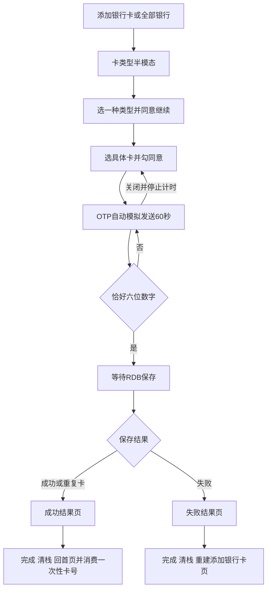

# 银行卡开卡 — 需求规格

版本 v1.0；2026-10-22；当前为 headless 自动冻结，质量结论以 harness 为准。

## 0. 术语映射表

| 原始术语 | 权威模块 | 所属层 | 置信度 | 易混项 | 用户确认 |
|---|---|---|---|---|---|
| 银行卡开卡 | WalletMain | 02-Feature | medium | AccountManager：仅账号mock手机号；Phone：仅根导航壳 | [x] |

来源：蓝图 discovery.facts 的 term:银行卡开卡 投影，extraction_method=headless_assumed，不代表本轮人工签名，不回写 glossary。

## 1. 功能概述

从两处既有银行入口完成单选卡类型、选择具体卡片、六位模拟短信验证、RDB保存和结果收口。绑定 CU open-card-flow 的 purpose 与 target predicates p-runtime-owner、p-entry-type、p-card-otp、p-rdb-result、p-finish-stack、p-old-route；交付 provide open-card-end-to-end、bank-card-rdb、safe-navigation-finish。蓝图与CU保持权威，本spec只补视觉与验收定义。

## 2. Scope 声明

```yaml
in_scope_modules: [WalletMain, AccountManager, Phone]
out_of_scope_modules: [CommUI, CommFunc]
expansions_with_user_approval: []
rationale: |
  集合由CU touches的development节点module投影。WalletMain负责流程/卡数据/页面，AccountManager只扩mock手机号，Phone只接已有单栈路由和首页去向。
  复用CommUI资源与CommFunc既有导航入口，不同意把银行卡流程提到公共模块；需要新增公共责任时交回蓝图owner调和，本阶段不扩大范围。
```

```yaml
ui_change: new_or_changed
fidelity_target: pixel_1to1
asset_acquisition_mode: approximate
visual_handoff:
  kind: screenshot_pack
  fidelity_target: pixel_1to1
  asset_acquisition_mode: approximate
  acceptance_strictness: best_effort
  authoritative_refs:
    - id: card_type_sheet
      path: doc/features/原始需求/1-2-银行卡/3-点击任意银行拉起添卡选卡半模态.jpg
    - id: bank_card_selection
      path: doc/features/原始需求/1-2-银行卡/4-点击信用卡或储蓄卡后拉起选卡页面.jpg
    - id: otp_sheet
      path: doc/features/原始需求/1-2-银行卡/5-选中某张卡片后拉起短信验证.jpg
    - id: bank_card_result
      path: doc/features/原始需求/1-2-银行卡/6-短信验证完成后结果页.jpg
```

## 3. 目标用户与使用场景

S1：钱包用户从添加卡片→添加银行卡，点击任一银行完成添加。S2：用户展开银行列表并进入全部银行，由任一银行启动同一流程。S3：用户遇写库失败，在结果页完成后回到新的添加银行卡入口重试；此前过程不可返回。当前为单机演示，不接真实银行、短信、NFC或卡详情。

## 4. 功能清单

| 编号 | 优先级 | 功能与可观察结果 | 场景 |
|---|---|---|---|
| F1 | P0 | 两入口打开相同银行的卡类型半模态；支持类型随银行；默认mock双类型，单类型银行仅显示一个；最多选一个；未选不可继续 | S1/S2 |
| F2 | P0 | 同意并继续进入该银行标题的具体卡页；按银行/卡类型各mock 1-2张；仅显示前四后四；单选具体卡并勾同意才可下一步 | S1/S2 |
| F3 | P0 | 打开OTP即假发送一次；60秒每秒更新，倒计时不可重发；归零重新发送；只接受恰好6位数字，任意6位均有效 | S1/S2 |
| F4 | P0 | 提交后等待RDB完成/失败再携带完整卡号与结果进结果页，提交中禁重复；写库字段与幂等沿蓝图bank-card-storage | S1/S3 |
| F5 | P0 | 结果全屏无title/左箭头，拦左滑、系统返回；只有完成可退出；成功回首页并一次性携全卡号、失败回添加银行卡 | S1/S3 |
| F6 | P1 | 保留旧首页/卡包/添加卡片/添加银行卡/全部银行互跳、展开与字母索引，保持根单栈 | S1/S2 |
| F7 | P0 | 全部四参考图视觉和动态状态验收，major债务阻止发布 | 全部 |

## 5. 页面/界面描述

所有布局由需求、OCR和runner的visual-observations推导，当前agent没有看图；ui-spec verified=unverified。四图不得缩减分母。归一化bbox为[x,y,w,h]，文本以OCR优先，明显噪声仅用观察sidecar恢复，疑项保留待核。

### 5.1 卡类型半模态
背景保留银行入口并遮罩。顶区标题选择卡类型及独立关闭按钮；中间同一白卡容器内银行logo+银行名称、储蓄卡、信用卡三行，以分割线分隔。银行信息与类型不得拆成不同底色块。下方授权说明和纯文本协议，底部同意并继续。截图显示储蓄卡选中态，实际打开初始未选，选中后可继续；关闭不写库、不改变入口栈。协议文字展示不需要富文本链接。

### 5.2 具体卡片页
全屏，返回和银行名在导航区；提示请选择您要绑定的银行卡。白色圆角条目显示银行logo、脱敏卡号、单选标记；同银行同类型1-2张，第二张按同模板重复。协议复选框+纯文本协议在下，下一步是居中窄按钮（观察sidecar描述红色，精确色待验证，不臆造品牌色）。无选择或未同意禁用。返回回原入口，保持原列表状态。

### 5.3 验证码半模态
标题输入验证码，关闭按钮；提示读取AccountManager新增mock手机号并脱敏，不从现有邮箱displayAccount反推。输入和发送在同一个白色圆角行，左输入右倒计时。60秒结束出现重新发送。输入限制数字最多6位，少于6位不启用下一步；非数字粘贴不得绕过校验。截图55秒是动态快照，不冻结为初值。系统数字键盘由系统绘制，OCR键盘乱码不作应用文字。关闭停止计时并保留选卡，重新打开重新假发送。

### 5.4 添加结果全屏
无导航title和返回按钮，结果图标、成败标题/说明、手持手机引导插画、底部完成。成功参考文案添卡成功/可用于实体店二维码支付和网上商城支付，演示不表示真实支付能力激活；失败显示失败状态与本地可展示错误摘要，不展示完整卡号。结果页不响应返回和侧滑，不能遮罩关闭。引导图缺供应，允许近似但须显式占位并登记major视觉债务。

### 5.5 权威裁决与状态
原需求明确“再往下的激活nfc部分本次先不需要”，故NFC区域登记excluded，不实现、不计缺失。原需求页面说明末尾提及详情页，与本次明确成功回首页及详情尚未开发冲突，沿蓝图navigation-cleanup裁决为回首页。背景参考100家与现有20家mock冲突，沿既有银行数据事实显示20家，不扩充列表。图4显示4392 **** **** 2269、图5手机号仅为样例，运行值从mock取。默认/未选/已选/未同意/倒计时/可重发/保存中/成功/失败均需覆盖；空候选不允许下一步，列表错误沿原空态。

## 6. 业务流程图



## 7. 异常/边界场景处理

| 编号 | 场景 | 处理与验收 |
|---|---|---|
| E1 / BD-1 | RDB初始化或insert失败 | 等待异常后构造含原全卡号失败结果，数据库无新增；完成清栈回添加银行卡 |
| E2 / BD-2 | 关闭OTP | 停止计时，无写库，保留选卡，可重开 |
| E3 / BD-3 | 重复同一卡号 | 唯一记录，返回既有成功结果，不重复新增 |
| E4 | 只支持一种类型/候选为空 | 只展示真实支持类型；无卡不可提交 |
| E5 | 非数字、0-5位、超6位、连续点击 | 不能绕过六位校验，保存中至多一笔，不重复导航 |
| E6 | 写成功后进程结束 | RDB记录保留，冷启动正常入口；再加同卡幂等成功，瞬时OTP不恢复 |

## 8. 非功能性需求

NFR-1：倒计时每1秒更新，首轮60秒，页面消失后停止，结束才允许重发。沿蓝图阈值，不增加无依据性能承诺。
隐私：全卡号只在typed内存和RDB处理，UI/日志/截图只脱敏；成功完成载荷仅消费一次并立即清除。持久化至少保存卡号、BANK_CARD大类、银行名、储蓄/信用子类型、添加时间、华为支付与银联手机闪付状态（初始均未开通）、空交易记录；bank_card.db v1与唯一卡号沿权威bank-card-storage，未来升级不得破坏性重建。兼容工程当前HarmonyOS手机与既有路由规则，继续沿模块出口，不另建路由体系。

## 9. 验收标准

- [ ] **AC-1** (F1 / P0): 已有添加银行卡页和全部银行页点击任意银行均打开该银行卡类型半模态；银行信息与支持的储蓄卡/信用卡选项一致，最多单选一种
- [ ] **AC-2** (F2 / P0): 选择卡类型并同意后进入银行具体卡片页，卡号仅显示前四后四；只展示该银行该类型的 1-2 张 mock 卡，完整卡号不出现在 UI 与日志
- [ ] **AC-3** (F3 / P0): 验证码半模态打开即模拟发送并倒计时，只允许六位数字启用下一步；无效输入不可提交，60 秒归零后出现重新发送并可再次倒计时
- [ ] **AC-4** (F4 / P0): 提交验证码后等待 RDB 写入结果并携带完整卡号进入结果页；成功或失败均携带完整卡号与结果；成功记录可重新读取且重复卡不新增
- [ ] **AC-5** (F5 / P0): 结果页禁止系统返回并且只能通过完成按钮退出；返回手势不退出；成功清除开卡流程并回钱包首页，失败清除后回最初添加卡片页
- [ ] **AC-6** (F6 / P1): 旧的添加银行卡展开、全部银行索引与原有路由保持可用；旧行为无回归且新路由均由既有 Navigation 注册
- [ ] **AC-7** (F7 / P0): 四张权威参考图逐屏 pixel_1to1 视觉验收，包括禁用、选中与成败状态；四图均有当前机器视觉证据；确定性缺失与失败修复；major记视觉债务并阻止发布，minor披露；NFC按原需求排除

BD-1..BD-3与NFR-1逐字消费蓝图预期，见acceptance.yaml；本轮只补checkpoint/视觉条目。UT验证筛选、脱敏、OTP状态、RDB映射/异常/幂等；设备验证真实键盘、禁用态、跳转、系统返回/侧滑、清栈和四屏视觉。AC-6 UT只覆盖路由决策/注册，不能模拟ArkUI冒充真实导航验收。

## 视觉待复核清单

| 屏 | 状态 | 待复核 | 严重性 |
|---|---|---|---|
| card_type_sheet | unverified | 精确字体、行高、遮罩、边距与颜色 | minor（未测，非通过结论） |
| bank_card_selection | unverified | 红按钮/勾选品牌色精确来源与协议行布局 | minor（未测） |
| otp_sheet | unverified | 键盘弹出后的半模态高度、按钮与输入同行几何 | minor（未测） |
| bank_card_result | unverified | 引导插画可见占位与原图差异 | major 视觉债务，阻止发布直至修复重验 |

best_effort允许登记自报major债务继续阶段，但不能改写确定性失败或缺测试锚点；发布前major必须修复并设备重验。下游按当前native/delegated机器视觉证据验真，不能把本阶段声明当PASS。

## 依据

- doc/features/原始需求/1-2-银行卡/原始需求.md
- doc/features/bc-openCard-2/blueprint/component-blueprint.yaml revision 2
- doc/features/bc-openCard-2/open-card-flow/change-unit.yaml revision 4
- doc/features/bc-openCard-2/blueprint/contract-authority.yaml
- context/facts.md；spec/ui-spec.yaml；spec/ref-elements.yaml；spec/asset-manifest.yaml
