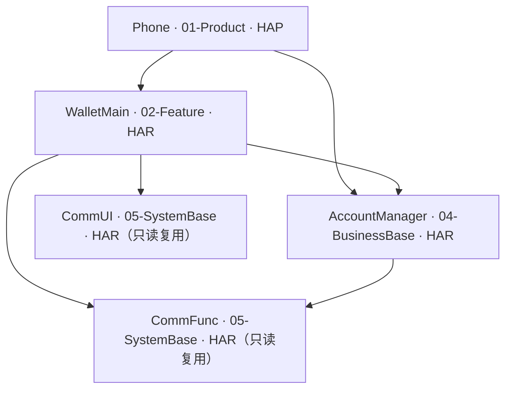
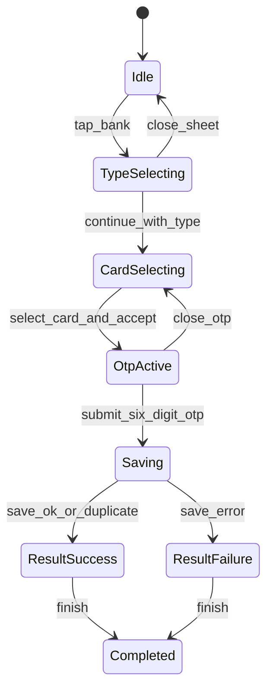

# 银行卡开卡闭环 — 实现计划（plan）

> **模块标识**: `bank-card-opening-flow`  
> **Feature**: `cu-YmMtb3BlbkNhcmQtMgBiYW5rLWNhcmQtb3BlbmluZy1mbG93`  
> **对应 spec**: `doc/features/bc-openCard-2/bank-card-opening-flow/spec/spec.md`  
> **版本**: v1.0  
> **创建日期**: 2026-10-23  
> **状态**: 已确认（headless CU 施工投影）

> `contracts.yaml`、`use-cases.yaml` 是 coding/review/UT 的机器契约真源；本文只提供人读施工说明。

## Scope 声明与继承

```yaml
inherited_from_prd: true
in_scope_modules:
  - WalletMain
  - AccountManager
  - Phone
out_of_scope_modules:
  - CommUI
  - CommFunc
rationale: |
  范围逐项投影 canonical CU touches：WalletMain 承担开卡页面、业务状态、mock 候选与 RDB；
  AccountManager 仅补账号 mock 手机号；Phone 仅装配新增 NavDestination。
  CommUI/CommFunc 只复用已有能力，不修改其实现或职责。
expansions_with_user_approval: []
```

### 架构影响声明 (architecture_impact)

```yaml
architecture_impact:
  impact: none
  affected_items: []
  architecture_md_updates: []
  catalog_updates: []
```

蓝图没有与本 CU 关联的 `architecture_impact` 决策。本轮仅在既有模块内新增/修改 feature 文件和目的页接线，不改 DSL、模块集合、依赖方向或模块核心职责。

### 功能拆分

| 功能点 | 责任模块 | 责任层 | 施工决定 |
|---|---|---|---|
| 双入口、卡型/卡片/验证码/结果 UI | WalletMain | presentation | 两个既有银行页调用同一 `CardTypeSheet`；全屏页仍使用现有 `NavPathStack`。 |
| 候选数据、RDB、开卡规则与定向清栈 | WalletMain | data/domain | 扩展 `BankRepository`；新增 `BankCardRepository` 与三个领域服务，不新造网络层。 |
| mock 手机号 | AccountManager | data/domain | `UserProfile.mobile` 与 `AccountService` mock 唯一供给，跨模块经 `index.ets`。 |
| 新目的页注册 | Phone | product shell | 只在根 `navDestinationMap` 追加 builder 映射。 |

## 1. 模块架构图



| Module | 所属层 | 物理路径 | 格式 | 变更类型 | 说明 |
|---|---|---|---|---|---|
| WalletMain | 02-Feature | `02-Feature/WalletMain` | HAR | 修改 | 开卡业务、页面、RDB、资源和跨模块导出。 |
| AccountManager | 04-BusinessBase | `04-BusinessBase/AccountManager` | HAR | 修改 | 账号 mock 手机号。 |
| Phone | 01-Product | `01-Product/Phone` | HAP | 修改 | 根导航目的页接线。 |

依赖边全部已存在，方向满足 `01-Product → 02-Feature/04-BusinessBase`、`02-Feature → 04-BusinessBase/05-SystemBase`、`04-BusinessBase → 05-SystemBase`。跨模块只经各模块 `src/main/ets/index.ets`。

## 2. 目录/文件结构规划

### WalletMain

```text
02-Feature/WalletMain/src/main/
├── ets/
│   ├── shared/constant/BankConstants.ets                     # 路由、倒计时、数据库常量
│   ├── data/
│   │   ├── model/BankInfo.ets                                # 支持卡型
│   │   ├── model/BankCardCandidate.ets                       # 完整 mock 候选卡
│   │   ├── model/StoredCard.ets                              # RDB 记录模型
│   │   ├── model/OpeningResult.ets                           # 保存结果参数
│   │   ├── model/BankOpeningCompletionContext.ets            # 成功卡号一次性交接
│   │   ├── repository/BankRepository.ets                     # 银行/卡候选 mock
│   │   └── repository/BankCardRepository.ets                 # wallet_bank_cards.rdb
│   ├── domain/service/
│   │   ├── BankCardOpeningService.ets                        # 掩码、校验、模型转换
│   │   ├── OtpService.ets                                    # mock 短信发送
│   │   └── OpeningNavigationService.ets                      # 成功/失败定向清栈
│   ├── presentation/
│   │   ├── components/CardTypeSheet.ets                      # 卡型半模态
│   │   ├── components/OtpVerificationSheet.ets               # 验证码半模态
│   │   ├── pages/AddBankCardPage.ets                         # 入口改接
│   │   ├── pages/AllBanksPage.ets                            # 入口改接
│   │   ├── pages/BankCardSelectionPage.ets                   # 具体卡片页
│   │   ├── pages/BankCardOpeningResultPage.ets               # 全屏结果页
│   │   └── pages/HomeTabPage.ets                             # 单次消费成功卡号
│   └── index.ets                                             # 导出新增 builder
└── resources/base/
    ├── profile/route_map.json                                # 两个新目的页
    ├── element/string.json                                   # UI 文案
    ├── element/color.json                                    # 视觉 token
    └── element/float.json                                    # 间距/字号/token
```

### AccountManager

```text
04-BusinessBase/AccountManager/src/main/ets/
├── data/model/UserProfile.ets                                # 增加 mobile
├── domain/service/AccountService.ets                         # mock mobile 供给
└── index.ets                                                 # 保持 UserProfile/AccountService 出口
```

### Phone

```text
01-Product/Phone/src/main/ets/pages/
└── index.ets                                                 # 注册 Selection/Result builder
```

测试文件由后续 UT 阶段在 `02-Feature/WalletMain/src/ohosTest/ets/test/bank_open_card_ut.test.ets` 增量覆盖；coding 阶段不写测试。

## 3. 数据模型定义

```typescript
export enum BankCardType { DEBIT = 'DEBIT', CREDIT = 'CREDIT' }

export interface BankInfo {
  code: string;
  name: string;
  pinyin: string;
  initial: string;
  logo: Resource;
  badgeRes?: Resource;
  supportedCardTypes: BankCardType[];
}

export interface BankCardCandidate {
  bankCode: string;
  bankName: string;
  cardNumber: string;        // 完整卡号，仅受控后台链路
  cardType: BankCardType;
}

export class StoredCard {
  cardNumber: string;
  category: string;          // BANK_CARD
  bankName: string;
  bankCardType: string;
  addedAt: number;
  huaweiPayEnabled: boolean;
  unionPayQuickPassEnabled: boolean;
  transactionRecords: string;
}

export class OpeningResult {
  fullCardNumber: string;
  success: boolean;
  errorMessage: string;
}

export class UserProfile {
  isLoggedIn: boolean;
  displayAccount: string;
  mobile: string;
  avatar: Resource | null;
}
```

`wallet_bank_cards.rdb` 版本 1 建 `cards` 表，以 `card_number` 为主键/唯一键；字段为 `category`、`bank_name`、`bank_card_type`、`added_at`、`huawei_pay_enabled`、`unionpay_quickpass_enabled`、`transaction_records`。保存使用事务或等价原子插入；唯一冲突回查既有记录并按成功返回。完整卡号不进入 UI 文本、Toast 或日志。

## 4. 页面组件树

### 4.1 AddBankCardPage / AllBanksPage + CardTypeSheet

```text
AddBankCardPage | AllBanksPage (NavDestination)
└── 既有银行列表
    └── BankListRow.onTap → openCardTypeSheet(bank)
        └── CardTypeSheet (bindSheet)
            ├── 标题/关闭
            ├── 银行 logo + 名称
            ├── 支持卡型单选行
            ├── 授权/协议文本
            └── 同意并继续 → openBankCardSelection(bank, cardType)
```

### 4.2 BankCardSelectionPage

```text
BankCardSelectionPage (NavDestination)
├── 自绘导航栏（返回 + 银行名）
├── 说明文本
├── 卡片候选单选列表（仅渲染 maskCardNumber）
├── 协议勾选/文本
├── 下一步 → openOtpVerificationSheet()
└── OtpVerificationSheet (bindSheet)
    ├── 标题/关闭
    ├── 掩码手机号提示
    ├── 六位数字输入 + 倒计时/重发
    └── 下一步 → saveSelectedCard()
```

### 4.3 BankCardOpeningResultPage

```text
BankCardOpeningResultPage (NavDestination, hideTitleBar, return intercepted)
├── 成功/失败状态图标
├── 标题与说明
├── result_payment_guide 占位插画
└── 完成 → finishOpeningFlow()
```

### 4.4 HomeTabPage

```text
HomeTabPage
└── aboutToAppear
    └── BankOpeningCompletionContext.consume()
        └── lastOpenedCardNumber（仅内存，不展示、不记录日志）
```

## 5. 状态管理方案

| 数据 | 作用域 | 装饰器/机制 | 持有者 | 生命周期/清理 |
|---|---|---|---|---|
| 当前银行、卡型、卡型 Sheet 可见性 | 入口页面实例 | `@State` | AddBankCardPage / AllBanksPage | 关闭 Sheet 清空本次未提交选择。 |
| 卡候选、当前卡、协议勾选、OTP Sheet 可见性 | 具体卡片页实例 | `@State` | BankCardSelectionPage | 返回销毁；关闭 OTP 只清验证码状态，保留卡片选择。 |
| mobile、otp、countdown、sending、saving | OTP Sheet 实例 | `@State` + `setInterval` | OtpVerificationSheet | 出现即发送；关闭/aboutToDisappear 取消 Timer 并清空。 |
| 已保存银行卡 | 应用沙箱持久态 | RDB | BankCardRepository | 冷启动可读；按完整卡号幂等。 |
| OpeningResult | 页面跳转参数 | `NavPathStack` param | BankCardOpeningResultPage | 完成后随过程栈清理。 |
| 成功完整卡号 | 进程内单次上下文 | static publish/consume/clear | BankOpeningCompletionContext | 结果页先 publish 后 clear；首页 appear 单次消费即清空。 |
| 页面栈 | 应用全局 | `NavPathContext.attach/stack` | Phone Index | 沿用唯一根栈，不新建导航体系。 |

运行顺序：入口打开卡型 Sheet → push 具体卡片页 → 打开 OTP Sheet → 转换 `StoredCard` 并等待 RDB → 生成 `OpeningResult` 并 push 结果页 → 成功 publish 卡号并 clear 回首页，失败 `popToName('AddBankCardPage')`。失败保存仍进入结果页，且数据库无半写。

## 6. 服务层接口定义

| 接口 | 完整签名 | 异步 | 说明 |
|---|---|---|---|
| BankRepository.getBanks | `getBanks(): Promise<BankInfo[]>` | 是 | 现有银行 mock，补支持卡型。 |
| BankRepository.getCards | `getCards(bankCode: string, cardType: BankCardType): Promise<BankCardCandidate[]>` | 是 | 每银行/卡型返回 1–2 张完整候选卡。 |
| BankCardRepository.save | `save(card: StoredCard): Promise<StoredCard>` | 是 | 按完整卡号幂等原子保存。 |
| BankCardRepository.list | `list(): Promise<StoredCard[]>` | 是 | 读取已保存卡。 |
| BankCardOpeningService.maskCardNumber | `maskCardNumber(cardNumber: string): string` | 否 | 只输出前四、掩码和后四。 |
| BankCardOpeningService.isValidOtp | `isValidOtp(otp: string): boolean` | 否 | 精确六位数字。 |
| BankCardOpeningService.toStoredCard | `toStoredCard(candidate: BankCardCandidate): StoredCard` | 否 | 补齐默认支付状态、时间和空交易记录。 |
| BankCardOpeningService.toOpeningResult | `toOpeningResult(candidate: BankCardCandidate, success: boolean, errorMessage: string): OpeningResult` | 否 | 成功/失败都保留完整卡号。 |
| OtpService.sendMockCode | `sendMockCode(mobile: string): Promise<void>` | 是 | 本地假发送，不调用真实短信服务。 |
| OpeningNavigationService.finish | `finish(stack: NavPathStack, result: OpeningResult): void` | 否 | 成功 clear 回首页；失败定向返回 AddBankCardPage。 |
| AccountService.getUserProfile | `getUserProfile(): Promise<UserProfile>` | 是 | 返回账号 mock mobile。 |
| BankOpeningCompletionContext.publish | `publish(fullCardNumber: string): void` | 否 | 暂存未消费成功卡号。 |
| BankOpeningCompletionContext.consume | `consume(): string | undefined` | 否 | 单次取出并清空。 |
| BankOpeningCompletionContext.clear | `clear(): void` | 否 | 显式清空。 |

`BankCardRepository` 通过构造注入页面取得的应用 `Context`，不把 UI runtime 能力伪装成 data boundary；对外业务方法保持上述蓝图签名。

### 业务流程 UseCase 清单

| UseCase | UI 入口 | 数据边界 | 分支 |
|---|---|---|---|
| `bank_card_opening` | 两个银行入口、选卡页、OTP Sheet、结果页 | BankRepository、OtpService、BankCardRepository、OpeningNavigationService | 成功、保存失败、非法输入、倒计时重发、中途取消。 |



## 7. 路由/导航设计


| 页面/弹层 | NavDestination / 承载 | 参数 | 注册/退出语义 |
|---|---|---|---|
| CardTypeSheet | 入口页 `bindSheet` | `BankInfo` | 关闭不入栈；继续 push 选卡页。 |
| BankCardSelectionPage | `BankCardSelectionPage` | `bankCode`, `cardType` | WalletMain builder 导出，Phone 注册。 |
| OtpVerificationSheet | 选卡页 `bindSheet` | `BankCardCandidate` | 关闭取消 Timer；成功 push 结果页。 |
| BankCardOpeningResultPage | `BankCardOpeningResultPage` | `OpeningResult` | WalletMain builder 导出，Phone 注册；拦截系统返回/侧滑。 |

导航配置定位文件仅为 `02-Feature/WalletMain/src/main/resources/base/profile/route_map.json`。`main_pages.json` 不新增二级目的页；Phone 根 `navDestinationMap` 经 WalletMain `index.ets` builder 接线。既有 `CardPackPage / AddCardEntryPage / AddBankCardPage / AllBanksPage` 名称不变。

## 8. spec 功能映射表

| spec 编号 | 功能名称 | 优先级 | 实现模块 | 实现层级 | 关键文件 | 实现说明 |
|---|---|---|---|---|---|---|
| F1 | 双入口统一开卡 | P0 | WalletMain | presentation | `AddBankCardPage.ets`, `AllBanksPage.ets`, `CardTypeSheet.ets` | 替换 Toast 终点，复用统一 Sheet。 |
| F2 | 卡型单选与协议门禁 | P0 | WalletMain | data/presentation | `BankInfo.ets`, `CardTypeSheet.ets` | 银行数据携带支持卡型，单选后继续。 |
| F3 | 具体银行卡选择 | P0 | WalletMain | data/domain/presentation | `BankRepository.ets`, `BankCardOpeningService.ets`, `BankCardSelectionPage.ets` | 1–2 张候选，UI 只取掩码。 |
| F4 | mock 短信验证 | P0 | WalletMain、AccountManager | domain/presentation | `OtpService.ets`, `OtpVerificationSheet.ets`, `AccountService.ets` | 出现即发、60 秒门禁、六位数字。 |
| F5 | 银行卡 RDB 持久化 | P0 | WalletMain | data/domain | `StoredCard.ets`, `BankCardRepository.ets`, `BankCardOpeningService.ets` | 完整卡号唯一、原子/幂等、失败无半写。 |
| F6 | 结果页与定向清栈 | P0 | WalletMain、Phone | domain/presentation/product | `OpeningResult.ets`, `OpeningNavigationService.ets`, `BankCardOpeningResultPage.ets`, `Phone/pages/index.ets` | 结果页禁返回；成功回首页，失败回 AddBankCardPage。 |
| F7 | 既有路由兼容 | P1 | WalletMain、Phone | presentation/product | `WalletMain/index.ets`, `route_map.json`, `Phone/pages/index.ets` | 新增注册且保持旧路由不变。 |

覆盖率：P0 `6/6`，P1 `1/1`。AC-1..AC-6、BD-1..BD-4 与 NFR-1 的实现引用同时落在 `contracts.yaml.prd_to_code_traceability`；四屏视觉节点落在 `plan/visual-parity.yaml`。
