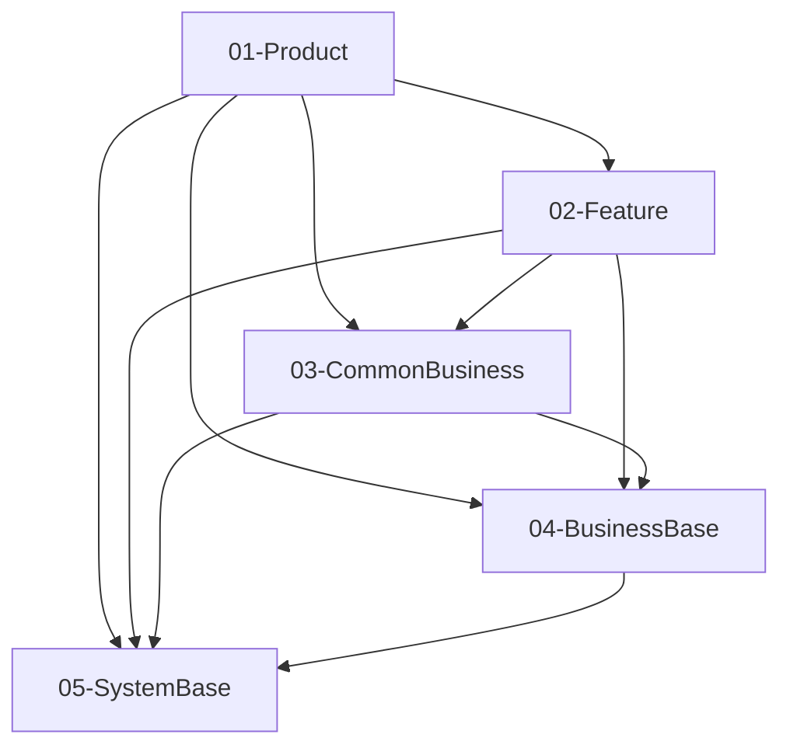

# Plan 阶段语义验证 — cu-YmMtb3BlbkNhcmQtMgBiYW5rLWNhcmQtb3BlbmluZy1mbG93

核对本次承诺的测试层级与生产入口一致：UT 驱动可隔离的真实业务状态/异常；UI、焦点和导航栈交设备。both 的两层互补，不要求 UT 实例化 UI，也不能只测 helper 冒充流程通过。L3 候选回原责任方；option_a 不批准降低当前验收。仅核当前材料，不新增一轮设计或额外门禁。

**P3 显式 1.1 调用**：以已解析验收与施工内容为准，不要求未列入 required_outputs 的 spec.md/plan.md。仍审查精确文件写集、类型/接口、外部 DTO 映射、runtime 生命周期、CU sidecar 与用例；不得用缺叙述为由跳过这些责任。共同决策冲突回蓝图/外部 owner，职责修订沿既有 P2 successor，不在原 run 改写范围。

**CU-bound（Feature 名以 `cu-` 开头）**：术语、Scope 模块范围与架构影响已由部件演进蓝图裁决（可修改模块 = CU touches 派生；架构影响 = 蓝图 `architecture_impact` 决策 id 投影）。检查 3、4、7 及检查 R 中涉及这三项的判断只核对与蓝图投影一致，不重新裁决模块归属、范围扩展或架构影响等级；检查 7 在 CU-bound 下按"架构影响段 `decisions` 与蓝图决策一致"判定，不要求 plan 更新 architecture.md。不一致指回 `/component-design` 做蓝图 revision。

> 自动生成于 2026-10-23T05:16:56.988Z
> 本文件为 AI Harness 的 prompt，可发送给任意 AI 模型执行语义级验证。
>
> **Profile 语义补充**：实例若存在 `framework/profiles/<project_profile>/harness/prompts/verify-plan.overlay.md`，须与本正文**合并阅读**。

---

## 一、你的角色

你是一名**独立的plan 审查员**，负责对实现计划（plan）做语义级质量验证。宿主分层、模块格式与实现语言以 **`project_profile` + `doc/architecture.md` + `framework.config.json > architecture`** 为准；细则可对照本阶段 profile 的 `verify-plan.overlay.md`。你的任务是根据下方提供的 **Spec 规约**、**plan 文档**和 **spec**，逐项评估plan 文档是否满足语义约束。

**关键原则：**
- 你独立于文档编写者，避免"自己验自己"的偏差
- 仅基于 Spec 规则和 spec 需求给出客观判定，不做主观偏好评价
- 脚本 Harness 已完成了确定性的结构检查（章节存在性、表格格式、映射覆盖率等），你负责**脚本无法覆盖的语义级检查**
- 若证据不足以判定，标注为 WARN 而非强行判定

---

## 二、功能模块

- **模块名称**: cu-YmMtb3BlbkNhcmQtMgBiYW5rLWNhcmQtb3BlbmluZy1mbG93
- **阶段**: plan

---

## 三、Spec 规约内容

以下是 `framework/specs/phase-rules/plan-rules.yaml` 的完整内容，定义了设计阶段的通用约束规则：

```
phase: plan
version: "1.0"
applies_to: <features_dir>/{module}/plan/plan.md
structure_checks:
  acceptance_content_complete:
    severity: BLOCKER
    description: 显式 typed 验收须含可执行步骤、精确预期、合法 ID 与分层关注点。
  design_scope_facts:
    severity: BLOCKER
    description: 新设计事实只经既有 P2 报告提议重签，不删除冻结 required 义务。
  acceptance_use_cases_resolvable:
    severity: BLOCKER
    description: typed 验收的 linked_flow/linked_branch 必须指向真实用例。
  construction_content_complete:
    severity: BLOCKER
    description: 施工文件、类型和接口签名须完整，不能用叙述省略减弱内容检查。
  usecase_spec_schema:
    severity: BLOCKER
    description: 复用 UT 的 UseCasesSpec schema 检查，必要用例不能使用占位条目。
  required_chapters:
    description: >
      设计文档必须包含以下 9 个章节： Scope 声明与继承、模块架构图、目录/文件结构规划、数据模型定义、页面组件树、
      状态管理方案、服务层接口定义、路由/导航设计、功能映射表
    severity: BLOCKER
    rule:
      expected_headings:
        - Scope 声明
        - 模块架构图
        - 目录/文件结构规划
        - 数据模型定义
        - 页面组件树
        - 状态管理方案
        - 服务层接口定义
        - 路由/导航设计
        - 功能映射表
      match: heading_text_contains
  scope_declaration:
    description: >
      「Scope 声明与继承」章节必须包含 yaml 代码块， 定义 inherited_from_prd（legacy yaml
      键名，机器字段保留）/ in_scope_modules / out_of_scope_modules / rationale /
      expansions_with_user_approval 字段； in_scope_modules 至少 1 项。
    severity: BLOCKER
    rule:
      section: Scope 声明
      expect: yaml_code_block
      required_keys:
        - in_scope_modules
        - out_of_scope_modules
        - rationale
      min_items:
        in_scope_modules: 1
  scope_consistency_with_spec:
    description: >
      plan.in_scope_modules 必须是 spec.in_scope_modules ∪
      expansions_with_user_approval.modules 的子集； plan 不得在未经用户批准的情况下声明
      spec.out_of_scope_modules 中的模块。 这是阻止 AI 自行扩大需求范围的核心 Scope 守门规则。
    severity: BLOCKER
    rule:
      source: <features_dir>/{module}/spec/spec.md > Scope 声明 > yaml
      target: <features_dir>/{module}/plan/plan.md > Scope 声明与继承 > yaml
      assertions:
        - plan.in_scope_modules ⊆ (spec.in_scope_modules ∪
          plan.expansions_with_user_approval.modules)
        - plan.in_scope_modules ∩ spec.out_of_scope_modules ⊆
          plan.expansions_with_user_approval.modules
  architecture_impact_declared:
    description: >
      plan.md 必须在 Scope 节（或其子节）声明「架构影响声明 (architecture_impact)」， 包含合法的 impact
      枚举与配套字段，作为后续 plan_to_architecture / architecture_doc_consistency
      规则的前置触发开关。 impact 合法取值：none | dsl_change | module_set_change |
      responsibility_rewrite。 架构级变更的准确定义见 framework/skills/feature/plan/SKILL.md
      Step 12。
    severity: BLOCKER
    rule:
      section: 架构影响声明
      expect: yaml_code_block
      required_keys:
        - impact
        - affected_items
        - architecture_md_updates
        - catalog_updates
      allowed_values:
        impact:
          - none
          - dsl_change
          - module_set_change
          - responsibility_rewrite
      conditional_required:
        - when: impact != 'none'
          non_empty:
            - affected_items
            - architecture_md_updates
  architecture_diagram:
    description: |
      「模块架构图」章节必须包含至少一个 Mermaid 代码块， 展示模块间依赖关系
    severity: BLOCKER
    rule:
      section: 模块架构图
      expect: mermaid_block
  module_change_table:
    description: |
      必须包含模块变更摘要表，列明每个涉及模块的所属层、物理路径、 格式（HAP/HAR/HSP）、变更类型（新增/修改/迁移）
    severity: BLOCKER
    rule:
      expect: markdown_table
      required_columns:
        - '"模块" or "Module"'
        - 所属层
        - 格式
        - 变更类型
  file_structure_per_module:
    description: |
      每个涉及的模块必须有目录/文件结构规划，精确到 .ets 文件路径， 使用代码块展示树形结构
    severity: BLOCKER
    rule:
      section: 目录/文件结构规划
      per_module:
        expect: code_block_with_tree
  data_model_typed:
    description: |
      数据模型定义必须使用 TypeScript/ArkTS 代码块， 包含字段名、类型、说明；不允许使用 any 类型
    severity: BLOCKER
    rule:
      section: 数据模型定义
      expect: typescript_code_block
      forbidden_types:
        - any
  interface_signatures_complete:
    description: |
      服务层接口定义中，所有方法必须包含完整的方法签名： 方法名、入参（名+类型）、返回类型、是否异步
    severity: BLOCKER
    rule:
      section: 服务层接口定义
      per_method:
        required_fields:
          - method_name
          - parameters_with_types
          - return_type
  component_tree_per_page:
    description: |
      每个页面必须有对应的组件树，使用树形文本图展示层级关系
    severity: MAJOR
    rule:
      section: 页面组件树
      per_page:
        expect: tree_diagram
  spec_mapping_table:
    description: |
      「spec 功能映射表」必须是 Markdown 表格，至少包含 spec 编号、功能名称、优先级、实现模块、关键文件 五列
    severity: BLOCKER
    rule:
      section: spec 功能映射表
      expect: markdown_table
      required_columns:
        - '"spec 编号" or "spec 功能编号"'
        - 功能名称
        - 优先级
        - 实现模块
        - 关键文件
  state_management_table:
    description: |
      「状态管理方案」章节必须包含状态分类表，列明数据、作用域、 使用的装饰器/机制、持有者
    severity: MAJOR
    rule:
      section: 状态管理方案
      expect: markdown_table
      required_columns:
        - 数据
        - '"装饰器" or "机制"'
  route_design_table:
    description: |
      「路由/导航设计」章节必须包含页面跳转关系表或 Mermaid 图， 明确每个 NavDestination 页面的名称和所属模块
    severity: MAJOR
    rule:
      section: 路由/导航设计
      expect_any_of:
        - markdown_table
        - mermaid_block
  metadata_header:
    description: |
      设计文档顶部必须包含模块标识、对应 spec 路径、版本、状态等元数据
    severity: MINOR
    rule:
      expect: blockquote_metadata
      required_fields:
        - 模块标识
        - 对应 spec
        - 版本
        - 状态
  visual_parity_coverage:
    description: >
      ui_change 要求 UI 时 plan 须产出 plan/visual-parity.yaml，映射 ui-spec 每个 asset key
      / token key 到 contracts.resource_keys 与 components。
    severity: MAJOR
    rule:
      expect: visual_parity_yaml
      enforcement_config: framework.config.json#coding.visual_parity_enforcement
semantic_checks:
  five_layer_compliance:
    description: >
      所有模块必须放在 framework.config.json 中声明的合法 outer layer 里， 且依赖方向遵循
      architecture.outer_layers[].can_depend_on 矩阵； 同层内依赖按 intra_layer_deps
      模式（forbid / dag / sublayer）裁决。 具体层名与方向由实例工程声明；framework 只守"DAG、无自指、引用已声明层"
      等元规则。
    severity: BLOCKER
    ai_prompt_hint: >
      审查模块架构图和依赖关系：(1) 每个模块是否在 outer_layers 声明的合法层里； (2) 依赖箭头是否满足 can_depend_on
      矩阵（自上而下或实例工程显式允许的方向）； (3) 同层依赖是否符合 intra_layer_deps 的模式要求。
  module_internal_layer_compliance:
    description: >
      每个模块的文件路径必须落在 framework.config.json 中 architecture.module_inner_layers
      声明的内层之一；依赖方向按 upward 规则（索引大的层可依赖索引小的层）。参考实例默认 shared / data / domain /
      presentation 四层，其他实例可自行声明。
    severity: BLOCKER
    ai_prompt_hint: >
      逐个文件检查路径是否落在实例工程声明的内层之一； 参考实例的典型分布（以 shared/data/domain/presentation
      四层为例）： 常量→shared，模型→data/model，仓库→data/repository，
      服务→domain/service，页面→presentation/pages，组件→presentation/components； 其他实例以
      module_inner_layers 声明为准。
  module_minimality:
    description: |
      仅创建 spec 功能实际需要的模块，不允许预创建无明确需求的模块
    severity: MAJOR
    ai_prompt_hint: |
      检查每个新增模块是否有 spec 中的功能点直接驱动， 没有被 spec 功能引用的模块应被质疑
  feature_split_accuracy:
    description: >
      功能拆分到模块的决策是否合理： 账号相关 → AccountManager，通用 UI → CommUI， 工具能力 → CommFunc，页面
      UI → Feature 层对应模块
    severity: MAJOR
    ai_prompt_hint: |
      逐条审查功能拆分表，判断每个功能点是否分配到了职责最匹配的模块
  data_type_legality:
    description: >
      数据模型字段类型必须是 ArkTS 合法类型 （string、number、boolean、Resource、Array、枚举等）， 不允许使用
      any 或未定义的自造类型
    severity: BLOCKER
    ai_prompt_hint: |
      审查所有数据模型定义中的字段类型，确认都是 ArkTS 合法类型
  no_tbd_in_p0_p1:
    description: |
      P0/P1 范围内不允许存在"待定"、"TBD"、"TODO"等未决标记
    severity: BLOCKER
    ai_prompt_hint: |
      搜索文档中所有 P0/P1 相关内容，检查是否存在 TBD/待定/TODO 标记
  architecture_doc_consistency:
    description: >
      plan.md 中涉及的分层归属、跨模块依赖边、出口约定（cross_module_exports_file，如 index.ets） 必须与
      doc/architecture.md 声明的外层 / 内层 / cross_module_exports_file 一致； 模块清单的行级一致性由
      doc/module-catalog.yaml 承担，本规则不再校验。 若分层归属 / 依赖边 / 出口约定存在不一致且未在文档中说明差异原因，判为
      FAIL。
    severity: MAJOR
    ai_prompt_hint: >
      对比 plan.md 和 architecture.md 的「分层归属（外层 id）」、 「跨模块依赖边」、「出口约定（导出文件名与 config
      一致）」，标出不一致之处； **不要**比对业务模块清单的行级细节。
  navigation_flow_consistency:
    description: |
      路由/导航设计中的页面跳转关系必须与 spec 中的业务流程图一致
    severity: MAJOR
    ai_prompt_hint: |
      对比 plan.md 的路由设计和 spec 的业务流程图， 每条跳转路径是否都有对应
  plan_constraint_coverage:
    description: >
      应用域约束在本阶段的处置须落进本阶段产物：读 doc/extensions/knowledge/constraints/README.md
      的适用矩阵，取 plan 那一列， 逐个非「—」的格子核对——该域是否已按格子写明的维度在 plan 产物（plan.md /
      contracts.yaml / use-cases.yaml）中给出设计结论或明确说明为何不适用。 命中判据与条目内容以该域文件为准。
      **不要求另建台账**：结论写在它自然该在的设计段落里即可，产物即证据。 矩阵中标「—」的域本阶段不消费，不必为其写任何内容。
    severity: MAJOR
    ai_prompt_hint: >
      打开 doc/extensions/knowledge/constraints/README.md 找到适用矩阵， 记下 plan
      列所有非「—」的域及其消费维度。再读 doc/features/{module}/plan/plan.md 与同目录 contracts.yaml
      / use-cases.yaml：逐域回答「这个维度的设计结论在哪一段」。 找不到落点且该域按其 applies_when 与本需求相关的，即
      FAIL—— 说明约束在设计阶段就已丢失，后面编码不可能补回来。 域文件里 `<待补充>` 的部分按
      README「读条目时须知」处理：定性评估，不臆造数值。
traceability_checks:
  component_asset_selection:
    severity: BLOCKER
    description: 组件资产检查；语义见 docs/concepts/component-assets.md。
  component_asset_projection:
    severity: BLOCKER
    description: 组件资产检查；语义见 docs/concepts/component-assets.md。
  component_export_registered:
    severity: BLOCKER
    description: 组件资产检查；语义见 docs/concepts/component-assets.md。
  component_new_static_checks:
    severity: BLOCKER
    description: 组件资产检查；语义见 docs/concepts/component-assets.md。
  component_uncurated:
    severity: MAJOR
    description: 组件资产检查；语义见 docs/concepts/component-assets.md。
  change_unit_feature_projection:
    description: CU-bound Feature 必须以 canonical change_unit_ref 和完整 ID-only mappings
      施工，且机械派生 use-case/DAG 义务
    severity: BLOCKER
  cu_scope_matches_blueprint:
    description: CU-bound contracts.modules 必须 ⊆ 蓝图可修改模块集合（只由 CU touches 解析到
      development 节点 module）；越界回 /component-design 调和
    severity: BLOCKER
  cu_architecture_impact_not_effective:
    description: 相关
      architecture_impact（add_module/move_module/dependency_edge）须已裁决且与当前 DSL
      一致；dependency_edge 按 add/remove 核对目标许可
    severity: BLOCKER
  cu_architecture_dsl_other:
    description: architecture_impact dsl_other 只登记不机检，提示人工核对已经权威批准落盘
    severity: MAJOR
  contract_file_reference_closure:
    description: >
      contracts.yaml 中的文件引用须能被统一解析为安全的工程内路径； contracts.files
      仅为实施预测，定位遗漏不单独阻断；引用不构成写授权，真实职责与授权边界仍按原检查核验
    severity: BLOCKER
  spec_constraint_traceability:
    description: |
      acceptance.yaml 中结构化 NFR/安全/性能/DFX 约束须在 plan.md 或 contracts.yaml 有实现引用
    severity: BLOCKER
  spec_p0_coverage:
    description: |
      spec 中每个 P0 功能点必须在「spec 功能映射表」中有至少一行映射
    severity: BLOCKER
    rule:
      source: spec.md > 功能清单
      filter: priority == "P0"
      target: plan.md > spec 功能映射表
      link_field: spec 编号
      coverage: 100%
  spec_p1_coverage:
    description: |
      spec 中每个 P1 功能点必须在映射表中有至少一行映射
    severity: BLOCKER
    rule:
      source: spec.md > 功能清单
      filter: priority == "P1"
      target: plan.md > spec 功能映射表
      link_field: spec 编号
      coverage: 100%
  mapping_to_file:
    description: |
      映射表中每行的「关键文件」必须能在「目录/文件结构规划」中找到
    severity: BLOCKER
    rule:
      source: spec 功能映射表.关键文件
      target: 目录/文件结构规划
      match: file_path_exists
  acceptance_to_interface:
    description: |
      spec 的验收标准中涉及数据展示/操作的 AC 项， 应能在plan 文档的数据模型或接口定义中找到支撑
    severity: MAJOR
    ai_prompt_hint: |
      对每条 spec 验收标准，判断 plan.md 中是否有对应的数据模型、 接口方法或组件来支撑该验收标准的实现
  plan_to_architecture:
    description: >
      仅当 plan.md 声明 architecture_impact.impact != 'none' 时触发： plan.md
      在「架构影响声明」中声明的 architecture_md_updates 必须已在 doc/architecture.md 中落盘。
      feature 级变更（impact == 'none'）不触发本规则，check 返回 SKIP， 架构文档无需同步（对应 plan Step
      12 的重写条款）。
    severity: MAJOR
    rule:
      precondition: plan.md > 架构影响声明 > impact != 'none'
      source: plan.md > 架构影响声明 > architecture_md_updates
      target: doc/architecture.md
      expect: all_declared_updates_applied
exploration_thresholds:
  min_files_inspected: 8
  min_source_code_paths: 5
  min_searches: 5
  min_code_facts: 5
  require_subagent_when_scope_gte: 2
  exploration_mode_allowed:
    - subagent
    - sequential
exploration_strategy:
  default_mode: subagent
  trivial_exemption:
    enabled: true
    conditions_any:
      - intent:
          - rename
          - extract_function
          - move_file
          - typo_fix
      - prd_loc_delta_lt: 30
      - single_function_scope: true
  scoring:
    threshold: 60
    dimensions:
      - id: module_loc
        weight: 25
        tiers:
          - gte: 50000
            score: 25
          - gte: 20000
            score: 15
          - gte: 5000
            score: 8
      - id: scope_breadth
        weight: 20
        tiers:
          - gte: 3
            score: 20
          - gte: 2
            score: 12
          - gte: 1
            score: 5
      - id: cross_layer
        weight: 20
        signal: touches_multiple_outer_layers
        score_if_true: 20
      - id: new_api_surface
        weight: 15
        signal: adds_exports_or_public_api
        score_if_true: 15
      - id: dependency_fan_out
        weight: 20
        tiers:
          - gte: 10
            score: 20
          - gte: 5
            score: 12
          - gte: 2
            score: 5
  sequential_multiplier: 2
  sequential_min_files_inspected_add: 5

```

---

## 四、脚本 Harness 检查结果

以下是脚本 Harness (`check-plan.ts`) 已完成的确定性检查报告。你无需重复检查这些项目，但应参考其结果辅助语义判断：

```
{
  "phase": "plan",
  "feature": "cu-YmMtb3BlbkNhcmQtMgBiYW5rLWNhcmQtb3BlbmluZy1mbG93",
  "timestamp": "2026-10-23T05:16:56.936Z",
  "project_root": "D:\\1.code\\SimulatedWalletForHmos",
  "assurance": "full",
  "capability_resolutions": [
    {
      "id": "capability_plan_context",
      "axis": "functional",
      "active": true,
      "state": "resolved",
      "on_missing": "fail",
      "applicability_provider_id": "applicability.always",
      "applicability_dependencies": [],
      "inputs": [
        {
          "id": "acceptance",
          "state": "resolved",
          "selected_source": "acceptance@1",
          "selected_source_fingerprint": "d46260b73f3fe267f8652ed4c4daee09642844add4db880539924bb16ed9c02b",
          "binding": {
            "input_id": "acceptance",
            "source": {
              "kind": "artifact",
              "artifact": "acceptance@1"
            },
            "dependencies": [
              {
                "path": "D:\\1.code\\SimulatedWalletForHmos\\doc\\features\\bc-openCard-2\\bank-card-opening-flow\\acceptance.yaml",
                "exists": true,
                "sha256": "60ca0798a0abd9f71e718c642dabb6e1fc5ce0713ac2c333fc7ad58964d1b3d6",
                "role": "artifact"
              }
            ],
            "source_refs": [
              "doc/features/bc-openCard-2/bank-card-opening-flow/acceptance.yaml"
            ],
            "content_fingerprint": "d46260b73f3fe267f8652ed4c4daee09642844add4db880539924bb16ed9c02b"
          },
          "attempts": [
            {
              "kind": "artifact",
              "source": "acceptance@1",
              "state": "resolved",
              "dependencies": [
                {
                  "path": "D:\\1.code\\SimulatedWalletForHmos\\doc\\features\\bc-openCard-2\\bank-card-opening-flow\\acceptance.yaml",
                  "exists": true,
                  "sha256": "60ca0798a0abd9f71e718c642dabb6e1fc5ce0713ac2c333fc7ad58964d1b3d6",
                  "role": "artifact"
                }
              ],
              "upstream_producer": "spec",
              "detail": "D:\\1.code\\SimulatedWalletForHmos\\doc\\features\\bc-openCard-2\\bank-card-opening-flow\\acceptance.yaml"
            }
          ]
        }
      ]
    },
    {
      "id": "capability_plan_codebase",
      "axis": "functional",
      "active": true,
      "state": "resolved",
      "on_missing": "prune",
      "applicability_provider_id": "applicability.always",
      "applicability_dependencies": [],
      "inputs": [
        {
          "id": "codebase",
          "state": "resolved",
          "selected_source": "derive.codebase",
          "selected_source_fingerprint": "d48560314657dfa600df9741032b3cb532ec98d184846ef852041acd6c00dc34",
          "binding": {
            "input_id": "codebase",
            "source": {
              "kind": "derive",
              "provider_id": "derive.codebase"
            },
            "dependencies": [
              {
                "path": "D:\\1.code\\SimulatedWalletForHmos\\01-Product\\Phone\\src\\main\\ets\\pages\\index.ets",
                "exists": true,
                "sha256": "21b852d52466892915b81dbf64e79429c9de1074e8f50a3b3e504d04d9e2dba0",
                "role": "derive"
              },
              {
                "path": "D:\\1.code\\SimulatedWalletForHmos\\02-Feature\\WalletMain\\src\\main\\ets\\data\\model\\BankInfo.ets",
                "exists": true,
                "sha256": "0415c01bfcae5b62cce9f754965729515a5d6ea9f675ff1730bdeddc45376222",
                "role": "derive"
              },
              {
                "path": "D:\\1.code\\SimulatedWalletForHmos\\02-Feature\\WalletMain\\src\\main\\ets\\data\\repository\\BankRepository.ets",
                "exists": true,
                "sha256": "b5e92f1a6f3b4256747f9ae6d38face63a1420bf64616f14d3751c473f5f6ade",
                "role": "derive"
              },
              {
                "path": "D:\\1.code\\SimulatedWalletForHmos\\02-Feature\\WalletMain\\src\\main\\ets\\index.ets",
                "exists": true,
                "sha256": "8091328f669e0b71340b6b141a47ded704f62a31647ad7bab0ea60752f9338c4",
                "role": "derive"
              },
              {
                "path": "D:\\1.code\\SimulatedWalletForHmos\\02-Feature\\WalletMain\\src\\main\\ets\\presentation\\pages\\AddBankCardPage.ets",
                "exists": true,
                "sha256": "5f636c6081094d08660774afa9ecdccabbcb7cb751ecfd474b540877cc08e754",
                "role": "derive"
              },
              {
                "path": "D:\\1.code\\SimulatedWalletForHmos\\02-Feature\\WalletMain\\src\\main\\ets\\presentation\\pages\\AllBanksPage.ets",
                "exists": true,
                "sha256": "0c7ee06f6bf8e8a23fc0de0b566a4014b36f3816ab97cbeee2eb10031b7411c4",
                "role": "derive"
              },
              {
                "path": "D:\\1.code\\SimulatedWalletForHmos\\02-Feature\\WalletMain\\src\\main\\ets\\presentation\\pages\\HomeTabPage.ets",
                "exists": true,
                "sha256": "492ba2d6abcdfb25a43b032c3113b2a21ecbd25649a6e8cb3c295b8c1a82b6b8",
                "role": "derive"
              },
              {
                "path": "D:\\1.code\\SimulatedWalletForHmos\\02-Feature\\WalletMain\\src\\main\\ets\\shared\\constant\\BankConstants.ets",
                "exists": true,
                "sha256": "f250072a31b64dcdb787da259c07651ba53b0067badf7031b1d650d370d81084",
                "role": "derive"
              },
              {
                "path": "D:\\1.code\\SimulatedWalletForHmos\\02-Feature\\WalletMain\\src\\main\\resources\\base\\element\\color.json",
                "exists": true,
                "sha256": "bc4e0d84fc66221345980f0e8f8fe8c7de42c21274e5a8431582e8b13a613164",
                "role": "derive"
              },
              {
                "path": "D:\\1.code\\SimulatedWalletForHmos\\02-Feature\\WalletMain\\src\\main\\resources\\base\\element\\float.json",
                "exists": true,
                "sha256": "691295c683cf1d199c7e0cf0ef04f9e0cc61005c6fb742202ace6cb488fd74fd",
                "role": "derive"
              },
              {
                "path": "D:\\1.code\\SimulatedWalletForHmos\\02-Feature\\WalletMain\\src\\main\\resources\\base\\element\\string.json",
                "exists": true,
                "sha256": "c3214a4e51402470f60adee645398dfc203926e0d042ec2d79d697175328c422",
                "role": "derive"
              },
              {
                "path": "D:\\1.code\\SimulatedWalletForHmos\\02-Feature\\WalletMain\\src\\main\\resources\\base\\profile\\route_map.json",
                "exists": true,
                "sha256": "ca935a9057ceaa18f11d2e23f7505ca1c670cdbd4697538a4b270bb8899e8955",
                "role": "derive"
              },
              {
                "path": "D:\\1.code\\SimulatedWalletForHmos\\04-BusinessBase\\AccountManager\\src\\main\\ets\\data\\model\\UserProfile.ets",
                "exists": true,
                "sha256": "1c81bfc6faa5cb81bc7bce2155e81db84be7bacae59dabcbda81e4aadb7ca366",
                "role": "derive"
              },
              {
                "path": "D:\\1.code\\SimulatedWalletForHmos\\04-BusinessBase\\AccountManager\\src\\main\\ets\\domain\\service\\AccountService.ets",
                "exists": true,
                "sha256": "3af42a0b6baa6895bb91a6d66817c9546db2ef605d1b7e96a861d9c349c3be2b",
                "role": "derive"
              },
              {
                "path": "D:\\1.code\\SimulatedWalletForHmos\\04-BusinessBase\\AccountManager\\src\\main\\ets\\index.ets",
                "exists": true,
                "sha256": "4f41856f439aeb2b26f8e748ad39992dbc1dbb049608c503e7867804a4e95662",
                "role": "derive"
              }
            ],
            "source_refs": [
              "01-Product/Phone/src/main/ets/pages/index.ets",
              "02-Feature/WalletMain/src/main/ets/data/model/BankInfo.ets",
              "02-Feature/WalletMain/src/main/ets/data/repository/BankRepository.ets",
              "02-Feature/WalletMain/src/main/ets/index.ets",
              "02-Feature/WalletMain/src/main/ets/presentation/pages/AddBankCardPage.ets",
              "02-Feature/WalletMain/src/main/ets/presentation/pages/AllBanksPage.ets",
              "02-Feature/WalletMain/src/main/ets/presentation/pages/HomeTabPage.ets",
              "02-Feature/WalletMain/src/main/ets/shared/constant/BankConstants.ets",
              "02-Feature/WalletMain/src/main/resources/base/element/color.json",
              "02-Feature/WalletMain/src/main/resources/base/element/float.json",
              "02-Feature/WalletMain/src/main/resources/base/element/string.json",
              "02-Feature/WalletMain/src/main/resources/base/profile/route_map.json",
              "04-BusinessBase/AccountManager/src/main/ets/data/model/UserProfile.ets",
              "04-BusinessBase/AccountManager/src/main/ets/domain/service/AccountService.ets",
              "04-BusinessBase/AccountManager/src/main/ets/index.ets"
            ],
            "content_fingerprint": "d48560314657dfa600df9741032b3cb532ec98d184846ef852041acd6c00dc34"
          },
          "attempts": [
            {
              "kind": "derive",
              "source": "derive.codebase",
              "state": "resolved",
              "dependencies": [
                {
                  "path": "D:\\1.code\\SimulatedWalletForHmos\\01-Product\\Phone\\src\\main\\ets\\pages\\index.ets",
                  "exists": true,
                  "sha256": "21b852d52466892915b81dbf64e79429c9de1074e8f50a3b3e504d04d9e2dba0",
                  "role": "derive"
                },
                {
                  "path": "D:\\1.code\\SimulatedWalletForHmos\\02-Feature\\WalletMain\\src\\main\\ets\\data\\model\\BankInfo.ets",
                  "exists": true,
                  "sha256": "0415c01bfcae5b62cce9f754965729515a5d6ea9f675ff1730bdeddc45376222",
                  "role": "derive"
                },
                {
                  "path": "D:\\1.code\\SimulatedWalletForHmos\\02-Feature\\WalletMain\\src\\main\\ets\\data\\repository\\BankRepository.ets",
                  "exists": true,
                  "sha256": "b5e92f1a6f3b4256747f9ae6d38face63a1420bf64616f14d3751c473f5f6ade",
                  "role": "derive"
                },
                {
                  "path": "D:\\1.code\\SimulatedWalletForHmos\\02-Feature\\WalletMain\\src\\main\\ets\\index.ets",
                  "exists": true,
                  "sha256": "8091328f669e0b71340b6b141a47ded704f62a31647ad7bab0ea60752f9338c4",
                  "role": "derive"
                },
                {
                  "path": "D:\\1.code\\SimulatedWalletForHmos\\02-Feature\\WalletMain\\src\\main\\ets\\presentation\\pages\\AddBankCardPage.ets",
                  "exists": true,
                  "sha256": "5f636c6081094d08660774afa9ecdccabbcb7cb751ecfd474b540877cc08e754",
                  "role": "derive"
                },
                {
                  "path": "D:\\1.code\\SimulatedWalletForHmos\\02-Feature\\WalletMain\\src\\main\\ets\\presentation\\pages\\AllBanksPage.ets",
                  "exists": true,
                  "sha256": "0c7ee06f6bf8e8a23fc0de0b566a4014b36f3816ab97cbeee2eb10031b7411c4",
                  "role": "derive"
                },
                {
                  "path": "D:\\1.code\\SimulatedWalletForHmos\\02-Feature\\WalletMain\\src\\main\\ets\\presentation\\pages\\HomeTabPage.ets",
                  "exists": true,
                  "sha256": "492ba2d6abcdfb25a43b032c3113b2a21ecbd25649a6e8cb3c295b8c1a82b6b8",
                  "role": "derive"
                },
                {
                  "path": "D:\\1.code\\SimulatedWalletForHmos\\02-Feature\\WalletMain\\src\\main\\ets\\shared\\constant\\BankConstants.ets",
                  "exists": true,
                  "sha256": "f250072a31b64dcdb787da259c07651ba53b0067badf7031b1d650d370d81084",
                  "role": "derive"
                },
                {
                  "path": "D:\\1.code\\SimulatedWalletForHmos\\02-Feature\\WalletMain\\src\\main\\resources\\base\\element\\color.json",
                  "exists": true,
                  "sha256": "bc4e0d84fc66221345980f0e8f8fe8c7de42c21274e5a8431582e8b13a613164",
                  "role": "derive"
                },
                {
                  "path": "D:\\1.code\\SimulatedWalletForHmos\\02-Feature\\WalletMain\\src\\main\\resources\\base\\element\\float.json",
                  "exists": true,
                  "sha256": "691295c683cf1d199c7e0cf0ef04f9e0cc61005c6fb742202ace6cb488fd74fd",
                  "role": "derive"
                },
                {
                  "path": "D:\\1.code\\SimulatedWalletForHmos\\02-Feature\\WalletMain\\src\\main\\resources\\base\\element\\string.json",
                  "exists": true,
                  "sha256": "c3214a4e51402470f60adee645398dfc203926e0d042ec2d79d697175328c422",
                  "role": "derive"
                },
                {
                  "path": "D:\\1.code\\SimulatedWalletForHmos\\02-Feature\\WalletMain\\src\\main\\resources\\base\\profile\\route_map.json",
                  "exists": true,
                  "sha256": "ca935a9057ceaa18f11d2e23f7505ca1c670cdbd4697538a4b270bb8899e8955",
                  "role": "derive"
                },
                {
                  "path": "D:\\1.code\\SimulatedWalletForHmos\\04-BusinessBase\\AccountManager\\src\\main\\ets\\data\\model\\UserProfile.ets",
                  "exists": true,
                  "sha256": "1c81bfc6faa5cb81bc7bce2155e81db84be7bacae59dabcbda81e4aadb7ca366",
                  "role": "derive"
                },
                {
                  "path": "D:\\1.code\\SimulatedWalletForHmos\\04-BusinessBase\\AccountManager\\src\\main\\ets\\domain\\service\\AccountService.ets",
                  "exists": true,
                  "sha256": "3af42a0b6baa6895bb91a6d66817c9546db2ef605d1b7e96a861d9c349c3be2b",
                  "role": "derive"
                },
                {
                  "path": "D:\\1.code\\SimulatedWalletForHmos\\04-BusinessBase\\AccountManager\\src\\main\\ets\\index.ets",
                  "exists": true,
                  "sha256": "4f41856f439aeb2b26f8e748ad39992dbc1dbb049608c503e7867804a4e95662",
                  "role": "derive"
                }
              ]
            }
          ]
        }
      ]
    },
    {
      "id": "capability_plan_existing_design",
      "axis": "functional",
      "active": true,
      "state": "resolved",
      "on_missing": "prune",
      "applicability_provider_id": "applicability.always",
      "applicability_dependencies": [],
      "inputs": [
        {
          "id": "contracts",
          "state": "resolved",
          "selected_source": "contracts@1",
          "selected_source_fingerprint": "e30d65628e0869c950af47b0c14b3303f93054d0b2f4d33ab10a1fb057cc946c",
          "binding": {
            "input_id": "contracts",
            "source": {
              "kind": "artifact",
              "artifact": "contracts@1"
            },
            "dependencies": [
              {
                "path": "D:\\1.code\\SimulatedWalletForHmos\\doc\\features\\bc-openCard-2\\bank-card-opening-flow\\change-unit.yaml",
                "exists": true,
                "sha256": "27fa5f44fb3150337359eaa6d14244ddea742139c4325cf9dce106fdcf5be883",
                "role": "artifact"
              },
              {
                "path": "D:\\1.code\\SimulatedWalletForHmos\\doc\\features\\bc-openCard-2\\bank-card-opening-flow\\contracts.yaml",
                "exists": true,
                "sha256": "6cff61240132f92e0fbdec8e3275229da40c59d032486d14f60472d022669c90",
                "role": "artifact"
              }
            ],
            "source_refs": [
              "doc/features/bc-openCard-2/bank-card-opening-flow/contracts.yaml"
            ],
            "content_fingerprint": "e30d65628e0869c950af47b0c14b3303f93054d0b2f4d33ab10a1fb057cc946c"
          },
          "attempts": [
            {
              "kind": "artifact",
              "source": "contracts@1",
              "state": "resolved",
              "dependencies": [
                {
                  "path": "D:\\1.code\\SimulatedWalletForHmos\\doc\\features\\bc-openCard-2\\bank-card-opening-flow\\contracts.yaml",
                  "exists": true,
                  "sha256": "6cff61240132f92e0fbdec8e3275229da40c59d032486d14f60472d022669c90",
                  "role": "artifact"
                }
              ],
              "upstream_producer": "plan",
              "detail": "D:\\1.code\\SimulatedWalletForHmos\\doc\\features\\bc-openCard-2\\bank-card-opening-flow\\contracts.yaml"
            }
          ]
        }
      ]
    },
    {
      "id": "capability_plan_visual_context",
      "axis": "visual",
      "active": true,
      "state": "resolved",
      "on_missing": "prune",
      "applicability_provider_id": "applicability.ui",
      "applicability_dependencies": [
        {
          "path": "D:\\1.code\\SimulatedWalletForHmos\\doc\\features\\bc-openCard-2\\bank-card-opening-flow\\PRD.md",
          "exists": false,
          "sha256": null,
          "role": "applicability"
        },
        {
          "path": "D:\\1.code\\SimulatedWalletForHmos\\doc\\features\\bc-openCard-2\\bank-card-opening-flow\\prd\\PRD.md",
          "exists": false,
          "sha256": null,
          "role": "applicability"
        },
        {
          "path": "D:\\1.code\\SimulatedWalletForHmos\\doc\\features\\bc-openCard-2\\bank-card-opening-flow\\prd\\spec.md",
          "exists": false,
          "sha256": null,
          "role": "applicability"
        },
        {
          "path": "D:\\1.code\\SimulatedWalletForHmos\\doc\\features\\bc-openCard-2\\bank-card-opening-flow\\spec.md",
          "exists": false,
          "sha256": null,
          "role": "applicability"
        },
        {
          "path": "D:\\1.code\\SimulatedWalletForHmos\\doc\\features\\bc-openCard-2\\bank-card-opening-flow\\spec\\spec.md",
          "exists": true,
          "sha256": "99955f414e056e67eee339eb49cec8d60f870369b88889447913f1d4bd078227",
          "role": "applicability"
        }
      ],
      "inputs": [
        {
          "id": "ui_spec",
          "state": "resolved",
          "selected_source": "ui-spec@1",
          "selected_source_fingerprint": "337d1911332439b8f92d819025b31c9a4364f407ffd5b52cb18d88cf6a62f663",
          "binding": {
            "input_id": "ui_spec",
            "source": {
              "kind": "artifact",
              "artifact": "ui-spec@1"
            },
            "dependencies": [
              {
                "path": "D:\\1.code\\SimulatedWalletForHmos\\doc\\features\\bc-openCard-2\\bank-card-opening-flow\\spec\\ui-spec.yaml",
                "exists": true,
                "sha256": "02fda91fa537decafb5bc02c6e76fbb5576b06a659535eff57a138488190d2a0",
                "role": "artifact"
              }
            ],
            "source_refs": [
              "doc/features/bc-openCard-2/bank-card-opening-flow/spec/ui-spec.yaml"
            ],
            "content_fingerprint": "337d1911332439b8f92d819025b31c9a4364f407ffd5b52cb18d88cf6a62f663"
          },
          "attempts": [
            {
              "kind": "artifact",
              "source": "ui-spec@1",
              "state": "resolved",
              "dependencies": [
                {
                  "path": "D:\\1.code\\SimulatedWalletForHmos\\doc\\features\\bc-openCard-2\\bank-card-opening-flow\\spec\\ui-spec.yaml",
                  "exists": true,
                  "sha256": "02fda91fa537decafb5bc02c6e76fbb5576b06a659535eff57a138488190d2a0",
                  "role": "artifact"
                }
              ],
              "upstream_producer": "spec",
              "detail": "D:\\1.code\\SimulatedWalletForHmos\\doc\\features\\bc-openCard-2\\bank-card-opening-flow\\spec\\ui-spec.yaml"
            }
          ]
        }
      ]
    }
  ],
  "capability_resolution_contract_fingerprint": "7f14954ae8ce523af21a02485241f8ad2e7aa4e32a7d6acd993a9415b8fffd12",
  "checks": [
    {
      "id": "integration_scope_consistency",
      "category": "structure",
      "description": "集成契约 scope 一致性（requires_modification 的 consumer 须 in_scope；零修改接入点须 binding 实存）",
      "severity": "MINOR",
      "status": "SKIP",
      "details": "contracts.integration_points 未声明——宿主集成面一致性无从机器校验（涉及跨模块接入的 feature 建议声明）。",
      "source": "check-plan.ts"
    }
  ],
  "summary": {
    "total": 22,
    "pass": 21,
    "fail": 0,
    "warn": 0,
    "skip": 1,
    "blockers": 0,
    "verdict": "PASS"
  },
  "passed_check_ids": [
    "node_options_injection",
    "construction_content_complete",
    "acceptance_use_cases_resolvable",
    "usecase_spec_schema",
    "contract_file_reference_closure",
    "component_asset_selection",
    "authoritative_content_aligned",
    "change_unit_feature_projection",
    "spec_constraint_traceability",
    "acceptance_yaml_present",
    "acceptance_content_complete",
    "acceptance_ut_layer_complete",
    "acceptance_device_focus_present",
    "legacy_device_testing_todo_deprecated",
    "context_exploration_facts_phase_delta_present",
    "visual_parity_coverage",
    "design_scope_facts",
    "capability_plan_context",
    "capability_plan_codebase",
    "capability_plan_existing_design",
    "capability_plan_visual_context"
  ]
}
```

---

## 五、语义检查项（你的核心任务）

请逐一完成以下 10 项语义检查。每项都有具体的评估方法和判定标准。

### 检查 1: 五层架构合规性 (five_layer_compliance)

- **严重等级**: BLOCKER
- **评估方法**:
  1. 阅读模块架构图中的 Mermaid 图和模块变更摘要表
  2. 逐个模块检查是否在正确的架构层：
     - 01-Product：应用/产品壳层主入口（模块格式以 catalog 与设计为准）
     - 02-Feature：特性层功能模块（可含业务 UI 与数据）
     - 03-CommonBusiness：跨 Feature 共享的业务能力
     - 04-BusinessBase：基础业务能力（账号、鉴权与外部结算能力等）
     - 05-SystemBase：与业务无关的基础工具（UI 组件、工具类）
  3. 检查依赖方向是否全部自上而下（01→02→03→04→05），不允许逆向依赖
  4. 检查 Feature 子层级是否合理（如 02-Feature 内部模块不应互相依赖）

### 检查 2: 模块内四层合规性 (module_internal_layer_compliance)

- **严重等级**: BLOCKER
- **评估方法**:
  1. 逐个文件检查其路径是否符合 shared/data/domain/presentation 四层规则：
     - `shared/`：常量、工具、公共组件
     - `data/model/`：数据模型定义
     - `data/repository/`：数据仓库（模拟数据封装）
     - `domain/service/`：领域服务
     - `presentation/pages/`：页面
     - `presentation/components/`：UI 组件
  2. 重点检查：
     - 模型类是否放在 data/model 而非 presentation
     - Repository 是否放在 data/repository 而非 domain
     - 页面是否放在 presentation/pages 而非根目录

### 检查 3: 模块最小性 (module_minimality)

- **严重等级**: MAJOR
- **评估方法**:
  1. 逐个审查新增模块，确认每个模块都有 spec 功能点直接驱动
  2. 检查「不创建的模块」章节是否合理解释了排除原因
  3. 若存在没有 spec 功能引用的新增模块，判为 FAIL
  4. 若 03-CommonBusiness 层创建了模块但无跨 Feature 共享需求，判为 FAIL

### 检查 4: 功能拆分合理性 (feature_split_accuracy)

- **严重等级**: MAJOR
- **评估方法**:
  1. 逐条审查 spec 功能映射表中的「分配模块」列
  2. 判断每个功能点是否分配到了职责最匹配的模块：
     - 账号相关 → AccountManager
     - 通用 UI 组件 → CommUI
     - 工具能力（日志、格式化）→ CommFunc
     - 页面 UI 和业务逻辑 → Feature 层对应模块
  3. 若功能拆分存在明显的职责混乱（如业务逻辑放在 SystemBase 层），判为 FAIL

### 检查 5: 数据类型合法性 (data_type_legality)

- **严重等级**: BLOCKER
- **评估方法**:
  1. 审查「数据模型定义」中所有代码块里的字段类型
  2. 确认都是**当前宿主/设计约定**的合法类型（禁止无依据的 `any`、松散 `object`）：
     - 基础类型：string、number、boolean（及宿主等价物）
     - 平台类型：由 profile/设计声明的资源、样式、国际化等类型（若有）
     - 集合类型：Array、Map 或宿主等价集合
     - 自定义枚举：在文档中有定义
     - 可空标记：文档中与宿主一致的联合/可空写法（如 `Type | null`）
  3. 不允许使用 `any`、`object`（无约束）、或未定义的自造类型
  4. 若发现非法类型，逐一列出

### 检查 6: P0/P1 无未决项 (no_tbd_in_p0_p1)

- **严重等级**: BLOCKER
- **评估方法**:
  1. 在设计文档全文中搜索以下标记：
     - "待定"、"TBD"、"TODO"、"待确认"、"待补充"、"后续"
  2. 对找到的每处标记，判断其是否在 P0/P1 功能的上下文中
  3. P0/P1 范围内存在任何未决标记，判为 FAIL
  4. P2 或附录中的未决标记可标为 WARN

### 检查 7: 架构文档一致性 (architecture_doc_consistency)

- **严重等级**: MAJOR
- **前置条件**: 先读取 plan.md「架构影响声明 (architecture_impact)」子节中的 yaml，获取 `impact` 字段
- **评估方法**:
  1. **若 `impact == none`** —— 直接返回 `status: NOT_APPLICABLE`（在 YAML 中使用 `status: PASS` 并在 details 注明"architecture_impact=none，feature 级变更不要求与 architecture.md 对齐"），**不再**做任何对比
  2. **若 `impact != none`**：
     - 对比 plan.md 中的「分层归属（外层 id）」、「跨模块依赖边」、「出口约定（`architecture.cross_module_exports_file` 声明的文件名）」与 `doc/architecture.md` 及 `framework.config.json > architecture` 是否一致
     - **不要**比对业务模块清单的行级细节（该职责已由 `doc/module-catalog.yaml` 承担）
     - 对照 plan.md「架构影响声明.architecture_md_updates」列出的每一条，核查相应更新是否已在 architecture.md 中落盘（业务模块清单行、架构级变更记录条目、分层/依赖/出口章节等）
     - 若分层 / 依赖边 / 出口约定存在不一致且未在 plan 中说明差异原因，判为 FAIL
     - 若 `architecture_md_updates` 中声明的更新未在 architecture.md 中找到对应落盘证据，判为 FAIL
  3. 若 architecture.md 不在上下文文件中，标为 WARN

### 检查 8: 导航流程一致性 (navigation_flow_consistency)

- **严重等级**: MAJOR
- **评估方法**:
  1. 从 plan.md 的「路由/导航设计」中提取页面跳转路径
  2. 从 spec 的「业务流程图」中提取业务操作流转
  3. 对比：
     - spec 中每条跳转路径是否在导航设计中有对应配置
     - 导航设计中的返回路径是否与 spec 流程一致
     - 路由设计中的目标页 / 路由项是否覆盖 spec 流程中的每条跳转（宿主导航 API 以 `project_profile` 为准；补充语义见同目录 `verify-plan.overlay.md`，由 profile 挂载）
  4. 若存在 spec 流程图中的路径在导航设计中缺失，判为 FAIL

### 检查 9: 验收标准到接口追溯 (acceptance_to_interface)

- **严重等级**: MAJOR
- **评估方法**:
  1. 从 spec 的验收标准中提取涉及数据展示/操作的 AC 项
  2. 对每条 AC，在 plan.md 中查找支撑实现的：
     - 数据模型（是否有对应字段来存储 AC 描述的数据）
     - 接口方法（是否有方法来获取/操作 AC 描述的数据）
     - 组件定义（是否有 UI 组件来展示 AC 描述的内容）
  3. 对每条 P0 AC 给出追溯结果
  4. 若 P0 AC 在设计中找不到任何支撑，判为 FAIL

### 检查 R: 跨产物引用核对 (reference_crosscheck)

- **严重等级**: MAJOR
- **评估方法**: 逐条核对本阶段产物里的跨文件引用——plan 引用的验收标准编号、接口名、模块路径 ↔ spec.md / contracts.yaml / architecture.md 中的真实条目。每条引用都要打开被引用的原文核对，不凭记忆、不凭上下文摘要。
- **判定标准**: 引用对象存在且含义一致 → PASS；个别引用漂移（行号/名称过期但对象仍可定位） → WARN；关键引用指向不存在或含义相反的对象 → FAIL
- **证据**: 列出核对过的引用（`引用 → 原文位置`）与不一致项


---

## 六、上下文文件

以下是本次验证的上下文：被审产物与直接依据内联；上游文档与源码只给**路径清单**，需要核对时用 Read 按路径读取，不要全量通读。

被审 feature 根目录：`doc/features/cu-YmMtb3BlbkNhcmQtMgBiYW5rLWNhcmQtb3BlbmluZy1mbG93/`（相对仓根；下方清单里的相对路径同样相对仓根）。

### doc/architecture.md

```
# SimulatedWalletForHmos — 模块与分层架构

> 本文档描述本工程的模块分层与依赖约定，是架构设计的单一事实源之一。  
> **机器可读结构**见工程根目录 [framework.config.json](../framework.config.json) 的 `architecture` 段；修改分层后请同步更新本文与 config。

---

## 生成说明

- 本文档由 **Skill `00-framework-init`** 基于 `framework` 模板首次生成。
- **后续仅架构级变更才更新本文**（`dsl_change` / `module_set_change` / `responsibility_rewrite` 三类，详见下方「变更触发条件」）；feature 级变更（既有模块内新增页面 / 接口 / 数据模型 / 修复）不写入本文，变更历史由 git 与 [doc/features/](features/) 承担。
- 若调整了外层 / 内层 / 出口文件名，必须同步 `framework.config.json` 并通过 harness 相关检查。

### 变更触发条件（写入/修改本文前先对号入座）

| impact 等级 | 触发场景 | 本文需同步的小节 |
|-------------|----------|------------------|
| `dsl_change` | `framework.config.json > architecture` 结构变化（分层 / 依赖边 / 同层策略 / 内层顺序 / 出口约定） | 外层架构 Mermaid、层间依赖表、模块内分层、物理目录 |
| `module_set_change` | 模块集合变化（新增 / 下线 / 迁层） | 业务模块清单增删一行、架构级变更记录 |
| `responsibility_rewrite` | [module-catalog.yaml](module-catalog.yaml) 中某模块 `primary_responsibility` 大幅重写 | 业务模块清单该模块的"一句话职责"、架构级变更记录 |
| `none` | 任何普通 feature 需求 | **不写入本文** |

---

## 外层架构（outer_layers）

依赖方向以 `framework.config.json` → `architecture.outer_layers` 为准：**仅允许声明过的层间依赖**，禁止逆向。



### 层间依赖表（摘录）

| 外层 id | 允许依赖的其它外层（can_depend_on） | 同层策略（intra_layer_deps） |
|---------|--------------------------------------|------------------------------|
| 01-Product | 02-Feature, 03-CommonBusiness, 04-BusinessBase, 05-SystemBase | dag |
| 02-Feature | 03-CommonBusiness, 04-BusinessBase, 05-SystemBase | dag |
| 03-CommonBusiness | 04-BusinessBase, 05-SystemBase | dag |
| 04-BusinessBase | 05-SystemBase | dag |
| 05-SystemBase | （无） | sublayer（CommUI → CommFunc） |

**05-SystemBase 子层**：`CommUI` 可依赖 `CommFunc`；`CommFunc` 不依赖 `CommUI`。成员模块见 `architecture.outer_layers[].sublayers`。

---

## 模块内分层（module_inner_layers）

模块代码目录内部采用以下分层（**数组顺序 = upward 依赖方向**，索引小的可被索引大的 import）：

`shared, data, domain, presentation`

跨模块引用必须通过各模块根目录下、与 `framework.config.json` → `architecture.cross_module_exports_file` 一致的导出入口（默认 **`index.ets`**）导出，禁止深路径 import 到其它模块内部实现。

---

## 物理目录与构建

`build-profile.json5` 中 `modules` 与源码路径对应关系（摘录）：

| 模块名 | srcPath |
|--------|---------|
| Phone | `./01-Product/Phone` |
| WalletMain | `./02-Feature/WalletMain` |
| AccountManager | `./04-BusinessBase/AccountManager` |
| CommUI | `./05-SystemBase/CommUI` |
| CommFunc | `./05-SystemBase/CommFunc` |

---

## 业务模块清单

> 本表仅作架构图的图例，**仅在 `module_set_change` 或 `responsibility_rewrite` 时更新**。
> 模块职责 / 公共能力 / 易混点 / `NOT_responsible_for` 等详情以 [module-catalog.yaml](module-catalog.yaml) 为 SSOT，**不要**在此重复复制。

| 模块名 | 所属外层 | 一句话职责 |
|--------|----------|-----------|
| CommFunc | 05-SystemBase（子层 CommFunc） | 系统侧通用能力：日志封装、脱敏/格式化等无 UI 工具 |
| CommUI | 05-SystemBase（子层 CommUI） | 公共 ArkUI 组件、主题色与 Toast 等可复用 UI 积木；依赖 CommFunc |
| AccountManager | 04-BusinessBase | 账号域：登录态、UserProfile、AccountService 等 |
| WalletMain | 02-Feature | 钱包主 feature：首页/我的/卡包/添卡等页面与路由 |
| Phone | 01-Product | 入口 HAP：PhoneAbility + 根页壳，聚合各 HAR |

---

## 架构级变更记录

> **准入条件**：仅记录 `dsl_change` / `module_set_change` / `responsibility_rewrite` 三类架构级事件。
> **禁入内容**：feature 级变更（页面新增 / 接口新增 / 数据模型扩展 / bug 修复 / 样式调整等）一律不记录，由 git history 与 [doc/features/](features/) 承担。

| 日期 | 影响等级 | 说明 |
|------|----------|------|
| （无） |  |  |

```

### framework/profiles/hmos-app/skills/plan/profile-addendum.md

```
# `hmos-app` · Skill `plan` profile addendum

宿主默认技术栈：**ArkTS / ArkUI、模块分层 outer_layers + shared→presentation、跨模块导出入口文件名由 DSL `cross_module_exports_file` 定义**。

### hmos-app 设计约定

- 常见模块格式为 `HAP` / `HAR` / `HSP`，模块配置通常涉及 `build-profile.json5`、`oh-package.json5`、`module.json5`。
- 实现文件通常为 `.ets`，数据模型与接口签名必须使用 ArkTS 合法类型。
- 模块内部常见目录为 `shared/`、`data/`、`domain/`、`presentation/`，跨模块导出入口文件名以 `framework.config.json > architecture.cross_module_exports_file` 为准。
- UI 设计可使用 ArkUI 组件术语（如 `Column`、`Row`、`List`、`Tabs`、`Navigation`），但 plan 的 scope、contracts 与 architecture 仍以实例 SSOT 为准。

## Context Exploration Gate（profile 补充）

设计前除中立 SKILL 要求外，建议结合：**工程根 `build-profile.json5`**（模块列表与 `srcPath`）、各相关模块 **`module.json5`**、**`oh-package.json5`**；路由与页面注册参见下文「presentation / 路由」中的 **`main_pages.json` / `route_map.json`**（若启用），避免凭记忆臆造入口文件名。

## 权威资产清单

| 用途 | 路径 |
|------|------|
| design 规则 overlay | `framework/profiles/hmos-app/phase-rules-overlays/plan-rules.overlay.yaml`（由 harness 与中立 `plan-rules.yaml` 合并消费） |
| 设计阶段模板/示例（宿主相关） | 见下文 skill-assets 键表与本目录 `templates/`、`examples/` |

设计中 **architecture_impact、dsl_change、contracts.yaml** 的写法须同时满足：`doc/architecture.md`、中立阶段规则与被合并 overlay 条目。

### skill-assets.yaml 键

本 skill 的 asset 键与相对路径**唯一声明**在机器清单 `framework/profiles/hmos-app/skills/skill-assets.yaml`（`assets.plan` 段）。根 `SKILL.md` 用 `` `profile-skill-asset:plan/<键>` `` 引用，解析规则见 `framework/skills/README.md` 的 “Profile skill asset protocol”。**本 addendum 不再罗列键与路径**，以清单为单一真相（SSOT），避免散文与清单漂移。

### 示例（仅在 hmos-app 下）

根 `framework/skills/feature/plan/SKILL.md` 中述及的 **Navigation + `NavPathStack` + `NavDestination` 页面容器**、**`@Prop` / `@Link` / `@ObjectLink`** 等，均以本 addendum 下文「presentation / 路由」为准，避免在中立 SKILL 正文中写死宿主专名。

## presentation / 路由（ArkUI 细节）

- **典型页面容器**：Feature 模块 `presentation/pages/` 内常见 **`NavDestination`** 页面；产品壳模块（如 `Phone`）侧配合 **`Navigation` + `NavPathStack`**。
- **组件树描述**可使用 ArkUI 状态装饰器术语（`@State` / `@Prop` / `@Link` / `@ObjectLink`、`LazyForEach` 等），与 **profile overlay** 中的 design 规则一致即可。
- **禁止写进 `data_boundaries` 的反例**：`NavPathStack`、`PromptAction`、Toast 等 **UI 运行时能力** —— UI 副作用归入 **`ui_subscription`（design）与 acceptance `device_focus`（spec）**，不进 UT 边界清单。
- **路由/导航设计草稿**应覆盖：页面跳转关系、`NavPathStack` 用法、路由参数；页面路径须在后续 `contracts.yaml > navigation` 与资源侧 `main_pages.json` / `route_map.json`（若启用）中对齐。

## 参考图示（示意，非强制命名）

```
<HomePage> (NavDestination)
├── <SectionA> (复杂组件)
│   └── <Widget> (基础组件)
└── <SectionB> (复杂组件)
```

```

### (knowledge navigation)

```
## Knowledge inputs

动笔前读取适用原文；索引/候选不是事实确认或已读证明。维护写入须沿原授权与时点，不在 run 内擅自刷新图谱。

- `doc/module-catalog.yaml` — 模块职责、反例与易混项；完整索引可继续探索；候选画像过大，按原路径读取相关模块
- `doc/glossary.yaml` — 术语与 alias 候选；字面命中不替代语义消歧
- `doc/architecture.md` — 架构背景；设计依据仍按原权威链引用
- `framework/docs/README.md` — 框架背景索引，按当前任务跟随相关原始链接
- `framework/profiles/hmos-app/skills/README.md` — 当前 profile 知识与 Skill 资产协议
- `framework/profiles/hmos-app/skills/plan/profile-addendum.md` — 执行 plan 前阅读当前 profile 补充
- `02-Feature/WalletMain/code-graph.yaml` — 相关模块节点导航，core 只高亮；无图/无命中回源码 02-Feature/WalletMain（文件缺失 / 未启用；不声称已消费）
- `04-BusinessBase/AccountManager/code-graph.yaml` — 相关模块节点导航，core 只高亮；无图/无命中回源码 04-BusinessBase/AccountManager（文件缺失 / 未启用；不声称已消费）
- `01-Product/Phone/code-graph.yaml` — 相关模块节点导航，core 只高亮；无图/无命中回源码 01-Product/Phone（文件缺失 / 未启用；不声称已消费）
- 02-Feature/WalletMain/code-graph.yaml 不存在；回源码探索 02-Feature/WalletMain，不自动建图。
- 04-BusinessBase/AccountManager/code-graph.yaml 不存在；回源码探索 04-BusinessBase/AccountManager，不自动建图。
- 01-Product/Phone/code-graph.yaml 不存在；回源码探索 01-Product/Phone，不自动建图。
- 无术语字面候选不代表无适用知识；继续读取完整索引并语义消歧。
```

### (resolved input acceptance)

```
schema_version: "1.0"
feature: cu-YmMtb3BlbkNhcmQtMgBiYW5rLWNhcmQtb3BlbmluZy1mbG93
criteria:
  - id: AC-1
    prd_function: F1
    related_functions:
      - F1
      - F2
    priority: P0
    description: 添加银行卡页和全部银行页点击任一银行均打开该银行的卡型选择半模态。
    testable: true
    verification_steps:
      - 分别从两个入口点击同一银行
      - 核对银行名与 logo
      - 核对支持卡型与后续流程一致
    expected_result: 不再提示暂不支持；半模态展示该银行支持卡型且只能单选。
    ut_layer: both
    ut_focus: 两个入口调用同一 opening session 参数构造与卡型单选规则。
    device_focus: 两入口真机点击与半模态视觉、关闭和继续行为。
    checkpoint:
      pre_screen: add_bank_card
      action:
        target_element_id: col_row_cmb
      post_screen: card_type_sheet
      required_element_ids:
        - card_type_sheet_title
        - card_type_bank_row
        - debit_card_row
        - credit_card_row
        - card_type_continue_btn
    requirement_ref:
      source_path: doc/features/原始需求/1-2-银行卡/原始需求.md
      snippet: 之前点击任一银行点击后，提示暂不支持，本次需求改为拉起选择卡类型半模态页面。
      snippet_sha256: c5e1166cbf6b17d91f3c640c8941fbd04ebf10c35ca3329ab62dca90dd8d84ba
  - id: AC-2
    prd_function: F3
    priority: P0
    description: 具体卡片页按银行和卡型展示一至两张 mock 卡，界面只显示前四后四，后台保留完整卡号。
    testable: true
    verification_steps:
      - 选择不同银行与卡型
      - 检查卡片数量和掩码
      - 检查传入验证码页的模型保留完整卡号
    expected_result: 展示格式为前四加掩码加后四；业务对象仍持有完整卡号。
    ut_layer: both
    ut_focus: 候选筛选和 maskCardNumber 边界。
    device_focus: 页面布局、单选和协议门禁。
    checkpoint:
      pre_screen: card_type_sheet
      action:
        target_element_id: card_type_continue_btn
      post_screen: bank_card_selection
      required_element_ids:
        - selection_nav_title
        - selection_hint
        - bank_card_candidate_1
        - selection_agreement
        - selection_next_btn
    requirement_ref:
      source_path: doc/features/原始需求/1-2-银行卡/原始需求.md
      snippet: 银行的选择具体卡片页面，展示该银行支持的银行卡信息，卡号只显示前四后四，但实际后台数据要按完整卡号处理。
      snippet_sha256: 4656ff7ac021e7869dd05b28deeb8117cbc93bf8ed200d9544b48fb184bde945
  - id: AC-3
    prd_function: F4
    priority: P0
    description: 验证码半模态出现即触发一次 mock 发送，60 秒内不可重发，仅六位数字使下一步可用。
    testable: true
    verification_steps:
      - 打开验证码弹层
      - 输入非法和合法字符
      - 推进倒计时至零并重发
    expected_result: 手机号掩码来自账号 mock；倒计时、重发和按钮状态符合要求。
    ut_layer: both
    ut_focus: 六位数字校验、倒计时状态机和重发门禁。
    device_focus: 数字键盘、弹层视觉和按钮启停。
    checkpoint:
      pre_screen: bank_card_selection
      action:
        target_element_id: selection_next_btn
      post_screen: otp_verification_sheet
      required_element_ids:
        - otp_sheet_title
        - otp_phone_hint
        - otp_input
        - otp_resend_action
        - otp_next_btn
    requirement_ref:
      source_path: doc/features/原始需求/1-2-银行卡/原始需求.md
      snippet: 输入验证码半模态页面，拉起后默认触发一次假的短信发送，之后右侧按钮变为倒计时，用户必须输入6位验证码才能点击下一步。
      snippet_sha256: b90e431612171cdcdbad3b41bd936f75fd3d8cf42149b788dc4236fc4bfac64d
  - id: AC-4
    prd_function: F5
    priority: P0
    description: 提交验证码后完整卡数据写入 RDB；无论成功或失败都携带完整卡号和结果进入结果页。
    testable: true
    verification_steps:
      - 分别让 Repository 保存成功和失败
      - 读取数据库记录
      - 检查 OpeningResult 的完整卡号和结果
    expected_result: 成功时数据库字段完整且卡号唯一；失败时无半写记录但结果页收到完整卡号与失败状态。
    ut_layer: both
    ut_focus: RDB 映射、幂等和失败结果。
    device_focus: 成功/失败结果页呈现与跨页参数。
    checkpoint:
      pre_screen: otp_verification_sheet
      action:
        target_element_id: otp_next_btn
      post_screen: opening_result_success
      required_element_ids:
        - result_status_icon
        - result_title
        - result_description
        - result_guide_illustration
        - result_finish_btn
    requirement_ref:
      source_path: doc/features/原始需求/1-2-银行卡/原始需求.md
      snippet: 无论写入成功还是失败，将本次添加的卡片卡号（全卡号）和开卡结果带着跳转到添加结果页。
      snippet_sha256: 397d06bf90202823855fe10b339d868f7017d13f0d0292dbc9b83480886cf52c
  - id: AC-5
    prd_function: F6
    priority: P0
    description: 结果页无返回入口并拦截侧滑/系统返回，只能点击完成；完成后开卡过程页从栈中移除。
    testable: true
    verification_steps:
      - 在结果页尝试系统返回与侧滑
      - 点击完成
      - 连续返回检查历史页已清除
    expected_result: 返回动作不离开结果页；成功携带完整卡号回钱包首页，失败回最初添加卡片页，均不能再看到本轮过程页。
    navigation_resolution: 蓝图详细导航裁决将‘最初添加卡片页’绑定为 AddBankCardPage/添加银行卡页；不得绑定 AddCardEntryPage。
    ut_layer: device
    ut_focus: 导航清栈计算可用纯函数覆盖。
    device_focus: 返回手势拦截、完成按钮和真实 NavPathStack。
    checkpoint:
      pre_screen: opening_result_success
      action:
        target_element_id: result_finish_btn
      post_screen: wallet_home
      required_element_ids:
        - home_root
    requirement_ref:
      source_path: doc/features/原始需求/1-2-银行卡/原始需求.md
      snippet: 添加结果页是个全屏页面，没有左滑箭头，也禁止左滑事件。
      snippet_sha256: 490381c8b6b42efb77a3f56604b3468939e34dc8184cc5fd11a0cf049607b619
  - id: AC-6
    prd_function: F7
    priority: P1
    description: 原有添加卡片、添加银行卡、全部银行、钱包首页导航链保持可用。
    testable: true
    verification_steps:
      - 运行既有路由用例
      - 在真机往返添加卡片与全部银行页面
    expected_result: 既有路由名称和页面返回语义不受新增流程破坏。
    ut_layer: both
    ut_focus: 路由注册和旧入口回归。
    device_focus: 旧页面互相跳转与返回。
    requirement_ref:
      source_path: doc/features/原始需求/1-2-银行卡/原始需求.md
      snippet: 测试用例要包含老代码和本轮新开发代码的页面互相跳转功能，不能导致原有路由受损。
      snippet_sha256: ac15e5291b666545510f25a924e0a4199a235258a04a34557d111026129edaf8
boundaries:
  - id: BD-1
    prd_exception: E1
    scenario: 用户输入或选择不完整。
    description: 未选择卡型、卡片、未同意协议或验证码不是六位数字时不得继续。
    priority: P0
    handling: 保持当前页面和输入，继续按钮置灰，不创建数据库记录。
    expected_behavior: 用户补齐合法输入后才可继续。
    affected_functions:
      - F2
      - F3
      - F4
    ut_layer: both
    ut_focus: 卡型、卡片、协议与六位数字验证码的组合门禁。
    device_focus: 四个界面的按钮启停和中途取消行为。
  - id: BD-2
    prd_exception: E2
    scenario: 用户快速重复点击发送验证码。
    description: 倒计时期间重复点击发送不触发新发送；归零后仅一次点击重启 60 秒。
    priority: P0
    handling: 倒计时状态为唯一门禁，忽略不可用期间点击。
    expected_behavior: 同一倒计时窗口只发生一次 mock 发送。
    affected_functions:
      - F4
    ut_layer: both
    ut_focus: 60 秒倒计时状态机、重复点击忽略与归零重启。
    device_focus: 倒计时文案和重发按钮实际交互。
  - id: BD-3
    prd_exception: E3
    scenario: 数据库创建、查询或插入失败。
    description: RDB 保存异常仍进入失败结果页且不泄漏完整卡号到日志或界面。
    priority: P0
    handling: 回滚/不提交当前写入，生成失败 OpeningResult，日志只记错误类别。
    expected_behavior: 失败结果页可完成退出，数据库无损坏或半写记录。
    affected_functions:
      - F5
      - F6
    ut_layer: both
    ut_focus: RDB 初始化/写入异常映射、事务原子性与敏感数据日志检查。
    device_focus: 失败结果页和完成后返回添加银行卡页。
  - id: BD-4
    prd_exception: E4
    scenario: 用户中途取消卡型或验证码流程。
    description: 半模态关闭或页面返回在结果页之前只丢弃当前未提交选择，不写数据库。
    priority: P1
    handling: 释放当前 opening session 的临时选择与计时器。
    expected_behavior: 返回原入口，重新进入时从初始状态开始。
    affected_functions:
      - F1
      - F2
      - F3
      - F4
    ut_layer: both
    ut_focus: Sheet 关闭与页面离开时的状态和 Timer 清理。
    device_focus: 中途关闭后重新进入的初始状态。
performance:
  - id: NFR-1
    metric: 交互响应
    threshold: "300"
    unit: ms
    description: 本地页面切换和按钮状态变化在普通真机上应即时可感，目标不超过 300ms；RDB 首次初始化除外但必须有进行中状态。
coverage_summary:
  total_functions: 7
  p0_functions: 6
  p1_functions: 1
  criteria_count: 6
  boundaries_count: 4
  performance_count: 1
  functions_with_ac:
    - F1
    - F2
    - F3
    - F4
    - F5
    - F6
    - F7
  uncovered_functions: []
  p0_p1_coverage: 7/7
  notes: AC-1..AC-6、BD-1..BD-4 与 NFR-1 逐字段保持蓝图权威内容；checkpoint 与 requirement_ref 为
    spec 视觉验收补充。

```

### (resolved input codebase)

```
- path: 01-Product/Phone/src/main/ets/pages/index.ets
  content: >
    import { NavPathContext } from '@aspect/CommFunc';

    import {
      buildAddBankCardPage,
      buildAddCardEntryPage,
      buildAllBanksPage,
      buildCardPackPage,
      HomeTabPage,
      MineTabPage
    } from '@aspect/WalletMain';


    @Entry

    @Component

    struct Index {
      @State navPathStack: NavPathStack = new NavPathStack();
      @State currentTabIndex: number = 0;

      aboutToAppear(): void {
        NavPathContext.attach(this.navPathStack);
      }

      @Builder
      navDestinationMap(name: string, _param: Object) {
        if (name === 'CardPackPage') {
          buildCardPackPage();
        } else if (name === 'AddCardEntryPage') {
          buildAddCardEntryPage();
        } else if (name === 'AddBankCardPage') {
          buildAddBankCardPage();
        } else if (name === 'AllBanksPage') {
          buildAllBanksPage();
        }
      }

      @Builder
      floatingTabBar() {
        Row() {
          Column({ space: 4 }) {
            SymbolGlyph($r('sys.symbol.house_fill'))
              .fontSize(22)
              .fontColor([this.currentTabIndex === 0 ? $r('app.color.tab_selected') : $r('app.color.tab_unselected')])
            Text($r('app.string.tab_home'))
              .fontSize(12)
              .fontColor(this.currentTabIndex === 0 ? $r('app.color.tab_selected') : $r('app.color.tab_unselected'))
          }
          .layoutWeight(1)
          .onClick(() => {
            this.currentTabIndex = 0;
          })

          Column({ space: 4 }) {
            SymbolGlyph($r('sys.symbol.person_fill'))
              .fontSize(22)
              .fontColor([this.currentTabIndex === 1 ? $r('app.color.tab_selected') : $r('app.color.tab_unselected')])
            Text($r('app.string.tab_mine'))
              .fontSize(12)
              .fontColor(this.currentTabIndex === 1 ? $r('app.color.tab_selected') : $r('app.color.tab_unselected'))
          }
          .layoutWeight(1)
          .onClick(() => {
            this.currentTabIndex = 1;
          })
        }
        .width('92%')
        .padding({ top: 8, bottom: 8 })
        .margin({ left: '4%', right: '4%', bottom: 12 })
        .backgroundColor(Color.White)
        .borderRadius(28)
        .shadow({ radius: 16, color: '#1A000000', offsetY: 4 })
      }

      build() {
        Navigation(this.navPathStack) {
          Stack({ alignContent: Alignment.Bottom }) {
            Column() {
              if (this.currentTabIndex === 0) {
                HomeTabPage({ navPathStack: $navPathStack })
              } else {
                MineTabPage()
              }
            }
            .width('100%')
            .height('100%')
            .padding({ bottom: 72 })

            this.floatingTabBar()
          }
          .width('100%')
          .height('100%')
          .backgroundColor($r('app.color.phone_page_bg'))
        }
        .hideTitleBar(true)
        .mode(NavigationMode.Stack)
        .navDestination(this.navDestinationMap)
      }
    }
- path: 02-Feature/WalletMain/src/main/ets/data/model/BankInfo.ets
  content: |
    /** 单家银行的展示数据（模拟数据，来源见 BankRepository） */
    export interface BankInfo {
      /** 银行短码，同时是 element id 后缀与 logo 资源键后缀，如 'cmb' */
      code: string;
      /** 银行显示名，如 '招商银行' */
      name: string;
      /** 汉语拼音全拼小写，用于块内升序排序，如 'zhaoshang' */
      pinyin: string;
      /** 拼音首字母大写，用于分块与字母索引，如 'Z' */
      initial: string;
      /** 品牌 logo 资源 */
      logo: Resource;
      /** 营销角标文案资源；无角标时为 undefined */
      badgeRes?: Resource;
    }
- path: 02-Feature/WalletMain/src/main/ets/data/repository/BankRepository.ets
  content: |
    import { BankInfo } from '../model/BankInfo';

    export class BankRepository {
      /**
       * 20 家银行模拟数据（编译期常量），顺序 = 展开态参考图顺序。
       * 无网络 / 无 IPC / 无数据库，不读任何持久化介质（BD-6）。
       */
      async getBanks(): Promise<BankInfo[]> {
        return [
          {
            code: 'cmb',
            name: '招商银行',
            pinyin: 'zhaoshang',
            initial: 'Z',
            logo: $r('app.media.bank_logo_cmb')
          },
          {
            code: 'icbc',
            name: '工商银行',
            pinyin: 'gongshang',
            initial: 'G',
            logo: $r('app.media.bank_logo_icbc')
          },
          {
            code: 'citic',
            name: '中信银行',
            pinyin: 'zhongxin',
            initial: 'Z',
            logo: $r('app.media.bank_logo_citic')
          },
          {
            code: 'hxb',
            name: '华夏银行',
            pinyin: 'huaxia',
            initial: 'H',
            logo: $r('app.media.bank_logo_hxb'),
            badgeRes: $r('app.string.bank_badge_first_bind')
          },
          {
            code: 'ccb',
            name: '建设银行',
            pinyin: 'jianshe',
            initial: 'J',
            logo: $r('app.media.bank_logo_ccb')
          },
          {
            code: 'abc',
            name: '农业银行',
            pinyin: 'nongye',
            initial: 'N',
            logo: $r('app.media.bank_logo_abc')
          },
          {
            code: 'bocom',
            name: '交通银行',
            pinyin: 'jiaotong',
            initial: 'J',
            logo: $r('app.media.bank_logo_bocom')
          },
          {
            code: 'psbc',
            name: '邮储银行',
            pinyin: 'youchu',
            initial: 'Y',
            logo: $r('app.media.bank_logo_psbc')
          },
          {
            code: 'spdb',
            name: '浦发银行',
            pinyin: 'pufa',
            initial: 'P',
            logo: $r('app.media.bank_logo_spdb')
          },
          {
            code: 'cmbc',
            name: '民生银行',
            pinyin: 'minsheng',
            initial: 'M',
            logo: $r('app.media.bank_logo_cmbc')
          },
          {
            code: 'pab',
            name: '平安银行',
            pinyin: 'pingan',
            initial: 'P',
            logo: $r('app.media.bank_logo_pab')
          },
          {
            code: 'cgb',
            name: '广发银行',
            pinyin: 'guangfa',
            initial: 'G',
            logo: $r('app.media.bank_logo_cgb')
          },
          {
            code: 'cib',
            name: '兴业银行',
            pinyin: 'xingye',
            initial: 'X',
            logo: $r('app.media.bank_logo_cib')
          },
          {
            code: 'bosh',
            name: '上海银行',
            pinyin: 'shanghai',
            initial: 'S',
            logo: $r('app.media.bank_logo_bosh')
          },
          {
            code: 'bobj',
            name: '北京银行',
            pinyin: 'beijing',
            initial: 'B',
            logo: $r('app.media.bank_logo_bobj')
          },
          {
            code: 'bonj',
            name: '南京银行',
            pinyin: 'nanjing',
            initial: 'N',
            logo: $r('app.media.bank_logo_bonj')
          },
          {
            code: 'bonb',
            name: '宁波银行',
            pinyin: 'ningbo',
            initial: 'N',
            logo: $r('app.media.bank_logo_bonb')
          },
          {
            code: 'bogz',
            name: '广州银行',
            pinyin: 'guangzhou',
            initial: 'G',
            logo: $r('app.media.bank_logo_bogz')
          },
          {
            code: 'ceb',
            name: '光大银行',
            pinyin: 'guangda',
            initial: 'G',
            logo: $r('app.media.bank_logo_ceb')
          },
          {
            code: 'boc',
            name: '中国银行',
            pinyin: 'zhongguo',
            initial: 'Z',
            logo: $r('app.media.bank_logo_boc')
          }
        ];
      }
    }
- path: 02-Feature/WalletMain/src/main/ets/index.ets
  content: >
    export { applyLaunchHomeCardMode } from './shared/HomeLaunchBridge';


    export { HomeTabPage } from './presentation/pages/HomeTabPage';


    export { MineTabPage } from './presentation/pages/MineTabPage';


    export { buildCardPackPage } from './presentation/pages/CardPackPage';


    export { buildAddCardEntryPage } from
    './presentation/pages/AddCardEntryPage';


    export { buildAddBankCardPage } from './presentation/pages/AddBankCardPage';


    export { buildAllBanksPage } from './presentation/pages/AllBanksPage';
- path: 02-Feature/WalletMain/src/main/ets/presentation/pages/AddBankCardPage.ets
  content: >
    import { Context } from '@kit.AbilityKit';

    import { Logger, NavPathContext } from '@aspect/CommFunc';

    import { showToast } from '@aspect/CommUI';

    import { BankInfo } from '../../data/model/BankInfo';

    import { BankRepository } from '../../data/repository/BankRepository';

    import { BankGroupService } from '../../domain/service/BankGroupService';

    import { BankConstants } from '../../shared/constant/BankConstants';

    import { BankListRow } from '../components/BankListRow';


    /**
     * 添加银行卡页面：收起态与展开态是同一路由的两个形态（expanded 状态位切换，不入栈），
     * 从全部银行页返回后仍保持展开态（AC-12）。
     */
    @Component

    struct AddBankCardPage {
      @State banks: BankInfo[] = [];
      @State expanded: boolean = false;
      @State availableHeightVp: number = 0;
      @State loadFailed: boolean = false;
      private readonly bankRepo: BankRepository = new BankRepository();
      private lastNavAtMs: number = 0;
      private lastToastAtMs: number = 0;

      aboutToAppear(): void {
        void this.loadBanks();
      }

      /** 取数：本地常量数据源，异常降级为空态并提示一次（BD-2） */
      private async loadBanks(): Promise<void> {
        try {
          this.banks = await this.bankRepo.getBanks();
          this.loadFailed = false;
        } catch (err) {
          this.banks = [];
          this.loadFailed = true;
          Logger.error(BankConstants.LOG_TAG, 'load banks failed on AddBankCardPage');
          this.showTip($r('app.string.bank_list_load_failed'));
        }
      }

      /** 节流提示（BD-3）：同一窗口内只提示一次 */
      private showTip(res: Resource): void {
        const now: number = Date.now();
        if (now - this.lastToastAtMs < BankConstants.TOAST_THROTTLE_MS) {
          return;
        }
        this.lastToastAtMs = now;
        try {
          const ctx = this.getUIContext().getHostContext() as Context;
          showToast(ctx.resourceManager.getStringSync(res.id));
        } catch (err) {
          Logger.error(BankConstants.LOG_TAG, 'show toast failed on AddBankCardPage');
        }
      }

      /** 行点击：本轮无选择卡类型半模态页面，提示暂不支持且不跳转（AC-9） */
      private handleBankTap(bank: BankInfo): void {
        Logger.info(BankConstants.LOG_TAG, 'bank tapped: %{public}s', bank.code);
        this.showTip($r('app.string.not_supported'));
      }

      /** 「更多」：同页切换为展开态，不入栈（AC-4） */
      private handleMoreTap(): void {
        this.expanded = true;
      }

      /** 「查看全部银行」：入栈全部银行页面，带防重入窗口（AC-6 / BD-3） */
      private handleViewAllBanks(): void {
        const now: number = Date.now();
        if (now - this.lastNavAtMs < BankConstants.NAV_DEBOUNCE_MS) {
          return;
        }
        this.lastNavAtMs = now;
        try {
          NavPathContext.stack().pushPath({ name: BankConstants.ROUTE_ALL_BANKS });
        } catch (err) {
          Logger.error(BankConstants.LOG_TAG, 'push AllBanksPage failed');
          this.showTip($r('app.string.bank_nav_failed'));
        }
      }

      /** 返回上一页（AC-13） */
      private handleBack(): void {
        try {
          NavPathContext.stack().pop();
        } catch (err) {
          Logger.error(BankConstants.LOG_TAG, 'pop from AddBankCardPage failed');
          this.showTip($r('app.string.bank_nav_failed'));
        }
      }

      private visibleRowCount(): number {
        // 白卡不占满剩余屏高：先扣掉参考图版面里白卡下沿到容器下沿的留白，再按行高分配（AC-2 = 7 行）
        return BankGroupService.calcVisibleRowCount(
          this.availableHeightVp - BankConstants.CARD_BOTTOM_RESERVE_VP,
          BankConstants.ROW_HEIGHT_VP,
          BankConstants.PILL_BLOCK_HEIGHT_VP,
          this.banks.length
        );
      }

      private pillBanks(): BankInfo[] {
        const visible: number = this.visibleRowCount();
        const iconCount: number = BankGroupService.calcPillIconCount(
          this.banks.length,
          visible,
          BankConstants.MAX_PILL_ICONS
        );
        return this.banks.slice(visible, visible + iconCount);
      }

      @Builder
      private navBar(prefix: string) {
        Row() {
          // 返回按钮：浅灰圆底 + 左箭头（参考图形态）。刻意不用 Button 容器，避免与自绘圆底样式冲突。
          Row() {
            SymbolGlyph($r('sys.symbol.chevron_left'))
              .fontSize(20)
              .fontColor([$r('app.color.color_text_primary')])
          }
          .width(36)
          .height(36)
          .justifyContent(FlexAlign.Center)
          .backgroundColor($r('app.color.color_nav_btn_bg'))
          .borderRadius(18)
          .id(`${prefix}_back_btn`)
          .onClick(() => {
            this.handleBack();
          })

          Text($r('app.string.add_bank_card_title'))
            .fontSize($r('app.float.bank_font_page_title'))
            .fontWeight(FontWeight.Bold)
            .fontColor($r('app.color.color_text_primary'))
            .margin({ left: 12 })
            .id(`${prefix}_page_title`)
        }
        .width('100%')
        .height(48)
        .alignItems(VerticalAlign.Center)
        .id(`${prefix}_nav_bar`)
      }

      @Builder
      private subtitleRow(prefix: string) {
        Row() {
          Text($r('app.string.add_bank_card_no_input'))
            .fontSize($r('app.float.bank_font_caption'))
            .fontColor($r('app.color.color_text_secondary'))
            .textAlign(TextAlign.Start)
            .id(`${prefix}_subtitle_left`)

          Blank()

          Text($r('app.string.add_bank_card_support_count'))
            .fontSize($r('app.float.bank_font_caption'))
            .fontColor($r('app.color.color_text_secondary'))
            .textAlign(TextAlign.End)
            .id(`${prefix}_subtitle_right`)
        }
        .width('100%')
        .padding({ left: 12, right: 12 })
        // 上留白 36vp：参考图 1-a 白卡上沿在 y=453px（3.0 px/vp），16vp 时白卡整体偏上 59px
        .margin({ top: 36, bottom: 12 })
      }

      /** 收起态白卡：按剩余屏高渲染的银行行 + 「更多」药丸 */
      @Builder
      private collapsedCard() {
        Column() {
          ForEach(this.banks.slice(0, this.visibleRowCount()), (bank: BankInfo, index: number) => {
            BankListRow({
              bank: bank,
              idPrefix: 'col',
              showDivider: index < this.visibleRowCount() - 1,
              onTap: (tapped: BankInfo): void => {
                this.handleBankTap(tapped);
              }
            })
          }, (bank: BankInfo) => bank.code)

          if (this.pillBanks().length > 0) {
            Row() {
              ForEach(this.pillBanks(), (bank: BankInfo) => {
                Image(bank.logo)
                  .width(22)
                  .height(22)
                  .objectFit(ImageFit.Contain)
                  .margin({ right: 6 })
                  .id(`col_pill_icon_${bank.code}`)
              }, (bank: BankInfo) => bank.code)

              Text($r('app.string.bank_more'))
                .fontSize($r('app.float.bank_font_caption'))
                .fontColor($r('app.color.color_text_secondary'))
                .margin({ left: 2 })
                .id('col_more_text')

              SymbolGlyph($r('sys.symbol.chevron_down'))
                .fontSize(14)
                .fontColor([$r('app.color.color_text_secondary')])
                .margin({ left: 4 })
                .id('col_more_chevron')
            }
            .height($r('app.float.bank_space_pill_height'))
            .padding({ left: 12, right: 12 })
            .backgroundColor($r('app.color.color_pill_bg'))
            .borderRadius($r('app.float.bank_radius_pill'))
            // 24 + 32(药丸) + 12 = PILL_BLOCK_HEIGHT_VP，与参考图 1-a 的药丸块 206px 对齐
            .margin({ top: 24, bottom: 12 })
            .id('col_more_pill')
            .onClick(() => {
              this.handleMoreTap();
            })
          }
        }
        .width('100%')
        .backgroundColor($r('app.color.color_card_bg'))
        .borderRadius($r('app.float.bank_radius_card'))
        .id('col_bank_card')
      }

      /** 展开态白卡：20 行 + 卡内页脚「查看全部银行」 */
      @Builder
      private expandedCard() {
        Column() {
          ForEach(this.banks, (bank: BankInfo, index: number) => {
            BankListRow({
              bank: bank,
              idPrefix: 'exp',
              showDivider: index < this.banks.length - 1,
              onTap: (tapped: BankInfo): void => {
                this.handleBankTap(tapped);
              }
            })
          }, (bank: BankInfo) => bank.code)

          Text($r('app.string.bank_view_all_banks'))
            .fontSize($r('app.float.bank_font_caption'))
            .fontColor($r('app.color.color_link_blue'))
            .width('100%')
            .height(48)
            .textAlign(TextAlign.Center)
            .id('exp_view_all_banks_btn')
            .onClick(() => {
              this.handleViewAllBanks();
            })
        }
        .width('100%')
        .backgroundColor($r('app.color.color_card_bg'))
        .borderRadius($r('app.float.bank_radius_card'))
        .id('exp_bank_card')
      }

      @Builder
      private emptyState() {
        Text(this.loadFailed ? $r('app.string.bank_list_load_failed') : $r('app.string.bank_list_empty'))
          .fontSize($r('app.float.bank_font_caption'))
          .fontColor($r('app.color.color_text_secondary'))
          .width('100%')
          .textAlign(TextAlign.Center)
          .margin({ top: 48 })
      }

      @Builder
      private collapsedBody() {
        Column() {
          this.navBar('col')
          this.subtitleRow('col')

          Column() {
            if (this.banks.length === 0) {
              this.emptyState()
            } else {
              this.collapsedCard()
            }
          }
          .width('100%')
          .alignItems(HorizontalAlign.Start)
          .layoutWeight(1)
          .onAreaChange((_oldValue: Area, newValue: Area) => {
            // 容器高由 layoutWeight 决定（父驱动），子元素变化不会回写高度，故无量测反馈环
            this.availableHeightVp = Number.parseFloat(newValue.height.toString());
          })
        }
        .width('100%')
        .height('100%')
        .alignItems(HorizontalAlign.Start)
        .padding({
          left: $r('app.float.bank_space_page_margin'),
          right: $r('app.float.bank_space_page_margin')
        })
        .backgroundColor($r('app.color.color_page_bg'))
        .id('col_root')
      }

      @Builder
      private expandedBody() {
        Column() {
          this.navBar('exp')
          this.subtitleRow('exp')

          if (this.banks.length === 0) {
            this.emptyState()
          } else {
            List() {
              ListItem() {
                this.expandedCard()
              }
            }
            .width('100%')
            .layoutWeight(1)
            .scrollBar(BarState.Off)
          }
        }
        .width('100%')
        .height('100%')
        .alignItems(HorizontalAlign.Start)
        .padding({
          left: $r('app.float.bank_space_page_margin'),
          right: $r('app.float.bank_space_page_margin')
        })
        .backgroundColor($r('app.color.color_page_bg'))
        .id('exp_root')
      }

      build() {
        NavDestination() {
          if (this.expanded) {
            this.expandedBody()
          } else {
            this.collapsedBody()
          }
        }
        .hideTitleBar(true)
        .onBackPressed(() => {
          this.handleBack();
          return true;
        })
      }
    }


    @Builder

    export function buildAddBankCardPage() {
      AddBankCardPage();
    }
- path: 02-Feature/WalletMain/src/main/ets/presentation/pages/AllBanksPage.ets
  content: >
    import { Context } from '@kit.AbilityKit';

    import { Logger, NavPathContext } from '@aspect/CommFunc';

    import { showToast } from '@aspect/CommUI';

    import { BankGroup } from '../../data/model/BankGroup';

    import { BankInfo } from '../../data/model/BankInfo';

    import { BankRepository } from '../../data/repository/BankRepository';

    import { BankGroupService } from '../../domain/service/BankGroupService';

    import { BankConstants } from '../../shared/constant/BankConstants';

    import { BankListRow } from '../components/BankListRow';


    /**
     * 全部银行页面：A-Z 分组列表（每块「字母标签 + 白卡」）+ 右缘竖排字母索引条。
     * 内容列右内缩 40vp、索引条宽 16vp 距右 4vp，两者 bounds 零相交（AC-G1）。
     */
    @Component

    struct AllBanksPage {
      @State groups: BankGroup[] = [];
      @State indexLetters: string[] = [];
      @State loadFailed: boolean = false;
      private readonly bankRepo: BankRepository = new BankRepository();
      private readonly listScroller: Scroller = new Scroller();
      private lastToastAtMs: number = 0;

      aboutToAppear(): void {
        void this.loadGroups();
      }

      /** 取数 + 分组：异常降级为空态并提示一次（BD-2） */
      private async loadGroups(): Promise<void> {
        try {
          const banks: BankInfo[] = await this.bankRepo.getBanks();
          this.groups = BankGroupService.groupByInitial(banks);
          this.indexLetters = BankGroupService.collectIndexLetters(this.groups);
          this.loadFailed = false;
        } catch (err) {
          this.groups = [];
          this.indexLetters = [];
          this.loadFailed = true;
          Logger.error(BankConstants.LOG_TAG, 'load banks failed on AllBanksPage');
          this.showTip($r('app.string.bank_list_load_failed'));
        }
      }

      /** 节流提示（BD-3） */
      private showTip(res: Resource): void {
        const now: number = Date.now();
        if (now - this.lastToastAtMs < BankConstants.TOAST_THROTTLE_MS) {
          return;
        }
        this.lastToastAtMs = now;
        try {
          const ctx = this.getUIContext().getHostContext() as Context;
          showToast(ctx.resourceManager.getStringSync(res.id));
        } catch (err) {
          Logger.error(BankConstants.LOG_TAG, 'show toast failed on AllBanksPage');
        }
      }

      /** 行点击：提示暂不支持且不跳转（AC-10） */
      private handleBankTap(bank: BankInfo): void {
        Logger.info(BankConstants.LOG_TAG, 'bank tapped: %{public}s', bank.code);
        this.showTip($r('app.string.not_supported'));
      }

      /** 字母索引点击：同页定位到对应分块（AC-8） */
      private handleLetterTap(letter: string): void {
        const index: number = this.indexLetters.indexOf(letter);
        if (index < 0) {
          return;
        }
        this.listScroller.scrollToIndex(index);
      }

      /** 返回上一页（AC-12） */
      private handleBack(): void {
        try {
          NavPathContext.stack().pop();
        } catch (err) {
          Logger.error(BankConstants.LOG_TAG, 'pop from AllBanksPage failed');
          this.showTip($r('app.string.bank_nav_failed'));
        }
      }

      @Builder
      private navBar() {
        Row() {
          Row() {
            SymbolGlyph($r('sys.symbol.chevron_left'))
              .fontSize(20)
              .fontColor([$r('app.color.color_text_primary')])
          }
          .width(36)
          .height(36)
          .justifyContent(FlexAlign.Center)
          .backgroundColor($r('app.color.color_nav_btn_bg'))
          .borderRadius(18)
          .id('ab_back_btn')
          .onClick(() => {
            this.handleBack();
          })

          Text($r('app.string.all_banks_title'))
            .fontSize($r('app.float.bank_font_page_title'))
            .fontWeight(FontWeight.Bold)
            .fontColor($r('app.color.color_text_primary'))
            .margin({ left: 12 })
            .id('ab_page_title')
        }
        .width('100%')
        .height(48)
        .alignItems(VerticalAlign.Center)
        .id('ab_nav_bar')
      }

      /** 右缘字母索引条：字母集合由分组结果派生，无对应银行的字母不展示（BD-7） */
      @Builder
      private letterIndex() {
        Column() {
          ForEach(this.indexLetters, (letter: string) => {
            Text(letter)
              .fontSize($r('app.float.bank_font_index_letter'))
              .fontColor($r('app.color.color_text_secondary'))
              .textAlign(TextAlign.Center)
              .width('100%')
              .padding({ top: 3, bottom: 3 })
              .id(`ab_index_letter_${letter}`)
              .onClick(() => {
                this.handleLetterTap(letter);
              })
          }, (letter: string) => letter)
        }
        .width($r('app.float.bank_space_ab_index_width'))
        .margin({ right: 4 })
        .id('ab_letter_index')
      }

      @Builder
      private groupBlock(group: BankGroup) {
        Column() {
          Text(group.letter)
            .fontSize($r('app.float.bank_font_caption'))
            .fontColor($r('app.color.color_text_secondary'))
            .width('100%')
            .height($r('app.float.bank_space_group_label_height'))
            .textAlign(TextAlign.Start)
            .id(`ab_group_label_${group.letter}`)

          Column() {
            ForEach(group.banks, (bank: BankInfo, index: number) => {
              BankListRow({
                bank: bank,
                idPrefix: 'ab',
                showDivider: index < group.banks.length - 1,
                onTap: (tapped: BankInfo): void => {
                  this.handleBankTap(tapped);
                }
              })
            }, (bank: BankInfo) => bank.code)
          }
          .width('100%')
          .backgroundColor($r('app.color.color_card_bg'))
          .borderRadius($r('app.float.bank_radius_card'))
          .id(`ab_group_card_${group.letter}`)
        }
        .width('100%')
        .alignItems(HorizontalAlign.Start)
      }

      build() {
        NavDestination() {
          Stack({ alignContent: Alignment.End }) {
            Column() {
              this.navBar()

              if (this.groups.length === 0) {
                Text(this.loadFailed ? $r('app.string.bank_list_load_failed') : $r('app.string.bank_list_empty'))
                  .fontSize($r('app.float.bank_font_caption'))
                  .fontColor($r('app.color.color_text_secondary'))
                  .width('100%')
                  .textAlign(TextAlign.Center)
                  .margin({ top: 48 })
              } else {
                List({ scroller: this.listScroller }) {
                  ForEach(this.groups, (group: BankGroup) => {
                    ListItem() {
                      this.groupBlock(group)
                    }
                  }, (group: BankGroup) => group.letter)
                }
                .width('100%')
                .layoutWeight(1)
                .scrollBar(BarState.Off)
                .id('ab_group_list')
              }
            }
            .width('100%')
            .height('100%')
            .alignItems(HorizontalAlign.Start)
            .padding({
              left: $r('app.float.bank_space_page_margin'),
              right: $r('app.float.bank_space_ab_content_right_margin')
            })

            this.letterIndex()
          }
          .width('100%')
          .height('100%')
          .backgroundColor($r('app.color.color_page_bg'))
          .id('ab_root')
        }
        .hideTitleBar(true)
        .onBackPressed(() => {
          this.handleBack();
          return true;
        })
      }
    }


    @Builder

    export function buildAllBanksPage() {
      AllBanksPage();
    }
- path: 02-Feature/WalletMain/src/main/ets/presentation/pages/HomeTabPage.ets
  content: >
    import { Context } from '@kit.AbilityKit';

    import { showToast } from '@aspect/CommUI';

    import { HomeCardDisplayMode } from '../../data/model/HomeCardState';

    import { MessageInfo } from '../../data/model/MessageInfo';

    import { HomeRepository } from '../../data/repository/HomeRepository';

    import { PromoInfo } from '../../data/model/PromoInfo';

    import { ServiceEntry } from '../../data/model/ServiceEntry';

    import { CardGuideSection } from '../components/CardGuideSection';

    import { CardStackSection } from '../components/CardStackSection';

    import { HomeTabHeader } from '../components/HomeTabHeader';

    import { MessageCenterRow } from '../components/MessageCenterRow';

    import { PromoSwiper } from '../components/PromoSwiper';

    import { ServiceGridSwiper } from '../components/ServiceGridSwiper';


    @Component

    export struct HomeTabPage {
      /** NavPathStack 禁止 @Prop（真机 pushPath 会丢原生句柄 SIGSEGV），须与 Navigation 同源 @Link */
      @Link navPathStack: NavPathStack;
      @State services: ServiceEntry[] = [];
      @State promos: PromoInfo[] = [];
      @State cardMode: HomeCardDisplayMode = HomeCardDisplayMode.NO_CARD;
      @State message: MessageInfo = {
        text: $r('app.string.msg_center_welcome'),
        showUnreadDot: false
      };
      private readonly homeRepo: HomeRepository = new HomeRepository();

      aboutToAppear(): void {
        void this.loadHomeData();
      }

      private handleTitleTap(): void {
        const nextMode = this.cardMode === HomeCardDisplayMode.WITH_CARD
          ? HomeCardDisplayMode.NO_CARD
          : HomeCardDisplayMode.WITH_CARD;
        HomeRepository.setLaunchCardModeOverride(nextMode);
        this.cardMode = nextMode;
        void this.loadHomeData();
      }

      private async loadHomeData(): Promise<void> {
        try {
          this.cardMode = await this.homeRepo.getCardDisplayMode();
          const hasCard: boolean = this.cardMode === HomeCardDisplayMode.WITH_CARD;
          this.promos = [];
          this.services = [];
          this.services = await this.homeRepo.getServiceEntries(hasCard);
          this.promos = await this.homeRepo.getPromoList(hasCard);
          this.message = await this.homeRepo.getMessageInfo(this.cardMode);
        } catch {
          this.services = [];
          this.promos = [];
          const ctx = this.getUIContext().getHostContext() as Context;
          showToast(ctx.resourceManager.getStringSync($r('app.string.home_data_unavailable').id));
        }
      }

      build() {
        Column() {
          HomeTabHeader({
            onAddCard: () => {
              this.navPathStack.pushPath({ name: 'AddCardEntryPage' });
            },
            onTitleTap: (): void => {
              this.handleTitleTap();
            }
          })

          Scroll() {
            Column({ space: 16 }) {
              if (this.cardMode === HomeCardDisplayMode.NO_CARD) {
                CardGuideSection({
                  onGoCardPack: () => {
                    this.navPathStack.pushPath({ name: 'CardPackPage' });
                  }
                })
              } else {
                CardStackSection({
                  onGoCardPack: () => {
                    this.navPathStack.pushPath({ name: 'CardPackPage' });
                  }
                })
              }

              if (this.services.length > 0) {
                ServiceGridSwiper({ services: this.services })
              }

              MessageCenterRow({ message: this.message })

              if (this.promos.length > 0) {
                PromoSwiper({
                  promos: this.promos,
                  imageFirst: this.cardMode === HomeCardDisplayMode.NO_CARD
                })
                  .key(this.cardMode === HomeCardDisplayMode.WITH_CARD ? 'promo_with_card' : 'promo_no_card')
              }
            }
            .width('100%')
            .padding({
              left: 16,
              right: 16,
              bottom: 24
            })
          }
          .layoutWeight(1)
          .scrollBar(BarState.Off)
        }
        .width('100%')
        .height('100%')
        .backgroundColor($r('app.color.bg_page'))
      }
    }
- path: 02-Feature/WalletMain/src/main/ets/shared/constant/BankConstants.ets
  content: |
    /**
     * 银行卡开卡（添加银行卡 / 全部银行）常量。
     * 只承载资源键无法承载的东西：路由名、数值上限、时间窗口，以及可见行数算术要用的几何数值
     * （$r('app.float.*') 不能直接参与同步算术，故与 float.json 同值镜像）。
     */
    export class BankConstants {
      /** 添加银行卡页面路由名（与 Phone 根页 navDestinationMap / route_map.json 一致） */
      static readonly ROUTE_ADD_BANK_CARD: string = 'AddBankCardPage';

      /** 全部银行页面路由名 */
      static readonly ROUTE_ALL_BANKS: string = 'AllBanksPage';

      /** 收起态药丸内最多展示的剩余银行小图标数 */
      static readonly MAX_PILL_ICONS: number = 5;

      /** 跳转防重入窗口（ms，BD-3 / ENV-02） */
      static readonly NAV_DEBOUNCE_MS: number = 500;

      /** 提示节流窗口（ms，BD-3） */
      static readonly TOAST_THROTTLE_MS: number = 500;

      /** 银行行高（vp），与 float.json 的 bank_space_row_height 同值 */
      static readonly ROW_HEIGHT_VP: number = 56;

      /**
       * 药丸整块占位高（vp）= 上留白 24 + 药丸 32 + 下留白 12，与 float.json 的
       * bank_space_pill_block_height 同值；参考图 1-a 实测 206px ÷ 3.0 px/vp ≈ 68vp
       */
      static readonly PILL_BLOCK_HEIGHT_VP: number = 68;

      /**
       * 收起态白卡下沿到容器下沿的预留（vp）。参考图 1-a 实测 194px ÷ 3.0 px/vp ≈ 65vp：
       * 白卡不占满剩余屏高，这段留白必须参与可见行数的减法，否则会多渲染一行（AC-2 要求 7 行）
       */
      static readonly CARD_BOTTOM_RESERVE_VP: number = 65;

      /** 日志 tag */
      static readonly LOG_TAG: string = 'BankOpenCard';
    }
- path: 02-Feature/WalletMain/src/main/resources/base/element/color.json
  content: |
    {
      "color": [
        {
          "name": "brand_primary",
          "value": "#007DFF"
        },
        {
          "name": "text_primary",
          "value": "#000000"
        },
        {
          "name": "text_secondary",
          "value": "#888888"
        },
        {
          "name": "text_tertiary",
          "value": "#C7C7CC"
        },
        {
          "name": "bg_page",
          "value": "#F2F2F2"
        },
        {
          "name": "bg_surface",
          "value": "#FFFFFF"
        },
        {
          "name": "wallet_primary",
          "value": "#007DFF"
        },
        {
          "name": "wallet_text_primary",
          "value": "#000000"
        },
        {
          "name": "wallet_text_secondary",
          "value": "#888888"
        },
        {
          "name": "wallet_text_tertiary",
          "value": "#C7C7CC"
        },
        {
          "name": "wallet_page_bg",
          "value": "#F2F2F2"
        },
        {
          "name": "wallet_surface_bg",
          "value": "#FFFFFF"
        },
        {
          "name": "brand_bank_orange",
          "value": "#FF9500"
        },
        {
          "name": "brand_bank_pink",
          "value": "#FF6B81"
        },
        {
          "name": "brand_fuel_green",
          "value": "#34C759"
        },
        {
          "name": "brand_id_yellow",
          "value": "#FFCC00"
        },
        {
          "name": "brand_danger",
          "value": "#FF3B30"
        },
        {
          "name": "wallet_badge_gray",
          "value": "#8E8E93"
        },
        {
          "name": "promo_placeholder",
          "value": "#F2F2F2"
        },
        {
          "name": "button_tonal_bg",
          "value": "#E8F3FF"
        },
        {
          "name": "home_banner_end",
          "value": "#FFFFFF"
        },
        {
          "name": "card_stack_cmb",
          "value": "#E8A317"
        },
        {
          "name": "card_stack_transit",
          "value": "#1E6FD9"
        },
        {
          "name": "card_stack_fund",
          "value": "#2E8B57"
        },
        {
          "name": "card_stack_access",
          "value": "#F5F5F5"
        },
        {
          "name": "color_page_bg",
          "value": "#F2F3F5"
        },
        {
          "name": "color_card_bg",
          "value": "#FFFFFF"
        },
        {
          "name": "color_text_primary",
          "value": "#1A1A1A"
        },
        {
          "name": "color_text_secondary",
          "value": "#606163"
        },
        {
          "name": "color_line_divider",
          "value": "#CCCCCC"
        },
        {
          "name": "color_icon_chevron",
          "value": "#CCCCCC"
        },
        {
          "name": "color_nav_btn_bg",
          "value": "#E7E8EA"
        },
        {
          "name": "color_pill_bg",
          "value": "#F2F3F5"
        },
        {
          "name": "color_link_blue",
          "value": "#1F57C8"
        },
        {
          "name": "color_badge_border",
          "value": "#D87639"
        },
        {
          "name": "color_badge_bg",
          "value": "#FFFBEF"
        }
      ]
    }
- path: 02-Feature/WalletMain/src/main/resources/base/element/float.json
  content: |
    {
      "float": [
        {
          "name": "home_title_size",
          "value": "20fp"
        },
        {
          "name": "guide_banner_height",
          "value": "160vp"
        },
        {
          "name": "bank_font_page_title",
          "value": "20fp"
        },
        {
          "name": "bank_font_row_title",
          "value": "16fp"
        },
        {
          "name": "bank_font_caption",
          "value": "14fp"
        },
        {
          "name": "bank_font_badge",
          "value": "10fp"
        },
        {
          "name": "bank_font_index_letter",
          "value": "10fp"
        },
        {
          "name": "bank_space_page_margin",
          "value": "16vp"
        },
        {
          "name": "bank_space_row_height",
          "value": "56vp"
        },
        {
          "name": "bank_space_logo_size",
          "value": "34vp"
        },
        {
          "name": "bank_space_divider_inset",
          "value": "52vp"
        },
        {
          "name": "bank_space_row_inner_padding",
          "value": "16vp"
        },
        {
          "name": "bank_space_ab_content_right_margin",
          "value": "40vp"
        },
        {
          "name": "bank_space_ab_index_width",
          "value": "16vp"
        },
        {
          "name": "bank_space_group_label_height",
          "value": "56vp"
        },
        {
          "name": "bank_radius_card",
          "value": "16vp"
        },
        {
          "name": "bank_radius_pill",
          "value": "24vp"
        },
        {
          "name": "bank_space_pill_height",
          "value": "32vp"
        },
        {
          "name": "bank_space_pill_block_height",
          "value": "68vp"
        }
      ]
    }
- path: 02-Feature/WalletMain/src/main/resources/base/element/string.json
  content: |
    {
      "string": [
        {
          "name": "module_desc",
          "value": "WalletMain"
        },
        {
          "name": "tab_home",
          "value": "首页"
        },
        {
          "name": "tab_mine",
          "value": "我的"
        },
        {
          "name": "home_title",
          "value": "钱包"
        },
        {
          "name": "mine_title",
          "value": "我的"
        },
        {
          "name": "card_pack_title",
          "value": "卡包"
        },
        {
          "name": "card_pack_section_title",
          "value": "卡包"
        },
        {
          "name": "add_card_title",
          "value": "添加卡片"
        },
        {
          "name": "card_guide_subtitle",
          "value": "集中管理您的卡证票券钥匙"
        },
        {
          "name": "add_manage_cards",
          "value": "添加管理卡片"
        },
        {
          "name": "more_services",
          "value": "更多服务"
        },
        {
          "name": "not_supported",
          "value": "暂不支持"
        },
        {
          "name": "not_logged_in",
          "value": "未登录"
        },
        {
          "name": "add_card_desc",
          "value": "银行卡/交通卡/门禁卡等"
        },
        {
          "name": "manage_non_local",
          "value": "管理非本机卡片"
        },
        {
          "name": "non_local_cards",
          "value": "非本机卡片"
        },
        {
          "name": "manage_sheet_empty_text",
          "value": "暂无非本机卡片"
        },
        {
          "name": "msg_center_welcome",
          "value": "欢迎使用钱包消息中心!"
        },
        {
          "name": "msg_center_charge_success",
          "value": "畅行无忧卡·金陵通刷卡扣费成功"
        },
        {
          "name": "msg_center_timestamp",
          "value": "2 小时前"
        },
        {
          "name": "card_stack_mock_bank_cmb",
          "value": "招商银行"
        },
        {
          "name": "card_stack_mock_label_cmb",
          "value": "信用卡"
        },
        {
          "name": "card_stack_mock_bank_fund",
          "value": "北京住房公积金"
        },
        {
          "name": "card_stack_mock_label_fund",
          "value": "管理中心"
        },
        {
          "name": "card_stack_mock_bank_transit",
          "value": "江苏交通一卡通"
        },
        {
          "name": "card_stack_mock_label_transit",
          "value": "畅行无忧卡"
        },
        {
          "name": "card_stack_mock_bank_access",
          "value": "华为智能门禁"
        },
        {
          "name": "card_stack_mock_label_access",
          "value": "门禁卡"
        },
        {
          "name": "home_title_add_action",
          "value": "+"
        },
        {
          "name": "home_promo_no_detail",
          "value": "暂无详情"
        },
        {
          "name": "home_data_unavailable",
          "value": "数据暂不可用，请稍后再试"
        },
        {
          "name": "home_mock_service_s1_name",
          "value": "Huawei Card"
        },
        {
          "name": "home_mock_service_s2_name",
          "value": "信用卡还款"
        },
        {
          "name": "home_mock_service_s3_name",
          "value": "优惠加油"
        },
        {
          "name": "home_mock_promo_p1_title",
          "value": "数字金融生活新方式"
        },
        {
          "name": "home_mock_promo_p1_desc",
          "value": "这些金融元服务，承包你的全场景金融需求"
        },
        {
          "name": "home_mock_promo_p2_title",
          "value": "春日出行"
        },
        {
          "name": "home_mock_promo_p2_desc",
          "value": "交通卡充值满减"
        },
        {
          "name": "home_mock_promo_p3_title",
          "value": "安全用卡"
        },
        {
          "name": "home_mock_promo_p3_desc",
          "value": "守护您的资金安全"
        },
        {
          "name": "home_mock_promo_wc_p1_title",
          "value": "会员卡（酒店、航司）、校园卡上线"
        },
        {
          "name": "home_mock_promo_wc_p1_desc",
          "value": "钱包全管理，出行更从容"
        },
        {
          "name": "home_mock_promo_wc_p2_title",
          "value": "数字金融生活新方式"
        },
        {
          "name": "home_mock_promo_wc_p2_desc",
          "value": "这些金融元服务，承包你的全场景金融需求"
        },
        {
          "name": "home_mock_promo_wc_p3_title",
          "value": "安全用卡"
        },
        {
          "name": "home_mock_promo_wc_p3_desc",
          "value": "守护您的资金安全"
        },
        {
          "name": "finance_section_title",
          "value": "金融信息"
        },
        {
          "name": "settings_section_title",
          "value": "设置与帮助"
        },
        {
          "name": "local_cards_section",
          "value": "本设备卡片"
        },
        {
          "name": "local_cards_empty",
          "value": "暂无本机卡片"
        },
        {
          "name": "wallet_login_hint",
          "value": "点击登录华为账号"
        },
        {
          "name": "login_confirm_title",
          "value": "登录"
        },
        {
          "name": "login_confirm_message",
          "value": "确认登录华为账号？"
        },
        {
          "name": "logout_confirm_title",
          "value": "登出"
        },
        {
          "name": "logout_confirm_message",
          "value": "确认退出当前账号？"
        },
        {
          "name": "dialog_confirm",
          "value": "确认"
        },
        {
          "name": "dialog_cancel",
          "value": "取消"
        },
        {
          "name": "bottom_tab",
          "value": "bottom tab"
        },
        {
          "name": "bottom_tab_wc",
          "value": "bottom tab wc"
        },
        {
          "name": "bottom_tab_mine",
          "value": "bottom tab mine"
        },
        {
          "name": "add_card_type_bank_subtitle",
          "value": "双击电源键便捷支付"
        },
        {
          "name": "add_card_type_transit_subtitle",
          "value": "一张卡可刷全国"
        },
        {
          "name": "add_card_type_access_subtitle",
          "value": "手机就是门禁卡"
        },
        {
          "name": "add_card_type_car_key_subtitle",
          "value": "手机秒变车钥匙"
        },
        {
          "name": "add_card_type_id_subtitle",
          "value": "随时随地查看证件"
        },
        {
          "name": "card_cat_bank",
          "value": "银行卡"
        },
        {
          "name": "card_cat_transit",
          "value": "交通卡"
        },
        {
          "name": "card_cat_access",
          "value": "门禁卡"
        },
        {
          "name": "card_cat_car_key",
          "value": "车钥匙"
        },
        {
          "name": "card_cat_id",
          "value": "证件"
        },
        {
          "name": "mine_finance_huawei_pay",
          "value": "华为支付"
        },
        {
          "name": "mine_finance_bank_account",
          "value": "银行电子账户"
        },
        {
          "name": "mine_finance_transaction",
          "value": "银行卡交易记录"
        },
        {
          "name": "mine_finance_transit_refund",
          "value": "交通卡退款记录"
        },
        {
          "name": "mine_setting_settings",
          "value": "设置"
        },
        {
          "name": "mine_setting_help",
          "value": "帮助和反馈"
        },
        {
          "name": "add_bank_card_title",
          "value": "添加银行卡"
        },
        {
          "name": "add_bank_card_no_input",
          "value": "免输卡号添卡"
        },
        {
          "name": "add_bank_card_support_count",
          "value": "支持 20 家银行"
        },
        {
          "name": "bank_more",
          "value": "更多"
        },
        {
          "name": "bank_view_all_banks",
          "value": "查看全部银行"
        },
        {
          "name": "all_banks_title",
          "value": "全部银行"
        },
        {
          "name": "bank_badge_first_bind",
          "value": "首绑送12元券包"
        },
        {
          "name": "bank_list_empty",
          "value": "暂无可添加的银行"
        },
        {
          "name": "bank_list_load_failed",
          "value": "银行列表加载失败，请稍后重试"
        },
        {
          "name": "bank_nav_failed",
          "value": "页面跳转失败，请重试"
        }
      ]
    }
- path: 02-Feature/WalletMain/src/main/resources/base/profile/route_map.json
  content: >
    {
      "routerMap": [
        {
          "name": "CardPackPage",
          "pageSourceFile": "src/main/ets/presentation/pages/CardPackPage.ets",
          "buildFunction": "buildCardPackPage",
          "data": {
            "description": ""
          }
        },
        {
          "name": "AddCardEntryPage",
          "pageSourceFile": "src/main/ets/presentation/pages/AddCardEntryPage.ets",
          "buildFunction": "buildAddCardEntryPage",
          "data": {
            "description": ""
          }
        },
        {
          "name": "AddBankCardPage",
          "pageSourceFile": "src/main/ets/presentation/pages/AddBankCardPage.ets",
          "buildFunction": "buildAddBankCardPage",
          "data": {
            "description": ""
          }
        },
        {
          "name": "AllBanksPage",
          "pageSourceFile": "src/main/ets/presentation/pages/AllBanksPage.ets",
          "buildFunction": "buildAllBanksPage",
          "data": {
            "description": ""
          }
        }
      ]
    }
- path: 04-BusinessBase/AccountManager/src/main/ets/data/model/UserProfile.ets
  content: |
    export interface UserProfileParams {
      isLoggedIn?: boolean;
      displayAccount?: string;
      avatar?: Resource | null;
    }

    export class UserProfile {
      isLoggedIn: boolean = false;
      displayAccount: string = '';
      avatar: Resource | null = null;

      constructor(params?: UserProfileParams) {
        if (params) {
          if (params.isLoggedIn !== undefined) {
            this.isLoggedIn = params.isLoggedIn;
          }
          if (params.displayAccount !== undefined) {
            this.displayAccount = params.displayAccount;
          }
          if (params.avatar !== undefined) {
            this.avatar = params.avatar;
          }
        }
      }

      get accountText(): string {
        return this.isLoggedIn ? this.displayAccount : '未登录';
      }
    }
- path: 04-BusinessBase/AccountManager/src/main/ets/domain/service/AccountService.ets
  content: >
    import { AccountConstants } from '../../shared/constant/AccountConstants';

    import { LoginState } from '../../data/model/LoginState';

    import { UserProfile } from '../../data/model/UserProfile';


    type LoginStateCallback = (state: LoginState) => void;


    export class AccountService {
      private static instance: AccountService | null = null;
      private readonly listeners: LoginStateCallback[] = [];

      static getInstance(): AccountService {
        if (AccountService.instance === null) {
          AccountService.instance = new AccountService();
          AccountService.instance.initStorage();
        }
        return AccountService.instance;
      }

      private initStorage(): void {
        if (!AppStorage.Has(AccountConstants.STORAGE_IS_LOGGED_IN)) {
          AppStorage.setOrCreate(AccountConstants.STORAGE_IS_LOGGED_IN, false);
        }
        if (!AppStorage.Has(AccountConstants.STORAGE_DISPLAY_ACCOUNT)) {
          AppStorage.setOrCreate(AccountConstants.STORAGE_DISPLAY_ACCOUNT, '');
        }
        if (!AppStorage.Has(AccountConstants.STORAGE_LOGIN_STATE)) {
          AppStorage.setOrCreate(AccountConstants.STORAGE_LOGIN_STATE, LoginState.NOT_LOGGED_IN);
        }
      }

      private notify(state: LoginState): void {
        AppStorage.setOrCreate(AccountConstants.STORAGE_LOGIN_STATE, state);
        this.listeners.forEach((cb: LoginStateCallback) => {
          cb(state);
        });
      }

      async getUserProfile(): Promise<UserProfile> {
        const logged: boolean = AppStorage.get<boolean>(AccountConstants.STORAGE_IS_LOGGED_IN) ?? false;
        const display: string = AppStorage.get<string>(AccountConstants.STORAGE_DISPLAY_ACCOUNT) ?? '';
        return new UserProfile({ isLoggedIn: logged, displayAccount: display, avatar: null });
      }

      async login(): Promise<UserProfile> {
        this.notify(LoginState.LOGGING_IN);
        await new Promise<void>((resolve: () => void) => {
          setTimeout(resolve, 400);
        });
        // 模拟阶段：写死登录成功（后续可替换为华为账号 Kit）
        const masked: string = '*****6790@**.com';
        AppStorage.setOrCreate(AccountConstants.STORAGE_IS_LOGGED_IN, true);
        AppStorage.setOrCreate(AccountConstants.STORAGE_DISPLAY_ACCOUNT, masked);
        this.notify(LoginState.LOGGED_IN);
        return new UserProfile({ isLoggedIn: true, displayAccount: masked, avatar: null });
      }

      async logout(): Promise<void> {
        AppStorage.setOrCreate(AccountConstants.STORAGE_IS_LOGGED_IN, false);
        AppStorage.setOrCreate(AccountConstants.STORAGE_DISPLAY_ACCOUNT, '');
        this.notify(LoginState.NOT_LOGGED_IN);
      }

      onLoginStateChanged(callback: LoginStateCallback): void {
        if (this.listeners.indexOf(callback) < 0) {
          this.listeners.push(callback);
        }
      }

      offLoginStateChanged(callback: LoginStateCallback): void {
        const idx: number = this.listeners.indexOf(callback);
        if (idx >= 0) {
          this.listeners.splice(idx, 1);
        }
      }

      /** 真机 visual-diff 冷启动：Want.parameters.mineLoggedIn=true 预置已登录展示态 */
      static applyLaunchPreset(raw: string | undefined): void {
        if (raw === 'logged_in' || raw === 'true') {
          AppStorage.setOrCreate(AccountConstants.STORAGE_IS_LOGGED_IN, true);
          AppStorage.setOrCreate(AccountConstants.STORAGE_DISPLAY_ACCOUNT, '*****6790@**.com');
          AppStorage.setOrCreate(AccountConstants.STORAGE_LOGIN_STATE, LoginState.LOGGED_IN);
        }
      }
    }
- path: 04-BusinessBase/AccountManager/src/main/ets/index.ets
  content: |
    export { AccountConstants } from './shared/constant/AccountConstants';

    export { LoginState } from './data/model/LoginState';

    export { UserProfile } from './data/model/UserProfile';

    export { AccountService } from './domain/service/AccountService';

```

### (resolved input contracts)

```
schema_version: "1.0"
feature: cu-YmMtb3BlbkNhcmQtMgBiYW5rLWNhcmQtb3BlbmluZy1mbG93
source: doc/features/bc-openCard-2/bank-card-opening-flow/plan/plan.md
version: "1.0"
modules:
  - name: WalletMain
    layer: 02-Feature
    format: HAR
    change_type: modify
    package_path: 02-Feature/WalletMain
    export_file: 02-Feature/WalletMain/src/main/ets/index.ets
  - name: AccountManager
    layer: 04-BusinessBase
    format: HAR
    change_type: modify
    package_path: 04-BusinessBase/AccountManager
    export_file: 04-BusinessBase/AccountManager/src/main/ets/index.ets
  - name: Phone
    layer: 01-Product
    format: HAP
    change_type: modify
    package_path: 01-Product/Phone
module_dependencies:
  WalletMain:
    - AccountManager
    - CommUI
    - CommFunc
  AccountManager:
    - CommFunc
  Phone:
    - WalletMain
    - AccountManager
    - CommUI
    - CommFunc
data_models:
  - name: BankCardType
    module: WalletMain
    file: 02-Feature/WalletMain/src/main/ets/data/model/BankCardCandidate.ets
    kind: enum
    values:
      - name: DEBIT
        value: DEBIT
      - name: CREDIT
        value: CREDIT
  - name: BankInfo
    module: WalletMain
    file: 02-Feature/WalletMain/src/main/ets/data/model/BankInfo.ets
    kind: interface
    fields:
      - name: code
        type: string
        required: true
      - name: name
        type: string
        required: true
      - name: pinyin
        type: string
        required: true
      - name: initial
        type: string
        required: true
      - name: logo
        type: Resource
        required: true
      - name: badgeRes
        type: Resource
        required: false
      - name: supportedCardTypes
        type: BankCardType[]
        required: true
  - name: BankCardCandidate
    file: 02-Feature/WalletMain/src/main/ets/data/model/BankCardCandidate.ets
    kind: interface
    fields:
      - name: bankCode
        type: string
        required: true
        description: 银行短码
      - name: bankName
        type: string
        required: true
        description: 银行显示名
      - name: cardNumber
        type: string
        required: true
        description: 完整 mock 卡号，仅后台链路使用
      - name: cardType
        type: BankCardType
        required: true
        description: DEBIT 或 CREDIT
  - name: StoredCard
    file: 02-Feature/WalletMain/src/main/ets/data/model/StoredCard.ets
    kind: class
    fields:
      - name: cardNumber
        type: string
        required: true
        description: 完整卡号且为唯一业务键
      - name: category
        type: string
        required: true
        description: 总卡类别，本轮为 BANK_CARD
      - name: bankName
        type: string
        required: true
        description: 银行名称
      - name: bankCardType
        type: string
        required: true
        description: 储蓄卡或信用卡
      - name: addedAt
        type: number
        required: true
        description: 添加时间毫秒时间戳
      - name: huaweiPayEnabled
        type: boolean
        required: true
        description: 华为支付开通状态
      - name: unionPayQuickPassEnabled
        type: boolean
        required: true
        description: 银联手机闪付状态
      - name: transactionRecords
        type: string
        required: true
        description: 交易记录 JSON，本轮默认空数组
  - name: OpeningResult
    file: 02-Feature/WalletMain/src/main/ets/data/model/OpeningResult.ets
    kind: class
    fields:
      - name: fullCardNumber
        type: string
        required: true
        description: 完整卡号，仅后台交接
      - name: success
        type: boolean
        required: true
        description: 保存结果
      - name: errorMessage
        type: string
        required: false
        description: 失败时的受控错误说明
  - name: UserProfile
    file: 04-BusinessBase/AccountManager/src/main/ets/data/model/UserProfile.ets
    kind: class
    fields:
      - name: isLoggedIn
        type: boolean
        required: true
      - name: displayAccount
        type: string
        required: true
      - name: mobile
        type: string
        required: true
        description: 账号 mock 手机号，验证码页只显示掩码
      - name: avatar
        type: Resource | null
        required: false
interfaces:
  - layer: data
    file: 02-Feature/WalletMain/src/main/ets/data/repository/BankCardRepository.ets
    class: BankCardRepository
    methods:
      - name: save
        params:
          - name: card
            type: StoredCard
        return: Promise<StoredCard>
        async: true
        description: 以完整卡号为唯一键原子保存；重复卡号回查既有记录并视为成功。
      - name: list
        params: []
        return: Promise<StoredCard[]>
        async: true
        description: 读取已保存银行卡。
  - layer: domain
    file: 02-Feature/WalletMain/src/main/ets/domain/service/BankCardOpeningService.ets
    class: BankCardOpeningService
    methods:
      - name: maskCardNumber
        params:
          - name: cardNumber
            type: string
        return: string
        async: false
        description: 只输出前四与后四。
      - name: isValidOtp
        params:
          - name: otp
            type: string
        return: boolean
        async: false
        description: 精确校验六位数字。
      - name: toStoredCard
        params:
          - name: candidate
            type: BankCardCandidate
        return: StoredCard
        async: false
        description: 生成默认支付状态和空交易记录。
      - name: toOpeningResult
        params:
          - name: candidate
            type: BankCardCandidate
          - name: success
            type: boolean
          - name: errorMessage
            type: string
        return: OpeningResult
        async: false
        description: 成功或失败均保留完整卡号用于后台交接。
  - layer: data
    file: 02-Feature/WalletMain/src/main/ets/data/repository/BankRepository.ets
    class: BankRepository
    methods:
      - name: getBanks
        params: []
        return: Promise<BankInfo[]>
        async: true
        description: 返回本地 mock 银行及支持卡型。
      - name: getCards
        params:
          - name: bankCode
            type: string
          - name: cardType
            type: BankCardType
        return: Promise<BankCardCandidate[]>
        async: true
        description: 按银行与卡型返回一至两张完整 mock 候选卡。
  - layer: domain
    file: 02-Feature/WalletMain/src/main/ets/domain/service/OtpService.ets
    class: OtpService
    methods:
      - name: sendMockCode
        params:
          - name: mobile
            type: string
        return: Promise<void>
        async: true
        description: 本地假发送。
  - layer: domain
    file: 02-Feature/WalletMain/src/main/ets/domain/service/OpeningNavigationService.ets
    class: OpeningNavigationService
    methods:
      - name: finish
        params:
          - name: stack
            type: NavPathStack
          - name: result
            type: OpeningResult
        return: void
        async: false
        description: 成功发布完整卡号后 clear 回首页；失败 popToName 到 AddBankCardPage。
  - layer: domain
    file: 04-BusinessBase/AccountManager/src/main/ets/domain/service/AccountService.ets
    class: AccountService
    methods:
      - name: getUserProfile
        params: []
        return: Promise<UserProfile>
        async: true
        description: 返回含 mobile 的账号 mock。
  - layer: data
    file: 02-Feature/WalletMain/src/main/ets/data/model/BankOpeningCompletionContext.ets
    class: BankOpeningCompletionContext
    methods:
      - name: publish
        params:
          - name: fullCardNumber
            type: string
        return: void
        async: false
        description: 暂存一次性成功卡号。
      - name: consume
        params: []
        return: string|undefined
        async: false
        description: 取出并立即清空。
      - name: clear
        params: []
        return: void
        async: false
        description: 清空未消费值。
components:
  - name: AddBankCardPage
    module: WalletMain
    file: 02-Feature/WalletMain/src/main/ets/presentation/pages/AddBankCardPage.ets
    kind: page
    asset_selection: &a1
      resolution: custom
      rationale: 卡型、卡片、验证码和结果页均携带银行卡流程状态，不能由无业务状态的通用列表项直接配置得到。
    state:
      - name: selectedBank
        decorator: "@State"
        type: BankInfo | null
      - name: showCardTypeSheet
        decorator: "@State"
        type: boolean
    events:
      - name: openCardTypeSheet
        description: 银行点击统一入口。
    children:
      - BankListRow
      - CardTypeSheet
  - name: AllBanksPage
    module: WalletMain
    file: 02-Feature/WalletMain/src/main/ets/presentation/pages/AllBanksPage.ets
    kind: page
    asset_selection: *a1
    state:
      - name: selectedBank
        decorator: "@State"
        type: BankInfo | null
      - name: showCardTypeSheet
        decorator: "@State"
        type: boolean
    events:
      - name: openCardTypeSheet
        description: 银行点击统一入口。
    children:
      - BankListRow
      - CardTypeSheet
  - name: CardTypeSheet
    module: WalletMain
    file: 02-Feature/WalletMain/src/main/ets/presentation/components/CardTypeSheet.ets
    kind: component
    asset_selection: *a1
    props:
      - name: bank
        decorator: "@Prop"
        type: BankInfo
    state:
      - name: selectedType
        decorator: "@State"
        type: BankCardType | null
    events:
      - name: onContinue
        description: 携带 bankCode/cardType 进入选卡页。
      - name: onClose
        description: 丢弃未提交卡型。
  - name: BankCardSelectionPage
    module: WalletMain
    file: 02-Feature/WalletMain/src/main/ets/presentation/pages/BankCardSelectionPage.ets
    kind: page
    asset_selection: *a1
    nav_destination: BankCardSelectionPage
    linked_functions:
      - buildBankCardSelectionPage
    state:
      - name: candidates
        decorator: "@State"
        type: BankCardCandidate[]
      - name: selectedCandidate
        decorator: "@State"
        type: BankCardCandidate | null
      - name: agreementAccepted
        decorator: "@State"
        type: boolean
      - name: showOtpSheet
        decorator: "@State"
        type: boolean
    events:
      - name: openOtpVerificationSheet
        description: 选卡且同意协议后打开验证码弹层。
    children:
      - OtpVerificationSheet
  - name: OtpVerificationSheet
    module: WalletMain
    file: 02-Feature/WalletMain/src/main/ets/presentation/components/OtpVerificationSheet.ets
    kind: component
    asset_selection: *a1
    props:
      - name: candidate
        decorator: "@Prop"
        type: BankCardCandidate
    state:
      - name: mobile
        decorator: "@State"
        type: string
      - name: otp
        decorator: "@State"
        type: string
      - name: countdownSeconds
        decorator: "@State"
        type: number
      - name: sending
        decorator: "@State"
        type: boolean
      - name: saving
        decorator: "@State"
        type: boolean
    events:
      - name: resendCode
        description: 归零后重新发送。
      - name: saveSelectedCard
        description: 保存并跳转结果页。
      - name: onClose
        description: 取消 Timer 并清理 OTP 状态。
  - name: BankCardOpeningResultPage
    module: WalletMain
    file: 02-Feature/WalletMain/src/main/ets/presentation/pages/BankCardOpeningResultPage.ets
    kind: page
    asset_selection: *a1
    nav_destination: BankCardOpeningResultPage
    linked_functions:
      - buildBankCardOpeningResultPage
    props:
      - name: result
        decorator: route_param
        type: OpeningResult
    events:
      - name: finishOpeningFlow
        description: 唯一退出动作。
  - name: HomeTabPage
    module: WalletMain
    file: 02-Feature/WalletMain/src/main/ets/presentation/pages/HomeTabPage.ets
    kind: page
    asset_selection: *a1
    state:
      - name: lastOpenedCardNumber
        decorator: "@State"
        type: string | undefined
    events:
      - name: consumeOpeningCompletion
        description: aboutToAppear 单次消费成功卡号。
state_management:
  - state_id: opening-session
    data: opening-session
    scope: 当前入口到结果页
    decorator: "@State + NavPathStack params"
    holder: AddBankCardPage|AllBanksPage / BankCardSelectionPage / OtpVerificationSheet
    module: WalletMain
    design_ref:
      artifact: component-blueprint@1
      component_id: wallet-bank-card-opening
      blueprint_id: bc-openCard-2
      revision: 1
      source_fingerprint: sha256:fb887c31df3f865b23b566d1e43d3f3364ee13da663fdc0257ef628a40bc9590
      artifact_sha256: sha256:5dfb52537711026c3a4b82d4b4e9a4e3dc979ea749e3d33c61308428c0093a29
      target:
        kind: node
        view_id: runtime
        id: bank-card-opening-flow
    owner_ref: view:runtime/node:bank-card-opening-flow
    contract_refs:
      - contract:bank-card-persistence
    ordered_steps:
      - AddBankCardPage 或 AllBanksPage 调用 CardTypeSheet.open(bank)，传入所选
        BankInfo；关闭时丢弃未提交选择。
      - CardTypeSheet 只允许选中一个受支持卡型；同意并继续后调用 NavPathContext.stack().pushPath 进入
        BankCardSelectionPage，参数包含 bankCode 与 cardType。
      - BankCardSelectionPage 调用 BankRepository.getCards(bankCode, cardType) 返回
        1 至 2 张完整 mock 卡；页面只渲染 maskCardNumber(fullNumber)。
      - 用户选卡并同意协议后，BankCardSelectionPage 打开 OtpVerificationSheet，内存参数包含所选完整
        BankCardCandidate。
      - OtpVerificationSheet 出现时调用 AccountService.getUserProfile() 取得
        UserProfile.mobile，渲染掩码手机号；随后调用 OtpService.sendMockCode(mobile) 并启动 60
        秒倒计时，仅接受六位数字，倒计时结束前禁止重发。
      - OtpVerificationSheet 关闭或 aboutToDisappear 时取消 Timer 并清空
        otp/sending/saving；关闭验证码弹层只丢弃验证码状态，保留具体卡片页上的当前卡片选择供用户继续。
      - 用户提交验证码后，OtpVerificationSheet 调用
        BankCardOpeningService.toStoredCard(candidate) 生成 StoredCard，再调用
        BankCardRepository.save(card) 并等待 RDB 返回；服务将成功或异常统一映射为
        OpeningResult(fullCardNumber, success, errorMessage)。
      - 页面将 OpeningResult 通过 NavPathStack 参数推入
        BankCardOpeningResultPage；结果页禁用返回手势和系统返回。
      - 用户点击完成后，结果页调用 OpeningNavigationService.finish(stack, result)：成功先把
        fullCardNumber 写入进程内 BankOpeningCompletionContext，再调用 stack.clear(false)
        回根首页；失败调用 stack.popToName('AddBankCardPage', false)，保留最初 AddBankCardPage
        并删除 AllBanksPage、选卡页和结果页。
  - state_id: persisted-bank-card-flow-mapping
    data: persisted-bank-card-flow
    scope: 应用沙箱持久态及成功完成一次性交接
    decorator: RDB + publish/consume
    holder: BankCardRepository
    module: WalletMain
    design_ref:
      artifact: component-blueprint@1
      component_id: wallet-bank-card-opening
      blueprint_id: bc-openCard-2
      revision: 1
      source_fingerprint: sha256:fb887c31df3f865b23b566d1e43d3f3364ee13da663fdc0257ef628a40bc9590
      artifact_sha256: sha256:5dfb52537711026c3a4b82d4b4e9a4e3dc979ea749e3d33c61308428c0093a29
      target:
        kind: flow
        view_id: runtime
        id: persisted-bank-card-flow
    owner_ref: view:development/node:bank-card-repository
    contract_refs:
      - contract:bank-card-persistence
    ordered_steps:
      - 验证码提交后把 BankCardCandidate 转为 StoredCard，并调用 BankCardRepository.save。
      - Repository 在单事务内按完整卡号查询后插入，并发唯一冲突回查既有记录。
      - 保存结果映射为 OpeningResult；结果页消费后，成功参数经 CompletionContext 单次交给
        HomeTabPage，失败定向返回 AddBankCardPage。
    lifecycle_triggers:
      - user_otp_submit
      - result_page_finish
      - home_tab_appear
    mutations:
      - mutation_id: save-bank-card
        kind: foreground
        persistence_ref: wallet_bank_cards.rdb/cards
        publication_ref: publication:bank-card-saved
        recovery_ref: recovery:save-result
    publications:
      - publication_id: bank-card-saved
        payload: OpeningResult 中的完整卡号、成功标记和错误说明；仅在内存调用链传递，不写日志或界面明文。
      - publication_id: opening-completed
        payload: 成功完成时发布到 BankOpeningCompletionContext 的单次完整卡号；HomeTabPage 消费即清除上下文。
    subscriptions:
      - subscription_id: home-completion-on-appear
        consumer_ref: consumer:wallet-home
        publication_ref: publication:opening-completed
        attach: HomeTabPage.aboutToAppear 调用 BankOpeningCompletionContext.consume()。
        detach: 无常驻监听。
        cleanup: consume() 返回后立即清空 Context 内静态值；页面仅在当前生命周期的 lastOpenedCardNumber
          状态中保留，离开页面释放。
        replay_or_snapshot: Context 只保留最近一次尚未消费的成功卡号。
        ordering: 结果页先 publish(fullCardNumber)，再 stack.clear(false) 使 HomeTabPage 出现并消费。
    consumers:
      - consumer_id: opening-result-page
        initial_load_ref: initial-load:opening-card-candidates
        update_ref: publication:bank-card-saved
      - consumer_id: wallet-home
        initial_load_ref: initial-load:opening-card-candidates
        update_ref: publication:opening-completed
    failure_recovery:
      recovery_id: save-result
      handling: 写库失败仍生成失败 OpeningResult 并进入结果页；数据库不留下半写记录。若写入已提交但进程在结果页 push
        前终止，下次重复添加通过完整卡号幂等回查既有记录。
      retry: 本轮结果页不重试，用户点击完成回添加卡片页后可重新开始；进程终止后不恢复未完成页面会话。
navigation:
  config_files:
    - 02-Feature/WalletMain/src/main/resources/base/profile/route_map.json
resource_keys:
  WalletMain:
    color:
      - key: color_page_bg
        value: "#F2F3F5"
        path: 02-Feature/WalletMain/src/main/resources/base/element/color.json
      - key: color_card_bg
        value: "#FFFFFF"
        path: 02-Feature/WalletMain/src/main/resources/base/element/color.json
      - key: color_text_primary
        value: "#1A1A1A"
        path: 02-Feature/WalletMain/src/main/resources/base/element/color.json
      - key: color_text_secondary
        value: "#606163"
        path: 02-Feature/WalletMain/src/main/resources/base/element/color.json
      - key: color_nav_btn_bg
        value: "#E7E8EA"
        path: 02-Feature/WalletMain/src/main/resources/base/element/color.json
      - key: brand_primary
        value: "#007DFF"
        path: 02-Feature/WalletMain/src/main/resources/base/element/color.json
      - key: button_tonal_bg
        value: "#E8F3FF"
        path: 02-Feature/WalletMain/src/main/resources/base/element/color.json
      - key: brand_danger
        value: "#FF3B30"
        path: 02-Feature/WalletMain/src/main/resources/base/element/color.json
      - key: brand_fuel_green
        value: "#34C759"
        path: 02-Feature/WalletMain/src/main/resources/base/element/color.json
      - key: opening_overlay_dim
        value: "#66000000"
        path: 02-Feature/WalletMain/src/main/resources/base/element/color.json
    float:
      - key: bank_space_page_margin
        value: 16vp
        path: 02-Feature/WalletMain/src/main/resources/base/element/float.json
      - key: bank_radius_card
        value: 16vp
        path: 02-Feature/WalletMain/src/main/resources/base/element/float.json
      - key: bank_font_page_title
        value: 20fp
        path: 02-Feature/WalletMain/src/main/resources/base/element/float.json
    media:
      - key: bank_logo_cmb
        media: 02-Feature/WalletMain/src/main/resources/base/media/bank_logo_cmb.png
        description: 仓内既有招商银行 logo。
      - key: result_payment_guide
        media: 02-Feature/WalletMain/src/main/resources/base/media/result_payment_guide_placeholder.png
        description: 近似模式下的可见占位，发布前视觉债务。
files:
  - 02-Feature/WalletMain/src/main/ets/data/model/BankInfo.ets
  - 02-Feature/WalletMain/src/main/ets/data/model/BankCardCandidate.ets
  - 02-Feature/WalletMain/src/main/ets/data/model/StoredCard.ets
  - 02-Feature/WalletMain/src/main/ets/data/model/OpeningResult.ets
  - 02-Feature/WalletMain/src/main/ets/data/model/BankOpeningCompletionContext.ets
  - 02-Feature/WalletMain/src/main/ets/data/repository/BankRepository.ets
  - 02-Feature/WalletMain/src/main/ets/data/repository/BankCardRepository.ets
  - 02-Feature/WalletMain/src/main/ets/domain/service/BankCardOpeningService.ets
  - 02-Feature/WalletMain/src/main/ets/domain/service/OtpService.ets
  - 02-Feature/WalletMain/src/main/ets/domain/service/OpeningNavigationService.ets
  - 02-Feature/WalletMain/src/main/ets/presentation/pages/AddBankCardPage.ets
  - 02-Feature/WalletMain/src/main/ets/presentation/pages/AllBanksPage.ets
  - 02-Feature/WalletMain/src/main/ets/presentation/pages/BankCardSelectionPage.ets
  - 02-Feature/WalletMain/src/main/ets/presentation/pages/BankCardOpeningResultPage.ets
  - 02-Feature/WalletMain/src/main/ets/presentation/pages/HomeTabPage.ets
  - 02-Feature/WalletMain/src/main/ets/presentation/components/CardTypeSheet.ets
  - 02-Feature/WalletMain/src/main/ets/presentation/components/OtpVerificationSheet.ets
  - 02-Feature/WalletMain/src/main/ets/shared/constant/BankConstants.ets
  - 02-Feature/WalletMain/src/main/ets/index.ets
  - 02-Feature/WalletMain/src/main/resources/base/profile/route_map.json
  - 02-Feature/WalletMain/src/main/resources/base/element/string.json
  - 02-Feature/WalletMain/src/main/resources/base/element/color.json
  - 02-Feature/WalletMain/src/main/resources/base/element/float.json
  - 02-Feature/WalletMain/src/main/resources/base/media/result_payment_guide_placeholder.png
  - 04-BusinessBase/AccountManager/src/main/ets/data/model/UserProfile.ets
  - 04-BusinessBase/AccountManager/src/main/ets/domain/service/AccountService.ets
  - 04-BusinessBase/AccountManager/src/main/ets/index.ets
  - 01-Product/Phone/src/main/ets/pages/index.ets
  - 02-Feature/WalletMain/src/ohosTest/ets/test/bank_open_card_ut.test.ets
prd_to_code_traceability:
  - prd_id: F1
    priority: P0
    key_files:
      - 02-Feature/WalletMain/src/main/ets/presentation/pages/AddBankCardPage.ets
      - 02-Feature/WalletMain/src/main/ets/presentation/pages/AllBanksPage.ets
      - 02-Feature/WalletMain/src/main/ets/presentation/components/CardTypeSheet.ets
  - prd_id: F2
    priority: P0
    key_files:
      - 02-Feature/WalletMain/src/main/ets/data/model/BankInfo.ets
      - 02-Feature/WalletMain/src/main/ets/presentation/components/CardTypeSheet.ets
  - prd_id: F3
    priority: P0
    key_files:
      - 02-Feature/WalletMain/src/main/ets/data/repository/BankRepository.ets
      - 02-Feature/WalletMain/src/main/ets/domain/service/BankCardOpeningService.ets
      - 02-Feature/WalletMain/src/main/ets/presentation/pages/BankCardSelectionPage.ets
  - prd_id: F4
    priority: P0
    key_files:
      - 02-Feature/WalletMain/src/main/ets/domain/service/OtpService.ets
      - 02-Feature/WalletMain/src/main/ets/presentation/components/OtpVerificationSheet.ets
      - 04-BusinessBase/AccountManager/src/main/ets/domain/service/AccountService.ets
  - prd_id: F5
    priority: P0
    key_files:
      - 02-Feature/WalletMain/src/main/ets/data/repository/BankCardRepository.ets
      - 02-Feature/WalletMain/src/main/ets/domain/service/BankCardOpeningService.ets
  - prd_id: F6
    priority: P0
    key_files:
      - 02-Feature/WalletMain/src/main/ets/domain/service/OpeningNavigationService.ets
      - 02-Feature/WalletMain/src/main/ets/presentation/pages/BankCardOpeningResultPage.ets
      - 01-Product/Phone/src/main/ets/pages/index.ets
  - prd_id: F7
    priority: P1
    key_files:
      - 02-Feature/WalletMain/src/main/ets/index.ets
      - 02-Feature/WalletMain/src/main/resources/base/profile/route_map.json
      - 01-Product/Phone/src/main/ets/pages/index.ets
  - prd_id: AC-1
    priority: P0
    key_files:
      - 02-Feature/WalletMain/src/main/ets/presentation/components/CardTypeSheet.ets
  - prd_id: AC-2
    priority: P0
    key_files:
      - 02-Feature/WalletMain/src/main/ets/presentation/pages/BankCardSelectionPage.ets
  - prd_id: AC-3
    priority: P0
    key_files:
      - 02-Feature/WalletMain/src/main/ets/presentation/components/OtpVerificationSheet.ets
  - prd_id: AC-4
    priority: P0
    key_files:
      - 02-Feature/WalletMain/src/main/ets/data/repository/BankCardRepository.ets
  - prd_id: AC-5
    priority: P0
    key_files:
      - 02-Feature/WalletMain/src/main/ets/domain/service/OpeningNavigationService.ets
      - 02-Feature/WalletMain/src/main/ets/presentation/pages/BankCardOpeningResultPage.ets
  - prd_id: AC-6
    priority: P1
    key_files:
      - 02-Feature/WalletMain/src/main/resources/base/profile/route_map.json
      - 01-Product/Phone/src/main/ets/pages/index.ets
  - prd_id: BD-1
    priority: P0
    key_files:
      - 02-Feature/WalletMain/src/main/ets/domain/service/BankCardOpeningService.ets
      - 02-Feature/WalletMain/src/main/ets/presentation/components/CardTypeSheet.ets
      - 02-Feature/WalletMain/src/main/ets/presentation/pages/BankCardSelectionPage.ets
  - prd_id: BD-2
    priority: P0
    key_files:
      - 02-Feature/WalletMain/src/main/ets/presentation/components/OtpVerificationSheet.ets
  - prd_id: BD-3
    priority: P0
    key_files:
      - 02-Feature/WalletMain/src/main/ets/data/repository/BankCardRepository.ets
  - prd_id: BD-4
    priority: P1
    key_files:
      - 02-Feature/WalletMain/src/main/ets/presentation/components/CardTypeSheet.ets
      - 02-Feature/WalletMain/src/main/ets/presentation/components/OtpVerificationSheet.ets
  - prd_id: NFR-1
    priority: P0
    key_files:
      - 02-Feature/WalletMain/src/main/ets/presentation/components/OtpVerificationSheet.ets
      - 02-Feature/WalletMain/src/main/ets/data/repository/BankCardRepository.ets
change_unit:
  change_unit_ref:
    artifact: change-unit@1
    component_id: wallet-bank-card-opening
    blueprint_id: bc-openCard-2
    change_unit_id: bank-card-opening-flow
    revision: 4
    artifact_sha256: sha256:27fa5f44fb3150337359eaa6d14244ddea742139c4325cf9dce106fdcf5be883
  predicate_mappings:
    - predicate_id: flow-behavior
      implementation_refs:
        - planned:02-Feature/WalletMain/src/main/ets/presentation/components/CardTypeSheet.ets#CardTypeSheet
        - planned:02-Feature/WalletMain/src/main/ets/presentation/pages/BankCardSelectionPage.ets#BankCardSelectionPage
        - planned:02-Feature/WalletMain/src/main/ets/presentation/components/OtpVerificationSheet.ets#OtpVerificationSheet
      test_refs:
        - planned:02-Feature/WalletMain/src/ohosTest/ets/test/bank_open_card_ut.test.ets#bank_card_opening_flow
    - predicate_id: state-owners
      implementation_refs:
        - planned:02-Feature/WalletMain/src/main/ets/data/repository/BankCardRepository.ets#BankCardRepository
        - planned:02-Feature/WalletMain/src/main/ets/data/model/BankOpeningCompletionContext.ets#BankOpeningCompletionContext
      test_refs:
        - planned:02-Feature/WalletMain/src/ohosTest/ets/test/bank_open_card_ut.test.ets#bank_card_state_owners
    - predicate_id: result-consumers
      implementation_refs:
        - planned:02-Feature/WalletMain/src/main/ets/presentation/pages/BankCardOpeningResultPage.ets#BankCardOpeningResultPage
        - 02-Feature/WalletMain/src/main/ets/presentation/pages/HomeTabPage.ets#HomeTabPage
      test_refs:
        - planned:02-Feature/WalletMain/src/ohosTest/ets/test/bank_open_card_ut.test.ets#bank_card_result_consumers
    - predicate_id: persistence-contract
      implementation_refs:
        - planned:02-Feature/WalletMain/src/main/ets/data/repository/BankCardRepository.ets#BankCardRepository
        - planned:02-Feature/WalletMain/src/main/ets/data/model/StoredCard.ets#StoredCard
      test_refs:
        - planned:02-Feature/WalletMain/src/ohosTest/ets/test/bank_open_card_ut.test.ets#bank_card_persistence
    - predicate_id: navigation-recovery
      implementation_refs:
        - planned:02-Feature/WalletMain/src/main/ets/domain/service/OpeningNavigationService.ets#OpeningNavigationService
        - planned:02-Feature/WalletMain/src/main/ets/presentation/pages/BankCardOpeningResultPage.ets#BankCardOpeningResultPage
        - 01-Product/Phone/src/main/ets/pages/index.ets#navDestinationMap
      test_refs:
        - planned:02-Feature/WalletMain/src/ohosTest/ets/test/bank_open_card_ut.test.ets#opening_navigation_recovery
  provide_mappings:
    - provide_id: bank-card-opening-complete
      implementation_refs:
        - planned:02-Feature/WalletMain/src/main/ets/domain/service/BankCardOpeningService.ets#BankCardOpeningService
        - planned:02-Feature/WalletMain/src/main/ets/presentation/pages/BankCardOpeningResultPage.ets#BankCardOpeningResultPage
      test_refs:
        - planned:02-Feature/WalletMain/src/ohosTest/ets/test/bank_open_card_ut.test.ets#bank_card_opening_complete
    - provide_id: bank-card-rdb
      implementation_refs:
        - planned:02-Feature/WalletMain/src/main/ets/data/repository/BankCardRepository.ets#BankCardRepository
      test_refs:
        - planned:02-Feature/WalletMain/src/ohosTest/ets/test/bank_open_card_ut.test.ets#bank_card_rdb
    - provide_id: opening-navigation-cleanup
      implementation_refs:
        - planned:02-Feature/WalletMain/src/main/ets/domain/service/OpeningNavigationService.ets#OpeningNavigationService
      test_refs:
        - planned:02-Feature/WalletMain/src/ohosTest/ets/test/bank_open_card_ut.test.ets#opening_navigation_cleanup
  design_ref_mappings:
    - design_ref:
        artifact: component-blueprint@1
        component_id: wallet-bank-card-opening
        blueprint_id: bc-openCard-2
        revision: 1
        source_fingerprint: sha256:fb887c31df3f865b23b566d1e43d3f3364ee13da663fdc0257ef628a40bc9590
        artifact_sha256: sha256:5dfb52537711026c3a4b82d4b4e9a4e3dc979ea749e3d33c61308428c0093a29
        target:
          kind: node
          view_id: logical
          id: bank-card-opening-domain
      implementation_refs:
        - planned:02-Feature/WalletMain/src/main/ets/domain/service/BankCardOpeningService.ets#BankCardOpeningService
      verification_refs:
        - doc/features/bc-openCard-2/bank-card-opening-flow/acceptance.yaml#AC-2
    - design_ref:
        artifact: component-blueprint@1
        component_id: wallet-bank-card-opening
        blueprint_id: bc-openCard-2
        revision: 1
        source_fingerprint: sha256:fb887c31df3f865b23b566d1e43d3f3364ee13da663fdc0257ef628a40bc9590
        artifact_sha256: sha256:5dfb52537711026c3a4b82d4b4e9a4e3dc979ea749e3d33c61308428c0093a29
        target:
          kind: node
          view_id: runtime
          id: bank-card-opening-flow
      implementation_refs:
        - planned:02-Feature/WalletMain/src/main/ets/domain/service/BankCardOpeningService.ets#BankCardOpeningService
        - planned:02-Feature/WalletMain/src/main/ets/presentation/pages/BankCardOpeningResultPage.ets#BankCardOpeningResultPage
      verification_refs:
        - doc/features/bc-openCard-2/bank-card-opening-flow/acceptance.yaml#AC-5
    - design_ref:
        artifact: component-blueprint@1
        component_id: wallet-bank-card-opening
        blueprint_id: bc-openCard-2
        revision: 1
        source_fingerprint: sha256:fb887c31df3f865b23b566d1e43d3f3364ee13da663fdc0257ef628a40bc9590
        artifact_sha256: sha256:5dfb52537711026c3a4b82d4b4e9a4e3dc979ea749e3d33c61308428c0093a29
        target:
          kind: flow
          view_id: runtime
          id: persisted-bank-card-flow
      implementation_refs:
        - planned:02-Feature/WalletMain/src/main/ets/data/repository/BankCardRepository.ets#BankCardRepository
        - planned:02-Feature/WalletMain/src/main/ets/data/model/BankOpeningCompletionContext.ets#BankOpeningCompletionContext
      verification_refs:
        - doc/features/bc-openCard-2/bank-card-opening-flow/acceptance.yaml#AC-4
    - design_ref:
        artifact: component-blueprint@1
        component_id: wallet-bank-card-opening
        blueprint_id: bc-openCard-2
        revision: 1
        source_fingerprint: sha256:fb887c31df3f865b23b566d1e43d3f3364ee13da663fdc0257ef628a40bc9590
        artifact_sha256: sha256:5dfb52537711026c3a4b82d4b4e9a4e3dc979ea749e3d33c61308428c0093a29
        target:
          kind: node
          view_id: development
          id: bank-card-opening-ui
      implementation_refs:
        - planned:02-Feature/WalletMain/src/main/ets/presentation/components/CardTypeSheet.ets#CardTypeSheet
        - planned:02-Feature/WalletMain/src/main/ets/presentation/pages/BankCardSelectionPage.ets#BankCardSelectionPage
        - planned:02-Feature/WalletMain/src/main/ets/presentation/components/OtpVerificationSheet.ets#OtpVerificationSheet
        - planned:02-Feature/WalletMain/src/main/ets/presentation/pages/BankCardOpeningResultPage.ets#BankCardOpeningResultPage
      verification_refs:
        - doc/features/bc-openCard-2/bank-card-opening-flow/spec/ui-spec.yaml#card_type_sheet
    - design_ref:
        artifact: component-blueprint@1
        component_id: wallet-bank-card-opening
        blueprint_id: bc-openCard-2
        revision: 1
        source_fingerprint: sha256:fb887c31df3f865b23b566d1e43d3f3364ee13da663fdc0257ef628a40bc9590
        artifact_sha256: sha256:5dfb52537711026c3a4b82d4b4e9a4e3dc979ea749e3d33c61308428c0093a29
        target:
          kind: node
          view_id: development
          id: bank-card-repository
      implementation_refs:
        - planned:02-Feature/WalletMain/src/main/ets/data/repository/BankCardRepository.ets#BankCardRepository
      verification_refs:
        - doc/features/bc-openCard-2/bank-card-opening-flow/acceptance.yaml#BD-3
    - design_ref:
        artifact: component-blueprint@1
        component_id: wallet-bank-card-opening
        blueprint_id: bc-openCard-2
        revision: 1
        source_fingerprint: sha256:fb887c31df3f865b23b566d1e43d3f3364ee13da663fdc0257ef628a40bc9590
        artifact_sha256: sha256:5dfb52537711026c3a4b82d4b4e9a4e3dc979ea749e3d33c61308428c0093a29
        target:
          kind: node
          view_id: development
          id: phone-route-wiring
      implementation_refs:
        - 01-Product/Phone/src/main/ets/pages/index.ets#navDestinationMap
      verification_refs:
        - doc/features/bc-openCard-2/bank-card-opening-flow/acceptance.yaml#AC-6
    - design_ref:
        artifact: component-blueprint@1
        component_id: wallet-bank-card-opening
        blueprint_id: bc-openCard-2
        revision: 1
        source_fingerprint: sha256:fb887c31df3f865b23b566d1e43d3f3364ee13da663fdc0257ef628a40bc9590
        artifact_sha256: sha256:5dfb52537711026c3a4b82d4b4e9a4e3dc979ea749e3d33c61308428c0093a29
        target:
          kind: node
          view_id: development
          id: account-mobile-mock
      implementation_refs:
        - 04-BusinessBase/AccountManager/src/main/ets/domain/service/AccountService.ets#getUserProfile
      verification_refs:
        - doc/features/bc-openCard-2/bank-card-opening-flow/acceptance.yaml#AC-3
    - design_ref:
        artifact: component-blueprint@1
        component_id: wallet-bank-card-opening
        blueprint_id: bc-openCard-2
        revision: 1
        source_fingerprint: sha256:fb887c31df3f865b23b566d1e43d3f3364ee13da663fdc0257ef628a40bc9590
        artifact_sha256: sha256:5dfb52537711026c3a4b82d4b4e9a4e3dc979ea749e3d33c61308428c0093a29
        target:
          kind: node
          view_id: deployment
          id: local-wallet-runtime
      implementation_refs:
        - planned:02-Feature/WalletMain/src/main/ets/data/repository/BankCardRepository.ets#BankCardRepository
      verification_refs:
        - doc/features/bc-openCard-2/bank-card-opening-flow/acceptance.yaml#AC-4
    - design_ref:
        artifact: component-blueprint@1
        component_id: wallet-bank-card-opening
        blueprint_id: bc-openCard-2
        revision: 1
        source_fingerprint: sha256:fb887c31df3f865b23b566d1e43d3f3364ee13da663fdc0257ef628a40bc9590
        artifact_sha256: sha256:5dfb52537711026c3a4b82d4b4e9a4e3dc979ea749e3d33c61308428c0093a29
        target:
          kind: node
          view_id: scenarios
          id: open-card-user-journey
      implementation_refs:
        - planned:02-Feature/WalletMain/src/main/ets/domain/service/BankCardOpeningService.ets#BankCardOpeningService
      verification_refs:
        - doc/features/bc-openCard-2/bank-card-opening-flow/acceptance.yaml#AC-1
    - design_ref:
        artifact: component-blueprint@1
        component_id: wallet-bank-card-opening
        blueprint_id: bc-openCard-2
        revision: 1
        source_fingerprint: sha256:fb887c31df3f865b23b566d1e43d3f3364ee13da663fdc0257ef628a40bc9590
        artifact_sha256: sha256:5dfb52537711026c3a4b82d4b4e9a4e3dc979ea749e3d33c61308428c0093a29
        target:
          kind: contract
          id: bank-card-persistence
      implementation_refs:
        - planned:02-Feature/WalletMain/src/main/ets/data/repository/BankCardRepository.ets#BankCardRepository
      verification_refs:
        - doc/features/bc-openCard-2/bank-card-opening-flow/acceptance.yaml#BD-3
    - design_ref:
        artifact: component-blueprint@1
        component_id: wallet-bank-card-opening
        blueprint_id: bc-openCard-2
        revision: 1
        source_fingerprint: sha256:fb887c31df3f865b23b566d1e43d3f3364ee13da663fdc0257ef628a40bc9590
        artifact_sha256: sha256:5dfb52537711026c3a4b82d4b4e9a4e3dc979ea749e3d33c61308428c0093a29
        target:
          kind: decision
          id: custom-opening-ui
      implementation_refs:
        - 02-Feature/WalletMain/src/main/ets/presentation/pages/AddBankCardPage.ets#AddBankCardPage
        - 02-Feature/WalletMain/src/main/ets/presentation/pages/AllBanksPage.ets#AllBanksPage
        - planned:02-Feature/WalletMain/src/main/ets/presentation/components/CardTypeSheet.ets#CardTypeSheet
        - planned:02-Feature/WalletMain/src/main/ets/presentation/pages/BankCardSelectionPage.ets#BankCardSelectionPage
        - planned:02-Feature/WalletMain/src/main/ets/presentation/components/OtpVerificationSheet.ets#OtpVerificationSheet
        - planned:02-Feature/WalletMain/src/main/ets/presentation/pages/BankCardOpeningResultPage.ets#BankCardOpeningResultPage
        - 02-Feature/WalletMain/src/main/ets/presentation/pages/HomeTabPage.ets#HomeTabPage
      verification_refs:
        - doc/features/bc-openCard-2/bank-card-opening-flow/spec/ui-spec.yaml#opening_result_success
    - design_ref:
        artifact: component-blueprint@1
        component_id: wallet-bank-card-opening
        blueprint_id: bc-openCard-2
        revision: 1
        source_fingerprint: sha256:fb887c31df3f865b23b566d1e43d3f3364ee13da663fdc0257ef628a40bc9590
        artifact_sha256: sha256:5dfb52537711026c3a4b82d4b4e9a4e3dc979ea749e3d33c61308428c0093a29
        target:
          kind: decision
          id: card-number-privacy
      implementation_refs:
        - planned:02-Feature/WalletMain/src/main/ets/domain/service/BankCardOpeningService.ets#maskCardNumber
      verification_refs:
        - doc/features/bc-openCard-2/bank-card-opening-flow/acceptance.yaml#AC-2
    - design_ref:
        artifact: component-blueprint@1
        component_id: wallet-bank-card-opening
        blueprint_id: bc-openCard-2
        revision: 1
        source_fingerprint: sha256:fb887c31df3f865b23b566d1e43d3f3364ee13da663fdc0257ef628a40bc9590
        artifact_sha256: sha256:5dfb52537711026c3a4b82d4b4e9a4e3dc979ea749e3d33c61308428c0093a29
        target:
          kind: decision
          id: result-stack-policy
      implementation_refs:
        - planned:02-Feature/WalletMain/src/main/ets/domain/service/OpeningNavigationService.ets#finish
      verification_refs:
        - doc/features/bc-openCard-2/bank-card-opening-flow/acceptance.yaml#AC-5
    - design_ref:
        artifact: component-blueprint@1
        component_id: wallet-bank-card-opening
        blueprint_id: bc-openCard-2
        revision: 1
        source_fingerprint: sha256:fb887c31df3f865b23b566d1e43d3f3364ee13da663fdc0257ef628a40bc9590
        artifact_sha256: sha256:5dfb52537711026c3a4b82d4b4e9a4e3dc979ea749e3d33c61308428c0093a29
        target:
          kind: relation
          id: scenario-to-domain
      implementation_refs:
        - planned:02-Feature/WalletMain/src/main/ets/domain/service/BankCardOpeningService.ets#BankCardOpeningService
      verification_refs:
        - doc/features/bc-openCard-2/blueprint/component-blueprint.yaml#scenario-to-domain
    - design_ref:
        artifact: component-blueprint@1
        component_id: wallet-bank-card-opening
        blueprint_id: bc-openCard-2
        revision: 1
        source_fingerprint: sha256:fb887c31df3f865b23b566d1e43d3f3364ee13da663fdc0257ef628a40bc9590
        artifact_sha256: sha256:5dfb52537711026c3a4b82d4b4e9a4e3dc979ea749e3d33c61308428c0093a29
        target:
          kind: relation
          id: runtime-to-domain
      implementation_refs:
        - planned:02-Feature/WalletMain/src/main/ets/domain/service/BankCardOpeningService.ets#BankCardOpeningService
      verification_refs:
        - doc/features/bc-openCard-2/blueprint/component-blueprint.yaml#runtime-to-domain
    - design_ref:
        artifact: component-blueprint@1
        component_id: wallet-bank-card-opening
        blueprint_id: bc-openCard-2
        revision: 1
        source_fingerprint: sha256:fb887c31df3f865b23b566d1e43d3f3364ee13da663fdc0257ef628a40bc9590
        artifact_sha256: sha256:5dfb52537711026c3a4b82d4b4e9a4e3dc979ea749e3d33c61308428c0093a29
        target:
          kind: relation
          id: development-implements-runtime
      implementation_refs:
        - planned:02-Feature/WalletMain/src/main/ets/presentation/pages/BankCardSelectionPage.ets#BankCardSelectionPage
      verification_refs:
        - doc/features/bc-openCard-2/blueprint/component-blueprint.yaml#development-implements-runtime
    - design_ref:
        artifact: component-blueprint@1
        component_id: wallet-bank-card-opening
        blueprint_id: bc-openCard-2
        revision: 1
        source_fingerprint: sha256:fb887c31df3f865b23b566d1e43d3f3364ee13da663fdc0257ef628a40bc9590
        artifact_sha256: sha256:5dfb52537711026c3a4b82d4b4e9a4e3dc979ea749e3d33c61308428c0093a29
        target:
          kind: relation
          id: repository-persists-domain
      implementation_refs:
        - planned:02-Feature/WalletMain/src/main/ets/data/repository/BankCardRepository.ets#BankCardRepository
      verification_refs:
        - doc/features/bc-openCard-2/blueprint/component-blueprint.yaml#repository-persists-domain
    - design_ref:
        artifact: component-blueprint@1
        component_id: wallet-bank-card-opening
        blueprint_id: bc-openCard-2
        revision: 1
        source_fingerprint: sha256:fb887c31df3f865b23b566d1e43d3f3364ee13da663fdc0257ef628a40bc9590
        artifact_sha256: sha256:5dfb52537711026c3a4b82d4b4e9a4e3dc979ea749e3d33c61308428c0093a29
        target:
          kind: relation
          id: phone-wires-wallet-pages
      implementation_refs:
        - 01-Product/Phone/src/main/ets/pages/index.ets#navDestinationMap
      verification_refs:
        - doc/features/bc-openCard-2/blueprint/component-blueprint.yaml#phone-wires-wallet-pages

```

### (resolved input ui_spec)

```
schema_version: "1.0"
verified: unverified
verified_method: none
screens:
  - id: card_type_sheet
    priority: P0
    ref_id: ref_card_type_sheet
    must_have_elements:
      - background_add_bank_title
      - background_add_bank_subtitles
      - background_search_bank
      - background_bank_row
      - card_type_sheet_title
      - card_type_sheet_close
      - card_type_sheet_panel
      - card_type_bank_row
      - debit_card_row
      - credit_card_row
      - card_type_authorization_copy
      - card_type_agreement_copy
      - card_type_continue_btn
    forbidden_overlap:
      - - card_type_sheet_close
        - card_type_bank_card
    protected_region:
      - card_type_sheet_close
    root:
      id: card_type_overlay_root
      type: overlay_panel
      layout: stack
      order: 0
      bg_color: color.overlay_dim
      children:
        - id: card_type_background_page
          type: navigation_frame
          layout: column
          order: 0
          bg_color: color.page_bg
          children:
            - id: background_add_bank_title
              type: nav_bar
              layout: row
              order: 0
              text: 添加银行卡
              source_ref: background_add_bank_title
              semantic_role: neutral
              color_ref: color.text_primary
              bbox:
                - 0.253
                - 0.0807
                - 0.1174
                - 0.0264
            - id: background_add_bank_subtitles
              type: content_display
              layout: row
              order: 1
              text: 免输卡号添卡    支持 100 家银行
              source_ref: background_add_bank_subtitles
              semantic_role: neutral
              color_ref: color.text_secondary
              bbox:
                - 0.0652
                - 0.1736
                - 0.8697
                - 0.0283
              fidelity_note: OCR 显示线上参考图为支持 100 家银行；该节点属于遮罩后的既有页面上下文。
            - id: background_search_bank
              type: input
              layout: row
              order: 2
              text: 搜索银行    搜索
              source_ref: background_search_bank
              semantic_role: neutral
              color_ref: color.text_secondary
              bbox:
                - 0.0667
                - 0.242
                - 0.8583
                - 0.0212
            - id: background_bank_row
              type: list_row
              layout: row
              order: 3
              text: 招商银行
              source_ref: background_bank_row
              semantic_role: neutral
              color_ref: color.text_primary
              icon:
                kind: brand_logo
                ref: bank_logo_cmb
              asset_ref: bank_logo_cmb
              bbox:
                - 0.1917
                - 0.3283
                - 0.1432
                - 0.0212
        - id: card_type_sheet_panel
          type: sheet_scaffold
          layout: column
          order: 1
          align: stretch
          bg_color: color.sheet_bg
          bbox:
            - 0
            - 0.39
            - 1
            - 0.61
          children:
            - id: card_type_sheet_title
              type: content_display
              layout: row
              order: 0
              text: 选择卡类型
              source_ref: card_type_sheet_title
              semantic_role: neutral
              color_ref: color.text_primary
              bbox:
                - 0.0379
                - 0.4259
                - 0.2235
                - 0.0264
            - id: card_type_sheet_close
              type: action_button
              layout: row
              order: 1
              variant: tonal
              semantic_role: neutral
              color_ref: color.nav_button_bg
              icon:
                kind: system_symbol
                ref: sys.symbol.xmark
              bbox:
                - 0.885
                - 0.42
                - 0.06
                - 0.04
              fidelity_note: 关闭图标由系统符号近似。
            - id: card_type_bank_card
              type: list_card_container
              layout: column
              order: 2
              bg_color: color.surface
              bbox:
                - 0.037
                - 0.495
                - 0.926
                - 0.22
              children:
                - id: card_type_bank_row
                  type: list_row
                  layout: row
                  order: 0
                  text: 招商银行
                  source_ref: card_type_bank_row
                  semantic_role: neutral
                  color_ref: color.text_primary
                  icon:
                    kind: brand_logo
                    ref: bank_logo_cmb
                  asset_ref: bank_logo_cmb
                  layout_group: card_type_rows
                  align: space_between
                  bbox:
                    - 0.1561
                    - 0.5203
                    - 0.1424
                    - 0.0208
                - id: debit_card_row
                  type: list_row
                  layout: row
                  order: 1
                  text: 储蓄卡
                  source_ref: debit_card_row
                  semantic_role: brand_primary
                  color_ref: color.primary
                  icon:
                    kind: system_symbol
                    ref: sys.symbol.checkmark_circle_fill
                  layout_group: card_type_rows
                  align: space_between
                  bbox:
                    - 0.0652
                    - 0.5948
                    - 0.8606
                    - 0.0283
                - id: credit_card_row
                  type: list_row
                  layout: row
                  order: 2
                  text: 信用卡
                  source_ref: credit_card_row
                  semantic_role: neutral
                  color_ref: color.text_primary
                  icon:
                    kind: system_symbol
                    ref: sys.symbol.circle
                  layout_group: card_type_rows
                  align: space_between
                  bbox:
                    - 0.0644
                    - 0.6717
                    - 0.1068
                    - 0.0321
            - id: card_type_authorization_copy
              type: content_display
              layout: column
              order: 3
              text: 为了您的银行卡开通华为支付和银联手机闪付服务，需要您授权银联提供实名信息给招商银行。
              source_ref: card_type_authorization_copy
              semantic_role: neutral
              color_ref: color.text_secondary
              bbox:
                - 0.0371
                - 0.7387
                - 0.9227
                - 0.0448
            - id: card_type_agreement_copy
              type: content_display
              layout: row
              order: 4
              text: 我已阅读快捷支付服务协议、银联无卡自助消费授权协议
              source_ref: card_type_agreement_copy
              semantic_role: brand_primary
              color_ref: color.primary
              bbox:
                - 0.0379
                - 0.8193
                - 0.6788
                - 0.025
            - id: card_type_continue_btn
              type: primary_button
              layout: row
              order: 5
              text: 同意并继续
              source_ref: card_type_continue_btn
              variant: filled
              semantic_role: brand_primary
              color_ref: color.primary
              align: center
              width_ratio: 0.5
              bbox:
                - 0.4121
                - 0.8962
                - 0.1773
                - 0.0321
  - id: bank_card_selection
    priority: P0
    ref_id: ref_bank_card_selection
    must_have_elements:
      - selection_back_btn
      - selection_nav_title
      - selection_hint
      - selection_card_container
      - bank_card_candidate_1
      - selection_agreement_check
      - selection_agreement
      - selection_next_btn
    forbidden_overlap:
      - - selection_back_btn
        - selection_nav_title
    protected_region:
      - selection_back_btn
    root:
      id: bank_card_selection_root
      type: navigation_frame
      layout: column
      order: 0
      bg_color: color.page_bg
      children:
        - id: selection_nav_bar
          type: nav_bar
          layout: row
          order: 0
          align: start
          children:
            - id: selection_back_btn
              type: action_button
              layout: row
              order: 0
              variant: tonal
              semantic_role: neutral
              color_ref: color.nav_button_bg
              icon:
                kind: system_symbol
                ref: sys.symbol.chevron_left
              bbox:
                - 0.05
                - 0.078
                - 0.06
                - 0.035
            - id: selection_nav_title
              type: content_display
              layout: row
              order: 1
              text: 招商银行
              source_ref: selection_nav_title
              semantic_role: neutral
              color_ref: color.text_primary
              bbox:
                - 0.1523
                - 0.0807
                - 0.1735
                - 0.0264
        - id: selection_hint
          type: content_display
          layout: row
          order: 1
          text: 请选择您要绑定的银行卡
          source_ref: selection_hint
          semantic_role: neutral
          color_ref: color.text_secondary
          bbox:
            - 0.0485
            - 0.1906
            - 0.297
            - 0.016
        - id: selection_card_container
          type: list_card_container
          layout: column
          order: 2
          bg_color: color.surface
          bbox:
            - 0.045
            - 0.235
            - 0.91
            - 0.09
          children:
            - id: bank_card_candidate_1
              type: list_row
              layout: row
              order: 0
              text: 4392 **** **** 2269
              source_ref: bank_card_candidate_1
              semantic_role: neutral
              color_ref: color.text_primary
              icon:
                kind: brand_logo
                ref: bank_logo_cmb
              asset_ref: bank_logo_cmb
              layout_group: bank_card_candidates
              align: space_between
              bbox:
                - 0.1902
                - 0.2675
                - 0.2772
                - 0.0142
        - id: selection_agreement_check
          type: logic_condition
          layout: row
          order: 3
          semantic_role: danger
          color_ref: color.brand_action
          icon:
            kind: system_symbol
            ref: sys.symbol.checkmark_square_fill
          bbox:
            - 0.05
            - 0.335
            - 0.045
            - 0.03
        - id: selection_agreement
          type: content_display
          layout: column
          order: 4
          text: 同意并阅读《云内付App一键绑卡用户授权协议》、《招商银行信用卡快捷支付服务协议》，授权云闪付获得您在本行银行卡号等信息。
          source_ref: selection_agreement
          semantic_role: neutral
          color_ref: color.text_secondary
          bbox:
            - 0.1114
            - 0.3363
            - 0.7886
            - 0.0749
          fidelity_note: 逐字采用 OCR JSON；首个产品名存在低置信识别，保留盲档待复核。
        - id: selection_next_btn
          type: primary_button
          layout: row
          order: 5
          text: 下一步
          source_ref: selection_next_btn
          variant: filled
          semantic_role: danger
          color_ref: color.brand_action
          align: center
          width_ratio: 0.3
          bbox:
            - 0.35
            - 0.44
            - 0.3
            - 0.05
          fidelity_note: 按钮文案来自需求；OCR 未稳定识别浅色按钮文字。
  - id: otp_verification_sheet
    priority: P0
    ref_id: ref_otp_verification_sheet
    must_have_elements:
      - otp_sheet_title
      - otp_sheet_close
      - otp_sheet_panel
      - otp_instruction
      - otp_phone_hint
      - otp_input
      - otp_resend_action
      - otp_next_btn
    forbidden_overlap:
      - - otp_sheet_close
        - otp_sheet_title
    protected_region:
      - otp_sheet_close
    root:
      id: otp_overlay_root
      type: overlay_panel
      layout: column
      order: 0
      bg_color: color.overlay_dim
      children:
        - id: otp_sheet_panel
          type: sheet_scaffold
          layout: column
          order: 0
          bg_color: color.sheet_bg
          bbox:
            - 0
            - 0.16
            - 1
            - 0.44
          children:
            - id: otp_sheet_title
              type: content_display
              layout: row
              order: 0
              text: 输入验证码
              source_ref: otp_sheet_title
              semantic_role: neutral
              color_ref: color.text_primary
              bbox:
                - 0.0379
                - 0.1925
                - 0.2232
                - 0.0538
            - id: otp_sheet_close
              type: action_button
              layout: row
              order: 1
              variant: tonal
              semantic_role: neutral
              color_ref: color.nav_button_bg
              icon:
                kind: system_symbol
                ref: sys.symbol.xmark
              bbox:
                - 0.9045
                - 0.2142
                - 0.0273
                - 0.0175
            - id: otp_instruction
              type: content_display
              layout: row
              order: 2
              text: 为确认是您本人操作，请输入发送至手机
              source_ref: otp_instruction
              semantic_role: neutral
              color_ref: color.text_secondary
              bbox:
                - 0.075
                - 0.2849
                - 0.6508
                - 0.0302
            - id: otp_phone_hint
              type: content_display
              layout: row
              order: 3
              text: 185**#***3841 的验证码。
              source_ref: otp_phone_hint
              semantic_role: neutral
              color_ref: color.text_primary
              bbox:
                - 0.0758
                - 0.3113
                - 0.3811
                - 0.0283
              fidelity_note: 号码逐字采用 OCR JSON；# 字符为低置信盲档残余，实际数据必须由账号 mock 脱敏生成。
            - id: otp_code_row
              type: list_card_container
              layout: row
              order: 4
              align: space_between
              bg_color: color.surface
              bbox:
                - 0.06
                - 0.355
                - 0.88
                - 0.075
              children:
                - id: otp_input
                  type: sms_code_field
                  layout: row
                  order: 0
                  text: 输入短信验证码
                  source_ref: otp_input
                  semantic_role: neutral
                  color_ref: color.text_secondary
                  layout_group: otp_code_row
                  width_ratio: 0.65
                  bbox:
                    - 0.1265
                    - 0.3844
                    - 0.2371
                    - 0.0217
                - id: otp_resend_action
                  type: action_button
                  layout: row
                  order: 1
                  text: 55 秒后重试
                  source_ref: otp_resend_action
                  variant: text
                  semantic_role: brand_primary
                  color_ref: color.primary
                  layout_group: otp_code_row
                  width_ratio: 0.3
                  bbox:
                    - 0.7553
                    - 0.3726
                    - 0.1705
                    - 0.042
                  data_binding: "countdown_seconds: 60..0; zero_label: 重新发送"
            - id: otp_next_btn
              type: primary_button
              layout: row
              order: 5
              text: 下一步
              source_ref: otp_next_btn
              variant: tonal
              semantic_role: brand_primary
              color_ref: color.primary_tonal
              align: center
              width_ratio: 0.88
              bbox:
                - 0.06
                - 0.455
                - 0.88
                - 0.055
              fidelity_note: 参考态为未输入的禁用浅蓝按钮；文案来自需求。
  - id: opening_result_success
    priority: P0
    ref_id: ref_opening_result_success
    must_have_elements:
      - result_status_icon
      - result_title
      - result_description
      - result_guide_illustration
      - result_finish_btn
    protected_region:
      - result_status_icon
    root:
      id: opening_result_root
      type: navigation_frame
      layout: column
      order: 0
      align: center
      bg_color: color.page_bg
      children:
        - id: result_state_group
          type: result_state
          layout: column
          order: 0
          align: center
          children:
            - id: result_status_icon
              type: content_display
              layout: row
              order: 0
              semantic_role: success
              color_ref: color.success
              icon:
                kind: system_symbol
                ref: sys.symbol.checkmark_circle_fill
              bbox:
                - 0.42
                - 0.15
                - 0.16
                - 0.08
              fidelity_note: 成功圆形对勾以系统符号近似。
            - id: result_title
              type: content_display
              layout: row
              order: 1
              text: 添卡成功
              source_ref: result_title
              semantic_role: success
              color_ref: color.text_primary
              bbox:
                - 0.4114
                - 0.2477
                - 0.1773
                - 0.0262
            - id: result_description
              type: content_display
              layout: row
              order: 2
              text: 可用于实体店二维码支付和网上商城支付
              source_ref: result_description
              semantic_role: neutral
              color_ref: color.text_secondary
              bbox:
                - 0.2159
                - 0.2937
                - 0.5689
                - 0.0276
        - id: result_guide_illustration
          type: content_display
          layout: row
          order: 1
          semantic_role: promo
          icon:
            kind: illustration
            ref: result_payment_guide
          asset_ref: result_payment_guide
          bbox:
            - 0.21
            - 0.34
            - 0.58
            - 0.33
          fidelity_note: 真实手持手机二维码插画未提供独立可验证素材，使用中性可见占位，属于 major 视觉债务。
        - id: result_finish_btn
          type: primary_button
          layout: row
          order: 2
          text: 完成
          source_ref: result_finish_btn
          variant: tonal
          semantic_role: brand_primary
          color_ref: color.primary
          align: center
          width_ratio: 0.88
          bbox:
            - 0.06
            - 0.875
            - 0.88
            - 0.065
          fidelity_note: 需求排除 NFC 激活区后，完成按钮保持页面底部唯一退出入口。
tokens:
  color.page_bg:
    kind: color
    value: "#F2F3F5"
    placeholder: false
    value_source: "repo: WalletMain color_page_bg"
  color.sheet_bg:
    kind: color
    value: "#F2F3F5"
    placeholder: false
    value_source: "repo: WalletMain color_page_bg"
  color.surface:
    kind: color
    value: "#FFFFFF"
    placeholder: false
    value_source: "repo: WalletMain color_card_bg"
  color.text_primary:
    kind: color
    value: "#1A1A1A"
    placeholder: false
    value_source: "repo: WalletMain color_text_primary"
  color.text_secondary:
    kind: color
    value: "#606163"
    placeholder: false
    value_source: "repo: WalletMain color_text_secondary"
  color.nav_button_bg:
    kind: color
    value: "#E7E8EA"
    placeholder: false
    value_source: "repo: WalletMain color_nav_btn_bg"
  color.primary:
    kind: color
    value: "#007DFF"
    placeholder: false
    value_source: "repo: WalletMain brand_primary"
  color.primary_tonal:
    kind: color
    value: "#E8F3FF"
    placeholder: false
    value_source: "repo: WalletMain button_tonal_bg"
  color.brand_action:
    kind: color
    value: "#FF3B30"
    placeholder: false
    value_source: "repo: WalletMain brand_danger; visual sidecar describes red action state"
  color.success:
    kind: color
    value: "#34C759"
    placeholder: false
    value_source: "repo: WalletMain brand_fuel_green reused as existing success-like
      token; visual sidecar describes green result icon"
  color.overlay_dim:
    kind: color
    value: "#66000000"
    placeholder: true
    value_source: blind_inference_neutral_placeholder
  spacing.page_margin:
    kind: spacing
    value: 16vp
  radius.card:
    kind: radius
    value: 16vp
  font.page_title:
    kind: font_size
    value: 20fp
assets:
  - key: bank_logo_cmb
    acquisition: repo_ref
    resolved_path: 02-Feature/WalletMain/src/main/resources/base/media/bank_logo_cmb.png
    role: brand_logo
    rationale: BankRepository 已明确把该资源绑定到招商银行，盲档可确认用途但不声称外观已验真。
  - key: result_payment_guide
    acquisition: placeholder
    placeholder: true
    rationale: 参考图含手持手机二维码插画，但仓内没有用途明确的对应素材且本执行者无视觉裁剪能力。
    blind_fallback_reason: missing_verified_asset_and_no_direct_vision
    role: illustration
    placeholder_kind: illustration_frame

```

### doc/features/bc-openCard-2/bank-card-opening-flow/contracts.yaml

```
schema_version: "1.0"
feature: "cu-YmMtb3BlbkNhcmQtMgBiYW5rLWNhcmQtb3BlbmluZy1mbG93"
source: "doc/features/bc-openCard-2/bank-card-opening-flow/plan/plan.md"
version: "1.0"

modules:
  - name: WalletMain
    layer: 02-Feature
    format: HAR
    change_type: modify
    package_path: 02-Feature/WalletMain
    export_file: 02-Feature/WalletMain/src/main/ets/index.ets
  - name: AccountManager
    layer: 04-BusinessBase
    format: HAR
    change_type: modify
    package_path: 04-BusinessBase/AccountManager
    export_file: 04-BusinessBase/AccountManager/src/main/ets/index.ets
  - name: Phone
    layer: 01-Product
    format: HAP
    change_type: modify
    package_path: 01-Product/Phone

module_dependencies:
  WalletMain: [AccountManager, CommUI, CommFunc]
  AccountManager: [CommFunc]
  Phone: [WalletMain, AccountManager, CommUI, CommFunc]

data_models:
  - name: BankCardType
    module: WalletMain
    file: 02-Feature/WalletMain/src/main/ets/data/model/BankCardCandidate.ets
    kind: enum
    values:
      - { name: DEBIT, value: DEBIT }
      - { name: CREDIT, value: CREDIT }
  - name: BankInfo
    module: WalletMain
    file: 02-Feature/WalletMain/src/main/ets/data/model/BankInfo.ets
    kind: interface
    fields:
      - { name: code, type: string, required: true }
      - { name: name, type: string, required: true }
      - { name: pinyin, type: string, required: true }
      - { name: initial, type: string, required: true }
      - { name: logo, type: Resource, required: true }
      - { name: badgeRes, type: Resource, required: false }
      - { name: supportedCardTypes, type: "BankCardType[]", required: true }
  - name: BankCardCandidate
    file: 02-Feature/WalletMain/src/main/ets/data/model/BankCardCandidate.ets
    kind: interface
    fields:
      - { name: bankCode, type: string, required: true, description: "银行短码" }
      - { name: bankName, type: string, required: true, description: "银行显示名" }
      - { name: cardNumber, type: string, required: true, description: "完整 mock 卡号，仅后台链路使用" }
      - { name: cardType, type: BankCardType, required: true, description: "DEBIT 或 CREDIT" }
  - name: StoredCard
    file: 02-Feature/WalletMain/src/main/ets/data/model/StoredCard.ets
    kind: class
    fields:
      - { name: cardNumber, type: string, required: true, description: "完整卡号且为唯一业务键" }
      - { name: category, type: string, required: true, description: "总卡类别，本轮为 BANK_CARD" }
      - { name: bankName, type: string, required: true, description: "银行名称" }
      - { name: bankCardType, type: string, required: true, description: "储蓄卡或信用卡" }
      - { name: addedAt, type: number, required: true, description: "添加时间毫秒时间戳" }
      - { name: huaweiPayEnabled, type: boolean, required: true, description: "华为支付开通状态" }
      - { name: unionPayQuickPassEnabled, type: boolean, required: true, description: "银联手机闪付状态" }
      - { name: transactionRecords, type: string, required: true, description: "交易记录 JSON，本轮默认空数组" }
  - name: OpeningResult
    file: 02-Feature/WalletMain/src/main/ets/data/model/OpeningResult.ets
    kind: class
    fields:
      - { name: fullCardNumber, type: string, required: true, description: "完整卡号，仅后台交接" }
      - { name: success, type: boolean, required: true, description: "保存结果" }
      - { name: errorMessage, type: string, required: false, description: "失败时的受控错误说明" }
  - name: UserProfile
    file: 04-BusinessBase/AccountManager/src/main/ets/data/model/UserProfile.ets
    kind: class
    fields:
      - { name: isLoggedIn, type: boolean, required: true }
      - { name: displayAccount, type: string, required: true }
      - { name: mobile, type: string, required: true, description: "账号 mock 手机号，验证码页只显示掩码" }
      - { name: avatar, type: "Resource | null", required: false }

interfaces:
  - layer: data
    file: 02-Feature/WalletMain/src/main/ets/data/repository/BankCardRepository.ets
    class: BankCardRepository
    methods:
      - name: save
        params: [{ name: card, type: StoredCard }]
        return: "Promise<StoredCard>"
        async: true
        description: "以完整卡号为唯一键原子保存；重复卡号回查既有记录并视为成功。"
      - { name: list, params: [], return: "Promise<StoredCard[]>", async: true, description: "读取已保存银行卡。" }
  - layer: domain
    file: 02-Feature/WalletMain/src/main/ets/domain/service/BankCardOpeningService.ets
    class: BankCardOpeningService
    methods:
      - { name: maskCardNumber, params: [{ name: cardNumber, type: string }], return: string, async: false, description: "只输出前四与后四。" }
      - { name: isValidOtp, params: [{ name: otp, type: string }], return: boolean, async: false, description: "精确校验六位数字。" }
      - { name: toStoredCard, params: [{ name: candidate, type: BankCardCandidate }], return: StoredCard, async: false, description: "生成默认支付状态和空交易记录。" }
      - name: toOpeningResult
        params: [{ name: candidate, type: BankCardCandidate }, { name: success, type: boolean }, { name: errorMessage, type: string }]
        return: OpeningResult
        async: false
        description: "成功或失败均保留完整卡号用于后台交接。"
  - layer: data
    file: 02-Feature/WalletMain/src/main/ets/data/repository/BankRepository.ets
    class: BankRepository
    methods:
      - { name: getBanks, params: [], return: "Promise<BankInfo[]>", async: true, description: "返回本地 mock 银行及支持卡型。" }
      - name: getCards
        params: [{ name: bankCode, type: string }, { name: cardType, type: BankCardType }]
        return: "Promise<BankCardCandidate[]>"
        async: true
        description: "按银行与卡型返回一至两张完整 mock 候选卡。"
  - layer: domain
    file: 02-Feature/WalletMain/src/main/ets/domain/service/OtpService.ets
    class: OtpService
    methods:
      - { name: sendMockCode, params: [{ name: mobile, type: string }], return: "Promise<void>", async: true, description: "本地假发送。" }
  - layer: domain
    file: 02-Feature/WalletMain/src/main/ets/domain/service/OpeningNavigationService.ets
    class: OpeningNavigationService
    methods:
      - name: finish
        params: [{ name: stack, type: NavPathStack }, { name: result, type: OpeningResult }]
        return: void
        async: false
        description: "成功发布完整卡号后 clear 回首页；失败 popToName 到 AddBankCardPage。"
  - layer: domain
    file: 04-BusinessBase/AccountManager/src/main/ets/domain/service/AccountService.ets
    class: AccountService
    methods:
      - { name: getUserProfile, params: [], return: "Promise<UserProfile>", async: true, description: "返回含 mobile 的账号 mock。" }
  - layer: data
    file: 02-Feature/WalletMain/src/main/ets/data/model/BankOpeningCompletionContext.ets
    class: BankOpeningCompletionContext
    methods:
      - { name: publish, params: [{ name: fullCardNumber, type: string }], return: void, async: false, description: "暂存一次性成功卡号。" }
      - { name: consume, params: [], return: "string|undefined", async: false, description: "取出并立即清空。" }
      - { name: clear, params: [], return: void, async: false, description: "清空未消费值。" }

components:
  - name: AddBankCardPage
    module: WalletMain
    file: 02-Feature/WalletMain/src/main/ets/presentation/pages/AddBankCardPage.ets
    kind: page
    asset_selection: &custom_opening_ui
      resolution: custom
      rationale: "卡型、卡片、验证码和结果页均携带银行卡流程状态，不能由无业务状态的通用列表项直接配置得到。"
    state: [{ name: selectedBank, decorator: "@State", type: "BankInfo | null" }, { name: showCardTypeSheet, decorator: "@State", type: boolean }]
    events: [{ name: openCardTypeSheet, description: "银行点击统一入口。" }]
    children: [BankListRow, CardTypeSheet]
  - name: AllBanksPage
    module: WalletMain
    file: 02-Feature/WalletMain/src/main/ets/presentation/pages/AllBanksPage.ets
    kind: page
    asset_selection: *custom_opening_ui
    state: [{ name: selectedBank, decorator: "@State", type: "BankInfo | null" }, { name: showCardTypeSheet, decorator: "@State", type: boolean }]
    events: [{ name: openCardTypeSheet, description: "银行点击统一入口。" }]
    children: [BankListRow, CardTypeSheet]
  - name: CardTypeSheet
    module: WalletMain
    file: 02-Feature/WalletMain/src/main/ets/presentation/components/CardTypeSheet.ets
    kind: component
    asset_selection: *custom_opening_ui
    props: [{ name: bank, decorator: "@Prop", type: BankInfo }]
    state: [{ name: selectedType, decorator: "@State", type: "BankCardType | null" }]
    events: [{ name: onContinue, description: "携带 bankCode/cardType 进入选卡页。" }, { name: onClose, description: "丢弃未提交卡型。" }]
  - name: BankCardSelectionPage
    module: WalletMain
    file: 02-Feature/WalletMain/src/main/ets/presentation/pages/BankCardSelectionPage.ets
    kind: page
    asset_selection: *custom_opening_ui
    nav_destination: BankCardSelectionPage
    linked_functions: [buildBankCardSelectionPage]
    state:
      - { name: candidates, decorator: "@State", type: "BankCardCandidate[]" }
      - { name: selectedCandidate, decorator: "@State", type: "BankCardCandidate | null" }
      - { name: agreementAccepted, decorator: "@State", type: boolean }
      - { name: showOtpSheet, decorator: "@State", type: boolean }
    events: [{ name: openOtpVerificationSheet, description: "选卡且同意协议后打开验证码弹层。" }]
    children: [OtpVerificationSheet]
  - name: OtpVerificationSheet
    module: WalletMain
    file: 02-Feature/WalletMain/src/main/ets/presentation/components/OtpVerificationSheet.ets
    kind: component
    asset_selection: *custom_opening_ui
    props: [{ name: candidate, decorator: "@Prop", type: BankCardCandidate }]
    state:
      - { name: mobile, decorator: "@State", type: string }
      - { name: otp, decorator: "@State", type: string }
      - { name: countdownSeconds, decorator: "@State", type: number }
      - { name: sending, decorator: "@State", type: boolean }
      - { name: saving, decorator: "@State", type: boolean }
    events: [{ name: resendCode, description: "归零后重新发送。" }, { name: saveSelectedCard, description: "保存并跳转结果页。" }, { name: onClose, description: "取消 Timer 并清理 OTP 状态。" }]
  - name: BankCardOpeningResultPage
    module: WalletMain
    file: 02-Feature/WalletMain/src/main/ets/presentation/pages/BankCardOpeningResultPage.ets
    kind: page
    asset_selection: *custom_opening_ui
    nav_destination: BankCardOpeningResultPage
    linked_functions: [buildBankCardOpeningResultPage]
    props: [{ name: result, decorator: route_param, type: OpeningResult }]
    events: [{ name: finishOpeningFlow, description: "唯一退出动作。" }]
  - name: HomeTabPage
    module: WalletMain
    file: 02-Feature/WalletMain/src/main/ets/presentation/pages/HomeTabPage.ets
    kind: page
    asset_selection: *custom_opening_ui
    state: [{ name: lastOpenedCardNumber, decorator: "@State", type: "string | undefined" }]
    events: [{ name: consumeOpeningCompletion, description: "aboutToAppear 单次消费成功卡号。" }]

state_management:
  - state_id: opening-session
    data: opening-session
    scope: 当前入口到结果页
    decorator: "@State + NavPathStack params"
    holder: "AddBankCardPage|AllBanksPage / BankCardSelectionPage / OtpVerificationSheet"
    module: WalletMain
    design_ref:
      artifact: component-blueprint@1
      component_id: wallet-bank-card-opening
      blueprint_id: bc-openCard-2
      revision: 1
      source_fingerprint: sha256:fb887c31df3f865b23b566d1e43d3f3364ee13da663fdc0257ef628a40bc9590
      artifact_sha256: sha256:5dfb52537711026c3a4b82d4b4e9a4e3dc979ea749e3d33c61308428c0093a29
      target: { kind: node, view_id: runtime, id: bank-card-opening-flow }
    owner_ref: view:runtime/node:bank-card-opening-flow
    contract_refs: [contract:bank-card-persistence]
    ordered_steps:
      - "AddBankCardPage 或 AllBanksPage 调用 CardTypeSheet.open(bank)，传入所选 BankInfo；关闭时丢弃未提交选择。"
      - "CardTypeSheet 只允许选中一个受支持卡型；同意并继续后调用 NavPathContext.stack().pushPath 进入 BankCardSelectionPage，参数包含 bankCode 与 cardType。"
      - "BankCardSelectionPage 调用 BankRepository.getCards(bankCode, cardType) 返回 1 至 2 张完整 mock 卡；页面只渲染 maskCardNumber(fullNumber)。"
      - "用户选卡并同意协议后，BankCardSelectionPage 打开 OtpVerificationSheet，内存参数包含所选完整 BankCardCandidate。"
      - "OtpVerificationSheet 出现时调用 AccountService.getUserProfile() 取得 UserProfile.mobile，渲染掩码手机号；随后调用 OtpService.sendMockCode(mobile) 并启动 60 秒倒计时，仅接受六位数字，倒计时结束前禁止重发。"
      - "OtpVerificationSheet 关闭或 aboutToDisappear 时取消 Timer 并清空 otp/sending/saving；关闭验证码弹层只丢弃验证码状态，保留具体卡片页上的当前卡片选择供用户继续。"
      - "用户提交验证码后，OtpVerificationSheet 调用 BankCardOpeningService.toStoredCard(candidate) 生成 StoredCard，再调用 BankCardRepository.save(card) 并等待 RDB 返回；服务将成功或异常统一映射为 OpeningResult(fullCardNumber, success, errorMessage)。"
      - "页面将 OpeningResult 通过 NavPathStack 参数推入 BankCardOpeningResultPage；结果页禁用返回手势和系统返回。"
      - "用户点击完成后，结果页调用 OpeningNavigationService.finish(stack, result)：成功先把 fullCardNumber 写入进程内 BankOpeningCompletionContext，再调用 stack.clear(false) 回根首页；失败调用 stack.popToName('AddBankCardPage', false)，保留最初 AddBankCardPage 并删除 AllBanksPage、选卡页和结果页。"
  - state_id: persisted-bank-card-flow-mapping
    data: persisted-bank-card-flow
    scope: 应用沙箱持久态及成功完成一次性交接
    decorator: "RDB + publish/consume"
    holder: BankCardRepository
    module: WalletMain
    design_ref:
      artifact: component-blueprint@1
      component_id: wallet-bank-card-opening
      blueprint_id: bc-openCard-2
      revision: 1
      source_fingerprint: sha256:fb887c31df3f865b23b566d1e43d3f3364ee13da663fdc0257ef628a40bc9590
      artifact_sha256: sha256:5dfb52537711026c3a4b82d4b4e9a4e3dc979ea749e3d33c61308428c0093a29
      target: { kind: flow, view_id: runtime, id: persisted-bank-card-flow }
    owner_ref: view:development/node:bank-card-repository
    contract_refs: [contract:bank-card-persistence]
    ordered_steps:
      - "验证码提交后把 BankCardCandidate 转为 StoredCard，并调用 BankCardRepository.save。"
      - "Repository 在单事务内按完整卡号查询后插入，并发唯一冲突回查既有记录。"
      - "保存结果映射为 OpeningResult；结果页消费后，成功参数经 CompletionContext 单次交给 HomeTabPage，失败定向返回 AddBankCardPage。"
    lifecycle_triggers: [user_otp_submit, result_page_finish, home_tab_appear]
    mutations:
      - { mutation_id: save-bank-card, kind: foreground, persistence_ref: wallet_bank_cards.rdb/cards, publication_ref: "publication:bank-card-saved", recovery_ref: "recovery:save-result" }
    publications:
      - publication_id: bank-card-saved
        payload: "OpeningResult 中的完整卡号、成功标记和错误说明；仅在内存调用链传递，不写日志或界面明文。"
      - publication_id: opening-completed
        payload: "成功完成时发布到 BankOpeningCompletionContext 的单次完整卡号；HomeTabPage 消费即清除上下文。"
    subscriptions:
      - subscription_id: home-completion-on-appear
        consumer_ref: "consumer:wallet-home"
        publication_ref: "publication:opening-completed"
        attach: "HomeTabPage.aboutToAppear 调用 BankOpeningCompletionContext.consume()。"
        detach: "无常驻监听。"
        cleanup: "consume() 返回后立即清空 Context 内静态值；页面仅在当前生命周期的 lastOpenedCardNumber 状态中保留，离开页面释放。"
        replay_or_snapshot: "Context 只保留最近一次尚未消费的成功卡号。"
        ordering: "结果页先 publish(fullCardNumber)，再 stack.clear(false) 使 HomeTabPage 出现并消费。"
    consumers:
      - { consumer_id: opening-result-page, initial_load_ref: "initial-load:opening-card-candidates", update_ref: "publication:bank-card-saved" }
      - { consumer_id: wallet-home, initial_load_ref: "initial-load:opening-card-candidates", update_ref: "publication:opening-completed" }
    failure_recovery:
      recovery_id: save-result
      handling: "写库失败仍生成失败 OpeningResult 并进入结果页；数据库不留下半写记录。若写入已提交但进程在结果页 push 前终止，下次重复添加通过完整卡号幂等回查既有记录。"
      retry: "本轮结果页不重试，用户点击完成回添加卡片页后可重新开始；进程终止后不恢复未完成页面会话。"

navigation:
  config_files:
    - 02-Feature/WalletMain/src/main/resources/base/profile/route_map.json

resource_keys:
  WalletMain:
    color:
      - { key: color_page_bg, value: "#F2F3F5", path: 02-Feature/WalletMain/src/main/resources/base/element/color.json }
      - { key: color_card_bg, value: "#FFFFFF", path: 02-Feature/WalletMain/src/main/resources/base/element/color.json }
      - { key: color_text_primary, value: "#1A1A1A", path: 02-Feature/WalletMain/src/main/resources/base/element/color.json }
      - { key: color_text_secondary, value: "#606163", path: 02-Feature/WalletMain/src/main/resources/base/element/color.json }
      - { key: color_nav_btn_bg, value: "#E7E8EA", path: 02-Feature/WalletMain/src/main/resources/base/element/color.json }
      - { key: brand_primary, value: "#007DFF", path: 02-Feature/WalletMain/src/main/resources/base/element/color.json }
      - { key: button_tonal_bg, value: "#E8F3FF", path: 02-Feature/WalletMain/src/main/resources/base/element/color.json }
      - { key: brand_danger, value: "#FF3B30", path: 02-Feature/WalletMain/src/main/resources/base/element/color.json }
      - { key: brand_fuel_green, value: "#34C759", path: 02-Feature/WalletMain/src/main/resources/base/element/color.json }
      - { key: opening_overlay_dim, value: "#66000000", path: 02-Feature/WalletMain/src/main/resources/base/element/color.json }
    float:
      - { key: bank_space_page_margin, value: "16vp", path: 02-Feature/WalletMain/src/main/resources/base/element/float.json }
      - { key: bank_radius_card, value: "16vp", path: 02-Feature/WalletMain/src/main/resources/base/element/float.json }
      - { key: bank_font_page_title, value: "20fp", path: 02-Feature/WalletMain/src/main/resources/base/element/float.json }
    media:
      - { key: bank_logo_cmb, media: 02-Feature/WalletMain/src/main/resources/base/media/bank_logo_cmb.png, description: "仓内既有招商银行 logo。" }
      - { key: result_payment_guide, media: 02-Feature/WalletMain/src/main/resources/base/media/result_payment_guide_placeholder.png, description: "近似模式下的可见占位，发布前视觉债务。" }

files:
  - 02-Feature/WalletMain/src/main/ets/data/model/BankInfo.ets
  - 02-Feature/WalletMain/src/main/ets/data/model/BankCardCandidate.ets
  - 02-Feature/WalletMain/src/main/ets/data/model/StoredCard.ets
  - 02-Feature/WalletMain/src/main/ets/data/model/OpeningResult.ets
  - 02-Feature/WalletMain/src/main/ets/data/model/BankOpeningCompletionContext.ets
  - 02-Feature/WalletMain/src/main/ets/data/repository/BankRepository.ets
  - 02-Feature/WalletMain/src/main/ets/data/repository/BankCardRepository.ets
  - 02-Feature/WalletMain/src/main/ets/domain/service/BankCardOpeningService.ets
  - 02-Feature/WalletMain/src/main/ets/domain/service/OtpService.ets
  - 02-Feature/WalletMain/src/main/ets/domain/service/OpeningNavigationService.ets
  - 02-Feature/WalletMain/src/main/ets/presentation/pages/AddBankCardPage.ets
  - 02-Feature/WalletMain/src/main/ets/presentation/pages/AllBanksPage.ets
  - 02-Feature/WalletMain/src/main/ets/presentation/pages/BankCardSelectionPage.ets
  - 02-Feature/WalletMain/src/main/ets/presentation/pages/BankCardOpeningResultPage.ets
  - 02-Feature/WalletMain/src/main/ets/presentation/pages/HomeTabPage.ets
  - 02-Feature/WalletMain/src/main/ets/presentation/components/CardTypeSheet.ets
  - 02-Feature/WalletMain/src/main/ets/presentation/components/OtpVerificationSheet.ets
  - 02-Feature/WalletMain/src/main/ets/shared/constant/BankConstants.ets
  - 02-Feature/WalletMain/src/main/ets/index.ets
  - 02-Feature/WalletMain/src/main/resources/base/profile/route_map.json
  - 02-Feature/WalletMain/src/main/resources/base/element/string.json
  - 02-Feature/WalletMain/src/main/resources/base/element/color.json
  - 02-Feature/WalletMain/src/main/resources/base/element/float.json
  - 02-Feature/WalletMain/src/main/resources/base/media/result_payment_guide_placeholder.png
  - 04-BusinessBase/AccountManager/src/main/ets/data/model/UserProfile.ets
  - 04-BusinessBase/AccountManager/src/main/ets/domain/service/AccountService.ets
  - 04-BusinessBase/AccountManager/src/main/ets/index.ets
  - 01-Product/Phone/src/main/ets/pages/index.ets
  - 02-Feature/WalletMain/src/ohosTest/ets/test/bank_open_card_ut.test.ets

prd_to_code_traceability:
  - { prd_id: F1, priority: P0, key_files: [02-Feature/WalletMain/src/main/ets/presentation/pages/AddBankCardPage.ets, 02-Feature/WalletMain/src/main/ets/presentation/pages/AllBanksPage.ets, 02-Feature/WalletMain/src/main/ets/presentation/components/CardTypeSheet.ets] }
  - { prd_id: F2, priority: P0, key_files: [02-Feature/WalletMain/src/main/ets/data/model/BankInfo.ets, 02-Feature/WalletMain/src/main/ets/presentation/components/CardTypeSheet.ets] }
  - { prd_id: F3, priority: P0, key_files: [02-Feature/WalletMain/src/main/ets/data/repository/BankRepository.ets, 02-Feature/WalletMain/src/main/ets/domain/service/BankCardOpeningService.ets, 02-Feature/WalletMain/src/main/ets/presentation/pages/BankCardSelectionPage.ets] }
  - { prd_id: F4, priority: P0, key_files: [02-Feature/WalletMain/src/main/ets/domain/service/OtpService.ets, 02-Feature/WalletMain/src/main/ets/presentation/components/OtpVerificationSheet.ets, 04-BusinessBase/AccountManager/src/main/ets/domain/service/AccountService.ets] }
  - { prd_id: F5, priority: P0, key_files: [02-Feature/WalletMain/src/main/ets/data/repository/BankCardRepository.ets, 02-Feature/WalletMain/src/main/ets/domain/service/BankCardOpeningService.ets] }
  - { prd_id: F6, priority: P0, key_files: [02-Feature/WalletMain/src/main/ets/domain/service/OpeningNavigationService.ets, 02-Feature/WalletMain/src/main/ets/presentation/pages/BankCardOpeningResultPage.ets, 01-Product/Phone/src/main/ets/pages/index.ets] }
  - { prd_id: F7, priority: P1, key_files: [02-Feature/WalletMain/src/main/ets/index.ets, 02-Feature/WalletMain/src/main/resources/base/profile/route_map.json, 01-Product/Phone/src/main/ets/pages/index.ets] }
  - { prd_id: AC-1, priority: P0, key_files: [02-Feature/WalletMain/src/main/ets/presentation/components/CardTypeSheet.ets] }
  - { prd_id: AC-2, priority: P0, key_files: [02-Feature/WalletMain/src/main/ets/presentation/pages/BankCardSelectionPage.ets] }
  - { prd_id: AC-3, priority: P0, key_files: [02-Feature/WalletMain/src/main/ets/presentation/components/OtpVerificationSheet.ets] }
  - { prd_id: AC-4, priority: P0, key_files: [02-Feature/WalletMain/src/main/ets/data/repository/BankCardRepository.ets] }
  - { prd_id: AC-5, priority: P0, key_files: [02-Feature/WalletMain/src/main/ets/domain/service/OpeningNavigationService.ets, 02-Feature/WalletMain/src/main/ets/presentation/pages/BankCardOpeningResultPage.ets] }
  - { prd_id: AC-6, priority: P1, key_files: [02-Feature/WalletMain/src/main/resources/base/profile/route_map.json, 01-Product/Phone/src/main/ets/pages/index.ets] }
  - { prd_id: BD-1, priority: P0, key_files: [02-Feature/WalletMain/src/main/ets/domain/service/BankCardOpeningService.ets, 02-Feature/WalletMain/src/main/ets/presentation/components/CardTypeSheet.ets, 02-Feature/WalletMain/src/main/ets/presentation/pages/BankCardSelectionPage.ets] }
  - { prd_id: BD-2, priority: P0, key_files: [02-Feature/WalletMain/src/main/ets/presentation/components/OtpVerificationSheet.ets] }
  - { prd_id: BD-3, priority: P0, key_files: [02-Feature/WalletMain/src/main/ets/data/repository/BankCardRepository.ets] }
  - { prd_id: BD-4, priority: P1, key_files: [02-Feature/WalletMain/src/main/ets/presentation/components/CardTypeSheet.ets, 02-Feature/WalletMain/src/main/ets/presentation/components/OtpVerificationSheet.ets] }
  - { prd_id: NFR-1, priority: P0, key_files: [02-Feature/WalletMain/src/main/ets/presentation/components/OtpVerificationSheet.ets, 02-Feature/WalletMain/src/main/ets/data/repository/BankCardRepository.ets] }

change_unit:
  change_unit_ref:
    artifact: change-unit@1
    component_id: wallet-bank-card-opening
    blueprint_id: bc-openCard-2
    change_unit_id: bank-card-opening-flow
    revision: 4
    artifact_sha256: sha256:27fa5f44fb3150337359eaa6d14244ddea742139c4325cf9dce106fdcf5be883
  predicate_mappings:
    - predicate_id: flow-behavior
      implementation_refs: ["planned:02-Feature/WalletMain/src/main/ets/presentation/components/CardTypeSheet.ets#CardTypeSheet", "planned:02-Feature/WalletMain/src/main/ets/presentation/pages/BankCardSelectionPage.ets#BankCardSelectionPage", "planned:02-Feature/WalletMain/src/main/ets/presentation/components/OtpVerificationSheet.ets#OtpVerificationSheet"]
      test_refs: ["planned:02-Feature/WalletMain/src/ohosTest/ets/test/bank_open_card_ut.test.ets#bank_card_opening_flow"]
    - predicate_id: state-owners
      implementation_refs: ["planned:02-Feature/WalletMain/src/main/ets/data/repository/BankCardRepository.ets#BankCardRepository", "planned:02-Feature/WalletMain/src/main/ets/data/model/BankOpeningCompletionContext.ets#BankOpeningCompletionContext"]
      test_refs: ["planned:02-Feature/WalletMain/src/ohosTest/ets/test/bank_open_card_ut.test.ets#bank_card_state_owners"]
    - predicate_id: result-consumers
      implementation_refs: ["planned:02-Feature/WalletMain/src/main/ets/presentation/pages/BankCardOpeningResultPage.ets#BankCardOpeningResultPage", "02-Feature/WalletMain/src/main/ets/presentation/pages/HomeTabPage.ets#HomeTabPage"]
      test_refs: ["planned:02-Feature/WalletMain/src/ohosTest/ets/test/bank_open_card_ut.test.ets#bank_card_result_consumers"]
    - predicate_id: persistence-contract
      implementation_refs: ["planned:02-Feature/WalletMain/src/main/ets/data/repository/BankCardRepository.ets#BankCardRepository", "planned:02-Feature/WalletMain/src/main/ets/data/model/StoredCard.ets#StoredCard"]
      test_refs: ["planned:02-Feature/WalletMain/src/ohosTest/ets/test/bank_open_card_ut.test.ets#bank_card_persistence"]
    - predicate_id: navigation-recovery
      implementation_refs: ["planned:02-Feature/WalletMain/src/main/ets/domain/service/OpeningNavigationService.ets#OpeningNavigationService", "planned:02-Feature/WalletMain/src/main/ets/presentation/pages/BankCardOpeningResultPage.ets#BankCardOpeningResultPage", "01-Product/Phone/src/main/ets/pages/index.ets#navDestinationMap"]
      test_refs: ["planned:02-Feature/WalletMain/src/ohosTest/ets/test/bank_open_card_ut.test.ets#opening_navigation_recovery"]
  provide_mappings:
    - provide_id: bank-card-opening-complete
      implementation_refs: ["planned:02-Feature/WalletMain/src/main/ets/domain/service/BankCardOpeningService.ets#BankCardOpeningService", "planned:02-Feature/WalletMain/src/main/ets/presentation/pages/BankCardOpeningResultPage.ets#BankCardOpeningResultPage"]
      test_refs: ["planned:02-Feature/WalletMain/src/ohosTest/ets/test/bank_open_card_ut.test.ets#bank_card_opening_complete"]
    - provide_id: bank-card-rdb
      implementation_refs: ["planned:02-Feature/WalletMain/src/main/ets/data/repository/BankCardRepository.ets#BankCardRepository"]
      test_refs: ["planned:02-Feature/WalletMain/src/ohosTest/ets/test/bank_open_card_ut.test.ets#bank_card_rdb"]
    - provide_id: opening-navigation-cleanup
      implementation_refs: ["planned:02-Feature/WalletMain/src/main/ets/domain/service/OpeningNavigationService.ets#OpeningNavigationService"]
      test_refs: ["planned:02-Feature/WalletMain/src/ohosTest/ets/test/bank_open_card_ut.test.ets#opening_navigation_cleanup"]
  design_ref_mappings:
    - design_ref: { artifact: component-blueprint@1, component_id: wallet-bank-card-opening, blueprint_id: bc-openCard-2, revision: 1, source_fingerprint: "sha256:fb887c31df3f865b23b566d1e43d3f3364ee13da663fdc0257ef628a40bc9590", artifact_sha256: "sha256:5dfb52537711026c3a4b82d4b4e9a4e3dc979ea749e3d33c61308428c0093a29", target: { kind: node, view_id: logical, id: bank-card-opening-domain } }
      implementation_refs: ["planned:02-Feature/WalletMain/src/main/ets/domain/service/BankCardOpeningService.ets#BankCardOpeningService"]
      verification_refs: ["doc/features/bc-openCard-2/bank-card-opening-flow/acceptance.yaml#AC-2"]
    - design_ref: { artifact: component-blueprint@1, component_id: wallet-bank-card-opening, blueprint_id: bc-openCard-2, revision: 1, source_fingerprint: "sha256:fb887c31df3f865b23b566d1e43d3f3364ee13da663fdc0257ef628a40bc9590", artifact_sha256: "sha256:5dfb52537711026c3a4b82d4b4e9a4e3dc979ea749e3d33c61308428c0093a29", target: { kind: node, view_id: runtime, id: bank-card-opening-flow } }
      implementation_refs: ["planned:02-Feature/WalletMain/src/main/ets/domain/service/BankCardOpeningService.ets#BankCardOpeningService", "planned:02-Feature/WalletMain/src/main/ets/presentation/pages/BankCardOpeningResultPage.ets#BankCardOpeningResultPage"]
      verification_refs: ["doc/features/bc-openCard-2/bank-card-opening-flow/acceptance.yaml#AC-5"]
    - design_ref: { artifact: component-blueprint@1, component_id: wallet-bank-card-opening, blueprint_id: bc-openCard-2, revision: 1, source_fingerprint: "sha256:fb887c31df3f865b23b566d1e43d3f3364ee13da663fdc0257ef628a40bc9590", artifact_sha256: "sha256:5dfb52537711026c3a4b82d4b4e9a4e3dc979ea749e3d33c61308428c0093a29", target: { kind: flow, view_id: runtime, id: persisted-bank-card-flow } }
      implementation_refs: ["planned:02-Feature/WalletMain/src/main/ets/data/repository/BankCardRepository.ets#BankCardRepository", "planned:02-Feature/WalletMain/src/main/ets/data/model/BankOpeningCompletionContext.ets#BankOpeningCompletionContext"]
      verification_refs: ["doc/features/bc-openCard-2/bank-card-opening-flow/acceptance.yaml#AC-4"]
    - design_ref: { artifact: component-blueprint@1, component_id: wallet-bank-card-opening, blueprint_id: bc-openCard-2, revision: 1, source_fingerprint: "sha256:fb887c31df3f865b23b566d1e43d3f3364ee13da663fdc0257ef628a40bc9590", artifact_sha256: "sha256:5dfb52537711026c3a4b82d4b4e9a4e3dc979ea749e3d33c61308428c0093a29", target: { kind: node, view_id: development, id: bank-card-opening-ui } }
      implementation_refs: ["planned:02-Feature/WalletMain/src/main/ets/presentation/components/CardTypeSheet.ets#CardTypeSheet", "planned:02-Feature/WalletMain/src/main/ets/presentation/pages/BankCardSelectionPage.ets#BankCardSelectionPage", "planned:02-Feature/WalletMain/src/main/ets/presentation/components/OtpVerificationSheet.ets#OtpVerificationSheet", "planned:02-Feature/WalletMain/src/main/ets/presentation/pages/BankCardOpeningResultPage.ets#BankCardOpeningResultPage"]
      verification_refs: ["doc/features/bc-openCard-2/bank-card-opening-flow/spec/ui-spec.yaml#card_type_sheet"]
    - design_ref: { artifact: component-blueprint@1, component_id: wallet-bank-card-opening, blueprint_id: bc-openCard-2, revision: 1, source_fingerprint: "sha256:fb887c31df3f865b23b566d1e43d3f3364ee13da663fdc0257ef628a40bc9590", artifact_sha256: "sha256:5dfb52537711026c3a4b82d4b4e9a4e3dc979ea749e3d33c61308428c0093a29", target: { kind: node, view_id: development, id: bank-card-repository } }
      implementation_refs: ["planned:02-Feature/WalletMain/src/main/ets/data/repository/BankCardRepository.ets#BankCardRepository"]
      verification_refs: ["doc/features/bc-openCard-2/bank-card-opening-flow/acceptance.yaml#BD-3"]
    - design_ref: { artifact: component-blueprint@1, component_id: wallet-bank-card-opening, blueprint_id: bc-openCard-2, revision: 1, source_fingerprint: "sha256:fb887c31df3f865b23b566d1e43d3f3364ee13da663fdc0257ef628a40bc9590", artifact_sha256: "sha256:5dfb52537711026c3a4b82d4b4e9a4e3dc979ea749e3d33c61308428c0093a29", target: { kind: node, view_id: development, id: phone-route-wiring } }
      implementation_refs: ["01-Product/Phone/src/main/ets/pages/index.ets#navDestinationMap"]
      verification_refs: ["doc/features/bc-openCard-2/bank-card-opening-flow/acceptance.yaml#AC-6"]
    - design_ref: { artifact: component-blueprint@1, component_id: wallet-bank-card-opening, blueprint_id: bc-openCard-2, revision: 1, source_fingerprint: "sha256:fb887c31df3f865b23b566d1e43d3f3364ee13da663fdc0257ef628a40bc9590", artifact_sha256: "sha256:5dfb52537711026c3a4b82d4b4e9a4e3dc979ea749e3d33c61308428c0093a29", target: { kind: node, view_id: development, id: account-mobile-mock } }
      implementation_refs: ["04-BusinessBase/AccountManager/src/main/ets/domain/service/AccountService.ets#getUserProfile"]
      verification_refs: ["doc/features/bc-openCard-2/bank-card-opening-flow/acceptance.yaml#AC-3"]
    - design_ref: { artifact: component-blueprint@1, component_id: wallet-bank-card-opening, blueprint_id: bc-openCard-2, revision: 1, source_fingerprint: "sha256:fb887c31df3f865b23b566d1e43d3f3364ee13da663fdc0257ef628a40bc9590", artifact_sha256: "sha256:5dfb52537711026c3a4b82d4b4e9a4e3dc979ea749e3d33c61308428c0093a29", target: { kind: node, view_id: deployment, id: local-wallet-runtime } }
      implementation_refs: ["planned:02-Feature/WalletMain/src/main/ets/data/repository/BankCardRepository.ets#BankCardRepository"]
      verification_refs: ["doc/features/bc-openCard-2/bank-card-opening-flow/acceptance.yaml#AC-4"]
    - design_ref: { artifact: component-blueprint@1, component_id: wallet-bank-card-opening, blueprint_id: bc-openCard-2, revision: 1, source_fingerprint: "sha256:fb887c31df3f865b23b566d1e43d3f3364ee13da663fdc0257ef628a40bc9590", artifact_sha256: "sha256:5dfb52537711026c3a4b82d4b4e9a4e3dc979ea749e3d33c61308428c0093a29", target: { kind: node, view_id: scenarios, id: open-card-user-journey } }
      implementation_refs: ["planned:02-Feature/WalletMain/src/main/ets/domain/service/BankCardOpeningService.ets#BankCardOpeningService"]
      verification_refs: ["doc/features/bc-openCard-2/bank-card-opening-flow/acceptance.yaml#AC-1"]
    - design_ref: { artifact: component-blueprint@1, component_id: wallet-bank-card-opening, blueprint_id: bc-openCard-2, revision: 1, source_fingerprint: "sha256:fb887c31df3f865b23b566d1e43d3f3364ee13da663fdc0257ef628a40bc9590", artifact_sha256: "sha256:5dfb52537711026c3a4b82d4b4e9a4e3dc979ea749e3d33c61308428c0093a29", target: { kind: contract, id: bank-card-persistence } }
      implementation_refs: ["planned:02-Feature/WalletMain/src/main/ets/data/repository/BankCardRepository.ets#BankCardRepository"]
      verification_refs: ["doc/features/bc-openCard-2/bank-card-opening-flow/acceptance.yaml#BD-3"]
    - design_ref: { artifact: component-blueprint@1, component_id: wallet-bank-card-opening, blueprint_id: bc-openCard-2, revision: 1, source_fingerprint: "sha256:fb887c31df3f865b23b566d1e43d3f3364ee13da663fdc0257ef628a40bc9590", artifact_sha256: "sha256:5dfb52537711026c3a4b82d4b4e9a4e3dc979ea749e3d33c61308428c0093a29", target: { kind: decision, id: custom-opening-ui } }
      implementation_refs: ["02-Feature/WalletMain/src/main/ets/presentation/pages/AddBankCardPage.ets#AddBankCardPage", "02-Feature/WalletMain/src/main/ets/presentation/pages/AllBanksPage.ets#AllBanksPage", "planned:02-Feature/WalletMain/src/main/ets/presentation/components/CardTypeSheet.ets#CardTypeSheet", "planned:02-Feature/WalletMain/src/main/ets/presentation/pages/BankCardSelectionPage.ets#BankCardSelectionPage", "planned:02-Feature/WalletMain/src/main/ets/presentation/components/OtpVerificationSheet.ets#OtpVerificationSheet", "planned:02-Feature/WalletMain/src/main/ets/presentation/pages/BankCardOpeningResultPage.ets#BankCardOpeningResultPage", "02-Feature/WalletMain/src/main/ets/presentation/pages/HomeTabPage.ets#HomeTabPage"]
      verification_refs: ["doc/features/bc-openCard-2/bank-card-opening-flow/spec/ui-spec.yaml#opening_result_success"]
    - design_ref: { artifact: component-blueprint@1, component_id: wallet-bank-card-opening, blueprint_id: bc-openCard-2, revision: 1, source_fingerprint: "sha256:fb887c31df3f865b23b566d1e43d3f3364ee13da663fdc0257ef628a40bc9590", artifact_sha256: "sha256:5dfb52537711026c3a4b82d4b4e9a4e3dc979ea749e3d33c61308428c0093a29", target: { kind: decision, id: card-number-privacy } }
      implementation_refs: ["planned:02-Feature/WalletMain/src/main/ets/domain/service/BankCardOpeningService.ets#maskCardNumber"]
      verification_refs: ["doc/features/bc-openCard-2/bank-card-opening-flow/acceptance.yaml#AC-2"]
    - design_ref: { artifact: component-blueprint@1, component_id: wallet-bank-card-opening, blueprint_id: bc-openCard-2, revision: 1, source_fingerprint: "sha256:fb887c31df3f865b23b566d1e43d3f3364ee13da663fdc0257ef628a40bc9590", artifact_sha256: "sha256:5dfb52537711026c3a4b82d4b4e9a4e3dc979ea749e3d33c61308428c0093a29", target: { kind: decision, id: result-stack-policy } }
      implementation_refs: ["planned:02-Feature/WalletMain/src/main/ets/domain/service/OpeningNavigationService.ets#finish"]
      verification_refs: ["doc/features/bc-openCard-2/bank-card-opening-flow/acceptance.yaml#AC-5"]
    - design_ref: { artifact: component-blueprint@1, component_id: wallet-bank-card-opening, blueprint_id: bc-openCard-2, revision: 1, source_fingerprint: "sha256:fb887c31df3f865b23b566d1e43d3f3364ee13da663fdc0257ef628a40bc9590", artifact_sha256: "sha256:5dfb52537711026c3a4b82d4b4e9a4e3dc979ea749e3d33c61308428c0093a29", target: { kind: relation, id: scenario-to-domain } }
      implementation_refs: ["planned:02-Feature/WalletMain/src/main/ets/domain/service/BankCardOpeningService.ets#BankCardOpeningService"]
      verification_refs: ["doc/features/bc-openCard-2/blueprint/component-blueprint.yaml#scenario-to-domain"]
    - design_ref: { artifact: component-blueprint@1, component_id: wallet-bank-card-opening, blueprint_id: bc-openCard-2, revision: 1, source_fingerprint: "sha256:fb887c31df3f865b23b566d1e43d3f3364ee13da663fdc0257ef628a40bc9590", artifact_sha256: "sha256:5dfb52537711026c3a4b82d4b4e9a4e3dc979ea749e3d33c61308428c0093a29", target: { kind: relation, id: runtime-to-domain } }
      implementation_refs: ["planned:02-Feature/WalletMain/src/main/ets/domain/service/BankCardOpeningService.ets#BankCardOpeningService"]
      verification_refs: ["doc/features/bc-openCard-2/blueprint/component-blueprint.yaml#runtime-to-domain"]
    - design_ref: { artifact: component-blueprint@1, component_id: wallet-bank-card-opening, blueprint_id: bc-openCard-2, revision: 1, source_fingerprint: "sha256:fb887c31df3f865b23b566d1e43d3f3364ee13da663fdc0257ef628a40bc9590", artifact_sha256: "sha256:5dfb52537711026c3a4b82d4b4e9a4e3dc979ea749e3d33c61308428c0093a29", target: { kind: relation, id: development-implements-runtime } }
      implementation_refs: ["planned:02-Feature/WalletMain/src/main/ets/presentation/pages/BankCardSelectionPage.ets#BankCardSelectionPage"]
      verification_refs: ["doc/features/bc-openCard-2/blueprint/component-blueprint.yaml#development-implements-runtime"]
    - design_ref: { artifact: component-blueprint@1, component_id: wallet-bank-card-opening, blueprint_id: bc-openCard-2, revision: 1, source_fingerprint: "sha256:fb887c31df3f865b23b566d1e43d3f3364ee13da663fdc0257ef628a40bc9590", artifact_sha256: "sha256:5dfb52537711026c3a4b82d4b4e9a4e3dc979ea749e3d33c61308428c0093a29", target: { kind: relation, id: repository-persists-domain } }
      implementation_refs: ["planned:02-Feature/WalletMain/src/main/ets/data/repository/BankCardRepository.ets#BankCardRepository"]
      verification_refs: ["doc/features/bc-openCard-2/blueprint/component-blueprint.yaml#repository-persists-domain"]
    - design_ref: { artifact: component-blueprint@1, component_id: wallet-bank-card-opening, blueprint_id: bc-openCard-2, revision: 1, source_fingerprint: "sha256:fb887c31df3f865b23b566d1e43d3f3364ee13da663fdc0257ef628a40bc9590", artifact_sha256: "sha256:5dfb52537711026c3a4b82d4b4e9a4e3dc979ea749e3d33c61308428c0093a29", target: { kind: relation, id: phone-wires-wallet-pages } }
      implementation_refs: ["01-Product/Phone/src/main/ets/pages/index.ets#navDestinationMap"]
      verification_refs: ["doc/features/bc-openCard-2/blueprint/component-blueprint.yaml#phone-wires-wallet-pages"]

```

### doc/features/bc-openCard-2/bank-card-opening-flow/use-cases.yaml

```
schema_version: "1.0"
feature: "cu-YmMtb3BlbkNhcmQtMgBiYW5rLWNhcmQtb3BlbmluZy1mbG93"
coordinator: BankCardOpeningService
ui_bindings:
  - ui: AddBankCardPage|AllBanksPage
    role: opening_entry
    user_actions:
      - trigger: tap_bank
        calls: [openCardTypeSheet]
  - ui: BankCardSelectionPage
    role: card_selection
    user_actions:
      - trigger: tap_next
        calls: [openOtpVerificationSheet]
  - ui: BankCardOpeningResultPage
    role: opening_result
    user_actions:
      - trigger: tap_finish
        calls: [finishOpeningFlow]

use_cases:
  - id: UC-1
    name: 完成银行卡开卡
    coordinator: BankCardOpeningService
    ui_bindings:
      - ui: AddBankCardPage|AllBanksPage
        role: entry
        user_actions:
          - { trigger: tap_bank, calls: [openCardTypeSheet] }
      - ui: BankCardSelectionPage
        role: progress
        user_actions:
          - { trigger: tap_next, calls: [openOtpVerificationSheet] }
      - ui: OtpVerificationSheet
        role: dialog
        user_actions:
          - { trigger: submit_otp, calls: [saveSelectedCard] }
      - ui: BankCardOpeningResultPage
        role: result
        user_actions:
          - { trigger: tap_finish, calls: [finishOpeningFlow] }
    data_boundaries:
      - name: BankCardRepository
        type: BankCardRepository
        kind: storage
        methods: [save, list]
    state_model:
      phases: [ENTRY, TYPE_SELECTED, CARD_SELECTED, OTP_ACTIVE, SAVING, RESULT]
    branches:
      - scenario: 成功保存银行卡
        id: BR-SUCCESS
        linked_acceptance: [AC-1, AC-2, AC-3, AC-4, AC-5]
        expected_phase_seq: [ENTRY, TYPE_SELECTED, CARD_SELECTED, OTP_ACTIVE, SAVING, RESULT]
        expected_port_calls: [BankRepository.getCards, OtpService.sendMockCode, BankCardRepository.save, OpeningNavigationService.finish]
      - scenario: 保存银行卡失败
        id: BR-FAILURE
        linked_acceptance: [AC-4, AC-5, BD-3]
        expected_phase_seq: [ENTRY, TYPE_SELECTED, CARD_SELECTED, OTP_ACTIVE, SAVING, RESULT]
        expected_port_calls: [BankCardRepository.save, OpeningNavigationService.finish]

```

### doc/features/bc-openCard-2/bank-card-opening-flow/plan/visual-parity.yaml

```
schema_version: "1.0"
feature: "cu-YmMtb3BlbkNhcmQtMgBiYW5rLWNhcmQtb3BlbmluZy1mbG93"
fidelity_target: pixel_1to1
asset_acquisition_mode: approximate
verified: unverified

mappings:
  assets:
    - { ui_spec_key: bank_logo_cmb, contract_resource_key: bank_logo_cmb, contract_module: WalletMain, contract_category: media }
    - { ui_spec_key: result_payment_guide, contract_resource_key: result_payment_guide, contract_module: WalletMain, contract_category: media }
  tokens:
    - { ui_spec_key: color.page_bg, contract_resource_key: color_page_bg, contract_module: WalletMain, contract_category: color }
    - { ui_spec_key: color.sheet_bg, contract_resource_key: color_page_bg, contract_module: WalletMain, contract_category: color }
    - { ui_spec_key: color.surface, contract_resource_key: color_card_bg, contract_module: WalletMain, contract_category: color }
    - { ui_spec_key: color.text_primary, contract_resource_key: color_text_primary, contract_module: WalletMain, contract_category: color }
    - { ui_spec_key: color.text_secondary, contract_resource_key: color_text_secondary, contract_module: WalletMain, contract_category: color }
    - { ui_spec_key: color.nav_button_bg, contract_resource_key: color_nav_btn_bg, contract_module: WalletMain, contract_category: color }
    - { ui_spec_key: color.primary, contract_resource_key: brand_primary, contract_module: WalletMain, contract_category: color }
    - { ui_spec_key: color.primary_tonal, contract_resource_key: button_tonal_bg, contract_module: WalletMain, contract_category: color }
    - { ui_spec_key: color.brand_action, contract_resource_key: brand_danger, contract_module: WalletMain, contract_category: color }
    - { ui_spec_key: color.success, contract_resource_key: brand_fuel_green, contract_module: WalletMain, contract_category: color }
    - { ui_spec_key: color.overlay_dim, contract_resource_key: opening_overlay_dim, contract_module: WalletMain, contract_category: color }
    - { ui_spec_key: spacing.page_margin, contract_resource_key: bank_space_page_margin, contract_module: WalletMain, contract_category: float }
    - { ui_spec_key: radius.card, contract_resource_key: bank_radius_card, contract_module: WalletMain, contract_category: float }
    - { ui_spec_key: font.page_title, contract_resource_key: bank_font_page_title, contract_module: WalletMain, contract_category: float }
  components:
    - { ui_spec_node_id: card_type_sheet, contract_component: CardTypeSheet, ui_spec_screen: card_type_sheet, contract_module: WalletMain }
    - { ui_spec_node_id: card_type_overlay_root, contract_component: CardTypeSheet, ui_spec_screen: card_type_sheet, contract_module: WalletMain }
    - { ui_spec_node_id: card_type_background_page, contract_component: AddBankCardPage, ui_spec_screen: card_type_sheet, contract_module: WalletMain }
    - { ui_spec_node_id: background_add_bank_title, contract_component: AddBankCardPage, ui_spec_screen: card_type_sheet, contract_module: WalletMain }
    - { ui_spec_node_id: background_add_bank_subtitles, contract_component: AddBankCardPage, ui_spec_screen: card_type_sheet, contract_module: WalletMain }
    - { ui_spec_node_id: background_search_bank, contract_component: AddBankCardPage, ui_spec_screen: card_type_sheet, contract_module: WalletMain }
    - { ui_spec_node_id: background_bank_row, contract_component: AddBankCardPage, ui_spec_screen: card_type_sheet, contract_module: WalletMain }
    - { ui_spec_node_id: card_type_sheet_panel, contract_component: CardTypeSheet, ui_spec_screen: card_type_sheet, contract_module: WalletMain }
    - { ui_spec_node_id: card_type_sheet_title, contract_component: CardTypeSheet, ui_spec_screen: card_type_sheet, contract_module: WalletMain }
    - { ui_spec_node_id: card_type_sheet_close, contract_component: CardTypeSheet, ui_spec_screen: card_type_sheet, contract_module: WalletMain }
    - { ui_spec_node_id: card_type_bank_card, contract_component: CardTypeSheet, ui_spec_screen: card_type_sheet, contract_module: WalletMain }
    - { ui_spec_node_id: card_type_bank_row, contract_component: CardTypeSheet, ui_spec_screen: card_type_sheet, contract_module: WalletMain }
    - { ui_spec_node_id: debit_card_row, contract_component: CardTypeSheet, ui_spec_screen: card_type_sheet, contract_module: WalletMain }
    - { ui_spec_node_id: credit_card_row, contract_component: CardTypeSheet, ui_spec_screen: card_type_sheet, contract_module: WalletMain }
    - { ui_spec_node_id: card_type_authorization_copy, contract_component: CardTypeSheet, ui_spec_screen: card_type_sheet, contract_module: WalletMain }
    - { ui_spec_node_id: card_type_agreement_copy, contract_component: CardTypeSheet, ui_spec_screen: card_type_sheet, contract_module: WalletMain }
    - { ui_spec_node_id: card_type_continue_btn, contract_component: CardTypeSheet, ui_spec_screen: card_type_sheet, contract_module: WalletMain }

    - { ui_spec_node_id: bank_card_selection, contract_component: BankCardSelectionPage, ui_spec_screen: bank_card_selection, contract_module: WalletMain }
    - { ui_spec_node_id: bank_card_selection_root, contract_component: BankCardSelectionPage, ui_spec_screen: bank_card_selection, contract_module: WalletMain }
    - { ui_spec_node_id: selection_nav_bar, contract_component: BankCardSelectionPage, ui_spec_screen: bank_card_selection, contract_module: WalletMain }
    - { ui_spec_node_id: selection_back_btn, contract_component: BankCardSelectionPage, ui_spec_screen: bank_card_selection, contract_module: WalletMain }
    - { ui_spec_node_id: selection_nav_title, contract_component: BankCardSelectionPage, ui_spec_screen: bank_card_selection, contract_module: WalletMain }
    - { ui_spec_node_id: selection_hint, contract_component: BankCardSelectionPage, ui_spec_screen: bank_card_selection, contract_module: WalletMain }
    - { ui_spec_node_id: selection_card_container, contract_component: BankCardSelectionPage, ui_spec_screen: bank_card_selection, contract_module: WalletMain }
    - { ui_spec_node_id: bank_card_candidate_1, contract_component: BankCardSelectionPage, ui_spec_screen: bank_card_selection, contract_module: WalletMain }
    - { ui_spec_node_id: selection_agreement_check, contract_component: BankCardSelectionPage, ui_spec_screen: bank_card_selection, contract_module: WalletMain }
    - { ui_spec_node_id: selection_agreement, contract_component: BankCardSelectionPage, ui_spec_screen: bank_card_selection, contract_module: WalletMain }
    - { ui_spec_node_id: selection_next_btn, contract_component: BankCardSelectionPage, ui_spec_screen: bank_card_selection, contract_module: WalletMain }

    - { ui_spec_node_id: otp_verification_sheet, contract_component: OtpVerificationSheet, ui_spec_screen: otp_verification_sheet, contract_module: WalletMain }
    - { ui_spec_node_id: otp_overlay_root, contract_component: OtpVerificationSheet, ui_spec_screen: otp_verification_sheet, contract_module: WalletMain }
    - { ui_spec_node_id: otp_sheet_panel, contract_component: OtpVerificationSheet, ui_spec_screen: otp_verification_sheet, contract_module: WalletMain }
    - { ui_spec_node_id: otp_sheet_title, contract_component: OtpVerificationSheet, ui_spec_screen: otp_verification_sheet, contract_module: WalletMain }
    - { ui_spec_node_id: otp_sheet_close, contract_component: OtpVerificationSheet, ui_spec_screen: otp_verification_sheet, contract_module: WalletMain }
    - { ui_spec_node_id: otp_instruction, contract_component: OtpVerificationSheet, ui_spec_screen: otp_verification_sheet, contract_module: WalletMain }
    - { ui_spec_node_id: otp_phone_hint, contract_component: OtpVerificationSheet, ui_spec_screen: otp_verification_sheet, contract_module: WalletMain }
    - { ui_spec_node_id: otp_code_row, contract_component: OtpVerificationSheet, ui_spec_screen: otp_verification_sheet, contract_module: WalletMain }
    - { ui_spec_node_id: otp_input, contract_component: OtpVerificationSheet, ui_spec_screen: otp_verification_sheet, contract_module: WalletMain }
    - { ui_spec_node_id: otp_resend_action, contract_component: OtpVerificationSheet, ui_spec_screen: otp_verification_sheet, contract_module: WalletMain }
    - { ui_spec_node_id: otp_next_btn, contract_component: OtpVerificationSheet, ui_spec_screen: otp_verification_sheet, contract_module: WalletMain }

    - { ui_spec_node_id: opening_result_success, contract_component: BankCardOpeningResultPage, ui_spec_screen: opening_result_success, contract_module: WalletMain }
    - { ui_spec_node_id: opening_result_root, contract_component: BankCardOpeningResultPage, ui_spec_screen: opening_result_success, contract_module: WalletMain }
    - { ui_spec_node_id: result_state_group, contract_component: BankCardOpeningResultPage, ui_spec_screen: opening_result_success, contract_module: WalletMain }
    - { ui_spec_node_id: result_status_icon, contract_component: BankCardOpeningResultPage, ui_spec_screen: opening_result_success, contract_module: WalletMain }
    - { ui_spec_node_id: result_title, contract_component: BankCardOpeningResultPage, ui_spec_screen: opening_result_success, contract_module: WalletMain }
    - { ui_spec_node_id: result_description, contract_component: BankCardOpeningResultPage, ui_spec_screen: opening_result_success, contract_module: WalletMain }
    - { ui_spec_node_id: result_guide_illustration, contract_component: BankCardOpeningResultPage, ui_spec_screen: opening_result_success, contract_module: WalletMain }
    - { ui_spec_node_id: result_finish_btn, contract_component: BankCardOpeningResultPage, ui_spec_screen: opening_result_success, contract_module: WalletMain }

visual_debt:
  - severity: major
    screen: opening_result_success
    element_id: result_guide_illustration
    reason: "参考图插画无独立可验证素材；本轮按 approximate 使用可见占位，发布前必须替换并重新执行 delegated visual review。"
  - severity: minor
    screen: card_type_sheet
    element_id: card_type_sheet_close
    reason: "关闭图标使用系统符号近似；当前执行者无直接视觉能力。"
  - severity: minor
    screen: otp_verification_sheet
    element_id: otp_phone_hint
    reason: "参考 OCR 的手机号字符存在低置信残余；实现以 AccountService mock mobile 的标准脱敏结果为准。"
  - severity: minor
    screen: opening_result_success
    element_id: result_status_icon
    reason: "成功图标使用系统符号近似。"

blind_review_pending:
  - "四屏 bbox、像素间距、字体字重和系统状态栏须由后续真机截图与 delegated visual review 核对。"
  - "结果页低置信 OCR 文案 result_ocr_uncertain_copy 不进入产品文案，等待视觉 provider 复核。"
  - "系统数字键盘由数字输入类型触发，不由应用自绘。"

```

### doc/features/bc-openCard-2/bank-card-opening-flow/context/facts.md

```
---
schema_version: "1.1"
feature: "cu-YmMtb3BlbkNhcmQtMgBiYW5rLWNhcmQtb3BlbmluZy1mbG93"
run_id: "20261023T044016Z-fe4512"
established_by: spec
ready_to_produce: true
has_blocker_coverage_risk: false
key_inputs_read:
  - "framework/specs/phase-rules/spec-rules.yaml — 已读"
  - "framework/profiles/hmos-app/skills/spec/profile-addendum.md — 已读"
  - "doc/module-catalog.yaml — 已读"
  - "doc/glossary.yaml — 已读"
  - "doc/architecture.md — 已读"
  - "build-profile.json5 — 已读"
  - "doc/component-index.yaml — 已读"
  - "doc/features/bc-openCard-2/blueprint/component-blueprint.yaml — 已读"
  - "doc/features/bc-openCard-2/bank-card-opening-flow/change-unit.yaml — 已读"
  - "doc/features/原始需求/1-2-银行卡/原始需求.md — 已读"
source_code_paths:
  - "01-Product/Phone/src/main/ets/pages/index.ets"
  - "02-Feature/WalletMain/src/main/ets/data/model/BankInfo.ets"
  - "02-Feature/WalletMain/src/main/ets/data/repository/BankRepository.ets"
  - "02-Feature/WalletMain/src/main/ets/index.ets"
  - "02-Feature/WalletMain/src/main/ets/presentation/pages/AddBankCardPage.ets"
  - "02-Feature/WalletMain/src/main/ets/presentation/pages/AllBanksPage.ets"
  - "02-Feature/WalletMain/src/main/ets/presentation/pages/HomeTabPage.ets"
  - "02-Feature/WalletMain/src/main/ets/shared/constant/BankConstants.ets"
  - "02-Feature/WalletMain/src/main/resources/base/element/color.json"
  - "02-Feature/WalletMain/src/main/resources/base/element/float.json"
  - "02-Feature/WalletMain/src/main/resources/base/element/string.json"
  - "02-Feature/WalletMain/src/main/resources/base/profile/route_map.json"
  - "02-Feature/WalletMain/src/ohosTest/ets/test/bank_open_card_ut.test.ets"
  - "04-BusinessBase/AccountManager/src/main/ets/data/model/UserProfile.ets"
  - "04-BusinessBase/AccountManager/src/main/ets/domain/service/AccountService.ets"
  - "04-BusinessBase/AccountManager/src/main/ets/index.ets"
exploration_mode: "sequential"
change_intent: "feature"
estimated_loc_delta: 1500
touches_layers:
  - "01-Product"
  - "02-Feature/shared"
  - "02-Feature/data"
  - "02-Feature/domain"
  - "02-Feature/presentation"
  - "04-BusinessBase/data"
  - "04-BusinessBase/domain"
adds_new_exports: true
single_function_scope: false
decisions_unlocked:
  - "从添加银行卡页与全部银行页复用同一开卡会话入口"
  - "卡型、具体卡片、验证码、保存结果与定向清栈的验收边界"
  - "WalletMain/AccountManager/Phone 三模块范围与职责"
  - "四张参考图的盲档 UI-Spec、资产占位与视觉债务"
  - "成功完成回钱包首页、失败回最初添加银行卡页"
subagents_used: ""
searches_performed_estimate: 12
files_inspected_count: 35
---

## 探索预算与检索

- 检索现有银行入口的点击行为、路由常量、根 `navDestination` 注册和公开导出。
- 检索账号模型与服务是否已有可供验证码提示使用的手机号字段。
- 核对 CU `touches`、蓝图术语事实、既有 acceptance 候选与成功目的地冲突裁决。
- 读取四份 OCR JSON 和四份只读视觉观察 sidecar；未直接查看参考图片。
- 核对现有资源 token、字符串、路由映射及银行卡相关既有 UT。

## 已检视文件与原因

| 路径（相对仓库根） | 为何读 |
|---|---|
| `02-Feature/WalletMain/src/main/ets/presentation/pages/AddBankCardPage.ets` | 确认添加银行卡页银行点击现状、导航上下文与页面结构 |
| `02-Feature/WalletMain/src/main/ets/presentation/pages/AllBanksPage.ets` | 确认全部银行页银行点击现状及既有分组/索引行为 |
| `01-Product/Phone/src/main/ets/pages/index.ets` | 确认根导航栈装配与目的页注册责任 |
| `04-BusinessBase/AccountManager/src/main/ets/data/model/UserProfile.ets` | 确认账号模型尚无手机号字段 |
| `04-BusinessBase/AccountManager/src/main/ets/domain/service/AccountService.ets` | 确认 mock 账号入口及手机号供给缺口 |
| `02-Feature/WalletMain/src/main/ets/data/repository/BankRepository.ets` | 确认银行数据为本地 mock，尚无卡型和具体卡候选 |
| `02-Feature/WalletMain/src/main/resources/base/profile/route_map.json` | 确认既有四个路由与新增路由接线面 |
| `02-Feature/WalletMain/src/ohosTest/ets/test/bank_open_card_ut.test.ets` | 确认旧银行数据/分组/导航异常测试基线 |
| `doc/features/bc-openCard-2/blueprint/component-blueprint.yaml` | 投影术语、Scope、验收和冲突裁决 |
| `doc/features/bc-openCard-2/bank-card-opening-flow/change-unit.yaml` | 绑定 purpose、provide、predicate 与允许修改模块 |
| `build-profile.json5` | 核对 Phone/WalletMain/AccountManager 的物理模块路径与 HarmonyOS SDK 配置 |

## Code Facts

| 路径 | 发现的事实 | 对本阶段产出的影响 |
|---|---|---|
| `02-Feature/WalletMain/src/main/ets/presentation/pages/AddBankCardPage.ets` | `handleBankTap` 当前记录银行 code 后展示 `not_supported`，不导航。 | F1/AC-1 明确从该入口改为同一卡型选择半模态。 |
| `02-Feature/WalletMain/src/main/ets/presentation/pages/AllBanksPage.ets` | `handleBankTap` 同样只展示 `not_supported`；页面已有 A-Z 分组和索引。 | 第二入口须与添加银行卡页复用相同开卡会话，不破坏既有浏览能力。 |
| `02-Feature/WalletMain/src/main/ets/data/model/BankInfo.ets` | 银行模型只有 code/name/pinyin/initial/logo/badge。 | 需求须扩展每家银行支持卡型和 mock 具体卡候选。 |
| `02-Feature/WalletMain/src/main/ets/data/repository/BankRepository.ets` | 仅返回 20 家本地银行数据，无卡候选查询。 | 具体卡选择继续归 WalletMain 本地 mock 数据面，不引入真实银行网络。 |
| `02-Feature/WalletMain/src/main/ets/index.ets` | 仅导出既有页面 builder，未导出选卡页和结果页。 | 新全屏目的页须经模块出口导出，再由 Phone 装配。 |
| `01-Product/Phone/src/main/ets/pages/index.ets` | 根 `Navigation` 持有唯一 `NavPathStack`，`navDestinationMap` 最远只注册 `AllBanksPage`。 | 新目的页注册归 Phone；业务清栈策略仍由 WalletMain 计算与发起。 |
| `02-Feature/WalletMain/src/main/ets/presentation/pages/HomeTabPage.ets` | 首页持有来自 Phone 的同源 `@Link navPathStack`。 | 成功完成后清栈回根首页可复用现有同源栈，不另造路由体系。 |
| `04-BusinessBase/AccountManager/src/main/ets/data/model/UserProfile.ets` | `UserProfile` 只有登录态、展示账号和头像。 | 验证码提示所需手机号须由 AccountManager mock 模型补充。 |
| `04-BusinessBase/AccountManager/src/main/ets/domain/service/AccountService.ets` | `getUserProfile/login` 未返回手机号；服务为本地模拟。 | 手机号来自账号 mock，短信发送同样明确为 mock。 |
| `02-Feature/WalletMain/src/main/resources/base/profile/route_map.json` | 只声明 CardPack/AddCardEntry/AddBankCard/AllBanks 四个目的页。 | AC-6 覆盖新增注册与旧路由不受损。 |
| `02-Feature/WalletMain/src/ohosTest/ets/test/bank_open_card_ut.test.ets` | 旧 UT 已覆盖 20 家银行顺序、分组、空态与栈未挂载异常。 | 本轮测试须保留这些回归，并新增开卡状态、持久化与路由清理断言。 |
| `02-Feature/WalletMain/src/main/resources/base/element/color.json` | 已有页面背景、卡片、文字、链接蓝等资源 token。 | UI-Spec 优先引用项目 token；无可信品牌色时不凭世界知识新增品牌真值。 |

## 关键结论

- 蓝图术语事实仅有“银行卡开卡”，权威模块为 WalletMain、置信度 medium，易混 Phone 应用壳与 AccountManager 账号域；按 CU 投影写入并记录 headless must-review。
- CU `touches` 派生的可修改模块集合精确为 `WalletMain`、`AccountManager`、`Phone`；不扩展 CommUI/CommFunc。
- 成功目的地冲突按蓝图裁决：本轮成功回钱包首页并携带完整卡号；卡详情页延期。失败回最初添加银行卡页。
- 完整卡号只进入受控内存对象和应用沙箱 RDB，不显示、不写日志；UI 只显示前四后四。
- 四张参考图均需建模；结果页 NFC 激活区按需求原句登记 `excluded`，不是 defer。
- 当前无直接视觉能力，`ui-spec` 必须保持 `verified: unverified`；品牌 logo/结果插画缺可信外观绑定时使用可见占位并登记视觉债务。

## 覆盖风险

| 风险 | 处理 |
|---|---|
| OCR 对浅色按钮文案和个别协议字符识别不完整 | 逐字文案优先采用 OCR 高置信文本；需求明确给出的“下一步”等交互文案作为需求事实；残余登记盲档待复核。 |
| 无法亲自核对颜色、像素间距和素材外观 | 不猜测、不声明 VL verified；使用 reviewer sidecar 作结构旁证并保留视觉债务。 |
| 参考结果页包含 NFC 激活区域但需求明确本轮不要 | 以需求原句为上位目标，ref-elements 登记 `excluded`。 |
| 成功后“首页/详情页”两种表述冲突 | 复用蓝图已记录裁决：编号需求与“后续详情页”说明优先，本轮成功回首页。 |

## 进入产出

Research Sub-Phase 已满足：真实源码路径已读、Code Facts 覆盖三模块和数据/导航/账号边界、决策均由 CU/蓝图/需求或当前代码支撑；`ready_to_produce: true` 且无 BLOCKER 覆盖风险。

## phase_delta: plan

本阶段承接 spec 建立的有效 facts 基线，仅补充施工设计所需事实；未改写 `established_by: spec`、run 身份或原始 Code Facts。

| 路径 | 事实 | 对 plan 的影响 |
|---|---|---|
| `doc/features/bc-openCard-2/bank-card-opening-flow/change-unit.yaml` | canonical CU revision=4，提供 3 个 provide、5 个 target predicate、18 个 design ref；touches 只解析到 WalletMain、AccountManager、Phone。 | `contracts.yaml` 必须完整生成 `change_unit_ref`、predicate/provide/design-ref 三类映射，模块范围不得越界。 |
| `doc/features/bc-openCard-2/blueprint/component-blueprint.yaml` | development 节点已给出模型、接口、文件、组件和 use case；runtime flow 明确 RDB 幂等保存、失败结果、一次性完成上下文和定向清栈。 | plan 只做施工落位，不重裁共同设计；`use-cases.yaml` 必须物化。 |
| `doc/features/bc-openCard-2/bank-card-opening-flow/acceptance.yaml` | AC-1..AC-6、BD-1..BD-4、NFR-1 已闭合，AC-5 将失败目的地绑定为 `AddBankCardPage`。 | 功能映射覆盖 F1..F7，并保持成功回首页、失败回添加银行卡页。 |
| `doc/features/bc-openCard-2/bank-card-opening-flow/spec/ui-spec.yaml` | 四个 P0 屏幕、全部 token/asset/must-have 元素已登记；素材模式为 approximate，结果引导插画为 placeholder。 | 生成 `plan/visual-parity.yaml`，逐屏映射组件、资源和视觉债务；不声称已直接看图。 |
| `02-Feature/WalletMain/src/main/ets/presentation/pages/AddBankCardPage.ets` | `handleBankTap` 仍只 Toast；页面通过 `NavPathContext.stack()` 使用宿主唯一栈。 | 复用既有页面与导航体系，仅把银行点击接到卡型 Sheet。 |
| `02-Feature/WalletMain/src/main/ets/presentation/pages/AllBanksPage.ets` | 分组与字母索引已经存在，银行点击仍只 Toast。 | 保留浏览行为，只替换银行点击后的开卡入口。 |
| `02-Feature/WalletMain/src/main/ets/data/repository/BankRepository.ets` | 银行数据是本地 async mock，尚无卡型和卡候选接口。 | 扩展现有 Repository，不新增网络层。 |
| `02-Feature/WalletMain/src/main/ets/index.ets` | 跨模块出口尚未导出新增目的页 builder。 | 新页面 builder 必须从该出口导出，Phone 只能经出口装配。 |
| `01-Product/Phone/src/main/ets/pages/index.ets` | 根 `Navigation` 持有唯一 `NavPathStack`，目的页映射只到 `AllBanksPage`。 | Phone 仅追加两个目的页注册，不承载开卡业务。 |
| `04-BusinessBase/AccountManager/src/main/ets/data/model/UserProfile.ets` | `UserProfile` 尚无 `mobile`。 | 仅在账号域补 mock 手机号字段。 |
| `04-BusinessBase/AccountManager/src/main/ets/domain/service/AccountService.ets` | `getUserProfile/login` 尚未提供手机号。 | 保持 AccountService 为手机号唯一供给者，WalletMain 不复制账号 mock。 |
| `02-Feature/WalletMain/src/main/resources/base/profile/route_map.json` | 现有四个路由已登记。 | 追加两个新目的页，既有名字和顺序语义保持兼容。 |
| `02-Feature/WalletMain/src/main/module.json5`、`04-BusinessBase/AccountManager/src/main/module.json5`、`01-Product/Phone/src/main/module.json5` | WalletMain/AccountManager 是 HAR，Phone 是 entry HAP；均面向 phone。 | contracts.modules 的 format/package_path 与宿主配置对齐，不新增模块配置变更。 |

plan 决策已由上述事实解锁：三模块施工拆分、RDB 模型与接口、四屏组件/状态、统一导航链、完整 CU sidecar、UseCase 分支和视觉 parity 映射；无 scope 扩展、无架构 DSL/模块集合/职责重写。

```

### 按需读取的文件（未内联 · 需要核对时用 Read 按路径读取，不要全量通读）

- `doc/module-catalog.yaml` — 模块职责、反例与易混项；完整索引可继续探索；候选画像过大，按原路径读取相关模块
- `doc/glossary.yaml` — 术语与 alias 候选；字面命中不替代语义消歧
- `framework/docs/README.md` — 框架背景索引，按当前任务跟随相关原始链接
- `framework/profiles/hmos-app/skills/README.md` — 当前 profile 知识与 Skill 资产协议

---

## 七、输出格式（必须严格遵循）

先给**汇总表**（每个检查项一行，PASS 也要列），再只对 **status ≠ PASS** 的项写 YAML 明细。
PASS 项不写论证，证据一行即可；证据不足时给 WARN 并说明缺什么，不要硬判 FAIL。
不要复述脚本 Harness 已判定的结构项，不要输出本节之外的自由文本。

本轮检查项与严重等级：

| id | severity |
|---|---|
| five_layer_compliance | BLOCKER |
| module_internal_layer_compliance | BLOCKER |
| module_minimality | MAJOR |
| feature_split_accuracy | MAJOR |
| data_type_legality | BLOCKER |
| no_tbd_in_p0_p1 | BLOCKER |
| architecture_doc_consistency | MAJOR |
| navigation_flow_consistency | MAJOR |
| acceptance_to_interface | MAJOR |
| reference_crosscheck | MAJOR |

### 7.1 汇总表

| id | status | severity | 证据（一行：文件:行 / 引文 / 数值） |
|---|---|---|---|
| <check_id> | PASS / WARN / FAIL / SKIP | <severity> | <一行证据> |

### 7.2 非 PASS 项明细

```yaml
verification_result:
  phase: "plan"
  feature: "cu-YmMtb3BlbkNhcmQtMgBiYW5rLWNhcmQtb3BlbmluZy1mbG93"
  timestamp: "2026-10-23T05:16:56.988Z"
  checks:            # 只列 status ≠ PASS 的项；每项字段固定
    - id: <check_id>
      status: FAIL | WARN | SKIP
      severity: <该项声明的 severity>
      details: |
        <证据：文件路径 + 行号/引文 + 判断依据>
      suggestion: |
        <修正建议：谁改、改哪个文件、改成什么>
  summary:
    total: 10
    pass: <PASS 数>
    fail: <FAIL 数>
    warn: <WARN 数>
    blockers: <severity=BLOCKER 且 status=FAIL 的数量>
    verdict: PASS | FAIL
    # verdict 规则：若存在任何 BLOCKER 级 FAIL → FAIL；否则 → PASS
```

---

## 八、注意事项

1. **不要重复脚本 Harness 已覆盖的检查**（章节存在性、表格列完整性、spec 覆盖率等）
2. 若设计文档缺少某个章节导致无法进行语义检查，将该检查标为 WARN 并说明原因
3. 本项目为模拟应用，数据全部写死——对"模拟数据"的类型合法性检查应适度宽容
4. 对每一项检查，请给出**具体的文档证据**（章节名 + 关键引文 / 文件路径），而非泛泛而谈
5. 五层架构和四层规则是 BLOCKER 级别，严格审查依赖方向和文件放置位置

---

## 终态块（唯一版本化结论出口 · 必填）

> **你收到的 Task prompt 是一份 request JSON**（`kind: "maison_verifier_request"`），
> 不是本文件全文。按其中的 `prompt_path` 用 Read 工具读取磁盘上的 `ai-prompt.md`，
> 那才是本轮要审的材料（可达上百 KB，刻意不走传输面）。
>
> 结束时，回答的**最后**必须且只能出现一个终态块，`verifier_subject_id` **逐字回显**
> request 里的 `subject_id`（不得改写、不得截断、不得自行编造）：
>
> ```
> <!-- maison-verifier-result:v1 -->
> verifier_subject_id: <request.subject_id，64 位小写 hex>
> verdict: PASS | FAIL
> blocker_count: <BLOCKER 级 FAIL 数量，整数>
> <!-- /maison-verifier-result:v1 -->
> ```
>
> `verdict=PASS` 当且仅当 `blocker_count=0`；两者不一致的报告一律判为无效证据。
>
> 若你收到的**不是**这样一份 request JSON（例如被手抄成模板、只给了 feature/phase，
> 或 JSON 前后夹带了额外指令）：照常输出审查结论，并在正文显著位置说明
> 「未收到合法 verifier request，本次报告不可入闭环，请调用方把
> `summary.verifier_request` 指向的 JSON 整段重投」。**不要自行编造 subject。**

---

## Profile Overlay：hmos-app

# HarmonyOS ArkUI · `verify-plan` 语义补充

合并阅读主 prompt 时额外关注：

- 「页面组件树」「路由/导航设计」「状态管理方案」是否与 ArkUI 组件模型、路由表登记方式一致；
- 「数据模型」ArkTS 类型是否避免出现 `any` 及未解释的自造类型；
- 「spec 功能映射表」中关键路径是否指向真实 `.ets` / 配置文件。


---

## Lifecycle hooks（实例 / profile / framework）

### Hook fragment 1

<!-- hook:on_context_load:extension:constraint-application.md -->
# 应用域约束：按阶段消费

本工程有一批常驻工程约束，跨需求长期有效——每个需求都要过问，不能指望每次自己想起来。
它们的权威所在是 `doc/extensions/knowledge/constraints/`。

**怎么用**：读 `doc/extensions/knowledge/constraints/README.md` 的**适用矩阵**，
定位**当前阶段**那一列，逐域按格子写明的维度处理：

- 格子有内容 → 本阶段要按那个维度消费该域：先判本需求是否命中（判据在该域文件的条目表里），
  命中的按格子说的维度给出处置或结论；
- 格子是「—」→ 本阶段不消费该域，不必勉强写点什么充数。

命中域的具体条目、强制力、命中条件、处置与验证方式，见该域文件的条目表；
API 与配置字段级的做法见该域的 `## 落法附注`。

**结论落在本阶段的产物里**，不另建台账——产物即证据。哪些条目该出现在哪份产物的哪个位置，
由本阶段自己的规则决定，本文件不重复。

> 本文件只指路。域清单、消费维度、条目内容全部以 `constraints/` 目录为准——
> 那里改了，这里不用动。


---

## 目标简报（goal brief）

### 需求原文

# BankCard原始需求描述

> **需求名**: `bc-openCard-2`
> **创建日期**: 2026-06-10

---

## 一、需求描述

### 需求内容

本次需求内容是银行卡开卡需求，我把原始图片都归档到了本文件同级目录下。

#### 需求规格：

1.用户进入已有的添加卡片页面，之前已经开发过了。之前点击任一银行点击后，提示暂不支持，本次需求改为拉起选择卡类型半模态页面。

2.用户在全部银行页面，任一银行点击后，效果与添加银行卡页面效果一致。

3.选择卡类型半模态页面，会展示本银行支持的储蓄卡+信用卡，如果只支持储蓄卡或者信用卡则只展示一个即可。最多只能选择一种卡类型添加，选择后，下方可点击同意并继续按钮进入对应银行的选择具体卡片页面。

4.银行的选择具体卡片页面，展示该银行支持的银行卡信息，卡号只显示前四后四，但实际后台数据要按完整卡号处理。用户选择一张银行卡后，同意协议，点击下一步，拉起输入验证码半模态页面。

5.输入验证码半模态页面，拉起后默认触发一次假的短信发送，之后右侧按钮变为倒计时，用户必须输入6位验证码才能点击下一步。当前6位验证码可随意输入。倒计时归零后，右侧按钮从倒计时变成重新发送。点击后再次变为倒计时。用户输入完成验证码后，后台将完整卡数据写入RDB（本需求开始要创建卡片数据库和对应卡片数据表，将添加的卡片存入数据库中，数据库中字段至少包含卡号、卡类型[比如银行卡、交通卡、门禁卡等]、银行名称、卡类型、添加时间、开通华为支付状态、开通银联手机闪付状态、交易记录等内容），无论写入成功还是失败，将本次添加的卡片卡号（全卡号）和开卡结果带着跳转到添加结果页。

6.添加结果页是个全屏页面，没有左滑箭头，也禁止左滑事件。添加结果页根据带过来的添卡结果，展示成功或者失败状态。同时本页面只有点击完成按钮才能退出页面，并且在页面退出时，关闭当前栈中1-6的所有页面（都是本轮银行卡添卡页面）。如果本次添加是成功状态，则带着卡片卡号跳转到钱包首页（后续等银行卡详情页开发完，这里会引导跳到银行卡详情页，并携带当前卡片参数）。如果本次添加失败则仅将过程中的页面全部退出，回到最开始的添加卡片页面。

#### 页面说明：

- 1）选择卡类型半模态：页面布局完全参考'3-点击任意银行拉起添卡选卡半模态.jpg'。在添加银行卡或全部银行页面，点击某个银行后，拉起选择卡类型半模态（默认所有mock银行都支持储蓄卡和信用卡，该数据随银行数据走），上方是银行信息，然后是储蓄卡/信用卡二选一，下方有小字提示，然后是协议内容（本次默认按文本展示，不需要可点击富文本），最下方是同意并继续按钮。

- 2）选择具体卡片页面：页面布局完全参考'4-点击信用卡或储蓄卡后拉起选卡页面.jpg'。在第3步选择银行+卡类型后点击继续，跳转全屏的银行内部选卡页面，页面title就是银行名称，上方是小字提示，中间是可选择的不同卡片（每个银行，储蓄卡/信用卡，分别mock 1-2张卡数据），下方是协议（文本即可，不需要富文本），最下方是下一步。

- 3）输入验证码半模态：页面布局完全参考'5-选中某张卡片后拉起短信验证.jpg'。第4步选择具体卡片下一步后，拉起短语输入弹框，上方是小字提示（里面要展示用户手机号，从账号mock数据读），中间是输入框，左边输入右边发送按钮，用户点击发送后，需要将按钮变为60s倒计时，倒计时过程中按钮不允许再次点击。倒计时清零后，按钮重新变成再次发送，并且可再次点击。用户在短信输入框中，只能输入6位数字（需要校验），只有输入正确，下方下一步按钮才从置灰状态变为可点击。点击下一步后，则绑卡完成，进入添卡成功结果页。

- 4）添加结果页：页面布局完全参考'6-短信验证完成后结果页.jpg'。无title，全屏页面。上方根据前一个页面传递的添卡结果，控制上方图标/文案/下方小字的提示内容，然后附一张引导图片（大差不差就行了），再往下的激活nfc部分本次先不需要。最下方是完成按钮。点击完成按钮后，跳转到卡详情页。并且本次添加的卡片数据则需要写入数据库中，数据库要包含卡片的详细数据，比如卡号/类型/哪家银行/支持华为支付或银联手机闪付/交易记录，后续的卡详情等页面都是根据数据库读取卡数据并展示。有一点要注意：到了添加结果页，要屏蔽左滑事件，并且在点击完成按钮后，要把整个开卡过程中的所有开卡相关页面全部从页面栈中剔除（从添加银行卡页面开始，一直到结果页自身）。避免开卡完成后还能一直左滑看到开卡过程页面。

#### 路由规格

1. 所有页面跳转要遵循已有路由规则，相关代码参考模块画像去找，不要自由发挥或者另外写一套。
2. 测试用例要包含老代码和本轮新开发代码的页面互相跳转功能，不能导致原有路由受损。

### 请求结果与完成目标

- 完成终点：feature
- 请求结果：从原始需求和参考图完成 bc-openCard-2 的开发、测试与验收闭环

### 明确不做

需求原文里明确写了不要或本次不做的内容同样是排除项，即使尚未登记。
- 参考图元素 result_nfc_panel：「再往下的激活nfc部分本次先不需要」

### 本次延后

以下是 spec 登记的本次延后及债务，不是用户原文排除；理由和登记正当性仍须依当前目标核验。
- card_type_status_bar（ref_card_type_sheet）：系统状态栏；非应用自绘，保留为 best-effort 视觉债务（来源 doc/features/bc-openCard-2/bank-card-opening-flow/spec/ref-elements.yaml）
- selection_status_bar（ref_bank_card_selection）：系统状态栏；非应用自绘，保留为 best-effort 视觉债务（来源 doc/features/bc-openCard-2/bank-card-opening-flow/spec/ref-elements.yaml）
- otp_status_bar（ref_otp_verification_sheet）：系统状态栏；非应用自绘，保留为 best-effort 视觉债务（来源 doc/features/bc-openCard-2/bank-card-opening-flow/spec/ref-elements.yaml）
- otp_system_numeric_keyboard（ref_otp_verification_sheet）：系统数字键盘由输入类型触发；不由应用绘制，保留为 best-effort 视觉债务（来源 doc/features/bc-openCard-2/bank-card-opening-flow/spec/ref-elements.yaml）
- result_status_bar（ref_opening_result_success）：系统状态栏；非应用自绘，保留为 best-effort 视觉债务（来源 doc/features/bc-openCard-2/bank-card-opening-flow/spec/ref-elements.yaml）
- result_ocr_uncertain_copy（ref_opening_result_success）「回中加」：OCR 低置信孤立文本，reviewer 观察判定为插画区域而非可靠产品文案；留待有视觉能力复核（来源 doc/features/bc-openCard-2/bank-card-opening-flow/spec/ref-elements.yaml）
有效范围已明确而审查意见相反：更正 review 报告，不派扩大范围的 coding 返修；实现违约由 coding 恢复契约。只有登记错误、定义缺口或目标需要改变时回原设计/spec 责任方。
合法延后按当前严格度披露债务与发布状态；不豁免真实功能、数据或关键交互缺陷。

### 已授予的权限

- 写入模式 full-access，审批模式 never

### 判定办法

目标以当前有效的授权与明确修订为准；候选缺陷、参考图、下位产物与目标冲突时按目标裁决并留一行裁决记录，只有目标本身冲突或缺失且无法裁决时才问人。详见 framework 行为规约 skills/reference/agent-behavioral-principles.md「权威判定」。
