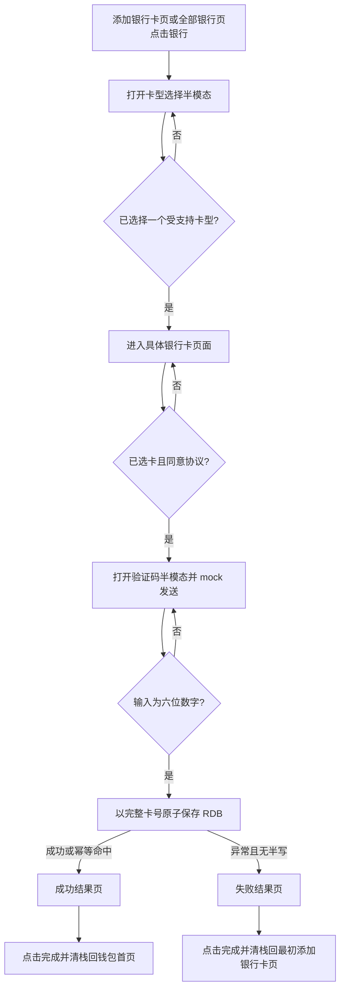

# 银行卡开卡闭环 — 需求规格（Spec）

> **模块标识**: `bank-card-opening-flow`  
> **Feature**: `cu-YmMtb3BlbkNhcmQtMgBiYW5rLWNhcmQtb3BlbmluZy1mbG93`  
> **版本**: v1.0  
> **创建日期**: 2026-10-23  
> **状态**: 已确认（headless CU 投影）

## 0. 术语映射表

> 本表逐字段投影自 `doc/features/bc-openCard-2/blueprint/component-blueprint.yaml` 的 `term:银行卡开卡` 事实；`[x]` 表示按已准入蓝图继续，不表示人工复核已经发生。

| 原始术语 | 权威模块 | 所属层 | 置信度 | 易混项（必须亮出） | 用户确认 |
|---|---|---|---|---|---|
| 银行卡开卡 | WalletMain | 02-Feature | medium | Phone 应用壳 — 只装配根导航与目的页；AccountManager 账号域 — 只提供账号 mock 手机号 | [x] |

## 1. 功能概述

在既有“添加银行卡”和“全部银行”两个入口上，提供从选择卡型、选择具体银行卡、短信验证码、RDB 持久化到成功/失败结果处理的完整本地模拟开卡流程，并保证旧路由和完整卡号隐私边界不受破坏。

## Scope 声明

### Scope 模块清单

| 字段 | 取值 | 说明 |
|---|---|---|
| 本需求允许修改的模块 | WalletMain、AccountManager、Phone | 与 CU `touches` 派生集合完全一致 |
| 本需求明确不修改的模块 | CommUI、CommFunc | 只复用现有 Toast、日志和导航上下文，不新增公共真源 |

```yaml
in_scope_modules:
  - WalletMain
  - AccountManager
  - Phone
out_of_scope_modules:
  - CommUI
  - CommFunc
expansions_with_user_approval: []
rationale: |
  WalletMain 拥有开卡业务状态、页面、mock 银行卡候选和本地 RDB；AccountManager 只补充账号 mock 手机号；Phone 只注册新增目的页。
  CommUI 与 CommFunc 的现有能力足以支撑通用反馈和导航栈访问，不同意把开卡业务逻辑上提到公共模块。
  CU-bound 范围没有阶段内扩展出口；任何新增模块或公共接口责任变更必须回 component-design 修订蓝图。
```

```yaml
ui_change: new_or_changed
visual_handoff:
  kind: screenshot_pack
  authoritative_refs:
    - id: ref_card_type_sheet
      path: doc/features/原始需求/1-2-银行卡/3-点击任意银行拉起添卡选卡半模态.jpg
    - id: ref_bank_card_selection
      path: doc/features/原始需求/1-2-银行卡/4-点击信用卡或储蓄卡后拉起选卡页面.jpg
    - id: ref_otp_verification_sheet
      path: doc/features/原始需求/1-2-银行卡/5-选中某张卡片后拉起短信验证.jpg
    - id: ref_opening_result_success
      path: doc/features/原始需求/1-2-银行卡/6-短信验证完成后结果页.jpg
fidelity_target: pixel_1to1
asset_acquisition_mode: approximate
fidelity_deferrals:
  - element_id: card_type_status_bar
    reason: "系统状态栏由系统渲染，应用不自绘；当前无直接视觉能力。"
    capability: "system_chrome + blind execution"
    clearance_condition: "真机捕获时由 delegated visual review 核对系统状态栏与参考环境差异。"
  - element_id: selection_status_bar
    reason: "系统状态栏由系统渲染，应用不自绘；当前无直接视觉能力。"
    capability: "system_chrome + blind execution"
    clearance_condition: "真机捕获时由 delegated visual review 核对系统状态栏与参考环境差异。"
  - element_id: otp_status_bar
    reason: "系统状态栏由系统渲染，应用不自绘；当前无直接视觉能力。"
    capability: "system_chrome + blind execution"
    clearance_condition: "真机捕获时由 delegated visual review 核对系统状态栏与参考环境差异。"
  - element_id: otp_system_numeric_keyboard
    reason: "系统数字键盘由输入类型触发，不由应用自绘；当前无法核对具体系统键盘皮肤。"
    capability: "system_input + blind execution"
    clearance_condition: "真机确认数字键盘可拉起、仅输入数字，并由 delegated visual review 记录系统皮肤差异。"
  - element_id: result_status_bar
    reason: "系统状态栏由系统渲染，应用不自绘；当前无直接视觉能力。"
    capability: "system_chrome + blind execution"
    clearance_condition: "真机捕获时由 delegated visual review 核对系统状态栏与参考环境差异。"
  - element_id: result_ocr_uncertain_copy
    reason: "OCR 返回低置信孤立文本‘回中加’，只读视觉观察将该区域识别为插画，不能可靠判定为产品文案。"
    capability: "direct vision unavailable"
    clearance_condition: "由具备结构化逐图审计能力的视觉 provider 复核；若为插画噪声则从分母清除，若为真实文案则补入 ui-spec。"
```

### Visual Handoff 裁决

- 四张参考图全部进入 `spec/ui-spec.yaml` 与 `spec/ref-elements.yaml`，没有缩小参考图分母。
- 本执行者无直接视觉能力；文案与位置采用 OCR JSON，结构采用需求与只读 reviewer 观察 sidecar，`verified` 保持 `unverified`。
- 需求原文“再往下的激活nfc部分本次先不需要”优先于结果页参考图：NFC 激活区登记为 `excluded`，不属于本轮视觉义务。
- 成功目的地按蓝图冲突裁决为钱包首页；银行卡详情页是后续需求，本轮不实现。
- 招商银行 logo 复用现有仓内资源；结果引导插画缺少可验证的独立素材，使用可见语义占位并登记视觉债务，禁止 AI 山寨。

## 2. 目标用户与使用场景

### 2.1 目标用户

| 用户角色 | 描述 |
|---|---|
| 钱包用户 | 希望从现有银行卡入口添加一张本地 mock 银行卡并看到明确结果 |
| 验收人员 | 需要验证新旧页面导航、隐私、持久化、倒计时和定向清栈均符合契约 |

### 2.2 使用场景

| 场景编号 | 场景名称 | 场景描述 | 前置条件 |
|---|---|---|---|
| S1 | 从添加银行卡页开卡 | 用户点击任一银行，选择卡型和具体卡片，完成验证码与结果处理 | 银行 mock 数据加载成功 |
| S2 | 从全部银行页开卡 | 用户在 A-Z 银行列表点击任一银行，进入与 S1 相同的后续流程 | 已进入全部银行页 |
| S3 | 保存失败后退出 | RDB 创建、查询或写入失败时仍进入失败结果页并返回原始添加银行卡页 | 已选卡并提交六位验证码 |
| S4 | 旧路由回归 | 用户仍可在添加卡片、添加银行卡、全部银行和钱包首页之间按既有语义往返 | 应用根导航栈已挂载 |

## 3. 功能清单

| 编号 | 功能名称 | 优先级 | 描述 | 关联场景 |
|---|---|---|---|---|
| F1 | 双入口统一开卡 | P0 | 添加银行卡页和全部银行页点击任一银行均打开携带该银行数据的卡型选择半模态，不再提示暂不支持 | S1、S2 |
| F2 | 卡型单选与协议门禁 | P0 | 仅展示银行支持的储蓄卡/信用卡，最多单选一种；选中后“同意并继续”可用 | S1、S2 |
| F3 | 具体银行卡选择 | P0 | 按银行和卡型展示 1–2 张 mock 卡，只显示前四后四；选卡并同意协议后才可下一步 | S1、S2 |
| F4 | mock 短信验证 | P0 | 弹层出现即发送一次 mock 短信，60 秒倒计时期间禁止重发；归零后可重发；仅六位数字可提交 | S1、S2 |
| F5 | 银行卡 RDB 持久化 | P0 | 以完整卡号为唯一业务键原子保存银行卡详细数据；成功幂等、失败无半写 | S1、S2、S3 |
| F6 | 结果页与定向清栈 | P0 | 保存成功或失败均携带完整卡号和结果进入全屏结果页；结果页禁返回，只能完成退出并清理本轮过程页 | S1、S2、S3 |
| F7 | 既有路由兼容 | P1 | 保持添加卡片、添加银行卡、全部银行、钱包首页的路由名、页面可达性和返回语义 | S4 |

## 4. 页面/界面描述

> UI 逐字文案、bbox、节点树和资产引用以 `spec/ui-spec.yaml` 为机器 SSOT；本节描述行为和页面分区。系统状态栏与系统数字键盘不是应用自绘组件。

### 4.1 选择卡类型半模态

| 组件 | 类型 | 内容/数据 | 交互行为 |
|---|---|---|---|
| 背景页面 | navigation_frame | 既有“添加银行卡”页；全部银行入口同样复用本弹层 | 遮罩下保持原页面，不新增路由层 |
| 弹层标题与关闭 | sheet_scaffold | “选择卡类型”与关闭按钮 | 关闭后丢弃当前 opening session 的未提交选择 |
| 银行与卡型分组卡 | list_card_container | 银行 logo/名称、储蓄卡、信用卡 | 仅展示支持项；卡型单选 |
| 授权与协议 | content_display | OCR 参考文案，协议本轮仅文本展示 | 不提供富文本跳转 |
| 同意并继续 | primary_button | “同意并继续” | 未选卡型时禁用；选中后进入具体卡片页 |

### 4.2 选择具体银行卡页面

| 组件 | 类型 | 内容/数据 | 交互行为 |
|---|---|---|---|
| 导航栏 | nav_bar | 返回按钮、银行名称标题 | 返回卡型流程；不破坏旧栈 |
| 提示 | content_display | “请选择您要绑定的银行卡” | 只读 |
| 卡片候选 | list_card_container | 每银行/卡型 1–2 张 mock 卡；示例显示 `4392 **** **** 2269` | 最多单选一张；UI 不接触完整卡号文本 |
| 协议确认 | logic_condition | 协议文本与勾选态 | 未同意时下一步禁用 |
| 下一步 | primary_button | “下一步” | 选卡且同意协议后打开验证码半模态 |

### 4.3 输入验证码半模态

| 组件 | 类型 | 内容/数据 | 交互行为 |
|---|---|---|---|
| 标题与关闭 | sheet_scaffold | “输入验证码”与关闭按钮 | 关闭时取消计时器并清空验证码/发送中/保存中状态 |
| 手机号提示 | content_display | 手机号从 `AccountService.getUserProfile()` 的 mock 数据读取并脱敏 | 不展示原始完整手机号 |
| 验证码输入行 | sms_code_field | 六位数字输入、右侧倒计时/重发 | 出现即 mock 发送；倒计时期间不可重发；归零后显示重新发送 |
| 下一步 | primary_button | “下一步” | 仅 `/^\d{6}$/` 成立时启用；点击后进入保存中并防重复提交 |

### 4.4 添加结果页

| 组件 | 类型 | 内容/数据 | 交互行为 |
|---|---|---|---|
| 结果状态 | result_state | 成功/失败图标、标题和说明 | 根据 `OpeningResult.success` 切换，不显示完整卡号 |
| 引导插画 | content_display | 支付引导语义占位，待真实素材清偿 | 只读；不包含烤入的应用文案 |
| 完成 | primary_button | “完成” | 唯一退出动作；成功清栈回钱包首页并携带完整卡号，失败回最初添加银行卡页 |

### 4.5 页面状态

| 状态 | 描述 | 触发条件 |
|---|---|---|
| 未完成选择 | 当前页输入保留，主按钮置灰 | 卡型/卡片/协议/验证码任一条件缺失 |
| 验证码倒计时 | 右侧显示剩余秒数且不可重发 | mock 发送成功后 60 秒内 |
| 验证码可重发 | 右侧显示重新发送且可点击 | 倒计时归零 |
| 保存中 | 防止重复提交，等待 RDB 返回 | 合法验证码点击下一步 |
| 成功结果 | 显示成功状态和完成按钮 | RDB 保存或幂等回查成功 |
| 失败结果 | 显示失败状态和完成按钮 | RDB 初始化/查询/写入失败 |

### 4.6 既有导航回归承载

| 页面 | 触发入口/动作 | 可验收组件或锚点 | 返回/完成语义 |
|---|---|---|---|
| 钱包首页 | 顶栏添加卡片入口 | `home_root`、现有添加入口 | 进入添加卡片页；成功开卡完成后清栈回此页 |
| 添加卡片页 | 点击“银行卡”行 | `add_card_bank_row` | 进入添加银行卡页；返回仍按既有栈语义回首页/卡包 |
| 添加银行卡页 | 点击任一银行或“查看全部银行” | `col_page_title`、`col_row_cmb`、`exp_view_all_banks_btn` | 银行行进入卡型半模态；查看全部银行进入全部银行页 |
| 全部银行页 | 点击任一银行或返回 | `ab_page_title`、`ab_row_cmb`、`ab_back_btn` | 银行行进入同一卡型半模态；返回到添加银行卡页 |

> AC-5 权威验收原文中的“最初添加卡片页”在本 CU 的详细导航裁决中指物理目的页 `AddBankCardPage`（添加银行卡页），不是 `AddCardEntryPage`；后续实现与测试统一按该物理路由名绑定。

## 5. 业务流程图



### 5.1 数据与隐私边界

- `BankCardCandidate`、保存服务和 RDB 使用完整卡号；presentation 只能消费掩码字符串。
- RDB 至少保存：完整卡号唯一键、卡片大类 `BANK_CARD`、银行 code/名称、银行卡型 `DEBIT|CREDIT`、添加时间、华为支付状态、银联手机闪付状态、交易记录集合。
- 完整卡号不得写日志、Toast、页面文本或测试失败消息；结果页参数与成功回首页参数只在受控内存调用链传递。
- 所有银行、卡候选、短信发送、账号手机号和支付开通状态均为本地模拟数据，不调用真实银行、短信或支付服务。

## 6. 异常/边界场景处理

| 编号 | 异常场景 | 触发条件 | 处理方式 | 用户提示/结果 | 关联功能 |
|---|---|---|---|---|---|
| E1 | 输入或选择不完整 | 未选卡型/卡片、未同意协议或验证码非法 | 保持当前输入，按钮置灰，不写库 | 无额外 Toast | F2、F3、F4 |
| E2 | 重复发送或提交 | 倒计时期间点发送，或保存中重复点下一步 | 忽略重复动作，单窗口只发送/保存一次 | 维持倒计时或保存中状态 | F4、F5 |
| E3 | RDB 异常 | 数据库创建、查询或插入失败 | 回滚或不提交，生成失败结果，日志只记错误类别 | 失败结果页仍可完成退出 | F5、F6 |
| E4 | 中途取消 | 关闭任一半模态或在结果页前返回 | 释放临时选择和计时器，不写库；重新进入从初始态开始 | 回到触发入口 | F1、F2、F3、F4 |
| E5 | 银行无支持卡型或无候选卡 | mock 数据返回空支持项/空候选 | 展示空态并禁用继续，不伪造候选 | 当前流程不可继续 | F2、F3 |
| E6 | 网络异常 | 设备离线 | 本流程全部使用本地 mock 与 RDB，继续可用 | 不出现网络依赖错误 | F1–F6 |
| E7 | 功能暂不支持 | 点击本轮明确排除的 NFC 激活能力 | 不渲染该入口，不新增替代逻辑 | 无 | F6 |

## 7. 非功能性需求

| 编号 | 指标 | 要求 | 说明 |
|---|---|---|---|
| NFR-1 | 本地交互响应 | ≤ 300 ms | 卡型/卡片选择、按钮启停和本地页面切换；首次 RDB 初始化除外，初始化时须防重复提交 |
| NFR-2 | 验证码倒计时 | 60 秒，显示误差 ≤ 1 秒 | 页面离开后必须停止计时器，重新进入重新发送 |
| NFR-3 | 持久化原子性 | 0 条半写记录 | 失败时事务不提交；同一完整卡号最多一条记录 |
| NFR-4 | 敏感数据泄漏 | 0 处 UI/日志完整卡号 | 测试覆盖页面文本、日志参数与异常路径 |

### 7.1 兼容性与可访问性

- 沿用当前工程 hmos-app 配置和既有 ArkUI 导航规则，不新增独立路由体系。
- 主操作按钮和可点击行保持可识别的启用/禁用状态；验证码输入使用数字键盘并限制为六位数字。
- 结果页不显示返回箭头，系统返回和侧滑返回均不得离开该页。

## 8. 验收标准

### P0 功能验收标准

- [ ] **AC-1（F1；同时验证 F2 的卡型单选门禁）**：分别从添加银行卡页和全部银行页点击同一银行，均打开该银行的卡型选择半模态；显示银行信息和其支持卡型，且只能单选一种。
- [ ] **AC-2（F3）**：按银行和卡型显示 1–2 张 mock 卡；页面只显示前四后四，业务对象仍持有完整卡号；未选卡或未同意协议时下一步不可用。
- [ ] **AC-3（F4）**：验证码弹层出现即 mock 发送一次；60 秒内不能重发，归零后可再次发送；只有六位数字使下一步可用。
- [ ] **AC-4（F5、F6）**：分别模拟保存成功和失败；成功时字段完整且完整卡号唯一，失败时无半写；两种结果均携带完整卡号与结果进入对应结果页。
- [ ] **AC-5（F6）**：结果页无返回入口并拦截系统返回/侧滑；点击完成后过程页全部移除，成功回钱包首页，失败回最初添加银行卡页。

### P1 功能验收标准

- [ ] **AC-6（F7）**：添加卡片、添加银行卡、全部银行、钱包首页的既有路由与返回语义保持可用；新增目的页遵循同一 `NavPathStack` 注册规则。

### 视觉验收说明

- 四个 P0 目标屏均以 Visual Handoff 的四张参考图为权威输入；`ui-spec.yaml` 必备元素和 `acceptance.yaml` checkpoint 必须可绑定。
- 当前 `verified: unverified` 只说明本阶段没有直接 VL 终签，不降低后续 delegated visual review 与真机视觉差异门禁。
- 结果引导插画占位属于已披露的 major 视觉债务，阶段可继续但发布前必须替换真实素材并重验；其余无法从 OCR/sidecar 确定的像素细节作为 minor 盲档残余披露。
