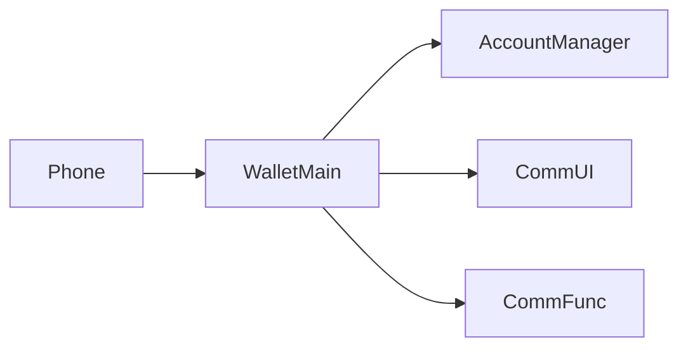
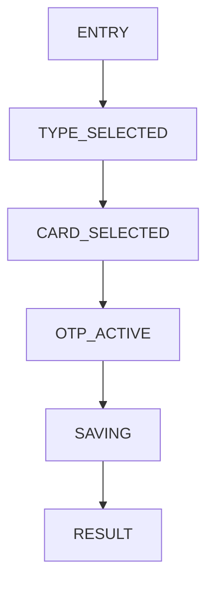
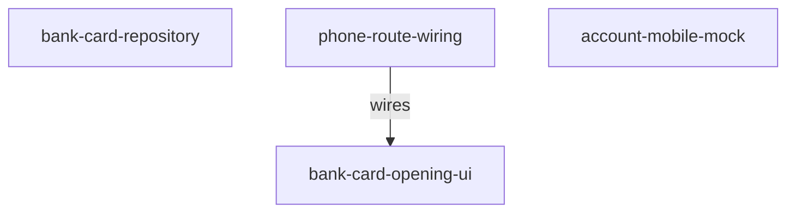
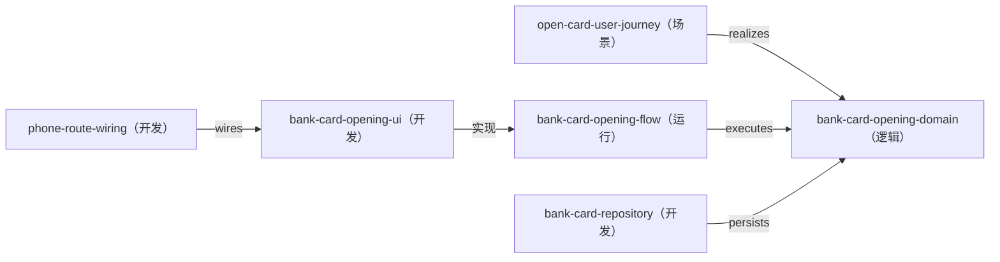

---
derived_from:
  artifact: component-blueprint@1
  component_id: wallet-bank-card-opening
  blueprint_id: bc-openCard-2
  revision: 1
  source_fingerprint: sha256:fb887c31df3f865b23b566d1e43d3f3364ee13da663fdc0257ef628a40bc9590
  artifact_sha256: sha256:5dfb52537711026c3a4b82d4b4e9a4e3dc979ea749e3d33c61308428c0093a29
  change_units:
    - change_unit_id: bank-card-opening-flow
      binding: bound
      identity_neutral_digest: 3d3298a786def58ca0998de6cbe75aa57676da4d8d79f8355881ec94caf28dc3
projection: component-blueprint-review@12
---

# 银行卡开卡闭环

<a id="design-626c75657072696e743a62632d6f70656e436172642d32"></a>
阅读入口：先阅读方案、旅程、关键流程和交付安排；类型、方法、完整分支与验收全文见同文档的[技术与追溯参考](#reference)。

<a id="summary"></a>
## 1 方案摘要

在既有银行入口上增加卡型半模态、具体卡片全屏页、验证码半模态、RDB 持久化与不可侧滑退出的结果页；成功完成后清理整个开卡栈并回到钱包首页，失败则回到最初添加卡片页。

施工安排见[施工与上线](#delivery)。

<a id="background"></a>
## 2 背景、目标与边界

### 现状、目标与边界

现有添加银行卡页和全部银行页已经能展示同一批 mock 银行，但点击银行只提示“暂不支持”。本次把这两个入口接入一条完整的本地模拟开卡链路：选择卡型、选择具体卡片、短信验证、保存到 RDB、展示结果并安全退出。真实银行、真实短信、真实支付开通、银行卡详情页和 NFC 激活不在本次范围。


[设计依据](#reader-guide-source-1)

<a id="terms"></a>
## 3 术语

### 关键术语和责任归属

“银行卡开卡”指从点击银行开始，到银行卡记录成功或失败落定并退出结果页为止的完整业务流程。WalletMain 负责业务状态、页面、RDB 和用例；Phone 只在已有根 Navigation 中装配新增目的页；AccountManager 只提供账号 mock 信息。


[设计依据](#reader-guide-source-2)

<a id="journey"></a>
## 4 用户旅程与界面

### 选择卡类型

用户从任一银行入口进入同一半模态。弹层显示银行信息、该银行支持的储蓄卡和信用卡，最多单选一种；只有完成选择并同意协议才可继续。


<a id="design-696d6167653a646f632f66656174757265732fe58e9fe5a78be99c80e6b1822f312d322de993b6e8a18ce58da12f332de782b9e587bbe4bbbbe6848fe993b6e8a18ce68b89e8b5b7e6b7bbe58da1e98089e58da1e58d8ae6a8a1e680812e6a7067"></a>


[设计依据](#reader-guide-source-3)

### 选择具体银行卡

全屏页面以银行名为标题，按已选卡型展示一至两张 mock 卡。界面只显示卡号前四后四，完整卡号继续由后台业务对象持有。


<a id="design-696d6167653a646f632f66656174757265732fe58e9fe5a78be99c80e6b1822f312d322de993b6e8a18ce58da12f342de782b9e587bbe4bfa1e794a8e58da1e68896e582a8e89384e58da1e5908ee68b89e8b5b7e98089e58da1e9a1b5e99da22e6a7067"></a>


[设计依据](#reader-guide-source-4)

### 输入短信验证码

弹层出现即触发一次 mock 发送并开始 60 秒倒计时。倒计时内不能重发；归零后可再次发送。输入只接受六位数字，合法后才允许保存。


<a id="design-696d6167653a646f632f66656174757265732fe58e9fe5a78be99c80e6b1822f312d322de993b6e8a18ce58da12f352de98089e4b8ade69f90e5bca0e58da1e78987e5908ee68b89e8b5b7e79fade4bfa1e9aa8ce8af812e6a7067"></a>


[设计依据](#reader-guide-source-5)

### 查看结果并完成

保存返回后无论成功或失败都进入全屏结果页。结果页没有返回入口并拦截返回动作；用户点击完成后，成功清栈回钱包首页，失败清栈回最初的添加银行卡页。


<a id="design-696d6167653a646f632f66656174757265732fe58e9fe5a78be99c80e6b1822f312d322de993b6e8a18ce58da12f362de79fade4bfa1e9aa8ce8af81e5ae8ce68890e5908ee7bb93e69e9ce9a1b52e6a7067"></a>


[设计依据](#reader-guide-source-6)

<a id="solution"></a>
## 5 整体方案

### 整体方案与责任边界

页面只维护未提交选择和倒计时；AccountService 提供账号 mock 手机号，BankCardOpeningService 负责掩码、输入规则与 StoredCard/OpeningResult 映射，OtpService 负责 mock 发送，BankCardRepository 是已保存银行卡的唯一真源。OpeningNavigationService 成功时写入一次性 BankOpeningCompletionContext 后 clear 回首页，HomeTabPage.aboutToAppear 消费并清空 Context；失败时 popToName 保留最初 AddBankCardPage。完整卡号只在受控内存对象和本地 RDB 中流转，不写入界面与日志。


[设计依据](#reader-guide-source-7)

<a id="flows"></a>
## 6 关键流程

### 从提交验证码到结果页

验证码合法后，弹层等待 BankCardRepository 完成幂等保存。成功返回已保存记录，失败返回受控错误；两种情况都生成包含完整卡号和结果的 OpeningResult，再进入结果页。只有保存确认后才发布成功，失败不会留下半写记录。


[设计依据](#reader-guide-source-8)

<a id="data"></a>
## 7 数据与存储

### 数据、存储和隐私

wallet_bank_cards.rdb 的 cards 表以完整卡号为主键和唯一键，保存总卡类别、银行、银行卡类型、添加时间、支付开通状态与交易记录 JSON。未完成会话只在内存中，关闭即清理；成功记录留在应用沙箱。本轮没有额外加密要求，但完整卡号不得显示或写日志。


[设计依据](#reader-guide-source-9)

<a id="decisions"></a>
## 8 关键取舍

设计优先复用现有 Navigation、银行数据和模块边界，不引入新的跨模块状态或未完成会话持久化。四个界面具有银行卡业务状态，组件索引中没有语义等价共享组件，因此在 WalletMain 内实现专用 UI。


[设计依据](#reader-guide-source-10)

<a id="design-6465636973696f6e3a77616c6c65746d61696e2d6f776e732d6f70656e696e67"></a>
### WalletMain 统一承载开卡业务

| 关切 | 结论 |
| --- | --- |
| 选了什么 | 开卡模型、RDB、服务和页面均归 WalletMain；Phone 只做既有 Navigation 装配。|
| 理由 | module-catalog 已将卡包、添卡、feature 内 Repository 与用例归 WalletMain，将根 Navigation 与 HAP 装配归 Phone。|

被否方案：

未记录；不推测被否选择。

<a id="design-6465636973696f6e3a73696e676c652d6f70656e696e672d73657373696f6e"></a>
### 单一内存开卡会话

| 关切 | 结论 |
| --- | --- |
| 选了什么 | 卡型、候选卡、验证码与 OpeningResult 通过页面参数和局部状态传递，保存成功前不持久化中间选择。|
| 理由 | 本轮无跨进程或恢复未完成开卡的要求，减少敏感数据留存和并行真源。|

被否方案：

| 方案 | 被否理由/缺陷 |
| --- | --- |
| 持久化未完成开卡会话 | 原始需求没有跨会话恢复要求。<br>增加敏感数据生命周期和清理责任。|

<a id="design-6465636973696f6e3a636172642d6e756d6265722d70726976616379"></a>
### 完整卡号最小暴露

| 关切 | 结论 |
| --- | --- |
| 选了什么 | UI 始终掩码显示，完整卡号仅存在于候选模型、保存调用、OpeningResult 和 RDB 字段，不写日志或资源文案。|
| 理由 | 原始需求明确要求界面只显示前四后四而后台按完整卡号处理。|

被否方案：

未记录；不推测被否选择。

<a id="design-6465636973696f6e3a726573756c742d737461636b2d706f6c696379"></a>
### 结果页独占完成出口并定向清栈

| 关切 | 结论 |
| --- | --- |
| 选了什么 | 结果页拦截返回，完成时按本轮入口栈标识删除 AddBankCardPage 之后的全部开卡页面；成功再回钱包首页，失败停在 AddBankCardPage。|
| 理由 | 原始需求明确要求结果页只能通过完成退出并清理本轮 1-6 页面，同时规定成功和失败去向。|

被否方案：

未记录；不推测被否选择。

<a id="design-6465636973696f6e3a637573746f6d2d6f70656e696e672d7569"></a>
### 在 WalletMain 内实现业务专用界面

| 关切 | 结论 |
| --- | --- |
| 选了什么 | 选型结果：自定义实现；选型目标：[bank-card-opening-ui](#design-766965773a646576656c6f706d656e742f6e6f64653a62616e6b2d636172642d6f70656e696e672d7569) |
| 理由 | 卡型、卡片、验证码和结果页均携带银行卡流程状态，不能由无业务状态的通用列表项直接配置得到。|

被否方案：

未记录；不推测被否选择。

<a id="recovery"></a>
## 9 失败与恢复

### 失败、中断和恢复

| 情况 | 用户看到什么 | 数据是否保存 | 如何继续 |
|---|---|---|---|
| 输入不完整（[BD-1](#design-616363657074616e63653a766965773a646576656c6f706d656e742f6e6f64653a62616e6b2d636172642d6f70656e696e672d75692f626f756e6461726965733a42442d31)）| 按钮保持不可用 | 否 | 补齐选择、协议或六位验证码 |
| 倒计时内重复发送（[BD-2](#design-616363657074616e63653a766965773a646576656c6f706d656e742f6e6f64653a62616e6b2d636172642d6f70656e696e672d75692f626f756e6461726965733a42442d32)）| 继续显示剩余秒数 | 否 | 等待归零后重发 |
| RDB 保存失败（[BD-3](#design-616363657074616e63653a766965773a646576656c6f706d656e742f6e6f64653a62616e6b2d636172642d6f70656e696e672d75692f626f756e6461726965733a42442d33)）| 失败结果页 | 否 | 点击完成回添加银行卡页后重试 |
| 结果页之前取消（[BD-4](#design-616363657074616e63653a766965773a646576656c6f706d656e742f6e6f64653a62616e6b2d636172642d6f70656e696e672d75692f626f756e6461726965733a42442d34)）| 回到上一入口 | 否 | 重新开始，本次临时状态已释放 |


[设计依据](#reader-guide-source-11)

边界验收：[BD-1](#design-616363657074616e63653a766965773a646576656c6f706d656e742f6e6f64653a62616e6b2d636172642d6f70656e696e672d75692f626f756e6461726965733a42442d31)；[BD-2](#design-616363657074616e63653a766965773a646576656c6f706d656e742f6e6f64653a62616e6b2d636172642d6f70656e696e672d75692f626f756e6461726965733a42442d32)；[BD-3](#design-616363657074616e63653a766965773a646576656c6f706d656e742f6e6f64653a62616e6b2d636172642d6f70656e696e672d75692f626f756e6461726965733a42442d33)；[BD-4](#design-616363657074616e63653a766965773a646576656c6f706d656e742f6e6f64653a62616e6b2d636172642d6f70656e696e672d75692f626f756e6461726965733a42442d34)。

<a id="quality"></a>
## 10 质量与安全

### 质量、安全与兼容

验收同时覆盖业务规则 UT、真实页面和导航设备证据。重点检查完整卡号最小暴露、触控和可读性、RDB 原子性，以及旧添加卡片、添加银行卡、全部银行和首页路由不受损。


[设计依据](#reader-guide-source-12)

<a id="delivery"></a>
## 11 施工与上线

### 施工落点与安全中间态

一个 Change Unit 即可闭合本次演进：先扩展 AccountManager 的 UserProfile/AccountService mock 手机号，再在 WalletMain 建立模型、Repository、服务、页面与资源（包含 HomeTabPage 的一次性成功参数消费）；随后通过 WalletMain index.ets、route_map.json 和 Phone navDestinationMap 接线，最后补业务 UT 和设备验收。施工过程中保留现有路由名，新增入口未接线前旧页面仍可运行。


[设计依据](#reader-guide-source-13)

### bank-card-opening-flow

一次性交付银行卡开卡闭环：两个既有银行入口进入卡型选择、具体卡片、短信验证、RDB 保存和结果页，并按成功或失败定向清栈，同时保持既有路由兼容。

- 两个入口均可完成卡型、卡片、验证码、保存和结果处理，且所有输入门禁符合验收。
- 页面、验证码弹层、BankCardRepository、NavPathStack 与一次性完成上下文各自拥有唯一且可清理的状态。
- 结果页消费 OpeningResult，钱包首页单次消费并清理成功卡号参数，失败路径由 AddBankCardPage 接回。
- 银行卡 RDB 字段、唯一键、幂等、失败原子性和隐私边界符合设计契约。
- 结果页拦截返回；成功携带完整卡号回首页，失败回最初添加银行卡页，且过程页全部清除。

模块分工：AccountManager；Phone；WalletMain。

- 设计目标（责任方：WalletMain presentation/domain/data）
- 设计目标（责任方：WalletMain data）
- 设计目标（责任方：AccountManager domain）
- 设计目标（责任方：Phone product shell）

未声明上游依赖。

安全中间态：模型、服务和页面按依赖顺序完成并保持每次提交可编译；新目的页在 Phone 注册前不影响旧路由，注册后完整链路才开放，任一失败可回退到原有银行列表仍可浏览的状态。

精确映射见 [施工单元参考](#design-756e69743a62616e6b2d636172642d6f70656e696e672d666c6f77)。

### 文件与目录

```text
├── 01-Product/Phone/src/main/ets/pages/
│   └── index.ets
├── 02-Feature/WalletMain/src/
│   ├── main/
│   │   ├── ets/
│   │   │   ├── data/
│   │   │   │   ├── model/
│   │   │   │   │   ├── BankCardCandidate.ets
│   │   │   │   │   ├── BankInfo.ets
│   │   │   │   │   ├── BankOpeningCompletionContext.ets
│   │   │   │   │   ├── OpeningResult.ets
│   │   │   │   │   └── StoredCard.ets
│   │   │   │   └── repository/
│   │   │   │       ├── BankCardRepository.ets
│   │   │   │       └── BankRepository.ets
│   │   │   ├── domain/service/
│   │   │   │   ├── BankCardOpeningService.ets
│   │   │   │   ├── OpeningNavigationService.ets
│   │   │   │   └── OtpService.ets
│   │   │   ├── index.ets
│   │   │   ├── presentation/
│   │   │   │   ├── components/
│   │   │   │   │   ├── CardTypeSheet.ets
│   │   │   │   │   └── OtpVerificationSheet.ets
│   │   │   │   └── pages/
│   │   │   │       ├── AddBankCardPage.ets
│   │   │   │       ├── AllBanksPage.ets
│   │   │   │       ├── BankCardOpeningResultPage.ets
│   │   │   │       ├── BankCardSelectionPage.ets
│   │   │   │       └── HomeTabPage.ets
│   │   │   └── shared/constant/
│   │   │       └── BankConstants.ets
│   │   └── resources/base/
│   │       ├── element/
│   │       │   ├── color.json
│   │       │   ├── float.json
│   │       │   └── string.json
│   │       └── profile/
│   │           └── route_map.json
│   └── ohosTest/ets/test/
│       └── bank_open_card_ut.test.ets
└── 04-BusinessBase/AccountManager/src/main/ets/
    ├── data/model/
    │   └── UserProfile.ets
    ├── domain/service/
    │   └── AccountService.ets
    └── index.ets
```

| 上线顺序 | 交付单元 | 配套前提 | 说明 |
| --- | --- | --- | --- |
| 1 | WalletMain HAR | AccountManager；CommUI；CommFunc | 先提供模型、RDB、服务、页面和 builder 导出。|
| 2 | Phone HAP | WalletMain | 再注册新增目的页并完成真机验收。|

<a id="acceptance"></a>
## 12 验收

### 验收方式

[AC-1](#design-616363657074616e63653a766965773a646576656c6f706d656e742f6e6f64653a62616e6b2d636172642d6f70656e696e672d75692f63726974657269613a41432d31) 至 [AC-4](#design-616363657074616e63653a766965773a646576656c6f706d656e742f6e6f64653a62616e6b2d636172642d6f70656e696e672d75692f63726974657269613a41432d34) 覆盖两入口、卡片掩码、验证码和 RDB 保存；[AC-5](#design-616363657074616e63653a766965773a646576656c6f706d656e742f6e6f64653a62616e6b2d636172642d6f70656e696e672d75692f63726974657269613a41432d35) 覆盖结果页返回拦截与定向清栈；[AC-6](#design-616363657074616e63653a766965773a646576656c6f706d656e742f6e6f64653a62616e6b2d636172642d6f70656e696e672d75692f63726974657269613a41432d36) 覆盖旧路由回归。[BD-1](#design-616363657074616e63653a766965773a646576656c6f706d656e742f6e6f64653a62616e6b2d636172642d6f70656e696e672d75692f626f756e6461726965733a42442d31) 至 [BD-4](#design-616363657074616e63653a766965773a646576656c6f706d656e742f6e6f64653a62616e6b2d636172642d6f70656e696e672d75692f626f756e6461726965733a42442d34) 分别覆盖输入门禁、重发门禁、保存失败和中途取消。


[设计依据](#reader-guide-source-14)

<a id="questions"></a>
## 13 待补问题

### 待核事项

“银行卡开卡”术语在无人值守模式下按 WalletMain 归属继续，已标记为 headless_assumed 供最终质询复核。参考图中的 NFC 激活区块按原始需求明确不实现；其余没有阻断当前施工的未决项。


[设计依据](#reader-guide-source-15)

### 术语假定

| 术语 | 当前假定解释 | 确认情况 |
| --- | --- | --- |
| 银行卡开卡 | 从银行选择开始，经卡型、具体卡片、验证码、持久化与结果处理完成一张银行卡添加的业务流程。| 作者自行假定，待确认 |

完整术语与来源见[术语参考](#review-terms)。

### 必须关注的评审问题

- 参考图只约束本轮四个界面的主要布局和交互层级；结果页 NFC 区块按原始需求明确不实现。


<a id="reference"></a>
## 技术与追溯参考

部件 wallet-bank-card-opening · 蓝图 bc-openCard-2 · revision 1 · 准入 通过

本文根据 canonical 蓝图与当前施工单元确定性生成，文首保留精确来源身份。是否通过设计交接见 readiness；施工授权、映射与完成结论由原责任阶段确认。可选说明缺失或过期不改变这些结论。

参考保留全部声明；不从名称、目录或数组顺序推断调用、依赖与未声明存储设计。正文的验收链接按来源目标与条目编号定位。

### A 字段与类型

<a id="review-summary-details"></a>
#### 原概述与目标

| 关切 | 设计说明 |
| --- | --- |
| 背景 | 现有添加银行卡与全部银行页面只能浏览银行列表，点击银行仍提示暂不支持，尚无卡型选择、具体卡片、短信验证、持久化和结果页闭环。 |
| 问题 | 用户无法从任一银行入口完成银行卡选择、短信验证、落库并安全返回钱包首页或添加卡片页。 |
| 本次改变 | 在既有银行入口上增加卡型半模态、具体卡片全屏页、验证码半模态、RDB 持久化与不可侧滑退出的结果页；成功完成后清理整个开卡栈并回到钱包首页，失败则回到最初添加卡片页。 |
| 整体定位 | 这是 WalletMain 内的银行卡添卡业务闭环；Phone 只负责在既有根 Navigation 中注册新增目的页，不承载开卡业务状态。 |
| 范围 | WalletMain 银行 mock 数据扩展、页面状态和业务服务；卡型选择半模态、具体卡片页、短信验证半模态、结果页；银行卡 RDB 数据库与表、保存成功或失败结果传递；Phone 根 Navigation 对新增页面的注册；受影响业务 UT、原路由回归和真机视觉/交互验收 |
| 不做什么 | 真实银行网络、真实短信服务、真实支付开通与交易明细；银行卡详情页和 NFC 激活流程；协议富文本点击与线上协议内容；改造应用根壳、底部 Tab 或新增跨模块架构职责 |

| 目标 | 目标说明 | 成功衡量 |
| --- | --- | --- |
| goal-open-card-flow | 用户从添加银行卡或全部银行入口完成一张 mock 银行卡的选择、验证、保存和结果处理。 | 两个银行入口行为一致且不再显示暂不支持<br>只有合法的卡型、卡片、协议与六位数字验证码状态才能继续<br>完整卡号仅在后台模型、页面间内存交接与 RDB 中使用，界面只显示前四后四<br>结果页禁止返回手势且只能通过完成按钮退出，退出后开卡过程页不可回退 |

<a id="review-terms"></a>
#### 完整术语

| 术语 | 含义 | 模块 | 易混项 | 确认依据 |
| --- | --- | --- | --- | --- |
| 银行卡开卡 | 从银行选择开始，经卡型、具体卡片、验证码、持久化与结果处理完成一张银行卡添加的业务流程。 | WalletMain | Phone 应用壳；AccountManager 账号域 | doc/glossary.yaml |

#### 必须关注的评审问题

见正文[必须关注的评审问题](#questions)。

#### 领域模型、字段与枚举

<a id="design-6d6f64656c3a766965773a646576656c6f706d656e742f6e6f64653a62616e6b2d636172642d6f70656e696e672d75692f42616e6b4361726443616e646964617465"></a>
内容承载于：[bank-card-opening-ui](#design-766965773a646576656c6f706d656e742f6e6f64653a62616e6b2d636172642d6f70656e696e672d7569) · 契约设计

#### BankCardCandidate · 接口

模块 未记录；文件 02-Feature/WalletMain/src/main/ets/data/model/BankCardCandidate.ets

| 字段 | 类型 | 必需 | 约束/说明 |
| --- | --- | --- | --- |
| bankCode | string | 是 | 银行短码 |
| bankName | string | 是 | 银行显示名 |
| cardNumber | string | 是 | 完整 mock 卡号，仅后台链路使用 |
| cardType | BankCardType | 是 | DEBIT 或 CREDIT |

未记录：可空；默认值；补充约束；验证引用；来源。

<a id="design-6d6f64656c3a766965773a646576656c6f706d656e742f6e6f64653a62616e6b2d636172642d6f70656e696e672d75692f53746f72656443617264"></a>


#### StoredCard · 类

模块 未记录；文件 02-Feature/WalletMain/src/main/ets/data/model/StoredCard.ets

| 字段 | 类型 | 必需 | 约束/说明 |
| --- | --- | --- | --- |
| cardNumber | string | 是 | 完整卡号且为唯一业务键 |
| category | string | 是 | 总卡类别，本轮为 BANK\_CARD |
| bankName | string | 是 | 银行名称 |
| bankCardType | string | 是 | 储蓄卡或信用卡 |
| addedAt | number | 是 | 添加时间毫秒时间戳 |
| huaweiPayEnabled | boolean | 是 | 华为支付开通状态 |
| unionPayQuickPassEnabled | boolean | 是 | 银联手机闪付状态 |
| transactionRecords | string | 是 | 交易记录 JSON，本轮默认空数组 |

未记录：可空；默认值；补充约束；验证引用；来源。

<a id="design-6d6f64656c3a766965773a646576656c6f706d656e742f6e6f64653a62616e6b2d636172642d6f70656e696e672d75692f4f70656e696e67526573756c74"></a>


#### OpeningResult · 类

模块 未记录；文件 02-Feature/WalletMain/src/main/ets/data/model/OpeningResult.ets

| 字段 | 类型 | 必需 | 约束/说明 |
| --- | --- | --- | --- |
| fullCardNumber | string | 是 | 完整卡号，仅后台交接 |
| success | boolean | 是 | 保存结果 |
| errorMessage | string | 否 | 失败时的受控错误说明 |

未记录：可空；默认值；补充约束；验证引用；来源。

<a id="design-6d6f64656c3a766965773a646576656c6f706d656e742f6e6f64653a62616e6b2d636172642d6f70656e696e672d75692f5573657250726f66696c65"></a>


#### UserProfile · 类

模块 未记录；文件 04-BusinessBase/AccountManager/src/main/ets/data/model/UserProfile.ets

| 字段 | 类型 | 必需 | 约束/说明 |
| --- | --- | --- | --- |
| mobile | string | 是 | 账号 mock 手机号，验证码页只显示掩码 |

未记录：可空；默认值；补充约束；验证引用；来源。

### B 接口与存储明细

#### 本部件实际消费或提供的操作与 DTO

<a id="design-636f6e74726163743a62616e6b2d636172642d70657273697374656e6365"></a>
#### bank-card-persistence

操作：saveBankCard · 1 · internal；责任方 WalletMain；需要方 bc-openCard-2

<a id="design-64746f3a62616e6b2d636172642d70657273697374656e63652f726571756573745f64746f"></a>
**请求 DTO：SaveBankCardRequest**

来源：[request\_dto](../../../../doc/features/bc-openCard-2/blueprint/component-blueprint.yaml#/contracts/0/request_dto)
验证引用：[AC-4](#design-616363657074616e63653a766965773a646576656c6f706d656e742f6e6f64653a62616e6b2d636172642d6f70656e696e672d75692f63726974657269613a41432d34)

| 字段 | 类型 | 可空 | 语义 | 来源 |
| --- | --- | --- | --- | --- |
| cardNumber | string | 否 | 完整银行卡号 | doc/features/bc-openCard-2/blueprint/component-blueprint.yaml#/contracts/0/request\_dto/fields/0 |
| bankName | string | 否 | 银行名称 | doc/features/bc-openCard-2/blueprint/component-blueprint.yaml#/contracts/0/request\_dto/fields/1 |
| bankCardType | string | 否 | 储蓄卡或信用卡 | doc/features/bc-openCard-2/blueprint/component-blueprint.yaml#/contracts/0/request\_dto/fields/2 |

未记录：必需；默认值；约束；验证引用。

<a id="design-64746f3a62616e6b2d636172642d70657273697374656e63652f726573706f6e73655f64746f"></a>
**响应 DTO：OpeningResult**

来源：[response\_dto](../../../../doc/features/bc-openCard-2/blueprint/component-blueprint.yaml#/contracts/0/response_dto)
验证引用：[AC-4](#design-616363657074616e63653a766965773a646576656c6f706d656e742f6e6f64653a62616e6b2d636172642d6f70656e696e672d75692f63726974657269613a41432d34)

| 字段 | 类型 | 可空 | 语义 | 来源 |
| --- | --- | --- | --- | --- |
| fullCardNumber | string | 否 | 完整银行卡号，仅后台交接 | doc/features/bc-openCard-2/blueprint/component-blueprint.yaml#/contracts/0/response\_dto/fields/0 |
| success | boolean | 否 | RDB 保存是否成功 | doc/features/bc-openCard-2/blueprint/component-blueprint.yaml#/contracts/0/response\_dto/fields/1 |
| errorMessage | string | 否 | 失败时的受控错误说明，成功时为空字符串 | doc/features/bc-openCard-2/blueprint/component-blueprint.yaml#/contracts/0/response\_dto/fields/2 |

映射：

| 映射 | 类型 | 源字段 | 目标字段 | 规则 |
| --- | --- | --- | --- | --- |
| request-to-stored-card | 推导映射 | cardNumber；bankName；bankCardType | StoredCard | 复制完整卡号、银行名和卡型，补充 BANK\_CARD、当前时间、默认 false 状态与空交易记录。 |
| persistence-to-opening-result | 推导映射 | fullCardNumber；success；errorMessage | OpeningResult | 将保存结果与完整卡号传给结果页；失败时保留卡号但不产生 StoredCard。 |

错误：values：DATABASE\_INIT\_FAILED；DATABASE\_WRITE\_FAILED；semantics：任一数据库错误转换为失败 OpeningResult，不向 UI 暴露内部异常。
来源：[errors](../../../../doc/features/bc-openCard-2/blueprint/component-blueprint.yaml#/contracts/0/errors)
验证：[BD-3](#design-616363657074616e63653a766965773a646576656c6f706d656e742f6e6f64653a62616e6b2d636172642d6f70656e696e672d75692f626f756e6461726965733a42442d33)
幂等：key：fullCardNumber；scope：wallet\_bank\_cards.rdb/cards；duplicate\_result：返回既有记录并视为成功。
来源：[idempotency](../../../../doc/features/bc-openCard-2/blueprint/component-blueprint.yaml#/contracts/0/idempotency)
验证：[AC-4](#design-616363657074616e63653a766965773a646576656c6f706d656e742f6e6f64653a62616e6b2d636172642d6f70656e696e672d75692f63726974657269613a41432d34)
非功能要求：privacy：完整卡号不得写日志或显示在 UI。；consistency：单次保存使用 RDB 事务或单条原子插入，失败不得半写。
来源：[nfr](../../../../doc/features/bc-openCard-2/blueprint/component-blueprint.yaml#/contracts/0/nfr)
验证：[AC-4](#design-616363657074616e63653a766965773a646576656c6f706d656e742f6e6f64653a62616e6b2d636172642d6f70656e696e672d75692f63726974657269613a41432d34)；[BD-3](#design-616363657074616e63653a766965773a646576656c6f706d656e742f6e6f64653a62616e6b2d636172642d6f70656e696e672d75692f626f756e6461726965733a42442d33)

未记录：必需；默认值；约束；验证引用。

#### 持久化表结构

表结构来自根级接口契约；领域模型见字段与类型，存储约束和编码保留此处原始声明。

##### bank-card-persistence 的存储设计

| 存储关切 | 声明 |
| --- | --- |
| 数据库 | wallet\_bank\_cards.rdb |
| 版本 | 1 |
| 安全级别 | — |
| 加密 | — |

未记录：安全级别（声明）；加密（声明）。

###### 表 cards

| 表关切 | 声明 |
| --- | --- |
| 主键 | card\_number |
| 约束 | — |
| 升级策略 | — |
| 来源 | — |

| 列 | 类型与声明约束 | 显式默认值 |
| --- | --- | --- |
| card\_number | TEXT | — |
| category | TEXT | BANK\_CARD |
| bank\_name | TEXT | — |
| bank\_card\_type | TEXT | — |
| added\_at | INTEGER | — |
| huawei\_pay\_enabled | INTEGER | 0 |
| unionpay\_quickpass\_enabled | INTEGER | 0 |
| transaction\_records | TEXT | \[\] |


模块依赖：



<!-- module-edge-source:view:development/node:bank-card-opening-ui.contracts.module_dependencies.WalletMain[0] -->
<!-- module-edge-source:view:development/node:bank-card-opening-ui.contracts.module_dependencies.WalletMain[1] -->
<!-- module-edge-source:view:development/node:bank-card-opening-ui.contracts.module_dependencies.WalletMain[2] -->
<!-- module-edge-source:view:development/node:bank-card-opening-ui.contracts.module_dependencies.Phone[0] -->
未记录：约束（声明）；升级策略（声明）；来源（声明）；来源字段；编码；显式默认值；说明；补充约束；来源。

<a id="design-696e746572666163653a766965773a646576656c6f706d656e742f6e6f64653a62616e6b2d636172642d6f70656e696e672d75692f42616e6b436172645265706f7369746f7279"></a>
接口 BankCardRepository · 未记录 / 未记录 · 02-Feature/WalletMain/src/main/ets/data/repository/BankCardRepository.ets

| 方法 | 参数 | 返回 |
| --- | --- | --- |
| save | card: StoredCard | Promise&lt;StoredCard&gt; |
| list | 无 | Promise&lt;StoredCard\[\]&gt; |

未记录：异步；职责/失败语义。

<a id="design-696e746572666163653a766965773a646576656c6f706d656e742f6e6f64653a62616e6b2d636172642d6f70656e696e672d75692f42616e6b436172644f70656e696e6753657276696365"></a>
接口 BankCardOpeningService · 未记录 / 未记录 · 02-Feature/WalletMain/src/main/ets/domain/service/BankCardOpeningService.ets

| 方法 | 参数 | 返回 |
| --- | --- | --- |
| maskCardNumber | cardNumber: string | string |
| isValidOtp | otp: string | boolean |
| toStoredCard | candidate: BankCardCandidate | StoredCard |
| toOpeningResult | candidate: BankCardCandidate；success: boolean；errorMessage: string | OpeningResult |

未记录：异步；职责/失败语义。

<a id="design-696e746572666163653a766965773a646576656c6f706d656e742f6e6f64653a62616e6b2d636172642d6f70656e696e672d75692f42616e6b5265706f7369746f7279"></a>
接口 BankRepository · 未记录 / 未记录 · 02-Feature/WalletMain/src/main/ets/data/repository/BankRepository.ets

| 方法 | 参数 | 返回 |
| --- | --- | --- |
| getCards | bankCode: string；cardType: BankCardType | Promise&lt;BankCardCandidate\[\]&gt; |

未记录：异步；职责/失败语义。

<a id="design-696e746572666163653a766965773a646576656c6f706d656e742f6e6f64653a62616e6b2d636172642d6f70656e696e672d75692f4f747053657276696365"></a>
接口 OtpService · 未记录 / 未记录 · 02-Feature/WalletMain/src/main/ets/domain/service/OtpService.ets

| 方法 | 参数 | 返回 |
| --- | --- | --- |
| sendMockCode | mobile: string | Promise&lt;void&gt; |

未记录：异步；职责/失败语义。

<a id="design-696e746572666163653a766965773a646576656c6f706d656e742f6e6f64653a62616e6b2d636172642d6f70656e696e672d75692f4f70656e696e674e617669676174696f6e53657276696365"></a>
接口 OpeningNavigationService · 未记录 / 未记录 · 02-Feature/WalletMain/src/main/ets/domain/service/OpeningNavigationService.ets

| 方法 | 参数 | 返回 |
| --- | --- | --- |
| finish | stack: NavPathStack；result: OpeningResult | void |

未记录：异步；职责/失败语义。

<a id="design-696e746572666163653a766965773a646576656c6f706d656e742f6e6f64653a62616e6b2d636172642d6f70656e696e672d75692f4163636f756e7453657276696365"></a>
接口 AccountService · 未记录 / 未记录 · 04-BusinessBase/AccountManager/src/main/ets/domain/service/AccountService.ets

| 方法 | 参数 | 返回 |
| --- | --- | --- |
| getUserProfile | 无 | Promise&lt;UserProfile&gt; |

未记录：异步；职责/失败语义。

<a id="design-696e746572666163653a766965773a646576656c6f706d656e742f6e6f64653a62616e6b2d636172642d6f70656e696e672d75692f42616e6b4f70656e696e67436f6d706c6574696f6e436f6e74657874"></a>
接口 BankOpeningCompletionContext · 未记录 / 未记录 · 02-Feature/WalletMain/src/main/ets/data/model/BankOpeningCompletionContext.ets

| 方法 | 参数 | 返回 |
| --- | --- | --- |
| publish | fullCardNumber: string | void |
| consume | 无 | string&#124;undefined |
| clear | 无 | void |

组件 未记录 · 组件 · 02-Feature/WalletMain/src/main/ets/presentation/components/CardTypeSheet.ets

未记录

组件 未记录 · 页面 · 02-Feature/WalletMain/src/main/ets/presentation/pages/BankCardSelectionPage.ets

未记录

组件 未记录 · 组件 · 02-Feature/WalletMain/src/main/ets/presentation/components/OtpVerificationSheet.ets

未记录

组件 未记录 · 页面 · 02-Feature/WalletMain/src/main/ets/presentation/pages/BankCardOpeningResultPage.ets

未记录

组件 未记录 · 页面 · 02-Feature/WalletMain/src/main/ets/presentation/pages/HomeTabPage.ets

未记录

组件 未记录 · 页面 · 02-Feature/WalletMain/src/main/ets/presentation/pages/AddBankCardPage.ets

未记录

组件 未记录 · 页面 · 02-Feature/WalletMain/src/main/ets/presentation/pages/AllBanksPage.ets

未记录

未记录：异步；职责/失败语义。

#### 运行流与状态明细

<a id="design-766965773a72756e74696d652f666c6f773a7065727369737465642d62616e6b2d636172642d666c6f77"></a>
##### persisted-bank-card-flow

数据域：data-domain:bank-card；契约：contract:bank-card-persistence；开发责任：view:development/node:bank-card-repository

触发：

| 类型 | 时机 | 幂等 |
| --- | --- | --- |
| user\_otp\_submit | 用户输入六位数字并点击下一步 | 同一完整卡号只保留一条记录；重复提交返回同一保存结果。 |

首次加载：opening-card-candidates · 页面按 bankCode 与 cardType 从 BankRepository 读取本地 mock 候选；结果页通过 NavPath 参数接收 OpeningResult。；责任方 WalletMain；范围 当前银行、卡型和已保存银行卡；新鲜度 mock 候选为进程内常量；OpeningResult 只对应刚完成的本次保存调用。

权威状态：view:development/node:bank-card-repository；持久化 wallet\_bank\_cards.rdb/cards；投影/缓存 view:runtime/node:bank-card-opening-flow；调和 每次保存以完整卡号为唯一业务键执行单事务查询后插入；若并发唯一冲突则回查既有记录并视为成功。
状态责任方：view:development/node:bank-card-repository；状态 saving；saved；save\_failed

写入与发布：

| 写入 | 类型 | 持久化 | 发布 | 恢复 |
| --- | --- | --- | --- | --- |
| save-bank-card | foreground | wallet\_bank\_cards.rdb/cards | publication:bank-card-saved | recovery:save-result |

| 发布 | 载荷 |
| --- | --- |
| bank-card-saved | OpeningResult 中的完整卡号、成功标记和错误说明；仅在内存调用链传递，不写日志或界面明文。 |
| opening-completed | 成功完成时发布到 BankOpeningCompletionContext 的单次完整卡号；HomeTabPage 消费即清除上下文。 |

订阅与消费者：

| 订阅 | 发布 | 消费者 | 建立/解除 | 快照/重放 | 清理 | 顺序 |
| --- | --- | --- | --- | --- | --- | --- |
| home-completion-on-appear | publication:opening-completed | consumer:wallet-home | HomeTabPage.aboutToAppear 调用 BankOpeningCompletionContext.consume()。 / 无常驻监听。 | Context 只保留最近一次尚未消费的成功卡号。 | consume() 返回后立即清空 Context 内静态值；页面仅在当前生命周期的 lastOpenedCardNumber 状态中保留，离开页面释放。 | 结果页先 publish(fullCardNumber)，再 stack.clear(false) 使 HomeTabPage 出现并消费。 |

| 消费者 | 首次加载 | 更新 |
| --- | --- | --- |
| opening-result-page | initial-load:opening-card-candidates | publication:bank-card-saved |
| wallet-home | initial-load:opening-card-candidates | publication:opening-completed |

失败与恢复：save-result

| 恢复关切 | 处理 |
| --- | --- |
| 失败处理 | 写库失败仍生成失败 OpeningResult 并进入结果页；数据库不留下半写记录。若写入已提交但进程在结果页 push 前终止，下次重复添加通过完整卡号幂等回查既有记录。 |
| 重试 | 本轮结果页不重试，用户点击完成回添加卡片页后可重新开始；进程终止后不恢复未完成页面会话。 |

生命周期：

| 场景 | 覆盖裁决 | 依据 |
| --- | --- | --- |
| 冷启动 | 已覆盖 | view:development/node:bank-card-repository |
| 热恢复 | 已覆盖 | view:runtime/node:bank-card-opening-flow |
| 页面挂载 | 已覆盖 | view:runtime/node:bank-card-opening-flow |
| 页面卸载 | 已覆盖 | view:runtime/node:bank-card-opening-flow |
| 账号切换 | 不适用 | doc/features/原始需求/1-2-银行卡/原始需求.md |
| 进程重建 | 已覆盖 | view:development/node:bank-card-repository |
| 后台写入 | 不适用 | doc/features/原始需求/1-2-银行卡/原始需求.md |

验证关注：doc/features/原始需求/1-2-银行卡/原始需求.md

未记录：触发；时机；快照/语义；消费语义；处理。

内容承载于：[bank-card-opening-flow](#design-766965773a72756e74696d652f6e6f64653a62616e6b2d636172642d6f70656e696e672d666c6f77) · 契约设计

#### 施工状态与有序步骤

状态 未记录；持有者 未记录；作用域 未记录；责任方 未记录

| 顺序 | 行为 |
| --- | --- |
| 1 | AddBankCardPage 或 AllBanksPage 调用 CardTypeSheet.open(bank)，传入所选 BankInfo；关闭时丢弃未提交选择。 |
| 2 | CardTypeSheet 只允许选中一个受支持卡型；同意并继续后调用 NavPathContext.stack().pushPath 进入 BankCardSelectionPage，参数包含 bankCode 与 cardType。 |
| 3 | BankCardSelectionPage 调用 BankRepository.getCards(bankCode, cardType) 返回 1 至 2 张完整 mock 卡；页面只渲染 maskCardNumber(fullNumber)。 |
| 4 | 用户选卡并同意协议后，BankCardSelectionPage 打开 OtpVerificationSheet，内存参数包含所选完整 BankCardCandidate。 |
| 5 | OtpVerificationSheet 出现时调用 AccountService.getUserProfile() 取得 UserProfile.mobile，渲染掩码手机号；随后调用 OtpService.sendMockCode(mobile) 并启动 60 秒倒计时，仅接受六位数字，倒计时结束前禁止重发。 |
| 6 | OtpVerificationSheet 关闭或 aboutToDisappear 时取消 Timer 并清空 otp/sending/saving；关闭验证码弹层只丢弃验证码状态，保留具体卡片页上的当前卡片选择供用户继续。 |
| 7 | 用户提交验证码后，OtpVerificationSheet 调用 BankCardOpeningService.toStoredCard(candidate) 生成 StoredCard，再调用 BankCardRepository.save(card) 并等待 RDB 返回；服务将成功或异常统一映射为 OpeningResult(fullCardNumber, success, errorMessage)。 |
| 8 | 页面将 OpeningResult 通过 NavPathStack 参数推入 BankCardOpeningResultPage；结果页禁用返回手势和系统返回。 |
| 9 | 用户点击完成后，结果页调用 OpeningNavigationService.finish(stack, result)：成功先把 fullCardNumber 写入进程内 BankOpeningCompletionContext，再调用 stack.clear(false) 回根首页；失败调用 stack.popToName('AddBankCardPage', false)，保留最初 AddBankCardPage 并删除 AllBanksPage、选卡页和结果页。 |

生命周期触发：—

内容承载于：[persisted-bank-card-flow](#design-766965773a72756e74696d652f666c6f773a7065727369737465642d62616e6b2d636172642d666c6f77) · 契约设计

#### 施工状态与有序步骤

状态 未记录；持有者 未记录；作用域 未记录；责任方 view:development/node:bank-card-repository

| 顺序 | 行为 |
| --- | --- |
| 1 | 验证码提交后把 BankCardCandidate 转为 StoredCard，并调用 BankCardRepository.save。 |
| 2 | Repository 在单事务内按完整卡号查询后插入，并发唯一冲突回查既有记录。 |
| 3 | 保存结果映射为 OpeningResult；结果页消费后，成功参数经 CompletionContext 单次交给 HomeTabPage，失败定向返回 AddBankCardPage。 |

生命周期触发：user\_otp\_submit；result\_page\_finish；home\_tab\_appear

### C 完整验收

内容承载于：[bank-card-opening-ui](#design-766965773a646576656c6f706d656e742f6e6f64653a62616e6b2d636172642d6f70656e696e672d7569) · 验收设计

<a id="design-616363657074616e63653a766965773a646576656c6f706d656e742f6e6f64653a62616e6b2d636172642d6f70656e696e672d75692f63726974657269613a41432d31"></a>
<a id="design-616363657074616e63653a766965773a646576656c6f706d656e742f6e6f64653a62616e6b2d636172642d6f70656e696e672d75692f63726974657269613a41432d32"></a>
<a id="design-616363657074616e63653a766965773a646576656c6f706d656e742f6e6f64653a62616e6b2d636172642d6f70656e696e672d75692f63726974657269613a41432d33"></a>
<a id="design-616363657074616e63653a766965773a646576656c6f706d656e742f6e6f64653a62616e6b2d636172642d6f70656e696e672d75692f63726974657269613a41432d34"></a>
<a id="design-616363657074616e63653a766965773a646576656c6f706d656e742f6e6f64653a62616e6b2d636172642d6f70656e696e672d75692f63726974657269613a41432d35"></a>
<a id="design-616363657074616e63653a766965773a646576656c6f706d656e742f6e6f64653a62616e6b2d636172642d6f70656e696e672d75692f63726974657269613a41432d36"></a>
<a id="design-616363657074616e63653a766965773a646576656c6f706d656e742f6e6f64653a62616e6b2d636172642d6f70656e696e672d75692f626f756e6461726965733a42442d31"></a>
<a id="design-616363657074616e63653a766965773a646576656c6f706d656e742f6e6f64653a62616e6b2d636172642d6f70656e696e672d75692f626f756e6461726965733a42442d32"></a>
<a id="design-616363657074616e63653a766965773a646576656c6f706d656e742f6e6f64653a62616e6b2d636172642d6f70656e696e672d75692f626f756e6461726965733a42442d33"></a>
<a id="design-616363657074616e63653a766965773a646576656c6f706d656e742f6e6f64653a62616e6b2d636172642d6f70656e696e672d75692f626f756e6461726965733a42442d34"></a>
<a id="design-616363657074616e63653a766965773a646576656c6f706d656e742f6e6f64653a62616e6b2d636172642d6f70656e696e672d75692f706572666f726d616e63653a4e46522d31"></a>
功能验收：

| AC | 优先级/功能 | 验收标准 | 验证步骤（按序） | 预期 | 分层/关注点 | 已有流程关联 | CU 谓词直接引用 |
| --- | --- | --- | --- | --- | --- | --- | --- |
| AC-1 | P0 / — | 添加银行卡页和全部银行页点击任一银行均打开该银行的卡型选择半模态。 | 1. 分别从两个入口点击同一银行<br>2. 核对银行名与 logo<br>3. 核对支持卡型与后续流程一致 | 不再提示暂不支持；半模态展示该银行支持卡型且只能单选。 | 单测与真机；UT：两个入口调用同一 opening session 参数构造与卡型单选规则。；device：两入口真机点击与半模态视觉、关闭和继续行为。 | 未声明；无 UI 依据时由 spec 不冲突补充 | bank-card-opening-flow/flow-behavior |
| AC-2 | P0 / — | 具体卡片页按银行和卡型展示一至两张 mock 卡，界面只显示前四后四，后台保留完整卡号。 | 1. 选择不同银行与卡型<br>2. 检查卡片数量和掩码<br>3. 检查传入验证码页的模型保留完整卡号 | 展示格式为前四加掩码加后四；业务对象仍持有完整卡号。 | 单测与真机；UT：候选筛选和 maskCardNumber 边界。；device：页面布局、单选和协议门禁。 | 未声明；无 UI 依据时由 spec 不冲突补充 | bank-card-opening-flow/flow-behavior |
| AC-3 | P0 / — | 验证码半模态出现即触发一次 mock 发送，60 秒内不可重发，仅六位数字使下一步可用。 | 1. 打开验证码弹层<br>2. 输入非法和合法字符<br>3. 推进倒计时至零并重发 | 手机号掩码来自账号 mock；倒计时、重发和按钮状态符合要求。 | 单测与真机；UT：六位数字校验、倒计时状态机和重发门禁。；device：数字键盘、弹层视觉和按钮启停。 | 未声明；无 UI 依据时由 spec 不冲突补充 | bank-card-opening-flow/flow-behavior；bank-card-opening-flow/state-owners |
| AC-4 | P0 / — | 提交验证码后完整卡数据写入 RDB；无论成功或失败都携带完整卡号和结果进入结果页。 | 1. 分别让 Repository 保存成功和失败<br>2. 读取数据库记录<br>3. 检查 OpeningResult 的完整卡号和结果 | 成功时数据库字段完整且卡号唯一；失败时无半写记录但结果页收到完整卡号与失败状态。 | 单测与真机；UT：RDB 映射、幂等和失败结果。；device：成功/失败结果页呈现与跨页参数。 | 未声明；无 UI 依据时由 spec 不冲突补充 | bank-card-opening-flow/state-owners；bank-card-opening-flow/result-consumers；bank-card-opening-flow/persistence-contract |
| AC-5 | P0 / — | 结果页无返回入口并拦截侧滑/系统返回，只能点击完成；完成后开卡过程页从栈中移除。 | 1. 在结果页尝试系统返回与侧滑<br>2. 点击完成<br>3. 连续返回检查历史页已清除 | 返回动作不离开结果页；成功携带完整卡号回钱包首页，失败回最初添加卡片页，均不能再看到本轮过程页。 | 真机；UT：导航清栈计算可用纯函数覆盖。；device：返回手势拦截、完成按钮和真实 NavPathStack。 | 未声明；无 UI 依据时由 spec 不冲突补充 | bank-card-opening-flow/state-owners；bank-card-opening-flow/result-consumers；bank-card-opening-flow/navigation-recovery |
| AC-6 | P1 / — | 原有添加卡片、添加银行卡、全部银行、钱包首页导航链保持可用。 | 1. 运行既有路由用例<br>2. 在真机往返添加卡片与全部银行页面 | 既有路由名称和页面返回语义不受新增流程破坏。 | 单测与真机；UT：路由注册和旧入口回归。；device：旧页面互相跳转与返回。 | 未声明；无 UI 依据时由 spec 不冲突补充 | bank-card-opening-flow/navigation-recovery |

边界验收：

| BD | 优先级 | 异常场景 | 处理 | 可见结果/预期 | 分层/关注点 | CU 谓词直接引用 |
| --- | --- | --- | --- | --- | --- | --- |
| BD-1 | P0 | 用户输入或选择不完整。 | 保持当前页面和输入，继续按钮置灰，不创建数据库记录。 | 用户补齐合法输入后才可继续。 | 单测与真机；UT：卡型、卡片、协议与六位数字验证码的组合门禁。；device：四个界面的按钮启停和中途取消行为。 | bank-card-opening-flow/flow-behavior |
| BD-2 | P0 | 用户快速重复点击发送验证码。 | 倒计时状态为唯一门禁，忽略不可用期间点击。 | 同一倒计时窗口只发生一次 mock 发送。 | 单测与真机；UT：60 秒倒计时状态机、重复点击忽略与归零重启。；device：倒计时文案和重发按钮实际交互。 | bank-card-opening-flow/flow-behavior |
| BD-3 | P0 | 数据库创建、查询或插入失败。 | 回滚/不提交当前写入，生成失败 OpeningResult，日志只记错误类别。 | 失败结果页可完成退出，数据库无损坏或半写记录。 | 单测与真机；UT：RDB 初始化/写入异常映射、事务原子性与敏感数据日志检查。；device：失败结果页和完成后返回添加银行卡页。 | bank-card-opening-flow/persistence-contract |
| BD-4 | P1 | 用户中途取消卡型或验证码流程。 | 释放当前 opening session 的临时选择与计时器。 | 返回原入口，重新进入时从初始状态开始。 | 单测与真机；UT：Sheet 关闭与页面离开时的状态和 Timer 清理。；device：中途关闭后重新进入的初始状态。 | bank-card-opening-flow/flow-behavior；bank-card-opening-flow/state-owners |

质量阈值：

| NFR | 指标 | 阈值 | 单位 | 说明 | 分层/关注点 |
| --- | --- | --- | --- | --- | --- |
| NFR-1 | 交互响应 | 300 | ms | 本地页面切换和按钮状态变化在普通真机上应即时可感，目标不超过 300ms；RDB 首次初始化除外但必须有进行中状态。 | 未记录；未记录关注点 |

### D 全部用例分支与界面调用

<a id="design-75693a766965773a646576656c6f706d656e742f6e6f64653a62616e6b2d636172642d6f70656e696e672d75692f55432d31"></a>
#### 用例 UC-1 的界面与交互

内容承载于：[bank-card-opening-ui](#design-766965773a646576656c6f706d656e742f6e6f64653a62616e6b2d636172642d6f70656e696e672d7569) · 用例设计

| 界面/交互 | 职责 | 用户动作与调用 |
| --- | --- | --- |
| AddBankCardPage&#124;AllBanksPage | 入口 | tap\_bank → openCardTypeSheet |
| BankCardSelectionPage | 过程 | tap\_next → openOtpVerificationSheet |
| OtpVerificationSheet | 对话框 | submit\_otp → saveSelectedCard |
| BankCardOpeningResultPage | 结果 | tap\_finish → finishOpeningFlow |

未记录：订阅。

#### 用例、数据边界与分支


#### 用例 UC-1

未记录

编排入口：BankCardOpeningService；文件 未记录

| 状态集合 |
| --- |
| ENTRY |
| TYPE\_SELECTED |
| CARD\_SELECTED |
| OTP\_ACTIVE |
| SAVING |
| RESULT |

阶段流转（展示基准：BR-SUCCESS；基准已出现的边不标标签，其余边标分支，完整来源见下方分支表）：



界面职责、动作、调用与订阅见 [用例 UC-1 的交互表](#design-75693a766965773a646576656c6f706d656e742f6e6f64653a62616e6b2d636172642d6f70656e696e672d75692f55432d31)。

数据边界：BankCardRepository · BankCardRepository · storage

主路径及分支去向：

| 分支 | 条件 | 关联验收 |
| --- | --- | --- |
| BR-SUCCESS | 成功保存银行卡 | [AC-1](#design-616363657074616e63653a766965773a646576656c6f706d656e742f6e6f64653a62616e6b2d636172642d6f70656e696e672d75692f63726974657269613a41432d31)；[AC-2](#design-616363657074616e63653a766965773a646576656c6f706d656e742f6e6f64653a62616e6b2d636172642d6f70656e696e672d75692f63726974657269613a41432d32)；[AC-3](#design-616363657074616e63653a766965773a646576656c6f706d656e742f6e6f64653a62616e6b2d636172642d6f70656e696e672d75692f63726974657269613a41432d33)；[AC-4](#design-616363657074616e63653a766965773a646576656c6f706d656e742f6e6f64653a62616e6b2d636172642d6f70656e696e672d75692f63726974657269613a41432d34)；[AC-5](#design-616363657074616e63653a766965773a646576656c6f706d656e742f6e6f64653a62616e6b2d636172642d6f70656e696e672d75692f63726974657269613a41432d35) |
| BR-FAILURE | 保存银行卡失败 | [AC-4](#design-616363657074616e63653a766965773a646576656c6f706d656e742f6e6f64653a62616e6b2d636172642d6f70656e696e672d75692f63726974657269613a41432d34)；[AC-5](#design-616363657074616e63653a766965773a646576656c6f706d656e742f6e6f64653a62616e6b2d636172642d6f70656e696e672d75692f63726974657269613a41432d35)；[BD-3](#design-616363657074616e63653a766965773a646576656c6f706d656e742f6e6f64653a62616e6b2d636172642d6f70656e696e672d75692f626f756e6461726965733a42442d33) |

**分支 BR-SUCCESS 的行为与去向**

| 关切 | 声明内容 |
| --- | --- |
| 动作顺序 | — |
| 阶段去向 | ENTRY；TYPE\_SELECTED；CARD\_SELECTED；OTP\_ACTIVE；SAVING；RESULT |
| 端口调用 | BankRepository.getCards；OtpService.sendMockCode；BankCardRepository.save；OpeningNavigationService.finish |
| 预期状态 | — |
| 不得调用 | — |

**分支 BR-FAILURE 的行为与去向**

| 关切 | 声明内容 |
| --- | --- |
| 动作顺序 | — |
| 阶段去向 | ENTRY；TYPE\_SELECTED；CARD\_SELECTED；OTP\_ACTIVE；SAVING；RESULT |
| 端口调用 | BankCardRepository.save；OpeningNavigationService.finish |
| 预期状态 | — |
| 不得调用 | — |

未记录：动作顺序（声明内容）；预期状态（声明内容）；不得调用（声明内容）。

### E 施工精确映射

#### 声明文件（完整施工写集）

<a id="design-66696c653a30322d466561747572652f57616c6c65744d61696e2f7372632f6d61696e2f6574732f646174612f6d6f64656c2f42616e6b496e666f2e657473"></a>
<a id="design-66696c653a30322d466561747572652f57616c6c65744d61696e2f7372632f6d61696e2f6574732f646174612f6d6f64656c2f42616e6b4361726443616e6469646174652e657473"></a>
<a id="design-66696c653a30322d466561747572652f57616c6c65744d61696e2f7372632f6d61696e2f6574732f646174612f6d6f64656c2f53746f726564436172642e657473"></a>
<a id="design-66696c653a30322d466561747572652f57616c6c65744d61696e2f7372632f6d61696e2f6574732f646174612f6d6f64656c2f4f70656e696e67526573756c742e657473"></a>
<a id="design-66696c653a30322d466561747572652f57616c6c65744d61696e2f7372632f6d61696e2f6574732f646174612f6d6f64656c2f42616e6b4f70656e696e67436f6d706c6574696f6e436f6e746578742e657473"></a>
<a id="design-66696c653a30322d466561747572652f57616c6c65744d61696e2f7372632f6d61696e2f6574732f646174612f7265706f7369746f72792f42616e6b5265706f7369746f72792e657473"></a>
<a id="design-66696c653a30322d466561747572652f57616c6c65744d61696e2f7372632f6d61696e2f6574732f646174612f7265706f7369746f72792f42616e6b436172645265706f7369746f72792e657473"></a>
<a id="design-66696c653a30322d466561747572652f57616c6c65744d61696e2f7372632f6d61696e2f6574732f646f6d61696e2f736572766963652f42616e6b436172644f70656e696e67536572766963652e657473"></a>
<a id="design-66696c653a30322d466561747572652f57616c6c65744d61696e2f7372632f6d61696e2f6574732f646f6d61696e2f736572766963652f4f7470536572766963652e657473"></a>
<a id="design-66696c653a30322d466561747572652f57616c6c65744d61696e2f7372632f6d61696e2f6574732f646f6d61696e2f736572766963652f4f70656e696e674e617669676174696f6e536572766963652e657473"></a>
<a id="design-66696c653a30322d466561747572652f57616c6c65744d61696e2f7372632f6d61696e2f6574732f70726573656e746174696f6e2f70616765732f41646442616e6b43617264506167652e657473"></a>
<a id="design-66696c653a30322d466561747572652f57616c6c65744d61696e2f7372632f6d61696e2f6574732f70726573656e746174696f6e2f70616765732f416c6c42616e6b73506167652e657473"></a>
<a id="design-66696c653a30322d466561747572652f57616c6c65744d61696e2f7372632f6d61696e2f6574732f70726573656e746174696f6e2f70616765732f42616e6b4361726453656c656374696f6e506167652e657473"></a>
<a id="design-66696c653a30322d466561747572652f57616c6c65744d61696e2f7372632f6d61696e2f6574732f70726573656e746174696f6e2f70616765732f42616e6b436172644f70656e696e67526573756c74506167652e657473"></a>
<a id="design-66696c653a30322d466561747572652f57616c6c65744d61696e2f7372632f6d61696e2f6574732f70726573656e746174696f6e2f70616765732f486f6d65546162506167652e657473"></a>
<a id="design-66696c653a30322d466561747572652f57616c6c65744d61696e2f7372632f6d61696e2f6574732f70726573656e746174696f6e2f636f6d706f6e656e74732f436172645479706553686565742e657473"></a>
<a id="design-66696c653a30322d466561747572652f57616c6c65744d61696e2f7372632f6d61696e2f6574732f70726573656e746174696f6e2f636f6d706f6e656e74732f4f7470566572696669636174696f6e53686565742e657473"></a>
<a id="design-66696c653a30322d466561747572652f57616c6c65744d61696e2f7372632f6d61696e2f6574732f7368617265642f636f6e7374616e742f42616e6b436f6e7374616e74732e657473"></a>
<a id="design-66696c653a30322d466561747572652f57616c6c65744d61696e2f7372632f6d61696e2f6574732f696e6465782e657473"></a>
<a id="design-66696c653a30322d466561747572652f57616c6c65744d61696e2f7372632f6d61696e2f7265736f75726365732f626173652f70726f66696c652f726f7574655f6d61702e6a736f6e"></a>
<a id="design-66696c653a30322d466561747572652f57616c6c65744d61696e2f7372632f6d61696e2f7265736f75726365732f626173652f656c656d656e742f737472696e672e6a736f6e"></a>
<a id="design-66696c653a30322d466561747572652f57616c6c65744d61696e2f7372632f6d61696e2f7265736f75726365732f626173652f656c656d656e742f636f6c6f722e6a736f6e"></a>
<a id="design-66696c653a30322d466561747572652f57616c6c65744d61696e2f7372632f6d61696e2f7265736f75726365732f626173652f656c656d656e742f666c6f61742e6a736f6e"></a>
<a id="design-66696c653a30312d50726f647563742f50686f6e652f7372632f6d61696e2f6574732f70616765732f696e6465782e657473"></a>
<a id="design-66696c653a30342d427573696e657373426173652f4163636f756e744d616e616765722f7372632f6d61696e2f6574732f646174612f6d6f64656c2f5573657250726f66696c652e657473"></a>
<a id="design-66696c653a30342d427573696e657373426173652f4163636f756e744d616e616765722f7372632f6d61696e2f6574732f646f6d61696e2f736572766963652f4163636f756e74536572766963652e657473"></a>
<a id="design-66696c653a30342d427573696e657373426173652f4163636f756e744d616e616765722f7372632f6d61696e2f6574732f696e6465782e657473"></a>
<a id="design-66696c653a30322d466561747572652f57616c6c65744d61696e2f7372632f6f686f73546573742f6574732f746573742f62616e6b5f6f70656e5f636172645f75742e746573742e657473"></a>
<a id="design-7772697465733a766965773a646576656c6f706d656e742f6e6f64653a62616e6b2d636172642d6f70656e696e672d7569"></a>
全表声明来源：[bank-card-opening-ui](#design-766965773a646576656c6f706d656e742f6e6f64653a62616e6b2d636172642d6f70656e696e672d7569)。

| 文件 |
| --- |
| 02-Feature/WalletMain/src/main/ets/data/model/BankInfo.ets |
| 02-Feature/WalletMain/src/main/ets/data/model/BankCardCandidate.ets |
| 02-Feature/WalletMain/src/main/ets/data/model/StoredCard.ets |
| 02-Feature/WalletMain/src/main/ets/data/model/OpeningResult.ets |
| 02-Feature/WalletMain/src/main/ets/data/model/BankOpeningCompletionContext.ets |
| 02-Feature/WalletMain/src/main/ets/data/repository/BankRepository.ets |
| 02-Feature/WalletMain/src/main/ets/data/repository/BankCardRepository.ets |
| 02-Feature/WalletMain/src/main/ets/domain/service/BankCardOpeningService.ets |
| 02-Feature/WalletMain/src/main/ets/domain/service/OtpService.ets |
| 02-Feature/WalletMain/src/main/ets/domain/service/OpeningNavigationService.ets |
| 02-Feature/WalletMain/src/main/ets/presentation/pages/AddBankCardPage.ets |
| 02-Feature/WalletMain/src/main/ets/presentation/pages/AllBanksPage.ets |
| 02-Feature/WalletMain/src/main/ets/presentation/pages/BankCardSelectionPage.ets |
| 02-Feature/WalletMain/src/main/ets/presentation/pages/BankCardOpeningResultPage.ets |
| 02-Feature/WalletMain/src/main/ets/presentation/pages/HomeTabPage.ets |
| 02-Feature/WalletMain/src/main/ets/presentation/components/CardTypeSheet.ets |
| 02-Feature/WalletMain/src/main/ets/presentation/components/OtpVerificationSheet.ets |
| 02-Feature/WalletMain/src/main/ets/shared/constant/BankConstants.ets |
| 02-Feature/WalletMain/src/main/ets/index.ets |
| 02-Feature/WalletMain/src/main/resources/base/profile/route\_map.json |
| 02-Feature/WalletMain/src/main/resources/base/element/string.json |
| 02-Feature/WalletMain/src/main/resources/base/element/color.json |
| 02-Feature/WalletMain/src/main/resources/base/element/float.json |
| 01-Product/Phone/src/main/ets/pages/index.ets |
| 04-BusinessBase/AccountManager/src/main/ets/data/model/UserProfile.ets |
| 04-BusinessBase/AccountManager/src/main/ets/domain/service/AccountService.ets |
| 04-BusinessBase/AccountManager/src/main/ets/index.ets |
| 02-Feature/WalletMain/src/ohosTest/ets/test/bank\_open\_card\_ut.test.ets |

#### 文件用途与已声明关联

| 文件 | 已声明用途或关联 |
| --- | --- |
| [02-Feature/WalletMain/src/main/ets/data/model/BankInfo.ets](#design-66696c653a30322d466561747572652f57616c6c65744d61696e2f7372632f6d61696e2f6574732f646174612f6d6f64656c2f42616e6b496e666f2e657473) | 未声明用途或接口/模型关联 |
| [02-Feature/WalletMain/src/main/ets/data/model/BankCardCandidate.ets](#design-66696c653a30322d466561747572652f57616c6c65744d61696e2f7372632f6d61696e2f6574732f646174612f6d6f64656c2f42616e6b4361726443616e6469646174652e657473) | 声明模型：[BankCardCandidate](#design-6d6f64656c3a766965773a646576656c6f706d656e742f6e6f64653a62616e6b2d636172642d6f70656e696e672d75692f42616e6b4361726443616e646964617465) |
| [02-Feature/WalletMain/src/main/ets/data/model/StoredCard.ets](#design-66696c653a30322d466561747572652f57616c6c65744d61696e2f7372632f6d61696e2f6574732f646174612f6d6f64656c2f53746f726564436172642e657473) | 声明模型：[StoredCard](#design-6d6f64656c3a766965773a646576656c6f706d656e742f6e6f64653a62616e6b2d636172642d6f70656e696e672d75692f53746f72656443617264) |
| [02-Feature/WalletMain/src/main/ets/data/model/OpeningResult.ets](#design-66696c653a30322d466561747572652f57616c6c65744d61696e2f7372632f6d61696e2f6574732f646174612f6d6f64656c2f4f70656e696e67526573756c742e657473) | 声明模型：[OpeningResult](#design-6d6f64656c3a766965773a646576656c6f706d656e742f6e6f64653a62616e6b2d636172642d6f70656e696e672d75692f4f70656e696e67526573756c74) |
| [02-Feature/WalletMain/src/main/ets/data/model/BankOpeningCompletionContext.ets](#design-66696c653a30322d466561747572652f57616c6c65744d61696e2f7372632f6d61696e2f6574732f646174612f6d6f64656c2f42616e6b4f70656e696e67436f6d706c6574696f6e436f6e746578742e657473) | 接口：[BankOpeningCompletionContext](#design-696e746572666163653a766965773a646576656c6f706d656e742f6e6f64653a62616e6b2d636172642d6f70656e696e672d75692f42616e6b4f70656e696e67436f6d706c6574696f6e436f6e74657874) |
| [02-Feature/WalletMain/src/main/ets/data/repository/BankRepository.ets](#design-66696c653a30322d466561747572652f57616c6c65744d61696e2f7372632f6d61696e2f6574732f646174612f7265706f7369746f72792f42616e6b5265706f7369746f72792e657473) | 接口：[BankRepository](#design-696e746572666163653a766965773a646576656c6f706d656e742f6e6f64653a62616e6b2d636172642d6f70656e696e672d75692f42616e6b5265706f7369746f7279) |
| [02-Feature/WalletMain/src/main/ets/data/repository/BankCardRepository.ets](#design-66696c653a30322d466561747572652f57616c6c65744d61696e2f7372632f6d61696e2f6574732f646174612f7265706f7369746f72792f42616e6b436172645265706f7369746f72792e657473) | 接口：[BankCardRepository](#design-696e746572666163653a766965773a646576656c6f706d656e742f6e6f64653a62616e6b2d636172642d6f70656e696e672d75692f42616e6b436172645265706f7369746f7279) |
| [02-Feature/WalletMain/src/main/ets/domain/service/BankCardOpeningService.ets](#design-66696c653a30322d466561747572652f57616c6c65744d61696e2f7372632f6d61696e2f6574732f646f6d61696e2f736572766963652f42616e6b436172644f70656e696e67536572766963652e657473) | 接口：[BankCardOpeningService](#design-696e746572666163653a766965773a646576656c6f706d656e742f6e6f64653a62616e6b2d636172642d6f70656e696e672d75692f42616e6b436172644f70656e696e6753657276696365) |
| [02-Feature/WalletMain/src/main/ets/domain/service/OtpService.ets](#design-66696c653a30322d466561747572652f57616c6c65744d61696e2f7372632f6d61696e2f6574732f646f6d61696e2f736572766963652f4f7470536572766963652e657473) | 接口：[OtpService](#design-696e746572666163653a766965773a646576656c6f706d656e742f6e6f64653a62616e6b2d636172642d6f70656e696e672d75692f4f747053657276696365) |
| [02-Feature/WalletMain/src/main/ets/domain/service/OpeningNavigationService.ets](#design-66696c653a30322d466561747572652f57616c6c65744d61696e2f7372632f6d61696e2f6574732f646f6d61696e2f736572766963652f4f70656e696e674e617669676174696f6e536572766963652e657473) | 接口：[OpeningNavigationService](#design-696e746572666163653a766965773a646576656c6f706d656e742f6e6f64653a62616e6b2d636172642d6f70656e696e672d75692f4f70656e696e674e617669676174696f6e53657276696365) |
| [02-Feature/WalletMain/src/main/ets/presentation/pages/AddBankCardPage.ets](#design-66696c653a30322d466561747572652f57616c6c65744d61696e2f7372632f6d61696e2f6574732f70726573656e746174696f6e2f70616765732f41646442616e6b43617264506167652e657473) | 未声明用途或接口/模型关联 |
| [02-Feature/WalletMain/src/main/ets/presentation/pages/AllBanksPage.ets](#design-66696c653a30322d466561747572652f57616c6c65744d61696e2f7372632f6d61696e2f6574732f70726573656e746174696f6e2f70616765732f416c6c42616e6b73506167652e657473) | 未声明用途或接口/模型关联 |
| [02-Feature/WalletMain/src/main/ets/presentation/pages/BankCardSelectionPage.ets](#design-66696c653a30322d466561747572652f57616c6c65744d61696e2f7372632f6d61696e2f6574732f70726573656e746174696f6e2f70616765732f42616e6b4361726453656c656374696f6e506167652e657473) | 未声明用途或接口/模型关联 |
| [02-Feature/WalletMain/src/main/ets/presentation/pages/BankCardOpeningResultPage.ets](#design-66696c653a30322d466561747572652f57616c6c65744d61696e2f7372632f6d61696e2f6574732f70726573656e746174696f6e2f70616765732f42616e6b436172644f70656e696e67526573756c74506167652e657473) | 未声明用途或接口/模型关联 |
| [02-Feature/WalletMain/src/main/ets/presentation/pages/HomeTabPage.ets](#design-66696c653a30322d466561747572652f57616c6c65744d61696e2f7372632f6d61696e2f6574732f70726573656e746174696f6e2f70616765732f486f6d65546162506167652e657473) | 未声明用途或接口/模型关联 |
| [02-Feature/WalletMain/src/main/ets/presentation/components/CardTypeSheet.ets](#design-66696c653a30322d466561747572652f57616c6c65744d61696e2f7372632f6d61696e2f6574732f70726573656e746174696f6e2f636f6d706f6e656e74732f436172645479706553686565742e657473) | 未声明用途或接口/模型关联 |
| [02-Feature/WalletMain/src/main/ets/presentation/components/OtpVerificationSheet.ets](#design-66696c653a30322d466561747572652f57616c6c65744d61696e2f7372632f6d61696e2f6574732f70726573656e746174696f6e2f636f6d706f6e656e74732f4f7470566572696669636174696f6e53686565742e657473) | 未声明用途或接口/模型关联 |
| [02-Feature/WalletMain/src/main/ets/shared/constant/BankConstants.ets](#design-66696c653a30322d466561747572652f57616c6c65744d61696e2f7372632f6d61696e2f6574732f7368617265642f636f6e7374616e742f42616e6b436f6e7374616e74732e657473) | 未声明用途或接口/模型关联 |
| [02-Feature/WalletMain/src/main/ets/index.ets](#design-66696c653a30322d466561747572652f57616c6c65744d61696e2f7372632f6d61696e2f6574732f696e6465782e657473) | 未声明用途或接口/模型关联 |
| [02-Feature/WalletMain/src/main/resources/base/profile/route\_map.json](#design-66696c653a30322d466561747572652f57616c6c65744d61696e2f7372632f6d61696e2f7265736f75726365732f626173652f70726f66696c652f726f7574655f6d61702e6a736f6e) | 未声明用途或接口/模型关联 |
| [02-Feature/WalletMain/src/main/resources/base/element/string.json](#design-66696c653a30322d466561747572652f57616c6c65744d61696e2f7372632f6d61696e2f7265736f75726365732f626173652f656c656d656e742f737472696e672e6a736f6e) | 未声明用途或接口/模型关联 |
| [02-Feature/WalletMain/src/main/resources/base/element/color.json](#design-66696c653a30322d466561747572652f57616c6c65744d61696e2f7372632f6d61696e2f7265736f75726365732f626173652f656c656d656e742f636f6c6f722e6a736f6e) | 未声明用途或接口/模型关联 |
| [02-Feature/WalletMain/src/main/resources/base/element/float.json](#design-66696c653a30322d466561747572652f57616c6c65744d61696e2f7372632f6d61696e2f7265736f75726365732f626173652f656c656d656e742f666c6f61742e6a736f6e) | 未声明用途或接口/模型关联 |
| [01-Product/Phone/src/main/ets/pages/index.ets](#design-66696c653a30312d50726f647563742f50686f6e652f7372632f6d61696e2f6574732f70616765732f696e6465782e657473) | 未声明用途或接口/模型关联 |
| [04-BusinessBase/AccountManager/src/main/ets/data/model/UserProfile.ets](#design-66696c653a30342d427573696e657373426173652f4163636f756e744d616e616765722f7372632f6d61696e2f6574732f646174612f6d6f64656c2f5573657250726f66696c652e657473) | 声明模型：[UserProfile](#design-6d6f64656c3a766965773a646576656c6f706d656e742f6e6f64653a62616e6b2d636172642d6f70656e696e672d75692f5573657250726f66696c65) |
| [04-BusinessBase/AccountManager/src/main/ets/domain/service/AccountService.ets](#design-66696c653a30342d427573696e657373426173652f4163636f756e744d616e616765722f7372632f6d61696e2f6574732f646f6d61696e2f736572766963652f4163636f756e74536572766963652e657473) | 接口：[AccountService](#design-696e746572666163653a766965773a646576656c6f706d656e742f6e6f64653a62616e6b2d636172642d6f70656e696e672d75692f4163636f756e7453657276696365) |
| [04-BusinessBase/AccountManager/src/main/ets/index.ets](#design-66696c653a30342d427573696e657373426173652f4163636f756e744d616e616765722f7372632f6d61696e2f6574732f696e6465782e657473) | 未声明用途或接口/模型关联 |
| [02-Feature/WalletMain/src/ohosTest/ets/test/bank\_open\_card\_ut.test.ets](#design-66696c653a30322d466561747572652f57616c6c65744d61696e2f7372632f6f686f73546573742f6574732f746573742f62616e6b5f6f70656e5f636172645f75742e746573742e657473) | 未声明用途或接口/模型关联 |

<a id="design-756e69743a62616e6b2d636172642d6f70656e696e672d666c6f77"></a>
#### bank-card-opening-flow

一次性交付银行卡开卡闭环：两个既有银行入口进入卡型选择、具体卡片、短信验证、RDB 保存和结果页，并按成功或失败定向清栈，同时保持既有路由兼容。

来源绑定：已绑定。

交付结果：

| 谓词 | 职责 | 交付语义 | 提供项 | 验证关注 |
| --- | --- | --- | --- | --- |
| flow-behavior | 行为责任 | 两个入口均可完成卡型、卡片、验证码、保存和结果处理，且所有输入门禁符合验收。 | bank-card-opening-complete | [AC-1](#design-616363657074616e63653a766965773a646576656c6f706d656e742f6e6f64653a62616e6b2d636172642d6f70656e696e672d75692f63726974657269613a41432d31)；[AC-2](#design-616363657074616e63653a766965773a646576656c6f706d656e742f6e6f64653a62616e6b2d636172642d6f70656e696e672d75692f63726974657269613a41432d32)；[AC-3](#design-616363657074616e63653a766965773a646576656c6f706d656e742f6e6f64653a62616e6b2d636172642d6f70656e696e672d75692f63726974657269613a41432d33)；[BD-1](#design-616363657074616e63653a766965773a646576656c6f706d656e742f6e6f64653a62616e6b2d636172642d6f70656e696e672d75692f626f756e6461726965733a42442d31)；[BD-2](#design-616363657074616e63653a766965773a646576656c6f706d656e742f6e6f64653a62616e6b2d636172642d6f70656e696e672d75692f626f756e6461726965733a42442d32)；[BD-4](#design-616363657074616e63653a766965773a646576656c6f706d656e742f6e6f64653a62616e6b2d636172642d6f70656e696e672d75692f626f756e6461726965733a42442d34) |
| state-owners | 主责 | 页面、验证码弹层、BankCardRepository、NavPathStack 与一次性完成上下文各自拥有唯一且可清理的状态。 | bank-card-opening-complete；bank-card-rdb；opening-navigation-cleanup | [AC-3](#design-616363657074616e63653a766965773a646576656c6f706d656e742f6e6f64653a62616e6b2d636172642d6f70656e696e672d75692f63726974657269613a41432d33)；[AC-4](#design-616363657074616e63653a766965773a646576656c6f706d656e742f6e6f64653a62616e6b2d636172642d6f70656e696e672d75692f63726974657269613a41432d34)；[AC-5](#design-616363657074616e63653a766965773a646576656c6f706d656e742f6e6f64653a62616e6b2d636172642d6f70656e696e672d75692f63726974657269613a41432d35)；[BD-4](#design-616363657074616e63653a766965773a646576656c6f706d656e742f6e6f64653a62616e6b2d636172642d6f70656e696e672d75692f626f756e6461726965733a42442d34) |
| result-consumers | 消费方 | 结果页消费 OpeningResult，钱包首页单次消费并清理成功卡号参数，失败路径由 AddBankCardPage 接回。 | bank-card-opening-complete；opening-navigation-cleanup | [AC-4](#design-616363657074616e63653a766965773a646576656c6f706d656e742f6e6f64653a62616e6b2d636172642d6f70656e696e672d75692f63726974657269613a41432d34)；[AC-5](#design-616363657074616e63653a766965773a646576656c6f706d656e742f6e6f64653a62616e6b2d636172642d6f70656e696e672d75692f63726974657269613a41432d35) |
| persistence-contract | 契约责任 | 银行卡 RDB 字段、唯一键、幂等、失败原子性和隐私边界符合设计契约。 | bank-card-rdb | [AC-4](#design-616363657074616e63653a766965773a646576656c6f706d656e742f6e6f64653a62616e6b2d636172642d6f70656e696e672d75692f63726974657269613a41432d34)；[BD-3](#design-616363657074616e63653a766965773a646576656c6f706d656e742f6e6f64653a62616e6b2d636172642d6f70656e696e672d75692f626f756e6461726965733a42442d33)；[NFR-1](#design-616363657074616e63653a766965773a646576656c6f706d656e742f6e6f64653a62616e6b2d636172642d6f70656e696e672d75692f706572666f726d616e63653a4e46522d31) |
| navigation-recovery | 恢复责任 | 结果页拦截返回；成功携带完整卡号回首页，失败回最初添加银行卡页，且过程页全部清除。 | opening-navigation-cleanup | [AC-5](#design-616363657074616e63653a766965773a646576656c6f706d656e742f6e6f64653a62616e6b2d636172642d6f70656e696e672d75692f63726974657269613a41432d35)；[AC-6](#design-616363657074616e63653a766965773a646576656c6f706d656e742f6e6f64653a62616e6b2d636172642d6f70656e696e672d75692f63726974657269613a41432d36) |

| 提供项 | 交付说明 |
| --- | --- |
| bank-card-opening-complete | 用户可从添加银行卡页或全部银行页完成一张 mock 银行卡的选择、验证、持久化与结果处理。 |
| bank-card-rdb | WalletMain 提供以完整卡号为唯一键的银行卡 RDB 保存和查询能力，失败不留下半写记录。 |
| opening-navigation-cleanup | 结果页拦截返回并在完成时成功回钱包首页、失败回最初添加银行卡页，清除本轮过程页。 |

显式依赖：

未声明上游依赖。

可修改模块：AccountManager；Phone；WalletMain。

| 修改责任方 | 写入范围 | 设计引用 |
| --- | --- | --- |
| WalletMain presentation/domain/data | [BankInfo.ets](#design-66696c653a30322d466561747572652f57616c6c65744d61696e2f7372632f6d61696e2f6574732f646174612f6d6f64656c2f42616e6b496e666f2e657473)；[BankCardCandidate.ets](#design-66696c653a30322d466561747572652f57616c6c65744d61696e2f7372632f6d61696e2f6574732f646174612f6d6f64656c2f42616e6b4361726443616e6469646174652e657473)；[StoredCard.ets](#design-66696c653a30322d466561747572652f57616c6c65744d61696e2f7372632f6d61696e2f6574732f646174612f6d6f64656c2f53746f726564436172642e657473)；[OpeningResult.ets](#design-66696c653a30322d466561747572652f57616c6c65744d61696e2f7372632f6d61696e2f6574732f646174612f6d6f64656c2f4f70656e696e67526573756c742e657473)；[BankOpeningCompletionContext.ets](#design-66696c653a30322d466561747572652f57616c6c65744d61696e2f7372632f6d61696e2f6574732f646174612f6d6f64656c2f42616e6b4f70656e696e67436f6d706c6574696f6e436f6e746578742e657473)；[BankRepository.ets](#design-66696c653a30322d466561747572652f57616c6c65744d61696e2f7372632f6d61696e2f6574732f646174612f7265706f7369746f72792f42616e6b5265706f7369746f72792e657473)；[BankCardOpeningService.ets](#design-66696c653a30322d466561747572652f57616c6c65744d61696e2f7372632f6d61696e2f6574732f646f6d61696e2f736572766963652f42616e6b436172644f70656e696e67536572766963652e657473)；[OtpService.ets](#design-66696c653a30322d466561747572652f57616c6c65744d61696e2f7372632f6d61696e2f6574732f646f6d61696e2f736572766963652f4f7470536572766963652e657473)；[OpeningNavigationService.ets](#design-66696c653a30322d466561747572652f57616c6c65744d61696e2f7372632f6d61696e2f6574732f646f6d61696e2f736572766963652f4f70656e696e674e617669676174696f6e536572766963652e657473)；[AddBankCardPage.ets](#design-66696c653a30322d466561747572652f57616c6c65744d61696e2f7372632f6d61696e2f6574732f70726573656e746174696f6e2f70616765732f41646442616e6b43617264506167652e657473)；[AllBanksPage.ets](#design-66696c653a30322d466561747572652f57616c6c65744d61696e2f7372632f6d61696e2f6574732f70726573656e746174696f6e2f70616765732f416c6c42616e6b73506167652e657473)；[BankCardSelectionPage.ets](#design-66696c653a30322d466561747572652f57616c6c65744d61696e2f7372632f6d61696e2f6574732f70726573656e746174696f6e2f70616765732f42616e6b4361726453656c656374696f6e506167652e657473)；[BankCardOpeningResultPage.ets](#design-66696c653a30322d466561747572652f57616c6c65744d61696e2f7372632f6d61696e2f6574732f70726573656e746174696f6e2f70616765732f42616e6b436172644f70656e696e67526573756c74506167652e657473)；[HomeTabPage.ets](#design-66696c653a30322d466561747572652f57616c6c65744d61696e2f7372632f6d61696e2f6574732f70726573656e746174696f6e2f70616765732f486f6d65546162506167652e657473)；[CardTypeSheet.ets](#design-66696c653a30322d466561747572652f57616c6c65744d61696e2f7372632f6d61696e2f6574732f70726573656e746174696f6e2f636f6d706f6e656e74732f436172645479706553686565742e657473)；[OtpVerificationSheet.ets](#design-66696c653a30322d466561747572652f57616c6c65744d61696e2f7372632f6d61696e2f6574732f70726573656e746174696f6e2f636f6d706f6e656e74732f4f7470566572696669636174696f6e53686565742e657473)；[BankConstants.ets](#design-66696c653a30322d466561747572652f57616c6c65744d61696e2f7372632f6d61696e2f6574732f7368617265642f636f6e7374616e742f42616e6b436f6e7374616e74732e657473)；[index.ets](#design-66696c653a30322d466561747572652f57616c6c65744d61696e2f7372632f6d61696e2f6574732f696e6465782e657473)；[route\_map.json](#design-66696c653a30322d466561747572652f57616c6c65744d61696e2f7372632f6d61696e2f7265736f75726365732f626173652f70726f66696c652f726f7574655f6d61702e6a736f6e)；[string.json](#design-66696c653a30322d466561747572652f57616c6c65744d61696e2f7372632f6d61696e2f7265736f75726365732f626173652f656c656d656e742f737472696e672e6a736f6e)；[color.json](#design-66696c653a30322d466561747572652f57616c6c65744d61696e2f7372632f6d61696e2f7265736f75726365732f626173652f656c656d656e742f636f6c6f722e6a736f6e)；[float.json](#design-66696c653a30322d466561747572652f57616c6c65744d61696e2f7372632f6d61696e2f7265736f75726365732f626173652f656c656d656e742f666c6f61742e6a736f6e)；[bank\_open\_card\_ut.test.ets](#design-66696c653a30322d466561747572652f57616c6c65744d61696e2f7372632f6f686f73546573742f6574732f746573742f62616e6b5f6f70656e5f636172645f75742e746573742e657473) | view:development/node:bank-card-opening-ui |
| WalletMain data | [BankCardRepository.ets](#design-66696c653a30322d466561747572652f57616c6c65744d61696e2f7372632f6d61696e2f6574732f646174612f7265706f7369746f72792f42616e6b436172645265706f7369746f72792e657473) | view:development/node:bank-card-repository |
| AccountManager domain | [UserProfile.ets](#design-66696c653a30342d427573696e657373426173652f4163636f756e744d616e616765722f7372632f6d61696e2f6574732f646174612f6d6f64656c2f5573657250726f66696c652e657473)；[AccountService.ets](#design-66696c653a30342d427573696e657373426173652f4163636f756e744d616e616765722f7372632f6d61696e2f6574732f646f6d61696e2f736572766963652f4163636f756e74536572766963652e657473)；[index.ets](#design-66696c653a30342d427573696e657373426173652f4163636f756e744d616e616765722f7372632f6d61696e2f6574732f696e6465782e657473) | view:development/node:account-mobile-mock |
| Phone product shell | [index.ets](#design-66696c653a30312d50726f647563742f50686f6e652f7372632f6d61696e2f6574732f70616765732f696e6465782e657473) | view:development/node:phone-route-wiring |

前置条件：

| 说明 | 依据 |
| --- | --- |
| bc-openCard-2 蓝图已经独立质询并通过 admission，参考图与需求来源 hash 均已绑定。 | blueprint:bc-openCard-2 |

保留约束：

| 说明 | 依据 |
| --- | --- |
| 既有 AddCardEntryPage、AddBankCardPage、AllBanksPage 与钱包首页路由名称和返回语义保持可用。 | AC-6 |
| 完整卡号不显示在 UI、不写日志，只在受控内存对象和应用沙箱 RDB 中使用。 | AC-2；AC-4；BD-3 |

安全中间态：模型、服务和页面按依赖顺序完成并保持每次提交可编译；新目的页在 Phone 注册前不影响旧路由，注册后完整链路才开放，任一失败可回退到原有银行列表仍可浏览的状态。
构建：compile；coding-harness；兼容：AC-6；existing-routing-intact；恢复：[BD-3](#design-616363657074616e63653a766965773a646576656c6f706d656e742f6e6f64653a62616e6b2d636172642d6f70656e696e672d75692f626f756e6461726965733a42442d33)；[BD-4](#design-616363657074616e63653a766965773a646576656c6f706d656e742f6e6f64653a62616e6b2d636172642d6f70656e696e672d75692f626f756e6461726965733a42442d34)；navigation-recovery

设计与执行阻塞项：无。

设计引用：

- [bank-card-opening-domain](#design-766965773a6c6f676963616c2f6e6f64653a62616e6b2d636172642d6f70656e696e672d646f6d61696e)
- [bank-card-opening-flow](#design-766965773a72756e74696d652f6e6f64653a62616e6b2d636172642d6f70656e696e672d666c6f77)
- [persisted-bank-card-flow](#design-766965773a72756e74696d652f666c6f773a7065727369737465642d62616e6b2d636172642d666c6f77)
- [bank-card-opening-ui](#design-766965773a646576656c6f706d656e742f6e6f64653a62616e6b2d636172642d6f70656e696e672d7569)
- [bank-card-repository](#design-766965773a646576656c6f706d656e742f6e6f64653a62616e6b2d636172642d7265706f7369746f7279)
- [phone-route-wiring](#design-766965773a646576656c6f706d656e742f6e6f64653a70686f6e652d726f7574652d776972696e67)
- [account-mobile-mock](#design-766965773a646576656c6f706d656e742f6e6f64653a6163636f756e742d6d6f62696c652d6d6f636b)
- [local-wallet-runtime](#design-766965773a6465706c6f796d656e742f6e6f64653a6c6f63616c2d77616c6c65742d72756e74696d65)
- [open-card-user-journey](#design-766965773a7363656e6172696f732f6e6f64653a6f70656e2d636172642d757365722d6a6f75726e6579)
- [bank-card-persistence](#design-636f6e74726163743a62616e6b2d636172642d70657273697374656e6365)
- [在 WalletMain 内实现业务专用界面](#design-6465636973696f6e3a637573746f6d2d6f70656e696e672d7569)
- [完整卡号最小暴露](#design-6465636973696f6e3a636172642d6e756d6265722d70726976616379)
- [结果页独占完成出口并定向清栈](#design-6465636973696f6e3a726573756c742d737461636b2d706f6c696379)
- [scenario-to-domain](#design-72656c6174696f6e3a7363656e6172696f2d746f2d646f6d61696e)
- [runtime-to-domain](#design-72656c6174696f6e3a72756e74696d652d746f2d646f6d61696e)
- [development-implements-runtime](#design-72656c6174696f6e3a646576656c6f706d656e742d696d706c656d656e74732d72756e74696d65)
- [repository-persists-domain](#design-72656c6174696f6e3a7265706f7369746f72792d70657273697374732d646f6d61696e)
- [phone-wires-wallet-pages](#design-72656c6174696f6e3a70686f6e652d77697265732d77616c6c65742d7061676573)

验证关注：[AC-1](#design-616363657074616e63653a766965773a646576656c6f706d656e742f6e6f64653a62616e6b2d636172642d6f70656e696e672d75692f63726974657269613a41432d31)；[AC-2](#design-616363657074616e63653a766965773a646576656c6f706d656e742f6e6f64653a62616e6b2d636172642d6f70656e696e672d75692f63726974657269613a41432d32)；[AC-3](#design-616363657074616e63653a766965773a646576656c6f706d656e742f6e6f64653a62616e6b2d636172642d6f70656e696e672d75692f63726974657269613a41432d33)；[AC-4](#design-616363657074616e63653a766965773a646576656c6f706d656e742f6e6f64653a62616e6b2d636172642d6f70656e696e672d75692f63726974657269613a41432d34)；[AC-5](#design-616363657074616e63653a766965773a646576656c6f706d656e742f6e6f64653a62616e6b2d636172642d6f70656e696e672d75692f63726974657269613a41432d35)；[AC-6](#design-616363657074616e63653a766965773a646576656c6f706d656e742f6e6f64653a62616e6b2d636172642d6f70656e696e672d75692f63726974657269613a41432d36)；[BD-1](#design-616363657074616e63653a766965773a646576656c6f706d656e742f6e6f64653a62616e6b2d636172642d6f70656e696e672d75692f626f756e6461726965733a42442d31)；[BD-2](#design-616363657074616e63653a766965773a646576656c6f706d656e742f6e6f64653a62616e6b2d636172642d6f70656e696e672d75692f626f756e6461726965733a42442d32)；[BD-3](#design-616363657074616e63653a766965773a646576656c6f706d656e742f6e6f64653a62616e6b2d636172642d6f70656e696e672d75692f626f756e6461726965733a42442d33)；[BD-4](#design-616363657074616e63653a766965773a646576656c6f706d656e742f6e6f64653a62616e6b2d636172642d6f70656e696e672d75692f626f756e6461726965733a42442d34)；[NFR-1](#design-616363657074616e63653a766965773a646576656c6f706d656e742f6e6f64653a62616e6b2d636172642d6f70656e696e672d75692f706572666f726d616e63653a4e46522d31)

合并所得声明集合：

| 内容 | 本 CU 整体继承的编号/文件 |
| --- | --- |
| AC | [AC-1](#design-616363657074616e63653a766965773a646576656c6f706d656e742f6e6f64653a62616e6b2d636172642d6f70656e696e672d75692f63726974657269613a41432d31)；[AC-2](#design-616363657074616e63653a766965773a646576656c6f706d656e742f6e6f64653a62616e6b2d636172642d6f70656e696e672d75692f63726974657269613a41432d32)；[AC-3](#design-616363657074616e63653a766965773a646576656c6f706d656e742f6e6f64653a62616e6b2d636172642d6f70656e696e672d75692f63726974657269613a41432d33)；[AC-4](#design-616363657074616e63653a766965773a646576656c6f706d656e742f6e6f64653a62616e6b2d636172642d6f70656e696e672d75692f63726974657269613a41432d34)；[AC-5](#design-616363657074616e63653a766965773a646576656c6f706d656e742f6e6f64653a62616e6b2d636172642d6f70656e696e672d75692f63726974657269613a41432d35)；[AC-6](#design-616363657074616e63653a766965773a646576656c6f706d656e742f6e6f64653a62616e6b2d636172642d6f70656e696e672d75692f63726974657269613a41432d36) |
| BD | [BD-1](#design-616363657074616e63653a766965773a646576656c6f706d656e742f6e6f64653a62616e6b2d636172642d6f70656e696e672d75692f626f756e6461726965733a42442d31)；[BD-2](#design-616363657074616e63653a766965773a646576656c6f706d656e742f6e6f64653a62616e6b2d636172642d6f70656e696e672d75692f626f756e6461726965733a42442d32)；[BD-3](#design-616363657074616e63653a766965773a646576656c6f706d656e742f6e6f64653a62616e6b2d636172642d6f70656e696e672d75692f626f756e6461726965733a42442d33)；[BD-4](#design-616363657074616e63653a766965773a646576656c6f706d656e742f6e6f64653a62616e6b2d636172642d6f70656e696e672d75692f626f756e6461726965733a42442d34) |
| NFR | [NFR-1](#design-616363657074616e63653a766965773a646576656c6f706d656e742f6e6f64653a62616e6b2d636172642d6f70656e696e672d75692f706572666f726d616e63653a4e46522d31) |
| contracts.files 声明写集 | 28 个文件；[BankInfo.ets](#design-66696c653a30322d466561747572652f57616c6c65744d61696e2f7372632f6d61696e2f6574732f646174612f6d6f64656c2f42616e6b496e666f2e657473)；[BankCardCandidate.ets](#design-66696c653a30322d466561747572652f57616c6c65744d61696e2f7372632f6d61696e2f6574732f646174612f6d6f64656c2f42616e6b4361726443616e6469646174652e657473)；[StoredCard.ets](#design-66696c653a30322d466561747572652f57616c6c65744d61696e2f7372632f6d61696e2f6574732f646174612f6d6f64656c2f53746f726564436172642e657473)；[OpeningResult.ets](#design-66696c653a30322d466561747572652f57616c6c65744d61696e2f7372632f6d61696e2f6574732f646174612f6d6f64656c2f4f70656e696e67526573756c742e657473)；[BankOpeningCompletionContext.ets](#design-66696c653a30322d466561747572652f57616c6c65744d61696e2f7372632f6d61696e2f6574732f646174612f6d6f64656c2f42616e6b4f70656e696e67436f6d706c6574696f6e436f6e746578742e657473)；[BankRepository.ets](#design-66696c653a30322d466561747572652f57616c6c65744d61696e2f7372632f6d61696e2f6574732f646174612f7265706f7369746f72792f42616e6b5265706f7369746f72792e657473)；[BankCardRepository.ets](#design-66696c653a30322d466561747572652f57616c6c65744d61696e2f7372632f6d61696e2f6574732f646174612f7265706f7369746f72792f42616e6b436172645265706f7369746f72792e657473)；[BankCardOpeningService.ets](#design-66696c653a30322d466561747572652f57616c6c65744d61696e2f7372632f6d61696e2f6574732f646f6d61696e2f736572766963652f42616e6b436172644f70656e696e67536572766963652e657473)；[OtpService.ets](#design-66696c653a30322d466561747572652f57616c6c65744d61696e2f7372632f6d61696e2f6574732f646f6d61696e2f736572766963652f4f7470536572766963652e657473)；[OpeningNavigationService.ets](#design-66696c653a30322d466561747572652f57616c6c65744d61696e2f7372632f6d61696e2f6574732f646f6d61696e2f736572766963652f4f70656e696e674e617669676174696f6e536572766963652e657473)；[AddBankCardPage.ets](#design-66696c653a30322d466561747572652f57616c6c65744d61696e2f7372632f6d61696e2f6574732f70726573656e746174696f6e2f70616765732f41646442616e6b43617264506167652e657473)；[AllBanksPage.ets](#design-66696c653a30322d466561747572652f57616c6c65744d61696e2f7372632f6d61696e2f6574732f70726573656e746174696f6e2f70616765732f416c6c42616e6b73506167652e657473)；[BankCardSelectionPage.ets](#design-66696c653a30322d466561747572652f57616c6c65744d61696e2f7372632f6d61696e2f6574732f70726573656e746174696f6e2f70616765732f42616e6b4361726453656c656374696f6e506167652e657473)；[BankCardOpeningResultPage.ets](#design-66696c653a30322d466561747572652f57616c6c65744d61696e2f7372632f6d61696e2f6574732f70726573656e746174696f6e2f70616765732f42616e6b436172644f70656e696e67526573756c74506167652e657473)；[HomeTabPage.ets](#design-66696c653a30322d466561747572652f57616c6c65744d61696e2f7372632f6d61696e2f6574732f70726573656e746174696f6e2f70616765732f486f6d65546162506167652e657473)；[CardTypeSheet.ets](#design-66696c653a30322d466561747572652f57616c6c65744d61696e2f7372632f6d61696e2f6574732f70726573656e746174696f6e2f636f6d706f6e656e74732f436172645479706553686565742e657473)；[OtpVerificationSheet.ets](#design-66696c653a30322d466561747572652f57616c6c65744d61696e2f7372632f6d61696e2f6574732f70726573656e746174696f6e2f636f6d706f6e656e74732f4f7470566572696669636174696f6e53686565742e657473)；[BankConstants.ets](#design-66696c653a30322d466561747572652f57616c6c65744d61696e2f7372632f6d61696e2f6574732f7368617265642f636f6e7374616e742f42616e6b436f6e7374616e74732e657473)；[index.ets](#design-66696c653a30322d466561747572652f57616c6c65744d61696e2f7372632f6d61696e2f6574732f696e6465782e657473)；[route\_map.json](#design-66696c653a30322d466561747572652f57616c6c65744d61696e2f7372632f6d61696e2f7265736f75726365732f626173652f70726f66696c652f726f7574655f6d61702e6a736f6e)；[string.json](#design-66696c653a30322d466561747572652f57616c6c65744d61696e2f7372632f6d61696e2f7265736f75726365732f626173652f656c656d656e742f737472696e672e6a736f6e)；[color.json](#design-66696c653a30322d466561747572652f57616c6c65744d61696e2f7372632f6d61696e2f7265736f75726365732f626173652f656c656d656e742f636f6c6f722e6a736f6e)；[float.json](#design-66696c653a30322d466561747572652f57616c6c65744d61696e2f7372632f6d61696e2f7265736f75726365732f626173652f656c656d656e742f666c6f61742e6a736f6e)；[index.ets](#design-66696c653a30312d50726f647563742f50686f6e652f7372632f6d61696e2f6574732f70616765732f696e6465782e657473)；[UserProfile.ets](#design-66696c653a30342d427573696e657373426173652f4163636f756e744d616e616765722f7372632f6d61696e2f6574732f646174612f6d6f64656c2f5573657250726f66696c652e657473)；[AccountService.ets](#design-66696c653a30342d427573696e657373426173652f4163636f756e744d616e616765722f7372632f6d61696e2f6574732f646f6d61696e2f736572766963652f4163636f756e74536572766963652e657473)；[index.ets](#design-66696c653a30342d427573696e657373426173652f4163636f756e744d616e616765722f7372632f6d61696e2f6574732f696e6465782e657473)；[bank\_open\_card\_ut.test.ets](#design-66696c653a30322d466561747572652f57616c6c65744d61696e2f7372632f6f686f73546573742f6574732f746573742f62616e6b5f6f70656e5f636172645f75742e746573742e657473) |
| 用例 | UC-1 |

### F 需求追溯

#### 需求追溯总表

| 需求项 | 类型 | 原始来源 |
| --- | --- | --- |
| req-bank-card-opening | requirement | doc/features/原始需求/1-2-银行卡/原始需求.md |
| visual-card-type-sheet | requirement | [截图来源](#design-696d6167653a646f632f66656174757265732fe58e9fe5a78be99c80e6b1822f312d322de993b6e8a18ce58da12f332de782b9e587bbe4bbbbe6848fe993b6e8a18ce68b89e8b5b7e6b7bbe58da1e98089e58da1e58d8ae6a8a1e680812e6a7067) |
| visual-card-selection | requirement | [截图来源](#design-696d6167653a646f632f66656174757265732fe58e9fe5a78be99c80e6b1822f312d322de993b6e8a18ce58da12f342de782b9e587bbe4bfa1e794a8e58da1e68896e582a8e89384e58da1e5908ee68b89e8b5b7e98089e58da1e9a1b5e99da22e6a7067) |
| visual-otp-sheet | requirement | [截图来源](#design-696d6167653a646f632f66656174757265732fe58e9fe5a78be99c80e6b1822f312d322de993b6e8a18ce58da12f352de98089e4b8ade69f90e5bca0e58da1e78987e5908ee68b89e8b5b7e79fade4bfa1e9aa8ce8af812e6a7067) |
| visual-opening-result | requirement | [截图来源](#design-696d6167653a646f632f66656174757265732fe58e9fe5a78be99c80e6b1822f312d322de993b6e8a18ce58da12f362de79fade4bfa1e9aa8ce8af81e5ae8ce68890e5908ee7bb93e69e9ce9a1b52e6a7067) |

- req-bank-card-opening：[来源](../../../../doc/features/%E5%8E%9F%E5%A7%8B%E9%9C%80%E6%B1%82/1-2-%E9%93%B6%E8%A1%8C%E5%8D%A1/%E5%8E%9F%E5%A7%8B%E9%9C%80%E6%B1%82.md)
- visual-card-type-sheet：[截图来源](#design-696d6167653a646f632f66656174757265732fe58e9fe5a78be99c80e6b1822f312d322de993b6e8a18ce58da12f332de782b9e587bbe4bbbbe6848fe993b6e8a18ce68b89e8b5b7e6b7bbe58da1e98089e58da1e58d8ae6a8a1e680812e6a7067)
- visual-card-selection：[截图来源](#design-696d6167653a646f632f66656174757265732fe58e9fe5a78be99c80e6b1822f312d322de993b6e8a18ce58da12f342de782b9e587bbe4bfa1e794a8e58da1e68896e582a8e89384e58da1e5908ee68b89e8b5b7e98089e58da1e9a1b5e99da22e6a7067)
- visual-otp-sheet：[截图来源](#design-696d6167653a646f632f66656174757265732fe58e9fe5a78be99c80e6b1822f312d322de993b6e8a18ce58da12f352de98089e4b8ade69f90e5bca0e58da1e78987e5908ee68b89e8b5b7e79fade4bfa1e9aa8ce8af812e6a7067)
- visual-opening-result：[截图来源](#design-696d6167653a646f632f66656174757265732fe58e9fe5a78be99c80e6b1822f312d322de993b6e8a18ce58da12f362de79fade4bfa1e9aa8ce8af81e5ae8ce68890e5908ee7bb93e69e9ce9a1b52e6a7067)

| 需求项 | 蓝图登记地址 | 当前 CU 直接引用 |
| --- | --- | --- |
| req-bank-card-opening | [open-card-user-journey](#design-766965773a7363656e6172696f732f6e6f64653a6f70656e2d636172642d757365722d6a6f75726e6579) | bank-card-opening-flow |
| req-bank-card-opening | [bank-card-opening-flow](#design-766965773a72756e74696d652f6e6f64653a62616e6b2d636172642d6f70656e696e672d666c6f77) | bank-card-opening-flow |
| req-bank-card-opening | [bank-card-opening-ui](#design-766965773a646576656c6f706d656e742f6e6f64653a62616e6b2d636172642d6f70656e696e672d7569) | bank-card-opening-flow |
| req-bank-card-opening | [bank-card-persistence](#design-636f6e74726163743a62616e6b2d636172642d70657273697374656e6365) | bank-card-opening-flow |
| visual-card-type-sheet | [bank-card-opening-ui](#design-766965773a646576656c6f706d656e742f6e6f64653a62616e6b2d636172642d6f70656e696e672d7569) | bank-card-opening-flow |
| visual-card-type-sheet | [open-card-user-journey](#design-766965773a7363656e6172696f732f6e6f64653a6f70656e2d636172642d757365722d6a6f75726e6579) | bank-card-opening-flow |
| visual-card-selection | [bank-card-opening-ui](#design-766965773a646576656c6f706d656e742f6e6f64653a62616e6b2d636172642d6f70656e696e672d7569) | bank-card-opening-flow |
| visual-card-selection | [open-card-user-journey](#design-766965773a7363656e6172696f732f6e6f64653a6f70656e2d636172642d757365722d6a6f75726e6579) | bank-card-opening-flow |
| visual-otp-sheet | [bank-card-opening-ui](#design-766965773a646576656c6f706d656e742f6e6f64653a62616e6b2d636172642d6f70656e696e672d7569) | bank-card-opening-flow |
| visual-otp-sheet | [open-card-user-journey](#design-766965773a7363656e6172696f732f6e6f64653a6f70656e2d636172642d757365722d6a6f75726e6579) | bank-card-opening-flow |
| visual-opening-result | [bank-card-opening-ui](#design-766965773a646576656c6f706d656e742f6e6f64653a62616e6b2d636172642d6f70656e696e672d7569) | bank-card-opening-flow |
| visual-opening-result | [open-card-user-journey](#design-766965773a7363656e6172696f732f6e6f64653a6f70656e2d636172642d757365722d6a6f75726e6579) | bank-card-opening-flow |

### G 质询、决定与稳定地址

<a id="reader-source-details"></a>
#### 读者说明完整来源

<a id="reader-guide-source-1"></a>
##### 现状、目标与边界

| 完整来源位置 |
| --- |
| /review\_summary/background |
| /review\_summary/goals |
| /review\_summary/non\_goals |

图引用：未引用图

<a id="reader-guide-source-2"></a>
##### 关键术语和责任归属

| 完整来源位置 |
| --- |
| /discovery/facts/0 |
| /decisions\_and\_gaps/decisions/0 |

图引用：未引用图

<a id="reader-guide-source-3"></a>
##### 选择卡类型

| 完整来源位置 |
| --- |
| /discovery/inputs/current\_scope\_items/1 |
| /design\_views/4/nodes/0/journey\_steps/0 |

图引用：未引用图

<a id="reader-guide-source-4"></a>
##### 选择具体银行卡

| 完整来源位置 |
| --- |
| /discovery/inputs/current\_scope\_items/2 |
| /design\_views/4/nodes/0/journey\_steps/1 |

图引用：未引用图

<a id="reader-guide-source-5"></a>
##### 输入短信验证码

| 完整来源位置 |
| --- |
| /discovery/inputs/current\_scope\_items/3 |
| /design\_views/4/nodes/0/journey\_steps/2 |

图引用：未引用图

<a id="reader-guide-source-6"></a>
##### 查看结果并完成

| 完整来源位置 |
| --- |
| /discovery/inputs/current\_scope\_items/4 |
| /design\_views/4/nodes/0/journey\_steps/3 |

图引用：未引用图

<a id="reader-guide-source-7"></a>
##### 整体方案与责任边界

| 完整来源位置 |
| --- |
| /design\_views/1/nodes/0/contracts/state\_management/0/ordered\_steps |
| /decisions\_and\_gaps/decisions/1 |
| /decisions\_and\_gaps/decisions/2 |

图引用：未引用图

<a id="reader-guide-source-8"></a>
##### 从提交验证码到结果页

| 完整来源位置 |
| --- |
| /design\_views/1/runtime\_data\_flows/0 |
| /contracts/0 |

图引用：未引用图

<a id="reader-guide-source-9"></a>
##### 数据、存储和隐私

| 完整来源位置 |
| --- |
| /contracts/0/table\_schema |
| /data\_domains/0 |
| /quality\_attributes/0 |

图引用：未引用图

<a id="reader-guide-source-10"></a>
##### 关键取舍

| 完整来源位置 |
| --- |
| /decisions\_and\_gaps/decisions |

图引用：未引用图

<a id="reader-guide-source-11"></a>
##### 失败、中断和恢复

| 完整来源位置 |
| --- |
| /design\_views/2/nodes/0/acceptance/boundaries |
| /design\_views/1/runtime\_data\_flows/0/failure\_recovery |

图引用：未引用图

<a id="reader-guide-source-12"></a>
##### 质量、安全与兼容

| 完整来源位置 |
| --- |
| /quality\_attributes |
| /design\_views/2/nodes/0/acceptance |

图引用：未引用图

<a id="reader-guide-source-13"></a>
##### 施工落点与安全中间态

| 完整来源位置 |
| --- |
| /design\_views/2/nodes |
| /design\_views/3/rollout |

图引用：未引用图

<a id="reader-guide-source-14"></a>
##### 验收方式

| 完整来源位置 |
| --- |
| /design\_views/2/nodes/0/acceptance |

图引用：未引用图

<a id="reader-guide-source-15"></a>
##### 待核事项

| 完整来源位置 |
| --- |
| /discovery/facts/0 |
| /review\_summary/must\_review |

图引用：未引用图

#### 已有 DSL 演进与组件选型

| 决策 | 主责说明 |
| --- | --- |
| custom-opening-ui | [在 WalletMain 内实现业务专用界面](#design-6465636973696f6e3a637573746f6d2d6f70656e696e672d7569) |

#### 决策精确声明

##### WalletMain 统一承载开卡业务

| 关切 | 声明 |
| --- | --- |
| 正文解释 | [WalletMain 统一承载开卡业务](#design-6465636973696f6e3a77616c6c65746d61696e2d6f776e732d6f70656e696e67) |
| 类型 | — |
| 状态 | 已授权裁决 |
| 责任方 | WalletMain |

未记录：类型（声明）。

##### 单一内存开卡会话

| 关切 | 声明 |
| --- | --- |
| 正文解释 | [单一内存开卡会话](#design-6465636973696f6e3a73696e676c652d6f70656e696e672d73657373696f6e) |
| 类型 | — |
| 状态 | 已据证回答 |
| 责任方 | WalletMain |

未记录：类型（声明）。

##### 完整卡号最小暴露

| 关切 | 声明 |
| --- | --- |
| 正文解释 | [完整卡号最小暴露](#design-6465636973696f6e3a636172642d6e756d6265722d70726976616379) |
| 类型 | — |
| 状态 | 已据证回答 |
| 责任方 | WalletMain |

未记录：类型（声明）。

##### 结果页独占完成出口并定向清栈

| 关切 | 声明 |
| --- | --- |
| 正文解释 | [结果页独占完成出口并定向清栈](#design-6465636973696f6e3a726573756c742d737461636b2d706f6c696379) |
| 类型 | — |
| 状态 | 已授权裁决 |
| 责任方 | WalletMain |

未记录：类型（声明）。

##### 在 WalletMain 内实现业务专用界面

| 关切 | 声明 |
| --- | --- |
| 正文解释 | [在 WalletMain 内实现业务专用界面](#design-6465636973696f6e3a637573746f6d2d6f70656e696e672d7569) |
| 类型 | 组件选型 |
| 状态 | 已据证回答 |
| 责任方 | WalletMain presentation |

<a id="review-quality"></a>
#### 质量属性与数据生命周期

| 要求 | 类别 | 要求说明 | 落点 | 来源 | 验证引用 |
| --- | --- | --- | --- | --- | --- |
| QA-privacy | security\_privacy | 完整卡号不出现在界面、日志、资源或测试失败文本中。 | maskCardNumber、Logger 调用审查、RDB 映射与设备截图。 | doc/features/原始需求/1-2-银行卡/原始需求.md | [AC-2](#design-616363657074616e63653a766965773a646576656c6f706d656e742f6e6f64653a62616e6b2d636172642d6f70656e696e672d75692f63726974657269613a41432d32)；[AC-4](#design-616363657074616e63653a766965773a646576656c6f706d656e742f6e6f64653a62616e6b2d636172642d6f70656e696e672d75692f63726974657269613a41432d34)；[BD-3](#design-616363657074616e63653a766965773a646576656c6f706d656e742f6e6f64653a62616e6b2d636172642d6f70656e696e672d75692f626f756e6461726965733a42442d33) |
| QA-accessibility | ux\_accessibility | 选择控件、关闭按钮、协议勾选和主按钮有可理解文本与足够触控区域，深浅色均可读。 | 四个新增界面和资源颜色。 | doc/features/原始需求/1-2-银行卡/原始需求.md | [AC-1](#design-616363657074616e63653a766965773a646576656c6f706d656e742f6e6f64653a62616e6b2d636172642d6f70656e696e672d75692f63726974657269613a41432d31)；[AC-2](#design-616363657074616e63653a766965773a646576656c6f706d656e742f6e6f64653a62616e6b2d636172642d6f70656e696e672d75692f63726974657269613a41432d32)；[AC-3](#design-616363657074616e63653a766965773a646576656c6f706d656e742f6e6f64653a62616e6b2d636172642d6f70656e696e672d75692f63726974657269613a41432d33)；[AC-5](#design-616363657074616e63653a766965773a646576656c6f706d656e742f6e6f64653a62616e6b2d636172642d6f70656e696e672d75692f63726974657269613a41432d35) |

<a id="review-data-domains"></a>
#### 数据用途与生命周期

| 数据域 | 用途 | 有效期 | 隔离 | 清理 | 安全 | 使用流 |
| --- | --- | --- | --- | --- | --- | --- |
| bank-card | 银行卡候选、开卡结果与已保存银行卡。 | 未完成会话到关闭即释放；成功记录持续保存在应用沙箱，直到未来删除能力实现。 | 当前本地 mock 账号单租户；不把银行卡记录写入 AccountManager。 | 取消清理内存选择和计时器；失败不落库；结果页完成释放 OpeningResult；成功 Context 在 HomeTabPage.consume 时清空，页面离开后释放 lastOpenedCardNumber。 | 完整卡号只在后台模型与本地 RDB 使用，UI 掩码，日志禁止记录。 | 未登记使用流 |

#### 风险、缺口与诊断

准入 通过；切片 bc-openCard-2；阻塞 无

#### 来源不可用与降级影响

| 来源能力 | 可用 | 实际处置 |
| --- | --- | --- |
| conventions-knowledge | 否 | 不适用 |

#### App 根问题

| 问题 | 回答 | 裁决 | 依据 |
| --- | --- | --- | --- |
| 模块边界是什么？ | WalletMain 拥有开卡业务、页面、Repository 与用例；Phone 只注册目的页；AccountManager 只提供账号 mock 数据。 | 已据证回答 | doc/module-catalog.yaml；doc/architecture.md |
| 哪些能力通过接缝消费？ | 页面经 BankCardOpeningService、OtpService、BankCardRepository 和 OpeningNavigationService 分离校验、计时、持久化与清栈；跨模块只经各模块 index.ets。 | 已据证回答 | doc/architecture.md；02-Feature/WalletMain/src/main/ets/index.ets；04-BusinessBase/AccountManager/src/main/ets/index.ets |
| 功能开关如何影响本切片？ | 本地模拟应用无灰度开关；通过保持原路由名和新增目的页接线确保兼容。 | 不适用 | 02-Feature/WalletMain/src/main/resources/base/profile/route\_map.json |
| 谁生产、谁消费数据？ | BankRepository 生产银行和候选卡 mock，AccountService 生产包含手机号的账号 mock，BankCardRepository 保存银行卡，结果页消费 OpeningResult；成功完成时 BankOpeningCompletionContext 暂存完整卡号，HomeTabPage.aboutToAppear 消费并立即清空 Context，页面状态只作为后续卡详情入口参数且不展示或记录日志。 | 已据证回答 | 02-Feature/WalletMain/src/main/ets/data/repository/BankRepository.ets；04-BusinessBase/AccountManager/src/main/ets/domain/service/AccountService.ets |
| 生命周期有哪些触发？ | 银行点击启动会话；卡型半模态关闭时丢弃卡型选择，验证码半模态关闭或 aboutToDisappear 时取消 Timer 并清空验证码/sending/saving 状态但保留选卡页选择；结果页完成触发定向清栈。 | 已据证回答 | doc/features/原始需求/1-2-银行卡/原始需求.md |
| 谁拥有状态？ | 卡型页和选卡页拥有未提交选择，OtpVerificationSheet 拥有倒计时和 saving 状态，BankCardRepository 只拥有持久化保存状态与记录，NavPathStack 是页面栈权威，BankOpeningCompletionContext 只保存成功后的单次完整卡号交接。 | 已据证回答 | view:runtime/flow:persisted-bank-card-flow；01-Product/Phone/src/main/ets/pages/index.ets |
| 如何初始化？ | 候选数据按页面进入从本地 Repository 读取；账号 mock 在 AccountService 初始化；RDB 首次访问创建版本 1 表，未来 onUpgrade 显式迁移而不删除现有卡数据。 | 已据证回答 | contract:bank-card-persistence |
| 如何发布与订阅？ | 保存完成同步返回 OpeningResult 给结果页；成功完成时将 fullCardNumber publish 到进程内 BankOpeningCompletionContext 后 clear 栈，HomeTabPage.aboutToAppear 单次 consume 并清空 Context；失败 popToName 返回 AddBankCardPage。 | 已据证回答 | view:runtime/flow:persisted-bank-card-flow |
| 界面如何刷新？ | 选择、协议、验证码、倒计时和保存中状态由对应页面局部响应式状态刷新；保存结束推入结果页，成功完成后 HomeTabPage 只消费一次性完整卡号参数，不读取 RDB、不展示或记录卡号。 | 已据证回答 | view:runtime/node:bank-card-opening-flow |
| 进程如何恢复？ | 未完成开卡只在内存中，进程重建后重新开始；已提交银行卡以 RDB 为准，若提交后结果页尚未 push 就终止，用户下次重复添加时按完整卡号回查既有记录并得到成功结果。 | 已据证回答 | contract:bank-card-persistence；decision:single-opening-session |

#### 独立质询

| 范围 | 问题 | 裁决 | 回答 |
| --- | --- | --- | --- |
| view:logical | 逻辑视图是否完整定义候选卡、保存记录、结果、账号手机号和幂等边界？ | 已据证回答 | BankCardCandidate、StoredCard、OpeningResult、UserProfile.mobile、完整卡号唯一键及失败错误已形成一致设计。 |
| view:runtime | 运行视图是否闭合两入口、账号手机号、保存、结果页和定向清栈？ | 已据证回答 | 两入口进入同一流程；成功 publish 完整卡号后 clear 回首页并单次消费，失败 popToName 保留 AddBankCardPage。 |
| view:development | 开发视图是否提供受影响文件和关键接口的可施工契约？ | 已据证回答 | 账号、候选卡、OTP、保存、结果、导航、完成上下文和首页消费均有文件与精确接口或组件责任。 |
| view:deployment | HAR、HAP、RDB、安全、账号隔离和升级落点是否明确？ | 已据证回答 | HAP/HAR、同进程应用沙箱 RDB、单账号边界、无额外加密和非破坏升级策略已明确。 |
| view:scenarios | 场景视图是否覆盖两入口、四图、成功失败、取消重发和 NFC 非范围？ | 已授权裁决 | J1-J4 和两个入口完整覆盖，NFC 明确不做，来源内目的地冲突已裁决为本轮成功携卡号回首页。 |
| flow:persisted-bank-card-flow | 持久化流是否闭合触发、权威、并发幂等、发布、消费、失败和恢复？ | 已据证回答 | 单事务保存、唯一冲突回查、结果页消费、首页一次性消费清理和进程中断重试均已闭合。 |
| relation:scenario-to-domain | 用户旅程是否由开卡领域模型完整实现？ | 已据证回答 | J1-J4 所需银行、卡型、候选卡、手机号、验证码、保存结果和完成参数均有领域承载。 |
| relation:runtime-to-domain | 运行链是否忠实执行逻辑模型和持久化契约？ | 已据证回答 | mobile、candidate、StoredCard、save、OpeningResult 和完成参数的调用、等待与错误分叉一致。 |
| relation:development-implements-runtime | 开发文件和接口是否足以实现全部运行步骤？ | 已据证回答 | 所有运行步骤均有对应文件、接口、模型或组件责任。 |
| relation:repository-persists-domain | Repository 是否以正确主键、唯一约束和失败语义持久化领域记录？ | 已据证回答 | card\_number 为主键和唯一键；并发冲突回查既有记录，异常转失败结果且不半写。 |
| relation:phone-wires-wallet-pages | Phone 是否只装配页面且不接管 WalletMain 业务状态？ | 已据证回答 | Phone 只注册 WalletMain builder，业务状态、持久化、完成交接和清栈仍归 WalletMain。 |
| app\_lens:module\_boundaries | 模块边界是否符合架构和模块画像？ | 已授权裁决 | WalletMain 承担开卡与持久化，AccountManager 提供手机号，Phone 只装配根导航，依赖方向正确。 |
| app\_lens:capability\_seams | 页面、账号、导航、短信、持久化和完成交接接缝是否都有真实契约？ | 已据证回答 | AccountService、BankRepository、OtpService、开卡服务、Repository、导航服务和 CompletionContext 均有精确接口。 |
| app\_lens:feature\_flags | 本地模拟功能是否需要 feature flag 或灰度控制？ | 不适用 | 本地模拟应用无灰度或远端开关要求，保持既有路由并增量接线即可。 |
| app\_lens:data\_producers\_consumers | 所有数据生产者与消费者是否真实存在并进入施工范围？ | 已据证回答 | 候选卡、手机号、保存结果、结果页和首页一次性参数消费均有生产者与当前消费者。 |
| app\_lens:lifecycle\_triggers | 页面进入、关闭、卸载、计时器清理和结果完成触发是否明确？ | 已据证回答 | Sheet 关闭、Timer 清理、结果完成、首页消费和页面离开释放均已明确。 |
| app\_lens:state\_owners | 临时选择、倒计时、保存状态、RDB、页面栈和成功交接状态是否各有唯一 owner？ | 已据证回答 | 页面、OtpVerificationSheet、BankCardRepository、NavPathStack 与 CompletionContext 的权属和生命周期不重叠。 |
| app\_lens:initialization | 候选数据、账号手机号和 RDB 首次初始化与升级是否可施工？ | 已据证回答 | 候选按页加载，AccountService 初始化 mock mobile，RDB 版本 1 首创并以后显式非破坏迁移。 |
| app\_lens:publication\_subscription | 保存结果、结果页和成功回首页的发布消费是否完整？ | 已据证回答 | OpeningResult 给结果页；成功参数单次发布消费并清理；失败 popToName 回添加银行卡页。 |
| app\_lens:ui\_refresh | 局部状态、保存结果和完成返回后的 UI 刷新是否有实现落点？ | 已据证回答 | 局部响应状态、结果页和首页一次性参数消费均有页面实现落点，不虚构首页 RDB 刷新。 |
| app\_lens:process\_recovery | 进程重建、保存中断和已提交未 push 结果页时如何恢复？ | 已据证回答 | 未提交会话重新开始；已提交未跳页时，下次重复添加按完整卡号回查既有记录并成功。 |
| terminology:current\_scope\_items | 当前范围材料中的业务术语是否有明确含义和模块归属？ | 已据证回答 | 银行卡开卡的流程含义、WalletMain 业务归属、AccountManager 账号归属与 Phone 装配归属均与材料一致。 |

#### 编号速查

| 编号 | 类别 | 主责来源 |
| --- | --- | --- |
| AC-1 | 功能验收 | [AC-1](#design-616363657074616e63653a766965773a646576656c6f706d656e742f6e6f64653a62616e6b2d636172642d6f70656e696e672d75692f63726974657269613a41432d31) |
| AC-2 | 功能验收 | [AC-2](#design-616363657074616e63653a766965773a646576656c6f706d656e742f6e6f64653a62616e6b2d636172642d6f70656e696e672d75692f63726974657269613a41432d32) |
| AC-3 | 功能验收 | [AC-3](#design-616363657074616e63653a766965773a646576656c6f706d656e742f6e6f64653a62616e6b2d636172642d6f70656e696e672d75692f63726974657269613a41432d33) |
| AC-4 | 功能验收 | [AC-4](#design-616363657074616e63653a766965773a646576656c6f706d656e742f6e6f64653a62616e6b2d636172642d6f70656e696e672d75692f63726974657269613a41432d34) |
| AC-5 | 功能验收 | [AC-5](#design-616363657074616e63653a766965773a646576656c6f706d656e742f6e6f64653a62616e6b2d636172642d6f70656e696e672d75692f63726974657269613a41432d35) |
| AC-6 | 功能验收 | [AC-6](#design-616363657074616e63653a766965773a646576656c6f706d656e742f6e6f64653a62616e6b2d636172642d6f70656e696e672d75692f63726974657269613a41432d36) |
| BD-1 | 边界验收 | [BD-1](#design-616363657074616e63653a766965773a646576656c6f706d656e742f6e6f64653a62616e6b2d636172642d6f70656e696e672d75692f626f756e6461726965733a42442d31) |
| BD-2 | 边界验收 | [BD-2](#design-616363657074616e63653a766965773a646576656c6f706d656e742f6e6f64653a62616e6b2d636172642d6f70656e696e672d75692f626f756e6461726965733a42442d32) |
| BD-3 | 边界验收 | [BD-3](#design-616363657074616e63653a766965773a646576656c6f706d656e742f6e6f64653a62616e6b2d636172642d6f70656e696e672d75692f626f756e6461726965733a42442d33) |
| BD-4 | 边界验收 | [BD-4](#design-616363657074616e63653a766965773a646576656c6f706d656e742f6e6f64653a62616e6b2d636172642d6f70656e696e672d75692f626f756e6461726965733a42442d34) |
| NFR-1 | 质量阈值 | [NFR-1](#design-616363657074616e63653a766965773a646576656c6f706d656e742f6e6f64653a62616e6b2d636172642d6f70656e696e672d75692f706572666f726d616e63653a4e46522d31) |
| BankCardCandidate | 领域模型 | [BankCardCandidate](#design-6d6f64656c3a766965773a646576656c6f706d656e742f6e6f64653a62616e6b2d636172642d6f70656e696e672d75692f42616e6b4361726443616e646964617465) |
| StoredCard | 领域模型 | [StoredCard](#design-6d6f64656c3a766965773a646576656c6f706d656e742f6e6f64653a62616e6b2d636172642d6f70656e696e672d75692f53746f72656443617264) |
| OpeningResult | 领域模型 | [OpeningResult](#design-6d6f64656c3a766965773a646576656c6f706d656e742f6e6f64653a62616e6b2d636172642d6f70656e696e672d75692f4f70656e696e67526573756c74) |
| UserProfile | 领域模型 | [UserProfile](#design-6d6f64656c3a766965773a646576656c6f706d656e742f6e6f64653a62616e6b2d636172642d6f70656e696e672d75692f5573657250726f66696c65) |
| UC-1 | 用例 | [bank-card-opening-ui](#design-766965773a646576656c6f706d656e742f6e6f64653a62616e6b2d636172642d6f70656e696e672d7569) |

#### 稳定设计地址

- blueprint:bc-openCard-2：[bc-openCard-2](#design-626c75657072696e743a62632d6f70656e436172642d32)
- view:logical：[逻辑视图](#design-766965773a6c6f676963616c)
- view:logical/node:bank-card-opening-domain：[bank-card-opening-domain](#design-766965773a6c6f676963616c2f6e6f64653a62616e6b2d636172642d6f70656e696e672d646f6d61696e)
- view:runtime：[运行时视图](#design-766965773a72756e74696d65)
- view:runtime/node:bank-card-opening-flow：[bank-card-opening-flow](#design-766965773a72756e74696d652f6e6f64653a62616e6b2d636172642d6f70656e696e672d666c6f77)
- view:runtime/flow:persisted-bank-card-flow：[persisted-bank-card-flow](#design-766965773a72756e74696d652f666c6f773a7065727369737465642d62616e6b2d636172642d666c6f77)
- view:development：[开发视图](#design-766965773a646576656c6f706d656e74)
- view:development/node:bank-card-opening-ui：[bank-card-opening-ui](#design-766965773a646576656c6f706d656e742f6e6f64653a62616e6b2d636172642d6f70656e696e672d7569)
- view:development/node:bank-card-repository：[bank-card-repository](#design-766965773a646576656c6f706d656e742f6e6f64653a62616e6b2d636172642d7265706f7369746f7279)
- view:development/node:phone-route-wiring：[phone-route-wiring](#design-766965773a646576656c6f706d656e742f6e6f64653a70686f6e652d726f7574652d776972696e67)
- view:development/node:account-mobile-mock：[account-mobile-mock](#design-766965773a646576656c6f706d656e742f6e6f64653a6163636f756e742d6d6f62696c652d6d6f636b)
- view:deployment：[部署视图](#design-766965773a6465706c6f796d656e74)
- view:deployment/node:local-wallet-runtime：[local-wallet-runtime](#design-766965773a6465706c6f796d656e742f6e6f64653a6c6f63616c2d77616c6c65742d72756e74696d65)
- view:scenarios：[场景视图](#design-766965773a7363656e6172696f73)
- view:scenarios/node:open-card-user-journey：[open-card-user-journey](#design-766965773a7363656e6172696f732f6e6f64653a6f70656e2d636172642d757365722d6a6f75726e6579)
- relation:scenario-to-domain：[scenario-to-domain](#design-72656c6174696f6e3a7363656e6172696f2d746f2d646f6d61696e)
- relation:runtime-to-domain：[runtime-to-domain](#design-72656c6174696f6e3a72756e74696d652d746f2d646f6d61696e)
- relation:development-implements-runtime：[development-implements-runtime](#design-72656c6174696f6e3a646576656c6f706d656e742d696d706c656d656e74732d72756e74696d65)
- relation:repository-persists-domain：[repository-persists-domain](#design-72656c6174696f6e3a7265706f7369746f72792d70657273697374732d646f6d61696e)
- relation:phone-wires-wallet-pages：[phone-wires-wallet-pages](#design-72656c6174696f6e3a70686f6e652d77697265732d77616c6c65742d7061676573)
- decision:walletmain-owns-opening：[WalletMain 统一承载开卡业务](#design-6465636973696f6e3a77616c6c65746d61696e2d6f776e732d6f70656e696e67)
- decision:single-opening-session：[单一内存开卡会话](#design-6465636973696f6e3a73696e676c652d6f70656e696e672d73657373696f6e)
- decision:card-number-privacy：[完整卡号最小暴露](#design-6465636973696f6e3a636172642d6e756d6265722d70726976616379)
- decision:result-stack-policy：[结果页独占完成出口并定向清栈](#design-6465636973696f6e3a726573756c742d737461636b2d706f6c696379)
- decision:custom-opening-ui：[在 WalletMain 内实现业务专用界面](#design-6465636973696f6e3a637573746f6d2d6f70656e696e672d7569)
- contract:bank-card-persistence：[bank-card-persistence](#design-636f6e74726163743a62616e6b2d636172642d70657273697374656e6365)

通过 /component-design 提出意见。

### H 4+1 与章节对照

| 建模视图 | 正文阅读位置 |
| --- | --- |
| 场景（+1） | [用户旅程与界面](#journey)、[验收](#acceptance) |
| 逻辑 | [整体方案](#solution)、[数据与存储](#data) |
| 运行时 | [关键流程](#flows)、[失败与恢复](#recovery) |
| 开发 | [整体方案](#solution)、[施工与上线](#delivery) |
| 部署 | [质量与安全](#quality)、[施工与上线](#delivery) |

#### 场景视图（+1）

<a id="design-766965773a7363656e6172696f73"></a>
从两个入口描述成功、失败、取消和重发场景及参考图对应界面。

| 适用性 | 本次影响 | 当前 | 目标 | 变化/依据 |
| --- | --- | --- | --- | --- |
| 适用 | 有变化 | 用户在银行列表点击后只看到暂不支持。 | 用户能完成卡型选择、具体卡片选择、验证码、结果处理，并得到一致的取消与失败恢复。 | 新增端到端开卡旅程与四张参考图对应的界面状态。 |

<a id="design-766965773a7363656e6172696f732f6e6f64653a6f70656e2d636172642d757365722d6a6f75726e6579"></a>
| 设计对象 | 模块/责任方 | 当前 | 目标 |
| --- | --- | --- | --- |
| open-card-user-journey | — / WalletMain | 点击银行后终止。 | 完成从银行入口到结果页完成的端到端旅程。 |

未记录：依据。

#### 逻辑视图

<a id="design-766965773a6c6f676963616c"></a>
定义银行卡开卡能力、模型、规则、持久化契约和失败语义。

| 适用性 | 本次影响 | 当前 | 目标 | 变化/依据 |
| --- | --- | --- | --- | --- |
| 适用 | 有变化 | 银行数据只用于列表展示，点击后不进入开卡；CardRepository 是首页静态 mock，工程没有银行卡持久化模型。 | 形成银行、卡型、可选银行卡、验证码会话、开卡结果与持久化银行卡记录的一致模型，完整卡号只在受控后台链路使用。 | 新增开卡领域模型、选择校验、验证码倒计时与 RDB 保存契约。 |

<a id="design-766965773a6c6f676963616c2f6e6f64653a62616e6b2d636172642d6f70656e696e672d646f6d61696e"></a>
| 设计对象 | 模块/责任方 | 当前 | 目标 |
| --- | --- | --- | --- |
| bank-card-opening-domain | — / WalletMain | BankInfo 只有列表展示字段；点击银行显示暂不支持。 | BankInfo 提供支持卡型与 mock 卡片，BankCardOpeningService 校验选择和验证码并生成持久化记录。 |

未记录：依据。

#### 运行时视图

<a id="design-766965773a72756e74696d65"></a>
描述从银行点击到结果页完成的导航、状态、写库、失败恢复和首页刷新闭环。

| 适用性 | 本次影响 | 当前 | 目标 | 变化/依据 |
| --- | --- | --- | --- | --- |
| 适用 | 有变化 | 两个银行入口只显示暂不支持，没有后续页面、会话状态或持久化。 | 两入口进入同一开卡会话；卡型和卡片选择后验证六位验证码，保存结果带完整卡号进入结果页并按结果清栈返回。 | 建立四段用户流程和以 BankCardRepository 为权威的持久化数据流。 |

<a id="design-766965773a72756e74696d652f6e6f64653a62616e6b2d636172642d6f70656e696e672d666c6f77"></a>
| 设计对象 | 模块/责任方 | 当前 | 目标 | 依据 |
| --- | --- | --- | --- | --- |
| bank-card-opening-flow | — / WalletMain | 银行点击终止在 Toast。 | 银行点击、卡型选择、卡片选择、验证码、RDB 保存、结果页与完成清栈按顺序闭合。 | view:logical/node:bank-card-opening-domain |

#### 开发视图

<a id="design-766965773a646576656c6f706d656e74"></a>
明确模块、文件、页面、服务、数据模型、资源和测试的施工责任。

| 适用性 | 本次影响 | 当前 | 目标 | 变化/依据 |
| --- | --- | --- | --- | --- |
| 适用 | 有变化 | WalletMain 有银行列表页面和 mock 银行数据，Phone 注册四个既有目的页；没有开卡页面、RDB 或对应服务。 | WalletMain 提供完整开卡实现与跨模块导出，Phone 仅接线新增目的页；测试覆盖规则、持久化和原路由回归。 | 新增 WalletMain 模型、Repository、Service、页面和资源，修改两个入口、模块导出、路由映射与 Phone 目的页映射。 |

<a id="design-766965773a646576656c6f706d656e742f6e6f64653a62616e6b2d636172642d6f70656e696e672d7569"></a><a id="design-766965773a646576656c6f706d656e742f6e6f64653a62616e6b2d636172642d7265706f7369746f7279"></a><a id="design-766965773a646576656c6f706d656e742f6e6f64653a70686f6e652d726f7574652d776972696e67"></a><a id="design-766965773a646576656c6f706d656e742f6e6f64653a6163636f756e742d6d6f62696c652d6d6f636b"></a>
| 设计对象 | 模块/责任方 | 当前 | 目标 | 依据 |
| --- | --- | --- | --- | --- |
| bank-card-opening-ui | WalletMain / WalletMain presentation | 只有 AddBankCardPage 与 AllBanksPage，银行点击提示暂不支持。 | 新增卡型半模态、具体卡片页、验证码半模态和结果页，并把两个入口接到同一流程。 | view:logical/node:bank-card-opening-domain；view:runtime/node:bank-card-opening-flow |
| bank-card-repository | WalletMain / WalletMain data | 工程没有银行卡 RDB 数据库和表。 | BankCardRepository 负责 wallet\_bank\_cards.rdb 的创建、升级、按完整卡号幂等保存和查询。 | view:logical/node:bank-card-opening-domain |
| phone-route-wiring | Phone / Phone product shell | Phone navDestinationMap 只注册到 AllBanksPage。 | Phone 额外注册 BankCardSelectionPage 与 BankCardOpeningResultPage builder，仍只负责目的页装配。 | view:runtime/node:bank-card-opening-flow |
| account-mobile-mock | AccountManager / AccountManager domain | UserProfile 只有登录状态、displayAccount 与头像，AccountService 的 mock 数据没有手机号。 | UserProfile 增加 mobile 字段，AccountService 初始化与登录 mock 返回固定手机号；WalletMain 只通过 AccountManager index.ets 的 AccountService.getUserProfile 读取。 | view:logical/node:bank-card-opening-domain；view:runtime/node:bank-card-opening-flow |



#### 部署视图

<a id="design-766965773a6465706c6f796d656e74"></a>
说明本地 HAR、入口 HAP、RDB 文件与账号 mock 的运行落点和失败影响。

| 适用性 | 本次影响 | 当前 | 目标 | 变化/依据 |
| --- | --- | --- | --- | --- |
| 适用 | 有变化 | Phone HAP 装配 WalletMain HAR；WalletMain 无银行卡数据库。 | 同一应用进程内由 Phone HAP 装配新增页面，WalletMain 在应用沙箱创建 wallet\_bank\_cards.rdb；不引入远端服务。 | 新增本地持久化与页面注册，不新增模块或跨进程边界。 |

<a id="design-766965773a6465706c6f796d656e742f6e6f64653a6c6f63616c2d77616c6c65742d72756e74696d65"></a>
| 设计对象 | 模块/责任方 | 当前 | 目标 |
| --- | --- | --- | --- |
| local-wallet-runtime | — / Phone and WalletMain | Phone HAP 与 WalletMain HAR 同进程运行，无银行卡 RDB。 | 页面仍在同进程，银行卡记录保存于应用沙箱 wallet\_bank\_cards.rdb。 |

未记录：依据。

#### 本部件落点与外部参与方

| 参与方 | 职责 | 输入 | 输出 | 不负责范围 | 失败影响 |
| --- | --- | --- | --- | --- | --- |
| local-wallet-runtime | 装配 WalletMain 页面；创建并访问本地银行卡数据库 | 用户页面操作；BankRepository mock 数据；AccountService mock 账号 | OpeningResult；StoredCard RDB 记录 | 真实银行网络；真实短信网关；真实支付开通 | RDB 故障只导致本次失败结果，不影响既有银行列表和其它卡种页面。 |

#### 外部契约与关系的本侧责任

| 契约 | 责任方 | 本侧需要方 | 认领 CU |
| --- | --- | --- | --- |
| bank-card-persistence | WalletMain | bc-openCard-2 | bank-card-opening-flow |

#### 各视图的显式联系

<a id="design-72656c6174696f6e3a7363656e6172696f2d746f2d646f6d61696e"></a><a id="design-72656c6174696f6e3a72756e74696d652d746f2d646f6d61696e"></a><a id="design-72656c6174696f6e3a646576656c6f706d656e742d696d706c656d656e74732d72756e74696d65"></a><a id="design-72656c6174696f6e3a7265706f7369746f72792d70657273697374732d646f6d61696e"></a><a id="design-72656c6174696f6e3a70686f6e652d77697265732d77616c6c65742d7061676573"></a>
| 关系 | 起点 | 终点 | 类型 | 责任方 | 认领 CU |
| --- | --- | --- | --- | --- | --- |
| scenario-to-domain | view:scenarios/node:open-card-user-journey | view:logical/node:bank-card-opening-domain | realizes | WalletMain | bank-card-opening-flow |
| runtime-to-domain | view:runtime/node:bank-card-opening-flow | view:logical/node:bank-card-opening-domain | executes | WalletMain | bank-card-opening-flow |
| development-implements-runtime | view:development/node:bank-card-opening-ui | view:runtime/node:bank-card-opening-flow | 实现 | WalletMain | bank-card-opening-flow |
| repository-persists-domain | view:development/node:bank-card-repository | view:logical/node:bank-card-opening-domain | persists | WalletMain | bank-card-opening-flow |
| phone-wires-wallet-pages | view:development/node:phone-route-wiring | view:development/node:bank-card-opening-ui | wires | Phone | bank-card-opening-flow |



##### open-card-user-journey

| 旅程步骤 | 阶段 | 前置条件 | 用户动作 | 系统行为 |
| --- | --- | --- | --- | --- |
| J1 | 选择卡型 | 银行列表已加载 | 在添加银行卡页或全部银行页点击银行，选择储蓄卡或信用卡并同意继续。 | 半模态展示该银行信息和支持卡型，最多单选一种。 |
| J2 | 选择具体卡片 | 已选择银行和卡型 | 在银行页选择一张掩码卡并同意协议后点击下一步。 | 页面仅显示卡号前四后四，后台保留完整卡号。 |
| J3 | 短信验证 | 已选择具体卡片 | 输入六位数字验证码并点击下一步。 | 弹层出现即 mock 发送，显示 60 秒倒计时；合法输入后保存银行卡。 |
| J4 | 查看结果并完成 | 保存调用已返回结果 | 在成功或失败结果页点击完成。 | 成功清栈回钱包首页，失败清栈回最初添加卡片页；结果页禁止返回。 |

| 适用人群/路径 | 差异 |
| --- | --- |
| 从添加银行卡页进入 | 完成失败后回到当前 AddBankCardPage。 |
| 从全部银行页进入 | 完成失败后清除 AllBanksPage 和后续页面，回到最初 AddBankCardPage。 |

| 逻辑对象/契约 | 运行流 | 开发落点 | 部署落点 |
| --- | --- | --- | --- |
| view:logical/node:bank-card-opening-domain；contract:bank-card-persistence | view:runtime/node:bank-card-opening-flow；view:runtime/flow:persisted-bank-card-flow | view:development/node:bank-card-opening-ui | view:deployment/node:local-wallet-runtime |
