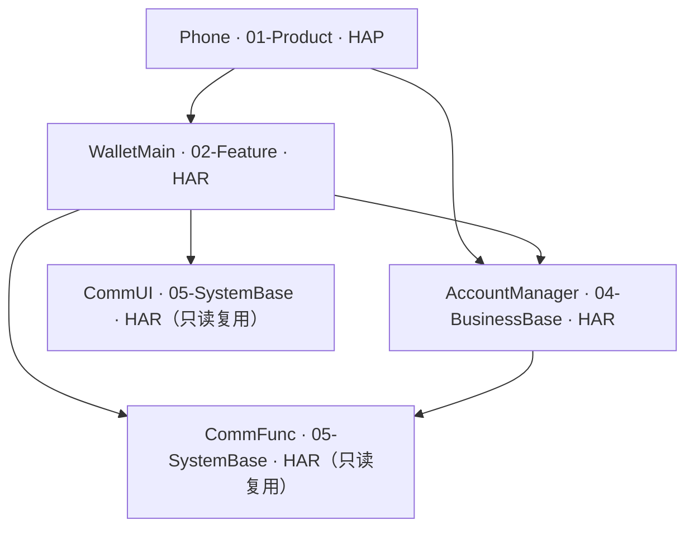
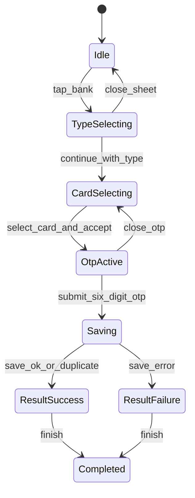
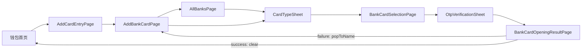
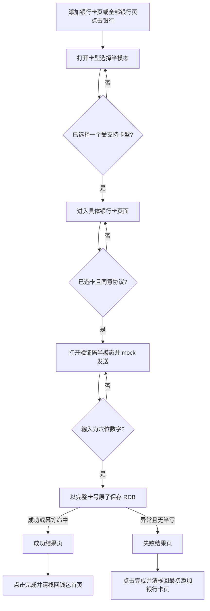

# Coding 阶段语义验证 — cu-YmMtb3BlbkNhcmQtMgBiYW5rLWNhcmQtb3BlbmluZy1mbG93

实施边界：以原始需求及有效更正中的真实限制、公共接口/数据契约和阶段职责为准。files、预计模块、私有名字/位置不是逐项许可；合法重组不要求创建空壳或回签预测。必须看实际 diff（含新增、删除、重命名）及必要源码，核对自然语言中的明确禁止；预测外模块的必要性、影响与回归依据在报告中显著披露。真实越权、公共契约违约或漏实现仍 FAIL，不能靠披露或登记齐全放行。

核对本次承诺的测试层级与生产入口一致：UT 驱动可隔离的真实业务状态/异常；UI、焦点和导航栈交设备。both 的两层互补，不要求 UT 实例化 UI，也不能只测 helper 冒充流程通过。L3 候选回原责任方；option_a 不批准降低当前验收。仅核当前材料，不新增一轮设计或额外门禁。

> 自动生成于 2026-10-24T19:16:39.781Z
> 本文件为 AI Harness 的 prompt，可发送给任意 AI 模型执行语义级验证。
>
> **Profile 语义补充**：实例若存在 `framework/profiles/<project_profile>/harness/prompts/verify-coding.overlay.md`，须与本正文**合并阅读**（宿主 toolchain 细则）。

## 一、你的角色

现代调用以附带的 resolved 输入及 binding 为对照：目标、契约、验收和真实源码；蓝图派生内容与物化输入等价，不因没有 spec.md/plan.md 降级。CU 的 design_refs、state_management runtime 链、组件资产选型须逐项对照真实实现。仅在输入确含叙述文档时检查其章节；缺必需契约或实现超出授权须 FAIL 并归因到设计责任方，经既有回退重签处理。

你是一名**独立的代码审查员**，专门负责宿主工程源代码的语义级质量验证。源码形态、组件模型与 toolchain 以 **`project_profile` 与 profile overlay** 为准；中性原则是对齐 Spec 与设计契约。你的任务是根据下方提供的 **Spec 规约**、**设计文档**和**源代码**，逐项评估编码阶段产出是否满足语义约束。

**关键原则：**
- 你独立于代码生成者，避免"自己验自己"的偏差
- 仅基于 Spec 和设计文档给出客观判定，不做主观偏好评价
- 脚本 Harness 已完成了确定性的结构检查（文件存在性、分层合规、资源引用等），你负责**脚本无法覆盖的语义级检查**
- 若证据不足以判定，标注为 WARN 而非强行判定

---

## 【HARD STOP — 不可绕过的产出约束】

> 以下约束是 coding 编码阶段的**红线**。违反任一条都应在最终报告的 `summary.verdict` 强制为 `FAIL`，并优先输出 `coding_compile_gate` 检查项。

1. **必须确认真实编译状态**：在评估任何其它语义检查项**之前**，先读取下方“四、脚本 Harness 检查结果”中的完整报告及同目录 `summary.json`（若存在）中的 `coding_run_status` / `run_statuses`。
2. **脚本未通过则语义不得 PASS**：若 `coding_run_status` 的 details 含 `can_claim_done: NO`，或 `coding_compile` / `coding_hvigor_build`（二者为同一 capability 的 canonical / legacy id）为 **FAIL**，或为 **SKIP** 且 severity 为 BLOCKER → **`summary.verdict` 必须为 `FAIL`**。不得因「错误在其它模块 / 非本 feature scope」而判 PASS。
3. **`coding_compile_gate`（BLOCKER）**：从脚本报告中摘录**第一条**编译错误（文件路径、行号、消息）；若 details 已列出「解析出 N 条 error」，取第一条。同时写明 `failure_kind`（如 `project_dependency_missing` / `project_dependency_undeclared` / `project_dependency_install_failed`）与 `summary.next_action`（若可读）。即使失败文件不在 `contracts.modules` 内，仍须 FAIL 并告知用户「全工程编译未通过，coding 阶段出口未满足」。
4. **禁止用 verifier PASS 代替脚本 harness**：父 agent 在脚本 harness 退出码非 0 或 `can_claim_done=NO` 时**不得**调用本子 agent；若已被误调用，你只输出 `coding_compile_gate: FAIL` 与其余项 WARN，最终 verdict 仍为 FAIL。

> 典型误读（须避免）：
> - 脚本 `coding_compile` FAIL 但 contracts/业务语义「看起来对」→ 仍 FAIL；
> - 「pre-existing 工程问题」→ 须向用户报告阻塞与 `next_action`，**不得**建议进入 code-review（Code Review）。

---

## 二、功能模块

- **模块名称**: cu-YmMtb3BlbkNhcmQtMgBiYW5rLWNhcmQtb3BlbmluZy1mbG93
- **阶段**: coding

---

## 三、Spec 规约内容

以下是 `framework/specs/phase-rules/coding-rules.yaml` 的完整内容，定义了编码阶段的通用约束规则：

```
phase: coding
version: "1.0"
applies_to: "{layer_dir}/{ModuleName}/src/main/ets/**/*.ets"
structure_checks:
  host_entry_reachability:
    description: >
      宿主入口可达性（visual-capability-truth S6/P1-G）：以 integration_points 为真源静态
      走查宿主入口→路由→feature 页面——入口未消费/路由缺失 → BLOCKER（页面孤岛在 review 前暴露，不等真机 TC-001
      才发现）。
  upstream_verdict_gate:
    description: >
      跨阶段负面裁决传播门禁（blind-visual-hardening d1）：coding 启动时消费上游 spec/plan
      summary.json 机器裁决——上游 verdict 非 PASS / blocker 未清 / 证据 stale|tampered →
      BLOCKER FAIL。
  resource_string_interpolation:
    description: >
      ArkTS 模板字符串内 `${$r(...)}` Resource 插值 lint（goal-fakepass-hardening t9）：
      Resource 对象进模板串渲染为 [object Object]（bc-openCard 卡包实锤）→ BLOCKER。 仅 hmos 系
      profile 生效。
  product_behavior_switch_scan:
    description: >
      产品源码测试性行为开关扫描（coding 期早警，与 testing 同门禁语义，见 testing-rules.yaml 同
      id）：命名命中且默认 true → BLOCKER；坐标级 waiver+receipt 仅降级 WARN
      且封顶。goal-fakepass-hardening t3。
  visible_text_whitelist:
    description: >
      P1-A（plan f2d8c4a6）：可见文案白名单——源码 Text()/Button() CJK 字面量与被
      $r('app.string.*') 引用的 string.json value 必须 ⊆ ui-spec/ref-elements 文本集 ∪
      豁免表 （coding/visible-text-exemptions.yaml，须非空 rationale，review 视觉维度逐条人审）。
      原图没有的文案不得无中生有（round6：zone 名脑补成「金融信息/设置与帮助」可见标题）。 pixel_1to1 →
      BLOCKER。非对称覆盖匹配（impl⊃spec 须占比 ≥80%，防短合法词漏放长脑补标题）。
    severity: BLOCKER
  visual_parity_unverified_crop:
    description: >
      P0-B 物化前置（plan f2d8c4a6）：crop 资产须 spec 阶段 asset_crop_validation 判 verified
      且 裁决绑定齐全（sha256/resolved_path/source_bbox 快照与当前一致，模块 media 副本 hash 一致）
      才可物化进 resources/base/media；报告缺失/旧格式/绑定漂移一律拦。pixel_1to1 → BLOCKER。
    severity: BLOCKER
  visual_parity_invisible_presence:
    description: >
      透明节点假 presence 拦截（2026-07-03，codex 发现的对抗模式）：spec 文本/资产/符号引用 （$r
      app.string/app.media/sys.symbol 或 CJK 字面量）挂在字面硬不可见节点
      （opacity(0)/visibility None|Hidden/width(0)+height(0)/fontSize(0)）＝骗静态
      presence/asset-render 扫描的作弊（round6 宿主实锤：bottomTabPresence 透明文本、三连零
      Image、透明 SymbolGlyph）。 pixel_1to1 → BLOCKER。仅判字面值（变量/动画绑定不判防误伤），漏报归 device
      OCR 存在性观测兜。
    severity: BLOCKER
  visual_parity_render:
    description: >
      v3 渲染忠实度（低置信，coding 源码静态）：P0 屏 action_button 声明 width_ratio(内联) 却源码全宽， 或
      variant=tonal 却 backgroundColor 高饱和实心 → WARN。形态保真主牙在 device
      visual_diff（#4）。
    severity: MAJOR
    rule:
      bundled_with: visual_parity
  structure_declaration_ledger:
    description: >
      台账记录结构声明的实现定位；缺项、过时定位或说明不完整仅作披露，不证明产品缺陷。 真实结构、交互和视觉仍由独立 review
      与适用设备验证；补登记不替代产品结果。
    severity: MAJOR
  file_completeness:
    description: |
      plan.md 的「目录/文件结构规划」中列出的所有 .ets 文件必须存在
    severity: BLOCKER
    rule:
      source: plan.md > 目录/文件结构规划
      check: all_files_exist_on_disk
  layer_compliance:
    description: >
      模块内 import 必须遵循 framework.config.json 中 architecture.module_inner_layers
      声明的依赖方向（upward：索引大的层 可依赖索引小的层，反之禁止）。实例工程通过修改 module_inner_layers
      来调整层集合与顺序；framework 本身不认识具体层名。
    severity: BLOCKER
    rule:
      source: framework.config.json > architecture.module_inner_layers
      for_each_file:
        layer: infer_from_path
        imports: extract_import_paths
        forbidden: derived_from_dsl
  inter_module_dependency:
    description: >
      模块间 import 必须遵循 framework.config.json 中
      architecture.outer_layers[].can_depend_on 声明的许可矩阵；同层内 依赖按 intra_layer_deps
      模式（forbid / dag / sublayer）裁决。 framework 只在启动时校验元规则（DAG、无自指、引用已声明层），
      具体层名由实例工程声明。
    severity: BLOCKER
    rule:
      source: framework.config.json > architecture.outer_layers
      for_each_import:
        source_module: infer_from_file_path
        target_module: infer_from_import_path
        validate: layer_dependency_matrix_from_dsl
  no_hardcoded_strings:
    description: >
      UI 层（presentation/）中的用户可见文本必须通过 $r('app.string.xxx') 引用资源文件，禁止硬编码中文或英文 UI
      文本
    severity: MAJOR
    rule:
      scope: presentation/**/*.ets
      detect: literal_string_in_ui_component
      exclude:
        - log_statements
        - constant_definitions_in_shared
        - test_files
  har_index_export:
    description: >
      每个 HAR / HSP 库模块必须存在由 framework.config.json 的
      architecture.cross_module_exports_file 声明的跨模块导出入口文件 （实例默认通常为
      index.ets）。入口物理路径以各模块 oh-package.json5 的 main 字段为准（可为模块根 index.ets 或
      src/main/ets/index.ets 等）； 文件名 stem 须与 cross_module_exports_file
      一致（大小写不敏感）。 对外暴露的 class/interface/function 应在该文件中 export。
    severity: BLOCKER
    rule:
      source: framework.config.json > architecture.cross_module_exports_file
      for_each_har_module:
        expect_file_exists: $cross_module_exports_file
        validate: public_api_exported
  module_config_registered:
    description: >
      每个新增模块必须在根目录 build-profile.json5 的 modules[] 中注册， srcPath 使用层目录前缀格式（如
      "./05-SystemBase/CommFunc"）
    severity: BLOCKER
    rule:
      source: plan.md > 模块变更摘要
      filter: change_type in ["新增"]
      validate:
        - build_profile_has_entry
        - src_path_format: ./{layer_dir}/{ModuleName}
  oh_package_dependencies:
    description: >
      模块的 oh-package.json5 中声明的依赖必须与五层架构依赖规则一致， 依赖路径使用层目录相对路径。Harness
      匹配时除模块名外，亦认可 ohpm 包名（如 @wallet/common-functions）与 file: 相对路径指向 目标模块目录的声明。
    severity: BLOCKER
    rule:
      for_each_module:
        file: oh-package.json5
        validate:
          - dependencies_match_layer_rules
          - path_format_any_of:
              - file:../{layer_dir}/{ModuleName}
              - file:./{layer_dir}/{ModuleName}
  page_registration:
    description: >
      所有 NavDestination 页面必须在对应模块的 main_pages.json 中注册； 使用系统路由表时必须在
      route_map.json 中配置
    severity: BLOCKER
    rule:
      for_each_page_file:
        scope: presentation/pages/*.ets
        validate: registered_in_main_pages_json
  naming_conventions:
    description: >
      命名规范：
        - 模块名: PascalCase（参考示例：FeatureAlpha、CommFunc 等，实际按本工程 doc/architecture.md 为准）
        - 组件 struct 名: PascalCase，与文件名一致（导出入口文件见下条例外）
        - 文件名: PascalCase.ets（如 HomeTabPage.ets、CardRepository.ets）；
          例外：`architecture.cross_module_exports_file` 所指的入口文件名
         （常为 index.ets，大小写因工程而异）不要求 PascalCase，且不强制该文件内
          @Component struct 名与入口 basename 一致
        - 资源 key: snake_case（如 app.string.tab_home）
    severity: MAJOR
    rule:
      checks:
        - module_dir_name: PascalCase
        - struct_name: PascalCase, matches_filename
        - ets_filename: PascalCase
        - resource_key: snake_case
  no_any_type:
    description: |
      代码中不允许使用 any 类型（TypeScript/ArkTS 严格类型约束）
    severity: MAJOR
    rule:
      for_each_file:
        detect_any_of:
          - :\s*any\b
          - as\s+any\b
          - <any>
  async_await_pattern:
    description: |
      异步操作必须使用 async/await，不允许裸 Promise 回调链（.then().catch()）
    severity: MINOR
    rule:
      detect_any_of:
        - .then(
        - .catch(
      exclude:
        - Promise.all
        - Promise.race
  arkui_bindsheet_double_close:
    description: >
      bindSheet builder 内自定义 sys.symbol.xmark/自绘关闭按钮时，options 须显式 showClose:
      false， 否则与系统关闭按钮重叠（双 X）。豁免：// arkui-lint:allow
      arkui_bindsheet_double_close
    severity: BLOCKER
  arkui_push_without_guard:
    description: >
      onChange/@Watch/syncFromFlow 回调内直接 pushPath 须有一次性消费 guard，避免重复拉起 Sheet/页面。
      豁免：// arkui-lint:allow arkui_push_without_guard
    severity: MAJOR
  arkui_singleton_flow_multi_subscriber:
    description: >
      多个 NavDestination/组件不得订阅同一 singleton Flow 的 showXSheet 状态重复展示 Sheet。 豁免：//
      arkui-lint:allow arkui_singleton_flow_multi_subscriber
    severity: MAJOR
  arkui_clip_overlap_risk:
    description: >
      a1 渲染陷阱低置信启发式：Swiper/Grid 含 Image 且固定矮高度(≤100vp) → 裁切；Swiper
      displayCount≥2 / prev·nextMargin → 单 banner 叠帧；Stack 内 Image+Text 绝对定位未
      .clip(true) → 重叠/溢出。 WARN（以 device visual_diff 为准）。豁免：// arkui-lint:allow
      arkui_clip_overlap_risk
    severity: MAJOR
  coding_compile:
    description: >
      宿主编译闭环（canonical id: coding_compile，历史别名 coding_hvigor_build）： 对
      contracts.yaml 声明的业务模块执行 profile 配置的真实构建任务，zero error 才通过。 工具链由
      project_profile 的 coding.compile 能力声明；缺失时 FAIL（不 SKIP）。 环境变量
      HARNESS_SKIP_HVIGOR=1 显式跳过编译时仍 FAIL，防止静默绕过出口。
    severity: BLOCKER
    rule:
      scope: contracts.yaml > modules[].name
      canonical_id: coding_compile
      legacy_id: coding_hvigor_build
  coding_hvigor_build:
    description: |
      （别名）与 coding_compile 相同；保留 id 供历史报告/消费方兼容。
    severity: BLOCKER
    rule:
      alias_of: coding_compile
  named_business_handler:
    description: >
      use-cases.yaml > ui_bindings[].user_actions[].calls 引用的每个业务入口，
      必须在代码中以**命名符号**形式存在。v2.2 放宽：合法形态包括
        (1) 传统 `function xxx` / `async function xxx`；
        (2) 顶层 `export const|let|var|function|class xxx`；
        (3) 类/接口方法 `xxx(...)[:{]`；
        (4) ArkTS 类字段函数 / 命名 const 赋值：
            `xxx = () => {}` / `xxx = async () => {}` / `xxx = function() {}` /
            `xxx: () => void = () => {}` / `const xxx = () => {}`。
      仅**匿名**直接挂载到 UI 事件（`.onClick(() => { ... })`）的写法不合法—— 它没有稳定符号名，UT 无法直接调用。
      若 `use-cases.yaml` 不存在则 SKIP（简单 feature 由 acceptance.yaml + dag.yaml 主导）。
    severity: BLOCKER
    rule:
      source: <features_dir>/{feature}/use-cases.yaml >
        use_cases[].ui_bindings[].user_actions[].calls
      for_each_call:
        extract_symbol: split('.') 的最后一段
        validate_any_of:
          - match_regex: \bfunction\s+{symbol}\b
          - match_regex: \bexport\s+(function|const|let|var|class)\s+{symbol}\b
          - match_regex: (?:^|[\s;{}])(?:async\s+)?{symbol}\s*(?:<[^>]*>\s*)?\([^)]*\)\s*(?::\s*[^={;\n]+)?[:{]
          - match_regex: (?:^|[\s;{}])(?:(public|private|protected|readonly|static|const|let|var)\s+)*{symbol}\b(\s*:\s*[^\n{;]+?)?\s*=(?!>)\s*(async\s+)?(function\b|\([^)]*\)\s*(?::\s*[^\n{=]+?)?\s*=>|[A-Za-z_$][\w$]*\s*=>)
      scope_search:
        - 02-Feature/**/src/main/ets/**/*.ets
        - 01-Business/**/src/main/ets/**/*.ets
        - 00-Common/**/src/main/ets/**/*.ets
        - "{coordinator_file if declared}"
  coordinator_file_exists_if_declared:
    description: >
      若 use-cases.yaml 为某 use_case 声明了 `coordinator_file`（表示业务编排 以独立类 /
      独立文件承载，而非 Page 内方法），则该文件必须真实存在。 不强制文件落在 `domain/usecase/` 下——可以是
      `domain/flow/` / `shared/` / `presentation/pages/`（仅当 coordinator 指向 Page
      方法时可省略本字段）。
    severity: BLOCKER
    rule:
      source: <features_dir>/{feature}/use-cases.yaml > use_cases[].coordinator_file
      validate: file_exists_on_disk
  visual_parity:
    description: >
      coding 背板（v2.4+）：仅 C2 节点→token 语义色绑定 + C3 must_have_elements presence。
      pixel_1to1 下未命中 → BLOCKER/FAIL。保真主信号见 static_fidelity_score 与 device
      visual_diff。
    severity: MAJOR
    rule:
      provider: coding.visual_parity
      enforcement_config: framework.config.json#coding.visual_parity_enforcement
  static_fidelity_score:
    description: >
      静态保真分：语义色绑定 / 文案 / 资产覆盖（pixel_1to1 含 placeholder 计入分母）/ 结构序。 pixel_1to1 下
      WARN 升 BLOCKER。几何 IoU 归 device visual_diff。
    severity: MAJOR
    rule:
      bundled_with: visual_parity
  visual_parity_asset_render:
    description: >
      s1 asset 真渲染（低置信）：节点声明 asset_ref/icon.ref 但映射 struct/源码未 $r 引用对应 media →
      WARN（如 #6：tab 声明图标却仅渲染文字）。动态渲染可漏判，以 device visual_diff 为准。
      review#4：pixel_1to1 下「声明 asset_ref 却未真实渲染」(not_rendered) 升 BLOCKER；显式
      placeholder 豁免仍 WARN。
    severity: MAJOR
    rule:
      bundled_with: visual_parity
  visual_parity_asset_materialized:
    description: >
      B 承重门禁：被 $r('app.media.<key>')
      引用的【模块实际】media（<module>/src/main/resources/base/media） 必须是真图，禁
      1×1/退化占位冒充（Q2 三信号取或：尺寸 w/h≤2 ｜ 字节<256B ｜ 面积比<5% 相对 resolved_path 真裁图）。 绝不信
      contracts.resource_keys.path / 工程根 media/（已知绕过点，归 F）。退化判定走无 jimp 路径——
      pixel_1to1 下 jimp 不可用也判、不 SKIP（Q4）。pixel_1to1 → BLOCKER/FAIL；否则
      MAJOR/WARN。
    severity: MAJOR
    rule:
      bundled_with: visual_parity
  visual_parity_asset_baked_text:
    description: >
      round5 P0-A 承重门禁：被 $r 引用的非 placeholder 素材图不得烤入该屏 ui-spec 声明文本节点
      （=整段界面当背景大图，致 coding 贴大图又搭真组件的双渲染/烤字）。OCR 素材真图、模糊比对声明文本， 命中 ≥2 个 →
      BLOCKER（pixel_1to1）/WARN（否则）。FP 校准：单品牌 logo 仅 1 个品牌名(<2)→PASS； 装饰/艺术文本不进
      ui-spec text 节点。legacy asset.baked_text_defer/署名只读且不放行； required
      命中必须修复或由当前机器证据重验，能力缺失按既有 capability defer。
    severity: MAJOR
    rule:
      bundled_with: visual_parity
  visual_parity_ocr_unavailable:
    description: >
      round5 P0-A/X4：OCR 是烤字门禁唯一承重探测；pixel_1to1 下不可用/失败（tesseract.js 未装/chi_sim
      未物化/ 素材图 OCR 失败）→ 不得 WARN 放行，升 BLOCKER 且归
      toolchain（goal-failure-classifier，指向"修 OCR 环境"、 signature 重复即
      halt，不吃视觉预算）。非 pixel_1to1 → WARN。
    severity: MAJOR
    rule:
      bundled_with: visual_parity
  visual_parity_icon_substitution:
    description: >
      round5 P0-B（Q5 已采纳）：ui-spec 显式声明 required 图标 asset 的元素、源码却用
      sys.symbol.*/$r('sys.*') 静默替代 → pixel_1to1 BLOCKER；显式 placeholder/defer
      仍须按 release-required 质量轴处理，legacy human_signed 不放行；非 pixel_1to1 或仅风格偏差 →
      WARN。 覆盖全局/跨屏元素（底部 tab 图标）。命门＝spec/plan 须把参考图彩色/品牌图标声明为 required
      asset（漏声明=漏报，可接受）。
    severity: MAJOR
    rule:
      bundled_with: visual_parity
  visual_parity_variant_decl:
    description: >
      a2 通用 spec 质量（低优先）：pixel_1to1 P0 屏 action_button 须声明合法 variant
      （filled|tonal|outlined|ghost|text）→ 缺/非法时 WARN。非 homepage 修复路径，引入期 WARN。
    severity: MAJOR
    rule:
      bundled_with: visual_parity
semantic_checks:
  business_logic_correctness:
    description: |
      代码逻辑是否正确实现了 plan.md 描述的业务流程， 包括数据流转、状态变更、页面跳转
    severity: MAJOR
    ai_prompt_hint: >
      对比 plan.md 的服务层接口和页面组件树，逐个检查： (1) Repository 方法是否按设计返回正确数据； (2)
      页面组件是否按组件树结构组织； (3) 状态管理是否使用了设计指定的装饰器
  error_handling_completeness:
    description: |
      spec 中定义的异常场景是否都有对应的代码处理逻辑
    severity: MAJOR
    ai_prompt_hint: |
      读取 spec 的异常场景表，逐条检查代码中是否有对应的处理： 如网络异常→是否有 try/catch 或降级逻辑； 数据为空→是否有空状态 UI
  interface_signature_consistency:
    description: |
      代码中实际实现的 class/interface 方法签名必须与 plan.md 定义一致， 包括方法名、参数类型、返回类型
    severity: BLOCKER
    ai_prompt_hint: |
      逐一对比 plan.md 中的接口定义和实际代码中的实现， 标出签名不一致的地方
  component_props_consistency:
    description: |
      组件的 @Prop/@Link/@State 声明必须与 plan.md 的组件接口定义一致
    severity: MAJOR
    ai_prompt_hint: |
      对比 plan.md 组件树中定义的 Props 和实际代码中的装饰器声明
  data_ownership_compliance:
    description: |
      业务数据的增删改查必须通过 Repository，presentation 层不允许 直接操作数据源（如直接访问 AppStorage 写业务数据）
    severity: MAJOR
    ai_prompt_hint: |
      检查 presentation 层代码是否存在绕过 Repository 直接操作数据的情况
  simulation_data_isolation:
    description: |
      模拟数据应封装在 data/repository 层内部， presentation 层不应感知数据是真实的还是模拟的
    severity: MINOR
    ai_prompt_hint: |
      检查模拟数据是否都在 Repository 中封装，上层代码是否与数据来源解耦
  coding_constraint_landing:
    description: >
      应用域约束在本阶段的落实须体现在代码里：读 doc/extensions/knowledge/constraints/README.md
      的适用矩阵，取 coding 那一列， 逐个非「—」的格子核对——该域是否已按格子写明的维度真正落到本次 diff 的代码/资源/配置中
      （不是在文档里再声明一遍）。命中判据与具体条目以该域文件为准。 与 profile 自带编码规范重复的部分以规范为准，不重复要求。
      矩阵中标「—」的域本阶段不消费。
    severity: MAJOR
    ai_prompt_hint: >
      打开 doc/extensions/knowledge/constraints/README.md 找到适用矩阵，记下 coding 列
      所有非「—」的域及其消费维度。对照本次变更涉及的文件逐域核对：该维度对应的落法 在代码里能指出具体位置吗（资源文件、配置项、调用点、清理逻辑等）。
      **只在文档里写「已考虑」而代码无对应落点的，即 FAIL**——本阶段的证据是代码本身。
      域文件给出具体落法（API、资源机制、配置字段）的，按其落法核对； 只给方向没给落法的，核对是否有等效实现并说明。
traceability_checks:
  coding_existing_test_preserved:
    severity: BLOCKER
    description: 本次实现引发的既有测试兼容修补保留原用例定义与断言，不新增测试、断言或跳过声明；真实原件或解析无法确认时交 UT 核验。
  component_asset_selection:
    severity: BLOCKER
    description: 组件资产检查；语义见 docs/concepts/component-assets.md。
  component_asset_projection:
    severity: BLOCKER
    description: 组件资产检查；语义见 docs/concepts/component-assets.md。
  component_export_registered:
    severity: BLOCKER
    description: 组件资产检查；语义见 docs/concepts/component-assets.md。
  component_new_static_checks:
    severity: BLOCKER
    description: 组件资产检查；语义见 docs/concepts/component-assets.md。
  component_uncurated:
    severity: MAJOR
    description: 组件资产检查；语义见 docs/concepts/component-assets.md。
  change_unit_feature_projection:
    description: CU-bound Feature 的 predicate/provide/design-ref
      映射须落到真实施工文件与测试，运行时只读 state_management 真源
    severity: BLOCKER
  ui_diff_within_declared_files:
    description: >
      对实际 UI diff 核验原请求真实边界和阶段职责；contracts.files 与预计模块不作许可。
      保留出生基线、真实绑定和删除/重命名的基线侧识别，必要私有实现调整由 review/真机核验。
    severity: BLOCKER
  plan_to_code:
    description: |
      plan.md 的「spec 功能映射表」中每行的「关键文件」路径 在代码工程中必须存在对应的文件
    severity: BLOCKER
    rule:
      source: plan.md > spec 功能映射表.关键文件
      check: file_exists_on_disk
  plan_file_to_code:
    description: |
      plan.md 的「目录/文件结构规划」中列出的每个文件路径 都必须在代码工程中存在
    severity: BLOCKER
    rule:
      source: plan.md > 目录/文件结构规划
      extract: all_file_paths
      check: all_exist_on_disk
  code_to_plan:
    description: |
      代码工程中新增的 .ets 文件（非资源/配置）应能在 plan.md 中 找到对应规划，不允许存在 plan.md 中未规划的新文件
    severity: MAJOR
    rule:
      source: new_ets_files_in_module
      target: plan.md > 目录/文件结构规划
      coverage: 100%
  spec_acceptance_to_code:
    description: |
      spec 中 P0/P1 的验收标准（AC 项）应能在代码中找到对应的实现逻辑
    severity: MAJOR
    ai_prompt_hint: |
      逐条审查 spec 的 P0/P1 验收标准，判断代码中是否有对应的功能实现
  diff_within_scope:
    description: >
      git diff 中涉及的所有位于架构层目录下（由 framework.config.json 的 outer_layers[].id
      构造的顶层前缀集合）的文件，其路径前缀必须属于 plan.in_scope_modules 对应的 package_path 之一。 越界文件即
      BLOCKER，用于阻止 coding 默默扩大改动范围。 非模块文件（doc/、specs/、skills/、harness/、adapter
      在实例根落地的点号开头配置目录、根配置等） 视为框架性变更，不纳入本检查。
    severity: BLOCKER
    rule:
      source: plan.md > Scope 声明与继承 > yaml.in_scope_modules
      layer_prefixes: framework.config.json > architecture.outer_layers[].id
      module_paths: contracts.yaml > modules[].package_path
      diff_base_ref: 未设置时默认 working（当前工作区/暂存/未跟踪 vs HEAD）；$HARNESS_DIFF_BASE_REF 可设为
        HEAD~1、分支名或 SHA 以纳入已提交差异
      validate: all(changed_files, f => not_under_layer_dir(f) or
        f.starts_with_any(allowed_package_paths))
exploration_thresholds:
  min_files_inspected: 6
  min_source_code_paths: 3
  min_searches: 4
  min_code_facts: 3
  require_subagent_when_contract_files_gt: 5
  exploration_mode_allowed:
    - subagent
    - sequential
exploration_strategy:
  default_mode: subagent
  trivial_exemption:
    enabled: true
    conditions_any:
      - intent:
          - rename
          - extract_function
          - move_file
          - typo_fix
      - prd_loc_delta_lt: 30
      - single_function_scope: true
  scoring:
    threshold: 60
    dimensions:
      - id: module_loc
        weight: 25
        tiers:
          - gte: 50000
            score: 25
          - gte: 20000
            score: 15
          - gte: 5000
            score: 8
      - id: scope_breadth
        weight: 20
        tiers:
          - gte: 3
            score: 20
          - gte: 2
            score: 12
          - gte: 1
            score: 5
      - id: cross_layer
        weight: 20
        signal: touches_multiple_outer_layers
        score_if_true: 20
      - id: new_api_surface
        weight: 15
        signal: adds_exports_or_public_api
        score_if_true: 15
      - id: dependency_fan_out
        weight: 20
        tiers:
          - gte: 10
            score: 20
          - gte: 5
            score: 12
          - gte: 2
            score: 5
  sequential_multiplier: 2
  sequential_min_files_inspected_add: 5

```

---

## 四、脚本 Harness 检查结果

以下是脚本 Harness (`check-coding.ts`) 已完成的确定性检查报告。你无需重复检查这些项目，但应参考其结果辅助语义判断（例如：若脚本报告某些文件缺失，你的语义验证也应考虑这一缺失的影响）：

```
{
  "phase": "coding",
  "feature": "cu-YmMtb3BlbkNhcmQtMgBiYW5rLWNhcmQtb3BlbmluZy1mbG93",
  "timestamp": "2026-10-24T19:16:34.177Z",
  "project_root": "D:\\1.code\\SimulatedWalletForHmos",
  "assurance": "full",
  "capability_resolutions": [
    {
      "id": "capability_coding_context",
      "axis": "functional",
      "active": true,
      "state": "resolved",
      "on_missing": "fail",
      "applicability_provider_id": "applicability.always",
      "applicability_dependencies": [],
      "inputs": [
        {
          "id": "requirement",
          "state": "resolved",
          "selected_source": "derive.requirement",
          "selected_source_fingerprint": "e928a0a262b03ba2a234b2dd522ce4f713be8217455039159d41956be9072ac9",
          "binding": {
            "input_id": "requirement",
            "source": {
              "kind": "derive",
              "provider_id": "derive.requirement"
            },
            "dependencies": [
              {
                "path": "D:\\1.code\\SimulatedWalletForHmos\\doc\\features\\原始需求\\1-2-银行卡\\原始需求.md",
                "exists": true,
                "sha256": "2a6bbd10d4ff297ad9b23670ba0e302f5feef7cc0757e43dd7b04ae909052300",
                "role": "derive"
              }
            ],
            "source_refs": [
              "doc/features/原始需求/1-2-银行卡/原始需求.md"
            ],
            "content_fingerprint": "e928a0a262b03ba2a234b2dd522ce4f713be8217455039159d41956be9072ac9"
          },
          "attempts": [
            {
              "kind": "derive",
              "source": "derive.requirement",
              "state": "resolved",
              "dependencies": [
                {
                  "path": "D:\\1.code\\SimulatedWalletForHmos\\doc\\features\\原始需求\\1-2-银行卡\\原始需求.md",
                  "exists": true,
                  "sha256": "2a6bbd10d4ff297ad9b23670ba0e302f5feef7cc0757e43dd7b04ae909052300",
                  "role": "derive"
                }
              ]
            }
          ]
        },
        {
          "id": "codebase",
          "state": "resolved",
          "selected_source": "derive.codebase",
          "selected_source_fingerprint": "ef00b999011c756a17b4c7780bb32b32e022e4767a4457aecb53bad641a73447",
          "binding": {
            "input_id": "codebase",
            "source": {
              "kind": "derive",
              "provider_id": "derive.codebase"
            },
            "dependencies": [
              {
                "path": "D:\\1.code\\SimulatedWalletForHmos\\01-Product\\Phone\\src\\main\\ets\\navigation\\WalletDestinationRegistry.ets",
                "exists": true,
                "sha256": "248d0e20be41280480b38d4a71fde6ba3996b2a4a7087393e89730a76165629f",
                "role": "derive"
              },
              {
                "path": "D:\\1.code\\SimulatedWalletForHmos\\01-Product\\Phone\\src\\main\\ets\\pages\\index.ets",
                "exists": true,
                "sha256": "c3e17ad03316367064f60cab14d49481eaa5a2d551ba41bad24e6f1a16e6c8e5",
                "role": "derive"
              },
              {
                "path": "D:\\1.code\\SimulatedWalletForHmos\\02-Feature\\WalletMain\\src\\main\\ets\\data\\model\\BankCardCandidate.ets",
                "exists": true,
                "sha256": "238a6b9bebac812a23f666d32e6d6b69af1309c84a7056c302323309b5cc1f10",
                "role": "derive"
              },
              {
                "path": "D:\\1.code\\SimulatedWalletForHmos\\02-Feature\\WalletMain\\src\\main\\ets\\data\\model\\BankInfo.ets",
                "exists": true,
                "sha256": "44e0db74c0bac252e63a0da69af0aa986dec35c5132daf4be089ad50a3904992",
                "role": "derive"
              },
              {
                "path": "D:\\1.code\\SimulatedWalletForHmos\\02-Feature\\WalletMain\\src\\main\\ets\\data\\model\\BankOpeningCompletionContext.ets",
                "exists": true,
                "sha256": "619ba798be856082f337f52482d06ff7bf9b8f314febcbc33f01765e6e4f89ac",
                "role": "derive"
              },
              {
                "path": "D:\\1.code\\SimulatedWalletForHmos\\02-Feature\\WalletMain\\src\\main\\ets\\data\\model\\OpeningResult.ets",
                "exists": true,
                "sha256": "7aef81041f69bcee34c401167d41ef36fd4e8f956d138cfa446304afd3a0f625",
                "role": "derive"
              },
              {
                "path": "D:\\1.code\\SimulatedWalletForHmos\\02-Feature\\WalletMain\\src\\main\\ets\\data\\model\\StoredCard.ets",
                "exists": true,
                "sha256": "91f0e5ebc47d7524f4892824d72767feb0863ae429928aa98f2423c1afe7cf94",
                "role": "derive"
              },
              {
                "path": "D:\\1.code\\SimulatedWalletForHmos\\02-Feature\\WalletMain\\src\\main\\ets\\data\\repository\\BankCardRepository.ets",
                "exists": true,
                "sha256": "e37016f70b00692092d863bcb5186c9d1e8bfe446f8d28c653b29a36fdf9ea78",
                "role": "derive"
              },
              {
                "path": "D:\\1.code\\SimulatedWalletForHmos\\02-Feature\\WalletMain\\src\\main\\ets\\data\\repository\\BankRepository.ets",
                "exists": true,
                "sha256": "45e35adb9536871ae95b18228bed2871bc42d4be342a1c000ccd040880ef1e35",
                "role": "derive"
              },
              {
                "path": "D:\\1.code\\SimulatedWalletForHmos\\02-Feature\\WalletMain\\src\\main\\ets\\domain\\service\\BankCardOpeningService.ets",
                "exists": true,
                "sha256": "8b022f1ee0020e880b1bb799f2beb914d2d60c33f0da9dde41c187f7200af41b",
                "role": "derive"
              },
              {
                "path": "D:\\1.code\\SimulatedWalletForHmos\\02-Feature\\WalletMain\\src\\main\\ets\\domain\\service\\OpeningNavigationService.ets",
                "exists": true,
                "sha256": "c517e8551ee64be83792c9fb42370cd439f89bec4dfbffaec119ff9257bee088",
                "role": "derive"
              },
              {
                "path": "D:\\1.code\\SimulatedWalletForHmos\\02-Feature\\WalletMain\\src\\main\\ets\\domain\\service\\OtpService.ets",
                "exists": true,
                "sha256": "bbe518fdc1bbd88e60b98a96eacc7fef4759028d7e232ba189097e593665319f",
                "role": "derive"
              },
              {
                "path": "D:\\1.code\\SimulatedWalletForHmos\\02-Feature\\WalletMain\\src\\main\\ets\\index.ets",
                "exists": true,
                "sha256": "7a854693ef4c516d125b47eeff71115a65641cd46d6ee0d5950cff308829992f",
                "role": "derive"
              },
              {
                "path": "D:\\1.code\\SimulatedWalletForHmos\\02-Feature\\WalletMain\\src\\main\\ets\\presentation\\components\\CardTypeSheet.ets",
                "exists": true,
                "sha256": "2fd3f5d09e53f7b4fac275c5b7f0a59d103d37bc0e577eb51a84d051a5a3e3a4",
                "role": "derive"
              },
              {
                "path": "D:\\1.code\\SimulatedWalletForHmos\\02-Feature\\WalletMain\\src\\main\\ets\\presentation\\components\\OtpVerificationSheet.ets",
                "exists": true,
                "sha256": "e0376d1aa4396c11d37c2cf2b412b2e38affc5b32edc3bafa5496ad1130664d3",
                "role": "derive"
              },
              {
                "path": "D:\\1.code\\SimulatedWalletForHmos\\02-Feature\\WalletMain\\src\\main\\ets\\presentation\\pages\\AddBankCardPage.ets",
                "exists": true,
                "sha256": "e2a1d6d06e959661848ae2b064c5fdb629481c1b2d409a85d22574b98d3ddba5",
                "role": "derive"
              },
              {
                "path": "D:\\1.code\\SimulatedWalletForHmos\\02-Feature\\WalletMain\\src\\main\\ets\\presentation\\pages\\AllBanksPage.ets",
                "exists": true,
                "sha256": "f822d14033e00d59c2b2c9987631e10d6fd3e1683a13d6728aded8a8ac13ea94",
                "role": "derive"
              },
              {
                "path": "D:\\1.code\\SimulatedWalletForHmos\\02-Feature\\WalletMain\\src\\main\\ets\\presentation\\pages\\BankCardOpeningResultPage.ets",
                "exists": true,
                "sha256": "d9589422aca3f459574dc9a590f3df347cd29521fe25151a7eb2581102f0561e",
                "role": "derive"
              },
              {
                "path": "D:\\1.code\\SimulatedWalletForHmos\\02-Feature\\WalletMain\\src\\main\\ets\\presentation\\pages\\BankCardSelectionPage.ets",
                "exists": true,
                "sha256": "5be74f8de46fa24b27f553a4d2bea52a4d64876cdd82b1e8e64fa6337606dfc4",
                "role": "derive"
              },
              {
                "path": "D:\\1.code\\SimulatedWalletForHmos\\02-Feature\\WalletMain\\src\\main\\ets\\presentation\\pages\\HomeTabPage.ets",
                "exists": true,
                "sha256": "b51d01ec291ec7ac6bc22caa01a36a3dd0f58e6540845ab7e4dd10fcd4d21d75",
                "role": "derive"
              },
              {
                "path": "D:\\1.code\\SimulatedWalletForHmos\\02-Feature\\WalletMain\\src\\main\\ets\\shared\\constant\\BankConstants.ets",
                "exists": true,
                "sha256": "eae748f4a6f58e86682d60e7f8aab7e7965e49fd7dff54aa91ba3546cb642a0b",
                "role": "derive"
              },
              {
                "path": "D:\\1.code\\SimulatedWalletForHmos\\02-Feature\\WalletMain\\src\\main\\resources\\base\\element\\color.json",
                "exists": true,
                "sha256": "5216bc6304a96e40a42fe8d20bba3f608626f86d29fd896f52cbac6b9f1b11f4",
                "role": "derive"
              },
              {
                "path": "D:\\1.code\\SimulatedWalletForHmos\\02-Feature\\WalletMain\\src\\main\\resources\\base\\element\\float.json",
                "exists": true,
                "sha256": "691295c683cf1d199c7e0cf0ef04f9e0cc61005c6fb742202ace6cb488fd74fd",
                "role": "derive"
              },
              {
                "path": "D:\\1.code\\SimulatedWalletForHmos\\02-Feature\\WalletMain\\src\\main\\resources\\base\\element\\string.json",
                "exists": true,
                "sha256": "81643574376adafbfbe0ab2b276c267677bf1a4c24257278440c352079ee9394",
                "role": "derive"
              },
              {
                "path": "D:\\1.code\\SimulatedWalletForHmos\\02-Feature\\WalletMain\\src\\main\\resources\\base\\media\\result_payment_guide_placeholder.png",
                "exists": true,
                "sha256": "e8155a66f7476b56e571d74b4774aa0e5c6a5ed57f24458227008e3d3fb65228",
                "role": "derive"
              },
              {
                "path": "D:\\1.code\\SimulatedWalletForHmos\\02-Feature\\WalletMain\\src\\main\\resources\\base\\profile\\route_map.json",
                "exists": true,
                "sha256": "51eb86e3a1e902c622192477713d15020308585fe612378ba873ace5d5bc33db",
                "role": "derive"
              },
              {
                "path": "D:\\1.code\\SimulatedWalletForHmos\\04-BusinessBase\\AccountManager\\src\\main\\ets\\data\\model\\UserProfile.ets",
                "exists": true,
                "sha256": "043b16cd29f489a03b8ae7b742df4974d48436845437064325e207d6a1ba8b55",
                "role": "derive"
              },
              {
                "path": "D:\\1.code\\SimulatedWalletForHmos\\04-BusinessBase\\AccountManager\\src\\main\\ets\\domain\\service\\AccountService.ets",
                "exists": true,
                "sha256": "0e97cba80995bbafaf7bdbcfae6ef44f25079e1775e609a7fe530716018b84b6",
                "role": "derive"
              },
              {
                "path": "D:\\1.code\\SimulatedWalletForHmos\\04-BusinessBase\\AccountManager\\src\\main\\ets\\index.ets",
                "exists": true,
                "sha256": "4f41856f439aeb2b26f8e748ad39992dbc1dbb049608c503e7867804a4e95662",
                "role": "derive"
              }
            ],
            "source_refs": [
              "01-Product/Phone/src/main/ets/navigation/WalletDestinationRegistry.ets",
              "01-Product/Phone/src/main/ets/pages/index.ets",
              "02-Feature/WalletMain/src/main/ets/data/model/BankCardCandidate.ets",
              "02-Feature/WalletMain/src/main/ets/data/model/BankInfo.ets",
              "02-Feature/WalletMain/src/main/ets/data/model/BankOpeningCompletionContext.ets",
              "02-Feature/WalletMain/src/main/ets/data/model/OpeningResult.ets",
              "02-Feature/WalletMain/src/main/ets/data/model/StoredCard.ets",
              "02-Feature/WalletMain/src/main/ets/data/repository/BankCardRepository.ets",
              "02-Feature/WalletMain/src/main/ets/data/repository/BankRepository.ets",
              "02-Feature/WalletMain/src/main/ets/domain/service/BankCardOpeningService.ets",
              "02-Feature/WalletMain/src/main/ets/domain/service/OpeningNavigationService.ets",
              "02-Feature/WalletMain/src/main/ets/domain/service/OtpService.ets",
              "02-Feature/WalletMain/src/main/ets/index.ets",
              "02-Feature/WalletMain/src/main/ets/presentation/components/CardTypeSheet.ets",
              "02-Feature/WalletMain/src/main/ets/presentation/components/OtpVerificationSheet.ets",
              "02-Feature/WalletMain/src/main/ets/presentation/pages/AddBankCardPage.ets",
              "02-Feature/WalletMain/src/main/ets/presentation/pages/AllBanksPage.ets",
              "02-Feature/WalletMain/src/main/ets/presentation/pages/BankCardOpeningResultPage.ets",
              "02-Feature/WalletMain/src/main/ets/presentation/pages/BankCardSelectionPage.ets",
              "02-Feature/WalletMain/src/main/ets/presentation/pages/HomeTabPage.ets",
              "02-Feature/WalletMain/src/main/ets/shared/constant/BankConstants.ets",
              "02-Feature/WalletMain/src/main/resources/base/element/color.json",
              "02-Feature/WalletMain/src/main/resources/base/element/float.json",
              "02-Feature/WalletMain/src/main/resources/base/element/string.json",
              "02-Feature/WalletMain/src/main/resources/base/media/result_payment_guide_placeholder.png",
              "02-Feature/WalletMain/src/main/resources/base/profile/route_map.json",
              "04-BusinessBase/AccountManager/src/main/ets/data/model/UserProfile.ets",
              "04-BusinessBase/AccountManager/src/main/ets/domain/service/AccountService.ets",
              "04-BusinessBase/AccountManager/src/main/ets/index.ets"
            ],
            "content_fingerprint": "ef00b999011c756a17b4c7780bb32b32e022e4767a4457aecb53bad641a73447"
          },
          "attempts": [
            {
              "kind": "derive",
              "source": "derive.codebase",
              "state": "resolved",
              "dependencies": [
                {
                  "path": "D:\\1.code\\SimulatedWalletForHmos\\01-Product\\Phone\\src\\main\\ets\\navigation\\WalletDestinationRegistry.ets",
                  "exists": true,
                  "sha256": "248d0e20be41280480b38d4a71fde6ba3996b2a4a7087393e89730a76165629f",
                  "role": "derive"
                },
                {
                  "path": "D:\\1.code\\SimulatedWalletForHmos\\01-Product\\Phone\\src\\main\\ets\\pages\\index.ets",
                  "exists": true,
                  "sha256": "c3e17ad03316367064f60cab14d49481eaa5a2d551ba41bad24e6f1a16e6c8e5",
                  "role": "derive"
                },
                {
                  "path": "D:\\1.code\\SimulatedWalletForHmos\\02-Feature\\WalletMain\\src\\main\\ets\\data\\model\\BankCardCandidate.ets",
                  "exists": true,
                  "sha256": "238a6b9bebac812a23f666d32e6d6b69af1309c84a7056c302323309b5cc1f10",
                  "role": "derive"
                },
                {
                  "path": "D:\\1.code\\SimulatedWalletForHmos\\02-Feature\\WalletMain\\src\\main\\ets\\data\\model\\BankInfo.ets",
                  "exists": true,
                  "sha256": "44e0db74c0bac252e63a0da69af0aa986dec35c5132daf4be089ad50a3904992",
                  "role": "derive"
                },
                {
                  "path": "D:\\1.code\\SimulatedWalletForHmos\\02-Feature\\WalletMain\\src\\main\\ets\\data\\model\\BankOpeningCompletionContext.ets",
                  "exists": true,
                  "sha256": "619ba798be856082f337f52482d06ff7bf9b8f314febcbc33f01765e6e4f89ac",
                  "role": "derive"
                },
                {
                  "path": "D:\\1.code\\SimulatedWalletForHmos\\02-Feature\\WalletMain\\src\\main\\ets\\data\\model\\OpeningResult.ets",
                  "exists": true,
                  "sha256": "7aef81041f69bcee34c401167d41ef36fd4e8f956d138cfa446304afd3a0f625",
                  "role": "derive"
                },
                {
                  "path": "D:\\1.code\\SimulatedWalletForHmos\\02-Feature\\WalletMain\\src\\main\\ets\\data\\model\\StoredCard.ets",
                  "exists": true,
                  "sha256": "91f0e5ebc47d7524f4892824d72767feb0863ae429928aa98f2423c1afe7cf94",
                  "role": "derive"
                },
                {
                  "path": "D:\\1.code\\SimulatedWalletForHmos\\02-Feature\\WalletMain\\src\\main\\ets\\data\\repository\\BankCardRepository.ets",
                  "exists": true,
                  "sha256": "e37016f70b00692092d863bcb5186c9d1e8bfe446f8d28c653b29a36fdf9ea78",
                  "role": "derive"
                },
                {
                  "path": "D:\\1.code\\SimulatedWalletForHmos\\02-Feature\\WalletMain\\src\\main\\ets\\data\\repository\\BankRepository.ets",
                  "exists": true,
                  "sha256": "45e35adb9536871ae95b18228bed2871bc42d4be342a1c000ccd040880ef1e35",
                  "role": "derive"
                },
                {
                  "path": "D:\\1.code\\SimulatedWalletForHmos\\02-Feature\\WalletMain\\src\\main\\ets\\domain\\service\\BankCardOpeningService.ets",
                  "exists": true,
                  "sha256": "8b022f1ee0020e880b1bb799f2beb914d2d60c33f0da9dde41c187f7200af41b",
                  "role": "derive"
                },
                {
                  "path": "D:\\1.code\\SimulatedWalletForHmos\\02-Feature\\WalletMain\\src\\main\\ets\\domain\\service\\OpeningNavigationService.ets",
                  "exists": true,
                  "sha256": "c517e8551ee64be83792c9fb42370cd439f89bec4dfbffaec119ff9257bee088",
                  "role": "derive"
                },
                {
                  "path": "D:\\1.code\\SimulatedWalletForHmos\\02-Feature\\WalletMain\\src\\main\\ets\\domain\\service\\OtpService.ets",
                  "exists": true,
                  "sha256": "bbe518fdc1bbd88e60b98a96eacc7fef4759028d7e232ba189097e593665319f",
                  "role": "derive"
                },
                {
                  "path": "D:\\1.code\\SimulatedWalletForHmos\\02-Feature\\WalletMain\\src\\main\\ets\\index.ets",
                  "exists": true,
                  "sha256": "7a854693ef4c516d125b47eeff71115a65641cd46d6ee0d5950cff308829992f",
                  "role": "derive"
                },
                {
                  "path": "D:\\1.code\\SimulatedWalletForHmos\\02-Feature\\WalletMain\\src\\main\\ets\\presentation\\components\\CardTypeSheet.ets",
                  "exists": true,
                  "sha256": "2fd3f5d09e53f7b4fac275c5b7f0a59d103d37bc0e577eb51a84d051a5a3e3a4",
                  "role": "derive"
                },
                {
                  "path": "D:\\1.code\\SimulatedWalletForHmos\\02-Feature\\WalletMain\\src\\main\\ets\\presentation\\components\\OtpVerificationSheet.ets",
                  "exists": true,
                  "sha256": "e0376d1aa4396c11d37c2cf2b412b2e38affc5b32edc3bafa5496ad1130664d3",
                  "role": "derive"
                },
                {
                  "path": "D:\\1.code\\SimulatedWalletForHmos\\02-Feature\\WalletMain\\src\\main\\ets\\presentation\\pages\\AddBankCardPage.ets",
                  "exists": true,
                  "sha256": "e2a1d6d06e959661848ae2b064c5fdb629481c1b2d409a85d22574b98d3ddba5",
                  "role": "derive"
                },
                {
                  "path": "D:\\1.code\\SimulatedWalletForHmos\\02-Feature\\WalletMain\\src\\main\\ets\\presentation\\pages\\AllBanksPage.ets",
                  "exists": true,
                  "sha256": "f822d14033e00d59c2b2c9987631e10d6fd3e1683a13d6728aded8a8ac13ea94",
                  "role": "derive"
                },
                {
                  "path": "D:\\1.code\\SimulatedWalletForHmos\\02-Feature\\WalletMain\\src\\main\\ets\\presentation\\pages\\BankCardOpeningResultPage.ets",
                  "exists": true,
                  "sha256": "d9589422aca3f459574dc9a590f3df347cd29521fe25151a7eb2581102f0561e",
                  "role": "derive"
                },
                {
                  "path": "D:\\1.code\\SimulatedWalletForHmos\\02-Feature\\WalletMain\\src\\main\\ets\\presentation\\pages\\BankCardSelectionPage.ets",
                  "exists": true,
                  "sha256": "5be74f8de46fa24b27f553a4d2bea52a4d64876cdd82b1e8e64fa6337606dfc4",
                  "role": "derive"
                },
                {
                  "path": "D:\\1.code\\SimulatedWalletForHmos\\02-Feature\\WalletMain\\src\\main\\ets\\presentation\\pages\\HomeTabPage.ets",
                  "exists": true,
                  "sha256": "b51d01ec291ec7ac6bc22caa01a36a3dd0f58e6540845ab7e4dd10fcd4d21d75",
                  "role": "derive"
                },
                {
                  "path": "D:\\1.code\\SimulatedWalletForHmos\\02-Feature\\WalletMain\\src\\main\\ets\\shared\\constant\\BankConstants.ets",
                  "exists": true,
                  "sha256": "eae748f4a6f58e86682d60e7f8aab7e7965e49fd7dff54aa91ba3546cb642a0b",
                  "role": "derive"
                },
                {
                  "path": "D:\\1.code\\SimulatedWalletForHmos\\02-Feature\\WalletMain\\src\\main\\resources\\base\\element\\color.json",
                  "exists": true,
                  "sha256": "5216bc6304a96e40a42fe8d20bba3f608626f86d29fd896f52cbac6b9f1b11f4",
                  "role": "derive"
                },
                {
                  "path": "D:\\1.code\\SimulatedWalletForHmos\\02-Feature\\WalletMain\\src\\main\\resources\\base\\element\\float.json",
                  "exists": true,
                  "sha256": "691295c683cf1d199c7e0cf0ef04f9e0cc61005c6fb742202ace6cb488fd74fd",
                  "role": "derive"
                },
                {
                  "path": "D:\\1.code\\SimulatedWalletForHmos\\02-Feature\\WalletMain\\src\\main\\resources\\base\\element\\string.json",
                  "exists": true,
                  "sha256": "81643574376adafbfbe0ab2b276c267677bf1a4c24257278440c352079ee9394",
                  "role": "derive"
                },
                {
                  "path": "D:\\1.code\\SimulatedWalletForHmos\\02-Feature\\WalletMain\\src\\main\\resources\\base\\media\\result_payment_guide_placeholder.png",
                  "exists": true,
                  "sha256": "e8155a66f7476b56e571d74b4774aa0e5c6a5ed57f24458227008e3d3fb65228",
                  "role": "derive"
                },
                {
                  "path": "D:\\1.code\\SimulatedWalletForHmos\\02-Feature\\WalletMain\\src\\main\\resources\\base\\profile\\route_map.json",
                  "exists": true,
                  "sha256": "51eb86e3a1e902c622192477713d15020308585fe612378ba873ace5d5bc33db",
                  "role": "derive"
                },
                {
                  "path": "D:\\1.code\\SimulatedWalletForHmos\\04-BusinessBase\\AccountManager\\src\\main\\ets\\data\\model\\UserProfile.ets",
                  "exists": true,
                  "sha256": "043b16cd29f489a03b8ae7b742df4974d48436845437064325e207d6a1ba8b55",
                  "role": "derive"
                },
                {
                  "path": "D:\\1.code\\SimulatedWalletForHmos\\04-BusinessBase\\AccountManager\\src\\main\\ets\\domain\\service\\AccountService.ets",
                  "exists": true,
                  "sha256": "0e97cba80995bbafaf7bdbcfae6ef44f25079e1775e609a7fe530716018b84b6",
                  "role": "derive"
                },
                {
                  "path": "D:\\1.code\\SimulatedWalletForHmos\\04-BusinessBase\\AccountManager\\src\\main\\ets\\index.ets",
                  "exists": true,
                  "sha256": "4f41856f439aeb2b26f8e748ad39992dbc1dbb049608c503e7867804a4e95662",
                  "role": "derive"
                }
              ]
            }
          ]
        },
        {
          "id": "contracts",
          "state": "resolved",
          "selected_source": "contracts@1",
          "selected_source_fingerprint": "e30d65628e0869c950af47b0c14b3303f93054d0b2f4d33ab10a1fb057cc946c",
          "binding": {
            "input_id": "contracts",
            "source": {
              "kind": "artifact",
              "artifact": "contracts@1"
            },
            "dependencies": [
              {
                "path": "D:\\1.code\\SimulatedWalletForHmos\\doc\\features\\bc-openCard-2\\bank-card-opening-flow\\change-unit.yaml",
                "exists": true,
                "sha256": "27fa5f44fb3150337359eaa6d14244ddea742139c4325cf9dce106fdcf5be883",
                "role": "artifact"
              },
              {
                "path": "D:\\1.code\\SimulatedWalletForHmos\\doc\\features\\bc-openCard-2\\bank-card-opening-flow\\contracts.yaml",
                "exists": true,
                "sha256": "6cff61240132f92e0fbdec8e3275229da40c59d032486d14f60472d022669c90",
                "role": "artifact"
              }
            ],
            "source_refs": [
              "doc/features/bc-openCard-2/bank-card-opening-flow/contracts.yaml"
            ],
            "content_fingerprint": "e30d65628e0869c950af47b0c14b3303f93054d0b2f4d33ab10a1fb057cc946c"
          },
          "attempts": [
            {
              "kind": "artifact",
              "source": "contracts@1",
              "state": "resolved",
              "dependencies": [
                {
                  "path": "D:\\1.code\\SimulatedWalletForHmos\\doc\\features\\bc-openCard-2\\bank-card-opening-flow\\contracts.yaml",
                  "exists": true,
                  "sha256": "6cff61240132f92e0fbdec8e3275229da40c59d032486d14f60472d022669c90",
                  "role": "artifact"
                }
              ],
              "upstream_producer": "plan",
              "detail": "D:\\1.code\\SimulatedWalletForHmos\\doc\\features\\bc-openCard-2\\bank-card-opening-flow\\contracts.yaml"
            }
          ]
        },
        {
          "id": "acceptance",
          "state": "resolved",
          "selected_source": "acceptance@1",
          "selected_source_fingerprint": "d46260b73f3fe267f8652ed4c4daee09642844add4db880539924bb16ed9c02b",
          "binding": {
            "input_id": "acceptance",
            "source": {
              "kind": "artifact",
              "artifact": "acceptance@1"
            },
            "dependencies": [
              {
                "path": "D:\\1.code\\SimulatedWalletForHmos\\doc\\features\\bc-openCard-2\\bank-card-opening-flow\\acceptance.yaml",
                "exists": true,
                "sha256": "60ca0798a0abd9f71e718c642dabb6e1fc5ce0713ac2c333fc7ad58964d1b3d6",
                "role": "artifact"
              }
            ],
            "source_refs": [
              "doc/features/bc-openCard-2/bank-card-opening-flow/acceptance.yaml"
            ],
            "content_fingerprint": "d46260b73f3fe267f8652ed4c4daee09642844add4db880539924bb16ed9c02b"
          },
          "attempts": [
            {
              "kind": "artifact",
              "source": "acceptance@1",
              "state": "resolved",
              "dependencies": [
                {
                  "path": "D:\\1.code\\SimulatedWalletForHmos\\doc\\features\\bc-openCard-2\\bank-card-opening-flow\\acceptance.yaml",
                  "exists": true,
                  "sha256": "60ca0798a0abd9f71e718c642dabb6e1fc5ce0713ac2c333fc7ad58964d1b3d6",
                  "role": "artifact"
                }
              ],
              "upstream_producer": "spec",
              "detail": "D:\\1.code\\SimulatedWalletForHmos\\doc\\features\\bc-openCard-2\\bank-card-opening-flow\\acceptance.yaml"
            }
          ]
        }
      ]
    },
    {
      "id": "capability_coding_plan_context",
      "axis": "functional",
      "active": true,
      "state": "resolved",
      "on_missing": "prune",
      "applicability_provider_id": "applicability.always",
      "applicability_dependencies": [],
      "inputs": [
        {
          "id": "plan",
          "state": "resolved",
          "selected_source": "plan@1",
          "selected_source_fingerprint": "5295bba8712e45debe066e2f8dcd9debe6abc2df89358c7ef95c9f5855133185",
          "binding": {
            "input_id": "plan",
            "source": {
              "kind": "artifact",
              "artifact": "plan@1"
            },
            "dependencies": [
              {
                "path": "D:\\1.code\\SimulatedWalletForHmos\\doc\\features\\bc-openCard-2\\bank-card-opening-flow\\plan\\plan.md",
                "exists": true,
                "sha256": "38737839afa2f8520b65fd48891ce4d803b5e0d677fda18356d2d79d60802b29",
                "role": "artifact"
              }
            ],
            "source_refs": [
              "doc/features/bc-openCard-2/bank-card-opening-flow/plan/plan.md"
            ],
            "content_fingerprint": "5295bba8712e45debe066e2f8dcd9debe6abc2df89358c7ef95c9f5855133185"
          },
          "attempts": [
            {
              "kind": "artifact",
              "source": "plan@1",
              "state": "resolved",
              "dependencies": [
                {
                  "path": "D:\\1.code\\SimulatedWalletForHmos\\doc\\features\\bc-openCard-2\\bank-card-opening-flow\\plan\\plan.md",
                  "exists": true,
                  "sha256": "38737839afa2f8520b65fd48891ce4d803b5e0d677fda18356d2d79d60802b29",
                  "role": "artifact"
                }
              ],
              "upstream_producer": "plan",
              "detail": "D:\\1.code\\SimulatedWalletForHmos\\doc\\features\\bc-openCard-2\\bank-card-opening-flow\\plan\\plan.md"
            }
          ]
        }
      ]
    },
    {
      "id": "capability_coding_spec_context",
      "axis": "functional",
      "active": true,
      "state": "resolved",
      "on_missing": "prune",
      "applicability_provider_id": "applicability.always",
      "applicability_dependencies": [],
      "inputs": [
        {
          "id": "spec",
          "state": "resolved",
          "selected_source": "spec@1",
          "selected_source_fingerprint": "11f0696e2c5e5c13ffa9c4a5f31a4ebc62f2612c3bdfe896edeb4d1dccde16a3",
          "binding": {
            "input_id": "spec",
            "source": {
              "kind": "artifact",
              "artifact": "spec@1"
            },
            "dependencies": [
              {
                "path": "D:\\1.code\\SimulatedWalletForHmos\\doc\\features\\bc-openCard-2\\bank-card-opening-flow\\spec\\spec.md",
                "exists": true,
                "sha256": "99955f414e056e67eee339eb49cec8d60f870369b88889447913f1d4bd078227",
                "role": "artifact"
              }
            ],
            "source_refs": [
              "doc/features/bc-openCard-2/bank-card-opening-flow/spec/spec.md"
            ],
            "content_fingerprint": "11f0696e2c5e5c13ffa9c4a5f31a4ebc62f2612c3bdfe896edeb4d1dccde16a3"
          },
          "attempts": [
            {
              "kind": "artifact",
              "source": "spec@1",
              "state": "resolved",
              "dependencies": [
                {
                  "path": "D:\\1.code\\SimulatedWalletForHmos\\doc\\features\\bc-openCard-2\\bank-card-opening-flow\\spec\\spec.md",
                  "exists": true,
                  "sha256": "99955f414e056e67eee339eb49cec8d60f870369b88889447913f1d4bd078227",
                  "role": "artifact"
                }
              ],
              "upstream_producer": "spec",
              "detail": "D:\\1.code\\SimulatedWalletForHmos\\doc\\features\\bc-openCard-2\\bank-card-opening-flow\\spec\\spec.md"
            }
          ]
        },
        {
          "id": "use_cases",
          "state": "resolved",
          "selected_source": "use-cases@1",
          "selected_source_fingerprint": "13214e59c92865b042ab81d264a8b89d90fe62ebbe449bbaf13f7a8faa03cbba",
          "binding": {
            "input_id": "use_cases",
            "source": {
              "kind": "artifact",
              "artifact": "use-cases@1"
            },
            "dependencies": [
              {
                "path": "D:\\1.code\\SimulatedWalletForHmos\\doc\\features\\bc-openCard-2\\bank-card-opening-flow\\use-cases.yaml",
                "exists": true,
                "sha256": "4f66f56d5e50b61ed1a67b8587a4e4bfa95f11e47c54afa7f1b3eea738c38a9d",
                "role": "artifact"
              }
            ],
            "source_refs": [
              "doc/features/bc-openCard-2/bank-card-opening-flow/use-cases.yaml"
            ],
            "content_fingerprint": "13214e59c92865b042ab81d264a8b89d90fe62ebbe449bbaf13f7a8faa03cbba"
          },
          "attempts": [
            {
              "kind": "artifact",
              "source": "use-cases@1",
              "state": "resolved",
              "dependencies": [
                {
                  "path": "D:\\1.code\\SimulatedWalletForHmos\\doc\\features\\bc-openCard-2\\bank-card-opening-flow\\use-cases.yaml",
                  "exists": true,
                  "sha256": "4f66f56d5e50b61ed1a67b8587a4e4bfa95f11e47c54afa7f1b3eea738c38a9d",
                  "role": "artifact"
                }
              ],
              "upstream_producer": "plan",
              "detail": "D:\\1.code\\SimulatedWalletForHmos\\doc\\features\\bc-openCard-2\\bank-card-opening-flow\\use-cases.yaml"
            }
          ]
        }
      ]
    },
    {
      "id": "capability_coding_visual_context",
      "axis": "visual",
      "active": true,
      "state": "resolved",
      "on_missing": "prune",
      "applicability_provider_id": "applicability.ui",
      "applicability_dependencies": [
        {
          "path": "D:\\1.code\\SimulatedWalletForHmos\\doc\\features\\bc-openCard-2\\bank-card-opening-flow\\PRD.md",
          "exists": false,
          "sha256": null,
          "role": "applicability"
        },
        {
          "path": "D:\\1.code\\SimulatedWalletForHmos\\doc\\features\\bc-openCard-2\\bank-card-opening-flow\\prd\\PRD.md",
          "exists": false,
          "sha256": null,
          "role": "applicability"
        },
        {
          "path": "D:\\1.code\\SimulatedWalletForHmos\\doc\\features\\bc-openCard-2\\bank-card-opening-flow\\prd\\spec.md",
          "exists": false,
          "sha256": null,
          "role": "applicability"
        },
        {
          "path": "D:\\1.code\\SimulatedWalletForHmos\\doc\\features\\bc-openCard-2\\bank-card-opening-flow\\spec.md",
          "exists": false,
          "sha256": null,
          "role": "applicability"
        },
        {
          "path": "D:\\1.code\\SimulatedWalletForHmos\\doc\\features\\bc-openCard-2\\bank-card-opening-flow\\spec\\spec.md",
          "exists": true,
          "sha256": "99955f414e056e67eee339eb49cec8d60f870369b88889447913f1d4bd078227",
          "role": "applicability"
        }
      ],
      "inputs": [
        {
          "id": "ui_spec",
          "state": "resolved",
          "selected_source": "ui-spec@1",
          "selected_source_fingerprint": "337d1911332439b8f92d819025b31c9a4364f407ffd5b52cb18d88cf6a62f663",
          "binding": {
            "input_id": "ui_spec",
            "source": {
              "kind": "artifact",
              "artifact": "ui-spec@1"
            },
            "dependencies": [
              {
                "path": "D:\\1.code\\SimulatedWalletForHmos\\doc\\features\\bc-openCard-2\\bank-card-opening-flow\\spec\\ui-spec.yaml",
                "exists": true,
                "sha256": "02fda91fa537decafb5bc02c6e76fbb5576b06a659535eff57a138488190d2a0",
                "role": "artifact"
              }
            ],
            "source_refs": [
              "doc/features/bc-openCard-2/bank-card-opening-flow/spec/ui-spec.yaml"
            ],
            "content_fingerprint": "337d1911332439b8f92d819025b31c9a4364f407ffd5b52cb18d88cf6a62f663"
          },
          "attempts": [
            {
              "kind": "artifact",
              "source": "ui-spec@1",
              "state": "resolved",
              "dependencies": [
                {
                  "path": "D:\\1.code\\SimulatedWalletForHmos\\doc\\features\\bc-openCard-2\\bank-card-opening-flow\\spec\\ui-spec.yaml",
                  "exists": true,
                  "sha256": "02fda91fa537decafb5bc02c6e76fbb5576b06a659535eff57a138488190d2a0",
                  "role": "artifact"
                }
              ],
              "upstream_producer": "spec",
              "detail": "D:\\1.code\\SimulatedWalletForHmos\\doc\\features\\bc-openCard-2\\bank-card-opening-flow\\spec\\ui-spec.yaml"
            }
          ]
        },
        {
          "id": "visual_parity",
          "state": "resolved",
          "selected_source": "visual-parity@1",
          "selected_source_fingerprint": "1df246bb62770f68ade951bdcca195502b0588f954fa307e75a08608618f0ff2",
          "binding": {
            "input_id": "visual_parity",
            "source": {
              "kind": "artifact",
              "artifact": "visual-parity@1"
            },
            "dependencies": [
              {
                "path": "D:\\1.code\\SimulatedWalletForHmos\\doc\\features\\bc-openCard-2\\bank-card-opening-flow\\plan\\visual-parity.yaml",
                "exists": true,
                "sha256": "7faa1320d2f3aa08d1874245cb1b748f064bb20e4b5f6c3c5f95e7245cf87343",
                "role": "artifact"
              }
            ],
            "source_refs": [
              "doc/features/bc-openCard-2/bank-card-opening-flow/plan/visual-parity.yaml"
            ],
            "content_fingerprint": "1df246bb62770f68ade951bdcca195502b0588f954fa307e75a08608618f0ff2"
          },
          "attempts": [
            {
              "kind": "artifact",
              "source": "visual-parity@1",
              "state": "resolved",
              "dependencies": [
                {
                  "path": "D:\\1.code\\SimulatedWalletForHmos\\doc\\features\\bc-openCard-2\\bank-card-opening-flow\\plan\\visual-parity.yaml",
                  "exists": true,
                  "sha256": "7faa1320d2f3aa08d1874245cb1b748f064bb20e4b5f6c3c5f95e7245cf87343",
                  "role": "artifact"
                }
              ],
              "upstream_producer": "plan",
              "detail": "D:\\1.code\\SimulatedWalletForHmos\\doc\\features\\bc-openCard-2\\bank-card-opening-flow\\plan\\visual-parity.yaml"
            }
          ]
        }
      ]
    }
  ],
  "capability_resolution_contract_fingerprint": "3a3f0d98e4b71bea6c4758ce8c95b29d27ecff5070e140b21cc5b32ef18c1098",
  "checks": [
    {
      "id": "host_entry_reachability",
      "category": "structure",
      "description": "宿主入口→路由→页面静态可达性（integration_points 为真源）",
      "severity": "MINOR",
      "status": "SKIP",
      "details": "contracts.integration_points 未声明——入口可达性无从机器校验。",
      "source": "host_entry_reachability"
    },
    {
      "id": "module_config_registered",
      "category": "structure",
      "description": "每个新增模块必须在根目录 build-profile.json5 的 modules[] 中注册， srcPath 使用层目录前缀格式（如 \"./05-SystemBase/CommFunc\"）",
      "severity": "BLOCKER",
      "status": "SKIP",
      "details": "无新增模块需要注册。",
      "structured": {
        "applicability": "not_applicable"
      },
      "source": "profile_coding_host_structure"
    },
    {
      "id": "page_registration",
      "category": "structure",
      "severity": "MAJOR",
      "description": "所有 NavDestination 页面必须在对应模块的 main_pages.json 中注册； 使用系统路由表时必须在 route_map.json 中配置",
      "status": "WARN",
      "details": "以下实际页面所属模块未识别到静态路由形式，须由 review/真机核验可达性：02-Feature/WalletMain/src/main/ets/presentation/pages/AddBankCardPage.ets、02-Feature/WalletMain/src/main/ets/presentation/pages/AllBanksPage.ets、02-Feature/WalletMain/src/main/ets/presentation/pages/BankCardOpeningResultPage.ets、02-Feature/WalletMain/src/main/ets/presentation/pages/BankCardSelectionPage.ets",
      "affected_files": [
        "01-Product/Phone/src/main/ets/pages/index.ets",
        "02-Feature/WalletMain/src/main/ets/presentation/pages/AddBankCardPage.ets",
        "02-Feature/WalletMain/src/main/ets/presentation/pages/AllBanksPage.ets",
        "02-Feature/WalletMain/src/main/ets/presentation/pages/BankCardOpeningResultPage.ets",
        "02-Feature/WalletMain/src/main/ets/presentation/pages/BankCardSelectionPage.ets"
      ],
      "source": "profile_coding_host_structure"
    },
    {
      "id": "naming_conventions",
      "category": "structure",
      "description": "命名规范：\n  - 模块名: PascalCase（参考示例：FeatureAlpha、CommFunc 等，实际按本工程 doc/architecture.md 为准）\n  - 组件 struct 名: PascalCase，与文件名一致（导出入口文件见下条例外）\n  - 文件名: PascalCase.ets（如 HomeTabPage.ets、CardRepository.ets）；\n    例外：`architecture.cross_module_exports_file` 所指的入口文件名\n   （常为 index.ets，大小写因工程而异）不要求 PascalCase，且不强制该文件内\n    @Component struct 名与入口 basename 一致\n  - 资源 key: snake_case（如 app.string.tab_home）",
      "severity": "MAJOR",
      "status": "WARN",
      "details": "6 处命名规范问题：\n  - 文件名 01-Product/Phone/src/ohosTest/ets/test/List.test.ets 不是 PascalCase\n  - 文件名 01-Product/Phone/src/ohosTest/ets/test/WalletDestinationRegistry.test.ets 不是 PascalCase\n  - 02-Feature/WalletMain/src/main/ets/shared/constant/BankConstants.ets:4: 资源 key \"*\" 不是 snake_case\n  - 文件名 02-Feature/WalletMain/src/ohosTest/ets/test/List.test.ets 不是 PascalCase\n  - 文件名 02-Feature/WalletMain/src/ohosTest/ets/test/bank_list_legacy_ut.test.ets 不是 PascalCase\n  - 文件名 02-Feature/WalletMain/src/ohosTest/ets/test/bank_open_card_ut.test.ets 不是 PascalCase",
      "affected_files": [
        "01-Product/Phone/src/ohosTest/ets/test/List.test.ets",
        "01-Product/Phone/src/ohosTest/ets/test/WalletDestinationRegistry.test.ets",
        "02-Feature/WalletMain/src/main/ets/shared/constant/BankConstants.ets",
        "02-Feature/WalletMain/src/ohosTest/ets/test/List.test.ets",
        "02-Feature/WalletMain/src/ohosTest/ets/test/bank_list_legacy_ut.test.ets",
        "02-Feature/WalletMain/src/ohosTest/ets/test/bank_open_card_ut.test.ets"
      ],
      "suggestion": "模块名/组件名/文件名使用 PascalCase，资源 key 使用 snake_case。",
      "source": "profile_coding_host_structure"
    },
    {
      "id": "component_new_static_checks",
      "status": "WARN",
      "details": "WalletMain/src/main/ets/presentation/pages/BankCardOpeningResultPage.ets#buildBankCardOpeningResultPage: 静态分析未确认 scalable_font_unit=unknown、declared_touch_target=unknown；review 核对真实组件源码，适用交互/视觉由 testing 验证；不代表通过或不适用。",
      "category": "traceability",
      "severity": "MAJOR",
      "description": "组件资产一致性",
      "source": "change_unit_feature_projection"
    },
    {
      "id": "component_new_static_checks",
      "status": "WARN",
      "details": "WalletMain/src/main/ets/presentation/pages/BankCardSelectionPage.ets#buildBankCardSelectionPage: 静态分析未确认 scalable_font_unit=unknown、declared_touch_target=unknown；review 核对真实组件源码，适用交互/视觉由 testing 验证；不代表通过或不适用。",
      "category": "traceability",
      "severity": "MAJOR",
      "description": "组件资产一致性",
      "source": "change_unit_feature_projection"
    },
    {
      "id": "static_fidelity_score",
      "category": "structure",
      "description": "静态保真分：语义色绑定 / 文案 / 资产覆盖（pixel_1to1 含 placeholder 计入分母）/ 结构序。 pixel_1to1 下 WARN 升 BLOCKER。几何 IoU 归 device visual_diff。",
      "severity": "MAJOR",
      "status": "WARN",
      "details": "基线未校验（ui-spec verified=unverified）：静态保真分仅供参考，不作保真结论。",
      "affected_files": [
        "doc/features/bc-openCard-2/bank-card-opening-flow/spec/ui-spec.yaml"
      ],
      "source": "visual_parity"
    },
    {
      "id": "structure_declaration_ledger",
      "category": "structure",
      "description": "P1-4：结构声明台账——spec 每条结构声明（subtitle_position/layout_group/bg_color/global_element）须在 coding/structure-conformance.yaml 逐条登记实现归属",
      "affected_files": [
        "doc/features/bc-openCard-2/bank-card-opening-flow/spec/ui-spec.yaml",
        "doc/features/bc-openCard-2/bank-card-opening-flow/coding/structure-conformance.yaml"
      ],
      "severity": "MAJOR",
      "status": "WARN",
      "details": "implemented_by 定位未命中当前源码，需更新定位并核实实际结构：card_type_overlay_root｜bg_color=color.overlay_dim → AddBankCardPage|AllBanksPage.bindSheet；card_type_background_page｜bg_color=color.page_bg → AddBankCardPage|AllBanksPage；debit_card_row｜layout_group=card_type_rows → CardTypeSheet.cardTypeRow；credit_card_row｜layout_group=card_type_rows → CardTypeSheet.cardTypeRow；otp_overlay_root｜bg_color=color.overlay_dim → BankCardSelectionPage.bindSheet\n（台账仅用于定位：缺项或位置过时不证明产品缺陷；实际结构由独立 review 与设备/视觉验证。）",
      "suggestion": "补齐 doc/features/bc-openCard-2/bank-card-opening-flow/coding/structure-conformance.yaml 后重跑；按实际源码更新 implemented_by；不能用补登记代替实际结构核验。",
      "source": "visual_parity"
    },
    {
      "id": "code_to_plan",
      "category": "traceability",
      "description": "代码工程中新增的 .ets 文件（非资源/配置）应能在 plan.md 中 找到对应规划，不允许存在 plan.md 中未规划的新文件",
      "severity": "MAJOR",
      "status": "WARN",
      "details": "38 个 .ets 文件不在 contracts.yaml 的规划中：\n  - 02-Feature/WalletMain/src/main/ets/data/model/BankGroup.ets\n  - 02-Feature/WalletMain/src/main/ets/data/model/CardCategory.ets\n  - 02-Feature/WalletMain/src/main/ets/data/model/FinanceEntry.ets\n  - 02-Feature/WalletMain/src/main/ets/data/model/HomeCardState.ets\n  - 02-Feature/WalletMain/src/main/ets/data/model/MessageInfo.ets\n  - 02-Feature/WalletMain/src/main/ets/data/model/PromoInfo.ets\n  - 02-Feature/WalletMain/src/main/ets/data/model/ServiceEntry.ets\n  - 02-Feature/WalletMain/src/main/ets/data/model/SettingEntry.ets\n  - 02-Feature/WalletMain/src/main/ets/data/repository/CardRepository.ets\n  - 02-Feature/WalletMain/src/main/ets/data/repository/HomeRepository.ets\n  - 02-Feature/WalletMain/src/main/ets/data/repository/MineRepository.ets\n  - 02-Feature/WalletMain/src/main/ets/domain/service/BankGroupService.ets\n  - 02-Feature/WalletMain/src/main/ets/presentation/components/AccountCard.ets\n  - 02-Feature/WalletMain/src/main/ets/presentation/components/AccountConfirmDialog.ets\n  - 02-Feature/WalletMain/src/main/ets/presentation/components/AddCardParityAnchors.ets\n  ... 还有 23 项",
      "affected_files": [
        "02-Feature/WalletMain/src/main/ets/data/model/BankGroup.ets",
        "02-Feature/WalletMain/src/main/ets/data/model/CardCategory.ets",
        "02-Feature/WalletMain/src/main/ets/data/model/FinanceEntry.ets",
        "02-Feature/WalletMain/src/main/ets/data/model/HomeCardState.ets",
        "02-Feature/WalletMain/src/main/ets/data/model/MessageInfo.ets",
        "02-Feature/WalletMain/src/main/ets/data/model/PromoInfo.ets",
        "02-Feature/WalletMain/src/main/ets/data/model/ServiceEntry.ets",
        "02-Feature/WalletMain/src/main/ets/data/model/SettingEntry.ets",
        "02-Feature/WalletMain/src/main/ets/data/repository/CardRepository.ets",
        "02-Feature/WalletMain/src/main/ets/data/repository/HomeRepository.ets",
        "02-Feature/WalletMain/src/main/ets/data/repository/MineRepository.ets",
        "02-Feature/WalletMain/src/main/ets/domain/service/BankGroupService.ets",
        "02-Feature/WalletMain/src/main/ets/presentation/components/AccountCard.ets",
        "02-Feature/WalletMain/src/main/ets/presentation/components/AccountConfirmDialog.ets",
        "02-Feature/WalletMain/src/main/ets/presentation/components/AddCardParityAnchors.ets",
        "02-Feature/WalletMain/src/main/ets/presentation/components/AddManageCardsButton.ets",
        "02-Feature/WalletMain/src/main/ets/presentation/components/BankListRow.ets",
        "02-Feature/WalletMain/src/main/ets/presentation/components/CardCategoryList.ets",
        "02-Feature/WalletMain/src/main/ets/presentation/components/CardGuideSection.ets",
        "02-Feature/WalletMain/src/main/ets/presentation/components/CardStackSection.ets",
        "02-Feature/WalletMain/src/main/ets/presentation/components/HomeTabBottomTab.ets",
        "02-Feature/WalletMain/src/main/ets/presentation/components/HomeTabHeader.ets",
        "02-Feature/WalletMain/src/main/ets/presentation/components/ManageNonLocalSheet.ets",
        "02-Feature/WalletMain/src/main/ets/presentation/components/MessageCenterRow.ets",
        "02-Feature/WalletMain/src/main/ets/presentation/components/MineTabBottomTab.ets",
        "02-Feature/WalletMain/src/main/ets/presentation/components/PromoSwiper.ets",
        "02-Feature/WalletMain/src/main/ets/presentation/components/ServiceGridSwiper.ets",
        "02-Feature/WalletMain/src/main/ets/presentation/pages/AddCardEntryPage.ets",
        "02-Feature/WalletMain/src/main/ets/presentation/pages/CardPackPage.ets",
        "02-Feature/WalletMain/src/main/ets/presentation/pages/MineTabPage.ets",
        "02-Feature/WalletMain/src/main/ets/shared/components/CardImageBanner.ets",
        "02-Feature/WalletMain/src/main/ets/shared/constant/HomeConstants.ets",
        "02-Feature/WalletMain/src/main/ets/shared/HomeLaunchBridge.ets",
        "04-BusinessBase/AccountManager/src/main/ets/data/model/LoginState.ets",
        "04-BusinessBase/AccountManager/src/main/ets/shared/constant/AccountConstants.ets",
        "01-Product/Phone/src/main/ets/navigation/WalletDestinationRegistry.ets",
        "01-Product/Phone/src/main/ets/phoneability/PhoneAbility.ets",
        "01-Product/Phone/src/main/ets/phonebackupability/PhoneBackupAbility.ets"
      ],
      "suggestion": "请确认这些文件是否应在 plan.md / contracts.yaml 中补充规划。",
      "source": "profile_coding_host_trace"
    }
  ],
  "summary": {
    "total": 45,
    "pass": 36,
    "fail": 0,
    "warn": 7,
    "skip": 2,
    "blockers": 0,
    "verdict": "PASS"
  },
  "passed_check_ids": [
    "node_options_injection",
    "context_exploration_facts_phase_delta_present",
    "upstream_verdict_gate",
    "file_completeness",
    "layer_compliance",
    "inter_module_dependency",
    "no_hardcoded_strings",
    "har_index_export",
    "oh_package_dependencies",
    "no_any_type",
    "async_await_pattern",
    "arkui_bindsheet_double_close",
    "arkui_push_without_guard",
    "arkui_singleton_flow_multi_subscriber",
    "arkui_clip_overlap_risk",
    "resource_string_interpolation",
    "named_business_handler",
    "coordinator_file_exists_if_declared",
    "change_unit_feature_projection",
    "coding_hvigor_build",
    "coding_compile",
    "visual_parity",
    "visual_parity_unverified_crop",
    "asset_materialization_sanity",
    "asset_placeholder_present",
    "plan_to_code",
    "plan_file_to_code",
    "diff_within_scope",
    "coding_existing_test_preserved",
    "ui_diff_within_declared_files",
    "product_behavior_switch_scan",
    "coding_run_status",
    "capability_coding_context",
    "capability_coding_plan_context",
    "capability_coding_spec_context",
    "capability_coding_visual_context"
  ]
}
```

---

## 五、语义检查项（你的核心任务）

请**先**完成检查 0（`coding_compile_gate`），再完成其余语义检查。

### 检查 0: 真实编译门禁 (coding_compile_gate)

- **严重等级**: BLOCKER
- **评估方法**:
  1. 从第四节脚本报告中定位 `coding_run_status`、`coding_compile` / `coding_hvigor_build`
  2. 若 `can_claim_done: NO` 或 compile 检查为 FAIL/SKIP(BLOCKER) → 本项 **FAIL**
  3. 在 details 中写入：第一条编译错误（`file:line` + message）、`failure_kind`、`next_action` 摘要
  4. 若 compile PASS 且 `can_claim_done: YES` → 本项 PASS
- **注意**: 即使错误模块不在本 feature 的 `contracts.modules` 内，也不得 PASS

### 检查 1: 业务逻辑正确性 (business_logic_correctness)

- **严重等级**: MAJOR
- **评估方法**:
  1. 阅读 plan.md 中的服务层接口定义（Repository 方法签名及其语义）
  2. 阅读对应的 Repository 实现代码，验证：
     - 方法返回值是否符合设计描述（数据格式、数量约束）
     - 模拟数据是否覆盖了设计中要求的场景
  3. 阅读 plan.md 中的组件树结构
  4. 阅读对应的页面/组件代码，验证：
     - 组件层级是否与组件树一致
     - 页面间跳转逻辑是否与导航设计一致
  5. 检查状态管理是否使用了设计指定的装饰器（@State / @Prop / @Link / @Provide / @Consume）

### 检查 2: 异常处理完整性 (error_handling_completeness)

- **严重等级**: MAJOR
- **评估方法**:
  1. 从上下文文件中的 acceptance.yaml 的 `boundaries` 章节提取**所有**异常场景（BD-1 至 BD-N）
  2. 逐条读取每个 BD 项的 `scenario`、`handling`、`expected_behavior` 字段
  3. 在源代码中查找对应的处理逻辑，判断代码是否满足 `handling` 描述的处理方式和 `expected_behavior` 描述的预期行为
  4. 对每条 BD 给出 PASS / FAIL / WARN 判定
  5. 注意：处理方式可以是显式的 try/catch、条件分支、空状态 UI，或通过架构设计隐式保证（如本地写死数据天然免疫网络异常）

### 检查 3: 接口签名一致性 (interface_signature_consistency)

- **严重等级**: BLOCKER
- **评估方法**:
  1. 从 contracts.yaml 的 `interfaces` 章节提取所有 class/method 定义
  2. 逐一对比实际代码中的实现：
     - 类名是否一致
     - 方法名是否一致
     - 参数列表（名称 + 类型）是否一致
     - 返回类型是否一致
     - async 标记是否一致
  3. 从 contracts.yaml 的 `data_models` 章节提取所有数据模型定义
  4. 逐一对比实际代码：
     - 字段名、类型、是否必填
     - enum 值是否一致
  5. 标出每一处不一致的具体差异

### 检查 4: 组件 Props 一致性 (component_props_consistency)

- **严重等级**: MAJOR
- **评估方法**:
  1. 从 contracts.yaml 的 `components` 章节提取每个组件的：
     - `state` 定义（@State 变量列表）
     - `props` 定义（@Prop 变量列表）
     - `events` 定义（回调事件列表）
  2. 对比实际代码中的装饰器声明：
     - @State 变量是否与设计一致
     - @Prop 变量是否与设计一致
     - 事件回调是否实现
  3. 检查父组件传递给子组件的 Props 是否类型匹配

### 检查 5: 数据所有权合规 (data_ownership_compliance)

- **严重等级**: MAJOR
- **评估方法**:
  1. 审查 presentation 层代码（pages/ 与 components/ 下的宿主实现文件）
  2. 检查是否存在以下违规行为：
     - 直接操作 AppStorage 写入业务数据（读取全局状态可以，但写入业务数据应通过 Repository）
     - 直接构造模拟数据（模拟数据应封装在 Repository 层）
     - 直接操作数据库或文件系统
  3. 正常模式：presentation 通过 Repository/Service 获取数据，通过状态装饰器管理 UI 状态

### 检查 6: 模拟数据隔离 (simulation_data_isolation)

- **严重等级**: MINOR
- **评估方法**:
  1. 检查 data/repository/ 下的 Repository 文件，确认模拟数据封装在内部
  2. 检查 presentation 层代码是否感知数据来源（如判断 `isMock`、读取模拟标记等）
  3. 理想状态：将来替换为真实 API 时，只需修改 Repository 内部实现，presentation 层无需变更

### 检查 7: spec 验收标准覆盖 (spec_acceptance_to_code)

- **严重等级**: MAJOR
- **评估方法**:
  1. 从 acceptance.yaml 的 `criteria` 章节提取所有 P0 和 P1 验收标准（AC-1 至 AC-N）
  2. 逐条审查代码中是否有对应的功能实现：
     - AC 描述的 UI 元素是否在代码中存在
     - AC 描述的交互行为是否有对应事件处理
     - AC 描述的数据约束是否在代码中体现
  3. 对每条 AC 给出 PASS / FAIL / WARN 判定
  4. 对 P2 的 AC 项，若未实现标注为 WARN（非 FAIL）

### 检查 14: 视觉背板语义 (visual_parity_backstop)

- **严重等级**: BLOCKER（硬像素契约：`fidelity_target: pixel_1to1` **且** `acceptance_strictness: hard`，以 `spec/reports/fidelity-intent.json` 的 `effective_fidelity` / `acceptance_strictness` 为准）/ 否则 MAJOR（**软档**下自报的样式残差走视觉债务披露、不驱动回退，但仍阻断发布；不要因这类残差把本项判 BLOCKER 或要求回退）
- **评估方法**:
  1. ui-spec 带 `color_ref`/`semantic_role` 的节点是否在 **visual-parity.yaml 有 ui_spec_node_id→contract_component 映射**
  2. 映射 struct 源码是否引用对应 `$r('app.color.*')`（组件级，非 feature 全局有一处即可）
  3. `must_have_elements` 是否在组件树或 string/源码可见；脚本 `visual_parity` FAIL → 本项 FAIL

### 检查 R: 跨产物引用核对 (reference_crosscheck)

- **严重等级**: MAJOR
- **评估方法**: 逐条核对本阶段产物里的跨文件引用——代码引用的接口签名、常量、资源 ID、路由 ↔ contracts.yaml / ui-spec.yaml / 资源文件；spec 验收标准编号 ↔ 代码注释或测试锚点。每条引用都要打开被引用的原文核对，不凭记忆、不凭上下文摘要。
- **判定标准**: 引用对象存在且含义一致 → PASS；个别引用漂移（行号/名称过期但对象仍可定位） → WARN；关键引用指向不存在或含义相反的对象 → FAIL
- **证据**: 列出核对过的引用（`引用 → 原文位置`）与不一致项


---

## 六、上下文文件

以下是本次验证的上下文：被审产物与直接依据内联；上游文档与源码只给**路径清单**，需要核对时用 Read 按路径读取，不要全量通读。

被审 feature 根目录：`doc/features/cu-YmMtb3BlbkNhcmQtMgBiYW5rLWNhcmQtb3BlbmluZy1mbG93/`（相对仓根；下方清单里的相对路径同样相对仓根）。

### doc/glossary.yaml

```
候选摘录，非全文，按路径读完整来源。

[
  {
    "term": "添卡",
    "canonical_module": "WalletMain",
    "owner_layer": "02-Feature",
    "aliases": [],
    "sample_usage": "当 PRD 说「`buildAddCardEntryPage`、卡种引导/选卡入口、进入卡包前的加卡流程」时，多指**本 feature 的添卡路由与业务页**；不是 `CommUI` 里无卡种语义的通用按钮行、也不是 `AccountService` 自身的接口定义。",
    "confidence_hint": "精确命中 `WalletMain.typical_business_terms`；与 NOT 不冲突（已扫）。",
    "easily_confused_with": [
      {
        "term": "账号管理",
        "module": "AccountManager",
        "disambiguation": "若讨论 **`AccountService` / 登录与登出 / `UserProfile` / `LoginState` / AppStorage 中账号态** 的**领域服务与数据模型** → **AccountManager**（权威域）。\n若讨论**「我的」页怎么摆、和首页如何跳转、卡包/添卡流程 UI** 等**feature 内页面与路由编排** → **WalletMain**（本模块），即使代码里在「我的」调用了 `AccountService`。\n"
      },
      {
        "term": "公共 UI 组件",
        "module": "CommUI",
        "disambiguation": "可复用、无钱包业务名状的 **ListItem/卡片容器/主题色/Toast** → **CommUI**。\n**卡引导、卡分类列表、与「卡包」强绑定的 feature 专页/区块** → **WalletMain**（本模块）；可 import `CommUI`，但**业务组件与数据绑定**的归属在仓库路径 `02-Feature/WalletMain`。\n"
      },
      {
        "term": "系统功能封装",
        "module": "CommFunc",
        "disambiguation": "**纯工具与日志/脱敏**、与卡包/首页/我的的**产品语义**无关 → **CommFunc**。\n与**钱包 Tab、卡种入口、服务宫格/活动与导航**强相关 → **WalletMain**（本模块）；本 feature 在少数路径可能调用 `CommFunc`（如日志），**禁止**用 `CommFunc` 当「主功能 feature」的挡箭牌。\n"
      },
      {
        "term": "主应用",
        "module": "Phone",
        "disambiguation": "**卡种/服务宫格/卡包/添卡、feature 内 Repository 与用例** → **WalletMain**（本模块）。\n**Entry HAP、`PhoneAbility`、`loadContent`、根 `Navigation`+双 Tab 壳、HAP 级多模块依赖装配** → **Phone**；`Phone` 的 `pages/Index` 从本模块 import 子页，**本模块不实现** Ability 与 HAP 壳。\n"
      }
    ]
  },
  {
    "term": "首页",
    "canonical_module": "WalletMain",
    "owner_layer": "02-Feature",
    "aliases": [],
    "sample_usage": "当 PRD 说「`HomeTabPage` 里的服务宫格/活动/卡引导、`HomeRepository` 提供的数据、双 Tab 里偏『首页』那一屏的内容」时，多指**本 feature 的首页子页**；不是 `Phone` 的 `loadContent` 或根 `Navigation` 壳、也不是 `AccountService` 的 API 面。",
    "confidence_hint": "精确命中 `WalletMain.typical_business_terms`；与 NOT 不冲突（已扫）。",
    "easily_confused_with": [
      {
        "term": "账号管理",
        "module": "AccountManager",
        "disambiguation": "若讨论 **`AccountService` / 登录与登出 / `UserProfile` / `LoginState` / AppStorage 中账号态** 的**领域服务与数据模型** → **AccountManager**（权威域）。\n若讨论**「我的」页怎么摆、和首页如何跳转、卡包/添卡流程 UI** 等**feature 内页面与路由编排** → **WalletMain**（本模块），即使代码里在「我的」调用了 `AccountService`。\n"
      },
      {
        "term": "公共 UI 组件",
        "module": "CommUI",
        "disambiguation": "可复用、无钱包业务名状的 **ListItem/卡片容器/主题色/Toast** → **CommUI**。\n**卡引导、卡分类列表、与「卡包」强绑定的 feature 专页/区块** → **WalletMain**（本模块）；可 import `CommUI`，但**业务组件与数据绑定**的归属在仓库路径 `02-Feature/WalletMain`。\n"
      },
      {
        "term": "系统功能封装",
        "module": "CommFunc",
        "disambiguation": "**纯工具与日志/脱敏**、与卡包/首页/我的的**产品语义**无关 → **CommFunc**。\n与**钱包 Tab、卡种入口、服务宫格/活动与导航**强相关 → **WalletMain**（本模块）；本 feature 在少数路径可能调用 `CommFunc`（如日志），**禁止**用 `CommFunc` 当「主功能 feature」的挡箭牌。\n"
      },
      {
        "term": "主应用",
        "module": "Phone",
        "disambiguation": "**卡种/服务宫格/卡包/添卡、feature 内 Repository 与用例** → **WalletMain**（本模块）。\n**Entry HAP、`PhoneAbility`、`loadContent`、根 `Navigation`+双 Tab 壳、HAP 级多模块依赖装配** → **Phone**；`Phone` 的 `pages/Index` 从本模块 import 子页，**本模块不实现** Ability 与 HAP 壳。\n"
      }
    ]
  }
]
```

### framework/profiles/hmos-app/skills/coding/profile-addendum.md

```
# `hmos-app` · Skill `coding` profile addendum

本工程 `project_profile=hmos-app` 时，编码阶段以 **ArkTS / ArkUI** 为默认宿主形态，并启用 DevEco / hvigor / `.ets` / HAR-HSP-HAP 等资源与模块约定。

## 权威资产清单

| 用途 | 资产引用（解析见 `framework/skills/README.md` 的 “Profile skill asset protocol”） |
|------|------|
| ArkTS 弱模型易错点 | `` `profile-skill-asset:coding/arkts_pitfalls` `` |
| ArkUI 模式速查 | `` `profile-skill-asset:coding/arkui_patterns` `` |
| API 指引 | `` `profile-skill-asset:coding/harmony_api_guide` `` |
| 编码规范全文 | `` `profile-skill-asset:coding/coding_standards` `` |
| 模块脚手架 | `` `profile-skill-asset:coding/module_scaffold` `` |

### skill-assets.yaml 键

本 skill 的 asset 键与相对路径**唯一声明**在机器清单 `framework/profiles/hmos-app/skills/skill-assets.yaml`（`assets.coding` 段）。根 `SKILL.md` 用 `` `profile-skill-asset:coding/<键>` `` 引用，解析规则见 `framework/skills/README.md` 的 “Profile skill asset protocol”。**本 addendum 不再罗列键与路径**，以清单为单一真相（SSOT），避免散文与清单漂移。

`framework/skills/feature/coding/` 下同名路径为**跳板**（仅指针），勿在跳板内追加条款。

## Harness 与 toolchain

- **真实编译 / UT / 真机**相关能力由 `framework/profiles/hmos-app/profile.yaml` → `capabilities` 与 `phase-rules-overlays` 声明；脚本层见 `framework/harness/capability-registry.ts`。
- **hvigor / hdc** 实现位于 `framework/profiles/hmos-app/harness/`（`framework/harness/scripts/utils/*-runner` 为 re-export shim）。
- 写 `.ets` 文件前，先按变更类型阅读 `arkts-pitfalls.md` 相关条目；尤其关注 `@State` 初始化、`$r()` 资源引用、`ForEach keyGenerator`、`Router vs NavPathStack`、HAR `Index.ets` 导出。
- 模块配置与依赖通常落在 `build-profile.json5` / `oh-package.json5` / `module.json5`；新增 HAP/HAR/HSP 或调整依赖时必须与 `contracts.yaml`、`doc/architecture.md` 和 `framework.config.json` 对齐。
- 跨模块导出入口文件名由 `architecture.cross_module_exports_file` 声明（以 `framework.config.json` 为准，默认 `index.ets`）；**物理路径**以各模块 `oh-package.json5` → `main` 为准，不固定为 `src/main/ets/`。

## ArkUI 视觉 parity（ui-spec → 资源）

- **色值 token**：ui-spec `tokens.*.value` → `$r('app.color.<snake_key>')`（`brand.cmb` → `brand_cmb`）
- **媒体资产**：ui-spec `assets[].key` → `$r('app.media.<key>')`。**物理落地**：`acquisition: crop` 非 placeholder 的资产，须把 `resolved_path`（`doc/.../spec/assets/<key>.<ext>` 真裁图）**复制**进引用模块 `<module>/src/main/resources/base/media/<key>.<ext>`；**禁** 1×1/纯色占位冒充、**禁** 工程根 `media/` 目录。`contracts.resource_keys[].path` 仅作契约记录、**不是** ArkUI 渲染解析路径（解析恒为模块 `resources/base/media`）。门禁：`visual_parity_asset_materialized`（pixel_1to1→BLOCKER 校验真图）；`$r()` 资源引用合法性以真实编译（`coding_compile`）为唯一真源。
- **素材=原子叶子视觉，禁双渲染（round5 P0-A/P0-C 承重）**：`assets` 的图**只作原子插画/单图标的叶子 `Image`**。**绝不**把"整段界面"裁成一张背景大图再贴——卡包区标题/副标题/「添加管理卡片」按钮、空态"暂无非本机卡片"文案、更多服务标题/副标题、底部 tab（首页·我的，含图标）一律**真实 ArkUI 组件**渲染，**不得依赖大图里烤的那份**。若发现某 asset 图内含标题/按钮/文案/tab（整段），说明它是坏的大图：停下按 P0-A 回退重裁成原子插画，**不得**"贴大图 + 又搭真实组件"（会双渲染/烤字，正是 CardGuideSection 卡包区两遍、ManageNonLocalSheet 空态文字两遍、PromoSwiper 灰盒+叠字的根因）。品牌/彩色图标（银行卡/交通卡/门禁/证件/宫格/tab）用 `$r('app.media.<icon_key>')` 真图，**禁** `sys.symbol.*` 冒充（门禁 `visual_parity_icon_substitution` BLOCKER；确需系统单色图标才用 `sys.symbol`）。
- **文案**：ui-spec 节点 `text` 逐字落入 `resources/base/element/string.json`
- 脚本守门：`coding.visual_parity`（含 `visual_parity_asset_baked_text` 烤字门禁 / `visual_parity_icon_substitution` 图标替代门禁）+ `static_fidelity_score`（ΔE / 文案 / 资产 / 结构）


编码前探索须覆盖：**`build-profile.json5` / `oh-package.json5` / 涉及模块的 `module.json5`**；**页面注册**（`main_pages.json`、`route_map.json` 等，以工程实际为准）、**资源目录**（`src/main/resources`）与 **各 HAR/HSP 库模块 oh-package `main` 指向的导出入口文件**（或 DSL 声明的 `cross_module_exports_file`）中与本轮改动相关的条目。真实工程 layout 以 oh-package main 为准；虚拟工程示例中的 `src/main/ets/` 仅为一种合法布局。

## 与中立骨架的关系

- `framework/specs/phase-rules/coding-rules.yaml` 仅保留 **profile 中立骨架**；鸿蒙细则由 `framework/profiles/hmos-app/phase-rules-overlays/coding-rules.overlay.yaml` 合并补齐。

## 业务编排（形态 B/C 与 A 的方法体）禁用 import（BLOCKER）

下列符号 **不得** 出现在业务编排源文件的 import 中（含仅类型引用），即便仅用于类型亦然：

```
@Component, @Entry, @Preview, @Builder, @State, @Prop, @Link（形态 A 仅允许用于 struct 自身 UI 状态声明，不得流入业务方法内的数据模型）
NavPathStack, NavDestination, NavPathInfo from @kit.ArkUI
$r, $rawfile, getUIContext, getContext, UIContext, PromptAction
AppStorage, LocalStorage
showToast, Toast 等 Toast 辅助函数
```

> **形态 A（Page 命名方法）**：方法可读写 `this.xxx`（struct 状态），但方法体内调用的下层函数与传入 data 层的参数须为**普通数据模型**；Toast / 路由 / 弹框等 UI 副作用在返回后由 UI 层翻译（如 `@Watch`）。

## 路由与页面注册

- 产品壳（如 `Phone`）中的 `Navigation` 需注册各功能模块的 **`NavDestination`** 页面。
- 使用系统路由表时，在对应模块 `resources/base/profile/` 下维护 **`route_map.json`**。
- 新增页面须同步 **`main_pages.json`**、字符串 / 颜色等资源，与设计 `contracts.yaml` 一致。

### 示例（仅在 hmos-app 下）

根 SKILL 中为保持 profile-neutral 已删去的具体形态，在此保留速查：

- **页面注册与资源清单**：常见涉及 `main_pages.json`、`route_map.json`、各 `resources/base/element/*.json` 等（以模块实际路径为准）。
- **壳入口**：产品壳常见使用 `@Entry` 装饰的入口组件 + Feature 侧路由页。
- **资源引用**：字符串等常见写法如 `$r('app.string.xxx')`，须与资源定义一致。

```

### doc/features/bc-openCard-2/bank-card-opening-flow/coding/upstream-issues.md

```
# Coding 上游问题

## 问题清单

| ID | 严重程度 | 分类 | 问题描述 | 涉及文件 | 修复建议 |
|---|---|---|---|---|---|
| UP-001 | INFO | 已关闭 | 旧轮次曾报告 `named_business_handler` 解析异常；当前可读证据 `doc/features/bc-openCard-2/bank-card-opening-flow/coding/reports/script-report.json:1029` 至 `:1035` 显示该检查已为 PASS，因此本轮不再存在可交接的上游缺陷。 | `doc/features/bc-openCard-2/bank-card-opening-flow/coding/upstream-issues.md` | 无需修改上游产物；保留历史关闭记录并以当前 harness 结果为准。 |

问题文件存在但没有可读取的问题表行。使用 ## 问题清单 与列 ID | 严重程度 | 分类 | 问题描述 | 涉及文件 | 修复建议；问题描述须含当前可读证据 `项目相对路径:行号`，涉及文件填真正修复对象。coding-upstream-issues@1 不接受纯叙述替代表格。
```

### (actual implementation changes)

```
基线 diff 供审查，不直接证明由本阶段写入；归属以现有调用观察为准，不接管其它任务的既有改动。
A: 01-Product/Phone/src/main/ets/navigation/WalletDestinationRegistry.ets
M: 01-Product/Phone/src/main/ets/pages/index.ets
M: 01-Product/Phone/src/ohosTest/ets/test/List.test.ets
A: 01-Product/Phone/src/ohosTest/ets/test/WalletDestinationRegistry.test.ets
A: 02-Feature/WalletMain/src/main/ets/data/model/BankCardCandidate.ets
M: 02-Feature/WalletMain/src/main/ets/data/model/BankInfo.ets
A: 02-Feature/WalletMain/src/main/ets/data/model/BankOpeningCompletionContext.ets
A: 02-Feature/WalletMain/src/main/ets/data/model/OpeningResult.ets
A: 02-Feature/WalletMain/src/main/ets/data/model/StoredCard.ets
A: 02-Feature/WalletMain/src/main/ets/data/repository/BankCardRepository.ets
M: 02-Feature/WalletMain/src/main/ets/data/repository/BankRepository.ets
A: 02-Feature/WalletMain/src/main/ets/domain/service/BankCardOpeningService.ets
A: 02-Feature/WalletMain/src/main/ets/domain/service/OpeningNavigationService.ets
A: 02-Feature/WalletMain/src/main/ets/domain/service/OtpService.ets
M: 02-Feature/WalletMain/src/main/ets/index.ets
A: 02-Feature/WalletMain/src/main/ets/presentation/components/CardTypeSheet.ets
A: 02-Feature/WalletMain/src/main/ets/presentation/components/OtpVerificationSheet.ets
M: 02-Feature/WalletMain/src/main/ets/presentation/pages/AddBankCardPage.ets
M: 02-Feature/WalletMain/src/main/ets/presentation/pages/AllBanksPage.ets
A: 02-Feature/WalletMain/src/main/ets/presentation/pages/BankCardOpeningResultPage.ets
A: 02-Feature/WalletMain/src/main/ets/presentation/pages/BankCardSelectionPage.ets
M: 02-Feature/WalletMain/src/main/ets/presentation/pages/HomeTabPage.ets
M: 02-Feature/WalletMain/src/main/ets/shared/constant/BankConstants.ets
M: 02-Feature/WalletMain/src/main/resources/base/element/color.json
M: 02-Feature/WalletMain/src/main/resources/base/element/string.json
A: 02-Feature/WalletMain/src/main/resources/base/media/result_payment_guide_placeholder.png
M: 02-Feature/WalletMain/src/main/resources/base/profile/route_map.json
A: 02-Feature/WalletMain/src/ohosTest/ets/test/bank_list_legacy_ut.test.ets
M: 02-Feature/WalletMain/src/ohosTest/ets/test/bank_open_card_ut.test.ets
M: 02-Feature/WalletMain/src/ohosTest/ets/test/List.test.ets
A: 02-Feature/WalletMain/src/ohosTest/ets/test/spy/SpyBankCardOpeningDependencies.ets
M: 02-Feature/WalletMain/src/ohosTest/ets/test/spy/SpyBankRepository.ets
M: 04-BusinessBase/AccountManager/src/main/ets/data/model/UserProfile.ets
M: 04-BusinessBase/AccountManager/src/main/ets/domain/service/AccountService.ets
```

### (knowledge navigation)

```
## Knowledge inputs

动笔前读取适用原文；索引/候选不是事实确认或已读证明。维护写入须沿原授权与时点，不在 run 内擅自刷新图谱。

- `doc/module-catalog.yaml` — 模块职责、反例与易混项；完整索引可继续探索；候选画像过大，按原路径读取相关模块
- `doc/glossary.yaml` — 术语与 alias 候选；字面命中不替代语义消歧
- `framework/docs/README.md` — 框架背景索引，按当前任务跟随相关原始链接
- `framework/profiles/hmos-app/skills/README.md` — 当前 profile 知识与 Skill 资产协议
- `framework/profiles/hmos-app/skills/coding/profile-addendum.md` — 执行 coding 前阅读当前 profile 补充
- `02-Feature/WalletMain/code-graph.yaml` — 相关模块节点导航，core 只高亮；无图/无命中回源码 02-Feature/WalletMain（文件缺失 / 未启用；不声称已消费）
- `04-BusinessBase/AccountManager/code-graph.yaml` — 相关模块节点导航，core 只高亮；无图/无命中回源码 04-BusinessBase/AccountManager（文件缺失 / 未启用；不声称已消费）
- `01-Product/Phone/code-graph.yaml` — 相关模块节点导航，core 只高亮；无图/无命中回源码 01-Product/Phone（文件缺失 / 未启用；不声称已消费）
- 02-Feature/WalletMain/code-graph.yaml 不存在；回源码探索 02-Feature/WalletMain，不自动建图。
- 04-BusinessBase/AccountManager/code-graph.yaml 不存在；回源码探索 04-BusinessBase/AccountManager，不自动建图。
- 01-Product/Phone/code-graph.yaml 不存在；回源码探索 01-Product/Phone，不自动建图。
```

### (resolved input requirement)

```
# BankCard原始需求描述

> **需求名**: `bc-openCard-2`
> **创建日期**: 2026-06-10

---

## 一、需求描述

### 需求内容

本次需求内容是银行卡开卡需求，我把原始图片都归档到了本文件同级目录下。

#### 需求规格：

1.用户进入已有的添加卡片页面，之前已经开发过了。之前点击任一银行点击后，提示暂不支持，本次需求改为拉起选择卡类型半模态页面。

2.用户在全部银行页面，任一银行点击后，效果与添加银行卡页面效果一致。

3.选择卡类型半模态页面，会展示本银行支持的储蓄卡+信用卡，如果只支持储蓄卡或者信用卡则只展示一个即可。最多只能选择一种卡类型添加，选择后，下方可点击同意并继续按钮进入对应银行的选择具体卡片页面。

4.银行的选择具体卡片页面，展示该银行支持的银行卡信息，卡号只显示前四后四，但实际后台数据要按完整卡号处理。用户选择一张银行卡后，同意协议，点击下一步，拉起输入验证码半模态页面。

5.输入验证码半模态页面，拉起后默认触发一次假的短信发送，之后右侧按钮变为倒计时，用户必须输入6位验证码才能点击下一步。当前6位验证码可随意输入。倒计时归零后，右侧按钮从倒计时变成重新发送。点击后再次变为倒计时。用户输入完成验证码后，后台将完整卡数据写入RDB（本需求开始要创建卡片数据库和对应卡片数据表，将添加的卡片存入数据库中，数据库中字段至少包含卡号、卡类型[比如银行卡、交通卡、门禁卡等]、银行名称、卡类型、添加时间、开通华为支付状态、开通银联手机闪付状态、交易记录等内容），无论写入成功还是失败，将本次添加的卡片卡号（全卡号）和开卡结果带着跳转到添加结果页。

6.添加结果页是个全屏页面，没有左滑箭头，也禁止左滑事件。添加结果页根据带过来的添卡结果，展示成功或者失败状态。同时本页面只有点击完成按钮才能退出页面，并且在页面退出时，关闭当前栈中1-6的所有页面（都是本轮银行卡添卡页面）。如果本次添加是成功状态，则带着卡片卡号跳转到钱包首页（后续等银行卡详情页开发完，这里会引导跳到银行卡详情页，并携带当前卡片参数）。如果本次添加失败则仅将过程中的页面全部退出，回到最开始的添加卡片页面。

#### 页面说明：

- 1）选择卡类型半模态：页面布局完全参考'3-点击任意银行拉起添卡选卡半模态.jpg'。在添加银行卡或全部银行页面，点击某个银行后，拉起选择卡类型半模态（默认所有mock银行都支持储蓄卡和信用卡，该数据随银行数据走），上方是银行信息，然后是储蓄卡/信用卡二选一，下方有小字提示，然后是协议内容（本次默认按文本展示，不需要可点击富文本），最下方是同意并继续按钮。

- 2）选择具体卡片页面：页面布局完全参考'4-点击信用卡或储蓄卡后拉起选卡页面.jpg'。在第3步选择银行+卡类型后点击继续，跳转全屏的银行内部选卡页面，页面title就是银行名称，上方是小字提示，中间是可选择的不同卡片（每个银行，储蓄卡/信用卡，分别mock 1-2张卡数据），下方是协议（文本即可，不需要富文本），最下方是下一步。

- 3）输入验证码半模态：页面布局完全参考'5-选中某张卡片后拉起短信验证.jpg'。第4步选择具体卡片下一步后，拉起短语输入弹框，上方是小字提示（里面要展示用户手机号，从账号mock数据读），中间是输入框，左边输入右边发送按钮，用户点击发送后，需要将按钮变为60s倒计时，倒计时过程中按钮不允许再次点击。倒计时清零后，按钮重新变成再次发送，并且可再次点击。用户在短信输入框中，只能输入6位数字（需要校验），只有输入正确，下方下一步按钮才从置灰状态变为可点击。点击下一步后，则绑卡完成，进入添卡成功结果页。

- 4）添加结果页：页面布局完全参考'6-短信验证完成后结果页.jpg'。无title，全屏页面。上方根据前一个页面传递的添卡结果，控制上方图标/文案/下方小字的提示内容，然后附一张引导图片（大差不差就行了），再往下的激活nfc部分本次先不需要。最下方是完成按钮。点击完成按钮后，跳转到卡详情页。并且本次添加的卡片数据则需要写入数据库中，数据库要包含卡片的详细数据，比如卡号/类型/哪家银行/支持华为支付或银联手机闪付/交易记录，后续的卡详情等页面都是根据数据库读取卡数据并展示。有一点要注意：到了添加结果页，要屏蔽左滑事件，并且在点击完成按钮后，要把整个开卡过程中的所有开卡相关页面全部从页面栈中剔除（从添加银行卡页面开始，一直到结果页自身）。避免开卡完成后还能一直左滑看到开卡过程页面。

#### 路由规格

1. 所有页面跳转要遵循已有路由规则，相关代码参考模块画像去找，不要自由发挥或者另外写一套。
2. 测试用例要包含老代码和本轮新开发代码的页面互相跳转功能，不能导致原有路由受损。
```

### (resolved input codebase)

```
- path: 01-Product/Phone/src/main/ets/navigation/WalletDestinationRegistry.ets
  content: |
    const CARD_PACK_PAGE: string = 'CardPackPage';
    const ADD_CARD_ENTRY_PAGE: string = 'AddCardEntryPage';
    const ADD_BANK_CARD_PAGE: string = 'AddBankCardPage';
    const ALL_BANKS_PAGE: string = 'AllBanksPage';
    const BANK_CARD_SELECTION_PAGE: string = 'BankCardSelectionPage';
    const BANK_CARD_OPENING_RESULT_PAGE: string = 'BankCardOpeningResultPage';

    /** Phone 根 Navigation 实际消费的新旧钱包目的页集合。 */
    export function walletDestinationNames(): string[] {
      return [
        CARD_PACK_PAGE,
        ADD_CARD_ENTRY_PAGE,
        ADD_BANK_CARD_PAGE,
        ALL_BANKS_PAGE,
        BANK_CARD_SELECTION_PAGE,
        BANK_CARD_OPENING_RESULT_PAGE
      ];
    }

    export function isWalletDestination(name: string): boolean {
      return walletDestinationNames().indexOf(name) >= 0;
    }
- path: 01-Product/Phone/src/main/ets/pages/index.ets
  content: >
    import { NavPathContext } from '@aspect/CommFunc';

    import {
      buildAddBankCardPage,
      buildAddCardEntryPage,
      buildAllBanksPage,
      buildBankCardOpeningResultPage,
      buildBankCardSelectionPage,
      buildCardPackPage,
      HomeTabPage,
      MineTabPage
    } from '@aspect/WalletMain';

    import { isWalletDestination } from
    '../navigation/WalletDestinationRegistry';


    @Entry

    @Component

    struct Index {
      @State navPathStack: NavPathStack = new NavPathStack();
      @State currentTabIndex: number = 0;

      aboutToAppear(): void {
        NavPathContext.attach(this.navPathStack);
      }

      @Builder
      navDestinationMap(name: string, param: Object) {
        if (isWalletDestination(name)) {
          if (name === 'CardPackPage') {
            buildCardPackPage();
          } else if (name === 'AddCardEntryPage') {
            buildAddCardEntryPage();
          } else if (name === 'AddBankCardPage') {
            buildAddBankCardPage();
          } else if (name === 'AllBanksPage') {
            buildAllBanksPage();
          } else if (name === 'BankCardSelectionPage') {
            buildBankCardSelectionPage(param);
          } else if (name === 'BankCardOpeningResultPage') {
            buildBankCardOpeningResultPage(param);
          }
        }
      }

      @Builder
      floatingTabBar() {
        Row() {
          Column({ space: 4 }) {
            SymbolGlyph($r('sys.symbol.house_fill'))
              .fontSize(22)
              .fontColor([this.currentTabIndex === 0 ? $r('app.color.tab_selected') : $r('app.color.tab_unselected')])
            Text($r('app.string.tab_home'))
              .fontSize(12)
              .fontColor(this.currentTabIndex === 0 ? $r('app.color.tab_selected') : $r('app.color.tab_unselected'))
          }
          .layoutWeight(1)
          .onClick(() => {
            this.currentTabIndex = 0;
          })

          Column({ space: 4 }) {
            SymbolGlyph($r('sys.symbol.person_fill'))
              .fontSize(22)
              .fontColor([this.currentTabIndex === 1 ? $r('app.color.tab_selected') : $r('app.color.tab_unselected')])
            Text($r('app.string.tab_mine'))
              .fontSize(12)
              .fontColor(this.currentTabIndex === 1 ? $r('app.color.tab_selected') : $r('app.color.tab_unselected'))
          }
          .layoutWeight(1)
          .onClick(() => {
            this.currentTabIndex = 1;
          })
        }
        .width('92%')
        .padding({ top: 8, bottom: 8 })
        .margin({ left: '4%', right: '4%', bottom: 12 })
        .backgroundColor(Color.White)
        .borderRadius(28)
        .shadow({ radius: 16, color: '#1A000000', offsetY: 4 })
      }

      build() {
        Navigation(this.navPathStack) {
          Stack({ alignContent: Alignment.Bottom }) {
            Column() {
              if (this.currentTabIndex === 0) {
                HomeTabPage({ navPathStack: $navPathStack })
              } else {
                MineTabPage()
              }
            }
            .width('100%')
            .height('100%')
            .padding({ bottom: 72 })

            this.floatingTabBar()
          }
          .width('100%')
          .height('100%')
          .backgroundColor($r('app.color.phone_page_bg'))
        }
        .hideTitleBar(true)
        .mode(NavigationMode.Stack)
        .navDestination(this.navDestinationMap)
      }
    }
- path: 02-Feature/WalletMain/src/main/ets/data/model/BankCardCandidate.ets
  content: |
    export enum BankCardType {
      DEBIT = 'DEBIT',
      CREDIT = 'CREDIT'
    }

    /** 银行提供的本地 mock 卡候选；完整卡号禁止直接展示或写日志。 */
    export interface BankCardCandidate {
      bankCode: string;
      bankName: string;
      cardNumber: string;
      cardType: BankCardType;
    }

    /** 具体卡片页路由参数。 */
    export interface BankCardSelectionParams {
      bankCode: string;
      cardType: BankCardType;
    }
- path: 02-Feature/WalletMain/src/main/ets/data/model/BankInfo.ets
  content: |
    import { BankCardType } from './BankCardCandidate';

    /** 单家银行的展示数据（模拟数据，来源见 BankRepository） */
    export interface BankInfo {
      /** 银行短码，同时是 element id 后缀与 logo 资源键后缀，如 'cmb' */
      code: string;
      /** 银行显示名，如 '招商银行' */
      name: string;
      /** 汉语拼音全拼小写，用于块内升序排序，如 'zhaoshang' */
      pinyin: string;
      /** 拼音首字母大写，用于分块与字母索引，如 'Z' */
      initial: string;
      /** 品牌 logo 资源 */
      logo: Resource;
      /** 营销角标文案资源；无角标时为 undefined */
      badgeRes?: Resource;
      /** 当前银行支持的银行卡类型 */
      supportedCardTypes: BankCardType[];
    }
- path: 02-Feature/WalletMain/src/main/ets/data/model/BankOpeningCompletionContext.ets
  content: >
    /** 成功开卡的一次性交接上下文；首页消费后立即清空。 */

    export class BankOpeningCompletionContext {
      private static pendingCardNumber: string | undefined = undefined;

      static publish(fullCardNumber: string): void {
        BankOpeningCompletionContext.pendingCardNumber = fullCardNumber;
      }

      static consume(): string | undefined {
        const value: string | undefined = BankOpeningCompletionContext.pendingCardNumber;
        BankOpeningCompletionContext.pendingCardNumber = undefined;
        return value;
      }

      static clear(): void {
        BankOpeningCompletionContext.pendingCardNumber = undefined;
      }
    }
- path: 02-Feature/WalletMain/src/main/ets/data/model/OpeningResult.ets
  content: |
    export interface OpeningResultParams {
      fullCardNumber: string;
      success: boolean;
      errorMessage?: string;
    }

    /** 开卡结果路由参数；完整卡号仅供后台交接，不得渲染或记录日志。 */
    export class OpeningResult {
      fullCardNumber: string;
      success: boolean;
      errorMessage?: string;

      constructor(params: OpeningResultParams) {
        this.fullCardNumber = params.fullCardNumber;
        this.success = params.success;
        this.errorMessage = params.errorMessage;
      }
    }
- path: 02-Feature/WalletMain/src/main/ets/data/model/StoredCard.ets
  content: |
    export interface StoredCardParams {
      cardNumber: string;
      category: string;
      bankName: string;
      bankCardType: string;
      addedAt: number;
      huaweiPayEnabled: boolean;
      unionPayQuickPassEnabled: boolean;
      transactionRecords: string;
    }

    /** 钱包银行卡 RDB 的领域记录。 */
    export class StoredCard {
      cardNumber: string;
      category: string;
      bankName: string;
      bankCardType: string;
      addedAt: number;
      huaweiPayEnabled: boolean;
      unionPayQuickPassEnabled: boolean;
      transactionRecords: string;

      constructor(params: StoredCardParams) {
        this.cardNumber = params.cardNumber;
        this.category = params.category;
        this.bankName = params.bankName;
        this.bankCardType = params.bankCardType;
        this.addedAt = params.addedAt;
        this.huaweiPayEnabled = params.huaweiPayEnabled;
        this.unionPayQuickPassEnabled = params.unionPayQuickPassEnabled;
        this.transactionRecords = params.transactionRecords;
      }
    }
- path: 02-Feature/WalletMain/src/main/ets/data/repository/BankCardRepository.ets
  content: >
    import { Context } from '@kit.AbilityKit';

    import { relationalStore } from '@kit.ArkData';

    import { StoredCard } from '../model/StoredCard';


    const DATABASE_NAME: string = 'wallet_bank_cards.rdb';

    const TABLE_NAME: string = 'cards';

    const CREATE_TABLE_SQL: string =
      'CREATE TABLE IF NOT EXISTS cards (' +
      'card_number TEXT PRIMARY KEY, ' +
      'category TEXT NOT NULL, ' +
      'bank_name TEXT NOT NULL, ' +
      'bank_card_type TEXT NOT NULL, ' +
      'added_at INTEGER NOT NULL, ' +
      'huawei_pay_enabled INTEGER NOT NULL, ' +
      'union_pay_quick_pass_enabled INTEGER NOT NULL, ' +
      'transaction_records TEXT NOT NULL)';
    const SELECT_COLUMNS: string =
      'card_number, category, bank_name, bank_card_type, added_at, ' +
      'huawei_pay_enabled, union_pay_quick_pass_enabled, transaction_records';

    /** Repository 的最小存储接缝；生产实现仍唯一落到 RDB。 */

    export interface BankCardStore {
      beginTransaction(): Promise<void>;
      commit(): Promise<void>;
      rollBack(): Promise<void>;
      findByCardNumber(cardNumber: string): Promise<StoredCard | undefined>;
      insert(card: StoredCard): Promise<void>;
      list(): Promise<StoredCard[]>;
    }


    /** 对 Harmony RDB 的薄包装，把系统对象隔离在 data 层。 */

    export class RdbBankCardStore implements BankCardStore {
      private storePromise: Promise<relationalStore.RdbStore> | null = null;
      private readonly context: Context;

      constructor(context: Context) {
        this.context = context;
      }

      private async store(): Promise<relationalStore.RdbStore> {
        if (this.storePromise === null) {
          this.storePromise = this.openStore();
        }
        return this.storePromise;
      }

      private async openStore(): Promise<relationalStore.RdbStore> {
        const config: relationalStore.StoreConfig = {
          name: DATABASE_NAME,
          securityLevel: relationalStore.SecurityLevel.S1
        };
        const store: relationalStore.RdbStore = await relationalStore.getRdbStore(this.context, config);
        await store.executeSql(CREATE_TABLE_SQL);
        return store;
      }

      async beginTransaction(): Promise<void> {
        const store: relationalStore.RdbStore = await this.store();
        store.beginTransaction();
      }

      async commit(): Promise<void> {
        const store: relationalStore.RdbStore = await this.store();
        store.commit();
      }

      async rollBack(): Promise<void> {
        const store: relationalStore.RdbStore = await this.store();
        store.rollBack();
      }

      async findByCardNumber(cardNumber: string): Promise<StoredCard | undefined> {
        const store: relationalStore.RdbStore = await this.store();
        const resultSet: relationalStore.ResultSet = await store.querySql(
          `SELECT ${SELECT_COLUMNS} FROM ${TABLE_NAME} WHERE card_number = ?`,
          [cardNumber]
        );
        try {
          if (!resultSet.goToFirstRow()) {
            return undefined;
          }
          return this.readCard(resultSet);
        } finally {
          resultSet.close();
        }
      }

      async insert(card: StoredCard): Promise<void> {
        const store: relationalStore.RdbStore = await this.store();
        const values: relationalStore.ValuesBucket = {
          card_number: card.cardNumber,
          category: card.category,
          bank_name: card.bankName,
          bank_card_type: card.bankCardType,
          added_at: card.addedAt,
          huawei_pay_enabled: card.huaweiPayEnabled ? 1 : 0,
          union_pay_quick_pass_enabled: card.unionPayQuickPassEnabled ? 1 : 0,
          transaction_records: card.transactionRecords
        };
        await store.insert(TABLE_NAME, values);
      }

      async list(): Promise<StoredCard[]> {
        const store: relationalStore.RdbStore = await this.store();
        const resultSet: relationalStore.ResultSet = await store.querySql(
          `SELECT ${SELECT_COLUMNS} FROM ${TABLE_NAME} ORDER BY added_at DESC`
        );
        const cards: StoredCard[] = [];
        try {
          if (!resultSet.goToFirstRow()) {
            return cards;
          }
          do {
            cards.push(this.readCard(resultSet));
          } while (resultSet.goToNextRow());
          return cards;
        } finally {
          resultSet.close();
        }
      }

      private readCard(resultSet: relationalStore.ResultSet): StoredCard {
        return new StoredCard({
          cardNumber: resultSet.getString(0),
          category: resultSet.getString(1),
          bankName: resultSet.getString(2),
          bankCardType: resultSet.getString(3),
          addedAt: resultSet.getLong(4),
          huaweiPayEnabled: resultSet.getLong(5) === 1,
          unionPayQuickPassEnabled: resultSet.getLong(6) === 1,
          transactionRecords: resultSet.getString(7)
        });
      }
    }


    /** 钱包银行卡本地 Repository；完整卡号是唯一业务键。 */

    export class BankCardRepository {
      private readonly store: BankCardStore;

      constructor(context: Context | null = null, store: BankCardStore | null = null) {
        if (store !== null) {
          this.store = store;
          return;
        }
        if (context === null) {
          throw new Error('bank card store unavailable');
        }
        this.store = new RdbBankCardStore(context);
      }

      async save(card: StoredCard): Promise<StoredCard> {
        await this.store.beginTransaction();
        try {
          const existing: StoredCard | undefined = await this.store.findByCardNumber(card.cardNumber);
          if (existing !== undefined) {
            await this.store.commit();
            return existing;
          }
          await this.store.insert(card);
          await this.store.commit();
          return card;
        } catch {
          await this.store.rollBack();
          const existing: StoredCard | undefined = await this.store.findByCardNumber(card.cardNumber);
          if (existing !== undefined) {
            return existing;
          }
          throw new Error('bank card save failed');
        }
      }

      async list(): Promise<StoredCard[]> {
        return this.store.list();
      }
    }
- path: 02-Feature/WalletMain/src/main/ets/data/repository/BankRepository.ets
  content: >
    import { BankInfo } from '../model/BankInfo';

    import { BankCardCandidate, BankCardType } from
    '../model/BankCardCandidate';


    export class BankRepository {
      /**
       * 20 家银行模拟数据（编译期常量），顺序 = 展开态参考图顺序。
       * 无网络 / 无 IPC / 无数据库，不读任何持久化介质（BD-6）。
       */
      async getBanks(): Promise<BankInfo[]> {
        return [
          {
            code: 'cmb',
            name: '招商银行',
            pinyin: 'zhaoshang',
            initial: 'Z',
            logo: $r('app.media.bank_logo_cmb'),
            supportedCardTypes: [BankCardType.DEBIT, BankCardType.CREDIT]
          },
          {
            code: 'icbc',
            name: '工商银行',
            pinyin: 'gongshang',
            initial: 'G',
            logo: $r('app.media.bank_logo_icbc'),
            supportedCardTypes: [BankCardType.DEBIT, BankCardType.CREDIT]
          },
          {
            code: 'citic',
            name: '中信银行',
            pinyin: 'zhongxin',
            initial: 'Z',
            logo: $r('app.media.bank_logo_citic'),
            supportedCardTypes: [BankCardType.DEBIT, BankCardType.CREDIT]
          },
          {
            code: 'hxb',
            name: '华夏银行',
            pinyin: 'huaxia',
            initial: 'H',
            logo: $r('app.media.bank_logo_hxb'),
            badgeRes: $r('app.string.bank_badge_first_bind'),
            supportedCardTypes: [BankCardType.DEBIT, BankCardType.CREDIT]
          },
          {
            code: 'ccb',
            name: '建设银行',
            pinyin: 'jianshe',
            initial: 'J',
            logo: $r('app.media.bank_logo_ccb'),
            supportedCardTypes: [BankCardType.DEBIT, BankCardType.CREDIT]
          },
          {
            code: 'abc',
            name: '农业银行',
            pinyin: 'nongye',
            initial: 'N',
            logo: $r('app.media.bank_logo_abc'),
            supportedCardTypes: [BankCardType.DEBIT, BankCardType.CREDIT]
          },
          {
            code: 'bocom',
            name: '交通银行',
            pinyin: 'jiaotong',
            initial: 'J',
            logo: $r('app.media.bank_logo_bocom'),
            supportedCardTypes: [BankCardType.DEBIT, BankCardType.CREDIT]
          },
          {
            code: 'psbc',
            name: '邮储银行',
            pinyin: 'youchu',
            initial: 'Y',
            logo: $r('app.media.bank_logo_psbc'),
            supportedCardTypes: [BankCardType.DEBIT, BankCardType.CREDIT]
          },
          {
            code: 'spdb',
            name: '浦发银行',
            pinyin: 'pufa',
            initial: 'P',
            logo: $r('app.media.bank_logo_spdb'),
            supportedCardTypes: [BankCardType.DEBIT, BankCardType.CREDIT]
          },
          {
            code: 'cmbc',
            name: '民生银行',
            pinyin: 'minsheng',
            initial: 'M',
            logo: $r('app.media.bank_logo_cmbc'),
            supportedCardTypes: [BankCardType.DEBIT, BankCardType.CREDIT]
          },
          {
            code: 'pab',
            name: '平安银行',
            pinyin: 'pingan',
            initial: 'P',
            logo: $r('app.media.bank_logo_pab'),
            supportedCardTypes: [BankCardType.DEBIT, BankCardType.CREDIT]
          },
          {
            code: 'cgb',
            name: '广发银行',
            pinyin: 'guangfa',
            initial: 'G',
            logo: $r('app.media.bank_logo_cgb'),
            supportedCardTypes: [BankCardType.DEBIT, BankCardType.CREDIT]
          },
          {
            code: 'cib',
            name: '兴业银行',
            pinyin: 'xingye',
            initial: 'X',
            logo: $r('app.media.bank_logo_cib'),
            supportedCardTypes: [BankCardType.DEBIT, BankCardType.CREDIT]
          },
          {
            code: 'bosh',
            name: '上海银行',
            pinyin: 'shanghai',
            initial: 'S',
            logo: $r('app.media.bank_logo_bosh'),
            supportedCardTypes: [BankCardType.DEBIT, BankCardType.CREDIT]
          },
          {
            code: 'bobj',
            name: '北京银行',
            pinyin: 'beijing',
            initial: 'B',
            logo: $r('app.media.bank_logo_bobj'),
            supportedCardTypes: [BankCardType.DEBIT, BankCardType.CREDIT]
          },
          {
            code: 'bonj',
            name: '南京银行',
            pinyin: 'nanjing',
            initial: 'N',
            logo: $r('app.media.bank_logo_bonj'),
            supportedCardTypes: [BankCardType.DEBIT, BankCardType.CREDIT]
          },
          {
            code: 'bonb',
            name: '宁波银行',
            pinyin: 'ningbo',
            initial: 'N',
            logo: $r('app.media.bank_logo_bonb'),
            supportedCardTypes: [BankCardType.DEBIT, BankCardType.CREDIT]
          },
          {
            code: 'bogz',
            name: '广州银行',
            pinyin: 'guangzhou',
            initial: 'G',
            logo: $r('app.media.bank_logo_bogz'),
            supportedCardTypes: [BankCardType.DEBIT, BankCardType.CREDIT]
          },
          {
            code: 'ceb',
            name: '光大银行',
            pinyin: 'guangda',
            initial: 'G',
            logo: $r('app.media.bank_logo_ceb'),
            supportedCardTypes: [BankCardType.DEBIT, BankCardType.CREDIT]
          },
          {
            code: 'boc',
            name: '中国银行',
            pinyin: 'zhongguo',
            initial: 'Z',
            logo: $r('app.media.bank_logo_boc'),
            supportedCardTypes: [BankCardType.DEBIT, BankCardType.CREDIT]
          }
        ];
      }

      /** 按银行与卡型返回 1–2 张完整 mock 候选；完整卡号只供后台链路使用。 */
      async getCards(bankCode: string, cardType: BankCardType): Promise<BankCardCandidate[]> {
        const banks: BankInfo[] = await this.getBanks();
        const index: number = banks.findIndex((bank: BankInfo) => bank.code === bankCode);
        if (index < 0) {
          return [];
        }
        const bank: BankInfo = banks[index];
        if (bank.supportedCardTypes.indexOf(cardType) < 0) {
          return [];
        }
        if (bankCode === 'cmb' && cardType === BankCardType.CREDIT) {
          return [
            { bankCode: bank.code, bankName: bank.name, cardNumber: '4392123412342269', cardType: cardType },
            { bankCode: bank.code, bankName: bank.name, cardNumber: '5187123412349088', cardType: cardType }
          ];
        }
        const bankSeed: string = (index + 1).toString().padStart(2, '0');
        const typeSeed: string = cardType === BankCardType.DEBIT ? '11' : '22';
        const first: BankCardCandidate = {
          bankCode: bank.code,
          bankName: bank.name,
          cardNumber: `6222${bankSeed}00000000${typeSeed}`,
          cardType: cardType
        };
        if (index % 2 !== 0) {
          return [first];
        }
        return [first, {
          bankCode: bank.code,
          bankName: bank.name,
          cardNumber: `9555${bankSeed}00000000${typeSeed}`,
          cardType: cardType
        }];
      }
    }
- path: 02-Feature/WalletMain/src/main/ets/domain/service/BankCardOpeningService.ets
  content: >
    import {
      BankCardCandidate,
      BankCardSelectionParams,
      BankCardType
    } from '../../data/model/BankCardCandidate';

    import { OpeningResult } from '../../data/model/OpeningResult';

    import { StoredCard } from '../../data/model/StoredCard';

    import { BankCardRepository } from
    '../../data/repository/BankCardRepository';

    import { BankRepository } from '../../data/repository/BankRepository';

    import { OtpVerificationState } from './OtpService';


    export enum BankCardOpeningPhase {
      ENTRY = 'ENTRY',
      TYPE_SELECTED = 'TYPE_SELECTED',
      CARD_SELECTED = 'CARD_SELECTED',
      OTP_ACTIVE = 'OTP_ACTIVE',
      SAVING = 'SAVING',
      RESULT = 'RESULT'
    }


    /** 开卡纯业务规则，可脱离 ArkUI 直接验证。 */

    export class BankCardOpeningService {
      private readonly repository: BankCardRepository | null;
      private readonly bankRepository: BankRepository;
      private readonly otpState: OtpVerificationState | null;
      private readonly session: BankCardOpeningSession;
      private openingPhase: BankCardOpeningPhase = BankCardOpeningPhase.ENTRY;
      private openingResult: OpeningResult | null = null;

      constructor(
        repository: BankCardRepository | null = null,
        bankRepository: BankRepository = new BankRepository(),
        otpState: OtpVerificationState | null = null,
        session: BankCardOpeningSession = new BankCardOpeningSession()
      ) {
        this.repository = repository;
        this.bankRepository = bankRepository;
        this.otpState = otpState;
        this.session = session;
      }

      begin(bankCode: string, cardType: BankCardType): void {
        this.session.begin(bankCode);
        this.session.selectCardType(cardType);
        this.openingResult = null;
        this.openingPhase = BankCardOpeningPhase.TYPE_SELECTED;
      }

      async loadCandidates(): Promise<BankCardCandidate[]> {
        const params: BankCardSelectionParams | null = this.session.selectionParams();
        if (params === null) {
          return [];
        }
        return this.bankRepository.getCards(params.bankCode, params.cardType);
      }

      selectCandidate(candidate: BankCardCandidate): void {
        this.session.selectCandidate(candidate);
        this.openingPhase = BankCardOpeningPhase.CARD_SELECTED;
      }

      setAgreementAccepted(accepted: boolean): void {
        this.session.setAgreementAccepted(accepted);
      }

      canOpenOtp(): boolean {
        return this.session.canOpenOtp();
      }

      async startOtp(mobile: string): Promise<boolean> {
        if (!this.canOpenOtp() || this.otpState === null) {
          return false;
        }
        const sent: boolean = await this.otpState.start(mobile);
        if (sent) {
          this.openingPhase = BankCardOpeningPhase.OTP_ACTIVE;
        }
        return sent;
      }

      async resendOtp(): Promise<boolean> {
        if (this.otpState === null) {
          return false;
        }
        return this.otpState.resend();
      }

      tickOtp(): number {
        return this.otpState === null ? 0 : this.otpState.tick();
      }

      updateOtp(value: string, maxLength: number): string {
        if (this.otpState === null) {
          return '';
        }
        const otp: string = this.otpState.updateOtp(value, maxLength);
        this.session.setOtp(otp);
        return otp;
      }

      otpValue(): string {
        return this.otpState === null ? '' : this.otpState.otp;
      }

      otpCountdownSeconds(): number {
        return this.otpState === null ? 0 : this.otpState.countdownSeconds;
      }

      otpSending(): boolean {
        return this.otpState !== null && this.otpState.sending;
      }

      canSubmit(expectedOtpLength: number): boolean {
        return this.otpState !== null && this.otpState.canSubmit(expectedOtpLength) && this.session.canSubmit();
      }

      phase(): BankCardOpeningPhase {
        return this.openingPhase;
      }

      result(): OpeningResult | null {
        return this.openingResult;
      }

      maskCardNumber(cardNumber: string): string {
        if (cardNumber.length <= 8) {
          return cardNumber;
        }
        return `${cardNumber.substring(0, 4)} **** **** ${cardNumber.substring(cardNumber.length - 4)}`;
      }

      isValidOtp(otp: string): boolean {
        return /^\d{6}$/.test(otp);
      }

      toStoredCard(candidate: BankCardCandidate): StoredCard {
        return new StoredCard({
          cardNumber: candidate.cardNumber,
          category: 'BANK_CARD',
          bankName: candidate.bankName,
          bankCardType: candidate.cardType === BankCardType.DEBIT ? 'DEBIT' : 'CREDIT',
          addedAt: Date.now(),
          huaweiPayEnabled: true,
          unionPayQuickPassEnabled: true,
          transactionRecords: '[]'
        });
      }

      toOpeningResult(
        candidate: BankCardCandidate,
        success: boolean,
        errorMessage: string = ''
      ): OpeningResult {
        return new OpeningResult({
          fullCardNumber: candidate.cardNumber,
          success: success,
          errorMessage: errorMessage.length > 0 ? errorMessage : undefined
        });
      }

      async saveCandidate(candidate: BankCardCandidate): Promise<OpeningResult> {
        if (this.repository === null) {
          return this.toOpeningResult(candidate, false, 'RDB_STORE_UNAVAILABLE');
        }
        try {
          await this.repository.save(this.toStoredCard(candidate));
          return this.toOpeningResult(candidate, true);
        } catch {
          return this.toOpeningResult(candidate, false, 'RDB_SAVE_FAILED');
        }
      }

      async completeOpening(expectedOtpLength: number): Promise<OpeningResult | null> {
        const candidate: BankCardCandidate | null = this.session.selectedCandidate();
        if (candidate === null || !this.canSubmit(expectedOtpLength)) {
          return null;
        }
        this.openingPhase = BankCardOpeningPhase.SAVING;
        this.openingResult = await this.saveCandidate(candidate);
        this.openingPhase = BankCardOpeningPhase.RESULT;
        return this.openingResult;
      }

      cancelOtp(): void {
        if (this.openingPhase !== BankCardOpeningPhase.OTP_ACTIVE) {
          return;
        }
        if (this.otpState !== null) {
          this.otpState.cancel();
        }
        this.session.setOtp('');
        this.openingPhase = BankCardOpeningPhase.CARD_SELECTED;
      }

      cancel(): void {
        if (this.otpState !== null) {
          this.otpState.cancel();
        }
        this.session.cancel();
        this.openingResult = null;
        this.openingPhase = BankCardOpeningPhase.ENTRY;
      }
    }


    /** 跨 ArkUI 页面复用的开卡选择与继续门禁。 */

    export class BankCardOpeningSession {
      private bankCode: string = '';
      private cardType: BankCardType | null = null;
      private candidate: BankCardCandidate | null = null;
      private agreementAccepted: boolean = false;
      private otp: string = '';

      begin(bankCode: string): void {
        this.reset();
        this.bankCode = bankCode;
      }

      selectCardType(cardType: BankCardType): void {
        this.cardType = cardType;
      }

      selectionParams(): BankCardSelectionParams | null {
        if (this.bankCode.length === 0 || this.cardType === null) {
          return null;
        }
        return { bankCode: this.bankCode, cardType: this.cardType };
      }

      selectCandidate(candidate: BankCardCandidate): void {
        this.candidate = candidate;
      }

      setAgreementAccepted(accepted: boolean): void {
        this.agreementAccepted = accepted;
      }

      setOtp(otp: string): void {
        this.otp = otp;
      }

      canOpenOtp(): boolean {
        return this.candidate !== null && this.agreementAccepted;
      }

      canSubmit(): boolean {
        return this.canOpenOtp() && /^\d{6}$/.test(this.otp);
      }

      selectedCandidate(): BankCardCandidate | null {
        return this.candidate;
      }

      cancel(): void {
        this.reset();
      }

      reset(): void {
        this.bankCode = '';
        this.cardType = null;
        this.candidate = null;
        this.agreementAccepted = false;
        this.otp = '';
      }
    }
- path: 02-Feature/WalletMain/src/main/ets/domain/service/OpeningNavigationService.ets
  content: >
    import { BankOpeningCompletionContext } from
    '../../data/model/BankOpeningCompletionContext';

    import { OpeningResult } from '../../data/model/OpeningResult';

    import { BankConstants } from '../../shared/constant/BankConstants';


    /** 开卡完成后的定向清栈规则。 */

    export class OpeningNavigationService {
      finish(stack: NavPathStack, result: OpeningResult): void {
        if (result.success) {
          BankOpeningCompletionContext.publish(result.fullCardNumber);
          stack.clear(false);
          return;
        }
        BankOpeningCompletionContext.clear();
        stack.popToName(BankConstants.ROUTE_ADD_BANK_CARD, false);
      }
    }
- path: 02-Feature/WalletMain/src/main/ets/domain/service/OtpService.ets
  content: >
    /** 本地短信模拟服务；不发送网络请求，也不记录手机号。 */

    export class OtpService {
      async sendMockCode(mobile: string): Promise<void> {
        if (mobile.length === 0) {
          return Promise.resolve();
        }
        return Promise.resolve();
      }
    }


    /** 可由页面时钟或 UT 显式驱动的 OTP 状态对象。 */

    export class OtpVerificationState {
      otp: string = '';
      countdownSeconds: number = 0;
      sending: boolean = false;
      active: boolean = false;
      private mobile: string = '';
      private readonly otpService: OtpService;
      private readonly countdownStart: number;

      constructor(otpService: OtpService, countdownStart: number) {
        this.otpService = otpService;
        this.countdownStart = countdownStart;
      }

      async start(mobile: string): Promise<boolean> {
        this.reset();
        this.active = true;
        this.mobile = mobile;
        return this.send();
      }

      async resend(): Promise<boolean> {
        if (!this.active || this.countdownSeconds > 0) {
          return false;
        }
        return this.send();
      }

      tick(): number {
        if (!this.active || this.countdownSeconds === 0) {
          return this.countdownSeconds;
        }
        this.countdownSeconds -= 1;
        return this.countdownSeconds;
      }

      updateOtp(value: string, maxLength: number): string {
        this.otp = value.replace(/[^0-9]/g, '').substring(0, maxLength);
        return this.otp;
      }

      canSubmit(expectedLength: number): boolean {
        return this.active && this.otp.length === expectedLength && /^\d+$/.test(this.otp);
      }

      cancel(): void {
        this.active = false;
        this.reset();
      }

      reset(): void {
        this.otp = '';
        this.countdownSeconds = 0;
        this.sending = false;
        this.mobile = '';
      }

      private async send(): Promise<boolean> {
        if (!this.active || this.sending || this.mobile.length === 0) {
          return false;
        }
        this.sending = true;
        try {
          await this.otpService.sendMockCode(this.mobile);
          if (!this.active) {
            return false;
          }
          this.countdownSeconds = this.countdownStart;
          return true;
        } finally {
          this.sending = false;
        }
      }
    }
- path: 02-Feature/WalletMain/src/main/ets/index.ets
  content: >
    export { applyLaunchHomeCardMode } from './shared/HomeLaunchBridge';


    export { HomeTabPage } from './presentation/pages/HomeTabPage';


    export { MineTabPage } from './presentation/pages/MineTabPage';


    export { buildCardPackPage } from './presentation/pages/CardPackPage';


    export { buildAddCardEntryPage } from
    './presentation/pages/AddCardEntryPage';


    export { buildAddBankCardPage } from './presentation/pages/AddBankCardPage';


    export { buildAllBanksPage } from './presentation/pages/AllBanksPage';


    export { buildBankCardSelectionPage } from
    './presentation/pages/BankCardSelectionPage';


    export { buildBankCardOpeningResultPage } from
    './presentation/pages/BankCardOpeningResultPage';
- path: 02-Feature/WalletMain/src/main/ets/presentation/components/CardTypeSheet.ets
  content: >
    import { BankCardSelectionParams, BankCardType } from
    '../../data/model/BankCardCandidate';

    import { BankInfo } from '../../data/model/BankInfo';

    import { BankCardOpeningSession } from
    '../../domain/service/BankCardOpeningService';


    @Component

    export struct CardTypeSheet {
      @Prop bank: BankInfo;
      @State selectedType: BankCardType | null = null;
      onContinue: (bank: BankInfo, cardType: BankCardType) => void =
        (_bank: BankInfo, _cardType: BankCardType): void => {};
      onClose: () => void = (): void => {};
      private readonly openingSession: BankCardOpeningSession = new BankCardOpeningSession();

      aboutToAppear(): void {
        this.selectedType = null;
        this.openingSession.begin(this.bank.code);
      }

      private selectCardType(cardType: BankCardType): void {
        this.openingSession.selectCardType(cardType);
        this.selectedType = cardType;
      }

      private continueOpening(): void {
        const params: BankCardSelectionParams | null = this.openingSession.selectionParams();
        if (params === null) {
          return;
        }
        this.onContinue(this.bank, params.cardType);
      }

      private closeSheet(): void {
        this.openingSession.cancel();
        this.selectedType = null;
        this.onClose();
      }

      @Builder
      private cardTypeRow(cardType: BankCardType, text: Resource, elementId: string) {
        Row() {
          Text(text)
            .fontSize(16)
            .fontColor(this.selectedType === cardType
              ? $r('app.color.brand_primary')
              : $r('app.color.color_text_primary'))
            .layoutWeight(1)

          SymbolGlyph(this.selectedType === cardType
            ? $r('sys.symbol.checkmark_circle_fill')
            : $r('sys.symbol.circle'))
            .fontSize(22)
            .fontColor([this.selectedType === cardType
              ? $r('app.color.brand_primary')
              : $r('app.color.color_text_secondary')])
        }
        .width('100%')
        .height(52)
        .padding({ left: 16, right: 16 })
        .id(elementId)
        .onClick(() => {
          this.selectCardType(cardType);
        })
      }

      build() {
        Column() {
          Row() {
            Text($r('app.string.card_type_sheet_title'))
              .fontSize($r('app.float.bank_font_page_title'))
              .fontWeight(FontWeight.Bold)
              .fontColor($r('app.color.color_text_primary'))
              .layoutWeight(1)
              .id('card_type_sheet_title')

            Row() {
              SymbolGlyph($r('sys.symbol.xmark'))
                .fontSize(18)
                .fontColor([$r('app.color.color_text_primary')])
            }
            .width(36)
            .height(36)
            .justifyContent(FlexAlign.Center)
            .backgroundColor($r('app.color.color_nav_btn_bg'))
            .borderRadius(18)
            .id('card_type_sheet_close')
            .onClick(() => {
              this.closeSheet();
            })
          }
          .width('100%')
          .alignItems(VerticalAlign.Center)

          Column() {
            Row() {
              Image(this.bank.logo)
                .width(34)
                .height(34)
                .objectFit(ImageFit.Contain)
                .margin({ right: 12 })
              Text(this.bank.name)
                .fontSize(16)
                .fontWeight(FontWeight.Medium)
                .fontColor($r('app.color.color_text_primary'))
            }
            .width('100%')
            .height(56)
            .padding({ left: 16, right: 16 })
            .id('card_type_bank_row')

            if (this.bank.supportedCardTypes.indexOf(BankCardType.DEBIT) >= 0) {
              this.cardTypeRow(BankCardType.DEBIT, $r('app.string.bank_card_type_debit'), 'debit_card_row')
            }
            if (this.bank.supportedCardTypes.indexOf(BankCardType.CREDIT) >= 0) {
              this.cardTypeRow(BankCardType.CREDIT, $r('app.string.bank_card_type_credit'), 'credit_card_row')
            }
          }
          .width('100%')
          .backgroundColor($r('app.color.color_card_bg'))
          .borderRadius($r('app.float.bank_radius_card'))
          .margin({ top: 18 })
          .id('card_type_bank_card')

          Text($r('app.string.card_type_authorization', this.bank.name))
            .fontSize(13)
            .fontColor($r('app.color.color_text_secondary'))
            .width('100%')
            .margin({ top: 14 })
            .id('card_type_authorization_copy')

          Text($r('app.string.card_type_agreement'))
            .fontSize(13)
            .fontColor($r('app.color.brand_primary'))
            .width('100%')
            .margin({ top: 12 })
            .id('card_type_agreement_copy')

          Button($r('app.string.card_type_continue'))
            .enabled(this.selectedType !== null)
            .width('50%')
            .height(46)
            .fontSize(16)
            .fontColor(Color.White)
            .backgroundColor(this.selectedType === null
              ? $r('app.color.button_tonal_bg')
              : $r('app.color.brand_primary'))
            .margin({ top: 20, bottom: 16 })
            .id('card_type_continue_btn')
            .onClick(() => {
              this.continueOpening();
            })
        }
        .width('100%')
        .padding({ left: 16, right: 16, top: 18 })
        .alignItems(HorizontalAlign.Center)
        .backgroundColor($r('app.color.color_page_bg'))
        .id('card_type_sheet_panel')
      }
    }
- path: 02-Feature/WalletMain/src/main/ets/presentation/components/OtpVerificationSheet.ets
  content: >
    import { AccountService, UserProfile } from '@aspect/AccountManager';

    import { OpeningResult } from '../../data/model/OpeningResult';

    import { BankCardOpeningService } from
    '../../domain/service/BankCardOpeningService';

    import { BankConstants } from '../../shared/constant/BankConstants';


    @Component

    export struct OtpVerificationSheet {
      @State mobile: string = '';
      @State otp: string = '';
      @State countdownSeconds: number = 0;
      @State sending: boolean = false;
      @State saving: boolean = false;
      onFinished: (result: OpeningResult) => void = (_result: OpeningResult): void => {};
      onClose: () => void = (): void => {};
      openingService: BankCardOpeningService = new BankCardOpeningService();
      private timerId: number = -1;
      private isActive: boolean = false;

      aboutToAppear(): void {
        this.isActive = true;
        void this.loadMobileAndSend();
      }

      aboutToDisappear(): void {
        this.isActive = false;
        this.resetTransientState();
      }

      private async loadMobileAndSend(): Promise<void> {
        const profile: UserProfile = await AccountService.getInstance().getUserProfile();
        if (!this.isActive) {
          return;
        }
        this.mobile = profile.mobile;
        const sent: boolean = await this.openingService.startOtp(this.mobile);
        this.syncOtpState();
        if (sent) {
          this.startCountdownTimer();
        }
      }

      private async sendCode(): Promise<void> {
        const sent: boolean = await this.openingService.resendOtp();
        this.syncOtpState();
        if (sent && this.isActive) {
          this.startCountdownTimer();
        }
      }

      private startCountdownTimer(): void {
        this.stopCountdown();
        this.timerId = setInterval(() => {
          const remaining: number = this.openingService.tickOtp();
          this.syncOtpState();
          if (remaining === 0) {
            this.stopCountdown();
          }
        }, 1000);
      }

      private stopCountdown(): void {
        if (this.timerId >= 0) {
          clearInterval(this.timerId);
          this.timerId = -1;
        }
      }

      private resetTransientState(): void {
        this.stopCountdown();
        this.openingService.cancelOtp();
        this.syncOtpState();
        this.saving = false;
      }

      private handleOtpChange(value: string): void {
        this.openingService.updateOtp(value, BankConstants.OTP_LENGTH);
        this.syncOtpState();
      }

      private syncOtpState(): void {
        this.otp = this.openingService.otpValue();
        this.countdownSeconds = this.openingService.otpCountdownSeconds();
        this.sending = this.openingService.otpSending();
      }

      private canSubmit(): boolean {
        return this.openingService.canSubmit(BankConstants.OTP_LENGTH);
      }

      private isOtpComplete(): boolean {
        return /^\d{6}$/.test(this.otp);
      }

      private maskMobile(mobile: string): string {
        if (mobile.length < 7) {
          return mobile;
        }
        return `${mobile.substring(0, 3)}****${mobile.substring(mobile.length - 4)}`;
      }

      private async saveSelectedCard(): Promise<void> {
        if (this.saving || !this.canSubmit()) {
          return;
        }
        this.saving = true;
        const result: OpeningResult | null = await this.openingService.completeOpening(BankConstants.OTP_LENGTH);
        if (!this.isActive) {
          return;
        }
        this.saving = false;
        if (result === null) {
          return;
        }
        this.stopCountdown();
        this.onFinished(result);
      }

      build() {
        Column() {
          Row() {
            Text($r('app.string.otp_sheet_title'))
              .fontSize($r('app.float.bank_font_page_title'))
              .fontWeight(FontWeight.Bold)
              .fontColor($r('app.color.color_text_primary'))
              .layoutWeight(1)
              .id('otp_sheet_title')

            Row() {
              SymbolGlyph($r('sys.symbol.xmark'))
                .fontSize(18)
                .fontColor([$r('app.color.color_text_primary')])
            }
            .width(36)
            .height(36)
            .justifyContent(FlexAlign.Center)
            .backgroundColor($r('app.color.color_nav_btn_bg'))
            .borderRadius(18)
            .enabled(!this.saving)
            .id('otp_sheet_close')
            .onClick(() => {
              if (this.saving) {
                return;
              }
              this.resetTransientState();
              this.onClose();
            })
          }
          .width('100%')
          .alignItems(VerticalAlign.Center)

          Text($r('app.string.otp_instruction'))
            .fontSize(14)
            .fontColor($r('app.color.color_text_secondary'))
            .width('100%')
            .margin({ top: 24 })
            .id('otp_instruction')

          Text($r('app.string.otp_phone_hint', this.maskMobile(this.mobile)))
            .fontSize(14)
            .fontColor($r('app.color.color_text_primary'))
            .width('100%')
            .margin({ top: 4 })
            .id('otp_phone_hint')

          Row() {
            TextInput({ text: this.otp, placeholder: $r('app.string.otp_input_placeholder') })
              .type(InputType.Number)
              .maxLength(BankConstants.OTP_LENGTH)
              .fontSize(16)
              .backgroundColor(Color.Transparent)
              .layoutWeight(1)
              .id('otp_input')
              .onChange((value: string) => {
                this.handleOtpChange(value);
              })

            Button(this.countdownSeconds > 0
              ? $r('app.string.otp_countdown', this.countdownSeconds)
              : $r('app.string.otp_resend'))
              .enabled(this.countdownSeconds === 0 && !this.sending)
              .width('30%')
              .height(44)
              .fontSize(14)
              .fontColor($r('app.color.brand_primary'))
              .backgroundColor(Color.Transparent)
              .id('otp_resend_action')
              .onClick(() => {
                void this.sendCode();
              })
          }
          .width('100%')
          .height(58)
          .padding({ left: 12, right: 8 })
          .backgroundColor($r('app.color.color_card_bg'))
          .borderRadius(12)
          .margin({ top: 18 })
          .id('otp_code_row')

          Button($r('app.string.opening_next'))
            .enabled(this.isOtpComplete() && !this.saving)
            .width('88%')
            .height(48)
            .fontSize(16)
            .fontColor(this.isOtpComplete() ? Color.White : $r('app.color.brand_primary'))
            .backgroundColor(this.isOtpComplete()
              ? $r('app.color.brand_primary')
              : $r('app.color.button_tonal_bg'))
            .margin({ top: 24, bottom: 18 })
            .id('otp_next_btn')
            .onClick(() => {
              void this.saveSelectedCard();
            })
        }
        .width('100%')
        .padding({ left: 16, right: 16, top: 18 })
        .alignItems(HorizontalAlign.Center)
        .backgroundColor($r('app.color.color_page_bg'))
        .id('otp_sheet_panel')
      }
    }
- path: 02-Feature/WalletMain/src/main/ets/presentation/pages/AddBankCardPage.ets
  content: >
    import { Context } from '@kit.AbilityKit';

    import { Logger, NavPathContext } from '@aspect/CommFunc';

    import { showToast } from '@aspect/CommUI';

    import { BankCardSelectionParams, BankCardType } from
    '../../data/model/BankCardCandidate';

    import { BankInfo } from '../../data/model/BankInfo';

    import { BankRepository } from '../../data/repository/BankRepository';

    import { BankGroupService } from '../../domain/service/BankGroupService';

    import { BankConstants } from '../../shared/constant/BankConstants';

    import { BankListRow } from '../components/BankListRow';

    import { CardTypeSheet } from '../components/CardTypeSheet';


    /**
     * 添加银行卡页面：收起态与展开态是同一路由的两个形态（expanded 状态位切换，不入栈），
     * 从全部银行页返回后仍保持展开态（AC-12）。
     */
    @Component

    struct AddBankCardPage {
      @State banks: BankInfo[] = [];
      @State expanded: boolean = false;
      @State availableHeightVp: number = 0;
      @State loadFailed: boolean = false;
      @State selectedBank: BankInfo | null = null;
      // arkui-lint:allow arkui_singleton_flow_multi_subscriber — 两个独立入口页各自承载本页 Sheet，并非共享 singleton 状态。
      @State showCardTypeSheet: boolean = false;
      private readonly bankRepo: BankRepository = new BankRepository();
      private lastNavAtMs: number = 0;
      private lastToastAtMs: number = 0;
      private sheetDismissing: boolean = false;
      private pendingBank: BankInfo | null = null;

      aboutToAppear(): void {
        void this.loadBanks();
      }

      /** 取数：本地常量数据源，异常降级为空态并提示一次（BD-2） */
      private async loadBanks(): Promise<void> {
        try {
          this.banks = await this.bankRepo.getBanks();
          this.loadFailed = false;
        } catch (err) {
          this.banks = [];
          this.loadFailed = true;
          Logger.error(BankConstants.LOG_TAG, 'load banks failed on AddBankCardPage');
          this.showTip($r('app.string.bank_list_load_failed'));
        }
      }

      /** 节流提示（BD-3）：同一窗口内只提示一次 */
      private showTip(res: Resource): void {
        const now: number = Date.now();
        if (now - this.lastToastAtMs < BankConstants.TOAST_THROTTLE_MS) {
          return;
        }
        this.lastToastAtMs = now;
        try {
          const ctx = this.getUIContext().getHostContext() as Context;
          showToast(ctx.resourceManager.getStringSync(res.id));
        } catch (err) {
          Logger.error(BankConstants.LOG_TAG, 'show toast failed on AddBankCardPage');
        }
      }

      /** 双入口复用的卡型选择起点。 */
      private openCardTypeSheet(bank: BankInfo): void {
        Logger.info(BankConstants.LOG_TAG, 'bank tapped: %{public}s', bank.code);
        if (this.showCardTypeSheet && !this.sheetDismissing) {
          return;
        }
        if (this.sheetDismissing) {
          this.pendingBank = bank;
          return;
        }
        this.selectedBank = bank;
        this.showCardTypeSheet = true;
      }

      private continueToCardSelection(bank: BankInfo, cardType: BankCardType): void {
        this.sheetDismissing = true;
        this.pendingBank = null;
        this.showCardTypeSheet = false;
        const param: BankCardSelectionParams = { bankCode: bank.code, cardType: cardType };
        try {
          NavPathContext.stack().pushPath({
            name: BankConstants.ROUTE_BANK_CARD_SELECTION,
            param: param
          });
        } catch {
          Logger.error(BankConstants.LOG_TAG, 'push BankCardSelectionPage failed');
          this.showTip($r('app.string.bank_nav_failed'));
        }
      }

      private closeCardTypeSheet(): void {
        this.sheetDismissing = true;
        this.pendingBank = null;
        this.showCardTypeSheet = false;
      }

      private handleCardTypeSheetDisappear(): void {
        this.showCardTypeSheet = false;
        this.sheetDismissing = false;
        const pendingBank: BankInfo | null = this.pendingBank;
        this.pendingBank = null;
        if (pendingBank === null) {
          this.selectedBank = null;
          return;
        }
        setTimeout(() => {
          this.selectedBank = pendingBank;
          this.showCardTypeSheet = true;
        }, 0);
      }

      /** 「更多」：同页切换为展开态，不入栈（AC-4） */
      private handleMoreTap(): void {
        if (this.showCardTypeSheet && !this.sheetDismissing) {
          return;
        }
        this.expanded = true;
      }

      /** 「查看全部银行」：入栈全部银行页面，带防重入窗口（AC-6 / BD-3） */
      private handleViewAllBanks(): void {
        if (this.showCardTypeSheet && !this.sheetDismissing) {
          return;
        }
        const now: number = Date.now();
        if (now - this.lastNavAtMs < BankConstants.NAV_DEBOUNCE_MS) {
          return;
        }
        this.lastNavAtMs = now;
        try {
          NavPathContext.stack().pushPath({ name: BankConstants.ROUTE_ALL_BANKS });
        } catch (err) {
          Logger.error(BankConstants.LOG_TAG, 'push AllBanksPage failed');
          this.showTip($r('app.string.bank_nav_failed'));
        }
      }

      /** 返回上一页（AC-13） */
      private handleBack(): void {
        try {
          NavPathContext.stack().pop();
        } catch (err) {
          Logger.error(BankConstants.LOG_TAG, 'pop from AddBankCardPage failed');
          this.showTip($r('app.string.bank_nav_failed'));
        }
      }

      private visibleRowCount(): number {
        // 白卡不占满剩余屏高：先扣掉参考图版面里白卡下沿到容器下沿的留白，再按行高分配（AC-2 = 7 行）
        return BankGroupService.calcVisibleRowCount(
          this.availableHeightVp - BankConstants.CARD_BOTTOM_RESERVE_VP,
          BankConstants.ROW_HEIGHT_VP,
          BankConstants.PILL_BLOCK_HEIGHT_VP,
          this.banks.length
        );
      }

      private pillBanks(): BankInfo[] {
        const visible: number = this.visibleRowCount();
        const iconCount: number = BankGroupService.calcPillIconCount(
          this.banks.length,
          visible,
          BankConstants.MAX_PILL_ICONS
        );
        return this.banks.slice(visible, visible + iconCount);
      }

      @Builder
      private navBar(prefix: string) {
        Row() {
          // 返回按钮：浅灰圆底 + 左箭头（参考图形态）。刻意不用 Button 容器，避免与自绘圆底样式冲突。
          Row() {
            SymbolGlyph($r('sys.symbol.chevron_left'))
              .fontSize(20)
              .fontColor([$r('app.color.color_text_primary')])
          }
          .width(36)
          .height(36)
          .justifyContent(FlexAlign.Center)
          .backgroundColor($r('app.color.color_nav_btn_bg'))
          .borderRadius(18)
          .id(`${prefix}_back_btn`)
          .onClick(() => {
            this.handleBack();
          })

          Text($r('app.string.add_bank_card_title'))
            .fontSize($r('app.float.bank_font_page_title'))
            .fontWeight(FontWeight.Bold)
            .fontColor($r('app.color.color_text_primary'))
            .margin({ left: 12 })
            .id(`${prefix}_page_title`)
        }
        .width('100%')
        .height(48)
        .alignItems(VerticalAlign.Center)
        .id(`${prefix}_nav_bar`)
      }

      @Builder
      private subtitleRow(prefix: string) {
        Row() {
          Text($r('app.string.add_bank_card_no_input'))
            .fontSize($r('app.float.bank_font_caption'))
            .fontColor($r('app.color.color_text_secondary'))
            .textAlign(TextAlign.Start)
            .id(`${prefix}_subtitle_left`)

          Blank()

          Text($r('app.string.add_bank_card_support_count'))
            .fontSize($r('app.float.bank_font_caption'))
            .fontColor($r('app.color.color_text_secondary'))
            .textAlign(TextAlign.End)
            .id(`${prefix}_subtitle_right`)
        }
        .width('100%')
        .padding({ left: 12, right: 12 })
        // 上留白 36vp：参考图 1-a 白卡上沿在 y=453px（3.0 px/vp），16vp 时白卡整体偏上 59px
        .margin({ top: 36, bottom: 12 })
      }

      @Builder
      private searchRow(prefix: string) {
        Row() {
          SymbolGlyph($r('sys.symbol.magnifyingglass'))
            .fontSize(18)
            .fontColor([$r('app.color.color_text_secondary')])

          Text($r('app.string.add_bank_card_search_placeholder'))
            .fontSize($r('app.float.bank_font_caption'))
            .fontColor($r('app.color.color_text_secondary'))
            .margin({ left: 8 })
            .id(`${prefix}_search_placeholder`)

          Blank()

          Divider()
            .vertical(true)
            .height(20)
            .color($r('app.color.color_line_divider'))

          Text($r('app.string.add_bank_card_search_action'))
            .fontSize($r('app.float.bank_font_caption'))
            .fontColor($r('app.color.color_link_blue'))
            .margin({ left: 12 })
            .id(`${prefix}_search_action`)
        }
        .width('100%')
        .height(44)
        .padding({ left: 12, right: 12 })
        .backgroundColor($r('app.color.color_card_bg'))
        .borderRadius($r('app.float.bank_radius_card'))
        .margin({ bottom: 12 })
        .id('background_search_bank')
      }

      /** 收起态白卡：按剩余屏高渲染的银行行 + 「更多」药丸 */
      @Builder
      private collapsedCard() {
        Column() {
          ForEach(this.banks.slice(0, this.visibleRowCount()), (bank: BankInfo, index: number) => {
            BankListRow({
              bank: bank,
              idPrefix: 'col',
              showDivider: index < this.visibleRowCount() - 1,
              onTap: (tapped: BankInfo): void => {
                this.openCardTypeSheet(tapped);
              }
            })
          }, (bank: BankInfo) => bank.code)

          if (this.pillBanks().length > 0) {
            Row() {
              ForEach(this.pillBanks(), (bank: BankInfo) => {
                Image(bank.logo)
                  .width(22)
                  .height(22)
                  .objectFit(ImageFit.Contain)
                  .margin({ right: 6 })
                  .id(`col_pill_icon_${bank.code}`)
              }, (bank: BankInfo) => bank.code)

              Text($r('app.string.bank_more'))
                .fontSize($r('app.float.bank_font_caption'))
                .fontColor($r('app.color.color_text_secondary'))
                .margin({ left: 2 })
                .id('col_more_text')

              SymbolGlyph($r('sys.symbol.chevron_down'))
                .fontSize(14)
                .fontColor([$r('app.color.color_text_secondary')])
                .margin({ left: 4 })
                .id('col_more_chevron')
            }
            .height($r('app.float.bank_space_pill_height'))
            .padding({ left: 12, right: 12 })
            .backgroundColor($r('app.color.color_pill_bg'))
            .borderRadius($r('app.float.bank_radius_pill'))
            // 24 + 32(药丸) + 12 = PILL_BLOCK_HEIGHT_VP，与参考图 1-a 的药丸块 206px 对齐
            .margin({ top: 24, bottom: 12 })
            .id('col_more_pill')
            .onClick(() => {
              this.handleMoreTap();
            })
          }
        }
        .width('100%')
        .backgroundColor($r('app.color.color_card_bg'))
        .borderRadius($r('app.float.bank_radius_card'))
        .id('col_bank_card')
      }

      /** 展开态白卡：20 行 + 卡内页脚「查看全部银行」 */
      @Builder
      private expandedCard() {
        Column() {
          ForEach(this.banks, (bank: BankInfo, index: number) => {
            BankListRow({
              bank: bank,
              idPrefix: 'exp',
              showDivider: index < this.banks.length - 1,
              onTap: (tapped: BankInfo): void => {
                this.openCardTypeSheet(tapped);
              }
            })
          }, (bank: BankInfo) => bank.code)

          Text($r('app.string.bank_view_all_banks'))
            .fontSize($r('app.float.bank_font_caption'))
            .fontColor($r('app.color.color_link_blue'))
            .width('100%')
            .height(48)
            .textAlign(TextAlign.Center)
            .id('exp_view_all_banks_btn')
            .onClick(() => {
              this.handleViewAllBanks();
            })
        }
        .width('100%')
        .backgroundColor($r('app.color.color_card_bg'))
        .borderRadius($r('app.float.bank_radius_card'))
        .id('exp_bank_card')
      }

      @Builder
      private emptyState() {
        Text(this.loadFailed ? $r('app.string.bank_list_load_failed') : $r('app.string.bank_list_empty'))
          .fontSize($r('app.float.bank_font_caption'))
          .fontColor($r('app.color.color_text_secondary'))
          .width('100%')
          .textAlign(TextAlign.Center)
          .margin({ top: 48 })
      }

      @Builder
      private collapsedBody() {
        Column() {
          this.navBar('col')
          this.subtitleRow('col')
          this.searchRow('col')

          Column() {
            if (this.banks.length === 0) {
              this.emptyState()
            } else {
              this.collapsedCard()
            }
          }
          .width('100%')
          .alignItems(HorizontalAlign.Start)
          .layoutWeight(1)
          .onAreaChange((_oldValue: Area, newValue: Area) => {
            // 容器高由 layoutWeight 决定（父驱动），子元素变化不会回写高度，故无量测反馈环
            this.availableHeightVp = Number.parseFloat(newValue.height.toString());
          })
        }
        .width('100%')
        .height('100%')
        .alignItems(HorizontalAlign.Start)
        .padding({
          left: $r('app.float.bank_space_page_margin'),
          right: $r('app.float.bank_space_page_margin')
        })
        .backgroundColor($r('app.color.color_page_bg'))
        .id('col_root')
      }

      @Builder
      private expandedBody() {
        Column() {
          this.navBar('exp')
          this.subtitleRow('exp')
          this.searchRow('exp')

          if (this.banks.length === 0) {
            this.emptyState()
          } else {
            List() {
              ListItem() {
                this.expandedCard()
              }
            }
            .width('100%')
            .layoutWeight(1)
            .scrollBar(BarState.Off)
          }
        }
        .width('100%')
        .height('100%')
        .alignItems(HorizontalAlign.Start)
        .padding({
          left: $r('app.float.bank_space_page_margin'),
          right: $r('app.float.bank_space_page_margin')
        })
        .backgroundColor($r('app.color.color_page_bg'))
        .id('exp_root')
      }

      @Builder
      private cardTypeSheetBuilder() {
        if (this.selectedBank !== null) {
          CardTypeSheet({
            bank: this.selectedBank,
            onContinue: (bank: BankInfo, cardType: BankCardType): void => {
              this.continueToCardSelection(bank, cardType);
            },
            onClose: (): void => {
              this.closeCardTypeSheet();
            }
          })
        }
      }

      build() {
        NavDestination() {
          Stack() {
            if (this.expanded) {
              this.expandedBody()
            } else {
              this.collapsedBody()
            }
          }
          .width('100%')
          .height('100%')
          .bindSheet($$this.showCardTypeSheet, this.cardTypeSheetBuilder(), {
            height: SheetSize.FIT_CONTENT,
            showClose: false,
            dragBar: false,
            enableOutsideInteractive: false,
            backgroundColor: $r('app.color.color_page_bg'),
            onDisappear: () => {
              this.handleCardTypeSheetDisappear();
            }
          })
        }
        .hideTitleBar(true)
        .onBackPressed(() => {
          this.handleBack();
          return true;
        })
      }
    }


    @Builder

    export function buildAddBankCardPage() {
      AddBankCardPage();
    }
- path: 02-Feature/WalletMain/src/main/ets/presentation/pages/AllBanksPage.ets
  content: >
    import { Context } from '@kit.AbilityKit';

    import { Logger, NavPathContext } from '@aspect/CommFunc';

    import { showToast } from '@aspect/CommUI';

    import { BankCardSelectionParams, BankCardType } from
    '../../data/model/BankCardCandidate';

    import { BankGroup } from '../../data/model/BankGroup';

    import { BankInfo } from '../../data/model/BankInfo';

    import { BankRepository } from '../../data/repository/BankRepository';

    import { BankGroupService } from '../../domain/service/BankGroupService';

    import { BankConstants } from '../../shared/constant/BankConstants';

    import { BankListRow } from '../components/BankListRow';

    import { CardTypeSheet } from '../components/CardTypeSheet';


    /**
     * 全部银行页面：A-Z 分组列表（每块「字母标签 + 白卡」）+ 右缘竖排字母索引条。
     * 内容列右内缩 40vp、索引条宽 16vp 距右 4vp，两者 bounds 零相交（AC-G1）。
     */
    @Component

    struct AllBanksPage {
      @State groups: BankGroup[] = [];
      @State indexLetters: string[] = [];
      @State loadFailed: boolean = false;
      @State selectedBank: BankInfo | null = null;
      // arkui-lint:allow arkui_singleton_flow_multi_subscriber — 两个独立入口页各自承载本页 Sheet，并非共享 singleton 状态。
      @State showCardTypeSheet: boolean = false;
      private readonly bankRepo: BankRepository = new BankRepository();
      private readonly listScroller: Scroller = new Scroller();
      private lastToastAtMs: number = 0;
      private sheetDismissing: boolean = false;
      private pendingBank: BankInfo | null = null;

      aboutToAppear(): void {
        void this.loadGroups();
      }

      /** 取数 + 分组：异常降级为空态并提示一次（BD-2） */
      private async loadGroups(): Promise<void> {
        try {
          const banks: BankInfo[] = await this.bankRepo.getBanks();
          this.groups = BankGroupService.groupByInitial(banks);
          this.indexLetters = BankGroupService.collectIndexLetters(this.groups);
          this.loadFailed = false;
        } catch (err) {
          this.groups = [];
          this.indexLetters = [];
          this.loadFailed = true;
          Logger.error(BankConstants.LOG_TAG, 'load banks failed on AllBanksPage');
          this.showTip($r('app.string.bank_list_load_failed'));
        }
      }

      /** 节流提示（BD-3） */
      private showTip(res: Resource): void {
        const now: number = Date.now();
        if (now - this.lastToastAtMs < BankConstants.TOAST_THROTTLE_MS) {
          return;
        }
        this.lastToastAtMs = now;
        try {
          const ctx = this.getUIContext().getHostContext() as Context;
          showToast(ctx.resourceManager.getStringSync(res.id));
        } catch (err) {
          Logger.error(BankConstants.LOG_TAG, 'show toast failed on AllBanksPage');
        }
      }

      /** 与添加银行卡页复用同一卡型选择流程。 */
      private openCardTypeSheet(bank: BankInfo): void {
        Logger.info(BankConstants.LOG_TAG, 'bank tapped: %{public}s', bank.code);
        if (this.showCardTypeSheet && !this.sheetDismissing) {
          return;
        }
        if (this.sheetDismissing) {
          this.pendingBank = bank;
          return;
        }
        this.selectedBank = bank;
        this.showCardTypeSheet = true;
      }

      private continueToCardSelection(bank: BankInfo, cardType: BankCardType): void {
        this.sheetDismissing = true;
        this.pendingBank = null;
        this.showCardTypeSheet = false;
        const param: BankCardSelectionParams = { bankCode: bank.code, cardType: cardType };
        try {
          NavPathContext.stack().pushPath({
            name: BankConstants.ROUTE_BANK_CARD_SELECTION,
            param: param
          });
        } catch {
          Logger.error(BankConstants.LOG_TAG, 'push BankCardSelectionPage failed');
          this.showTip($r('app.string.bank_nav_failed'));
        }
      }

      private closeCardTypeSheet(): void {
        this.sheetDismissing = true;
        this.pendingBank = null;
        this.showCardTypeSheet = false;
      }

      private handleCardTypeSheetDisappear(): void {
        this.showCardTypeSheet = false;
        this.sheetDismissing = false;
        const pendingBank: BankInfo | null = this.pendingBank;
        this.pendingBank = null;
        if (pendingBank === null) {
          this.selectedBank = null;
          return;
        }
        setTimeout(() => {
          this.selectedBank = pendingBank;
          this.showCardTypeSheet = true;
        }, 0);
      }

      /** 字母索引点击：同页定位到对应分块（AC-8） */
      private handleLetterTap(letter: string): void {
        if (this.showCardTypeSheet && !this.sheetDismissing) {
          return;
        }
        const index: number = this.indexLetters.indexOf(letter);
        if (index < 0) {
          return;
        }
        this.listScroller.scrollToIndex(index);
      }

      /** 返回上一页（AC-12） */
      private handleBack(): void {
        try {
          NavPathContext.stack().pop();
        } catch (err) {
          Logger.error(BankConstants.LOG_TAG, 'pop from AllBanksPage failed');
          this.showTip($r('app.string.bank_nav_failed'));
        }
      }

      @Builder
      private navBar() {
        Row() {
          Row() {
            SymbolGlyph($r('sys.symbol.chevron_left'))
              .fontSize(20)
              .fontColor([$r('app.color.color_text_primary')])
          }
          .width(36)
          .height(36)
          .justifyContent(FlexAlign.Center)
          .backgroundColor($r('app.color.color_nav_btn_bg'))
          .borderRadius(18)
          .id('ab_back_btn')
          .onClick(() => {
            this.handleBack();
          })

          Text($r('app.string.all_banks_title'))
            .fontSize($r('app.float.bank_font_page_title'))
            .fontWeight(FontWeight.Bold)
            .fontColor($r('app.color.color_text_primary'))
            .margin({ left: 12 })
            .id('ab_page_title')
        }
        .width('100%')
        .height(48)
        .alignItems(VerticalAlign.Center)
        .id('ab_nav_bar')
      }

      /** 右缘字母索引条：字母集合由分组结果派生，无对应银行的字母不展示（BD-7） */
      @Builder
      private letterIndex() {
        Column() {
          ForEach(this.indexLetters, (letter: string) => {
            Text(letter)
              .fontSize($r('app.float.bank_font_index_letter'))
              .fontColor($r('app.color.color_text_secondary'))
              .textAlign(TextAlign.Center)
              .width('100%')
              .padding({ top: 3, bottom: 3 })
              .id(`ab_index_letter_${letter}`)
              .onClick(() => {
                this.handleLetterTap(letter);
              })
          }, (letter: string) => letter)
        }
        .width($r('app.float.bank_space_ab_index_width'))
        .margin({ right: 4 })
        .id('ab_letter_index')
      }

      @Builder
      private groupBlock(group: BankGroup) {
        Column() {
          Text(group.letter)
            .fontSize($r('app.float.bank_font_caption'))
            .fontColor($r('app.color.color_text_secondary'))
            .width('100%')
            .height($r('app.float.bank_space_group_label_height'))
            .textAlign(TextAlign.Start)
            .id(`ab_group_label_${group.letter}`)

          Column() {
            ForEach(group.banks, (bank: BankInfo, index: number) => {
              BankListRow({
                bank: bank,
                idPrefix: 'ab',
                showDivider: index < group.banks.length - 1,
                onTap: (tapped: BankInfo): void => {
                  this.openCardTypeSheet(tapped);
                }
              })
            }, (bank: BankInfo) => bank.code)
          }
          .width('100%')
          .backgroundColor($r('app.color.color_card_bg'))
          .borderRadius($r('app.float.bank_radius_card'))
          .id(`ab_group_card_${group.letter}`)
        }
        .width('100%')
        .alignItems(HorizontalAlign.Start)
      }

      @Builder
      private cardTypeSheetBuilder() {
        if (this.selectedBank !== null) {
          CardTypeSheet({
            bank: this.selectedBank,
            onContinue: (bank: BankInfo, cardType: BankCardType): void => {
              this.continueToCardSelection(bank, cardType);
            },
            onClose: (): void => {
              this.closeCardTypeSheet();
            }
          })
        }
      }

      build() {
        NavDestination() {
          Stack({ alignContent: Alignment.End }) {
            Column() {
              this.navBar()

              if (this.groups.length === 0) {
                Text(this.loadFailed ? $r('app.string.bank_list_load_failed') : $r('app.string.bank_list_empty'))
                  .fontSize($r('app.float.bank_font_caption'))
                  .fontColor($r('app.color.color_text_secondary'))
                  .width('100%')
                  .textAlign(TextAlign.Center)
                  .margin({ top: 48 })
              } else {
                List({ scroller: this.listScroller }) {
                  ForEach(this.groups, (group: BankGroup) => {
                    ListItem() {
                      this.groupBlock(group)
                    }
                  }, (group: BankGroup) => group.letter)
                }
                .width('100%')
                .layoutWeight(1)
                .scrollBar(BarState.Off)
                .id('ab_group_list')
              }
            }
            .width('100%')
            .height('100%')
            .alignItems(HorizontalAlign.Start)
            .padding({
              left: $r('app.float.bank_space_page_margin'),
              right: $r('app.float.bank_space_ab_content_right_margin')
            })

            this.letterIndex()
          }
          .width('100%')
          .height('100%')
          .backgroundColor($r('app.color.color_page_bg'))
          .id('ab_root')
          .bindSheet($$this.showCardTypeSheet, this.cardTypeSheetBuilder(), {
            height: SheetSize.FIT_CONTENT,
            showClose: false,
            dragBar: false,
            enableOutsideInteractive: false,
            backgroundColor: $r('app.color.color_page_bg'),
            onDisappear: () => {
              this.handleCardTypeSheetDisappear();
            }
          })
        }
        .hideTitleBar(true)
        .onBackPressed(() => {
          this.handleBack();
          return true;
        })
      }
    }


    @Builder

    export function buildAllBanksPage() {
      AllBanksPage();
    }
- path: 02-Feature/WalletMain/src/main/ets/presentation/pages/BankCardOpeningResultPage.ets
  content: >
    import { NavPathContext } from '@aspect/CommFunc';

    import { OpeningResult } from '../../data/model/OpeningResult';

    import { OpeningNavigationService } from
    '../../domain/service/OpeningNavigationService';


    @Component

    struct BankCardOpeningResultPage {
      @Prop routeParam: Object;
      private readonly navigationService: OpeningNavigationService = new OpeningNavigationService();

      private result(): OpeningResult {
        return this.routeParam as OpeningResult;
      }

      private finishOpeningFlow(): void {
        this.navigationService.finish(NavPathContext.stack(), this.result());
      }

      build() {
        NavDestination() {
          Column() {
            Column() {
              SymbolGlyph(this.result().success
                ? $r('sys.symbol.checkmark_circle_fill')
                : $r('sys.symbol.xmark_circle_fill'))
                .fontSize(64)
                .fontColor([this.result().success
                  ? $r('app.color.brand_fuel_green')
                  : $r('app.color.brand_danger')])
                .id('result_status_icon')

              Text(this.result().success
                ? $r('app.string.opening_result_success_title')
                : $r('app.string.opening_result_failure_title'))
                .fontSize(22)
                .fontWeight(FontWeight.Bold)
                .fontColor($r('app.color.color_text_primary'))
                .margin({ top: 14 })
                .id('result_title')

              Text(this.result().success
                ? $r('app.string.opening_result_success_description')
                : $r('app.string.opening_result_failure_description'))
                .fontSize(14)
                .fontColor($r('app.color.color_text_secondary'))
                .textAlign(TextAlign.Center)
                .margin({ top: 8 })
                .id('result_description')
            }
            .width('100%')
            .alignItems(HorizontalAlign.Center)
            .margin({ top: 96 })
            .id('result_state_group')

            Image($r('app.media.result_payment_guide_placeholder'))
              .width('58%')
              .height('33%')
              .objectFit(ImageFit.Contain)
              .margin({ top: 24 })
              .id('result_guide_illustration')

            Blank()

            Button($r('app.string.opening_finish'))
              .width('88%')
              .height(52)
              .fontSize(16)
              .fontColor($r('app.color.brand_primary'))
              .backgroundColor($r('app.color.button_tonal_bg'))
              .margin({ bottom: 28 })
              .id('result_finish_btn')
              .onClick(() => {
                this.finishOpeningFlow();
              })
          }
          .width('100%')
          .height('100%')
          .alignItems(HorizontalAlign.Center)
          .backgroundColor($r('app.color.color_page_bg'))
          .id('opening_result_root')
        }
        .hideTitleBar(true)
        .onBackPressed(() => {
          return true;
        })
      }
    }


    @Builder

    export function buildBankCardOpeningResultPage(param: Object) {
      BankCardOpeningResultPage({ routeParam: param });
    }
- path: 02-Feature/WalletMain/src/main/ets/presentation/pages/BankCardSelectionPage.ets
  content: >
    import { Context } from '@kit.AbilityKit';

    import { Logger, NavPathContext } from '@aspect/CommFunc';

    import { BankCardCandidate, BankCardSelectionParams, BankCardType } from
    '../../data/model/BankCardCandidate';

    import { BankInfo } from '../../data/model/BankInfo';

    import { OpeningResult } from '../../data/model/OpeningResult';

    import { BankCardRepository } from
    '../../data/repository/BankCardRepository';

    import { BankRepository } from '../../data/repository/BankRepository';

    import { BankCardOpeningService } from
    '../../domain/service/BankCardOpeningService';

    import { OtpService, OtpVerificationState } from
    '../../domain/service/OtpService';

    import { BankConstants } from '../../shared/constant/BankConstants';

    import { OtpVerificationSheet } from '../components/OtpVerificationSheet';


    @Component

    struct BankCardSelectionPage {
      @Prop routeParam: Object;
      @State candidates: BankCardCandidate[] = [];
      @State bank: BankInfo | null = null;
      @State selectedCandidate: BankCardCandidate | null = null;
      @State agreementAccepted: boolean = false;
      @State showOtpSheet: boolean = false;
      private readonly bankRepository: BankRepository = new BankRepository();
      private openingService: BankCardOpeningService = new BankCardOpeningService();

      aboutToAppear(): void {
        const params: BankCardSelectionParams = this.params();
        const context: Context = this.getUIContext().getHostContext() as Context;
        this.openingService = new BankCardOpeningService(
          new BankCardRepository(context),
          this.bankRepository,
          new OtpVerificationState(new OtpService(), BankConstants.OTP_COUNTDOWN_SECONDS)
        );
        this.openingService.begin(params.bankCode, params.cardType);
        void this.loadCandidates();
      }

      private params(): BankCardSelectionParams {
        return this.routeParam as BankCardSelectionParams;
      }

      private async loadCandidates(): Promise<void> {
        const params: BankCardSelectionParams = this.params();
        const banks: BankInfo[] = await this.bankRepository.getBanks();
        this.bank = banks.find((item: BankInfo) => item.code === params.bankCode) ?? null;
        this.candidates = await this.openingService.loadCandidates();
      }

      private selectCandidate(candidate: BankCardCandidate): void {
        this.openingService.selectCandidate(candidate);
        this.selectedCandidate = candidate;
      }

      private cardTypeText(): Resource {
        return this.params().cardType === BankCardType.DEBIT
          ? $r('app.string.bank_card_type_debit')
          : $r('app.string.bank_card_type_credit');
      }

      private openOtpVerificationSheet(): void {
        if (!this.openingService.canOpenOtp()) {
          return;
        }
        this.showOtpSheet = true;
      }

      private updateAgreementAccepted(accepted: boolean): void {
        this.openingService.setAgreementAccepted(accepted);
        this.agreementAccepted = accepted;
      }

      private canOpenOtp(): boolean {
        // ArkUI 只能追踪页面 @State；service 内部普通字段不能单独驱动 enabled 重算。
        return this.selectedCandidate !== null && this.agreementAccepted;
      }

      private handleOpeningResult(result: OpeningResult): void {
        this.showOtpSheet = false;
        try {
          NavPathContext.stack().pushPath({
            name: BankConstants.ROUTE_BANK_CARD_RESULT,
            param: result
          });
        } catch {
          Logger.error(BankConstants.LOG_TAG, 'push opening result page failed');
        }
      }

      private handleBack(): void {
        try {
          NavPathContext.stack().pop();
        } catch {
          Logger.error(BankConstants.LOG_TAG, 'pop from BankCardSelectionPage failed');
        }
      }

      @Builder
      private otpSheetBuilder() {
        if (this.selectedCandidate !== null) {
          OtpVerificationSheet({
            openingService: this.openingService,
            onFinished: (result: OpeningResult): void => {
              this.handleOpeningResult(result);
            },
            onClose: (): void => {
              this.showOtpSheet = false;
            }
          })
        }
      }

      @Builder
      private navBar() {
        Row() {
          Row() {
            SymbolGlyph($r('sys.symbol.chevron_left'))
              .fontSize(20)
              .fontColor([$r('app.color.color_text_primary')])
          }
          .width(36)
          .height(36)
          .justifyContent(FlexAlign.Center)
          .backgroundColor($r('app.color.color_nav_btn_bg'))
          .borderRadius(18)
          .id('selection_back_btn')
          .onClick(() => {
            this.handleBack();
          })

          Text(this.bank?.name ?? '')
            .fontSize($r('app.float.bank_font_page_title'))
            .fontWeight(FontWeight.Bold)
            .fontColor($r('app.color.color_text_primary'))
            .margin({ left: 12 })
            .id('selection_nav_title')
        }
        .width('100%')
        .height(48)
        .alignItems(VerticalAlign.Center)
        .id('selection_nav_bar')
      }

      build() {
        NavDestination() {
          Column() {
            this.navBar()

            Text($r('app.string.selection_hint'))
              .fontSize(14)
              .fontColor($r('app.color.color_text_secondary'))
              .width('100%')
              .margin({ top: 42, bottom: 14 })
              .id('selection_hint')

            Column() {
              ForEach(this.candidates, (candidate: BankCardCandidate, index: number) => {
                Row() {
                  if (this.bank !== null) {
                    Image(this.bank.logo)
                      .width(34)
                      .height(34)
                      .objectFit(ImageFit.Contain)
                      .margin({ right: 12 })
                  }
                  Text(this.openingService.maskCardNumber(candidate.cardNumber))
                    .fontSize(16)
                    .fontColor($r('app.color.color_text_primary'))
                    .layoutWeight(1)
                  SymbolGlyph(this.selectedCandidate?.cardNumber === candidate.cardNumber
                    ? $r('sys.symbol.checkmark_circle_fill')
                    : $r('sys.symbol.circle'))
                    .fontSize(22)
                    .fontColor([this.selectedCandidate?.cardNumber === candidate.cardNumber
                      ? $r('app.color.brand_danger')
                      : $r('app.color.color_text_secondary')])
                }
                .width('100%')
                .height(58)
                .padding({ left: 16, right: 16 })
                .id(`bank_card_candidate_${index + 1}`)
                .onClick(() => {
                  this.selectCandidate(candidate);
                })
              }, (candidate: BankCardCandidate) => candidate.cardNumber)
            }
            .width('100%')
            .backgroundColor($r('app.color.color_card_bg'))
            .borderRadius($r('app.float.bank_radius_card'))
            .id('selection_card_container')

            Row() {
              Toggle({ type: ToggleType.Checkbox, isOn: this.agreementAccepted })
                .selectedColor($r('app.color.brand_danger'))
                .id('selection_agreement_check')
                .onChange((isOn: boolean) => {
                  this.updateAgreementAccepted(isOn);
                })

              Text($r('app.string.selection_agreement', this.bank?.name ?? '', this.cardTypeText()))
                .fontSize(13)
                .fontColor($r('app.color.color_text_secondary'))
                .layoutWeight(1)
                .margin({ left: 8 })
                .id('selection_agreement')
            }
            .width('100%')
            .alignItems(VerticalAlign.Top)
            .margin({ top: 12 })

            Button($r('app.string.opening_next'))
              .enabled(this.canOpenOtp())
              .width('30%')
              .height(46)
              .fontSize(16)
              .fontColor(Color.White)
              .backgroundColor(this.canOpenOtp()
                ? $r('app.color.brand_danger')
                : $r('app.color.button_tonal_bg'))
              .margin({ top: 22 })
              .id('selection_next_btn')
              .onClick(() => {
                this.openOtpVerificationSheet();
              })
          }
          .width('100%')
          .height('100%')
          .padding({ left: 18, right: 18 })
          .alignItems(HorizontalAlign.Center)
          .backgroundColor($r('app.color.color_page_bg'))
          .id('bank_card_selection_root')
          .bindSheet($$this.showOtpSheet, this.otpSheetBuilder(), {
            height: SheetSize.FIT_CONTENT,
            showClose: false,
            dragBar: false,
            backgroundColor: $r('app.color.color_page_bg'),
            onDisappear: () => {
              this.showOtpSheet = false;
            }
          })
        }
        .hideTitleBar(true)
        .onBackPressed(() => {
          this.handleBack();
          return true;
        })
      }
    }


    @Builder

    export function buildBankCardSelectionPage(param: Object) {
      BankCardSelectionPage({ routeParam: param });
    }
- path: 02-Feature/WalletMain/src/main/ets/presentation/pages/HomeTabPage.ets
  content: >
    import { Context } from '@kit.AbilityKit';

    import { showToast } from '@aspect/CommUI';

    import { BankOpeningCompletionContext } from
    '../../data/model/BankOpeningCompletionContext';

    import { HomeCardDisplayMode } from '../../data/model/HomeCardState';

    import { MessageInfo } from '../../data/model/MessageInfo';

    import { HomeRepository } from '../../data/repository/HomeRepository';

    import { PromoInfo } from '../../data/model/PromoInfo';

    import { ServiceEntry } from '../../data/model/ServiceEntry';

    import { CardGuideSection } from '../components/CardGuideSection';

    import { CardStackSection } from '../components/CardStackSection';

    import { HomeTabHeader } from '../components/HomeTabHeader';

    import { MessageCenterRow } from '../components/MessageCenterRow';

    import { PromoSwiper } from '../components/PromoSwiper';

    import { ServiceGridSwiper } from '../components/ServiceGridSwiper';


    @Component

    export struct HomeTabPage {
      /** NavPathStack 禁止 @Prop（真机 pushPath 会丢原生句柄 SIGSEGV），须与 Navigation 同源 @Link */
      @Link navPathStack: NavPathStack;
      @State services: ServiceEntry[] = [];
      @State promos: PromoInfo[] = [];
      @State cardMode: HomeCardDisplayMode = HomeCardDisplayMode.NO_CARD;
      @State lastOpenedCardNumber: string | undefined = undefined;
      @State message: MessageInfo = {
        text: $r('app.string.msg_center_welcome'),
        showUnreadDot: false
      };
      private readonly homeRepo: HomeRepository = new HomeRepository();

      aboutToAppear(): void {
        this.consumeOpeningCompletion();
        void this.loadHomeData();
      }

      private consumeOpeningCompletion(): void {
        const cardNumber: string | undefined = BankOpeningCompletionContext.consume();
        if (cardNumber === undefined) {
          return;
        }
        this.lastOpenedCardNumber = cardNumber;
        HomeRepository.setLaunchCardModeOverride(HomeCardDisplayMode.WITH_CARD);
      }

      private handleTitleTap(): void {
        const nextMode = this.cardMode === HomeCardDisplayMode.WITH_CARD
          ? HomeCardDisplayMode.NO_CARD
          : HomeCardDisplayMode.WITH_CARD;
        HomeRepository.setLaunchCardModeOverride(nextMode);
        this.cardMode = nextMode;
        void this.loadHomeData();
      }

      private async loadHomeData(): Promise<void> {
        try {
          this.cardMode = await this.homeRepo.getCardDisplayMode();
          const hasCard: boolean = this.cardMode === HomeCardDisplayMode.WITH_CARD;
          this.promos = [];
          this.services = [];
          this.services = await this.homeRepo.getServiceEntries(hasCard);
          this.promos = await this.homeRepo.getPromoList(hasCard);
          this.message = await this.homeRepo.getMessageInfo(this.cardMode);
        } catch {
          this.services = [];
          this.promos = [];
          const ctx = this.getUIContext().getHostContext() as Context;
          showToast(ctx.resourceManager.getStringSync($r('app.string.home_data_unavailable').id));
        }
      }

      build() {
        Column() {
          HomeTabHeader({
            onAddCard: () => {
              this.navPathStack.pushPath({ name: 'AddCardEntryPage' });
            },
            onTitleTap: (): void => {
              this.handleTitleTap();
            }
          })

          Scroll() {
            Column({ space: 16 }) {
              if (this.cardMode === HomeCardDisplayMode.NO_CARD) {
                CardGuideSection({
                  onGoCardPack: () => {
                    this.navPathStack.pushPath({ name: 'CardPackPage' });
                  }
                })
              } else {
                CardStackSection({
                  onGoCardPack: () => {
                    this.navPathStack.pushPath({ name: 'CardPackPage' });
                  }
                })
              }

              if (this.services.length > 0) {
                ServiceGridSwiper({ services: this.services })
              }

              MessageCenterRow({ message: this.message })

              if (this.promos.length > 0) {
                PromoSwiper({
                  promos: this.promos,
                  imageFirst: this.cardMode === HomeCardDisplayMode.NO_CARD
                })
                  .key(this.cardMode === HomeCardDisplayMode.WITH_CARD ? 'promo_with_card' : 'promo_no_card')
              }
            }
            .width('100%')
            .padding({
              left: 16,
              right: 16,
              bottom: 24
            })
          }
          .layoutWeight(1)
          .scrollBar(BarState.Off)
        }
        .width('100%')
        .height('100%')
        .backgroundColor($r('app.color.bg_page'))
        .id('home_root')
      }
    }
- path: 02-Feature/WalletMain/src/main/ets/shared/constant/BankConstants.ets
  content: >
    /**
     * 银行卡开卡（添加银行卡 / 全部银行）常量。
     * 只承载资源键无法承载的东西：路由名、数值上限、时间窗口，以及可见行数算术要用的几何数值
     * （$r('app.float.*') 不能直接参与同步算术，故与 float.json 同值镜像）。
     */
    export class BankConstants {
      /** 添加银行卡页面路由名（与 Phone 根页 navDestinationMap / route_map.json 一致） */
      static readonly ROUTE_ADD_BANK_CARD: string = 'AddBankCardPage';

      /** 全部银行页面路由名 */
      static readonly ROUTE_ALL_BANKS: string = 'AllBanksPage';

      /** 银行内部具体卡片选择页 */
      static readonly ROUTE_BANK_CARD_SELECTION: string = 'BankCardSelectionPage';

      /** 银行卡开卡结果页 */
      static readonly ROUTE_BANK_CARD_RESULT: string = 'BankCardOpeningResultPage';

      /** 验证码倒计时秒数 */
      static readonly OTP_COUNTDOWN_SECONDS: number = 60;

      /** 验证码允许长度 */
      static readonly OTP_LENGTH: number = 6;

      /** 收起态药丸内最多展示的剩余银行小图标数 */
      static readonly MAX_PILL_ICONS: number = 5;

      /** 跳转防重入窗口（ms，BD-3 / ENV-02） */
      static readonly NAV_DEBOUNCE_MS: number = 500;

      /** 提示节流窗口（ms，BD-3） */
      static readonly TOAST_THROTTLE_MS: number = 500;

      /** 银行行高（vp），与 float.json 的 bank_space_row_height 同值 */
      static readonly ROW_HEIGHT_VP: number = 56;

      /**
       * 药丸整块占位高（vp）= 上留白 24 + 药丸 32 + 下留白 12，与 float.json 的
       * bank_space_pill_block_height 同值；参考图 1-a 实测 206px ÷ 3.0 px/vp ≈ 68vp
       */
      static readonly PILL_BLOCK_HEIGHT_VP: number = 68;

      /**
       * 收起态白卡下沿到容器下沿的预留（vp）。参考图 1-a 实测 194px ÷ 3.0 px/vp ≈ 65vp：
       * 白卡不占满剩余屏高，这段留白必须参与可见行数的减法，否则会多渲染一行（AC-2 要求 7 行）
       */
      static readonly CARD_BOTTOM_RESERVE_VP: number = 65;

      /** 日志 tag */
      static readonly LOG_TAG: string = 'BankOpenCard';
    }
- path: 02-Feature/WalletMain/src/main/resources/base/element/color.json
  content: |
    {
      "color": [
        {
          "name": "brand_primary",
          "value": "#007DFF"
        },
        {
          "name": "text_primary",
          "value": "#000000"
        },
        {
          "name": "text_secondary",
          "value": "#888888"
        },
        {
          "name": "text_tertiary",
          "value": "#C7C7CC"
        },
        {
          "name": "bg_page",
          "value": "#F2F2F2"
        },
        {
          "name": "bg_surface",
          "value": "#FFFFFF"
        },
        {
          "name": "wallet_primary",
          "value": "#007DFF"
        },
        {
          "name": "wallet_text_primary",
          "value": "#000000"
        },
        {
          "name": "wallet_text_secondary",
          "value": "#888888"
        },
        {
          "name": "wallet_text_tertiary",
          "value": "#C7C7CC"
        },
        {
          "name": "wallet_page_bg",
          "value": "#F2F2F2"
        },
        {
          "name": "wallet_surface_bg",
          "value": "#FFFFFF"
        },
        {
          "name": "brand_bank_orange",
          "value": "#FF9500"
        },
        {
          "name": "brand_bank_pink",
          "value": "#FF6B81"
        },
        {
          "name": "brand_fuel_green",
          "value": "#34C759"
        },
        {
          "name": "brand_id_yellow",
          "value": "#FFCC00"
        },
        {
          "name": "brand_danger",
          "value": "#FF3B30"
        },
        {
          "name": "wallet_badge_gray",
          "value": "#8E8E93"
        },
        {
          "name": "promo_placeholder",
          "value": "#F2F2F2"
        },
        {
          "name": "button_tonal_bg",
          "value": "#E8F3FF"
        },
        {
          "name": "home_banner_end",
          "value": "#FFFFFF"
        },
        {
          "name": "card_stack_cmb",
          "value": "#E8A317"
        },
        {
          "name": "card_stack_transit",
          "value": "#1E6FD9"
        },
        {
          "name": "card_stack_fund",
          "value": "#2E8B57"
        },
        {
          "name": "card_stack_access",
          "value": "#F5F5F5"
        },
        {
          "name": "color_page_bg",
          "value": "#F2F3F5"
        },
        {
          "name": "color_card_bg",
          "value": "#FFFFFF"
        },
        {
          "name": "color_text_primary",
          "value": "#1A1A1A"
        },
        {
          "name": "color_text_secondary",
          "value": "#606163"
        },
        {
          "name": "color_line_divider",
          "value": "#CCCCCC"
        },
        {
          "name": "color_icon_chevron",
          "value": "#CCCCCC"
        },
        {
          "name": "color_nav_btn_bg",
          "value": "#E7E8EA"
        },
        {
          "name": "color_pill_bg",
          "value": "#F2F3F5"
        },
        {
          "name": "color_link_blue",
          "value": "#1F57C8"
        },
        {
          "name": "color_badge_border",
          "value": "#D87639"
        },
        {
          "name": "color_badge_bg",
          "value": "#FFFBEF"
        },
        {
          "name": "opening_overlay_dim",
          "value": "#66000000"
        }
      ]
    }
- path: 02-Feature/WalletMain/src/main/resources/base/element/float.json
  content: |
    {
      "float": [
        {
          "name": "home_title_size",
          "value": "20fp"
        },
        {
          "name": "guide_banner_height",
          "value": "160vp"
        },
        {
          "name": "bank_font_page_title",
          "value": "20fp"
        },
        {
          "name": "bank_font_row_title",
          "value": "16fp"
        },
        {
          "name": "bank_font_caption",
          "value": "14fp"
        },
        {
          "name": "bank_font_badge",
          "value": "10fp"
        },
        {
          "name": "bank_font_index_letter",
          "value": "10fp"
        },
        {
          "name": "bank_space_page_margin",
          "value": "16vp"
        },
        {
          "name": "bank_space_row_height",
          "value": "56vp"
        },
        {
          "name": "bank_space_logo_size",
          "value": "34vp"
        },
        {
          "name": "bank_space_divider_inset",
          "value": "52vp"
        },
        {
          "name": "bank_space_row_inner_padding",
          "value": "16vp"
        },
        {
          "name": "bank_space_ab_content_right_margin",
          "value": "40vp"
        },
        {
          "name": "bank_space_ab_index_width",
          "value": "16vp"
        },
        {
          "name": "bank_space_group_label_height",
          "value": "56vp"
        },
        {
          "name": "bank_radius_card",
          "value": "16vp"
        },
        {
          "name": "bank_radius_pill",
          "value": "24vp"
        },
        {
          "name": "bank_space_pill_height",
          "value": "32vp"
        },
        {
          "name": "bank_space_pill_block_height",
          "value": "68vp"
        }
      ]
    }
- path: 02-Feature/WalletMain/src/main/resources/base/element/string.json
  content: |
    {
      "string": [
        {
          "name": "module_desc",
          "value": "WalletMain"
        },
        {
          "name": "tab_home",
          "value": "首页"
        },
        {
          "name": "tab_mine",
          "value": "我的"
        },
        {
          "name": "home_title",
          "value": "钱包"
        },
        {
          "name": "mine_title",
          "value": "我的"
        },
        {
          "name": "card_pack_title",
          "value": "卡包"
        },
        {
          "name": "card_pack_section_title",
          "value": "卡包"
        },
        {
          "name": "add_card_title",
          "value": "添加卡片"
        },
        {
          "name": "card_guide_subtitle",
          "value": "集中管理您的卡证票券钥匙"
        },
        {
          "name": "add_manage_cards",
          "value": "添加管理卡片"
        },
        {
          "name": "more_services",
          "value": "更多服务"
        },
        {
          "name": "not_supported",
          "value": "暂不支持"
        },
        {
          "name": "not_logged_in",
          "value": "未登录"
        },
        {
          "name": "add_card_desc",
          "value": "银行卡/交通卡/门禁卡等"
        },
        {
          "name": "manage_non_local",
          "value": "管理非本机卡片"
        },
        {
          "name": "non_local_cards",
          "value": "非本机卡片"
        },
        {
          "name": "manage_sheet_empty_text",
          "value": "暂无非本机卡片"
        },
        {
          "name": "msg_center_welcome",
          "value": "欢迎使用钱包消息中心!"
        },
        {
          "name": "msg_center_charge_success",
          "value": "畅行无忧卡·金陵通刷卡扣费成功"
        },
        {
          "name": "msg_center_timestamp",
          "value": "2 小时前"
        },
        {
          "name": "card_stack_mock_bank_cmb",
          "value": "招商银行"
        },
        {
          "name": "card_stack_mock_label_cmb",
          "value": "信用卡"
        },
        {
          "name": "card_stack_mock_bank_fund",
          "value": "北京住房公积金"
        },
        {
          "name": "card_stack_mock_label_fund",
          "value": "管理中心"
        },
        {
          "name": "card_stack_mock_bank_transit",
          "value": "江苏交通一卡通"
        },
        {
          "name": "card_stack_mock_label_transit",
          "value": "畅行无忧卡"
        },
        {
          "name": "card_stack_mock_bank_access",
          "value": "华为智能门禁"
        },
        {
          "name": "card_stack_mock_label_access",
          "value": "门禁卡"
        },
        {
          "name": "home_title_add_action",
          "value": "+"
        },
        {
          "name": "home_promo_no_detail",
          "value": "暂无详情"
        },
        {
          "name": "home_data_unavailable",
          "value": "数据暂不可用，请稍后再试"
        },
        {
          "name": "home_mock_service_s1_name",
          "value": "Huawei Card"
        },
        {
          "name": "home_mock_service_s2_name",
          "value": "信用卡还款"
        },
        {
          "name": "home_mock_service_s3_name",
          "value": "优惠加油"
        },
        {
          "name": "home_mock_promo_p1_title",
          "value": "数字金融生活新方式"
        },
        {
          "name": "home_mock_promo_p1_desc",
          "value": "这些金融元服务，承包你的全场景金融需求"
        },
        {
          "name": "home_mock_promo_p2_title",
          "value": "春日出行"
        },
        {
          "name": "home_mock_promo_p2_desc",
          "value": "交通卡充值满减"
        },
        {
          "name": "home_mock_promo_p3_title",
          "value": "安全用卡"
        },
        {
          "name": "home_mock_promo_p3_desc",
          "value": "守护您的资金安全"
        },
        {
          "name": "home_mock_promo_wc_p1_title",
          "value": "会员卡（酒店、航司）、校园卡上线"
        },
        {
          "name": "home_mock_promo_wc_p1_desc",
          "value": "钱包全管理，出行更从容"
        },
        {
          "name": "home_mock_promo_wc_p2_title",
          "value": "数字金融生活新方式"
        },
        {
          "name": "home_mock_promo_wc_p2_desc",
          "value": "这些金融元服务，承包你的全场景金融需求"
        },
        {
          "name": "home_mock_promo_wc_p3_title",
          "value": "安全用卡"
        },
        {
          "name": "home_mock_promo_wc_p3_desc",
          "value": "守护您的资金安全"
        },
        {
          "name": "finance_section_title",
          "value": "金融信息"
        },
        {
          "name": "settings_section_title",
          "value": "设置与帮助"
        },
        {
          "name": "local_cards_section",
          "value": "本设备卡片"
        },
        {
          "name": "local_cards_empty",
          "value": "暂无本机卡片"
        },
        {
          "name": "wallet_login_hint",
          "value": "点击登录华为账号"
        },
        {
          "name": "login_confirm_title",
          "value": "登录"
        },
        {
          "name": "login_confirm_message",
          "value": "确认登录华为账号？"
        },
        {
          "name": "logout_confirm_title",
          "value": "登出"
        },
        {
          "name": "logout_confirm_message",
          "value": "确认退出当前账号？"
        },
        {
          "name": "dialog_confirm",
          "value": "确认"
        },
        {
          "name": "dialog_cancel",
          "value": "取消"
        },
        {
          "name": "bottom_tab",
          "value": "bottom tab"
        },
        {
          "name": "bottom_tab_wc",
          "value": "bottom tab wc"
        },
        {
          "name": "bottom_tab_mine",
          "value": "bottom tab mine"
        },
        {
          "name": "add_card_type_bank_subtitle",
          "value": "双击电源键便捷支付"
        },
        {
          "name": "add_card_type_transit_subtitle",
          "value": "一张卡可刷全国"
        },
        {
          "name": "add_card_type_access_subtitle",
          "value": "手机就是门禁卡"
        },
        {
          "name": "add_card_type_car_key_subtitle",
          "value": "手机秒变车钥匙"
        },
        {
          "name": "add_card_type_id_subtitle",
          "value": "随时随地查看证件"
        },
        {
          "name": "card_cat_bank",
          "value": "银行卡"
        },
        {
          "name": "card_cat_transit",
          "value": "交通卡"
        },
        {
          "name": "card_cat_access",
          "value": "门禁卡"
        },
        {
          "name": "card_cat_car_key",
          "value": "车钥匙"
        },
        {
          "name": "card_cat_id",
          "value": "证件"
        },
        {
          "name": "mine_finance_huawei_pay",
          "value": "华为支付"
        },
        {
          "name": "mine_finance_bank_account",
          "value": "银行电子账户"
        },
        {
          "name": "mine_finance_transaction",
          "value": "银行卡交易记录"
        },
        {
          "name": "mine_finance_transit_refund",
          "value": "交通卡退款记录"
        },
        {
          "name": "mine_setting_settings",
          "value": "设置"
        },
        {
          "name": "mine_setting_help",
          "value": "帮助和反馈"
        },
        {
          "name": "add_bank_card_title",
          "value": "添加银行卡"
        },
        {
          "name": "add_bank_card_no_input",
          "value": "免输卡号添卡"
        },
        {
          "name": "add_bank_card_support_count",
          "value": "支持 100 家银行"
        },
        {
          "name": "add_bank_card_search_placeholder",
          "value": "搜索银行"
        },
        {
          "name": "add_bank_card_search_action",
          "value": "搜索"
        },
        {
          "name": "bank_more",
          "value": "更多"
        },
        {
          "name": "bank_view_all_banks",
          "value": "查看全部银行"
        },
        {
          "name": "all_banks_title",
          "value": "全部银行"
        },
        {
          "name": "bank_badge_first_bind",
          "value": "首绑送12元券包"
        },
        {
          "name": "bank_list_empty",
          "value": "暂无可添加的银行"
        },
        {
          "name": "bank_list_load_failed",
          "value": "银行列表加载失败，请稍后重试"
        },
        {
          "name": "bank_nav_failed",
          "value": "页面跳转失败，请重试"
        },
        {
          "name": "card_type_sheet_title",
          "value": "选择卡类型"
        },
        {
          "name": "bank_card_type_debit",
          "value": "储蓄卡"
        },
        {
          "name": "bank_card_type_credit",
          "value": "信用卡"
        },
        {
          "name": "card_type_authorization",
          "value": "为了您的银行卡开通华为支付和银联手机闪付服务，需要您授权银联提供实名信息给%s。"
        },
        {
          "name": "card_type_agreement",
          "value": "我已阅读快捷支付服务协议、银联无卡自助消费授权协议"
        },
        {
          "name": "card_type_continue",
          "value": "同意并继续"
        },
        {
          "name": "selection_hint",
          "value": "请选择您要绑定的银行卡"
        },
        {
          "name": "selection_agreement",
          "value": "同意并阅读《云闪付App一键绑卡用户授权协议》、《%s%s快捷支付服务协议》，授权云闪付获得您在本行银行卡号等信息。"
        },
        {
          "name": "opening_next",
          "value": "下一步"
        },
        {
          "name": "otp_sheet_title",
          "value": "输入验证码"
        },
        {
          "name": "otp_instruction",
          "value": "为确认是您本人操作，请输入发送至手机"
        },
        {
          "name": "otp_phone_hint",
          "value": "%s 的验证码。"
        },
        {
          "name": "otp_input_placeholder",
          "value": "输入短信验证码"
        },
        {
          "name": "otp_countdown",
          "value": "%d 秒后重试"
        },
        {
          "name": "otp_resend",
          "value": "重新发送"
        },
        {
          "name": "opening_result_success_title",
          "value": "添卡成功"
        },
        {
          "name": "opening_result_success_description",
          "value": "可用于实体店二维码支付和网上商城支付"
        },
        {
          "name": "opening_result_failure_title",
          "value": "添卡失败"
        },
        {
          "name": "opening_result_failure_description",
          "value": "银行卡添加失败，请稍后重试"
        },
        {
          "name": "opening_finish",
          "value": "完成"
        }
      ]
    }
- path: 02-Feature/WalletMain/src/main/resources/base/media/result_payment_guide_placeholder.png
  sha256: e8155a66f7476b56e571d74b4774aa0e5c6a5ed57f24458227008e3d3fb65228
  binary: true
- path: 02-Feature/WalletMain/src/main/resources/base/profile/route_map.json
  content: >
    {
      "routerMap": [
        {
          "name": "CardPackPage",
          "pageSourceFile": "src/main/ets/presentation/pages/CardPackPage.ets",
          "buildFunction": "buildCardPackPage",
          "data": {
            "description": ""
          }
        },
        {
          "name": "AddCardEntryPage",
          "pageSourceFile": "src/main/ets/presentation/pages/AddCardEntryPage.ets",
          "buildFunction": "buildAddCardEntryPage",
          "data": {
            "description": ""
          }
        },
        {
          "name": "AddBankCardPage",
          "pageSourceFile": "src/main/ets/presentation/pages/AddBankCardPage.ets",
          "buildFunction": "buildAddBankCardPage",
          "data": {
            "description": ""
          }
        },
        {
          "name": "AllBanksPage",
          "pageSourceFile": "src/main/ets/presentation/pages/AllBanksPage.ets",
          "buildFunction": "buildAllBanksPage",
          "data": {
            "description": ""
          }
        },
        {
          "name": "BankCardSelectionPage",
          "pageSourceFile": "src/main/ets/presentation/pages/BankCardSelectionPage.ets",
          "buildFunction": "buildBankCardSelectionPage",
          "data": {
            "description": ""
          }
        },
        {
          "name": "BankCardOpeningResultPage",
          "pageSourceFile": "src/main/ets/presentation/pages/BankCardOpeningResultPage.ets",
          "buildFunction": "buildBankCardOpeningResultPage",
          "data": {
            "description": ""
          }
        }
      ]
    }
- path: 04-BusinessBase/AccountManager/src/main/ets/data/model/UserProfile.ets
  content: |
    export interface UserProfileParams {
      isLoggedIn?: boolean;
      displayAccount?: string;
      mobile?: string;
      avatar?: Resource | null;
    }

    export class UserProfile {
      isLoggedIn: boolean = false;
      displayAccount: string = '';
      mobile: string = '';
      avatar: Resource | null = null;

      constructor(params?: UserProfileParams) {
        if (params) {
          if (params.isLoggedIn !== undefined) {
            this.isLoggedIn = params.isLoggedIn;
          }
          if (params.displayAccount !== undefined) {
            this.displayAccount = params.displayAccount;
          }
          if (params.mobile !== undefined) {
            this.mobile = params.mobile;
          }
          if (params.avatar !== undefined) {
            this.avatar = params.avatar;
          }
        }
      }

      get accountText(): string {
        return this.isLoggedIn ? this.displayAccount : '未登录';
      }
    }
- path: 04-BusinessBase/AccountManager/src/main/ets/domain/service/AccountService.ets
  content: >
    import { AccountConstants } from '../../shared/constant/AccountConstants';

    import { LoginState } from '../../data/model/LoginState';

    import { UserProfile } from '../../data/model/UserProfile';


    type LoginStateCallback = (state: LoginState) => void;


    export class AccountService {
      private static instance: AccountService | null = null;
      private static readonly MOCK_MOBILE: string = '18512343841';
      private readonly listeners: LoginStateCallback[] = [];

      static getInstance(): AccountService {
        if (AccountService.instance === null) {
          AccountService.instance = new AccountService();
          AccountService.instance.initStorage();
        }
        return AccountService.instance;
      }

      private initStorage(): void {
        if (!AppStorage.Has(AccountConstants.STORAGE_IS_LOGGED_IN)) {
          AppStorage.setOrCreate(AccountConstants.STORAGE_IS_LOGGED_IN, false);
        }
        if (!AppStorage.Has(AccountConstants.STORAGE_DISPLAY_ACCOUNT)) {
          AppStorage.setOrCreate(AccountConstants.STORAGE_DISPLAY_ACCOUNT, '');
        }
        if (!AppStorage.Has(AccountConstants.STORAGE_LOGIN_STATE)) {
          AppStorage.setOrCreate(AccountConstants.STORAGE_LOGIN_STATE, LoginState.NOT_LOGGED_IN);
        }
      }

      private notify(state: LoginState): void {
        AppStorage.setOrCreate(AccountConstants.STORAGE_LOGIN_STATE, state);
        this.listeners.forEach((cb: LoginStateCallback) => {
          cb(state);
        });
      }

      async getUserProfile(): Promise<UserProfile> {
        const logged: boolean = AppStorage.get<boolean>(AccountConstants.STORAGE_IS_LOGGED_IN) ?? false;
        const display: string = AppStorage.get<string>(AccountConstants.STORAGE_DISPLAY_ACCOUNT) ?? '';
        return new UserProfile({
          isLoggedIn: logged,
          displayAccount: display,
          mobile: AccountService.MOCK_MOBILE,
          avatar: null
        });
      }

      async login(): Promise<UserProfile> {
        this.notify(LoginState.LOGGING_IN);
        await new Promise<void>((resolve: () => void) => {
          setTimeout(resolve, 400);
        });
        // 模拟阶段：写死登录成功（后续可替换为华为账号 Kit）
        const masked: string = '*****6790@**.com';
        AppStorage.setOrCreate(AccountConstants.STORAGE_IS_LOGGED_IN, true);
        AppStorage.setOrCreate(AccountConstants.STORAGE_DISPLAY_ACCOUNT, masked);
        this.notify(LoginState.LOGGED_IN);
        return new UserProfile({
          isLoggedIn: true,
          displayAccount: masked,
          mobile: AccountService.MOCK_MOBILE,
          avatar: null
        });
      }

      async logout(): Promise<void> {
        AppStorage.setOrCreate(AccountConstants.STORAGE_IS_LOGGED_IN, false);
        AppStorage.setOrCreate(AccountConstants.STORAGE_DISPLAY_ACCOUNT, '');
        this.notify(LoginState.NOT_LOGGED_IN);
      }

      onLoginStateChanged(callback: LoginStateCallback): void {
        if (this.listeners.indexOf(callback) < 0) {
          this.listeners.push(callback);
        }
      }

      offLoginStateChanged(callback: LoginStateCallback): void {
        const idx: number = this.listeners.indexOf(callback);
        if (idx >= 0) {
          this.listeners.splice(idx, 1);
        }
      }

      /** 真机 visual-diff 冷启动：Want.parameters.mineLoggedIn=true 预置已登录展示态 */
      static applyLaunchPreset(raw: string | undefined): void {
        if (raw === 'logged_in' || raw === 'true') {
          AppStorage.setOrCreate(AccountConstants.STORAGE_IS_LOGGED_IN, true);
          AppStorage.setOrCreate(AccountConstants.STORAGE_DISPLAY_ACCOUNT, '*****6790@**.com');
          AppStorage.setOrCreate(AccountConstants.STORAGE_LOGIN_STATE, LoginState.LOGGED_IN);
        }
      }
    }
- path: 04-BusinessBase/AccountManager/src/main/ets/index.ets
  content: |
    export { AccountConstants } from './shared/constant/AccountConstants';

    export { LoginState } from './data/model/LoginState';

    export { UserProfile } from './data/model/UserProfile';

    export { AccountService } from './domain/service/AccountService';

```

### (resolved input contracts)

```
schema_version: "1.0"
feature: cu-YmMtb3BlbkNhcmQtMgBiYW5rLWNhcmQtb3BlbmluZy1mbG93
source: doc/features/bc-openCard-2/bank-card-opening-flow/plan/plan.md
version: "1.0"
modules:
  - name: WalletMain
    layer: 02-Feature
    format: HAR
    change_type: modify
    package_path: 02-Feature/WalletMain
    export_file: 02-Feature/WalletMain/src/main/ets/index.ets
  - name: AccountManager
    layer: 04-BusinessBase
    format: HAR
    change_type: modify
    package_path: 04-BusinessBase/AccountManager
    export_file: 04-BusinessBase/AccountManager/src/main/ets/index.ets
  - name: Phone
    layer: 01-Product
    format: HAP
    change_type: modify
    package_path: 01-Product/Phone
module_dependencies:
  WalletMain:
    - AccountManager
    - CommUI
    - CommFunc
  AccountManager:
    - CommFunc
  Phone:
    - WalletMain
    - AccountManager
    - CommUI
    - CommFunc
data_models:
  - name: BankCardType
    module: WalletMain
    file: 02-Feature/WalletMain/src/main/ets/data/model/BankCardCandidate.ets
    kind: enum
    values:
      - name: DEBIT
        value: DEBIT
      - name: CREDIT
        value: CREDIT
  - name: BankInfo
    module: WalletMain
    file: 02-Feature/WalletMain/src/main/ets/data/model/BankInfo.ets
    kind: interface
    fields:
      - name: code
        type: string
        required: true
      - name: name
        type: string
        required: true
      - name: pinyin
        type: string
        required: true
      - name: initial
        type: string
        required: true
      - name: logo
        type: Resource
        required: true
      - name: badgeRes
        type: Resource
        required: false
      - name: supportedCardTypes
        type: BankCardType[]
        required: true
  - name: BankCardCandidate
    file: 02-Feature/WalletMain/src/main/ets/data/model/BankCardCandidate.ets
    kind: interface
    fields:
      - name: bankCode
        type: string
        required: true
        description: 银行短码
      - name: bankName
        type: string
        required: true
        description: 银行显示名
      - name: cardNumber
        type: string
        required: true
        description: 完整 mock 卡号，仅后台链路使用
      - name: cardType
        type: BankCardType
        required: true
        description: DEBIT 或 CREDIT
  - name: StoredCard
    file: 02-Feature/WalletMain/src/main/ets/data/model/StoredCard.ets
    kind: class
    fields:
      - name: cardNumber
        type: string
        required: true
        description: 完整卡号且为唯一业务键
      - name: category
        type: string
        required: true
        description: 总卡类别，本轮为 BANK_CARD
      - name: bankName
        type: string
        required: true
        description: 银行名称
      - name: bankCardType
        type: string
        required: true
        description: 储蓄卡或信用卡
      - name: addedAt
        type: number
        required: true
        description: 添加时间毫秒时间戳
      - name: huaweiPayEnabled
        type: boolean
        required: true
        description: 华为支付开通状态
      - name: unionPayQuickPassEnabled
        type: boolean
        required: true
        description: 银联手机闪付状态
      - name: transactionRecords
        type: string
        required: true
        description: 交易记录 JSON，本轮默认空数组
  - name: OpeningResult
    file: 02-Feature/WalletMain/src/main/ets/data/model/OpeningResult.ets
    kind: class
    fields:
      - name: fullCardNumber
        type: string
        required: true
        description: 完整卡号，仅后台交接
      - name: success
        type: boolean
        required: true
        description: 保存结果
      - name: errorMessage
        type: string
        required: false
        description: 失败时的受控错误说明
  - name: UserProfile
    file: 04-BusinessBase/AccountManager/src/main/ets/data/model/UserProfile.ets
    kind: class
    fields:
      - name: isLoggedIn
        type: boolean
        required: true
      - name: displayAccount
        type: string
        required: true
      - name: mobile
        type: string
        required: true
        description: 账号 mock 手机号，验证码页只显示掩码
      - name: avatar
        type: Resource | null
        required: false
interfaces:
  - layer: data
    file: 02-Feature/WalletMain/src/main/ets/data/repository/BankCardRepository.ets
    class: BankCardRepository
    methods:
      - name: save
        params:
          - name: card
            type: StoredCard
        return: Promise<StoredCard>
        async: true
        description: 以完整卡号为唯一键原子保存；重复卡号回查既有记录并视为成功。
      - name: list
        params: []
        return: Promise<StoredCard[]>
        async: true
        description: 读取已保存银行卡。
  - layer: domain
    file: 02-Feature/WalletMain/src/main/ets/domain/service/BankCardOpeningService.ets
    class: BankCardOpeningService
    methods:
      - name: maskCardNumber
        params:
          - name: cardNumber
            type: string
        return: string
        async: false
        description: 只输出前四与后四。
      - name: isValidOtp
        params:
          - name: otp
            type: string
        return: boolean
        async: false
        description: 精确校验六位数字。
      - name: toStoredCard
        params:
          - name: candidate
            type: BankCardCandidate
        return: StoredCard
        async: false
        description: 生成默认支付状态和空交易记录。
      - name: toOpeningResult
        params:
          - name: candidate
            type: BankCardCandidate
          - name: success
            type: boolean
          - name: errorMessage
            type: string
        return: OpeningResult
        async: false
        description: 成功或失败均保留完整卡号用于后台交接。
  - layer: data
    file: 02-Feature/WalletMain/src/main/ets/data/repository/BankRepository.ets
    class: BankRepository
    methods:
      - name: getBanks
        params: []
        return: Promise<BankInfo[]>
        async: true
        description: 返回本地 mock 银行及支持卡型。
      - name: getCards
        params:
          - name: bankCode
            type: string
          - name: cardType
            type: BankCardType
        return: Promise<BankCardCandidate[]>
        async: true
        description: 按银行与卡型返回一至两张完整 mock 候选卡。
  - layer: domain
    file: 02-Feature/WalletMain/src/main/ets/domain/service/OtpService.ets
    class: OtpService
    methods:
      - name: sendMockCode
        params:
          - name: mobile
            type: string
        return: Promise<void>
        async: true
        description: 本地假发送。
  - layer: domain
    file: 02-Feature/WalletMain/src/main/ets/domain/service/OpeningNavigationService.ets
    class: OpeningNavigationService
    methods:
      - name: finish
        params:
          - name: stack
            type: NavPathStack
          - name: result
            type: OpeningResult
        return: void
        async: false
        description: 成功发布完整卡号后 clear 回首页；失败 popToName 到 AddBankCardPage。
  - layer: domain
    file: 04-BusinessBase/AccountManager/src/main/ets/domain/service/AccountService.ets
    class: AccountService
    methods:
      - name: getUserProfile
        params: []
        return: Promise<UserProfile>
        async: true
        description: 返回含 mobile 的账号 mock。
  - layer: data
    file: 02-Feature/WalletMain/src/main/ets/data/model/BankOpeningCompletionContext.ets
    class: BankOpeningCompletionContext
    methods:
      - name: publish
        params:
          - name: fullCardNumber
            type: string
        return: void
        async: false
        description: 暂存一次性成功卡号。
      - name: consume
        params: []
        return: string|undefined
        async: false
        description: 取出并立即清空。
      - name: clear
        params: []
        return: void
        async: false
        description: 清空未消费值。
components:
  - name: AddBankCardPage
    module: WalletMain
    file: 02-Feature/WalletMain/src/main/ets/presentation/pages/AddBankCardPage.ets
    kind: page
    asset_selection: &a1
      resolution: custom
      rationale: 卡型、卡片、验证码和结果页均携带银行卡流程状态，不能由无业务状态的通用列表项直接配置得到。
    state:
      - name: selectedBank
        decorator: "@State"
        type: BankInfo | null
      - name: showCardTypeSheet
        decorator: "@State"
        type: boolean
    events:
      - name: openCardTypeSheet
        description: 银行点击统一入口。
    children:
      - BankListRow
      - CardTypeSheet
  - name: AllBanksPage
    module: WalletMain
    file: 02-Feature/WalletMain/src/main/ets/presentation/pages/AllBanksPage.ets
    kind: page
    asset_selection: *a1
    state:
      - name: selectedBank
        decorator: "@State"
        type: BankInfo | null
      - name: showCardTypeSheet
        decorator: "@State"
        type: boolean
    events:
      - name: openCardTypeSheet
        description: 银行点击统一入口。
    children:
      - BankListRow
      - CardTypeSheet
  - name: CardTypeSheet
    module: WalletMain
    file: 02-Feature/WalletMain/src/main/ets/presentation/components/CardTypeSheet.ets
    kind: component
    asset_selection: *a1
    props:
      - name: bank
        decorator: "@Prop"
        type: BankInfo
    state:
      - name: selectedType
        decorator: "@State"
        type: BankCardType | null
    events:
      - name: onContinue
        description: 携带 bankCode/cardType 进入选卡页。
      - name: onClose
        description: 丢弃未提交卡型。
  - name: BankCardSelectionPage
    module: WalletMain
    file: 02-Feature/WalletMain/src/main/ets/presentation/pages/BankCardSelectionPage.ets
    kind: page
    asset_selection: *a1
    nav_destination: BankCardSelectionPage
    linked_functions:
      - buildBankCardSelectionPage
    state:
      - name: candidates
        decorator: "@State"
        type: BankCardCandidate[]
      - name: selectedCandidate
        decorator: "@State"
        type: BankCardCandidate | null
      - name: agreementAccepted
        decorator: "@State"
        type: boolean
      - name: showOtpSheet
        decorator: "@State"
        type: boolean
    events:
      - name: openOtpVerificationSheet
        description: 选卡且同意协议后打开验证码弹层。
    children:
      - OtpVerificationSheet
  - name: OtpVerificationSheet
    module: WalletMain
    file: 02-Feature/WalletMain/src/main/ets/presentation/components/OtpVerificationSheet.ets
    kind: component
    asset_selection: *a1
    props:
      - name: candidate
        decorator: "@Prop"
        type: BankCardCandidate
    state:
      - name: mobile
        decorator: "@State"
        type: string
      - name: otp
        decorator: "@State"
        type: string
      - name: countdownSeconds
        decorator: "@State"
        type: number
      - name: sending
        decorator: "@State"
        type: boolean
      - name: saving
        decorator: "@State"
        type: boolean
    events:
      - name: resendCode
        description: 归零后重新发送。
      - name: saveSelectedCard
        description: 保存并跳转结果页。
      - name: onClose
        description: 取消 Timer 并清理 OTP 状态。
  - name: BankCardOpeningResultPage
    module: WalletMain
    file: 02-Feature/WalletMain/src/main/ets/presentation/pages/BankCardOpeningResultPage.ets
    kind: page
    asset_selection: *a1
    nav_destination: BankCardOpeningResultPage
    linked_functions:
      - buildBankCardOpeningResultPage
    props:
      - name: result
        decorator: route_param
        type: OpeningResult
    events:
      - name: finishOpeningFlow
        description: 唯一退出动作。
  - name: HomeTabPage
    module: WalletMain
    file: 02-Feature/WalletMain/src/main/ets/presentation/pages/HomeTabPage.ets
    kind: page
    asset_selection: *a1
    state:
      - name: lastOpenedCardNumber
        decorator: "@State"
        type: string | undefined
    events:
      - name: consumeOpeningCompletion
        description: aboutToAppear 单次消费成功卡号。
state_management:
  - state_id: opening-session
    data: opening-session
    scope: 当前入口到结果页
    decorator: "@State + NavPathStack params"
    holder: AddBankCardPage|AllBanksPage / BankCardSelectionPage / OtpVerificationSheet
    module: WalletMain
    design_ref:
      artifact: component-blueprint@1
      component_id: wallet-bank-card-opening
      blueprint_id: bc-openCard-2
      revision: 1
      source_fingerprint: sha256:fb887c31df3f865b23b566d1e43d3f3364ee13da663fdc0257ef628a40bc9590
      artifact_sha256: sha256:5dfb52537711026c3a4b82d4b4e9a4e3dc979ea749e3d33c61308428c0093a29
      target:
        kind: node
        view_id: runtime
        id: bank-card-opening-flow
    owner_ref: view:runtime/node:bank-card-opening-flow
    contract_refs:
      - contract:bank-card-persistence
    ordered_steps:
      - AddBankCardPage 或 AllBanksPage 调用 CardTypeSheet.open(bank)，传入所选
        BankInfo；关闭时丢弃未提交选择。
      - CardTypeSheet 只允许选中一个受支持卡型；同意并继续后调用 NavPathContext.stack().pushPath 进入
        BankCardSelectionPage，参数包含 bankCode 与 cardType。
      - BankCardSelectionPage 调用 BankRepository.getCards(bankCode, cardType) 返回
        1 至 2 张完整 mock 卡；页面只渲染 maskCardNumber(fullNumber)。
      - 用户选卡并同意协议后，BankCardSelectionPage 打开 OtpVerificationSheet，内存参数包含所选完整
        BankCardCandidate。
      - OtpVerificationSheet 出现时调用 AccountService.getUserProfile() 取得
        UserProfile.mobile，渲染掩码手机号；随后调用 OtpService.sendMockCode(mobile) 并启动 60
        秒倒计时，仅接受六位数字，倒计时结束前禁止重发。
      - OtpVerificationSheet 关闭或 aboutToDisappear 时取消 Timer 并清空
        otp/sending/saving；关闭验证码弹层只丢弃验证码状态，保留具体卡片页上的当前卡片选择供用户继续。
      - 用户提交验证码后，OtpVerificationSheet 调用
        BankCardOpeningService.toStoredCard(candidate) 生成 StoredCard，再调用
        BankCardRepository.save(card) 并等待 RDB 返回；服务将成功或异常统一映射为
        OpeningResult(fullCardNumber, success, errorMessage)。
      - 页面将 OpeningResult 通过 NavPathStack 参数推入
        BankCardOpeningResultPage；结果页禁用返回手势和系统返回。
      - 用户点击完成后，结果页调用 OpeningNavigationService.finish(stack, result)：成功先把
        fullCardNumber 写入进程内 BankOpeningCompletionContext，再调用 stack.clear(false)
        回根首页；失败调用 stack.popToName('AddBankCardPage', false)，保留最初 AddBankCardPage
        并删除 AllBanksPage、选卡页和结果页。
  - state_id: persisted-bank-card-flow-mapping
    data: persisted-bank-card-flow
    scope: 应用沙箱持久态及成功完成一次性交接
    decorator: RDB + publish/consume
    holder: BankCardRepository
    module: WalletMain
    design_ref:
      artifact: component-blueprint@1
      component_id: wallet-bank-card-opening
      blueprint_id: bc-openCard-2
      revision: 1
      source_fingerprint: sha256:fb887c31df3f865b23b566d1e43d3f3364ee13da663fdc0257ef628a40bc9590
      artifact_sha256: sha256:5dfb52537711026c3a4b82d4b4e9a4e3dc979ea749e3d33c61308428c0093a29
      target:
        kind: flow
        view_id: runtime
        id: persisted-bank-card-flow
    owner_ref: view:development/node:bank-card-repository
    contract_refs:
      - contract:bank-card-persistence
    ordered_steps:
      - 验证码提交后把 BankCardCandidate 转为 StoredCard，并调用 BankCardRepository.save。
      - Repository 在单事务内按完整卡号查询后插入，并发唯一冲突回查既有记录。
      - 保存结果映射为 OpeningResult；结果页消费后，成功参数经 CompletionContext 单次交给
        HomeTabPage，失败定向返回 AddBankCardPage。
    lifecycle_triggers:
      - user_otp_submit
      - result_page_finish
      - home_tab_appear
    mutations:
      - mutation_id: save-bank-card
        kind: foreground
        persistence_ref: wallet_bank_cards.rdb/cards
        publication_ref: publication:bank-card-saved
        recovery_ref: recovery:save-result
    publications:
      - publication_id: bank-card-saved
        payload: OpeningResult 中的完整卡号、成功标记和错误说明；仅在内存调用链传递，不写日志或界面明文。
      - publication_id: opening-completed
        payload: 成功完成时发布到 BankOpeningCompletionContext 的单次完整卡号；HomeTabPage 消费即清除上下文。
    subscriptions:
      - subscription_id: home-completion-on-appear
        consumer_ref: consumer:wallet-home
        publication_ref: publication:opening-completed
        attach: HomeTabPage.aboutToAppear 调用 BankOpeningCompletionContext.consume()。
        detach: 无常驻监听。
        cleanup: consume() 返回后立即清空 Context 内静态值；页面仅在当前生命周期的 lastOpenedCardNumber
          状态中保留，离开页面释放。
        replay_or_snapshot: Context 只保留最近一次尚未消费的成功卡号。
        ordering: 结果页先 publish(fullCardNumber)，再 stack.clear(false) 使 HomeTabPage 出现并消费。
    consumers:
      - consumer_id: opening-result-page
        initial_load_ref: initial-load:opening-card-candidates
        update_ref: publication:bank-card-saved
      - consumer_id: wallet-home
        initial_load_ref: initial-load:opening-card-candidates
        update_ref: publication:opening-completed
    failure_recovery:
      recovery_id: save-result
      handling: 写库失败仍生成失败 OpeningResult 并进入结果页；数据库不留下半写记录。若写入已提交但进程在结果页 push
        前终止，下次重复添加通过完整卡号幂等回查既有记录。
      retry: 本轮结果页不重试，用户点击完成回添加卡片页后可重新开始；进程终止后不恢复未完成页面会话。
navigation:
  config_files:
    - 02-Feature/WalletMain/src/main/resources/base/profile/route_map.json
resource_keys:
  WalletMain:
    color:
      - key: color_page_bg
        value: "#F2F3F5"
        path: 02-Feature/WalletMain/src/main/resources/base/element/color.json
      - key: color_card_bg
        value: "#FFFFFF"
        path: 02-Feature/WalletMain/src/main/resources/base/element/color.json
      - key: color_text_primary
        value: "#1A1A1A"
        path: 02-Feature/WalletMain/src/main/resources/base/element/color.json
      - key: color_text_secondary
        value: "#606163"
        path: 02-Feature/WalletMain/src/main/resources/base/element/color.json
      - key: color_nav_btn_bg
        value: "#E7E8EA"
        path: 02-Feature/WalletMain/src/main/resources/base/element/color.json
      - key: brand_primary
        value: "#007DFF"
        path: 02-Feature/WalletMain/src/main/resources/base/element/color.json
      - key: button_tonal_bg
        value: "#E8F3FF"
        path: 02-Feature/WalletMain/src/main/resources/base/element/color.json
      - key: brand_danger
        value: "#FF3B30"
        path: 02-Feature/WalletMain/src/main/resources/base/element/color.json
      - key: brand_fuel_green
        value: "#34C759"
        path: 02-Feature/WalletMain/src/main/resources/base/element/color.json
      - key: opening_overlay_dim
        value: "#66000000"
        path: 02-Feature/WalletMain/src/main/resources/base/element/color.json
    float:
      - key: bank_space_page_margin
        value: 16vp
        path: 02-Feature/WalletMain/src/main/resources/base/element/float.json
      - key: bank_radius_card
        value: 16vp
        path: 02-Feature/WalletMain/src/main/resources/base/element/float.json
      - key: bank_font_page_title
        value: 20fp
        path: 02-Feature/WalletMain/src/main/resources/base/element/float.json
    media:
      - key: bank_logo_cmb
        media: 02-Feature/WalletMain/src/main/resources/base/media/bank_logo_cmb.png
        description: 仓内既有招商银行 logo。
      - key: result_payment_guide
        media: 02-Feature/WalletMain/src/main/resources/base/media/result_payment_guide_placeholder.png
        description: 近似模式下的可见占位，发布前视觉债务。
files:
  - 02-Feature/WalletMain/src/main/ets/data/model/BankInfo.ets
  - 02-Feature/WalletMain/src/main/ets/data/model/BankCardCandidate.ets
  - 02-Feature/WalletMain/src/main/ets/data/model/StoredCard.ets
  - 02-Feature/WalletMain/src/main/ets/data/model/OpeningResult.ets
  - 02-Feature/WalletMain/src/main/ets/data/model/BankOpeningCompletionContext.ets
  - 02-Feature/WalletMain/src/main/ets/data/repository/BankRepository.ets
  - 02-Feature/WalletMain/src/main/ets/data/repository/BankCardRepository.ets
  - 02-Feature/WalletMain/src/main/ets/domain/service/BankCardOpeningService.ets
  - 02-Feature/WalletMain/src/main/ets/domain/service/OtpService.ets
  - 02-Feature/WalletMain/src/main/ets/domain/service/OpeningNavigationService.ets
  - 02-Feature/WalletMain/src/main/ets/presentation/pages/AddBankCardPage.ets
  - 02-Feature/WalletMain/src/main/ets/presentation/pages/AllBanksPage.ets
  - 02-Feature/WalletMain/src/main/ets/presentation/pages/BankCardSelectionPage.ets
  - 02-Feature/WalletMain/src/main/ets/presentation/pages/BankCardOpeningResultPage.ets
  - 02-Feature/WalletMain/src/main/ets/presentation/pages/HomeTabPage.ets
  - 02-Feature/WalletMain/src/main/ets/presentation/components/CardTypeSheet.ets
  - 02-Feature/WalletMain/src/main/ets/presentation/components/OtpVerificationSheet.ets
  - 02-Feature/WalletMain/src/main/ets/shared/constant/BankConstants.ets
  - 02-Feature/WalletMain/src/main/ets/index.ets
  - 02-Feature/WalletMain/src/main/resources/base/profile/route_map.json
  - 02-Feature/WalletMain/src/main/resources/base/element/string.json
  - 02-Feature/WalletMain/src/main/resources/base/element/color.json
  - 02-Feature/WalletMain/src/main/resources/base/element/float.json
  - 02-Feature/WalletMain/src/main/resources/base/media/result_payment_guide_placeholder.png
  - 04-BusinessBase/AccountManager/src/main/ets/data/model/UserProfile.ets
  - 04-BusinessBase/AccountManager/src/main/ets/domain/service/AccountService.ets
  - 04-BusinessBase/AccountManager/src/main/ets/index.ets
  - 01-Product/Phone/src/main/ets/pages/index.ets
  - 02-Feature/WalletMain/src/ohosTest/ets/test/bank_open_card_ut.test.ets
prd_to_code_traceability:
  - prd_id: F1
    priority: P0
    key_files:
      - 02-Feature/WalletMain/src/main/ets/presentation/pages/AddBankCardPage.ets
      - 02-Feature/WalletMain/src/main/ets/presentation/pages/AllBanksPage.ets
      - 02-Feature/WalletMain/src/main/ets/presentation/components/CardTypeSheet.ets
  - prd_id: F2
    priority: P0
    key_files:
      - 02-Feature/WalletMain/src/main/ets/data/model/BankInfo.ets
      - 02-Feature/WalletMain/src/main/ets/presentation/components/CardTypeSheet.ets
  - prd_id: F3
    priority: P0
    key_files:
      - 02-Feature/WalletMain/src/main/ets/data/repository/BankRepository.ets
      - 02-Feature/WalletMain/src/main/ets/domain/service/BankCardOpeningService.ets
      - 02-Feature/WalletMain/src/main/ets/presentation/pages/BankCardSelectionPage.ets
  - prd_id: F4
    priority: P0
    key_files:
      - 02-Feature/WalletMain/src/main/ets/domain/service/OtpService.ets
      - 02-Feature/WalletMain/src/main/ets/presentation/components/OtpVerificationSheet.ets
      - 04-BusinessBase/AccountManager/src/main/ets/domain/service/AccountService.ets
  - prd_id: F5
    priority: P0
    key_files:
      - 02-Feature/WalletMain/src/main/ets/data/repository/BankCardRepository.ets
      - 02-Feature/WalletMain/src/main/ets/domain/service/BankCardOpeningService.ets
  - prd_id: F6
    priority: P0
    key_files:
      - 02-Feature/WalletMain/src/main/ets/domain/service/OpeningNavigationService.ets
      - 02-Feature/WalletMain/src/main/ets/presentation/pages/BankCardOpeningResultPage.ets
      - 01-Product/Phone/src/main/ets/pages/index.ets
  - prd_id: F7
    priority: P1
    key_files:
      - 02-Feature/WalletMain/src/main/ets/index.ets
      - 02-Feature/WalletMain/src/main/resources/base/profile/route_map.json
      - 01-Product/Phone/src/main/ets/pages/index.ets
  - prd_id: AC-1
    priority: P0
    key_files:
      - 02-Feature/WalletMain/src/main/ets/presentation/components/CardTypeSheet.ets
  - prd_id: AC-2
    priority: P0
    key_files:
      - 02-Feature/WalletMain/src/main/ets/presentation/pages/BankCardSelectionPage.ets
  - prd_id: AC-3
    priority: P0
    key_files:
      - 02-Feature/WalletMain/src/main/ets/presentation/components/OtpVerificationSheet.ets
  - prd_id: AC-4
    priority: P0
    key_files:
      - 02-Feature/WalletMain/src/main/ets/data/repository/BankCardRepository.ets
  - prd_id: AC-5
    priority: P0
    key_files:
      - 02-Feature/WalletMain/src/main/ets/domain/service/OpeningNavigationService.ets
      - 02-Feature/WalletMain/src/main/ets/presentation/pages/BankCardOpeningResultPage.ets
  - prd_id: AC-6
    priority: P1
    key_files:
      - 02-Feature/WalletMain/src/main/resources/base/profile/route_map.json
      - 01-Product/Phone/src/main/ets/pages/index.ets
  - prd_id: BD-1
    priority: P0
    key_files:
      - 02-Feature/WalletMain/src/main/ets/domain/service/BankCardOpeningService.ets
      - 02-Feature/WalletMain/src/main/ets/presentation/components/CardTypeSheet.ets
      - 02-Feature/WalletMain/src/main/ets/presentation/pages/BankCardSelectionPage.ets
  - prd_id: BD-2
    priority: P0
    key_files:
      - 02-Feature/WalletMain/src/main/ets/presentation/components/OtpVerificationSheet.ets
  - prd_id: BD-3
    priority: P0
    key_files:
      - 02-Feature/WalletMain/src/main/ets/data/repository/BankCardRepository.ets
  - prd_id: BD-4
    priority: P1
    key_files:
      - 02-Feature/WalletMain/src/main/ets/presentation/components/CardTypeSheet.ets
      - 02-Feature/WalletMain/src/main/ets/presentation/components/OtpVerificationSheet.ets
  - prd_id: NFR-1
    priority: P0
    key_files:
      - 02-Feature/WalletMain/src/main/ets/presentation/components/OtpVerificationSheet.ets
      - 02-Feature/WalletMain/src/main/ets/data/repository/BankCardRepository.ets
change_unit:
  change_unit_ref:
    artifact: change-unit@1
    component_id: wallet-bank-card-opening
    blueprint_id: bc-openCard-2
    change_unit_id: bank-card-opening-flow
    revision: 4
    artifact_sha256: sha256:27fa5f44fb3150337359eaa6d14244ddea742139c4325cf9dce106fdcf5be883
  predicate_mappings:
    - predicate_id: flow-behavior
      implementation_refs:
        - planned:02-Feature/WalletMain/src/main/ets/presentation/components/CardTypeSheet.ets#CardTypeSheet
        - planned:02-Feature/WalletMain/src/main/ets/presentation/pages/BankCardSelectionPage.ets#BankCardSelectionPage
        - planned:02-Feature/WalletMain/src/main/ets/presentation/components/OtpVerificationSheet.ets#OtpVerificationSheet
      test_refs:
        - planned:02-Feature/WalletMain/src/ohosTest/ets/test/bank_open_card_ut.test.ets#bank_card_opening_flow
    - predicate_id: state-owners
      implementation_refs:
        - planned:02-Feature/WalletMain/src/main/ets/data/repository/BankCardRepository.ets#BankCardRepository
        - planned:02-Feature/WalletMain/src/main/ets/data/model/BankOpeningCompletionContext.ets#BankOpeningCompletionContext
      test_refs:
        - planned:02-Feature/WalletMain/src/ohosTest/ets/test/bank_open_card_ut.test.ets#bank_card_state_owners
    - predicate_id: result-consumers
      implementation_refs:
        - planned:02-Feature/WalletMain/src/main/ets/presentation/pages/BankCardOpeningResultPage.ets#BankCardOpeningResultPage
        - 02-Feature/WalletMain/src/main/ets/presentation/pages/HomeTabPage.ets#HomeTabPage
      test_refs:
        - planned:02-Feature/WalletMain/src/ohosTest/ets/test/bank_open_card_ut.test.ets#bank_card_result_consumers
    - predicate_id: persistence-contract
      implementation_refs:
        - planned:02-Feature/WalletMain/src/main/ets/data/repository/BankCardRepository.ets#BankCardRepository
        - planned:02-Feature/WalletMain/src/main/ets/data/model/StoredCard.ets#StoredCard
      test_refs:
        - planned:02-Feature/WalletMain/src/ohosTest/ets/test/bank_open_card_ut.test.ets#bank_card_persistence
    - predicate_id: navigation-recovery
      implementation_refs:
        - planned:02-Feature/WalletMain/src/main/ets/domain/service/OpeningNavigationService.ets#OpeningNavigationService
        - planned:02-Feature/WalletMain/src/main/ets/presentation/pages/BankCardOpeningResultPage.ets#BankCardOpeningResultPage
        - 01-Product/Phone/src/main/ets/pages/index.ets#navDestinationMap
      test_refs:
        - planned:02-Feature/WalletMain/src/ohosTest/ets/test/bank_open_card_ut.test.ets#opening_navigation_recovery
  provide_mappings:
    - provide_id: bank-card-opening-complete
      implementation_refs:
        - planned:02-Feature/WalletMain/src/main/ets/domain/service/BankCardOpeningService.ets#BankCardOpeningService
        - planned:02-Feature/WalletMain/src/main/ets/presentation/pages/BankCardOpeningResultPage.ets#BankCardOpeningResultPage
      test_refs:
        - planned:02-Feature/WalletMain/src/ohosTest/ets/test/bank_open_card_ut.test.ets#bank_card_opening_complete
    - provide_id: bank-card-rdb
      implementation_refs:
        - planned:02-Feature/WalletMain/src/main/ets/data/repository/BankCardRepository.ets#BankCardRepository
      test_refs:
        - planned:02-Feature/WalletMain/src/ohosTest/ets/test/bank_open_card_ut.test.ets#bank_card_rdb
    - provide_id: opening-navigation-cleanup
      implementation_refs:
        - planned:02-Feature/WalletMain/src/main/ets/domain/service/OpeningNavigationService.ets#OpeningNavigationService
      test_refs:
        - planned:02-Feature/WalletMain/src/ohosTest/ets/test/bank_open_card_ut.test.ets#opening_navigation_cleanup
  design_ref_mappings:
    - design_ref:
        artifact: component-blueprint@1
        component_id: wallet-bank-card-opening
        blueprint_id: bc-openCard-2
        revision: 1
        source_fingerprint: sha256:fb887c31df3f865b23b566d1e43d3f3364ee13da663fdc0257ef628a40bc9590
        artifact_sha256: sha256:5dfb52537711026c3a4b82d4b4e9a4e3dc979ea749e3d33c61308428c0093a29
        target:
          kind: node
          view_id: logical
          id: bank-card-opening-domain
      implementation_refs:
        - planned:02-Feature/WalletMain/src/main/ets/domain/service/BankCardOpeningService.ets#BankCardOpeningService
      verification_refs:
        - doc/features/bc-openCard-2/bank-card-opening-flow/acceptance.yaml#AC-2
    - design_ref:
        artifact: component-blueprint@1
        component_id: wallet-bank-card-opening
        blueprint_id: bc-openCard-2
        revision: 1
        source_fingerprint: sha256:fb887c31df3f865b23b566d1e43d3f3364ee13da663fdc0257ef628a40bc9590
        artifact_sha256: sha256:5dfb52537711026c3a4b82d4b4e9a4e3dc979ea749e3d33c61308428c0093a29
        target:
          kind: node
          view_id: runtime
          id: bank-card-opening-flow
      implementation_refs:
        - planned:02-Feature/WalletMain/src/main/ets/domain/service/BankCardOpeningService.ets#BankCardOpeningService
        - planned:02-Feature/WalletMain/src/main/ets/presentation/pages/BankCardOpeningResultPage.ets#BankCardOpeningResultPage
      verification_refs:
        - doc/features/bc-openCard-2/bank-card-opening-flow/acceptance.yaml#AC-5
    - design_ref:
        artifact: component-blueprint@1
        component_id: wallet-bank-card-opening
        blueprint_id: bc-openCard-2
        revision: 1
        source_fingerprint: sha256:fb887c31df3f865b23b566d1e43d3f3364ee13da663fdc0257ef628a40bc9590
        artifact_sha256: sha256:5dfb52537711026c3a4b82d4b4e9a4e3dc979ea749e3d33c61308428c0093a29
        target:
          kind: flow
          view_id: runtime
          id: persisted-bank-card-flow
      implementation_refs:
        - planned:02-Feature/WalletMain/src/main/ets/data/repository/BankCardRepository.ets#BankCardRepository
        - planned:02-Feature/WalletMain/src/main/ets/data/model/BankOpeningCompletionContext.ets#BankOpeningCompletionContext
      verification_refs:
        - doc/features/bc-openCard-2/bank-card-opening-flow/acceptance.yaml#AC-4
    - design_ref:
        artifact: component-blueprint@1
        component_id: wallet-bank-card-opening
        blueprint_id: bc-openCard-2
        revision: 1
        source_fingerprint: sha256:fb887c31df3f865b23b566d1e43d3f3364ee13da663fdc0257ef628a40bc9590
        artifact_sha256: sha256:5dfb52537711026c3a4b82d4b4e9a4e3dc979ea749e3d33c61308428c0093a29
        target:
          kind: node
          view_id: development
          id: bank-card-opening-ui
      implementation_refs:
        - planned:02-Feature/WalletMain/src/main/ets/presentation/components/CardTypeSheet.ets#CardTypeSheet
        - planned:02-Feature/WalletMain/src/main/ets/presentation/pages/BankCardSelectionPage.ets#BankCardSelectionPage
        - planned:02-Feature/WalletMain/src/main/ets/presentation/components/OtpVerificationSheet.ets#OtpVerificationSheet
        - planned:02-Feature/WalletMain/src/main/ets/presentation/pages/BankCardOpeningResultPage.ets#BankCardOpeningResultPage
      verification_refs:
        - doc/features/bc-openCard-2/bank-card-opening-flow/spec/ui-spec.yaml#card_type_sheet
    - design_ref:
        artifact: component-blueprint@1
        component_id: wallet-bank-card-opening
        blueprint_id: bc-openCard-2
        revision: 1
        source_fingerprint: sha256:fb887c31df3f865b23b566d1e43d3f3364ee13da663fdc0257ef628a40bc9590
        artifact_sha256: sha256:5dfb52537711026c3a4b82d4b4e9a4e3dc979ea749e3d33c61308428c0093a29
        target:
          kind: node
          view_id: development
          id: bank-card-repository
      implementation_refs:
        - planned:02-Feature/WalletMain/src/main/ets/data/repository/BankCardRepository.ets#BankCardRepository
      verification_refs:
        - doc/features/bc-openCard-2/bank-card-opening-flow/acceptance.yaml#BD-3
    - design_ref:
        artifact: component-blueprint@1
        component_id: wallet-bank-card-opening
        blueprint_id: bc-openCard-2
        revision: 1
        source_fingerprint: sha256:fb887c31df3f865b23b566d1e43d3f3364ee13da663fdc0257ef628a40bc9590
        artifact_sha256: sha256:5dfb52537711026c3a4b82d4b4e9a4e3dc979ea749e3d33c61308428c0093a29
        target:
          kind: node
          view_id: development
          id: phone-route-wiring
      implementation_refs:
        - 01-Product/Phone/src/main/ets/pages/index.ets#navDestinationMap
      verification_refs:
        - doc/features/bc-openCard-2/bank-card-opening-flow/acceptance.yaml#AC-6
    - design_ref:
        artifact: component-blueprint@1
        component_id: wallet-bank-card-opening
        blueprint_id: bc-openCard-2
        revision: 1
        source_fingerprint: sha256:fb887c31df3f865b23b566d1e43d3f3364ee13da663fdc0257ef628a40bc9590
        artifact_sha256: sha256:5dfb52537711026c3a4b82d4b4e9a4e3dc979ea749e3d33c61308428c0093a29
        target:
          kind: node
          view_id: development
          id: account-mobile-mock
      implementation_refs:
        - 04-BusinessBase/AccountManager/src/main/ets/domain/service/AccountService.ets#getUserProfile
      verification_refs:
        - doc/features/bc-openCard-2/bank-card-opening-flow/acceptance.yaml#AC-3
    - design_ref:
        artifact: component-blueprint@1
        component_id: wallet-bank-card-opening
        blueprint_id: bc-openCard-2
        revision: 1
        source_fingerprint: sha256:fb887c31df3f865b23b566d1e43d3f3364ee13da663fdc0257ef628a40bc9590
        artifact_sha256: sha256:5dfb52537711026c3a4b82d4b4e9a4e3dc979ea749e3d33c61308428c0093a29
        target:
          kind: node
          view_id: deployment
          id: local-wallet-runtime
      implementation_refs:
        - planned:02-Feature/WalletMain/src/main/ets/data/repository/BankCardRepository.ets#BankCardRepository
      verification_refs:
        - doc/features/bc-openCard-2/bank-card-opening-flow/acceptance.yaml#AC-4
    - design_ref:
        artifact: component-blueprint@1
        component_id: wallet-bank-card-opening
        blueprint_id: bc-openCard-2
        revision: 1
        source_fingerprint: sha256:fb887c31df3f865b23b566d1e43d3f3364ee13da663fdc0257ef628a40bc9590
        artifact_sha256: sha256:5dfb52537711026c3a4b82d4b4e9a4e3dc979ea749e3d33c61308428c0093a29
        target:
          kind: node
          view_id: scenarios
          id: open-card-user-journey
      implementation_refs:
        - planned:02-Feature/WalletMain/src/main/ets/domain/service/BankCardOpeningService.ets#BankCardOpeningService
      verification_refs:
        - doc/features/bc-openCard-2/bank-card-opening-flow/acceptance.yaml#AC-1
    - design_ref:
        artifact: component-blueprint@1
        component_id: wallet-bank-card-opening
        blueprint_id: bc-openCard-2
        revision: 1
        source_fingerprint: sha256:fb887c31df3f865b23b566d1e43d3f3364ee13da663fdc0257ef628a40bc9590
        artifact_sha256: sha256:5dfb52537711026c3a4b82d4b4e9a4e3dc979ea749e3d33c61308428c0093a29
        target:
          kind: contract
          id: bank-card-persistence
      implementation_refs:
        - planned:02-Feature/WalletMain/src/main/ets/data/repository/BankCardRepository.ets#BankCardRepository
      verification_refs:
        - doc/features/bc-openCard-2/bank-card-opening-flow/acceptance.yaml#BD-3
    - design_ref:
        artifact: component-blueprint@1
        component_id: wallet-bank-card-opening
        blueprint_id: bc-openCard-2
        revision: 1
        source_fingerprint: sha256:fb887c31df3f865b23b566d1e43d3f3364ee13da663fdc0257ef628a40bc9590
        artifact_sha256: sha256:5dfb52537711026c3a4b82d4b4e9a4e3dc979ea749e3d33c61308428c0093a29
        target:
          kind: decision
          id: custom-opening-ui
      implementation_refs:
        - 02-Feature/WalletMain/src/main/ets/presentation/pages/AddBankCardPage.ets#AddBankCardPage
        - 02-Feature/WalletMain/src/main/ets/presentation/pages/AllBanksPage.ets#AllBanksPage
        - planned:02-Feature/WalletMain/src/main/ets/presentation/components/CardTypeSheet.ets#CardTypeSheet
        - planned:02-Feature/WalletMain/src/main/ets/presentation/pages/BankCardSelectionPage.ets#BankCardSelectionPage
        - planned:02-Feature/WalletMain/src/main/ets/presentation/components/OtpVerificationSheet.ets#OtpVerificationSheet
        - planned:02-Feature/WalletMain/src/main/ets/presentation/pages/BankCardOpeningResultPage.ets#BankCardOpeningResultPage
        - 02-Feature/WalletMain/src/main/ets/presentation/pages/HomeTabPage.ets#HomeTabPage
      verification_refs:
        - doc/features/bc-openCard-2/bank-card-opening-flow/spec/ui-spec.yaml#opening_result_success
    - design_ref:
        artifact: component-blueprint@1
        component_id: wallet-bank-card-opening
        blueprint_id: bc-openCard-2
        revision: 1
        source_fingerprint: sha256:fb887c31df3f865b23b566d1e43d3f3364ee13da663fdc0257ef628a40bc9590
        artifact_sha256: sha256:5dfb52537711026c3a4b82d4b4e9a4e3dc979ea749e3d33c61308428c0093a29
        target:
          kind: decision
          id: card-number-privacy
      implementation_refs:
        - planned:02-Feature/WalletMain/src/main/ets/domain/service/BankCardOpeningService.ets#maskCardNumber
      verification_refs:
        - doc/features/bc-openCard-2/bank-card-opening-flow/acceptance.yaml#AC-2
    - design_ref:
        artifact: component-blueprint@1
        component_id: wallet-bank-card-opening
        blueprint_id: bc-openCard-2
        revision: 1
        source_fingerprint: sha256:fb887c31df3f865b23b566d1e43d3f3364ee13da663fdc0257ef628a40bc9590
        artifact_sha256: sha256:5dfb52537711026c3a4b82d4b4e9a4e3dc979ea749e3d33c61308428c0093a29
        target:
          kind: decision
          id: result-stack-policy
      implementation_refs:
        - planned:02-Feature/WalletMain/src/main/ets/domain/service/OpeningNavigationService.ets#finish
      verification_refs:
        - doc/features/bc-openCard-2/bank-card-opening-flow/acceptance.yaml#AC-5
    - design_ref:
        artifact: component-blueprint@1
        component_id: wallet-bank-card-opening
        blueprint_id: bc-openCard-2
        revision: 1
        source_fingerprint: sha256:fb887c31df3f865b23b566d1e43d3f3364ee13da663fdc0257ef628a40bc9590
        artifact_sha256: sha256:5dfb52537711026c3a4b82d4b4e9a4e3dc979ea749e3d33c61308428c0093a29
        target:
          kind: relation
          id: scenario-to-domain
      implementation_refs:
        - planned:02-Feature/WalletMain/src/main/ets/domain/service/BankCardOpeningService.ets#BankCardOpeningService
      verification_refs:
        - doc/features/bc-openCard-2/blueprint/component-blueprint.yaml#scenario-to-domain
    - design_ref:
        artifact: component-blueprint@1
        component_id: wallet-bank-card-opening
        blueprint_id: bc-openCard-2
        revision: 1
        source_fingerprint: sha256:fb887c31df3f865b23b566d1e43d3f3364ee13da663fdc0257ef628a40bc9590
        artifact_sha256: sha256:5dfb52537711026c3a4b82d4b4e9a4e3dc979ea749e3d33c61308428c0093a29
        target:
          kind: relation
          id: runtime-to-domain
      implementation_refs:
        - planned:02-Feature/WalletMain/src/main/ets/domain/service/BankCardOpeningService.ets#BankCardOpeningService
      verification_refs:
        - doc/features/bc-openCard-2/blueprint/component-blueprint.yaml#runtime-to-domain
    - design_ref:
        artifact: component-blueprint@1
        component_id: wallet-bank-card-opening
        blueprint_id: bc-openCard-2
        revision: 1
        source_fingerprint: sha256:fb887c31df3f865b23b566d1e43d3f3364ee13da663fdc0257ef628a40bc9590
        artifact_sha256: sha256:5dfb52537711026c3a4b82d4b4e9a4e3dc979ea749e3d33c61308428c0093a29
        target:
          kind: relation
          id: development-implements-runtime
      implementation_refs:
        - planned:02-Feature/WalletMain/src/main/ets/presentation/pages/BankCardSelectionPage.ets#BankCardSelectionPage
      verification_refs:
        - doc/features/bc-openCard-2/blueprint/component-blueprint.yaml#development-implements-runtime
    - design_ref:
        artifact: component-blueprint@1
        component_id: wallet-bank-card-opening
        blueprint_id: bc-openCard-2
        revision: 1
        source_fingerprint: sha256:fb887c31df3f865b23b566d1e43d3f3364ee13da663fdc0257ef628a40bc9590
        artifact_sha256: sha256:5dfb52537711026c3a4b82d4b4e9a4e3dc979ea749e3d33c61308428c0093a29
        target:
          kind: relation
          id: repository-persists-domain
      implementation_refs:
        - planned:02-Feature/WalletMain/src/main/ets/data/repository/BankCardRepository.ets#BankCardRepository
      verification_refs:
        - doc/features/bc-openCard-2/blueprint/component-blueprint.yaml#repository-persists-domain
    - design_ref:
        artifact: component-blueprint@1
        component_id: wallet-bank-card-opening
        blueprint_id: bc-openCard-2
        revision: 1
        source_fingerprint: sha256:fb887c31df3f865b23b566d1e43d3f3364ee13da663fdc0257ef628a40bc9590
        artifact_sha256: sha256:5dfb52537711026c3a4b82d4b4e9a4e3dc979ea749e3d33c61308428c0093a29
        target:
          kind: relation
          id: phone-wires-wallet-pages
      implementation_refs:
        - 01-Product/Phone/src/main/ets/pages/index.ets#navDestinationMap
      verification_refs:
        - doc/features/bc-openCard-2/blueprint/component-blueprint.yaml#phone-wires-wallet-pages

```

### (resolved input acceptance)

```
schema_version: "1.0"
feature: cu-YmMtb3BlbkNhcmQtMgBiYW5rLWNhcmQtb3BlbmluZy1mbG93
criteria:
  - id: AC-1
    prd_function: F1
    related_functions:
      - F1
      - F2
    priority: P0
    description: 添加银行卡页和全部银行页点击任一银行均打开该银行的卡型选择半模态。
    testable: true
    verification_steps:
      - 分别从两个入口点击同一银行
      - 核对银行名与 logo
      - 核对支持卡型与后续流程一致
    expected_result: 不再提示暂不支持；半模态展示该银行支持卡型且只能单选。
    ut_layer: both
    ut_focus: 两个入口调用同一 opening session 参数构造与卡型单选规则。
    device_focus: 两入口真机点击与半模态视觉、关闭和继续行为。
    checkpoint:
      pre_screen: add_bank_card
      action:
        target_element_id: col_row_cmb
      post_screen: card_type_sheet
      required_element_ids:
        - card_type_sheet_title
        - card_type_bank_row
        - debit_card_row
        - credit_card_row
        - card_type_continue_btn
    requirement_ref:
      source_path: doc/features/原始需求/1-2-银行卡/原始需求.md
      snippet: 之前点击任一银行点击后，提示暂不支持，本次需求改为拉起选择卡类型半模态页面。
      snippet_sha256: c5e1166cbf6b17d91f3c640c8941fbd04ebf10c35ca3329ab62dca90dd8d84ba
  - id: AC-2
    prd_function: F3
    priority: P0
    description: 具体卡片页按银行和卡型展示一至两张 mock 卡，界面只显示前四后四，后台保留完整卡号。
    testable: true
    verification_steps:
      - 选择不同银行与卡型
      - 检查卡片数量和掩码
      - 检查传入验证码页的模型保留完整卡号
    expected_result: 展示格式为前四加掩码加后四；业务对象仍持有完整卡号。
    ut_layer: both
    ut_focus: 候选筛选和 maskCardNumber 边界。
    device_focus: 页面布局、单选和协议门禁。
    checkpoint:
      pre_screen: card_type_sheet
      action:
        target_element_id: card_type_continue_btn
      post_screen: bank_card_selection
      required_element_ids:
        - selection_nav_title
        - selection_hint
        - bank_card_candidate_1
        - selection_agreement
        - selection_next_btn
    requirement_ref:
      source_path: doc/features/原始需求/1-2-银行卡/原始需求.md
      snippet: 银行的选择具体卡片页面，展示该银行支持的银行卡信息，卡号只显示前四后四，但实际后台数据要按完整卡号处理。
      snippet_sha256: 4656ff7ac021e7869dd05b28deeb8117cbc93bf8ed200d9544b48fb184bde945
  - id: AC-3
    prd_function: F4
    priority: P0
    description: 验证码半模态出现即触发一次 mock 发送，60 秒内不可重发，仅六位数字使下一步可用。
    testable: true
    verification_steps:
      - 打开验证码弹层
      - 输入非法和合法字符
      - 推进倒计时至零并重发
    expected_result: 手机号掩码来自账号 mock；倒计时、重发和按钮状态符合要求。
    ut_layer: both
    ut_focus: 六位数字校验、倒计时状态机和重发门禁。
    device_focus: 数字键盘、弹层视觉和按钮启停。
    checkpoint:
      pre_screen: bank_card_selection
      action:
        target_element_id: selection_next_btn
      post_screen: otp_verification_sheet
      required_element_ids:
        - otp_sheet_title
        - otp_phone_hint
        - otp_input
        - otp_resend_action
        - otp_next_btn
    requirement_ref:
      source_path: doc/features/原始需求/1-2-银行卡/原始需求.md
      snippet: 输入验证码半模态页面，拉起后默认触发一次假的短信发送，之后右侧按钮变为倒计时，用户必须输入6位验证码才能点击下一步。
      snippet_sha256: b90e431612171cdcdbad3b41bd936f75fd3d8cf42149b788dc4236fc4bfac64d
  - id: AC-4
    prd_function: F5
    priority: P0
    description: 提交验证码后完整卡数据写入 RDB；无论成功或失败都携带完整卡号和结果进入结果页。
    testable: true
    verification_steps:
      - 分别让 Repository 保存成功和失败
      - 读取数据库记录
      - 检查 OpeningResult 的完整卡号和结果
    expected_result: 成功时数据库字段完整且卡号唯一；失败时无半写记录但结果页收到完整卡号与失败状态。
    ut_layer: both
    ut_focus: RDB 映射、幂等和失败结果。
    device_focus: 成功/失败结果页呈现与跨页参数。
    checkpoint:
      pre_screen: otp_verification_sheet
      action:
        target_element_id: otp_next_btn
      post_screen: opening_result_success
      required_element_ids:
        - result_status_icon
        - result_title
        - result_description
        - result_guide_illustration
        - result_finish_btn
    requirement_ref:
      source_path: doc/features/原始需求/1-2-银行卡/原始需求.md
      snippet: 无论写入成功还是失败，将本次添加的卡片卡号（全卡号）和开卡结果带着跳转到添加结果页。
      snippet_sha256: 397d06bf90202823855fe10b339d868f7017d13f0d0292dbc9b83480886cf52c
  - id: AC-5
    prd_function: F6
    priority: P0
    description: 结果页无返回入口并拦截侧滑/系统返回，只能点击完成；完成后开卡过程页从栈中移除。
    testable: true
    verification_steps:
      - 在结果页尝试系统返回与侧滑
      - 点击完成
      - 连续返回检查历史页已清除
    expected_result: 返回动作不离开结果页；成功携带完整卡号回钱包首页，失败回最初添加卡片页，均不能再看到本轮过程页。
    navigation_resolution: 蓝图详细导航裁决将‘最初添加卡片页’绑定为 AddBankCardPage/添加银行卡页；不得绑定 AddCardEntryPage。
    ut_layer: device
    ut_focus: 导航清栈计算可用纯函数覆盖。
    device_focus: 返回手势拦截、完成按钮和真实 NavPathStack。
    checkpoint:
      pre_screen: opening_result_success
      action:
        target_element_id: result_finish_btn
      post_screen: wallet_home
      required_element_ids:
        - home_root
    requirement_ref:
      source_path: doc/features/原始需求/1-2-银行卡/原始需求.md
      snippet: 添加结果页是个全屏页面，没有左滑箭头，也禁止左滑事件。
      snippet_sha256: 490381c8b6b42efb77a3f56604b3468939e34dc8184cc5fd11a0cf049607b619
  - id: AC-6
    prd_function: F7
    priority: P1
    description: 原有添加卡片、添加银行卡、全部银行、钱包首页导航链保持可用。
    testable: true
    verification_steps:
      - 运行既有路由用例
      - 在真机往返添加卡片与全部银行页面
    expected_result: 既有路由名称和页面返回语义不受新增流程破坏。
    ut_layer: both
    ut_focus: 路由注册和旧入口回归。
    device_focus: 旧页面互相跳转与返回。
    requirement_ref:
      source_path: doc/features/原始需求/1-2-银行卡/原始需求.md
      snippet: 测试用例要包含老代码和本轮新开发代码的页面互相跳转功能，不能导致原有路由受损。
      snippet_sha256: ac15e5291b666545510f25a924e0a4199a235258a04a34557d111026129edaf8
boundaries:
  - id: BD-1
    prd_exception: E1
    scenario: 用户输入或选择不完整。
    description: 未选择卡型、卡片、未同意协议或验证码不是六位数字时不得继续。
    priority: P0
    handling: 保持当前页面和输入，继续按钮置灰，不创建数据库记录。
    expected_behavior: 用户补齐合法输入后才可继续。
    affected_functions:
      - F2
      - F3
      - F4
    ut_layer: both
    ut_focus: 卡型、卡片、协议与六位数字验证码的组合门禁。
    device_focus: 四个界面的按钮启停和中途取消行为。
  - id: BD-2
    prd_exception: E2
    scenario: 用户快速重复点击发送验证码。
    description: 倒计时期间重复点击发送不触发新发送；归零后仅一次点击重启 60 秒。
    priority: P0
    handling: 倒计时状态为唯一门禁，忽略不可用期间点击。
    expected_behavior: 同一倒计时窗口只发生一次 mock 发送。
    affected_functions:
      - F4
    ut_layer: both
    ut_focus: 60 秒倒计时状态机、重复点击忽略与归零重启。
    device_focus: 倒计时文案和重发按钮实际交互。
  - id: BD-3
    prd_exception: E3
    scenario: 数据库创建、查询或插入失败。
    description: RDB 保存异常仍进入失败结果页且不泄漏完整卡号到日志或界面。
    priority: P0
    handling: 回滚/不提交当前写入，生成失败 OpeningResult，日志只记错误类别。
    expected_behavior: 失败结果页可完成退出，数据库无损坏或半写记录。
    affected_functions:
      - F5
      - F6
    ut_layer: both
    ut_focus: RDB 初始化/写入异常映射、事务原子性与敏感数据日志检查。
    device_focus: 失败结果页和完成后返回添加银行卡页。
  - id: BD-4
    prd_exception: E4
    scenario: 用户中途取消卡型或验证码流程。
    description: 半模态关闭或页面返回在结果页之前只丢弃当前未提交选择，不写数据库。
    priority: P1
    handling: 释放当前 opening session 的临时选择与计时器。
    expected_behavior: 返回原入口，重新进入时从初始状态开始。
    affected_functions:
      - F1
      - F2
      - F3
      - F4
    ut_layer: both
    ut_focus: Sheet 关闭与页面离开时的状态和 Timer 清理。
    device_focus: 中途关闭后重新进入的初始状态。
performance:
  - id: NFR-1
    metric: 交互响应
    threshold: "300"
    unit: ms
    description: 本地页面切换和按钮状态变化在普通真机上应即时可感，目标不超过 300ms；RDB 首次初始化除外但必须有进行中状态。
coverage_summary:
  total_functions: 7
  p0_functions: 6
  p1_functions: 1
  criteria_count: 6
  boundaries_count: 4
  performance_count: 1
  functions_with_ac:
    - F1
    - F2
    - F3
    - F4
    - F5
    - F6
    - F7
  uncovered_functions: []
  p0_p1_coverage: 7/7
  notes: AC-1..AC-6、BD-1..BD-4 与 NFR-1 逐字段保持蓝图权威内容；checkpoint 与 requirement_ref 为
    spec 视觉验收补充。

```

### (resolved input plan)

```
# 银行卡开卡闭环 — 实现计划（plan）

> **模块标识**: `bank-card-opening-flow`  
> **Feature**: `cu-YmMtb3BlbkNhcmQtMgBiYW5rLWNhcmQtb3BlbmluZy1mbG93`  
> **对应 spec**: `doc/features/bc-openCard-2/bank-card-opening-flow/spec/spec.md`  
> **版本**: v1.0  
> **创建日期**: 2026-10-23  
> **状态**: 已确认（headless CU 施工投影）

> `contracts.yaml`、`use-cases.yaml` 是 coding/review/UT 的机器契约真源；本文只提供人读施工说明。

## Scope 声明与继承

```yaml
inherited_from_prd: true
in_scope_modules:
  - WalletMain
  - AccountManager
  - Phone
out_of_scope_modules:
  - CommUI
  - CommFunc
rationale: |
  范围逐项投影 canonical CU touches：WalletMain 承担开卡页面、业务状态、mock 候选与 RDB；
  AccountManager 仅补账号 mock 手机号；Phone 仅装配新增 NavDestination。
  CommUI/CommFunc 只复用已有能力，不修改其实现或职责。
expansions_with_user_approval: []
```

### 架构影响声明 (architecture_impact)

```yaml
architecture_impact:
  impact: none
  affected_items: []
  architecture_md_updates: []
  catalog_updates: []
```

蓝图没有与本 CU 关联的 `architecture_impact` 决策。本轮仅在既有模块内新增/修改 feature 文件和目的页接线，不改 DSL、模块集合、依赖方向或模块核心职责。

### 功能拆分

| 功能点 | 责任模块 | 责任层 | 施工决定 |
|---|---|---|---|
| 双入口、卡型/卡片/验证码/结果 UI | WalletMain | presentation | 两个既有银行页调用同一 `CardTypeSheet`；全屏页仍使用现有 `NavPathStack`。 |
| 候选数据、RDB、开卡规则与定向清栈 | WalletMain | data/domain | 扩展 `BankRepository`；新增 `BankCardRepository` 与三个领域服务，不新造网络层。 |
| mock 手机号 | AccountManager | data/domain | `UserProfile.mobile` 与 `AccountService` mock 唯一供给，跨模块经 `index.ets`。 |
| 新目的页注册 | Phone | product shell | 只在根 `navDestinationMap` 追加 builder 映射。 |

## 1. 模块架构图



| Module | 所属层 | 物理路径 | 格式 | 变更类型 | 说明 |
|---|---|---|---|---|---|
| WalletMain | 02-Feature | `02-Feature/WalletMain` | HAR | 修改 | 开卡业务、页面、RDB、资源和跨模块导出。 |
| AccountManager | 04-BusinessBase | `04-BusinessBase/AccountManager` | HAR | 修改 | 账号 mock 手机号。 |
| Phone | 01-Product | `01-Product/Phone` | HAP | 修改 | 根导航目的页接线。 |

依赖边全部已存在，方向满足 `01-Product → 02-Feature/04-BusinessBase`、`02-Feature → 04-BusinessBase/05-SystemBase`、`04-BusinessBase → 05-SystemBase`。跨模块只经各模块 `src/main/ets/index.ets`。

## 2. 目录/文件结构规划

### WalletMain

```text
02-Feature/WalletMain/src/main/
├── ets/
│   ├── shared/constant/BankConstants.ets                     # 路由、倒计时、数据库常量
│   ├── data/
│   │   ├── model/BankInfo.ets                                # 支持卡型
│   │   ├── model/BankCardCandidate.ets                       # 完整 mock 候选卡
│   │   ├── model/StoredCard.ets                              # RDB 记录模型
│   │   ├── model/OpeningResult.ets                           # 保存结果参数
│   │   ├── model/BankOpeningCompletionContext.ets            # 成功卡号一次性交接
│   │   ├── repository/BankRepository.ets                     # 银行/卡候选 mock
│   │   └── repository/BankCardRepository.ets                 # wallet_bank_cards.rdb
│   ├── domain/service/
│   │   ├── BankCardOpeningService.ets                        # 掩码、校验、模型转换
│   │   ├── OtpService.ets                                    # mock 短信发送
│   │   └── OpeningNavigationService.ets                      # 成功/失败定向清栈
│   ├── presentation/
│   │   ├── components/CardTypeSheet.ets                      # 卡型半模态
│   │   ├── components/OtpVerificationSheet.ets               # 验证码半模态
│   │   ├── pages/AddBankCardPage.ets                         # 入口改接
│   │   ├── pages/AllBanksPage.ets                            # 入口改接
│   │   ├── pages/BankCardSelectionPage.ets                   # 具体卡片页
│   │   ├── pages/BankCardOpeningResultPage.ets               # 全屏结果页
│   │   └── pages/HomeTabPage.ets                             # 单次消费成功卡号
│   └── index.ets                                             # 导出新增 builder
└── resources/base/
    ├── profile/route_map.json                                # 两个新目的页
    ├── element/string.json                                   # UI 文案
    ├── element/color.json                                    # 视觉 token
    └── element/float.json                                    # 间距/字号/token
```

### AccountManager

```text
04-BusinessBase/AccountManager/src/main/ets/
├── data/model/UserProfile.ets                                # 增加 mobile
├── domain/service/AccountService.ets                         # mock mobile 供给
└── index.ets                                                 # 保持 UserProfile/AccountService 出口
```

### Phone

```text
01-Product/Phone/src/main/ets/pages/
└── index.ets                                                 # 注册 Selection/Result builder
```

测试文件由后续 UT 阶段在 `02-Feature/WalletMain/src/ohosTest/ets/test/bank_open_card_ut.test.ets` 增量覆盖；coding 阶段不写测试。

## 3. 数据模型定义

```typescript
export enum BankCardType { DEBIT = 'DEBIT', CREDIT = 'CREDIT' }

export interface BankInfo {
  code: string;
  name: string;
  pinyin: string;
  initial: string;
  logo: Resource;
  badgeRes?: Resource;
  supportedCardTypes: BankCardType[];
}

export interface BankCardCandidate {
  bankCode: string;
  bankName: string;
  cardNumber: string;        // 完整卡号，仅受控后台链路
  cardType: BankCardType;
}

export class StoredCard {
  cardNumber: string;
  category: string;          // BANK_CARD
  bankName: string;
  bankCardType: string;
  addedAt: number;
  huaweiPayEnabled: boolean;
  unionPayQuickPassEnabled: boolean;
  transactionRecords: string;
}

export class OpeningResult {
  fullCardNumber: string;
  success: boolean;
  errorMessage: string;
}

export class UserProfile {
  isLoggedIn: boolean;
  displayAccount: string;
  mobile: string;
  avatar: Resource | null;
}
```

`wallet_bank_cards.rdb` 版本 1 建 `cards` 表，以 `card_number` 为主键/唯一键；字段为 `category`、`bank_name`、`bank_card_type`、`added_at`、`huawei_pay_enabled`、`unionpay_quickpass_enabled`、`transaction_records`。保存使用事务或等价原子插入；唯一冲突回查既有记录并按成功返回。完整卡号不进入 UI 文本、Toast 或日志。

## 4. 页面组件树

### 4.1 AddBankCardPage / AllBanksPage + CardTypeSheet

```text
AddBankCardPage | AllBanksPage (NavDestination)
└── 既有银行列表
    └── BankListRow.onTap → openCardTypeSheet(bank)
        └── CardTypeSheet (bindSheet)
            ├── 标题/关闭
            ├── 银行 logo + 名称
            ├── 支持卡型单选行
            ├── 授权/协议文本
            └── 同意并继续 → openBankCardSelection(bank, cardType)
```

### 4.2 BankCardSelectionPage

```text
BankCardSelectionPage (NavDestination)
├── 自绘导航栏（返回 + 银行名）
├── 说明文本
├── 卡片候选单选列表（仅渲染 maskCardNumber）
├── 协议勾选/文本
├── 下一步 → openOtpVerificationSheet()
└── OtpVerificationSheet (bindSheet)
    ├── 标题/关闭
    ├── 掩码手机号提示
    ├── 六位数字输入 + 倒计时/重发
    └── 下一步 → saveSelectedCard()
```

### 4.3 BankCardOpeningResultPage

```text
BankCardOpeningResultPage (NavDestination, hideTitleBar, return intercepted)
├── 成功/失败状态图标
├── 标题与说明
├── result_payment_guide 占位插画
└── 完成 → finishOpeningFlow()
```

### 4.4 HomeTabPage

```text
HomeTabPage
└── aboutToAppear
    └── BankOpeningCompletionContext.consume()
        └── lastOpenedCardNumber（仅内存，不展示、不记录日志）
```

## 5. 状态管理方案

| 数据 | 作用域 | 装饰器/机制 | 持有者 | 生命周期/清理 |
|---|---|---|---|---|
| 当前银行、卡型、卡型 Sheet 可见性 | 入口页面实例 | `@State` | AddBankCardPage / AllBanksPage | 关闭 Sheet 清空本次未提交选择。 |
| 卡候选、当前卡、协议勾选、OTP Sheet 可见性 | 具体卡片页实例 | `@State` | BankCardSelectionPage | 返回销毁；关闭 OTP 只清验证码状态，保留卡片选择。 |
| mobile、otp、countdown、sending、saving | OTP Sheet 实例 | `@State` + `setInterval` | OtpVerificationSheet | 出现即发送；关闭/aboutToDisappear 取消 Timer 并清空。 |
| 已保存银行卡 | 应用沙箱持久态 | RDB | BankCardRepository | 冷启动可读；按完整卡号幂等。 |
| OpeningResult | 页面跳转参数 | `NavPathStack` param | BankCardOpeningResultPage | 完成后随过程栈清理。 |
| 成功完整卡号 | 进程内单次上下文 | static publish/consume/clear | BankOpeningCompletionContext | 结果页先 publish 后 clear；首页 appear 单次消费即清空。 |
| 页面栈 | 应用全局 | `NavPathContext.attach/stack` | Phone Index | 沿用唯一根栈，不新建导航体系。 |

运行顺序：入口打开卡型 Sheet → push 具体卡片页 → 打开 OTP Sheet → 转换 `StoredCard` 并等待 RDB → 生成 `OpeningResult` 并 push 结果页 → 成功 publish 卡号并 clear 回首页，失败 `popToName('AddBankCardPage')`。失败保存仍进入结果页，且数据库无半写。

## 6. 服务层接口定义

| 接口 | 完整签名 | 异步 | 说明 |
|---|---|---|---|
| BankRepository.getBanks | `getBanks(): Promise<BankInfo[]>` | 是 | 现有银行 mock，补支持卡型。 |
| BankRepository.getCards | `getCards(bankCode: string, cardType: BankCardType): Promise<BankCardCandidate[]>` | 是 | 每银行/卡型返回 1–2 张完整候选卡。 |
| BankCardRepository.save | `save(card: StoredCard): Promise<StoredCard>` | 是 | 按完整卡号幂等原子保存。 |
| BankCardRepository.list | `list(): Promise<StoredCard[]>` | 是 | 读取已保存卡。 |
| BankCardOpeningService.maskCardNumber | `maskCardNumber(cardNumber: string): string` | 否 | 只输出前四、掩码和后四。 |
| BankCardOpeningService.isValidOtp | `isValidOtp(otp: string): boolean` | 否 | 精确六位数字。 |
| BankCardOpeningService.toStoredCard | `toStoredCard(candidate: BankCardCandidate): StoredCard` | 否 | 补齐默认支付状态、时间和空交易记录。 |
| BankCardOpeningService.toOpeningResult | `toOpeningResult(candidate: BankCardCandidate, success: boolean, errorMessage: string): OpeningResult` | 否 | 成功/失败都保留完整卡号。 |
| OtpService.sendMockCode | `sendMockCode(mobile: string): Promise<void>` | 是 | 本地假发送，不调用真实短信服务。 |
| OpeningNavigationService.finish | `finish(stack: NavPathStack, result: OpeningResult): void` | 否 | 成功 clear 回首页；失败定向返回 AddBankCardPage。 |
| AccountService.getUserProfile | `getUserProfile(): Promise<UserProfile>` | 是 | 返回账号 mock mobile。 |
| BankOpeningCompletionContext.publish | `publish(fullCardNumber: string): void` | 否 | 暂存未消费成功卡号。 |
| BankOpeningCompletionContext.consume | `consume(): string | undefined` | 否 | 单次取出并清空。 |
| BankOpeningCompletionContext.clear | `clear(): void` | 否 | 显式清空。 |

`BankCardRepository` 通过构造注入页面取得的应用 `Context`，不把 UI runtime 能力伪装成 data boundary；对外业务方法保持上述蓝图签名。

### 业务流程 UseCase 清单

| UseCase | UI 入口 | 数据边界 | 分支 |
|---|---|---|---|
| `bank_card_opening` | 两个银行入口、选卡页、OTP Sheet、结果页 | BankRepository、OtpService、BankCardRepository、OpeningNavigationService | 成功、保存失败、非法输入、倒计时重发、中途取消。 |



## 7. 路由/导航设计



| 页面/弹层 | NavDestination / 承载 | 参数 | 注册/退出语义 |
|---|---|---|---|
| CardTypeSheet | 入口页 `bindSheet` | `BankInfo` | 关闭不入栈；继续 push 选卡页。 |
| BankCardSelectionPage | `BankCardSelectionPage` | `bankCode`, `cardType` | WalletMain builder 导出，Phone 注册。 |
| OtpVerificationSheet | 选卡页 `bindSheet` | `BankCardCandidate` | 关闭取消 Timer；成功 push 结果页。 |
| BankCardOpeningResultPage | `BankCardOpeningResultPage` | `OpeningResult` | WalletMain builder 导出，Phone 注册；拦截系统返回/侧滑。 |

导航配置定位文件仅为 `02-Feature/WalletMain/src/main/resources/base/profile/route_map.json`。`main_pages.json` 不新增二级目的页；Phone 根 `navDestinationMap` 经 WalletMain `index.ets` builder 接线。既有 `CardPackPage / AddCardEntryPage / AddBankCardPage / AllBanksPage` 名称不变。

## 8. spec 功能映射表

| spec 编号 | 功能名称 | 优先级 | 实现模块 | 实现层级 | 关键文件 | 实现说明 |
|---|---|---|---|---|---|---|
| F1 | 双入口统一开卡 | P0 | WalletMain | presentation | `AddBankCardPage.ets`, `AllBanksPage.ets`, `CardTypeSheet.ets` | 替换 Toast 终点，复用统一 Sheet。 |
| F2 | 卡型单选与协议门禁 | P0 | WalletMain | data/presentation | `BankInfo.ets`, `CardTypeSheet.ets` | 银行数据携带支持卡型，单选后继续。 |
| F3 | 具体银行卡选择 | P0 | WalletMain | data/domain/presentation | `BankRepository.ets`, `BankCardOpeningService.ets`, `BankCardSelectionPage.ets` | 1–2 张候选，UI 只取掩码。 |
| F4 | mock 短信验证 | P0 | WalletMain、AccountManager | domain/presentation | `OtpService.ets`, `OtpVerificationSheet.ets`, `AccountService.ets` | 出现即发、60 秒门禁、六位数字。 |
| F5 | 银行卡 RDB 持久化 | P0 | WalletMain | data/domain | `StoredCard.ets`, `BankCardRepository.ets`, `BankCardOpeningService.ets` | 完整卡号唯一、原子/幂等、失败无半写。 |
| F6 | 结果页与定向清栈 | P0 | WalletMain、Phone | domain/presentation/product | `OpeningResult.ets`, `OpeningNavigationService.ets`, `BankCardOpeningResultPage.ets`, `Phone/pages/index.ets` | 结果页禁返回；成功回首页，失败回 AddBankCardPage。 |
| F7 | 既有路由兼容 | P1 | WalletMain、Phone | presentation/product | `WalletMain/index.ets`, `route_map.json`, `Phone/pages/index.ets` | 新增注册且保持旧路由不变。 |

覆盖率：P0 `6/6`，P1 `1/1`。AC-1..AC-6、BD-1..BD-4 与 NFR-1 的实现引用同时落在 `contracts.yaml.prd_to_code_traceability`；四屏视觉节点落在 `plan/visual-parity.yaml`。

```

### (resolved input spec)

```
# 银行卡开卡闭环 — 需求规格（Spec）

> **模块标识**: `bank-card-opening-flow`  
> **Feature**: `cu-YmMtb3BlbkNhcmQtMgBiYW5rLWNhcmQtb3BlbmluZy1mbG93`  
> **版本**: v1.0  
> **创建日期**: 2026-10-23  
> **状态**: 已确认（headless CU 投影）

## 0. 术语映射表

> 本表逐字段投影自 `doc/features/bc-openCard-2/blueprint/component-blueprint.yaml` 的 `term:银行卡开卡` 事实；`[x]` 表示按已准入蓝图继续，不表示人工复核已经发生。

| 原始术语 | 权威模块 | 所属层 | 置信度 | 易混项（必须亮出） | 用户确认 |
|---|---|---|---|---|---|
| 银行卡开卡 | WalletMain | 02-Feature | medium | Phone 应用壳 — 只装配根导航与目的页；AccountManager 账号域 — 只提供账号 mock 手机号 | [x] |

## 1. 功能概述

在既有“添加银行卡”和“全部银行”两个入口上，提供从选择卡型、选择具体银行卡、短信验证码、RDB 持久化到成功/失败结果处理的完整本地模拟开卡流程，并保证旧路由和完整卡号隐私边界不受破坏。

## Scope 声明

### Scope 模块清单

| 字段 | 取值 | 说明 |
|---|---|---|
| 本需求允许修改的模块 | WalletMain、AccountManager、Phone | 与 CU `touches` 派生集合完全一致 |
| 本需求明确不修改的模块 | CommUI、CommFunc | 只复用现有 Toast、日志和导航上下文，不新增公共真源 |

```yaml
in_scope_modules:
  - WalletMain
  - AccountManager
  - Phone
out_of_scope_modules:
  - CommUI
  - CommFunc
expansions_with_user_approval: []
rationale: |
  WalletMain 拥有开卡业务状态、页面、mock 银行卡候选和本地 RDB；AccountManager 只补充账号 mock 手机号；Phone 只注册新增目的页。
  CommUI 与 CommFunc 的现有能力足以支撑通用反馈和导航栈访问，不同意把开卡业务逻辑上提到公共模块。
  CU-bound 范围没有阶段内扩展出口；任何新增模块或公共接口责任变更必须回 component-design 修订蓝图。
```

```yaml
ui_change: new_or_changed
visual_handoff:
  kind: screenshot_pack
  authoritative_refs:
    - id: ref_card_type_sheet
      path: doc/features/原始需求/1-2-银行卡/3-点击任意银行拉起添卡选卡半模态.jpg
    - id: ref_bank_card_selection
      path: doc/features/原始需求/1-2-银行卡/4-点击信用卡或储蓄卡后拉起选卡页面.jpg
    - id: ref_otp_verification_sheet
      path: doc/features/原始需求/1-2-银行卡/5-选中某张卡片后拉起短信验证.jpg
    - id: ref_opening_result_success
      path: doc/features/原始需求/1-2-银行卡/6-短信验证完成后结果页.jpg
fidelity_target: pixel_1to1
asset_acquisition_mode: approximate
fidelity_deferrals:
  - element_id: card_type_status_bar
    reason: "系统状态栏由系统渲染，应用不自绘；当前无直接视觉能力。"
    capability: "system_chrome + blind execution"
    clearance_condition: "真机捕获时由 delegated visual review 核对系统状态栏与参考环境差异。"
  - element_id: selection_status_bar
    reason: "系统状态栏由系统渲染，应用不自绘；当前无直接视觉能力。"
    capability: "system_chrome + blind execution"
    clearance_condition: "真机捕获时由 delegated visual review 核对系统状态栏与参考环境差异。"
  - element_id: otp_status_bar
    reason: "系统状态栏由系统渲染，应用不自绘；当前无直接视觉能力。"
    capability: "system_chrome + blind execution"
    clearance_condition: "真机捕获时由 delegated visual review 核对系统状态栏与参考环境差异。"
  - element_id: otp_system_numeric_keyboard
    reason: "系统数字键盘由输入类型触发，不由应用自绘；当前无法核对具体系统键盘皮肤。"
    capability: "system_input + blind execution"
    clearance_condition: "真机确认数字键盘可拉起、仅输入数字，并由 delegated visual review 记录系统皮肤差异。"
  - element_id: result_status_bar
    reason: "系统状态栏由系统渲染，应用不自绘；当前无直接视觉能力。"
    capability: "system_chrome + blind execution"
    clearance_condition: "真机捕获时由 delegated visual review 核对系统状态栏与参考环境差异。"
  - element_id: result_ocr_uncertain_copy
    reason: "OCR 返回低置信孤立文本‘回中加’，只读视觉观察将该区域识别为插画，不能可靠判定为产品文案。"
    capability: "direct vision unavailable"
    clearance_condition: "由具备结构化逐图审计能力的视觉 provider 复核；若为插画噪声则从分母清除，若为真实文案则补入 ui-spec。"
```

### Visual Handoff 裁决

- 四张参考图全部进入 `spec/ui-spec.yaml` 与 `spec/ref-elements.yaml`，没有缩小参考图分母。
- 本执行者无直接视觉能力；文案与位置采用 OCR JSON，结构采用需求与只读 reviewer 观察 sidecar，`verified` 保持 `unverified`。
- 需求原文“再往下的激活nfc部分本次先不需要”优先于结果页参考图：NFC 激活区登记为 `excluded`，不属于本轮视觉义务。
- 成功目的地按蓝图冲突裁决为钱包首页；银行卡详情页是后续需求，本轮不实现。
- 招商银行 logo 复用现有仓内资源；结果引导插画缺少可验证的独立素材，使用可见语义占位并登记视觉债务，禁止 AI 山寨。

## 2. 目标用户与使用场景

### 2.1 目标用户

| 用户角色 | 描述 |
|---|---|
| 钱包用户 | 希望从现有银行卡入口添加一张本地 mock 银行卡并看到明确结果 |
| 验收人员 | 需要验证新旧页面导航、隐私、持久化、倒计时和定向清栈均符合契约 |

### 2.2 使用场景

| 场景编号 | 场景名称 | 场景描述 | 前置条件 |
|---|---|---|---|
| S1 | 从添加银行卡页开卡 | 用户点击任一银行，选择卡型和具体卡片，完成验证码与结果处理 | 银行 mock 数据加载成功 |
| S2 | 从全部银行页开卡 | 用户在 A-Z 银行列表点击任一银行，进入与 S1 相同的后续流程 | 已进入全部银行页 |
| S3 | 保存失败后退出 | RDB 创建、查询或写入失败时仍进入失败结果页并返回原始添加银行卡页 | 已选卡并提交六位验证码 |
| S4 | 旧路由回归 | 用户仍可在添加卡片、添加银行卡、全部银行和钱包首页之间按既有语义往返 | 应用根导航栈已挂载 |

## 3. 功能清单

| 编号 | 功能名称 | 优先级 | 描述 | 关联场景 |
|---|---|---|---|---|
| F1 | 双入口统一开卡 | P0 | 添加银行卡页和全部银行页点击任一银行均打开携带该银行数据的卡型选择半模态，不再提示暂不支持 | S1、S2 |
| F2 | 卡型单选与协议门禁 | P0 | 仅展示银行支持的储蓄卡/信用卡，最多单选一种；选中后“同意并继续”可用 | S1、S2 |
| F3 | 具体银行卡选择 | P0 | 按银行和卡型展示 1–2 张 mock 卡，只显示前四后四；选卡并同意协议后才可下一步 | S1、S2 |
| F4 | mock 短信验证 | P0 | 弹层出现即发送一次 mock 短信，60 秒倒计时期间禁止重发；归零后可重发；仅六位数字可提交 | S1、S2 |
| F5 | 银行卡 RDB 持久化 | P0 | 以完整卡号为唯一业务键原子保存银行卡详细数据；成功幂等、失败无半写 | S1、S2、S3 |
| F6 | 结果页与定向清栈 | P0 | 保存成功或失败均携带完整卡号和结果进入全屏结果页；结果页禁返回，只能完成退出并清理本轮过程页 | S1、S2、S3 |
| F7 | 既有路由兼容 | P1 | 保持添加卡片、添加银行卡、全部银行、钱包首页的路由名、页面可达性和返回语义 | S4 |

## 4. 页面/界面描述

> UI 逐字文案、bbox、节点树和资产引用以 `spec/ui-spec.yaml` 为机器 SSOT；本节描述行为和页面分区。系统状态栏与系统数字键盘不是应用自绘组件。

### 4.1 选择卡类型半模态

| 组件 | 类型 | 内容/数据 | 交互行为 |
|---|---|---|---|
| 背景页面 | navigation_frame | 既有“添加银行卡”页；全部银行入口同样复用本弹层 | 遮罩下保持原页面，不新增路由层 |
| 弹层标题与关闭 | sheet_scaffold | “选择卡类型”与关闭按钮 | 关闭后丢弃当前 opening session 的未提交选择 |
| 银行与卡型分组卡 | list_card_container | 银行 logo/名称、储蓄卡、信用卡 | 仅展示支持项；卡型单选 |
| 授权与协议 | content_display | OCR 参考文案，协议本轮仅文本展示 | 不提供富文本跳转 |
| 同意并继续 | primary_button | “同意并继续” | 未选卡型时禁用；选中后进入具体卡片页 |

### 4.2 选择具体银行卡页面

| 组件 | 类型 | 内容/数据 | 交互行为 |
|---|---|---|---|
| 导航栏 | nav_bar | 返回按钮、银行名称标题 | 返回卡型流程；不破坏旧栈 |
| 提示 | content_display | “请选择您要绑定的银行卡” | 只读 |
| 卡片候选 | list_card_container | 每银行/卡型 1–2 张 mock 卡；示例显示 `4392 **** **** 2269` | 最多单选一张；UI 不接触完整卡号文本 |
| 协议确认 | logic_condition | 协议文本与勾选态 | 未同意时下一步禁用 |
| 下一步 | primary_button | “下一步” | 选卡且同意协议后打开验证码半模态 |

### 4.3 输入验证码半模态

| 组件 | 类型 | 内容/数据 | 交互行为 |
|---|---|---|---|
| 标题与关闭 | sheet_scaffold | “输入验证码”与关闭按钮 | 关闭时取消计时器并清空验证码/发送中/保存中状态 |
| 手机号提示 | content_display | 手机号从 `AccountService.getUserProfile()` 的 mock 数据读取并脱敏 | 不展示原始完整手机号 |
| 验证码输入行 | sms_code_field | 六位数字输入、右侧倒计时/重发 | 出现即 mock 发送；倒计时期间不可重发；归零后显示重新发送 |
| 下一步 | primary_button | “下一步” | 仅 `/^\d{6}$/` 成立时启用；点击后进入保存中并防重复提交 |

### 4.4 添加结果页

| 组件 | 类型 | 内容/数据 | 交互行为 |
|---|---|---|---|
| 结果状态 | result_state | 成功/失败图标、标题和说明 | 根据 `OpeningResult.success` 切换，不显示完整卡号 |
| 引导插画 | content_display | 支付引导语义占位，待真实素材清偿 | 只读；不包含烤入的应用文案 |
| 完成 | primary_button | “完成” | 唯一退出动作；成功清栈回钱包首页并携带完整卡号，失败回最初添加银行卡页 |

### 4.5 页面状态

| 状态 | 描述 | 触发条件 |
|---|---|---|
| 未完成选择 | 当前页输入保留，主按钮置灰 | 卡型/卡片/协议/验证码任一条件缺失 |
| 验证码倒计时 | 右侧显示剩余秒数且不可重发 | mock 发送成功后 60 秒内 |
| 验证码可重发 | 右侧显示重新发送且可点击 | 倒计时归零 |
| 保存中 | 防止重复提交，等待 RDB 返回 | 合法验证码点击下一步 |
| 成功结果 | 显示成功状态和完成按钮 | RDB 保存或幂等回查成功 |
| 失败结果 | 显示失败状态和完成按钮 | RDB 初始化/查询/写入失败 |

### 4.6 既有导航回归承载

| 页面 | 触发入口/动作 | 可验收组件或锚点 | 返回/完成语义 |
|---|---|---|---|
| 钱包首页 | 顶栏添加卡片入口 | `home_root`、现有添加入口 | 进入添加卡片页；成功开卡完成后清栈回此页 |
| 添加卡片页 | 点击“银行卡”行 | `add_card_bank_row` | 进入添加银行卡页；返回仍按既有栈语义回首页/卡包 |
| 添加银行卡页 | 点击任一银行或“查看全部银行” | `col_page_title`、`col_row_cmb`、`exp_view_all_banks_btn` | 银行行进入卡型半模态；查看全部银行进入全部银行页 |
| 全部银行页 | 点击任一银行或返回 | `ab_page_title`、`ab_row_cmb`、`ab_back_btn` | 银行行进入同一卡型半模态；返回到添加银行卡页 |

> AC-5 权威验收原文中的“最初添加卡片页”在本 CU 的详细导航裁决中指物理目的页 `AddBankCardPage`（添加银行卡页），不是 `AddCardEntryPage`；后续实现与测试统一按该物理路由名绑定。

## 5. 业务流程图



### 5.1 数据与隐私边界

- `BankCardCandidate`、保存服务和 RDB 使用完整卡号；presentation 只能消费掩码字符串。
- RDB 至少保存：完整卡号唯一键、卡片大类 `BANK_CARD`、银行 code/名称、银行卡型 `DEBIT|CREDIT`、添加时间、华为支付状态、银联手机闪付状态、交易记录集合。
- 完整卡号不得写日志、Toast、页面文本或测试失败消息；结果页参数与成功回首页参数只在受控内存调用链传递。
- 所有银行、卡候选、短信发送、账号手机号和支付开通状态均为本地模拟数据，不调用真实银行、短信或支付服务。

## 6. 异常/边界场景处理

| 编号 | 异常场景 | 触发条件 | 处理方式 | 用户提示/结果 | 关联功能 |
|---|---|---|---|---|---|
| E1 | 输入或选择不完整 | 未选卡型/卡片、未同意协议或验证码非法 | 保持当前输入，按钮置灰，不写库 | 无额外 Toast | F2、F3、F4 |
| E2 | 重复发送或提交 | 倒计时期间点发送，或保存中重复点下一步 | 忽略重复动作，单窗口只发送/保存一次 | 维持倒计时或保存中状态 | F4、F5 |
| E3 | RDB 异常 | 数据库创建、查询或插入失败 | 回滚或不提交，生成失败结果，日志只记错误类别 | 失败结果页仍可完成退出 | F5、F6 |
| E4 | 中途取消 | 关闭任一半模态或在结果页前返回 | 释放临时选择和计时器，不写库；重新进入从初始态开始 | 回到触发入口 | F1、F2、F3、F4 |
| E5 | 银行无支持卡型或无候选卡 | mock 数据返回空支持项/空候选 | 展示空态并禁用继续，不伪造候选 | 当前流程不可继续 | F2、F3 |
| E6 | 网络异常 | 设备离线 | 本流程全部使用本地 mock 与 RDB，继续可用 | 不出现网络依赖错误 | F1–F6 |
| E7 | 功能暂不支持 | 点击本轮明确排除的 NFC 激活能力 | 不渲染该入口，不新增替代逻辑 | 无 | F6 |

## 7. 非功能性需求

| 编号 | 指标 | 要求 | 说明 |
|---|---|---|---|
| NFR-1 | 本地交互响应 | ≤ 300 ms | 卡型/卡片选择、按钮启停和本地页面切换；首次 RDB 初始化除外，初始化时须防重复提交 |
| NFR-2 | 验证码倒计时 | 60 秒，显示误差 ≤ 1 秒 | 页面离开后必须停止计时器，重新进入重新发送 |
| NFR-3 | 持久化原子性 | 0 条半写记录 | 失败时事务不提交；同一完整卡号最多一条记录 |
| NFR-4 | 敏感数据泄漏 | 0 处 UI/日志完整卡号 | 测试覆盖页面文本、日志参数与异常路径 |

### 7.1 兼容性与可访问性

- 沿用当前工程 hmos-app 配置和既有 ArkUI 导航规则，不新增独立路由体系。
- 主操作按钮和可点击行保持可识别的启用/禁用状态；验证码输入使用数字键盘并限制为六位数字。
- 结果页不显示返回箭头，系统返回和侧滑返回均不得离开该页。

## 8. 验收标准

### P0 功能验收标准

- [ ] **AC-1（F1；同时验证 F2 的卡型单选门禁）**：分别从添加银行卡页和全部银行页点击同一银行，均打开该银行的卡型选择半模态；显示银行信息和其支持卡型，且只能单选一种。
- [ ] **AC-2（F3）**：按银行和卡型显示 1–2 张 mock 卡；页面只显示前四后四，业务对象仍持有完整卡号；未选卡或未同意协议时下一步不可用。
- [ ] **AC-3（F4）**：验证码弹层出现即 mock 发送一次；60 秒内不能重发，归零后可再次发送；只有六位数字使下一步可用。
- [ ] **AC-4（F5、F6）**：分别模拟保存成功和失败；成功时字段完整且完整卡号唯一，失败时无半写；两种结果均携带完整卡号与结果进入对应结果页。
- [ ] **AC-5（F6）**：结果页无返回入口并拦截系统返回/侧滑；点击完成后过程页全部移除，成功回钱包首页，失败回最初添加银行卡页。

### P1 功能验收标准

- [ ] **AC-6（F7）**：添加卡片、添加银行卡、全部银行、钱包首页的既有路由与返回语义保持可用；新增目的页遵循同一 `NavPathStack` 注册规则。

### 视觉验收说明

- 四个 P0 目标屏均以 Visual Handoff 的四张参考图为权威输入；`ui-spec.yaml` 必备元素和 `acceptance.yaml` checkpoint 必须可绑定。
- 当前 `verified: unverified` 只说明本阶段没有直接 VL 终签，不降低后续 delegated visual review 与真机视觉差异门禁。
- 结果引导插画占位属于已披露的 major 视觉债务，阶段可继续但发布前必须替换真实素材并重验；其余无法从 OCR/sidecar 确定的像素细节作为 minor 盲档残余披露。

```

### (resolved input use_cases)

```
schema_version: "1.0"
feature: cu-YmMtb3BlbkNhcmQtMgBiYW5rLWNhcmQtb3BlbmluZy1mbG93
coordinator: BankCardOpeningService
ui_bindings:
  - ui: AddBankCardPage|AllBanksPage
    role: opening_entry
    user_actions:
      - trigger: tap_bank
        calls:
          - openCardTypeSheet
  - ui: BankCardSelectionPage
    role: card_selection
    user_actions:
      - trigger: tap_next
        calls:
          - openOtpVerificationSheet
  - ui: BankCardOpeningResultPage
    role: opening_result
    user_actions:
      - trigger: tap_finish
        calls:
          - finishOpeningFlow
use_cases:
  - id: UC-1
    name: 完成银行卡开卡
    coordinator: BankCardOpeningService
    ui_bindings:
      - ui: AddBankCardPage|AllBanksPage
        role: entry
        user_actions:
          - trigger: tap_bank
            calls:
              - openCardTypeSheet
      - ui: BankCardSelectionPage
        role: progress
        user_actions:
          - trigger: tap_next
            calls:
              - openOtpVerificationSheet
      - ui: OtpVerificationSheet
        role: dialog
        user_actions:
          - trigger: submit_otp
            calls:
              - saveSelectedCard
      - ui: BankCardOpeningResultPage
        role: result
        user_actions:
          - trigger: tap_finish
            calls:
              - finishOpeningFlow
    data_boundaries:
      - name: BankCardRepository
        type: BankCardRepository
        kind: storage
        methods:
          - save
          - list
    state_model:
      phases:
        - ENTRY
        - TYPE_SELECTED
        - CARD_SELECTED
        - OTP_ACTIVE
        - SAVING
        - RESULT
    branches:
      - scenario: 成功保存银行卡
        id: BR-SUCCESS
        linked_acceptance:
          - AC-1
          - AC-2
          - AC-3
          - AC-4
          - AC-5
        expected_phase_seq:
          - ENTRY
          - TYPE_SELECTED
          - CARD_SELECTED
          - OTP_ACTIVE
          - SAVING
          - RESULT
        expected_port_calls:
          - BankRepository.getCards
          - OtpService.sendMockCode
          - BankCardRepository.save
          - OpeningNavigationService.finish
      - scenario: 保存银行卡失败
        id: BR-FAILURE
        linked_acceptance:
          - AC-4
          - AC-5
          - BD-3
        expected_phase_seq:
          - ENTRY
          - TYPE_SELECTED
          - CARD_SELECTED
          - OTP_ACTIVE
          - SAVING
          - RESULT
        expected_port_calls:
          - BankCardRepository.save
          - OpeningNavigationService.finish

```

### (resolved input ui_spec)

```
schema_version: "1.0"
verified: unverified
verified_method: none
screens:
  - id: card_type_sheet
    priority: P0
    ref_id: ref_card_type_sheet
    must_have_elements:
      - background_add_bank_title
      - background_add_bank_subtitles
      - background_search_bank
      - background_bank_row
      - card_type_sheet_title
      - card_type_sheet_close
      - card_type_sheet_panel
      - card_type_bank_row
      - debit_card_row
      - credit_card_row
      - card_type_authorization_copy
      - card_type_agreement_copy
      - card_type_continue_btn
    forbidden_overlap:
      - - card_type_sheet_close
        - card_type_bank_card
    protected_region:
      - card_type_sheet_close
    root:
      id: card_type_overlay_root
      type: overlay_panel
      layout: stack
      order: 0
      bg_color: color.overlay_dim
      children:
        - id: card_type_background_page
          type: navigation_frame
          layout: column
          order: 0
          bg_color: color.page_bg
          children:
            - id: background_add_bank_title
              type: nav_bar
              layout: row
              order: 0
              text: 添加银行卡
              source_ref: background_add_bank_title
              semantic_role: neutral
              color_ref: color.text_primary
              bbox:
                - 0.253
                - 0.0807
                - 0.1174
                - 0.0264
            - id: background_add_bank_subtitles
              type: content_display
              layout: row
              order: 1
              text: 免输卡号添卡    支持 100 家银行
              source_ref: background_add_bank_subtitles
              semantic_role: neutral
              color_ref: color.text_secondary
              bbox:
                - 0.0652
                - 0.1736
                - 0.8697
                - 0.0283
              fidelity_note: OCR 显示线上参考图为支持 100 家银行；该节点属于遮罩后的既有页面上下文。
            - id: background_search_bank
              type: input
              layout: row
              order: 2
              text: 搜索银行    搜索
              source_ref: background_search_bank
              semantic_role: neutral
              color_ref: color.text_secondary
              bbox:
                - 0.0667
                - 0.242
                - 0.8583
                - 0.0212
            - id: background_bank_row
              type: list_row
              layout: row
              order: 3
              text: 招商银行
              source_ref: background_bank_row
              semantic_role: neutral
              color_ref: color.text_primary
              icon:
                kind: brand_logo
                ref: bank_logo_cmb
              asset_ref: bank_logo_cmb
              bbox:
                - 0.1917
                - 0.3283
                - 0.1432
                - 0.0212
        - id: card_type_sheet_panel
          type: sheet_scaffold
          layout: column
          order: 1
          align: stretch
          bg_color: color.sheet_bg
          bbox:
            - 0
            - 0.39
            - 1
            - 0.61
          children:
            - id: card_type_sheet_title
              type: content_display
              layout: row
              order: 0
              text: 选择卡类型
              source_ref: card_type_sheet_title
              semantic_role: neutral
              color_ref: color.text_primary
              bbox:
                - 0.0379
                - 0.4259
                - 0.2235
                - 0.0264
            - id: card_type_sheet_close
              type: action_button
              layout: row
              order: 1
              variant: tonal
              semantic_role: neutral
              color_ref: color.nav_button_bg
              icon:
                kind: system_symbol
                ref: sys.symbol.xmark
              bbox:
                - 0.885
                - 0.42
                - 0.06
                - 0.04
              fidelity_note: 关闭图标由系统符号近似。
            - id: card_type_bank_card
              type: list_card_container
              layout: column
              order: 2
              bg_color: color.surface
              bbox:
                - 0.037
                - 0.495
                - 0.926
                - 0.22
              children:
                - id: card_type_bank_row
                  type: list_row
                  layout: row
                  order: 0
                  text: 招商银行
                  source_ref: card_type_bank_row
                  semantic_role: neutral
                  color_ref: color.text_primary
                  icon:
                    kind: brand_logo
                    ref: bank_logo_cmb
                  asset_ref: bank_logo_cmb
                  layout_group: card_type_rows
                  align: space_between
                  bbox:
                    - 0.1561
                    - 0.5203
                    - 0.1424
                    - 0.0208
                - id: debit_card_row
                  type: list_row
                  layout: row
                  order: 1
                  text: 储蓄卡
                  source_ref: debit_card_row
                  semantic_role: brand_primary
                  color_ref: color.primary
                  icon:
                    kind: system_symbol
                    ref: sys.symbol.checkmark_circle_fill
                  layout_group: card_type_rows
                  align: space_between
                  bbox:
                    - 0.0652
                    - 0.5948
                    - 0.8606
                    - 0.0283
                - id: credit_card_row
                  type: list_row
                  layout: row
                  order: 2
                  text: 信用卡
                  source_ref: credit_card_row
                  semantic_role: neutral
                  color_ref: color.text_primary
                  icon:
                    kind: system_symbol
                    ref: sys.symbol.circle
                  layout_group: card_type_rows
                  align: space_between
                  bbox:
                    - 0.0644
                    - 0.6717
                    - 0.1068
                    - 0.0321
            - id: card_type_authorization_copy
              type: content_display
              layout: column
              order: 3
              text: 为了您的银行卡开通华为支付和银联手机闪付服务，需要您授权银联提供实名信息给招商银行。
              source_ref: card_type_authorization_copy
              semantic_role: neutral
              color_ref: color.text_secondary
              bbox:
                - 0.0371
                - 0.7387
                - 0.9227
                - 0.0448
            - id: card_type_agreement_copy
              type: content_display
              layout: row
              order: 4
              text: 我已阅读快捷支付服务协议、银联无卡自助消费授权协议
              source_ref: card_type_agreement_copy
              semantic_role: brand_primary
              color_ref: color.primary
              bbox:
                - 0.0379
                - 0.8193
                - 0.6788
                - 0.025
            - id: card_type_continue_btn
              type: primary_button
              layout: row
              order: 5
              text: 同意并继续
              source_ref: card_type_continue_btn
              variant: filled
              semantic_role: brand_primary
              color_ref: color.primary
              align: center
              width_ratio: 0.5
              bbox:
                - 0.4121
                - 0.8962
                - 0.1773
                - 0.0321
  - id: bank_card_selection
    priority: P0
    ref_id: ref_bank_card_selection
    must_have_elements:
      - selection_back_btn
      - selection_nav_title
      - selection_hint
      - selection_card_container
      - bank_card_candidate_1
      - selection_agreement_check
      - selection_agreement
      - selection_next_btn
    forbidden_overlap:
      - - selection_back_btn
        - selection_nav_title
    protected_region:
      - selection_back_btn
    root:
      id: bank_card_selection_root
      type: navigation_frame
      layout: column
      order: 0
      bg_color: color.page_bg
      children:
        - id: selection_nav_bar
          type: nav_bar
          layout: row
          order: 0
          align: start
          children:
            - id: selection_back_btn
              type: action_button
              layout: row
              order: 0
              variant: tonal
              semantic_role: neutral
              color_ref: color.nav_button_bg
              icon:
                kind: system_symbol
                ref: sys.symbol.chevron_left
              bbox:
                - 0.05
                - 0.078
                - 0.06
                - 0.035
            - id: selection_nav_title
              type: content_display
              layout: row
              order: 1
              text: 招商银行
              source_ref: selection_nav_title
              semantic_role: neutral
              color_ref: color.text_primary
              bbox:
                - 0.1523
                - 0.0807
                - 0.1735
                - 0.0264
        - id: selection_hint
          type: content_display
          layout: row
          order: 1
          text: 请选择您要绑定的银行卡
          source_ref: selection_hint
          semantic_role: neutral
          color_ref: color.text_secondary
          bbox:
            - 0.0485
            - 0.1906
            - 0.297
            - 0.016
        - id: selection_card_container
          type: list_card_container
          layout: column
          order: 2
          bg_color: color.surface
          bbox:
            - 0.045
            - 0.235
            - 0.91
            - 0.09
          children:
            - id: bank_card_candidate_1
              type: list_row
              layout: row
              order: 0
              text: 4392 **** **** 2269
              source_ref: bank_card_candidate_1
              semantic_role: neutral
              color_ref: color.text_primary
              icon:
                kind: brand_logo
                ref: bank_logo_cmb
              asset_ref: bank_logo_cmb
              layout_group: bank_card_candidates
              align: space_between
              bbox:
                - 0.1902
                - 0.2675
                - 0.2772
                - 0.0142
        - id: selection_agreement_check
          type: logic_condition
          layout: row
          order: 3
          semantic_role: danger
          color_ref: color.brand_action
          icon:
            kind: system_symbol
            ref: sys.symbol.checkmark_square_fill
          bbox:
            - 0.05
            - 0.335
            - 0.045
            - 0.03
        - id: selection_agreement
          type: content_display
          layout: column
          order: 4
          text: 同意并阅读《云内付App一键绑卡用户授权协议》、《招商银行信用卡快捷支付服务协议》，授权云闪付获得您在本行银行卡号等信息。
          source_ref: selection_agreement
          semantic_role: neutral
          color_ref: color.text_secondary
          bbox:
            - 0.1114
            - 0.3363
            - 0.7886
            - 0.0749
          fidelity_note: 逐字采用 OCR JSON；首个产品名存在低置信识别，保留盲档待复核。
        - id: selection_next_btn
          type: primary_button
          layout: row
          order: 5
          text: 下一步
          source_ref: selection_next_btn
          variant: filled
          semantic_role: danger
          color_ref: color.brand_action
          align: center
          width_ratio: 0.3
          bbox:
            - 0.35
            - 0.44
            - 0.3
            - 0.05
          fidelity_note: 按钮文案来自需求；OCR 未稳定识别浅色按钮文字。
  - id: otp_verification_sheet
    priority: P0
    ref_id: ref_otp_verification_sheet
    must_have_elements:
      - otp_sheet_title
      - otp_sheet_close
      - otp_sheet_panel
      - otp_instruction
      - otp_phone_hint
      - otp_input
      - otp_resend_action
      - otp_next_btn
    forbidden_overlap:
      - - otp_sheet_close
        - otp_sheet_title
    protected_region:
      - otp_sheet_close
    root:
      id: otp_overlay_root
      type: overlay_panel
      layout: column
      order: 0
      bg_color: color.overlay_dim
      children:
        - id: otp_sheet_panel
          type: sheet_scaffold
          layout: column
          order: 0
          bg_color: color.sheet_bg
          bbox:
            - 0
            - 0.16
            - 1
            - 0.44
          children:
            - id: otp_sheet_title
              type: content_display
              layout: row
              order: 0
              text: 输入验证码
              source_ref: otp_sheet_title
              semantic_role: neutral
              color_ref: color.text_primary
              bbox:
                - 0.0379
                - 0.1925
                - 0.2232
                - 0.0538
            - id: otp_sheet_close
              type: action_button
              layout: row
              order: 1
              variant: tonal
              semantic_role: neutral
              color_ref: color.nav_button_bg
              icon:
                kind: system_symbol
                ref: sys.symbol.xmark
              bbox:
                - 0.9045
                - 0.2142
                - 0.0273
                - 0.0175
            - id: otp_instruction
              type: content_display
              layout: row
              order: 2
              text: 为确认是您本人操作，请输入发送至手机
              source_ref: otp_instruction
              semantic_role: neutral
              color_ref: color.text_secondary
              bbox:
                - 0.075
                - 0.2849
                - 0.6508
                - 0.0302
            - id: otp_phone_hint
              type: content_display
              layout: row
              order: 3
              text: 185**#***3841 的验证码。
              source_ref: otp_phone_hint
              semantic_role: neutral
              color_ref: color.text_primary
              bbox:
                - 0.0758
                - 0.3113
                - 0.3811
                - 0.0283
              fidelity_note: 号码逐字采用 OCR JSON；# 字符为低置信盲档残余，实际数据必须由账号 mock 脱敏生成。
            - id: otp_code_row
              type: list_card_container
              layout: row
              order: 4
              align: space_between
              bg_color: color.surface
              bbox:
                - 0.06
                - 0.355
                - 0.88
                - 0.075
              children:
                - id: otp_input
                  type: sms_code_field
                  layout: row
                  order: 0
                  text: 输入短信验证码
                  source_ref: otp_input
                  semantic_role: neutral
                  color_ref: color.text_secondary
                  layout_group: otp_code_row
                  width_ratio: 0.65
                  bbox:
                    - 0.1265
                    - 0.3844
                    - 0.2371
                    - 0.0217
                - id: otp_resend_action
                  type: action_button
                  layout: row
                  order: 1
                  text: 55 秒后重试
                  source_ref: otp_resend_action
                  variant: text
                  semantic_role: brand_primary
                  color_ref: color.primary
                  layout_group: otp_code_row
                  width_ratio: 0.3
                  bbox:
                    - 0.7553
                    - 0.3726
                    - 0.1705
                    - 0.042
                  data_binding: "countdown_seconds: 60..0; zero_label: 重新发送"
            - id: otp_next_btn
              type: primary_button
              layout: row
              order: 5
              text: 下一步
              source_ref: otp_next_btn
              variant: tonal
              semantic_role: brand_primary
              color_ref: color.primary_tonal
              align: center
              width_ratio: 0.88
              bbox:
                - 0.06
                - 0.455
                - 0.88
                - 0.055
              fidelity_note: 参考态为未输入的禁用浅蓝按钮；文案来自需求。
  - id: opening_result_success
    priority: P0
    ref_id: ref_opening_result_success
    must_have_elements:
      - result_status_icon
      - result_title
      - result_description
      - result_guide_illustration
      - result_finish_btn
    protected_region:
      - result_status_icon
    root:
      id: opening_result_root
      type: navigation_frame
      layout: column
      order: 0
      align: center
      bg_color: color.page_bg
      children:
        - id: result_state_group
          type: result_state
          layout: column
          order: 0
          align: center
          children:
            - id: result_status_icon
              type: content_display
              layout: row
              order: 0
              semantic_role: success
              color_ref: color.success
              icon:
                kind: system_symbol
                ref: sys.symbol.checkmark_circle_fill
              bbox:
                - 0.42
                - 0.15
                - 0.16
                - 0.08
              fidelity_note: 成功圆形对勾以系统符号近似。
            - id: result_title
              type: content_display
              layout: row
              order: 1
              text: 添卡成功
              source_ref: result_title
              semantic_role: success
              color_ref: color.text_primary
              bbox:
                - 0.4114
                - 0.2477
                - 0.1773
                - 0.0262
            - id: result_description
              type: content_display
              layout: row
              order: 2
              text: 可用于实体店二维码支付和网上商城支付
              source_ref: result_description
              semantic_role: neutral
              color_ref: color.text_secondary
              bbox:
                - 0.2159
                - 0.2937
                - 0.5689
                - 0.0276
        - id: result_guide_illustration
          type: content_display
          layout: row
          order: 1
          semantic_role: promo
          icon:
            kind: illustration
            ref: result_payment_guide
          asset_ref: result_payment_guide
          bbox:
            - 0.21
            - 0.34
            - 0.58
            - 0.33
          fidelity_note: 真实手持手机二维码插画未提供独立可验证素材，使用中性可见占位，属于 major 视觉债务。
        - id: result_finish_btn
          type: primary_button
          layout: row
          order: 2
          text: 完成
          source_ref: result_finish_btn
          variant: tonal
          semantic_role: brand_primary
          color_ref: color.primary
          align: center
          width_ratio: 0.88
          bbox:
            - 0.06
            - 0.875
            - 0.88
            - 0.065
          fidelity_note: 需求排除 NFC 激活区后，完成按钮保持页面底部唯一退出入口。
tokens:
  color.page_bg:
    kind: color
    value: "#F2F3F5"
    placeholder: false
    value_source: "repo: WalletMain color_page_bg"
  color.sheet_bg:
    kind: color
    value: "#F2F3F5"
    placeholder: false
    value_source: "repo: WalletMain color_page_bg"
  color.surface:
    kind: color
    value: "#FFFFFF"
    placeholder: false
    value_source: "repo: WalletMain color_card_bg"
  color.text_primary:
    kind: color
    value: "#1A1A1A"
    placeholder: false
    value_source: "repo: WalletMain color_text_primary"
  color.text_secondary:
    kind: color
    value: "#606163"
    placeholder: false
    value_source: "repo: WalletMain color_text_secondary"
  color.nav_button_bg:
    kind: color
    value: "#E7E8EA"
    placeholder: false
    value_source: "repo: WalletMain color_nav_btn_bg"
  color.primary:
    kind: color
    value: "#007DFF"
    placeholder: false
    value_source: "repo: WalletMain brand_primary"
  color.primary_tonal:
    kind: color
    value: "#E8F3FF"
    placeholder: false
    value_source: "repo: WalletMain button_tonal_bg"
  color.brand_action:
    kind: color
    value: "#FF3B30"
    placeholder: false
    value_source: "repo: WalletMain brand_danger; visual sidecar describes red action state"
  color.success:
    kind: color
    value: "#34C759"
    placeholder: false
    value_source: "repo: WalletMain brand_fuel_green reused as existing success-like
      token; visual sidecar describes green result icon"
  color.overlay_dim:
    kind: color
    value: "#66000000"
    placeholder: true
    value_source: blind_inference_neutral_placeholder
  spacing.page_margin:
    kind: spacing
    value: 16vp
  radius.card:
    kind: radius
    value: 16vp
  font.page_title:
    kind: font_size
    value: 20fp
assets:
  - key: bank_logo_cmb
    acquisition: repo_ref
    resolved_path: 02-Feature/WalletMain/src/main/resources/base/media/bank_logo_cmb.png
    role: brand_logo
    rationale: BankRepository 已明确把该资源绑定到招商银行，盲档可确认用途但不声称外观已验真。
  - key: result_payment_guide
    acquisition: placeholder
    placeholder: true
    rationale: 参考图含手持手机二维码插画，但仓内没有用途明确的对应素材且本执行者无视觉裁剪能力。
    blind_fallback_reason: missing_verified_asset_and_no_direct_vision
    role: illustration
    placeholder_kind: illustration_frame

```

### (resolved input visual_parity)

```
schema_version: "1.0"
feature: cu-YmMtb3BlbkNhcmQtMgBiYW5rLWNhcmQtb3BlbmluZy1mbG93
fidelity_target: pixel_1to1
asset_acquisition_mode: approximate
verified: unverified
mappings:
  assets:
    - ui_spec_key: bank_logo_cmb
      contract_resource_key: bank_logo_cmb
      contract_module: WalletMain
      contract_category: media
    - ui_spec_key: result_payment_guide
      contract_resource_key: result_payment_guide
      contract_module: WalletMain
      contract_category: media
  tokens:
    - ui_spec_key: color.page_bg
      contract_resource_key: color_page_bg
      contract_module: WalletMain
      contract_category: color
    - ui_spec_key: color.sheet_bg
      contract_resource_key: color_page_bg
      contract_module: WalletMain
      contract_category: color
    - ui_spec_key: color.surface
      contract_resource_key: color_card_bg
      contract_module: WalletMain
      contract_category: color
    - ui_spec_key: color.text_primary
      contract_resource_key: color_text_primary
      contract_module: WalletMain
      contract_category: color
    - ui_spec_key: color.text_secondary
      contract_resource_key: color_text_secondary
      contract_module: WalletMain
      contract_category: color
    - ui_spec_key: color.nav_button_bg
      contract_resource_key: color_nav_btn_bg
      contract_module: WalletMain
      contract_category: color
    - ui_spec_key: color.primary
      contract_resource_key: brand_primary
      contract_module: WalletMain
      contract_category: color
    - ui_spec_key: color.primary_tonal
      contract_resource_key: button_tonal_bg
      contract_module: WalletMain
      contract_category: color
    - ui_spec_key: color.brand_action
      contract_resource_key: brand_danger
      contract_module: WalletMain
      contract_category: color
    - ui_spec_key: color.success
      contract_resource_key: brand_fuel_green
      contract_module: WalletMain
      contract_category: color
    - ui_spec_key: color.overlay_dim
      contract_resource_key: opening_overlay_dim
      contract_module: WalletMain
      contract_category: color
    - ui_spec_key: spacing.page_margin
      contract_resource_key: bank_space_page_margin
      contract_module: WalletMain
      contract_category: float
    - ui_spec_key: radius.card
      contract_resource_key: bank_radius_card
      contract_module: WalletMain
      contract_category: float
    - ui_spec_key: font.page_title
      contract_resource_key: bank_font_page_title
      contract_module: WalletMain
      contract_category: float
  components:
    - ui_spec_node_id: card_type_sheet
      contract_component: CardTypeSheet
      ui_spec_screen: card_type_sheet
      contract_module: WalletMain
    - ui_spec_node_id: card_type_overlay_root
      contract_component: CardTypeSheet
      ui_spec_screen: card_type_sheet
      contract_module: WalletMain
    - ui_spec_node_id: card_type_background_page
      contract_component: AddBankCardPage
      ui_spec_screen: card_type_sheet
      contract_module: WalletMain
    - ui_spec_node_id: background_add_bank_title
      contract_component: AddBankCardPage
      ui_spec_screen: card_type_sheet
      contract_module: WalletMain
    - ui_spec_node_id: background_add_bank_subtitles
      contract_component: AddBankCardPage
      ui_spec_screen: card_type_sheet
      contract_module: WalletMain
    - ui_spec_node_id: background_search_bank
      contract_component: AddBankCardPage
      ui_spec_screen: card_type_sheet
      contract_module: WalletMain
    - ui_spec_node_id: background_bank_row
      contract_component: AddBankCardPage
      ui_spec_screen: card_type_sheet
      contract_module: WalletMain
    - ui_spec_node_id: card_type_sheet_panel
      contract_component: CardTypeSheet
      ui_spec_screen: card_type_sheet
      contract_module: WalletMain
    - ui_spec_node_id: card_type_sheet_title
      contract_component: CardTypeSheet
      ui_spec_screen: card_type_sheet
      contract_module: WalletMain
    - ui_spec_node_id: card_type_sheet_close
      contract_component: CardTypeSheet
      ui_spec_screen: card_type_sheet
      contract_module: WalletMain
    - ui_spec_node_id: card_type_bank_card
      contract_component: CardTypeSheet
      ui_spec_screen: card_type_sheet
      contract_module: WalletMain
    - ui_spec_node_id: card_type_bank_row
      contract_component: CardTypeSheet
      ui_spec_screen: card_type_sheet
      contract_module: WalletMain
    - ui_spec_node_id: debit_card_row
      contract_component: CardTypeSheet
      ui_spec_screen: card_type_sheet
      contract_module: WalletMain
    - ui_spec_node_id: credit_card_row
      contract_component: CardTypeSheet
      ui_spec_screen: card_type_sheet
      contract_module: WalletMain
    - ui_spec_node_id: card_type_authorization_copy
      contract_component: CardTypeSheet
      ui_spec_screen: card_type_sheet
      contract_module: WalletMain
    - ui_spec_node_id: card_type_agreement_copy
      contract_component: CardTypeSheet
      ui_spec_screen: card_type_sheet
      contract_module: WalletMain
    - ui_spec_node_id: card_type_continue_btn
      contract_component: CardTypeSheet
      ui_spec_screen: card_type_sheet
      contract_module: WalletMain
    - ui_spec_node_id: bank_card_selection
      contract_component: BankCardSelectionPage
      ui_spec_screen: bank_card_selection
      contract_module: WalletMain
    - ui_spec_node_id: bank_card_selection_root
      contract_component: BankCardSelectionPage
      ui_spec_screen: bank_card_selection
      contract_module: WalletMain
    - ui_spec_node_id: selection_nav_bar
      contract_component: BankCardSelectionPage
      ui_spec_screen: bank_card_selection
      contract_module: WalletMain
    - ui_spec_node_id: selection_back_btn
      contract_component: BankCardSelectionPage
      ui_spec_screen: bank_card_selection
      contract_module: WalletMain
    - ui_spec_node_id: selection_nav_title
      contract_component: BankCardSelectionPage
      ui_spec_screen: bank_card_selection
      contract_module: WalletMain
    - ui_spec_node_id: selection_hint
      contract_component: BankCardSelectionPage
      ui_spec_screen: bank_card_selection
      contract_module: WalletMain
    - ui_spec_node_id: selection_card_container
      contract_component: BankCardSelectionPage
      ui_spec_screen: bank_card_selection
      contract_module: WalletMain
    - ui_spec_node_id: bank_card_candidate_1
      contract_component: BankCardSelectionPage
      ui_spec_screen: bank_card_selection
      contract_module: WalletMain
    - ui_spec_node_id: selection_agreement_check
      contract_component: BankCardSelectionPage
      ui_spec_screen: bank_card_selection
      contract_module: WalletMain
    - ui_spec_node_id: selection_agreement
      contract_component: BankCardSelectionPage
      ui_spec_screen: bank_card_selection
      contract_module: WalletMain
    - ui_spec_node_id: selection_next_btn
      contract_component: BankCardSelectionPage
      ui_spec_screen: bank_card_selection
      contract_module: WalletMain
    - ui_spec_node_id: otp_verification_sheet
      contract_component: OtpVerificationSheet
      ui_spec_screen: otp_verification_sheet
      contract_module: WalletMain
    - ui_spec_node_id: otp_overlay_root
      contract_component: OtpVerificationSheet
      ui_spec_screen: otp_verification_sheet
      contract_module: WalletMain
    - ui_spec_node_id: otp_sheet_panel
      contract_component: OtpVerificationSheet
      ui_spec_screen: otp_verification_sheet
      contract_module: WalletMain
    - ui_spec_node_id: otp_sheet_title
      contract_component: OtpVerificationSheet
      ui_spec_screen: otp_verification_sheet
      contract_module: WalletMain
    - ui_spec_node_id: otp_sheet_close
      contract_component: OtpVerificationSheet
      ui_spec_screen: otp_verification_sheet
      contract_module: WalletMain
    - ui_spec_node_id: otp_instruction
      contract_component: OtpVerificationSheet
      ui_spec_screen: otp_verification_sheet
      contract_module: WalletMain
    - ui_spec_node_id: otp_phone_hint
      contract_component: OtpVerificationSheet
      ui_spec_screen: otp_verification_sheet
      contract_module: WalletMain
    - ui_spec_node_id: otp_code_row
      contract_component: OtpVerificationSheet
      ui_spec_screen: otp_verification_sheet
      contract_module: WalletMain
    - ui_spec_node_id: otp_input
      contract_component: OtpVerificationSheet
      ui_spec_screen: otp_verification_sheet
      contract_module: WalletMain
    - ui_spec_node_id: otp_resend_action
      contract_component: OtpVerificationSheet
      ui_spec_screen: otp_verification_sheet
      contract_module: WalletMain
    - ui_spec_node_id: otp_next_btn
      contract_component: OtpVerificationSheet
      ui_spec_screen: otp_verification_sheet
      contract_module: WalletMain
    - ui_spec_node_id: opening_result_success
      contract_component: BankCardOpeningResultPage
      ui_spec_screen: opening_result_success
      contract_module: WalletMain
    - ui_spec_node_id: opening_result_root
      contract_component: BankCardOpeningResultPage
      ui_spec_screen: opening_result_success
      contract_module: WalletMain
    - ui_spec_node_id: result_state_group
      contract_component: BankCardOpeningResultPage
      ui_spec_screen: opening_result_success
      contract_module: WalletMain
    - ui_spec_node_id: result_status_icon
      contract_component: BankCardOpeningResultPage
      ui_spec_screen: opening_result_success
      contract_module: WalletMain
    - ui_spec_node_id: result_title
      contract_component: BankCardOpeningResultPage
      ui_spec_screen: opening_result_success
      contract_module: WalletMain
    - ui_spec_node_id: result_description
      contract_component: BankCardOpeningResultPage
      ui_spec_screen: opening_result_success
      contract_module: WalletMain
    - ui_spec_node_id: result_guide_illustration
      contract_component: BankCardOpeningResultPage
      ui_spec_screen: opening_result_success
      contract_module: WalletMain
    - ui_spec_node_id: result_finish_btn
      contract_component: BankCardOpeningResultPage
      ui_spec_screen: opening_result_success
      contract_module: WalletMain
visual_debt:
  - severity: major
    screen: opening_result_success
    element_id: result_guide_illustration
    reason: 参考图插画无独立可验证素材；本轮按 approximate 使用可见占位，发布前必须替换并重新执行 delegated visual review。
  - severity: minor
    screen: card_type_sheet
    element_id: card_type_sheet_close
    reason: 关闭图标使用系统符号近似；当前执行者无直接视觉能力。
  - severity: minor
    screen: otp_verification_sheet
    element_id: otp_phone_hint
    reason: 参考 OCR 的手机号字符存在低置信残余；实现以 AccountService mock mobile 的标准脱敏结果为准。
  - severity: minor
    screen: opening_result_success
    element_id: result_status_icon
    reason: 成功图标使用系统符号近似。
blind_review_pending:
  - 四屏 bbox、像素间距、字体字重和系统状态栏须由后续真机截图与 delegated visual review 核对。
  - 结果页低置信 OCR 文案 result_ocr_uncertain_copy 不进入产品文案，等待视觉 provider 复核。
  - 系统数字键盘由数字输入类型触发，不由应用自绘。

```

### doc/features/bc-openCard-2/bank-card-opening-flow/context/facts.md

```
---
schema_version: "1.1"
feature: "cu-YmMtb3BlbkNhcmQtMgBiYW5rLWNhcmQtb3BlbmluZy1mbG93"
run_id: "20261023T044016Z-fe4512"
established_by: spec
ready_to_produce: true
has_blocker_coverage_risk: false
key_inputs_read:
  - "framework/specs/phase-rules/spec-rules.yaml — 已读"
  - "framework/profiles/hmos-app/skills/spec/profile-addendum.md — 已读"
  - "doc/module-catalog.yaml — 已读"
  - "doc/glossary.yaml — 已读"
  - "doc/architecture.md — 已读"
  - "build-profile.json5 — 已读"
  - "doc/component-index.yaml — 已读"
  - "doc/features/bc-openCard-2/blueprint/component-blueprint.yaml — 已读"
  - "doc/features/bc-openCard-2/bank-card-opening-flow/change-unit.yaml — 已读"
  - "doc/features/原始需求/1-2-银行卡/原始需求.md — 已读"
source_code_paths:
  - "01-Product/Phone/src/main/ets/pages/index.ets"
  - "02-Feature/WalletMain/src/main/ets/data/model/BankInfo.ets"
  - "02-Feature/WalletMain/src/main/ets/data/repository/BankRepository.ets"
  - "02-Feature/WalletMain/src/main/ets/index.ets"
  - "02-Feature/WalletMain/src/main/ets/presentation/pages/AddBankCardPage.ets"
  - "02-Feature/WalletMain/src/main/ets/presentation/pages/AllBanksPage.ets"
  - "02-Feature/WalletMain/src/main/ets/presentation/pages/HomeTabPage.ets"
  - "02-Feature/WalletMain/src/main/ets/shared/constant/BankConstants.ets"
  - "02-Feature/WalletMain/src/main/resources/base/element/color.json"
  - "02-Feature/WalletMain/src/main/resources/base/element/float.json"
  - "02-Feature/WalletMain/src/main/resources/base/element/string.json"
  - "02-Feature/WalletMain/src/main/resources/base/profile/route_map.json"
  - "02-Feature/WalletMain/src/ohosTest/ets/test/bank_open_card_ut.test.ets"
  - "04-BusinessBase/AccountManager/src/main/ets/data/model/UserProfile.ets"
  - "04-BusinessBase/AccountManager/src/main/ets/domain/service/AccountService.ets"
  - "04-BusinessBase/AccountManager/src/main/ets/index.ets"
exploration_mode: "sequential"
change_intent: "feature"
estimated_loc_delta: 1500
touches_layers:
  - "01-Product"
  - "02-Feature/shared"
  - "02-Feature/data"
  - "02-Feature/domain"
  - "02-Feature/presentation"
  - "04-BusinessBase/data"
  - "04-BusinessBase/domain"
adds_new_exports: true
single_function_scope: false
decisions_unlocked:
  - "从添加银行卡页与全部银行页复用同一开卡会话入口"
  - "卡型、具体卡片、验证码、保存结果与定向清栈的验收边界"
  - "WalletMain/AccountManager/Phone 三模块范围与职责"
  - "四张参考图的盲档 UI-Spec、资产占位与视觉债务"
  - "成功完成回钱包首页、失败回最初添加银行卡页"
subagents_used: ""
searches_performed_estimate: 12
files_inspected_count: 35
---

## 探索预算与检索

- 检索现有银行入口的点击行为、路由常量、根 `navDestination` 注册和公开导出。
- 检索账号模型与服务是否已有可供验证码提示使用的手机号字段。
- 核对 CU `touches`、蓝图术语事实、既有 acceptance 候选与成功目的地冲突裁决。
- 读取四份 OCR JSON 和四份只读视觉观察 sidecar；未直接查看参考图片。
- 核对现有资源 token、字符串、路由映射及银行卡相关既有 UT。

## 已检视文件与原因

| 路径（相对仓库根） | 为何读 |
|---|---|
| `02-Feature/WalletMain/src/main/ets/presentation/pages/AddBankCardPage.ets` | 确认添加银行卡页银行点击现状、导航上下文与页面结构 |
| `02-Feature/WalletMain/src/main/ets/presentation/pages/AllBanksPage.ets` | 确认全部银行页银行点击现状及既有分组/索引行为 |
| `01-Product/Phone/src/main/ets/pages/index.ets` | 确认根导航栈装配与目的页注册责任 |
| `04-BusinessBase/AccountManager/src/main/ets/data/model/UserProfile.ets` | 确认账号模型尚无手机号字段 |
| `04-BusinessBase/AccountManager/src/main/ets/domain/service/AccountService.ets` | 确认 mock 账号入口及手机号供给缺口 |
| `02-Feature/WalletMain/src/main/ets/data/repository/BankRepository.ets` | 确认银行数据为本地 mock，尚无卡型和具体卡候选 |
| `02-Feature/WalletMain/src/main/resources/base/profile/route_map.json` | 确认既有四个路由与新增路由接线面 |
| `02-Feature/WalletMain/src/ohosTest/ets/test/bank_open_card_ut.test.ets` | 确认旧银行数据/分组/导航异常测试基线 |
| `doc/features/bc-openCard-2/blueprint/component-blueprint.yaml` | 投影术语、Scope、验收和冲突裁决 |
| `doc/features/bc-openCard-2/bank-card-opening-flow/change-unit.yaml` | 绑定 purpose、provide、predicate 与允许修改模块 |
| `build-profile.json5` | 核对 Phone/WalletMain/AccountManager 的物理模块路径与 HarmonyOS SDK 配置 |

## Code Facts

| 路径 | 发现的事实 | 对本阶段产出的影响 |
|---|---|---|
| `02-Feature/WalletMain/src/main/ets/presentation/pages/AddBankCardPage.ets` | `handleBankTap` 当前记录银行 code 后展示 `not_supported`，不导航。 | F1/AC-1 明确从该入口改为同一卡型选择半模态。 |
| `02-Feature/WalletMain/src/main/ets/presentation/pages/AllBanksPage.ets` | `handleBankTap` 同样只展示 `not_supported`；页面已有 A-Z 分组和索引。 | 第二入口须与添加银行卡页复用相同开卡会话，不破坏既有浏览能力。 |
| `02-Feature/WalletMain/src/main/ets/data/model/BankInfo.ets` | 银行模型只有 code/name/pinyin/initial/logo/badge。 | 需求须扩展每家银行支持卡型和 mock 具体卡候选。 |
| `02-Feature/WalletMain/src/main/ets/data/repository/BankRepository.ets` | 仅返回 20 家本地银行数据，无卡候选查询。 | 具体卡选择继续归 WalletMain 本地 mock 数据面，不引入真实银行网络。 |
| `02-Feature/WalletMain/src/main/ets/index.ets` | 仅导出既有页面 builder，未导出选卡页和结果页。 | 新全屏目的页须经模块出口导出，再由 Phone 装配。 |
| `01-Product/Phone/src/main/ets/pages/index.ets` | 根 `Navigation` 持有唯一 `NavPathStack`，`navDestinationMap` 最远只注册 `AllBanksPage`。 | 新目的页注册归 Phone；业务清栈策略仍由 WalletMain 计算与发起。 |
| `02-Feature/WalletMain/src/main/ets/presentation/pages/HomeTabPage.ets` | 首页持有来自 Phone 的同源 `@Link navPathStack`。 | 成功完成后清栈回根首页可复用现有同源栈，不另造路由体系。 |
| `04-BusinessBase/AccountManager/src/main/ets/data/model/UserProfile.ets` | `UserProfile` 只有登录态、展示账号和头像。 | 验证码提示所需手机号须由 AccountManager mock 模型补充。 |
| `04-BusinessBase/AccountManager/src/main/ets/domain/service/AccountService.ets` | `getUserProfile/login` 未返回手机号；服务为本地模拟。 | 手机号来自账号 mock，短信发送同样明确为 mock。 |
| `02-Feature/WalletMain/src/main/resources/base/profile/route_map.json` | 只声明 CardPack/AddCardEntry/AddBankCard/AllBanks 四个目的页。 | AC-6 覆盖新增注册与旧路由不受损。 |
| `02-Feature/WalletMain/src/ohosTest/ets/test/bank_open_card_ut.test.ets` | 旧 UT 已覆盖 20 家银行顺序、分组、空态与栈未挂载异常。 | 本轮测试须保留这些回归，并新增开卡状态、持久化与路由清理断言。 |
| `02-Feature/WalletMain/src/main/resources/base/element/color.json` | 已有页面背景、卡片、文字、链接蓝等资源 token。 | UI-Spec 优先引用项目 token；无可信品牌色时不凭世界知识新增品牌真值。 |

## 关键结论

- 蓝图术语事实仅有“银行卡开卡”，权威模块为 WalletMain、置信度 medium，易混 Phone 应用壳与 AccountManager 账号域；按 CU 投影写入并记录 headless must-review。
- CU `touches` 派生的可修改模块集合精确为 `WalletMain`、`AccountManager`、`Phone`；不扩展 CommUI/CommFunc。
- 成功目的地冲突按蓝图裁决：本轮成功回钱包首页并携带完整卡号；卡详情页延期。失败回最初添加银行卡页。
- 完整卡号只进入受控内存对象和应用沙箱 RDB，不显示、不写日志；UI 只显示前四后四。
- 四张参考图均需建模；结果页 NFC 激活区按需求原句登记 `excluded`，不是 defer。
- 当前无直接视觉能力，`ui-spec` 必须保持 `verified: unverified`；品牌 logo/结果插画缺可信外观绑定时使用可见占位并登记视觉债务。

## 覆盖风险

| 风险 | 处理 |
|---|---|
| OCR 对浅色按钮文案和个别协议字符识别不完整 | 逐字文案优先采用 OCR 高置信文本；需求明确给出的“下一步”等交互文案作为需求事实；残余登记盲档待复核。 |
| 无法亲自核对颜色、像素间距和素材外观 | 不猜测、不声明 VL verified；使用 reviewer sidecar 作结构旁证并保留视觉债务。 |
| 参考结果页包含 NFC 激活区域但需求明确本轮不要 | 以需求原句为上位目标，ref-elements 登记 `excluded`。 |
| 成功后“首页/详情页”两种表述冲突 | 复用蓝图已记录裁决：编号需求与“后续详情页”说明优先，本轮成功回首页。 |

## 进入产出

Research Sub-Phase 已满足：真实源码路径已读、Code Facts 覆盖三模块和数据/导航/账号边界、决策均由 CU/蓝图/需求或当前代码支撑；`ready_to_produce: true` 且无 BLOCKER 覆盖风险。

## phase_delta: plan

本阶段承接 spec 建立的有效 facts 基线，仅补充施工设计所需事实；未改写 `established_by: spec`、run 身份或原始 Code Facts。

| 路径 | 事实 | 对 plan 的影响 |
|---|---|---|
| `doc/features/bc-openCard-2/bank-card-opening-flow/change-unit.yaml` | canonical CU revision=4，提供 3 个 provide、5 个 target predicate、18 个 design ref；touches 只解析到 WalletMain、AccountManager、Phone。 | `contracts.yaml` 必须完整生成 `change_unit_ref`、predicate/provide/design-ref 三类映射，模块范围不得越界。 |
| `doc/features/bc-openCard-2/blueprint/component-blueprint.yaml` | development 节点已给出模型、接口、文件、组件和 use case；runtime flow 明确 RDB 幂等保存、失败结果、一次性完成上下文和定向清栈。 | plan 只做施工落位，不重裁共同设计；`use-cases.yaml` 必须物化。 |
| `doc/features/bc-openCard-2/bank-card-opening-flow/acceptance.yaml` | AC-1..AC-6、BD-1..BD-4、NFR-1 已闭合，AC-5 将失败目的地绑定为 `AddBankCardPage`。 | 功能映射覆盖 F1..F7，并保持成功回首页、失败回添加银行卡页。 |
| `doc/features/bc-openCard-2/bank-card-opening-flow/spec/ui-spec.yaml` | 四个 P0 屏幕、全部 token/asset/must-have 元素已登记；素材模式为 approximate，结果引导插画为 placeholder。 | 生成 `plan/visual-parity.yaml`，逐屏映射组件、资源和视觉债务；不声称已直接看图。 |
| `02-Feature/WalletMain/src/main/ets/presentation/pages/AddBankCardPage.ets` | `handleBankTap` 仍只 Toast；页面通过 `NavPathContext.stack()` 使用宿主唯一栈。 | 复用既有页面与导航体系，仅把银行点击接到卡型 Sheet。 |
| `02-Feature/WalletMain/src/main/ets/presentation/pages/AllBanksPage.ets` | 分组与字母索引已经存在，银行点击仍只 Toast。 | 保留浏览行为，只替换银行点击后的开卡入口。 |
| `02-Feature/WalletMain/src/main/ets/data/repository/BankRepository.ets` | 银行数据是本地 async mock，尚无卡型和卡候选接口。 | 扩展现有 Repository，不新增网络层。 |
| `02-Feature/WalletMain/src/main/ets/index.ets` | 跨模块出口尚未导出新增目的页 builder。 | 新页面 builder 必须从该出口导出，Phone 只能经出口装配。 |
| `01-Product/Phone/src/main/ets/pages/index.ets` | 根 `Navigation` 持有唯一 `NavPathStack`，目的页映射只到 `AllBanksPage`。 | Phone 仅追加两个目的页注册，不承载开卡业务。 |
| `04-BusinessBase/AccountManager/src/main/ets/data/model/UserProfile.ets` | `UserProfile` 尚无 `mobile`。 | 仅在账号域补 mock 手机号字段。 |
| `04-BusinessBase/AccountManager/src/main/ets/domain/service/AccountService.ets` | `getUserProfile/login` 尚未提供手机号。 | 保持 AccountService 为手机号唯一供给者，WalletMain 不复制账号 mock。 |
| `02-Feature/WalletMain/src/main/resources/base/profile/route_map.json` | 现有四个路由已登记。 | 追加两个新目的页，既有名字和顺序语义保持兼容。 |
| `02-Feature/WalletMain/src/main/module.json5`、`04-BusinessBase/AccountManager/src/main/module.json5`、`01-Product/Phone/src/main/module.json5` | WalletMain/AccountManager 是 HAR，Phone 是 entry HAP；均面向 phone。 | contracts.modules 的 format/package_path 与宿主配置对齐，不新增模块配置变更。 |

plan 决策已由上述事实解锁：三模块施工拆分、RDB 模型与接口、四屏组件/状态、统一导航链、完整 CU sidecar、UseCase 分支和视觉 parity 映射；无 scope 扩展、无架构 DSL/模块集合/职责重写。

## phase_delta: coding

本轮为 testing 返修回退，保留既有 spec 建立身份与已验证基线；仅登记当前失败证据与本阶段负责的修复事实。

| 路径 | 事实 | 影响 |
|---|---|---|
| `doc/features/bc-openCard-2/bank-card-opening-flow/testing/reports/20261024T175459Z-004/hylyre/trace.json` | TC-001/004/005/006/007/008 均在点击 `selection_next_btn` 后找不到 `otp_sheet_title`；失败 UI 树显示协议已勾选但 `selection_next_btn.enabled=false`。 | 修复选卡页的响应式继续门禁；后续 OTP/结果失败按级联缺陷处理。 |
| `02-Feature/WalletMain/src/main/ets/presentation/pages/BankCardSelectionPage.ets` | 按钮 `.enabled()` 只读取普通 `openingService` 内部状态，没有直接读取 `@State selectedCandidate/agreementAccepted`。 | UI 门禁改为以页面响应式状态判定，同时保持 service 为业务状态真源。 |
| `doc/features/bc-openCard-2/bank-card-opening-flow/testing/reports/20261024T175459Z-004/hylyre/trace.json` | TC-002/003 在卡型 Sheet 关闭后立即操作底层页面：展开点击未生效，重入时 Sheet 未出现。 | 修复 Sheet 关闭阶段的底层交互与延迟回调覆盖重入状态。 |
| `02-Feature/WalletMain/src/main/ets/presentation/pages/AddBankCardPage.ets` | `onClose` 与延迟 `onDisappear` 都清理状态；关闭动画期间 Sheet 容器仍可能拦截底层操作。 | 使关闭后的底层交互可达，并避免延迟回调覆盖新一轮打开。 |
| `02-Feature/WalletMain/src/main/ets/presentation/pages/AddBankCardPage.ets` | Sheet 内容过早随 `selectedBank=null` 消失，会让 UI 锚点先于原生遮罩退出；关闭后立即点击被遮罩吞掉。 | 保留内容到 `onDisappear` 再清理，并对关闭期重入请求做延后处理。 |
| `02-Feature/WalletMain/src/main/ets/presentation/pages/AllBanksPage.ets` | 与添加银行卡页复用相同 bindSheet 生命周期，存在同类关闭/重入竞态。 | 对两个入口应用一致的 Sheet 生命周期修复。 |
| `02-Feature/WalletMain/src/main/ets/presentation/pages/HomeTabPage.ets` | AC-5 checkpoint 要求稳定 `home_root`，原根容器缺该 id。 | 增加验收锚点，不改变首页导航或展示语义。 |
| `doc/features/_adhoc/testing/reports/20261024-140337/hylyre/trace.json` | 当前构建从首页走到选卡并点击下一步后，`otp_sheet_title` 出现，18/18 steps 通过。 | TC-001/004/005/006/007/008 的共同 OTP 入口阻断已在当前构建复核消除。 |
| `doc/features/_adhoc/testing/reports/20261024-140906/hylyre/trace.json` | 当前构建执行卡型 Sheet 关闭后立即重入及再次关闭后点击“更多”，20/20 steps 通过。 | TC-002/003 对应的关闭动画竞态已在当前构建复核消除。 |

## phase_delta: coding

本阶段承接 spec 建立、plan 补充的有效 facts 基线；已复读 contracts、acceptance、use-cases、ui-spec、ArkTS 易错点、模块配置、页面注册、资源目录和三模块实际源码。无新增 Scope 或上游契约决策。

| 路径 | 事实 | 对 coding 的影响 |
|---|---|---|
| `04-BusinessBase/AccountManager/src/main/ets/data/model/UserProfile.ets` | 账号模型尚无手机号字段，现有构造器采用可选参数对象。 | 沿现有模型补 `mobile`，不在 WalletMain 复制账号 mock。 |
| `04-BusinessBase/AccountManager/src/main/ets/domain/service/AccountService.ets` | `getUserProfile/login` 是本地 mock 的唯一用户资料供给。 | 两条返回路径统一提供 mock 手机号，验证码页只消费掩码。 |
| `02-Feature/WalletMain/src/main/ets/data/repository/BankRepository.ets` | 20 家银行为本地常量，尚无支持卡型与具体卡候选。 | 保留既有银行顺序与字段，增量补全双卡型和每类 1–2 张完整 mock 卡。 |
| `02-Feature/WalletMain/src/main/ets/presentation/pages/AddBankCardPage.ets` | 银行点击目前只显示暂不支持；页面已使用 `NavPathContext`。 | 替换点击终点为共享卡型 Sheet，不新建路由体系。 |
| `02-Feature/WalletMain/src/main/ets/presentation/pages/AllBanksPage.ets` | 银行点击目前只显示暂不支持；分组、索引和返回行为已完成。 | 仅接入共享卡型 Sheet，保留旧浏览行为。 |
| `01-Product/Phone/src/main/ets/pages/index.ets` | 根 `Navigation` 持有唯一 `NavPathStack`，新增目的页尚未注册。 | 仅经 WalletMain 出口追加 Selection/Result builder。 |
| `02-Feature/WalletMain/src/main/resources/base/profile/route_map.json` | 已有四个目的页且名称稳定。 | 追加两个新目的页，保留旧路由条目。 |
| `02-Feature/WalletMain/src/main/resources/base/media/bank_logo_cmb.png` | BankRepository 已建立招商银行用途绑定。 | 卡型、候选卡复用该 repo_ref；不声称视觉验真。 |
| `doc/features/bc-openCard-2/bank-card-opening-flow/spec/asset-manifest.yaml` | 结果引导图明确登记为可见 placeholder 和 major 视觉债务。 | 物化独立 placeholder 资源，不冒充参考图真裁图。 |
| `02-Feature/WalletMain/src/main/ets/data/model/BankInfo.ets` | `BankInfo` 已增加 `supportedCardTypes`，由银行 mock 数据声明实际支持的卡型。 | 卡型 Sheet 只渲染该银行支持的储蓄卡/信用卡选项。 |
| `02-Feature/WalletMain/src/main/ets/data/model/BankCardCandidate.ets` | 新增 `BankCardType`、完整卡号候选模型和选卡页路由参数。 | 卡型与完整卡号在普通数据模型中跨页面传递，界面仅消费脱敏结果。 |
| `02-Feature/WalletMain/src/main/ets/data/model/BankOpeningCompletionContext.ets` | 新增成功卡号的一次性 publish/consume/clear 上下文。 | 成功清栈回首页后可单次交接完整卡号，消费后立即清空。 |
| `02-Feature/WalletMain/src/main/ets/data/model/OpeningResult.ets` | 新增携带完整卡号、成功标记和受控错误码的结果模型。 | RDB 成功或失败均可进入统一结果页，完整卡号不用于界面展示。 |
| `02-Feature/WalletMain/src/main/ets/data/model/StoredCard.ets` | 新增银行卡持久化记录模型，覆盖卡号、总卡类别、银行、银行卡型、添加时间、支付状态和交易记录。 | RDB 字段与 AC-4/持久化契约一一对应。 |
| `02-Feature/WalletMain/src/main/ets/data/repository/BankCardRepository.ets` | 新增 `wallet_bank_cards.rdb/cards` 建表、按完整卡号幂等保存、事务回滚和列表读取。 | 保存成功返回记录；异常不保留半写记录，唯一冲突回查既有记录。 |
| `02-Feature/WalletMain/src/main/ets/domain/service/BankCardOpeningService.ets` | 新增卡号脱敏、六位数字验证码校验、持久化模型与结果模型转换。 | 核心业务规则脱离 ArkUI，可由后续 UT 直接驱动。 |
| `02-Feature/WalletMain/src/main/ets/domain/service/OpeningNavigationService.ets` | 新增成功 publish 后清栈、失败定向返回 `AddBankCardPage` 的完成策略。 | 结果页只需调用具名 `finish`，统一执行 AC-5 清栈规则。 |
| `02-Feature/WalletMain/src/main/ets/domain/service/OtpService.ets` | 新增不联网、不记录手机号的 mock 短信发送服务。 | 验证码 Sheet 出现与重发时复用同一异步入口。 |
| `02-Feature/WalletMain/src/main/ets/presentation/components/CardTypeSheet.ets` | 新增按银行支持能力渲染卡型、单选、协议文案和继续按钮的半模态内容。 | 两个银行入口复用同一组件，并以具名方法推进选卡页。 |
| `02-Feature/WalletMain/src/main/ets/presentation/components/OtpVerificationSheet.ets` | 新增账号手机号读取与脱敏、自动 mock 发送、60 秒倒计时、六位数字输入、RDB 保存和结果回调。 | 覆盖 AC-3/AC-4 与 BD-2/BD-3/BD-4，关闭时清理计时器和瞬态状态。 |
| `02-Feature/WalletMain/src/main/ets/presentation/pages/BankCardSelectionPage.ets` | 新增按银行/卡型加载 1–2 张候选卡、仅显示前四后四、单选与协议门禁、验证码 Sheet 接线。 | 实现具体卡片选择页面并通过既有 `NavPathContext` 推进结果页。 |
| `02-Feature/WalletMain/src/main/ets/presentation/pages/BankCardOpeningResultPage.ets` | 新增无标题栏结果页、系统返回拦截、成功/失败状态和唯一完成按钮。 | 完成动作统一进入 `OpeningNavigationService.finish`，页面不显示完整卡号。 |
| `02-Feature/WalletMain/src/main/ets/index.ets` | WalletMain 出口已导出选卡页和结果页 builder。 | Phone 仅经跨模块出口注册新增目的页，不深路径引用。 |
| `02-Feature/WalletMain/src/main/ets/presentation/pages/HomeTabPage.ets` | 首页 `aboutToAppear` 单次消费成功卡号，并切换到有卡展示模式。 | 成功清栈回根首页后接收本次开卡结果，避免常驻监听。 |
| `02-Feature/WalletMain/src/main/ets/shared/constant/BankConstants.ets` | 新增两个路由名、60 秒倒计时和六位验证码长度常量。 | 页面间沿既有路由规则共享稳定名称与状态参数。 |
| `02-Feature/WalletMain/src/main/resources/base/element/color.json` | 新增开卡半模态遮罩色资源。 | Sheet 视觉 token 可通过资源系统解析，不在 UI 中硬编码色值。 |
| `02-Feature/WalletMain/src/main/resources/base/element/string.json` | 新增四屏文案与动态格式资源，并按 ui-spec 将背景支持数更新为 100 家。 | 用户可见文案统一走资源键并与盲档 UI-Spec 对齐。 |
| `02-Feature/WalletMain/src/main/resources/base/media/result_payment_guide_placeholder.png` | 新增结果页独立可见占位插画，来源仍为 asset-manifest 已登记的 approximate/placeholder。 | 满足运行时资源引用；保留 major 视觉债务，不冒充参考图真裁素材。 |

## phase_delta: review

本阶段沿用 `established_by: spec` 的既有事实基线与 plan/coding 增量；审查基线为提交 `9b37cce3281566e6d20f5071dc502866d976ebe3` 加当前工作树中的本轮实现。review 只核对契约、实现与直接调用链，不改写产品源码或上游产物。

| 路径 | 事实 | 对 review 的影响 |
|---|---|---|
| `doc/features/bc-openCard-2/bank-card-opening-flow/contracts.yaml` | 正式范围绑定 WalletMain、AccountManager、Phone，并声明模型、接口、组件、状态流与文件清单。 | 按完整契约范围审查，不以已跟踪 diff 列表排除新增文件。 |
| `doc/features/bc-openCard-2/bank-card-opening-flow/acceptance.yaml` | AC-1..AC-6、BD-1..BD-4、NFR-1 是当前验收依据。 | 正常、失败、重复、倒计时、返回与隐私路径均须沿源码核对。 |
| `doc/features/bc-openCard-2/bank-card-opening-flow/coding/structure-conformance.yaml` | coding 已登记四个 P0 屏的结构承载。 | review 逐条回看 `implemented_by` 源码；设备像素结论仍留给 testing。 |
| `doc/features/bc-openCard-2/bank-card-opening-flow/plan/visual-parity.yaml` | fidelity_target 为 pixel_1to1，asset 模式 approximate，当前 verified 为 unverified。 | 不把占位插画或未执行的真机像素核验误判为视觉 PASS；合法 defer/excluded 按目标简报保留。 |
| `02-Feature/WalletMain/src/main/ets` | 本轮实现包含新增模型、Repository、Domain Service、两个 Sheet、两个页面及既有入口接线。 | 沿完整卡号、RDB、OTP timer、NavPathStack 和完成上下文追踪业务与生命周期正确性。 |
| `04-BusinessBase/AccountManager/src/main/ets` | 账号域增加 mock mobile 供 OTP 页面读取。 | 核对旧构造调用兼容性与手机号不被 UI/日志明文泄漏。 |
| `01-Product/Phone/src/main/ets/pages/index.ets` | 宿主追加 Selection/Result 两个 destination。 | 核对只经 WalletMain 出口装配且既有路由不受损。 |
| `02-Feature/WalletMain/src/main/ets/data/model/BankCardCandidate.ets` | 已核对银行卡型、完整候选卡和选卡路由参数。 | 模型与 contracts 对齐；完整卡号不得直接展示或记录日志。 |
| `02-Feature/WalletMain/src/main/ets/data/model/BankOpeningCompletionContext.ets` | 已核对成功卡号的一次性 publish/consume/clear。 | 首页消费后清空，静态链路符合完成交接契约。 |
| `02-Feature/WalletMain/src/main/ets/data/model/OpeningResult.ets` | 已核对成功/失败、完整卡号和受控错误字段。 | 成功失败均能携带后台完整卡号；结果页不渲染该字段。 |
| `02-Feature/WalletMain/src/main/ets/data/model/StoredCard.ets` | 已核对 RDB 记录的八个持久字段。 | 字段与 contracts 对齐。 |
| `02-Feature/WalletMain/src/main/ets/data/repository/BankCardRepository.ets` | 已核对建表、事务、幂等回查、回滚和列表映射。 | 静态设计符合原子保存契约；真实 RDB 行为交 UT/testing。 |
| `02-Feature/WalletMain/src/main/ets/domain/service/BankCardOpeningService.ets` | 已核对卡号脱敏、OTP 校验和模型转换。 | 当前 mock 正常路径不展示完整卡号。 |
| `02-Feature/WalletMain/src/main/ets/domain/service/OpeningNavigationService.ets` | 已核对成功 clear 与失败 popToName 规则。 | 与当前成功回首页、失败回 AddBankCardPage 裁决一致。 |
| `02-Feature/WalletMain/src/main/ets/domain/service/OtpService.ets` | 已核对本地 mock 发送无网络、无手机号日志。 | 满足当前模拟短信边界。 |
| `02-Feature/WalletMain/src/main/ets/presentation/components/CardTypeSheet.ets` | 出现时自动预选首个支持卡型。 | 违反未选择卡型时按钮禁用的当前契约，登记 CR-001。 |
| `02-Feature/WalletMain/src/main/ets/presentation/components/OtpVerificationSheet.ets` | 保存期间关闭仍可执行，关闭不取消在途保存及完成回调。 | 取消语义与重复结果路由风险，登记 CR-002。 |
| `02-Feature/WalletMain/src/main/ets/presentation/pages/BankCardOpeningResultPage.ets` | 已核对成功/失败展示、返回拦截与唯一完成按钮。 | 静态结构符合；真实侧滑拦截交 testing。 |
| `02-Feature/WalletMain/src/main/ets/presentation/pages/BankCardSelectionPage.ets` | 候选为空或加载异常时没有明确空态。 | spec E5 异常体验缺口，登记 CR-005。 |
| `02-Feature/WalletMain/src/main/resources/base/media/result_payment_guide_placeholder.png` | 占位图缺少手机、二维码和手部引导语义。 | 不满足结果页近似引导语义，登记 CR-004。 |

## phase_delta: coding

本次为 review 回退后的 coding 窄返修；保留 `established_by: spec` 与既有基线，仅核对注入的 CR-001～CR-003，不扩展到未注入候选或其它阶段产物。

| 路径 | 事实 | 对 coding 的影响 |
|---|---|---|
| `02-Feature/WalletMain/src/main/ets/presentation/components/CardTypeSheet.ets` | `selectedType` 虽声明为 `null`，但 `aboutToAppear()` 会自动选中首个支持卡型。 | 删除隐式预选，恢复 BD-1 的显式选择门禁。 |
| `02-Feature/WalletMain/src/main/ets/presentation/components/OtpVerificationSheet.ets` | 保存异步开始后关闭按钮仍可触发，组件消失会把 `saving` 复位，而在途保存结束仍调用 `onFinished`。 | 保存期间拒绝显式关闭，并以组件活跃标记阻止消失后的完成回调。 |
| `02-Feature/WalletMain/src/main/ets/presentation/pages/BankCardSelectionPage.ets` | 协议资源未传入当前银行与当前卡型。 | 由已加载银行和路由卡型向格式化资源传参。 |
| `02-Feature/WalletMain/src/main/resources/base/element/string.json` | `selection_agreement` 固定写成招商银行信用卡协议。 | 改为受控的银行名、卡型格式占位，避免跨银行/卡型错误主体。 |
| `doc/features/bc-openCard-2/bank-card-opening-flow/coding/upstream-issues.md` | 既有问题表缺少 `## 问题清单` 标题且列序不符合 `coding-upstream-issues@1`；当前 `coding/reports/script-report.json:1012` 起的同一检查已为 PASS。 | 仅修正当前阶段自有问题表格式并把陈旧问题标记为已关闭，不修改 framework。 |

设备诊断：当前构建已成功安装到登记设备，设备门通过；临时导航脚本在首页首步未找到“添加管理卡片”，未到达目标页面，诊断 trace 为 `doc/features/_adhoc/testing/reports/20261024-123725/hylyre/trace.json`。因此本轮不声称完成真机交互复核，卡型初始态、动态协议展示和保存期关闭行为仍由后续正式 testing 验收。

## phase_delta: review

本次为 CR-001～CR-003 定向返修后的复审；保留 `established_by: spec` 与原始事实基线，仅登记返修文件及直接影响，不重启无边界审查。

| 路径 | 事实 | 对 review 的影响 |
|---|---|---|
| `02-Feature/WalletMain/src/main/ets/presentation/components/CardTypeSheet.ets` | `aboutToAppear()` 重置为未选择态，卡型仅由用户点击赋值，继续动作保持双重空值门禁。 | CR-001 已修复。 |
| `02-Feature/WalletMain/src/main/ets/presentation/components/OtpVerificationSheet.ets` | 保存期间显式关闭被禁用；组件消失后以 `isActive` 阻止在途保存回调继续导航。 | CR-002 已修复，未发现直接回归。 |
| `02-Feature/WalletMain/src/main/ets/presentation/pages/BankCardSelectionPage.ets` | 协议文案从当前银行与路由卡型取得动态格式参数。 | 与资源改动共同关闭 CR-003。 |
| `02-Feature/WalletMain/src/main/resources/base/element/string.json` | `selection_agreement` 使用银行名、卡型两个受控占位。 | CR-003 已修复。 |
| `02-Feature/WalletMain/src/main/resources/base/media/result_payment_guide_placeholder.png` | 仍为抽象占位，缺少手机、二维码与手持语义。 | 沿用 `plan/visual-parity.yaml` 已登记的 best-effort major 视觉债务；不阻断 review，发布前必须替换并重验。 |
| `02-Feature/WalletMain/src/main/ets/presentation/pages/BankCardSelectionPage.ets` | 候选加载仍无异常/空态说明。 | 保留 CR-005（MINOR），不扩大本次返修范围。 |

## phase_delta: ut

本阶段承接 `established_by: spec` 的既有事实基线，只追加业务级 UT 的真实可测性结论；未改写需求、契约、实现或 review 产物。

| 路径 | 事实 | 对 ut 的影响 |
|---|---|---|
| `doc/features/bc-openCard-2/bank-card-opening-flow/acceptance.yaml` | AC-1、AC-2、AC-3、AC-4、AC-6 与 BD-1..BD-4 均声明 `ut_layer: both`；其具体预期与本轮断言分类逐条命中。 | 这些条目不能因当前实现不可测而静默降级；L3 必须回 owning phase 修复接缝或经有效需求修订。 |
| `doc/features/bc-openCard-2/bank-card-opening-flow/use-cases.yaml` | `UC-1` 把 `BankCardOpeningService` 声明为 coordinator，并要求成功/失败分支具有完整阶段序列和 `BankCardRepository.save` 调用。 | UT 必须驱动真实业务入口，不能在测试内重写 coordinator。 |
| `02-Feature/WalletMain/src/main/ets/domain/service/BankCardOpeningService.ets` | 当前仅有 `maskCardNumber`、`isValidOtp`、`toStoredCard`、`toOpeningResult`，没有 state、Repository 依赖或保存分支入口。 | AC-2 局部规则为 L0；完整 UC-1、AC-4 与 BD-3 命中 L3。 |
| `02-Feature/WalletMain/src/main/ets/data/repository/BankCardRepository.ets` | `RdbStore` 由私有 `openStore()` 创建并缓存，事务与查询/插入/回滚无可替换边界。 | 真实 RDB 原子性与失败恢复不能在单元隔离下预设，需 coding 最小接缝。 |
| `02-Feature/WalletMain/src/main/ets/data/model/BankCardCandidate.ets` | 定义 `BankCardType`、完整卡号候选与选卡路由参数。 | 为 AC-2/AC-4 fixture 提供真实类型；不产生状态序列。 |
| `02-Feature/WalletMain/src/main/ets/data/model/BankOpeningCompletionContext.ets` | `publish/consume/clear` 实现一次性进程内卡号交接。 | 可做 L0 状态所有权断言，但不能替代成功分支与清栈实测。 |
| `02-Feature/WalletMain/src/main/ets/data/model/OpeningResult.ets` | 结果对象保留完整卡号、成功标记和可选受控错误。 | 可直接断言 AC-4 的结果映射字段。 |
| `02-Feature/WalletMain/src/main/ets/data/model/StoredCard.ets` | 持久化模型包含卡号、类别、银行、卡型、添加时间、两项支付状态和交易记录。 | 可直接断言转换结果字段；RDB 原子性仍需接缝。 |
| `02-Feature/WalletMain/src/main/ets/domain/service/OpeningNavigationService.ets` | `finish()` 直接依赖 `NavPathStack`，成功 clear、失败 popToName。 | AC-5 是 device-only；UT 不导入导航运行时。 |
| `02-Feature/WalletMain/src/main/ets/domain/service/OtpService.ets` | `sendMockCode()` 是无网络的异步空实现。 | 可作为可注入边界，但当前 OTP 组件未把状态机开放给 UT。 |
| `02-Feature/WalletMain/src/main/ets/presentation/components/CardTypeSheet.ets` | 卡型选择与继续门禁位于组件私有状态/方法。 | AC-1/BD-1 命中 L3，需要无 UI session 入口。 |
| `02-Feature/WalletMain/src/main/ets/presentation/components/OtpVerificationSheet.ets` | 发送、倒计时、重发、保存和取消清理编排位于 ArkUI 组件。 | AC-3、BD-2、BD-4 没有 UT 白名单允许的真实入口，需提取无 UI 状态对象。 |
| `02-Feature/WalletMain/src/main/ets/presentation/pages/BankCardSelectionPage.ets` | 候选加载、选卡与协议门禁位于页面私有状态/方法。 | AC-2 的数据规则可测，但 BD-1 的组合门禁仍为 L3。 |
| `02-Feature/WalletMain/src/main/ets/presentation/pages/BankCardOpeningResultPage.ets` | 完成动作直接消费 `NavPathContext.stack()`。 | 真实结果页退出与手势行为交 device testing。 |
| `01-Product/Phone/src/main/ets/pages/index.ets` | 新旧目的页注册位于 `@Entry`/`Navigation` 宿主代码。 | AC-6 的真实注册/往返不能由 UT 直接构造；需非 UI 路由决策入口或上游有效分层修订。 |
| `02-Feature/WalletMain/src/main/resources/base/media/result_payment_guide_placeholder.png` | 实际图像是灰色抽象占位，与 review 记录一致。 | 不纳入 UT；保留 testing/release 的视觉债务。 |
| `02-Feature/WalletMain/src/ohosTest/ets/test/bank_open_card_ut.test.ets` | 现有测试仍属于上一需求，标签为 AC-14/AC-16/AC-G3 等，不对应本 CU。 | 保留其字节与注册关系，但不得计入当前 AC/BD 覆盖。 |

预期来源核对：上述正确性结论逐条来自 `acceptance.yaml` 对应 AC/BD 原文；实现与既有测试只用于判断当前可执行事实，不被当作预期来源。当前没有新增断言，因此无需登记 characterization 用例。

## phase_delta: coding

本次为 UT 可测性审计回退后的 coding 窄返修；保留 `established_by: spec` 与既有基线，逐项核实 AC-1、AC-3、AC-4、AC-6、BD-1～BD-4 的 option_b 候选，不改写验收语义或 UT 产物。

| 路径 | 事实 | 对 coding 的影响 |
|---|---|---|
| `02-Feature/WalletMain/src/main/ets/domain/service/BankCardOpeningService.ets` | 当前仅提供脱敏、OTP 校验和模型转换，没有统一承载卡型、卡片、协议、OTP 门禁与保存分支的无 UI session。 | 在现有 domain service 文件内增加最小 opening-session 状态与 repository 注入编排，供页面和 UT 共用。 |
| `02-Feature/WalletMain/src/main/ets/domain/service/OtpService.ets` | 当前只有 mock 发送方法；倒计时、重发、输入和取消状态全部位于 ArkUI 组件。 | 增加可注入 `OtpService`、由调用方驱动 tick 的无 UI OTP 状态对象。 |
| `02-Feature/WalletMain/src/main/ets/data/repository/BankCardRepository.ets` | 当前 Repository 私有创建 `RdbStore`，事务、查询、插入和回滚无法由 Spy 驱动。 | 引入最小 store wrapper 注入，生产仍使用唯一 RDB wrapper。 |
| `02-Feature/WalletMain/src/main/ets/presentation/components/CardTypeSheet.ets` | 显式卡型选择门禁只存在于组件私有状态。 | 组件改为消费 opening session，不改变初始未选中语义。 |
| `02-Feature/WalletMain/src/main/ets/presentation/components/OtpVerificationSheet.ets` | 自动发送、倒计时、重发、验证码校验、保存与取消清理均由组件私有字段直接编排。 | 组件改为消费 OTP/opening session；保存期间保持不可关闭，消失后取消在途完成回调。 |
| `02-Feature/WalletMain/src/main/ets/presentation/pages/BankCardSelectionPage.ets` | 卡片与协议组合继续条件只存在于页面私有字段判断。 | 页面复用 opening session 的组合门禁并把真实选择同步到 session。 |
| `01-Product/Phone/src/main/ets/pages/index.ets` | 新旧目的页集合只编码在 `@Entry` 的 builder 分支中。 | 提取无 UI 路由识别入口，并由 builder 实际消费。 |

## phase_delta: review

本次为 UT 可测性回退返修后的定向复审；保留 `established_by: spec`、run 身份和既有事实基线，只登记本轮新增/变化源码及其直接影响，不重启无边界审查。

| 路径 | 事实 | 对 review 的影响 |
|---|---|---|
| `02-Feature/WalletMain/src/main/ets/data/repository/BankCardRepository.ets` | 新增 `BankCardStore` 与 `RdbBankCardStore`，`BankCardRepository` 支持构造注入；生产默认仍落到同一 RDB wrapper。 | 核对事务、幂等回查、异常映射及生产路径未被测试接缝替换。 |
| `02-Feature/WalletMain/src/main/ets/domain/service/BankCardOpeningService.ets` | 新增 repository 注入的 `saveCandidate` 和无 ArkUI 的 `BankCardOpeningSession`；页面继续消费真实候选与门禁。 | 核对卡型、卡片、协议、OTP 组合门禁及成功/失败结果映射。 |
| `02-Feature/WalletMain/src/main/ets/domain/service/OtpService.ets` | 新增可注入发送服务、显式 tick/resend/cancel 的 `OtpVerificationState`。 | 核对自动发送、60 秒窗口、快速重复点击与取消清理未改变产品语义。 |
| `02-Feature/WalletMain/src/main/ets/presentation/components/CardTypeSheet.ets` | 卡型 Sheet 改为消费 `BankCardOpeningSession`，初始仍未选中。 | CR-001 保持关闭；继续按钮门禁无直接回归。 |
| `02-Feature/WalletMain/src/main/ets/presentation/pages/BankCardSelectionPage.ets` | 页面把银行、卡型、候选与协议状态同步到同一个 opening session，并把 session 传入 OTP Sheet。 | 选卡与协议门禁仍由实际 UI 调用；既有 CR-005 空态缺口未变化。 |
| `02-Feature/WalletMain/src/main/ets/presentation/components/OtpVerificationSheet.ets` | Sheet 改为消费 `OtpVerificationState`/`BankCardOpeningSession`，生产保存仍创建真实 RDB Repository。 | 自动发送、倒计时、验证码门禁、保存期关闭保护和消失后回调抑制均保持。 |
| `01-Product/Phone/src/main/ets/navigation/WalletDestinationRegistry.ets` | 新增新旧钱包目的页的无 UI 识别入口。 | Phone 内部职责未外溢；作为本轮新增源码纳入复审与追溯。 |
| `01-Product/Phone/src/main/ets/pages/index.ets` | 根 `navDestinationMap` 在既有 builder 分支前实际调用 `isWalletDestination`。 | 新接缝不是测试专用死代码；旧路由和两个新增路由仍由原 builder 分支承载。 |
| `02-Feature/WalletMain/src/ohosTest/ets/test/bank_open_card_ut.test.ets` | 现有旧需求测试载体字节未因本轮生产接缝返修改变。 | 本阶段只读核对，不越界补写下一阶段 UT。 |
| `02-Feature/WalletMain/src/ohosTest/ets/test/spy/SpyBankRepository.ets` | 既有银行数据 Spy 仍只服务旧测试，不参与生产路径。 | 不把旧测试当作本 CU 已覆盖；后续 UT 需针对新接缝增加真实断言。 |

## phase_delta: ut

本次在 coding 可测性返修与 review 收口后恢复 UT；保留原始 `established_by: spec` 基线，只登记当前 UT 真实消费事实和本阶段拥有的测试文件。

| 路径 | 事实 | 对 ut 的影响 |
|---|---|---|
| `02-Feature/WalletMain/src/main/ets/domain/service/BankCardOpeningService.ets` | `BankCardOpeningSession` 与 repository 构造注入已存在，上一轮 AC-1/AC-4/BD-1/BD-4 的 L3 原因消失。 | 可直接驱动组合门禁和成功/失败保存结果。 |
| `02-Feature/WalletMain/src/main/ets/domain/service/OtpService.ets` | `OtpVerificationState` 提供 start/resend/tick/updateOtp/cancel 且依赖可注入。 | AC-3、BD-2、BD-4 可由 Spy 验证发送序列、倒计时与清理。 |
| `02-Feature/WalletMain/src/main/ets/data/repository/BankCardRepository.ets` | `BankCardStore` 与构造注入已存在，真实 Repository 保存编排可隔离系统 RDB。 | AC-4、BD-3 可覆盖事务、幂等和异常回滚。 |
| `01-Product/Phone/src/main/ets/navigation/WalletDestinationRegistry.ets` | Phone 根导航实际消费的纯函数路由集合已存在。 | AC-6 可由 Phone ohosTest 覆盖新旧目的页共存。 |
| `02-Feature/WalletMain/src/ohosTest/ets/test/bank_open_card_ut.test.ets` | 新增当前 CU 的 AC-1/2/3/4/6、BD-1..4 与 BR-SUCCESS/BR-FAILURE 用例。 | 成为 contracts.change_unit test_refs 的 canonical 证据载体。 |
| `02-Feature/WalletMain/src/ohosTest/ets/test/spy/SpyBankCardOpeningDependencies.ets` | 新增 Repository、Store、OtpService 的强类型 Spy/Fake。 | 隔离系统 IO，同时保留调用序列和失败预设。 |
| `02-Feature/WalletMain/src/ohosTest/ets/test/spy/SpyBankRepository.ets` | 旧银行卡列表 legacy suite 仍真实引用该既有 Spy。 | 纳入当前测试目标 facts 覆盖，但不作为本 CU AC/BD 证据。 |
| `02-Feature/WalletMain/src/ohosTest/ets/test/bank_list_legacy_ut.test.ets` | 原 `bank_open_card_ut.test.ets` 的旧银行卡列表用例原样迁移并继续注册。 | 保留既有回归，不让历史 UI import 混入当前 CU 测试文件。 |
| `01-Product/Phone/src/ohosTest/ets/test/WalletDestinationRegistry.test.ets` | 新增纯路由注册回归用例。 | 直接证明 AC-6 的 Phone 路由集合。 |

预期来源核对：每条新增正确性断言均对照 `acceptance.yaml` 的同名 AC/BD 原文；BR-SUCCESS/BR-FAILURE 对照 `use-cases.yaml`。源码只提供入口和当前事实，不充当预期来源。

## phase_delta: ut

独立 verifier 对脚本 PASS 材料复核后确认：局部测试不能冒充 `use-cases.yaml` 的完整分支证据。本节只追加新证据，不改写此前真实通过的局部测试事实。

| 路径 | 事实 | 对 ut 的影响 |
|---|---|---|
| `doc/features/bc-openCard-2/bank-card-opening-flow/use-cases.yaml` | BR-SUCCESS/BR-FAILURE 要求完整阶段序列及候选、OTP、保存、完成调用。 | 完整分支标签只能放在驱动同一真实协调入口的用例上。 |
| `02-Feature/WalletMain/src/main/ets/domain/service/BankCardOpeningService.ets` | service/session 分别覆盖门禁与保存，但没有统一阶段状态，也未注入候选、OTP 与完成策略。 | AC-4 的完整分支仍为 L3；形成 UT-004 coding repair candidate。 |
| `02-Feature/WalletMain/src/ohosTest/ets/test/bank_open_card_ut.test.ets` | 已移除三个局部用例上不真实的 BR-SUCCESS/BR-FAILURE 标签，保留其精确 AC/BD 断言。 | 防止局部规则测试被误算为端到端分支覆盖。 |

## phase_delta: coding

本次针对 UT-004 / AC-4 回退候选做窄返修；继续保留原始 `established_by: spec` 和既有事实基线，不修改 contracts、acceptance 或 UT 产物。

| 路径 | 事实 | 对 coding 的影响 |
|---|---|---|
| `02-Feature/WalletMain/src/main/ets/domain/service/BankCardOpeningService.ets` | `BankCardOpeningService` 现由既有 `BankRepository`、`OtpVerificationState`、`BankCardRepository` 和 `BankCardOpeningSession` 组合候选加载、OTP、保存及 ENTRY→RESULT 阶段状态。 | AC-4 成功/失败链获得无 ArkUI 的真实协调入口；未新增 Port 或平行存储真源。 |
| `02-Feature/WalletMain/src/main/ets/presentation/pages/BankCardSelectionPage.ets` | 页面创建生产 RDB Repository 与 OTP 状态后，把选卡、协议及候选加载事件转发给同一 `BankCardOpeningService`。 | 协调入口由真实产品页面消费，不是测试专用死代码。 |
| `02-Feature/WalletMain/src/main/ets/presentation/components/OtpVerificationSheet.ets` | Sheet 将自动发送、重发、tick、输入校验和保存完成转发给父页传入的同一 service；保存期间关闭保护和消失后回调抑制仍保留。 | UI 只同步可渲染状态，AC-4 保存结果及阶段可由后续 UT 直接断言。 |
| `01-Product/Phone/src/main/ets/navigation/WalletDestinationRegistry.ets` | `walletDestinationNames()` 同时列出四个既有钱包目的页和两个本轮新增目的页，`Phone/pages/index.ets` 在 builder 分支前实际调用 `isWalletDestination()`。 | 该前轮路由接缝继续作为 AC-6 真实生产消费事实；本次 AC-4 窄返修不修改其字节。 |

## phase_delta: review

本次为 UT-004 / AC-4 协调入口窄返修后的定向复审；保留 `established_by: spec`、run 身份及全部既有事实，只核对既有意见、当前返修和直接回归。

| 路径 | 事实 | 对 review 的影响 |
|---|---|---|
| `02-Feature/WalletMain/src/main/ets/domain/service/BankCardOpeningService.ets` | service 组合既有候选、OTP、RDB 与 session 边界，统一暴露候选加载、OTP、保存完成及 `ENTRY→RESULT` 阶段/结果状态。 | AC-4 获得可由 UT 驱动的真实生产协调入口；未新增平行状态真源或测试 fast path。 |
| `02-Feature/WalletMain/src/main/ets/presentation/pages/BankCardSelectionPage.ets` | 页面构造生产 `BankCardRepository` 和 `OtpVerificationState`，并将候选、选卡、协议与 Sheet 事件转发给同一 service。 | 证明协调入口被产品调用链消费；既有 CR-005 空态缺口未变化。 |
| `02-Feature/WalletMain/src/main/ets/presentation/components/OtpVerificationSheet.ets` | Sheet 转发 OTP 启动、重发、tick、输入与 `completeOpening`，仅镜像渲染所需状态。 | 成功/失败结果继续来自真实保存路径；CR-002 的保存期关闭保护与消失后回调抑制保持。 |
| `doc/features/bc-openCard-2/bank-card-opening-flow/coding/reports/summary.json` | 返修后 coding verdict=PASS，生成时间 2026-10-24T17:20:13.633Z，保证等级 full。 | 复用最新编译与 coding 机器门禁；review 不重复执行无新增信息的全量编译。 |

## phase_delta: ut

本次 UT 返修继续保留原始 `established_by: spec` 基线；补登记 harness 当前目标中已有的两个 suite 注册入口，不改写上游事实。

| 路径 | 事实 | 对 ut 的影响 |
|---|---|---|
| `02-Feature/WalletMain/src/ohosTest/ets/test/List.test.ets` | 注册 `bankOpenCardUtTest` 与既有 legacy suite。 | 当前 CU 的 WalletMain 用例会进入真实 Hypium suite。 |
| `01-Product/Phone/src/ohosTest/ets/test/List.test.ets` | 注册 `walletDestinationRegistryTest` 与既有 Ability suite。 | AC-6 的 Phone 路由回归会进入真实 Hypium suite。 |

## phase_delta: testing

本阶段沿用 `established_by: spec` 的已验证基线，只补充真机计划、执行锚点与视觉证据所需事实；不修改需求、设计、产品源码或 UT。

| 路径 | 事实 | 对 testing 的影响 |
|---|---|---|
| `doc/features/bc-openCard-2/bank-card-opening-flow/acceptance.yaml` | AC-1..AC-6、BD-1..BD-4 均为 `device` 或 `both`；NFR-1 要求本地交互目标不超过 300ms。 | 测试计划覆盖全部 AC/BD；当前 Hylyre 无校准时延采样原语，NFR-1 以 `manual:perf_sampling` 如实保留。 |
| `02-Feature/WalletMain/src/main/ets/presentation/pages/AddBankCardPage.ets` | 添加银行卡页以 `col_row_cmb` 打开共用 `CardTypeSheet`，并保留旧的展开与全部银行入口。 | AC-1 主入口和 AC-6 旧路由均可通过稳定 `id` 驱动。 |
| `02-Feature/WalletMain/src/main/ets/presentation/pages/AllBanksPage.ets` | 全部银行页以 `ab_row_cmb` 打开同一 `CardTypeSheet`。 | AC-1 第二入口单独设计真机用例，避免只验证一个入口。 |
| `02-Feature/WalletMain/src/main/ets/presentation/components/CardTypeSheet.ets` | Sheet 暴露标题、关闭、卡型、协议和继续按钮的稳定 `id`，继续按钮在未选卡型时禁用。 | 卡型单选、取消重入和初始门禁可用 Hylyre 驱动。 |
| `02-Feature/WalletMain/src/main/ets/presentation/pages/BankCardSelectionPage.ets` | 选卡页暴露候选、协议、下一步与 OTP Sheet 的稳定 `id`；候选 UI 只渲染掩码卡号。 | AC-2、BD-1 与 OTP 入口可由真机步骤和 checkpoint 断言覆盖。 |
| `02-Feature/WalletMain/src/main/ets/presentation/components/OtpVerificationSheet.ets` | OTP Sheet 出现即发送，使用数字输入、60 秒倒计时、关闭清理和六位验证码门禁。 | AC-3、BD-2、BD-4 分别以输入、等待重发和关闭重入用例覆盖。 |
| `02-Feature/WalletMain/src/main/ets/presentation/pages/BankCardOpeningResultPage.ets` | 结果页拦截 `onBackPressed`，唯一退出动作为 `result_finish_btn`。 | AC-5 以返回拦截和完成清栈路径验证。 |
| `02-Feature/WalletMain/src/main/ets/presentation/pages/HomeTabPage.ets` | 当前根 Column 未声明 acceptance checkpoint 所引用的 `home_root`。 | testing 不改产品源码；保留 AC-5 原 checkpoint，让 native 证据与 harness 如实判定并在失败时交回 coding。 |
| `doc/features/bc-openCard-2/bank-card-opening-flow/spec/ui-spec.yaml` | 四个 P0 屏为 `card_type_sheet`、`bank_card_selection`、`otp_verification_sheet`、`opening_result_success`，fidelity 为 `pixel_1to1`。 | 建立四屏 `visual-diff-nav.json`，由正式 visual capture/diff 链采集与裁决。 |
| `02-Feature/WalletMain/src/main/ets/data/model/BankCardCandidate.ets` | 候选卡在后台持有完整卡号，路由参数由银行 code 与卡型组成。 | 真机只断言掩码 UI；完整卡号传递与候选筛选复用 UT 证据。 |
| `02-Feature/WalletMain/src/main/ets/data/model/BankOpeningCompletionContext.ets` | 成功完整卡号使用一次性 publish/consume/clear 上下文交给首页。 | AC-5 以完成后回首页及过程页消失为设备可观察结果，不在 UI 读取完整卡号。 |
| `02-Feature/WalletMain/src/main/ets/data/model/OpeningResult.ets` | 成功/失败结果均携带完整卡号、布尔结果与受控错误码。 | 结果页设备测试只断言状态文案与导航；敏感参数不进入 selector、截图文案或日志。 |
| `02-Feature/WalletMain/src/main/ets/data/model/StoredCard.ets` | 持久化模型包含卡号、类别、银行、银行卡型、添加时间、支付状态与交易记录。 | 成功设备链走真实 RDB；字段完整性与原子性继续由 UT 负责，避免 UI 重复验证内部字段。 |
| `02-Feature/WalletMain/src/main/ets/data/repository/BankCardRepository.ets` | 生产页面使用真实 RDB wrapper，当前产品包没有可由 Hylyre安全触发的失败注入入口。 | 成功路径真机执行；BD-3/失败结果页登记 `manual:data_injection`，不添加测试行为开关。 |
| `02-Feature/WalletMain/src/main/ets/domain/service/BankCardOpeningService.ets` | 统一协调候选、协议、OTP、保存与 RESULT 阶段，页面真实消费该 service。 | 端到端成功用例沿产品入口驱动，不采用测试专用 fast path。 |
| `02-Feature/WalletMain/src/main/ets/domain/service/OpeningNavigationService.ets` | 成功 clear 回首页，失败定向 pop 到 `AddBankCardPage`。 | AC-5/BD-3 的设备预期分别绑定首页与添加银行卡页。 |
| `02-Feature/WalletMain/src/main/ets/domain/service/OtpService.ets` | mock 发送状态由 60 秒 countdown 门禁控制，归零后可重发。 | TC-006 保留一轮真实 60 秒等待，不缩短产品常量。 |
| `02-Feature/WalletMain/src/main/resources/base/media/result_payment_guide_placeholder.png` | 结果页当前使用已登记的近似占位插画。 | 不把文件存在当视觉通过；`pixel_1to1` 由本轮截图与参考图真实裁决。 |
| `01-Product/Phone/src/main/ets/navigation/WalletDestinationRegistry.ets` | 新旧六个钱包目的页由纯路由集合统一识别并被 Phone 根导航消费。 | AC-6 真机回归覆盖旧页面往返，并由当前装机包验证新增目的页可达。 |

## phase_delta: review

本次为 testing 回流返修后的定向复审；保留 `established_by: spec` 与既有基线，只登记当前返修事实、窄真机证据及直接回归，不重启无界审计。

| 路径 | 事实 | 对 review 的影响 |
|---|---|---|
| `02-Feature/WalletMain/src/main/ets/presentation/pages/BankCardSelectionPage.ets` | 候选与协议同步到页面 `@State` 以驱动按钮响应式重算，实际打开 OTP 时仍由 `BankCardOpeningService.canOpenOtp()` 校验。 | TC-001/004/005/006/007/008 的共同禁用按钮根因按代码关闭，未形成平行业务真源。 |
| `doc/features/_adhoc/testing/reports/20261024-140337/hylyre/trace.json` | 当前构建从选卡进入 OTP 的 18/18 步通过。 | 为上述共同根因提供当前构建窄真机证据；不替代后续正式 testing 全量重跑。 |
| `02-Feature/WalletMain/src/main/ets/presentation/pages/AddBankCardPage.ets` | 显式关闭/继续路径设置 dismissing，关闭期重开使用 pending 队列，`onDisappear` 后清理或重开。 | TC-002/003 的显式关闭竞态按代码关闭；系统关闭原因未在消失前统一置 dismissing，形成 CR-006 MINOR。 |
| `02-Feature/WalletMain/src/main/ets/presentation/pages/AllBanksPage.ets` | 与添加银行卡页使用对称的 Sheet 生命周期协调。 | 主入口修复逻辑一致；全部银行入口仍需正式 testing 覆盖系统关闭边界。 |
| `doc/features/_adhoc/testing/reports/20261024-140906/hylyre/trace.json` | 当前构建关闭、重开、再次关闭及点击“更多”的 20/20 步通过。 | 为显式关闭竞态提供当前构建窄真机证据。 |
| `02-Feature/WalletMain/src/main/ets/presentation/pages/HomeTabPage.ets` | 根容器新增稳定 `home_root` id。 | AC-5 完成后首页 checkpoint 可绑定，不改变导航或展示语义。 |

## phase_delta: ut

本次在 testing 回流返修及定向 review 闭环后恢复 UT。保留 `established_by: spec` 与此前已验证的 UT 基线；最新产品改动只涉及页面响应式状态、Sheet 生命周期协调和设备 checkpoint，不改变可脱离 ArkUI 驱动的业务入口或既有 UT 断言语义。

| 路径 | 事实 | 对 ut 的影响 |
|---|---|---|
| `02-Feature/WalletMain/src/ohosTest/ets/test/bank_open_card_ut.test.ets` | 现有用例继续覆盖 AC-1/2/3/4、BD-1..4 与 BR-SUCCESS/BR-FAILURE，调用的 service、OTP、Repository 签名未被最新返修改动。 | 复用当前测试字节并真实重跑，无需新增或改写断言。 |
| `01-Product/Phone/src/ohosTest/ets/test/WalletDestinationRegistry.test.ets` | 路由注册回归仍覆盖 AC-6；最新返修未修改 `WalletDestinationRegistry`。 | 复用 Phone suite 并真实重跑。 |
| `02-Feature/WalletMain/src/ohosTest/ets/test/List.test.ets` | 当前 suite 注册 `bankOpenCardUtTest` 与 legacy suite。 | WalletMain 目标用例可由正式 harness 执行。 |
| `01-Product/Phone/src/ohosTest/ets/test/List.test.ets` | 当前 suite 注册 `walletDestinationRegistryTest`。 | Phone 路由用例可由正式 harness 执行。 |

## phase_delta: testing

本轮复用 `established_by: spec` 基线与既有 testing 计划；根据当前 HAP 的原生失败截图，仅修正 testing 自有的执行导航，不改产品源码、UT 或需求 SSOT。

| 路径 | 事实 | 对 testing 的影响 |
|---|---|---|
| `doc/features/bc-openCard-2/bank-card-opening-flow/testing/reports/20261024T183031Z-701/hylyre/failures/TC-001-step-35.png` | 六位验证码输入完成后系统键盘仍展开，`otp_next_btn` 位于键盘遮挡区且 native selector 不可见。 | 新派生计划在 OTP 提交前先执行系统返回收起键盘，并再次断言 `otp_sheet_title`，再点击下一步。 |
| `doc/features/bc-openCard-2/bank-card-opening-flow/testing/reports/20261024T183031Z-701/hylyre/failures/TC-002-step-18.png` | 全部银行页已正确到达；招商银行位于当前视口以下，直接 `touch ab_row_cmb` 无候选。 | 新派生计划先 `scroll_to ab_row_cmb` 再点击，保持同一业务预期。 |
| `doc/features/bc-openCard-2/bank-card-opening-flow/testing/reports/20261024T183031Z-701/hylyre/failures/TC-007-step-26.png` | OTP 关闭重入后输入框已清空且倒计时重新开始；TextInput placeholder 未作为独立 `by_text` 节点暴露。 | TC-007 改用稳定 `otp_input` id 验证输入框重现，倒计时仍用可观察文案断言。 |
| `doc/features/bc-openCard-2/bank-card-opening-flow/testing/reports/20261024T184500Z-agentfix/hylyre/test-plan.hylyre.md` | 仅补齐列表滚动、键盘收起与 TextInput id 断言，顶层 TC 集合和执行通道未变化。 | 用新 execution key 重跑九条 Hylyre 用例，旧 trace 保持只读。 |
| `doc/features/bc-openCard-2/bank-card-opening-flow/device-testing/visual-diff-nav.json` | 结果页视觉导航在 OTP 输入后增加收起键盘与 OTP 身份复核。 | 允许 `opening_result_success` 在不改产品行为的前提下到达并采集当前截图。 |

## phase_delta: coding

本轮承接既有 spec 基线与 testing 回流证据，仅处理 OTP 六位输入后按钮仍禁用的共同产品根因，不改需求、测试计划或正式 testing 证据。

| 路径 | 事实 | 对 coding 的影响 |
|---|---|---|
| `doc/features/bc-openCard-2/bank-card-opening-flow/testing/reports/20261024T185039Z-266/hylyre/trace.json` | TC-001 step 38、TC-005 step 32、TC-008 step 25 均在六位验证码已输入且 OTP Sheet 仍显示后，点击下一步未进入结果页。 | 三条回修候选归并为同一 OTP 提交按钮响应式门禁缺陷。 |
| `doc/features/bc-openCard-2/bank-card-opening-flow/testing/reports/20261024T185039Z-266/hylyre/failures/TC-001-step-38.json` | UI 树中 `otp_input.text=123456`，但 `otp_next_btn.enabled=false`。 | 证明失败发生在按钮可用态投影，不是结果页路由或 RDB 保存失败。 |
| `02-Feature/WalletMain/src/main/ets/presentation/components/OtpVerificationSheet.ets` | `otp` 已是页面 `@State`，输入时同步到 service；按钮可用态却只调用读取普通 service 字段的 `canSubmit()`。 | 按钮渲染显式读取 `@State otp`，点击后的保存仍保留 service 最终校验，避免平行业务真源。 |

## phase_delta: review

本次复审保留 `established_by: spec` 与全部既有基线，只登记最新 OTP 回流返修及其直接影响。

| 路径 | 事实 | 对 review 的影响 |
|---|---|---|
| `02-Feature/WalletMain/src/main/ets/presentation/components/OtpVerificationSheet.ets` | 当前按钮的 `enabled`、文字色和背景色显式读取页面 `@State otp`；输入变化仍同步到 `BankCardOpeningService`，保存入口仍调用 `openingService.canSubmit()`。 | 修复 testing UI 树证明的响应式投影缺陷，同时保留 service/session 的最终业务门禁；未形成 fast path 或平行业务真源。 |
| `doc/features/bc-openCard-2/bank-card-opening-flow/testing/reports/20261024T185039Z-266/hylyre/trace.json` | TC-001/005/008 的失败均发生在旧构建六位 OTP 可见但按钮禁用；TC-002 是 selector ambiguous。 | 三条 coding 候选归并为已返修的共同根因；TC-002 继续归 testing 重派生，不扩大 coding 范围。 |
| `doc/features/bc-openCard-2/bank-card-opening-flow/coding/reports/summary.json` | 最新 coding 编译、verifier 与 receipt 均 PASS，生成时间 2026-10-24T19:03:18.131Z。 | 复用相称的机器证据，不重复编译；返修后的设备实效仍由下一轮正式 testing 验证。 |
| `doc/features/bc-openCard-2/bank-card-opening-flow/spec/ui-spec.yaml` | 四个 P0 `pixel_1to1` 屏共声明 34 个 must-have；其中 `background_search_bank` 同时在 `ref-elements.yaml` 标为 `implement`。 | review 必须全覆盖核对，不能由 16 条结构台账替代。 |
| `02-Feature/WalletMain/src/main/ets/presentation/pages/AddBankCardPage.ets` | 当前背景页实现标题、副标题和银行列表，但没有 `background_search_bank` 对应的搜索输入或文案；WalletMain 主源码和资源全局检索亦无“搜索银行”。 | 形成 CR-007 BLOCKER；归 coding 补齐既有页面，不修改 spec 或扩大需求。 |

```

### 按需读取的文件（未内联 · 需要核对时用 Read 按路径读取，不要全量通读）

- `doc/module-catalog.yaml` — 模块职责、反例与易混项；完整索引可继续探索；候选画像过大，按原路径读取相关模块
- `framework/docs/README.md` — 框架背景索引，按当前任务跟随相关原始链接
- `framework/profiles/hmos-app/skills/README.md` — 当前 profile 知识与 Skill 资产协议
- `01-Product/Phone/src/main/ets/navigation/WalletDestinationRegistry.ets` — 762 字节；按路径核对目标源码
- `01-Product/Phone/src/main/ets/pages/index.ets` — 3052 字节；按路径核对目标源码
- `01-Product/Phone/src/ohosTest/ets/test/List.test.ets` — 213 字节；按路径核对目标源码
- `01-Product/Phone/src/ohosTest/ets/test/WalletDestinationRegistry.test.ets` — 871 字节；按路径核对目标源码
- `02-Feature/WalletMain/src/main/ets/data/model/BankCardCandidate.ets` — 418 字节；按路径核对目标源码
- `02-Feature/WalletMain/src/main/ets/data/model/BankInfo.ets` — 731 字节；按路径核对目标源码
- `02-Feature/WalletMain/src/main/ets/data/model/BankOpeningCompletionContext.ets` — 625 字节；按路径核对目标源码
- `02-Feature/WalletMain/src/main/ets/data/model/OpeningResult.ets` — 492 字节；按路径核对目标源码
- `02-Feature/WalletMain/src/main/ets/data/model/StoredCard.ets` — 936 字节；按路径核对目标源码
- `02-Feature/WalletMain/src/main/ets/data/repository/BankCardRepository.ets` — 5687 字节；按路径核对目标源码
- `02-Feature/WalletMain/src/main/ets/data/repository/BankRepository.ets` — 6491 字节；按路径核对目标源码
- `02-Feature/WalletMain/src/main/ets/domain/service/BankCardOpeningService.ets` — 7444 字节；按路径核对目标源码
- `02-Feature/WalletMain/src/main/ets/domain/service/OpeningNavigationService.ets` — 626 字节；按路径核对目标源码
- `02-Feature/WalletMain/src/main/ets/domain/service/OtpService.ets` — 2110 字节；按路径核对目标源码
- `02-Feature/WalletMain/src/main/ets/index.ets` — 689 字节；按路径核对目标源码
- `02-Feature/WalletMain/src/main/ets/presentation/components/CardTypeSheet.ets` — 4998 字节；按路径核对目标源码
- `02-Feature/WalletMain/src/main/ets/presentation/components/OtpVerificationSheet.ets` — 6482 字节；按路径核对目标源码
- `02-Feature/WalletMain/src/main/ets/presentation/pages/AddBankCardPage.ets` — 14632 字节；按路径核对目标源码
- `02-Feature/WalletMain/src/main/ets/presentation/pages/AllBanksPage.ets` — 9644 字节；按路径核对目标源码
- `02-Feature/WalletMain/src/main/ets/presentation/pages/BankCardOpeningResultPage.ets` — 2883 字节；按路径核对目标源码
- `02-Feature/WalletMain/src/main/ets/presentation/pages/BankCardSelectionPage.ets` — 8450 字节；按路径核对目标源码
- `02-Feature/WalletMain/src/main/ets/presentation/pages/HomeTabPage.ets` — 4372 字节；按路径核对目标源码
- `02-Feature/WalletMain/src/main/ets/shared/constant/BankConstants.ets` — 2081 字节；按路径核对目标源码
- `02-Feature/WalletMain/src/ohosTest/ets/test/List.test.ets` — 283 字节；按路径核对目标源码
- `02-Feature/WalletMain/src/ohosTest/ets/test/bank_list_legacy_ut.test.ets` — 7068 字节；按路径核对目标源码
- `02-Feature/WalletMain/src/ohosTest/ets/test/bank_open_card_ut.test.ets` — 14706 字节；按路径核对目标源码
- `02-Feature/WalletMain/src/ohosTest/ets/test/spy/SpyBankCardOpeningDependencies.ets` — 2799 字节；按路径核对目标源码
- `02-Feature/WalletMain/src/ohosTest/ets/test/spy/SpyBankRepository.ets` — 1617 字节；按路径核对目标源码
- `04-BusinessBase/AccountManager/src/main/ets/data/model/UserProfile.ets` — 838 字节；按路径核对目标源码
- `04-BusinessBase/AccountManager/src/main/ets/domain/service/AccountService.ets` — 3504 字节；按路径核对目标源码
- `04-BusinessBase/AccountManager/src/main/ets/index.ets` — 250 字节；按路径核对目标源码

---

## 七、输出格式（必须严格遵循）

先给**汇总表**（每个检查项一行，PASS 也要列），再只对 **status ≠ PASS** 的项写 YAML 明细。
PASS 项不写论证，证据一行即可；证据不足时给 WARN 并说明缺什么，不要硬判 FAIL。
不要复述脚本 Harness 已判定的结构项，不要输出本节之外的自由文本。

本轮检查项与严重等级：

| id | severity |
|---|---|
| coding_compile_gate | BLOCKER |
| business_logic_correctness | MAJOR |
| error_handling_completeness | MAJOR |
| interface_signature_consistency | BLOCKER |
| component_props_consistency | MAJOR |
| data_ownership_compliance | MAJOR |
| simulation_data_isolation | MINOR |
| spec_acceptance_to_code | MAJOR |
| reference_crosscheck | MAJOR |
| visual_parity_backstop | BLOCKER（硬像素契约 pixel_1to1 ∧ hard）/ MAJOR（其余档位） |
| visual_multimodal_parity | MAJOR |

### 7.1 汇总表

| id | status | severity | 证据（一行：文件:行 / 引文 / 数值） |
|---|---|---|---|
| <check_id> | PASS / WARN / FAIL / SKIP | <severity> | <一行证据> |

### 7.2 非 PASS 项明细

```yaml
verification_result:
  phase: "coding"
  feature: "cu-YmMtb3BlbkNhcmQtMgBiYW5rLWNhcmQtb3BlbmluZy1mbG93"
  timestamp: "2026-10-24T19:16:39.781Z"
  checks:            # 只列 status ≠ PASS 的项；每项字段固定
    - id: <check_id>
      status: FAIL | WARN | SKIP
      severity: <该项声明的 severity>
      details: |
        <证据：文件路径 + 行号/引文 + 判断依据>
      suggestion: |
        <修正建议：谁改、改哪个文件、改成什么>
  summary:
    total: 11
    pass: <PASS 数>
    fail: <FAIL 数>
    warn: <WARN 数>
    blockers: <severity=BLOCKER 且 status=FAIL 的数量>
    verdict: PASS | FAIL
    # verdict 规则：若存在任何 BLOCKER 级 FAIL → FAIL；否则 → PASS
```

---

## 七-b、多模态视觉对照（ui_change=new_or_changed 时 · MAJOR）

> **Verifier 必须是多模态模型**（强 VL：Composer / Claude 等）。纯文本 verifier 对本节标 SKIP 并在 summary 注明降级。

当 spec 声明 `ui_change: new_or_changed` 且上下文含 **原图 + ui-spec.yaml** 时，额外执行：

### 检查 N: 视觉多模态 parity (visual_multimodal_parity)

- **严重等级**: MAJOR
- **评估方法**:
  1. **用读图工具**逐个读取上下文 `context-images/` 下 sidecar 像素文件（禁止把 markdown 链接当已看图）
  2. 打开 ui-spec.yaml，对照实现代码与资源，逐区域报告：版面结构 / 品牌主题色 / 真实资产 vs 占位 / 文案逐字保真
  3. ui-spec `verified=unverified` 时：仅报告明显冲突，不宣称整体保真 PASS
- **读图证据块（必填，可机读）**：结论中须含 fenced `read-image-evidence` 块，每条 `- file: <sidecar文件名>` + `observation: <关键观察>`（与 sidecar 清单一一对应）
- **证据**: 按屏列出 must-fix 项（若有）

若 adapter `image_input=none` 或上下文无图片注入：本检查 **SKIP**，details 写「视觉多模态层已降级（adapter 不支持图像）」。

若 adapter 为 `tool_read` 但未输出合规读图证据块：本检查 **WARN**，details 写「未取得读图证据，多模态降级（区别于 adapter 不支持）」。

---

## 八、注意事项

1. **`coding_compile_gate` 优先于一切语义项**；脚本 compile FAIL 继续是产品 FAIL。`repair_diagnosis` 只核实当前提案与责任，终态块只数你自己的语义 BLOCKER，不得以诊断 PASS 覆盖脚本 FAIL。
2. **不要重复脚本 Harness 已覆盖的检查**（文件存在性、分层合规、资源引用等）
3. 若源代码文件缺失导致无法进行某项语义检查，将该检查标为 WARN 并说明原因
4. 对于"暂不支持"类的占位功能，只要 Toast 正确弹出即视为 PASS
5. 模拟阶段的数据正确性要求：写死数据的格式和数量需满足 contracts.yaml 中的约束，但不要求真实 API 调用
6. 对每一项检查，请给出**具体的代码证据**（文件路径 + 关键代码行），而非泛泛而谈

---

## 终态块（唯一版本化结论出口 · 必填）

若材料含 coding 可选上游问题表，逐条读取其责任产物和当前证据（含编译日志），用原 `issue-verification` fenced 块输出 `- issue: <原ID>`、`verdict: confirmed|refuted|unclear`、`evidence: <责任文件名 + 材料给出的完整问题/依据＋修复建议原文 + 实际判断依据>`。缺证据、只是实现/资源漏写、错误甩锅须 refuted/unclear；不要求编造 review 结论。owner 的拒修理由须一起看；事实拒修按材料中的 `repair_candidate:<指纹>` 逐条核实，evidence 包含完整依据。蓝图/CU/DSL 归设计 owner，源码和日志只是证据。无提案不补空表。

> **你收到的 Task prompt 是一份 request JSON**（`kind: "maison_verifier_request"`），
> 不是本文件全文。按其中的 `prompt_path` 用 Read 工具读取磁盘上的 `ai-prompt.md`，
> 那才是本轮要审的材料（可达上百 KB，刻意不走传输面）。
>
> 结束时，回答的**最后**必须且只能出现一个终态块，`verifier_subject_id` **逐字回显**
> request 里的 `subject_id`（不得改写、不得截断、不得自行编造）：
>
> ```
> <!-- maison-verifier-result:v1 -->
> verifier_subject_id: <request.subject_id，64 位小写 hex>
> verdict: PASS | FAIL
> blocker_count: <BLOCKER 级 FAIL 数量，整数>
> <!-- /maison-verifier-result:v1 -->
> ```
>
> `verdict=PASS` 当且仅当 `blocker_count=0`；两者不一致的报告一律判为无效证据。
>
> 若你收到的**不是**这样一份 request JSON（例如被手抄成模板、只给了 feature/phase，
> 或 JSON 前后夹带了额外指令）：照常输出审查结论，并在正文显著位置说明
> 「未收到合法 verifier request，本次报告不可入闭环，请调用方把
> `summary.verifier_request` 指向的 JSON 整段重投」。**不要自行编造 subject。**


具名入口核实：`named_business_handler` PASS 只证明所有 calls 声明可定位。Page 方法可承接 UI 事件；unit/both 验收的倒计时、重发门禁等必须有无需 UI runtime 的真实可驱动业务入口。真实 NavPathStack/UI/手势留设备测试；缺接缝沿现有 testability/设计 owner 链核实修复，不能用静态名字或辅助函数测试代签业务可测性。

---

## Profile Overlay：hmos-app

# HarmonyOS / ArkTS · `verify-coding` 语义补充

在消费主 prompt `framework/harness/prompts/verify-coding.md` 时，额外自检：

1. **装饰器与状态**：`@Component`、`@State`/`@Prop`/`@Link`/`@Provide`/`@Consume` 使用是否与 plan 组件树声明一致。
2. **路由与导航**：`NavDestination`、`NavPathStack`、页面注册（`main_pages.json` / `route_map.json`）是否与 plan「路由/导航设计」章节一致。
3. **跨模块导出**：HAR/HSP 库模块对外 API 是否与 `architecture.cross_module_exports_file`（通常 `index.ets`，大小写因工程而异）及 contracts 对齐；导出入口物理路径以 oh-package `main` 为准。
4. **资源**：用户可见文案是否经由 `$r('app.string.*')` 等解析，与设计登记的资源 key 一致。

若 `project_profile != hmos-app`，以上条目仅在对应 profile overlay 指明适用时采纳。


---

## Lifecycle hooks（实例 / profile / framework）

### Hook fragment 1

<!-- hook:on_context_load:extension:constraint-application.md -->
# 应用域约束：按阶段消费

本工程有一批常驻工程约束，跨需求长期有效——每个需求都要过问，不能指望每次自己想起来。
它们的权威所在是 `doc/extensions/knowledge/constraints/`。

**怎么用**：读 `doc/extensions/knowledge/constraints/README.md` 的**适用矩阵**，
定位**当前阶段**那一列，逐域按格子写明的维度处理：

- 格子有内容 → 本阶段要按那个维度消费该域：先判本需求是否命中（判据在该域文件的条目表里），
  命中的按格子说的维度给出处置或结论；
- 格子是「—」→ 本阶段不消费该域，不必勉强写点什么充数。

命中域的具体条目、强制力、命中条件、处置与验证方式，见该域文件的条目表；
API 与配置字段级的做法见该域的 `## 落法附注`。

**结论落在本阶段的产物里**，不另建台账——产物即证据。哪些条目该出现在哪份产物的哪个位置，
由本阶段自己的规则决定，本文件不重复。

> 本文件只指路。域清单、消费维度、条目内容全部以 `constraints/` 目录为准——
> 那里改了，这里不用动。


---

## 目标简报（goal brief）

### 需求原文

需求原文已在上方已解析输入中，此处不重复。

### 请求结果与完成目标

- 完成终点：feature
- 请求结果：从原始需求和参考图完成 bc-openCard-2 的开发、测试与验收闭环

### 明确不做

需求原文里明确写了不要或本次不做的内容同样是排除项，即使尚未登记。
- 参考图元素 result_nfc_panel：「再往下的激活nfc部分本次先不需要」

### 本次延后

以下是 spec 登记的本次延后及债务，不是用户原文排除；理由和登记正当性仍须依当前目标核验。
- card_type_status_bar（ref_card_type_sheet）：系统状态栏；非应用自绘，保留为 best-effort 视觉债务（来源 doc/features/bc-openCard-2/bank-card-opening-flow/spec/ref-elements.yaml）
- selection_status_bar（ref_bank_card_selection）：系统状态栏；非应用自绘，保留为 best-effort 视觉债务（来源 doc/features/bc-openCard-2/bank-card-opening-flow/spec/ref-elements.yaml）
- otp_status_bar（ref_otp_verification_sheet）：系统状态栏；非应用自绘，保留为 best-effort 视觉债务（来源 doc/features/bc-openCard-2/bank-card-opening-flow/spec/ref-elements.yaml）
- otp_system_numeric_keyboard（ref_otp_verification_sheet）：系统数字键盘由输入类型触发；不由应用绘制，保留为 best-effort 视觉债务（来源 doc/features/bc-openCard-2/bank-card-opening-flow/spec/ref-elements.yaml）
- result_status_bar（ref_opening_result_success）：系统状态栏；非应用自绘，保留为 best-effort 视觉债务（来源 doc/features/bc-openCard-2/bank-card-opening-flow/spec/ref-elements.yaml）
- result_ocr_uncertain_copy（ref_opening_result_success）「回中加」：OCR 低置信孤立文本，reviewer 观察判定为插画区域而非可靠产品文案；留待有视觉能力复核（来源 doc/features/bc-openCard-2/bank-card-opening-flow/spec/ref-elements.yaml）
有效范围已明确而审查意见相反：更正 review 报告，不派扩大范围的 coding 返修；实现违约由 coding 恢复契约。只有登记错误、定义缺口或目标需要改变时回原设计/spec 责任方。
合法延后按当前严格度披露债务与发布状态；不豁免真实功能、数据或关键交互缺陷。

### 已授予的权限

- 写入模式 full-access，审批模式 never

### 判定办法

目标以当前有效的授权与明确修订为准；候选缺陷、参考图、下位产物与目标冲突时按目标裁决并留一行裁决记录，只有目标本身冲突或缺失且无法裁决时才问人。详见 framework 行为规约 skills/reference/agent-behavioral-principles.md「权威判定」。
