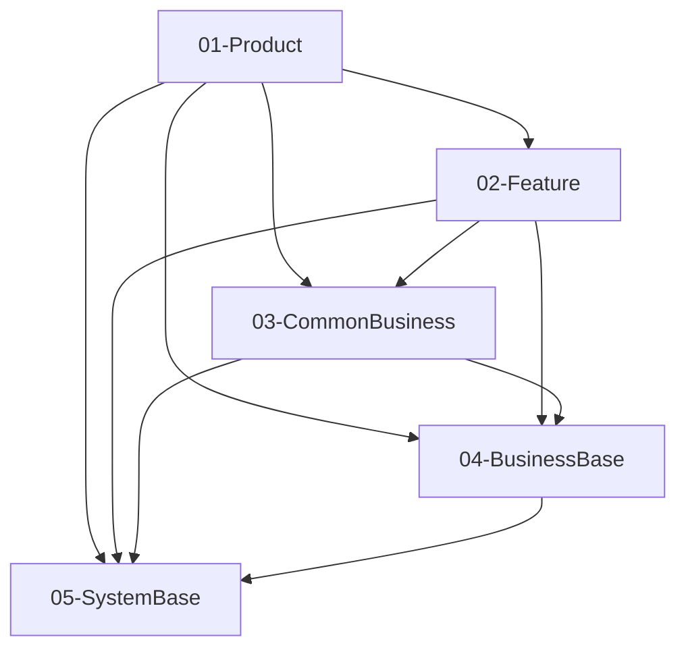

# Goal run phase: review
Feature: cu-YmMtb3BlbkNhcmQtMgBiYW5rLWNhcmQtb3BlbmluZy1mbG93
Requirement:
# BankCard原始需求描述

> **需求名**: `bc-openCard-2`
> **创建日期**: 2026-06-10

---

## 一、需求描述

### 需求内容

本次需求内容是银行卡开卡需求，我把原始图片都归档到了本文件同级目录下。

#### 需求规格：

1.用户进入已有的添加卡片页面，之前已经开发过了。之前点击任一银行点击后，提示暂不支持，本次需求改为拉起选择卡类型半模态页面。

2.用户在全部银行页面，任一银行点击后，效果与添加银行卡页面效果一致。

3.选择卡类型半模态页面，会展示本银行支持的储蓄卡+信用卡，如果只支持储蓄卡或者信用卡则只展示一个即可。最多只能选择一种卡类型添加，选择后，下方可点击同意并继续按钮进入对应银行的选择具体卡片页面。

4.银行的选择具体卡片页面，展示该银行支持的银行卡信息，卡号只显示前四后四，但实际后台数据要按完整卡号处理。用户选择一张银行卡后，同意协议，点击下一步，拉起输入验证码半模态页面。

5.输入验证码半模态页面，拉起后默认触发一次假的短信发送，之后右侧按钮变为倒计时，用户必须输入6位验证码才能点击下一步。当前6位验证码可随意输入。倒计时归零后，右侧按钮从倒计时变成重新发送。点击后再次变为倒计时。用户输入完成验证码后，后台将完整卡数据写入RDB（本需求开始要创建卡片数据库和对应卡片数据表，将添加的卡片存入数据库中，数据库中字段至少包含卡号、卡类型[比如银行卡、交通卡、门禁卡等]、银行名称、卡类型、添加时间、开通华为支付状态、开通银联手机闪付状态、交易记录等内容），无论写入成功还是失败，将本次添加的卡片卡号（全卡号）和开卡结果带着跳转到添加结果页。

6.添加结果页是个全屏页面，没有左滑箭头，也禁止左滑事件。添加结果页根据带过来的添卡结果，展示成功或者失败状态。同时本页面只有点击完成按钮才能退出页面，并且在页面退出时，关闭当前栈中1-6的所有页面（都是本轮银行卡添卡页面）。如果本次添加是成功状态，则带着卡片卡号跳转到钱包首页（后续等银行卡详情页开发完，这里会引导跳到银行卡详情页，并携带当前卡片参数）。如果本次添加失败则仅将过程中的页面全部退出，回到最开始的添加卡片页面。

#### 页面说明：

- 1）选择卡类型半模态：页面布局完全参考'3-点击任意银行拉起添卡选卡半模态.jpg'。在添加银行卡或全部银行页面，点击某个银行后，拉起选择卡类型半模态（默认所有mock银行都支持储蓄卡和信用卡，该数据随银行数据走），上方是银行信息，然后是储蓄卡/信用卡二选一，下方有小字提示，然后是协议内容（本次默认按文本展示，不需要可点击富文本），最下方是同意并继续按钮。

- 2）选择具体卡片页面：页面布局完全参考'4-点击信用卡或储蓄卡后拉起选卡页面.jpg'。在第3步选择银行+卡类型后点击继续，跳转全屏的银行内部选卡页面，页面title就是银行名称，上方是小字提示，中间是可选择的不同卡片（每个银行，储蓄卡/信用卡，分别mock 1-2张卡数据），下方是协议（文本即可，不需要富文本），最下方是下一步。

- 3）输入验证码半模态：页面布局完全参考'5-选中某张卡片后拉起短信验证.jpg'。第4步选择具体卡片下一步后，拉起短语输入弹框，上方是小字提示（里面要展示用户手机号，从账号mock数据读），中间是输入框，左边输入右边发送按钮，用户点击发送后，需要将按钮变为60s倒计时，倒计时过程中按钮不允许再次点击。倒计时清零后，按钮重新变成再次发送，并且可再次点击。用户在短信输入框中，只能输入6位数字（需要校验），只有输入正确，下方下一步按钮才从置灰状态变为可点击。点击下一步后，则绑卡完成，进入添卡成功结果页。

- 4）添加结果页：页面布局完全参考'6-短信验证完成后结果页.jpg'。无title，全屏页面。上方根据前一个页面传递的添卡结果，控制上方图标/文案/下方小字的提示内容，然后附一张引导图片（大差不差就行了），再往下的激活nfc部分本次先不需要。最下方是完成按钮。点击完成按钮后，跳转到卡详情页。并且本次添加的卡片数据则需要写入数据库中，数据库要包含卡片的详细数据，比如卡号/类型/哪家银行/支持华为支付或银联手机闪付/交易记录，后续的卡详情等页面都是根据数据库读取卡数据并展示。有一点要注意：到了添加结果页，要屏蔽左滑事件，并且在点击完成按钮后，要把整个开卡过程中的所有开卡相关页面全部从页面栈中剔除（从添加银行卡页面开始，一直到结果页自身）。避免开卡完成后还能一直左滑看到开卡过程页面。

#### 路由规格

1. 所有页面跳转要遵循已有路由规则，相关代码参考模块画像去找，不要自由发挥或者另外写一套。
2. 测试用例要包含老代码和本轮新开发代码的页面互相跳转功能，不能导致原有路由受损。
## 目标简报（goal brief）

### 明确不做

需求原文里明确写了不要或本次不做的内容同样是排除项，即使尚未登记。
- 参考图元素 result_nfc_panel：「再往下的激活nfc部分本次先不需要」

### 本次延后

以下是 spec 登记的本次延后及债务，不是用户原文排除；理由和登记正当性仍须依当前目标核验。
- card_type_status_bar（ref_card_type_sheet）：系统状态栏；非应用自绘，保留为 best-effort 视觉债务（来源 doc/features/bc-openCard-2/bank-card-opening-flow/spec/ref-elements.yaml）
- selection_status_bar（ref_bank_card_selection）：系统状态栏；非应用自绘，保留为 best-effort 视觉债务（来源 doc/features/bc-openCard-2/bank-card-opening-flow/spec/ref-elements.yaml）
- otp_status_bar（ref_otp_verification_sheet）：系统状态栏；非应用自绘，保留为 best-effort 视觉债务（来源 doc/features/bc-openCard-2/bank-card-opening-flow/spec/ref-elements.yaml）
- otp_system_numeric_keyboard（ref_otp_verification_sheet）：系统数字键盘由输入类型触发；不由应用绘制，保留为 best-effort 视觉债务（来源 doc/features/bc-openCard-2/bank-card-opening-flow/spec/ref-elements.yaml）
- result_status_bar（ref_opening_result_success）：系统状态栏；非应用自绘，保留为 best-effort 视觉债务（来源 doc/features/bc-openCard-2/bank-card-opening-flow/spec/ref-elements.yaml）
- result_ocr_uncertain_copy（ref_opening_result_success）「回中加」：OCR 低置信孤立文本，reviewer 观察判定为插画区域而非可靠产品文案；留待有视觉能力复核（来源 doc/features/bc-openCard-2/bank-card-opening-flow/spec/ref-elements.yaml）
有效范围已明确而审查意见相反：更正 review 报告，不派扩大范围的 coding 返修；实现违约由 coding 恢复契约。只有登记错误、定义缺口或目标需要改变时回原设计/spec 责任方。
合法延后按当前严格度披露债务与发布状态；不豁免真实功能、数据或关键交互缺陷。

### 判定办法

目标以当前有效的授权与明确修订为准；候选缺陷、参考图、下位产物与目标冲突时按目标裁决并留一行裁决记录，只有目标本身冲突或缺失且无法裁决时才问人。详见 framework 行为规约 skills/reference/agent-behavioral-principles.md「权威判定」。
## Unattended execution (headless goal-mode) (BLOCKER — overrides phase SKILL stop-and-ask)
This run is **headless / unattended**. There is **no interactive user** in this session.
- approval_mode: **never**
**BLOCKER**: You MUST NOT stop to ask the user for confirmation, clarification, or approval.
Stopping to ask the user in headless mode = **task failure** (runner will halt the goal run).
This block **overrides** every phase SKILL instruction that says "停下来等用户确认",
"不启用 auto-approve", "must wait for user", or equivalent — **including spec Step 1.5**.
For every **in-phase** confirmation gate (registry class gate/enum/matrix/artifact_checkbox):
- Resolve automatically per `skills/reference/user-confirmation-ux.md` **§9 Goal/headless**.
- Record **every** auto-decision as one JSON line in `doc/features/bc-openCard-2/bank-card-opening-flow/review/headless-assumptions.jsonl` (machine SSOT; the ledger is an
  audit trail — it is not authorization, and a missing ledger line does not by itself veto phase closure):
  `{"decision_id":"<unique>","run_id":"<this run id>","phase":"<phase>","gate_id":"<registry id>","class":"<gate|enum|matrix|artifact_checkbox|freeform>","decision":"<what you chose, or n/a: reason>","must_review":true|false,"source":"agent","ts":"<ISO 8601>"}`
- Optionally mirror a human-readable table in `doc/features/bc-openCard-2/bank-card-opening-flow/review/headless-assumptions.md` (projection only — never the SSOT).
- Ledger records are **not** authorization: hard quality gates cannot be lowered by fidelity/P0/review/
  behavior waivers or any confirmation receipt. Repair the owning phase, defer for a real missing capability,
  or submit a changed requirement as a correction/successor run.
- `freeform_approval` gates (scope expansion, src mutation): **conservative default** — do NOT expand scope / do NOT mutate protected src; log the deferred request as a ledger line (must_review=true).
- gap-notes `approved_src_mutations[]` entries written by an agent are SELF-REPORTED intent, NOT
  authorization: the runner three-source chain will still HALT on any protected-source change they
  "approve". Even if a gap-note claims a seam was approved, do NOT (re-)implement it — log the request
  as must_review and continue without the mutation.
- Product source after review closure is reconciled against the closure attestation: a drift is graded by
  risk and reported as a WARN naming the review it still owes (`review_closure_attestation` in testing,
  `ut_no_src_mutation` in ut) — it does not silently pass, and it is not a licence to keep editing.
  You still own the drift: fold it back into coding and re-close review, or do the graded review it names.
  Test seams MUST NOT alter user-visible flows or default behavior — a `*_FAST_PATH`-style switch
  defaulting to true is a blocker, not a workaround.
After auto-resolving gates: **continue producing phase artifacts** and run harness. Do NOT halt at confirmation gates.
**Gate-integrity red lines (BLOCKER — violations are task failure, not a path to completion):**
- NEVER write legacy quality-signature fields such as `confirmed_by`; current quality conclusions require machine evidence.
- `bbox_verified_by` / `approved_by` / `user_requirement` may only carry their narrowly defined provenance or external-authority semantics; they never override quality FAIL.
- NEVER tamper with gate artifacts (visual-diff.json / summary.json / receipts) via process injection
  (NODE_OPTIONS --require/-r/--import/--loader, .node-options, .npmrc node-options, fs monkey-patching)
  or verdict-filling/resetting scripts; never instruct the operator to set up such bypasses.
- NEVER modify the framework control plane. There is no approval field that unlocks it: integrity.drift_allowlist
  and allow_local_drift are retired and ignored on read. Found a framework bug? HALT and report it upstream.
- Deterministic detectors (node_options_injection / visual_diff_tamper_artifact / receipt command scan /
  drift approval validation) turn any attempt into BLOCKER evidence. The only path through pixel_1to1 P0
  screens is: fix deterministic signals, then produce current native/delegated machine visual evidence.
## Orchestrator constraints (BLOCKER)
- Do NOT invoke goal-runner, --resume, or --manifest; the orchestrator is already running this goal run.
- goal-runs/ evidence directory is read-only for you: do NOT write, append, or patch events.jsonl or any run artifacts.
**Phase write boundary (recorded around this invocation):**
- Current phase: `review`. Registered paths this phase owns:
  - `doc/features/bc-openCard-2/bank-card-opening-flow/review-report.md`
  - `doc/features/bc-openCard-2/bank-card-opening-flow/review/context-exploration.md`
  - `doc/features/bc-openCard-2/bank-card-opening-flow/review/headless-assumptions.jsonl`
  - `doc/features/bc-openCard-2/bank-card-opening-flow/review/headless-assumptions.md`
  - `doc/features/bc-openCard-2/bank-card-opening-flow/review/review-report.md`
- Writing a registered artifact owned by another phase invalidates this invocation: the bytes are preserved as untrusted and the runner directs recovery to that owner. Outstanding current-phase obligations still require valid proof before completion. Do not repair another phase's artifact in place.
- Pre-existing dirty bytes are not attributed to this invocation.
- Other changes are recorded and judged by the checks that own them (scope, drift, and closure gates); they are not silently permitted.
- `goal-runs/**`, closure state, manifests, pointers, summaries, and evidence refreshes are runner-owned. Do not edit them.
Read and follow the phase skill: skills/feature/code-review/SKILL.md
Skill absolute path: D:\1.code\SimulatedWalletForHmos\framework\skills\feature\code-review\SKILL.md
Before writing this phase's artifacts, read the knowledge inputs below that apply to this phase.
## Knowledge inputs

动笔前读取适用原文；索引/候选不是事实确认或已读证明。维护写入须沿原授权与时点，不在 run 内擅自刷新图谱。

- `doc/module-catalog.yaml` — 模块职责、反例与易混项；完整索引可继续探索；候选画像过大，按原路径读取相关模块
- `doc/glossary.yaml` — 术语与 alias 候选；字面命中不替代语义消歧

[
  {
    "term": "添卡",
    "canonical_module": "WalletMain",
    "owner_layer": "02-Feature",
    "aliases": [],
    "sample_usage": "当 PRD 说「`buildAddCardEntryPage`、卡种引导/选卡入口、进入卡包前的加卡流程」时，多指**本 feature 的添卡路由与业务页**；不是 `CommUI` 里无卡种语义的通用按钮行、也不是 `AccountService` 自身的接口定义。",
    "confidence_hint": "精确命中 `WalletMain.typical_business_terms`；与 NOT 不冲突（已扫）。",
    "easily_confused_with": [
      {
        "term": "账号管理",
        "module": "AccountManager",
        "disambiguation": "若讨论 **`AccountService` / 登录与登出 / `UserProfile` / `LoginState` / AppStorage 中账号态** 的**领域服务与数据模型** → **AccountManager**（权威域）。\n若讨论**「我的」页怎么摆、和首页如何跳转、卡包/添卡流程 UI** 等**feature 内页面与路由编排** → **WalletMain**（本模块），即使代码里在「我的」调用了 `AccountService`。\n"
      },
      {
        "term": "公共 UI 组件",
        "module": "CommUI",
        "disambiguation": "可复用、无钱包业务名状的 **ListItem/卡片容器/主题色/Toast** → **CommUI**。\n**卡引导、卡分类列表、与「卡包」强绑定的 feature 专页/区块** → **WalletMain**（本模块）；可 import `CommUI`，但**业务组件与数据绑定**的归属在仓库路径 `02-Feature/WalletMain`。\n"
      },
      {
        "term": "系统功能封装",
        "module": "CommFunc",
        "disambiguation": "**纯工具与日志/脱敏**、与卡包/首页/我的的**产品语义**无关 → **CommFunc**。\n与**钱包 Tab、卡种入口、服务宫格/活动与导航**强相关 → **WalletMain**（本模块）；本 feature 在少数路径可能调用 `CommFunc`（如日志），**禁止**用 `CommFunc` 当「主功能 feature」的挡箭牌。\n"
      },
      {
        "term": "主应用",
        "module": "Phone",
        "disambiguation": "**卡种/服务宫格/卡包/添卡、feature 内 Repository 与用例** → **WalletMain**（本模块）。\n**Entry HAP、`PhoneAbility`、`loadContent`、根 `Navigation`+双 Tab 壳、HAP 级多模块依赖装配** → **Phone**；`Phone` 的 `pages/Index` 从本模块 import 子页，**本模块不实现** Ability 与 HAP 壳。\n"
      }
    ]
  },
  {
    "term": "首页",
    "canonical_module": "WalletMain",
    "owner_layer": "02-Feature",
    "aliases": [],
    "sample_usage": "当 PRD 说「`HomeTabPage` 里的服务宫格/活动/卡引导、`HomeRepository` 提供的数据、双 Tab 里偏『首页』那一屏的内容」时，多指**本 feature 的首页子页**；不是 `Phone` 的 `loadContent` 或根 `Navigation` 壳、也不是 `AccountService` 的 API 面。",
    "confidence_hint": "精确命中 `WalletMain.typical_business_terms`；与 NOT 不冲突（已扫）。",
    "easily_confused_with": [
      {
        "term": "账号管理",
        "module": "AccountManager",
        "disambiguation": "若讨论 **`AccountService` / 登录与登出 / `UserProfile` / `LoginState` / AppStorage 中账号态** 的**领域服务与数据模型** → **AccountManager**（权威域）。\n若讨论**「我的」页怎么摆、和首页如何跳转、卡包/添卡流程 UI** 等**feature 内页面与路由编排** → **WalletMain**（本模块），即使代码里在「我的」调用了 `AccountService`。\n"
      },
      {
        "term": "公共 UI 组件",
        "module": "CommUI",
        "disambiguation": "可复用、无钱包业务名状的 **ListItem/卡片容器/主题色/Toast** → **CommUI**。\n**卡引导、卡分类列表、与「卡包」强绑定的 feature 专页/区块** → **WalletMain**（本模块）；可 import `CommUI`，但**业务组件与数据绑定**的归属在仓库路径 `02-Feature/WalletMain`。\n"
      },
      {
        "term": "系统功能封装",
        "module": "CommFunc",
        "disambiguation": "**纯工具与日志/脱敏**、与卡包/首页/我的的**产品语义**无关 → **CommFunc**。\n与**钱包 Tab、卡种入口、服务宫格/活动与导航**强相关 → **WalletMain**（本模块）；本 feature 在少数路径可能调用 `CommFunc`（如日志），**禁止**用 `CommFunc` 当「主功能 feature」的挡箭牌。\n"
      },
      {
        "term": "主应用",
        "module": "Phone",
        "disambiguation": "**卡种/服务宫格/卡包/添卡、feature 内 Repository 与用例** → **WalletMain**（本模块）。\n**Entry HAP、`PhoneAbility`、`loadContent`、根 `Navigation`+双 Tab 壳、HAP 级多模块依赖装配** → **Phone**；`Phone` 的 `pages/Index` 从本模块 import 子页，**本模块不实现** Ability 与 HAP 壳。\n"
      }
    ]
  }
]

- `doc/architecture.md` — 架构背景；设计依据仍按原权威链引用

# SimulatedWalletForHmos — 模块与分层架构

> 本文档描述本工程的模块分层与依赖约定，是架构设计的单一事实源之一。  
> **机器可读结构**见工程根目录 [framework.config.json](../framework.config.json) 的 `architecture` 段；修改分层后请同步更新本文与 config。

---

## 生成说明

- 本文档由 **Skill `00-framework-init`** 基于 `framework` 模板首次生成。
- **后续仅架构级变更才更新本文**（`dsl_change` / `module_set_change` / `responsibility_rewrite` 三类，详见下方「变更触发条件」）；feature 级变更（既有模块内新增页面 / 接口 / 数据模型 / 修复）不写入本文，变更历史由 git 与 [doc/features/](features/) 承担。
- 若调整了外层 / 内层 / 出口文件名，必须同步 `framework.config.json` 并通过 harness 相关检查。

### 变更触发条件（写入/修改本文前先对号入座）

| impact 等级 | 触发场景 | 本文需同步的小节 |
|-------------|----------|------------------|
| `dsl_change` | `framework.config.json > architecture` 结构变化（分层 / 依赖边 / 同层策略 / 内层顺序 / 出口约定） | 外层架构 Mermaid、层间依赖表、模块内分层、物理目录 |
| `module_set_change` | 模块集合变化（新增 / 下线 / 迁层） | 业务模块清单增删一行、架构级变更记录 |
| `responsibility_rewrite` | [module-catalog.yaml](module-catalog.yaml) 中某模块 `primary_responsibility` 大幅重写 | 业务模块清单该模块的"一句话职责"、架构级变更记录 |
| `none` | 任何普通 feature 需求 | **不写入本文** |

---

## 外层架构（outer_layers）

依赖方向以 `framework.config.json` → `architecture.outer_layers` 为准：**仅允许声明过的层间依赖**，禁止逆向。



### 层间依赖表（摘录）

| 外层 id | 允许依赖的其它外层（can_depend_on） | 同层策略（intra_layer_deps） |
|---------|--------------------------------------|------------------------------|
| 01-Product | 02-Feature, 03-CommonBusiness, 04-BusinessBase, 05-SystemBase | dag |
| 02-Feature | 03-CommonBusiness, 04-BusinessBase, 05-SystemBase | dag |
| 03-CommonBusiness | 04-BusinessBase, 05-SystemBase | dag |
| 04-BusinessBase | 05-SystemBase | dag |
| 05-SystemBase | （无） | sublayer（CommUI → CommFunc） |

**05-SystemBase 子层**：`CommUI` 可依赖 `CommFunc`；`CommFunc` 不依赖 `CommUI`。成员模块见 `architecture.outer_layers[].sublayers`。

---

## 模块内分层（module_inner_layers）

模块代码目录内部采用以下分层（**数组顺序 = upward 依赖方向**，索引小的可被索引大的 import）：

`shared, data, domain, presentation`

跨模块引用必须通过各模块根目录下、与 `framework.config.json` → `architecture.cross_module_exports_file` 一致的导出入口（默认 **`index.ets`**）导出，禁止深路径 import 到其它模块内部实现。

---

## 物理目录与构建

`build-profile.json5` 中 `modules` 与源码路径对应关系（摘录）：

| 模块名 | srcPath |
|--------|---------|
| Phone | `./01-Product/Phone` |
| WalletMain | `./02-Feature/WalletMain` |
| AccountManager | `./04-BusinessBase/AccountManager` |
| CommUI | `./05-SystemBase/CommUI` |
| CommFunc | `./05-SystemBase/CommFunc` |

---

## 业务模块清单

> 本表仅作架构图的图例，**仅在 `module_set_change` 或 `responsibility_rewrite` 时更新**。
> 模块职责 / 公共能力 / 易混点 / `NOT_responsible_for` 等详情以 [module-catalog.yaml](module-catalog.yaml) 为 SSOT，**不要**在此重复复制。

| 模块名 | 所属外层 | 一句话职责 |
|--------|----------|-----------|
| CommFunc | 05-SystemBase（子层 CommFunc） | 系统侧通用能力：日志封装、脱敏/格式化等无 UI 工具 |
| CommUI | 05-SystemBase（子层 CommUI） | 公共 ArkUI 组件、主题色与 Toast 等可复用 UI 积木；依赖 CommFunc |
| AccountManager | 04-BusinessBase | 账号域：登录态、UserProfile、AccountService 等 |
| WalletMain | 02-Feature | 钱包主 feature：首页/我的/卡包/添卡等页面与路由 |
| Phone | 01-Product | 入口 HAP：PhoneAbility + 根页壳，聚合各 HAR |

---

## 架构级变更记录

> **准入条件**：仅记录 `dsl_change` / `module_set_change` / `responsibility_rewrite` 三类架构级事件。
> **禁入内容**：feature 级变更（页面新增 / 接口新增 / 数据模型扩展 / bug 修复 / 样式调整等）一律不记录，由 git history 与 [doc/features/](features/) 承担。

| 日期 | 影响等级 | 说明 |
|------|----------|------|
| （无） |  |  |


- `doc/conventions.md` — 存在时读全文；review 独立选适用项并打开范例（文件缺失 / 未启用；不声称已消费）
- `doc/component-index.yaml` — 完整组件库存；与策展按 id 联合读取并反查源码

{"schema_version":"1.0","components":[{"id":"CommUI/src/main/ets/presentation/components/ActionListItem.ets#ActionListItem","module":"CommUI","file":"05-SystemBase/CommUI/src/main/ets/presentation/components/ActionListItem.ets","symbol":"ActionListItem","kind":"component","props":["icon","title"],"deprecated":false,"source_fingerprint":"sha256:4bc6399ca67f965d6736d38b63fdb6b077e572f3066b5ba2380a1c5c6245045f","static_checks":{"scalable_font_unit":"fail","no_hardcoded_hex_color":"pass","declared_touch_target":"fail"},"curation":null},{"id":"CommUI/src/main/ets/presentation/components/SectionCard.ets#SectionCard","module":"CommUI","file":"05-SystemBase/CommUI/src/main/ets/presentation/components/SectionCard.ets","symbol":"SectionCard","kind":"component","props":["content"],"deprecated":false,"source_fingerprint":"sha256:5476b33b3e55ec1d5e9b39c7ab7e363ab3aa6b5635da6408d804b970638738a6","static_checks":{"scalable_font_unit":"unknown","no_hardcoded_hex_color":"pass","declared_touch_target":"unknown"},"curation":null},{"id":"WalletMain/src/main/ets/presentation/pages/AddBankCardPage.ets#buildAddBankCardPage","module":"WalletMain","file":"02-Feature/WalletMain/src/main/ets/presentation/pages/AddBankCardPage.ets","symbol":"buildAddBankCardPage","kind":"builder","props":[],"deprecated":false,"source_fingerprint":"sha256:e2a1d6d06e959661848ae2b064c5fdb629481c1b2d409a85d22574b98d3ddba5","static_checks":{"scalable_font_unit":"unknown","no_hardcoded_hex_color":"pass","declared_touch_target":"unknown"},"curation":null},{"id":"WalletMain/src/main/ets/presentation/pages/AddCardEntryPage.ets#buildAddCardEntryPage","module":"WalletMain","file":"02-Feature/WalletMain/src/main/ets/presentation/pages/AddCardEntryPage.ets","symbol":"buildAddCardEntryPage","kind":"builder","props":[],"deprecated":false,"source_fingerprint":"sha256:b06696e280d9aac073ab7fc546bc7eb4d6cfa324119aed3cfa19792923598e9a","static_checks":{"scalable_font_unit":"unknown","no_hardcoded_hex_color":"pass","declared_touch_target":"unknown"},"curation":null},{"id":"WalletMain/src/main/ets/presentation/pages/AllBanksPage.ets#buildAllBanksPage","module":"WalletMain","file":"02-Feature/WalletMain/src/main/ets/presentation/pages/AllBanksPage.ets","symbol":"buildAllBanksPage","kind":"builder","props":[],"deprecated":false,"source_fingerprint":"sha256:f822d14033e00d59c2b2c9987631e10d6fd3e1683a13d6728aded8a8ac13ea94","static_checks":{"scalable_font_unit":"unknown","no_hardcoded_hex_color":"pass","declared_touch_target":"unknown"},"curation":null},{"id":"WalletMain/src/main/ets/presentation/pages/BankCardOpeningResultPage.ets#buildBankCardOpeningResultPage","module":"WalletMain","file":"02-Feature/WalletMain/src/main/ets/presentation/pages/BankCardOpeningResultPage.ets","symbol":"buildBankCardOpeningResultPage","kind":"builder","props":["param"],"deprecated":false,"source_fingerprint":"sha256:d9589422aca3f459574dc9a590f3df347cd29521fe25151a7eb2581102f0561e","static_checks":{"scalable_font_unit":"unknown","no_hardcoded_hex_color":"pass","declared_touch_target":"unknown"},"curation":null},{"id":"WalletMain/src/main/ets/presentation/pages/BankCardSelectionPage.ets#buildBankCardSelectionPage","module":"WalletMain","file":"02-Feature/WalletMain/src/main/ets/presentation/pages/BankCardSelectionPage.ets","symbol":"buildBankCardSelectionPage","kind":"builder","props":["param"],"deprecated":false,"source_fingerprint":"sha256:5be74f8de46fa24b27f553a4d2bea52a4d64876cdd82b1e8e64fa6337606dfc4","static_checks":{"scalable_font_unit":"unknown","no_hardcoded_hex_color":"pass","declared_touch_target":"unknown"},"curation":null},{"id":"WalletMain/src/main/ets/presentation/pages/CardPackPage.ets#buildCardPackPage","module":"WalletMain","file":"02-Feature/WalletMain/src/main/ets/presentation/pages/CardPackPage.ets","symbol":"buildCardPackPage","kind":"builder","props":[],"deprecated":false,"source_fingerprint":"sha256:3326dedfc930f8aba0d2874d7c5ac305994e23f1420f1a4ab537a83cddb31c68","static_checks":{"scalable_font_unit":"unknown","no_hardcoded_hex_color":"pass","declared_touch_target":"unknown"},"curation":null},{"id":"WalletMain/src/main/ets/presentation/pages/HomeTabPage.ets#HomeTabPage","module":"WalletMain","file":"02-Feature/WalletMain/src/main/ets/presentation/pages/HomeTabPage.ets","symbol":"HomeTabPage","kind":"component","props":["navPathStack"],"deprecated":false,"source_fingerprint":"sha256:b51d01ec291ec7ac6bc22caa01a36a3dd0f58e6540845ab7e4dd10fcd4d21d75","static_checks":{"scalable_font_unit":"unknown","no_hardcoded_hex_color":"pass","declared_touch_target":"unknown"},"curation":null},{"id":"WalletMain/src/main/ets/presentation/pages/MineTabPage.ets#MineTabPage","module":"WalletMain","file":"02-Feature/WalletMain/src/main/ets/presentation/pages/MineTabPage.ets","symbol":"MineTabPage","kind":"component","props":[],"deprecated":false,"source_fingerprint":"sha256:a2c83893ce0dde879bbe55e7209022edadb1e42e99c251eaaf3079bd48d5843e","static_checks":{"scalable_font_unit":"fail","no_hardcoded_hex_color":"pass","declared_touch_target":"fail"},"curation":null}]}

- `doc/component-catalog.yaml` — 组件适用/不适用与易混项；不覆盖源码事实（文件缺失 / 未启用；不声称已消费）

{"schema_version":"1.0","components":[]}

- `framework/docs/README.md` — 框架背景索引，按当前任务跟随相关原始链接
- `framework/profiles/hmos-app/skills/README.md` — 当前 profile 知识与 Skill 资产协议
- `framework/profiles/hmos-app/skills/code-review/profile-addendum.md` — 执行 code-review 前阅读当前 profile 补充

# `hmos-app` · Skill `code-review` profile addendum

审查 **`*.ets`/ArkUI/资源 `$r`/HAR-HSP 导出/分层 import** 时，默认以 **宿主 ArkTS** 语义与 **`coding-rules` + overlay** 为 BLOCKER 依据。

## 权威资产清单

| 用途 | 路径 |
|------|------|
| 编码规则 overlay | `framework/profiles/hmos-app/phase-rules-overlays/coding-rules.overlay.yaml` |
| ArkTS 易错点（审查时对照） | `framework/profiles/hmos-app/skills/coding/reference/arkts-pitfalls.md` |

### skill-assets.yaml 键

本 skill 的 asset 键与相对路径**唯一声明**在机器清单 `framework/profiles/hmos-app/skills/skill-assets.yaml`（`assets.code-review` 段）。根 `SKILL.md` 用 `` `profile-skill-asset:code-review/<键>` `` 引用，解析规则见 `framework/skills/README.md` 的 “Profile skill asset protocol”。**本 addendum 不再罗列键与路径**，以清单为单一真相（SSOT），避免散文与清单漂移。

若宿主含 **非 `.ets`** 源码形态，以实际语言、实例 `architecture` 和本次适用契约为准，避免套错语言规则；独立审查不因缺 contracts 不能开始。

## Context Exploration Gate（profile 补充）

审查先读本次目标及调用链；正式范围读全 `contracts.files`，独立范围由用户的 diff/提交/文件请求确定。按影响核对 **HAR/HSP 库模块 `Index.ets` 导出**、**`$r()` 资源 key 定义文件** 与 **`route_map.json` / 页面注册**，避免遗漏宿主特有问题。


- `02-Feature/WalletMain/code-graph.yaml` — 相关模块节点导航，core 只高亮；无图/无命中回源码 02-Feature/WalletMain（文件缺失 / 未启用；不声称已消费）
- `04-BusinessBase/AccountManager/code-graph.yaml` — 相关模块节点导航，core 只高亮；无图/无命中回源码 04-BusinessBase/AccountManager（文件缺失 / 未启用；不声称已消费）
- `01-Product/Phone/code-graph.yaml` — 相关模块节点导航，core 只高亮；无图/无命中回源码 01-Product/Phone（文件缺失 / 未启用；不声称已消费）
- `01-Product/Phone/src/main/ets/pages/index.ets` — 组件定义 / live 样本原文；按路径打开核对。
- `02-Feature/WalletMain/src/main/ets/presentation/pages/AddBankCardPage.ets` — 组件定义 / live 样本原文；按路径打开核对。
- `02-Feature/WalletMain/src/main/ets/presentation/pages/AddCardEntryPage.ets` — 组件定义 / live 样本原文；按路径打开核对。
- `02-Feature/WalletMain/src/main/ets/presentation/pages/AllBanksPage.ets` — 组件定义 / live 样本原文；按路径打开核对。
- `02-Feature/WalletMain/src/main/ets/presentation/pages/BankCardOpeningResultPage.ets` — 组件定义 / live 样本原文；按路径打开核对。
- `02-Feature/WalletMain/src/main/ets/presentation/pages/BankCardSelectionPage.ets` — 组件定义 / live 样本原文；按路径打开核对。
- `02-Feature/WalletMain/src/main/ets/presentation/pages/CardPackPage.ets` — 组件定义 / live 样本原文；按路径打开核对。
- `02-Feature/WalletMain/src/main/ets/presentation/pages/HomeTabPage.ets` — 组件定义 / live 样本原文；按路径打开核对。
- `02-Feature/WalletMain/src/main/ets/presentation/pages/MineTabPage.ets` — 组件定义 / live 样本原文；按路径打开核对。
- `05-SystemBase/CommUI/src/main/ets/presentation/components/ActionListItem.ets` — 组件定义 / live 样本原文；按路径打开核对。
- `05-SystemBase/CommUI/src/main/ets/presentation/components/SectionCard.ets` — 组件定义 / live 样本原文；按路径打开核对。
- 02-Feature/WalletMain/code-graph.yaml 不存在；回源码探索 02-Feature/WalletMain，不自动建图。
- 04-BusinessBase/AccountManager/code-graph.yaml 不存在；回源码探索 04-BusinessBase/AccountManager，不自动建图。
- 01-Product/Phone/code-graph.yaml 不存在；回源码探索 01-Product/Phone，不自动建图。
- (组件静态未确认): CommUI/src/main/ets/presentation/components/SectionCard.ets#SectionCard: scalable_font_unit、declared_touch_target 未确认；核真实组件源码，适用交互/视觉交 testing，不能当作 PASS 或不适用。
WalletMain/src/main/ets/presentation/pages/AddBankCardPage.ets#buildAddBankCardPage: scalable_font_unit、declared_touch_target 未确认；核真实组件源码，适用交互/视觉交 testing，不能当作 PASS 或不适用。
WalletMain/src/main/ets/presentation/pages/AddCardEntryPage.ets#buildAddCardEntryPage: scalable_font_unit、declared_touch_target 未确认；核真实组件源码，适用交互/视觉交 testing，不能当作 PASS 或不适用。
WalletMain/src/main/ets/presentation/pages/AllBanksPage.ets#buildAllBanksPage: scalable_font_unit、declared_touch_target 未确认；核真实组件源码，适用交互/视觉交 testing，不能当作 PASS 或不适用。
WalletMain/src/main/ets/presentation/pages/BankCardOpeningResultPage.ets#buildBankCardOpeningResultPage: scalable_font_unit、declared_touch_target 未确认；核真实组件源码，适用交互/视觉交 testing，不能当作 PASS 或不适用。
WalletMain/src/main/ets/presentation/pages/BankCardSelectionPage.ets#buildBankCardSelectionPage: scalable_font_unit、declared_touch_target 未确认；核真实组件源码，适用交互/视觉交 testing，不能当作 PASS 或不适用。
WalletMain/src/main/ets/presentation/pages/CardPackPage.ets#buildCardPackPage: scalable_font_unit、declared_touch_target 未确认；核真实组件源码，适用交互/视觉交 testing，不能当作 PASS 或不适用。
WalletMain/src/main/ets/presentation/pages/HomeTabPage.ets#HomeTabPage: scalable_font_unit、declared_touch_target 未确认；核真实组件源码，适用交互/视觉交 testing，不能当作 PASS 或不适用。
- 组件 live 调用样本超过内联预算；按完整 index/catalog 与下列定义/样本源路径分批核对，不代表没有调用。
After producing artifacts, run harness for this phase and ensure summary.json is written.
Do NOT claim phase complete if harness verdict is INCOMPLETE or FAIL.
After this phase, only the frozen remaining chain applies: ut→testing.

## Frozen execution scope / P1 input protocol 1.1
Completion target: feature; requested results: 从原始需求和参考图完成 bc-openCard-2 的开发、测试与验收闭环
Frozen phase chain: coding→review→ut→testing; execute only review in this invocation.
Before substantive work, establish or adopt real facts at D:\1.code\SimulatedWalletForHmos\doc\features\bc-openCard-2\bank-card-opening-flow\context\facts.md. Preserve any validated original baseline and its establishing phase; a reordered remaining queue does not redefine its owner.
Preserve a validated predecessor baseline and its actual established_by; append only this phase_delta. Never invent spec/change execution.
New facts belong to the responsible Skill/checker; do not edit the frozen manifest or cancel obligations because a check failed.
code-review:request:review: required; 用户明确请求 review
## 本次调用命令与已有上下文
当前阶段自检：
npx ts-node 'D:\1.code\SimulatedWalletForHmos\framework\harness\harness-runner.ts' --project-root 'D:\1.code\SimulatedWalletForHmos' --phase 'review' --feature 'cu-YmMtb3BlbkNhcmQtMgBiYW5rLWNhcmQtb3BlbmluZy1mbG93' --summary
仅在 summary.next_action 要求闭环时：
npx ts-node 'D:\1.code\SimulatedWalletForHmos\framework\harness\harness-runner.ts' --project-root 'D:\1.code\SimulatedWalletForHmos' --phase 'review' --feature 'cu-YmMtb3BlbkNhcmQtMgBiYW5rLWNhcmQtb3BlbmluZy1mbG93' --sync-closure
项目根、阶段及身份已确定；已有冻结需求、阶段约束和写入范围见上文，仅按路径读取当前需要的段落。新调用尚无 summary/receipt 时先产出并运行阶段自检，不运行必然缺材料的 check-receipt；已有回执的恢复规则照旧。

## Re-review: previous findings and direct effects
Check whether existing findings were corrected and whether the actual changes introduce direct regressions. Do not restart an unbounded polish audit on a new attempt.
A real defect outside the diff can still block; the file list is context, not an authorization or filtering gate. New blockers need concrete evidence and why the previous review could not reasonably discover them.
Visual disclosure uses the same classification/strictness rules as ordinary review. Refuted or inflated findings require correcting the original report before revalidation; verifier PASS never replaces a negative product verdict.
Prior report snapshot: doc/features/bc-openCard-2/bank-card-opening-flow/goal-runs/20261023T044016Z-fe4512/phases/review/harness/review-report.md
# Code Review 报告 — bank-card-opening-flow

> **模块标识**: `cu-YmMtb3BlbkNhcmQtMgBiYW5rLWNhcmQtb3BlbmluZy1mbG93`
> **审查日期**: 2026-10-24
> **审查版本**: v1.6（OTP testing 回流返修复审 + must-have 覆盖纠正）
> **审查人**: 当前 review 阶段执行者；复用上一轮 Claude Code CLI 对未变材料的独立检视
> **保证等级**: `full`
> **能力解析说明**: 正式 contracts、acceptance、spec、plan、源码、结构台账与四张参考图均可解析；复用 2026-10-24T19:03:18.131Z 的 coding 编译与 verifier PASS，消费最新正式 testing 失败 UI 树并复审其后唯一生产源码改动；review 未重跑 testing 或像素度量。
> **对应设计文档**: `doc/features/bc-openCard-2/bank-card-opening-flow/plan/plan.md`

---

## 一、审查范围

### 审查模块

| 模块名 | 所属层 | 格式 | 审查文件数 |
|---|---|---|---:|
| WalletMain | 02-Feature | HAR | 24 |
| AccountManager | 04-BusinessBase | HAR | 3 |
| Phone | 01-Product | HAP | 2 |

### 文件范围

复用上一轮对 `contracts.yaml > files` 的完整审查；本轮按 re-review 规则只核最新 testing 回流的 OTP 共同根因、实际返修文件及其直接调用链，不重启无界审计。失败证据来自 `testing/reports/20261024T185039Z-266/hylyre/trace.json` 与 TC-001/005/008 三份失败 UI 树；当前返修只改变 `OtpVerificationSheet.ets` 的按钮响应式投影，旧的两个 ad-hoc trace 仅继续证明此前选卡门禁与显式 Sheet 关闭修复。

实际覆盖路径：

```text
02-Feature/WalletMain/src/main/ets/data/model/BankInfo.ets
02-Feature/WalletMain/src/main/ets/data/model/BankCardCandidate.ets
02-Feature/WalletMain/src/main/ets/data/model/StoredCard.ets
02-Feature/WalletMain/src/main/ets/data/model/OpeningResult.ets
02-Feature/WalletMain/src/main/ets/data/model/BankOpeningCompletionContext.ets
02-Feature/WalletMain/src/main/ets/data/repository/BankRepository.ets
02-Feature/WalletMain/src/main/ets/data/repository/BankCardRepository.ets
02-Feature/WalletMain/src/main/ets/domain/service/BankCardOpeningService.ets
02-Feature/WalletMain/src/main/ets/domain/service/OtpService.ets
02-Feature/WalletMain/src/main/ets/domain/service/OpeningNavigationService.ets
02-Feature/WalletMain/src/main/ets/presentation/pages/AddBankCardPage.ets
02-Feature/WalletMain/src/main/ets/presentation/pages/AllBanksPage.ets
02-Feature/WalletMain/src/main/ets/presentation/pages/BankCardSelectionPage.ets
02-Feature/WalletMain/src/main/ets/presentation/pages/BankCardOpeningResultPage.ets
02-Feature/WalletMain/src/main/ets/presentation/pages/HomeTabPage.ets
02-Feature/WalletMain/src/main/ets/presentation/components/CardTypeSheet.ets
02-Feature/WalletMain/src/main/ets/presentation/components/OtpVerificationSheet.ets
02-Feature/WalletMain/src/main/ets/shared/constant/BankConstants.ets
02-Feature/WalletMain/src/main/ets/index.ets
02-Feature/WalletMain/src/main/resources/base/profile/route_map.json
02-Feature/WalletMain/src/main/resources/base/element/string.json
02-Feature/WalletMain/src/main/resources/base/element/color.json
02-Feature/WalletMain/src/main/resources/base/element/float.json
02-Feature/WalletMain/src/main/resources/base/media/result_payment_guide_placeholder.png
04-BusinessBase/AccountManager/src/main/ets/data/model/UserProfile.ets
04-BusinessBase/AccountManager/src/main/ets/domain/service/AccountService.ets
04-BusinessBase/AccountManager/src/main/ets/index.ets
01-Product/Phone/src/main/ets/pages/index.ets
01-Product/Phone/src/main/ets/navigation/WalletDestinationRegistry.ets
```

审查基线为提交 `9b37cce3281566e6d20f5071dc502866d976ebe3` 加当前工作树中的本轮实现。

---

## 二、审查方法

| 审查维度 | 依据文档 | 检查要点 |
|---|---|---|
| 架构合规性 | `doc/architecture.md`、module catalog、profile addendum | 外层依赖、模块内分层、WalletMain 出口、Phone 装配 |
| 接口一致性 | `contracts.yaml` | 模型字段、Repository/Service 签名、组件状态/事件、路由参数 |
| 编码规范 | ArkTS pitfalls、coding 机器报告 | 类型安全、资源引用、异步与生命周期、完整卡号隐私 |
| 命名规范 | coding rules、ArkTS pitfalls | 新增模型、Repository、Service、组件、资源 key 与路由常量命名 |
| 业务逻辑 | `spec.md`、`acceptance.yaml`、`plan.md`、`use-cases.yaml` | 卡型/卡片门禁、OTP、RDB、成功/失败清栈、取消与重复操作 |
| 数据层 | `contracts.yaml`、Repository 源码 | RDB 建表、事务、幂等、失败回滚与敏感字段边界 |
| 视觉保真 | 四张原图、`ref-elements.yaml`、`visual-parity.yaml`、`structure-conformance.yaml` | 排除/延后、可见文案、16 条结构声明与引导图语义 |

最新 coding 阶段真实编译结果为 PASS（`coding/reports/summary.json`，生成时间 2026-10-24T19:03:18.131Z），且 coding verifier subject `8d4c92489e3aec3ef73452682db81ff9bc1659bcf2cba34431aeb885b062f287` 为 PASS；review 按验证相称原则未重复编译。上一轮未变材料的独立检视调用为 `claude -p --model opus --permission-mode dontAsk --output-format json`，Claude Code 版本 `2.1.310`，CLI 返回 canonical model `claude-opus-5-5`，结论为 `CONDITIONAL PASS`；本轮新增 OTP 单文件差异由当前阶段按正式 re-review 规则核对。CLI 只读且未修改仓库。

---

## 三、问题清单

### 既有意见关闭核对

- CR-001 已修复：`CardTypeSheet.aboutToAppear()` 仅重置为 `null`，继续按钮在未选择时保持禁用；卡型只在行点击后赋值。
- CR-002 已修复：OTP 保存时关闭按钮禁用且点击路径显式拒绝；组件消失会把 `isActive` 置为 `false`，在途保存完成后不会再调用 `onFinished()`。
- CR-003 已修复：`selection_agreement` 改为银行名与卡型双占位，`BankCardSelectionPage` 从当前银行及路由卡型传入参数。

上述返修未改变模块依赖、导出、路由注册、RDB 接口或正常流程状态机，未发现直接回归。

### UT 可测性返修核对

- `BankCardRepository` 新增 `BankCardStore`/`RdbBankCardStore` 构造注入边界；默认生产构造仍要求 `Context` 并使用同一 RDB，保存路径仍执行事务、幂等回查和失败回滚，没有测试 fast path。
- `BankCardOpeningService` 新增 `saveCandidate` 和 `BankCardOpeningSession`；`CardTypeSheet`、`BankCardSelectionPage`、`OtpVerificationSheet` 均真实消费该 session，卡型、卡片、协议和六位 OTP 门禁未旁路。
- `OtpVerificationState` 提供 start/tick/resend/cancel；Sheet 仍在出现时自动发送，60 秒内拒绝重发，消失时清 Timer/OTP，保存期关闭保护与消失后回调抑制保持。
- `WalletDestinationRegistry` 覆盖 4 个旧目的页与 2 个新增目的页，Phone 根 `navDestinationMap` 在原 builder 分支前实际消费该入口；现有分支与参数传递未改变。

上述变化与其直接调用链未发现新回归；AC/BD 的断言覆盖仍由下一阶段 UT 真实生成和运行，本报告不预签 UT 通过。

### testing 回流返修核对

- 根因一已关闭：正式失败 UI 树显示协议已勾选但 `selection_next_btn.enabled=false`。`BankCardSelectionPage` 现以 `@State selectedCandidate` 与 `@State agreementAccepted` 驱动按钮响应式重算，同时点击时仍由 `openingService.canOpenOtp()` 作业务门禁。当前构建的 `doc/features/_adhoc/testing/reports/20261024-140337/hylyre/trace.json` 完成 18/18 步，点击下一步后成功定位 `otp_sheet_title`。
- 根因二已关闭（显式关闭路径）：`AddBankCardPage` 与 `AllBanksPage` 以 `sheetDismissing`/`pendingBank` 协调关闭动画，保留 Sheet 内容到 `onDisappear` 再清理，并在关闭期缓存重开请求。当前构建的 `doc/features/_adhoc/testing/reports/20261024-140906/hylyre/trace.json` 完成 20/20 步，覆盖关闭、重开、再次关闭及点击“更多”。
- `HomeTabPage` 根容器新增稳定 `home_root` 验收锚点，不改变导航或展示语义。
- 最新正式 testing 在 TC-001 step 38、TC-005 step 32、TC-008 step 25 复现同一现象：UI 树中 `otp_input.text` 已为六位数字，但 `otp_next_btn.enabled=false`，因此未进入结果页。该证据把根因限定在 OTP 按钮可用态投影，而非 RDB、结果路由或清栈。
- 当前返修在 `OtpVerificationSheet` 中新增 `isOtpComplete()`，按钮的 `enabled`、文字颜色和背景色直接读取页面 `@State otp`；`handleOtpChange()` 仍先更新 `BankCardOpeningService` 再同步页面状态，点击后 `saveSelectedCard()` 仍以 `openingService.canSubmit()` 作最终业务校验。显示投影与业务真源职责清晰，没有新增 fast path 或绕过六位数字、会话、卡片、协议门禁。
- 本次只改变响应式 UI 投影，未修改 RDB、OTP 倒计时状态机、结果页路由/清栈或跨模块出口；未发现直接回归。此前 review 无法合理发现该运行时缺陷，是因为当时的当前构建窄证据只覆盖“选卡页进入 OTP”，报告也明确把完整 TC-001～TC-008 留给正式 testing；新 UI 树首次提供了“原生输入框显示六位但按钮仍禁用”的确定性证据。
- TC-002 step 18 为 `scroll_to ab_row_cmb` 的 `selector.ambiguous`，没有已执行产品断言失败，按现有回流分类保留给 testing 重派生/消歧，不归为 coding 缺陷。
- 当前修复尚无返修后的设备 trace；完整 TC-001/005/008 与其余用例仍由后续正式 testing 重跑闭环，本报告不预签真机通过。

### 当前未关闭问题

| 编号 | 严重程度 | 分类 | 问题描述 | 涉及文件 | 修复建议 |
|---|---|---|---|---|---|
| CR-004 | MAJOR | 视觉保真 | 结果页仍使用抽象灰色占位图，未表达参考图的手机、二维码与手持动作。该差异已由 `plan/visual-parity.yaml` 登记为 best-effort major 视觉债务，且原始需求允许引导图“大差不差”；因此本轮只披露，不作为功能返修阻断，但发布就绪仍受阻。 | `02-Feature/WalletMain/src/main/resources/base/media/result_payment_guide_placeholder.png` | 发布前替换为具有手机屏幕、二维码和手持动作的近似原创插画，并在 testing 重新截图核对。 |
| CR-005 | MINOR | 异常处理 | `loadCandidates()` 没有异常分支，候选为空时只显示空白卡片容器和禁用按钮，没有 spec E5 要求的空态说明。当前 mock 正常路径可达 1–2 张卡，但数据配置漂移或非法路由参数会落入无解释死端。 | `02-Feature/WalletMain/src/main/ets/presentation/pages/BankCardSelectionPage.ets` | 捕获加载异常并增加明确空态；候选为空时保持下一步禁用并允许返回，不伪造候选。 |
| CR-006 | MINOR | 逻辑错误 | 新的关闭竞态修复仅在应用内 `onClose`/继续路径预先设置 `sheetDismissing=true`。若 Sheet 由系统返回、下滑等框架关闭路径触发，双向绑定可先将 `showCardTypeSheet` 置为 false，而 `sheetDismissing` 仍为 false；退出动画期间重点银行可能直接置 true，随后迟到的 `onDisappear` 又把这次重开清掉。当前 ad-hoc 只覆盖显式“X”关闭，未覆盖该路径。 | `02-Feature/WalletMain/src/main/ets/presentation/pages/AddBankCardPage.ets`, `02-Feature/WalletMain/src/main/ets/presentation/pages/AllBanksPage.ets` | 在两处 Sheet 生命周期开始消失时统一进入 dismissing 状态（采用当前 SDK 支持的 will-dismiss/will-disappear 回调），让所有关闭原因复用 pending 重开队列；补一条系统关闭后立即重开的设备用例。 |
| CR-007 | BLOCKER | 视觉保真 | `card_type_sheet` 是 P0 `pixel_1to1` 屏；`ui-spec.yaml` 与 `ref-elements.yaml` 均要求实现 `background_search_bank`（“搜索银行 / 搜索”），且该元素不在排除或延后项中。当前 `AddBankCardPage.ets` 的背景页只有标题、副标题和银行列表，源码及资源中均没有搜索输入/文案，因此 34 个 must-have 中此项缺失。该缺陷不是本次 OTP diff 引入；上一轮本可发现，但由于 review 只复核了 16 条结构台账、未执行 34 项 must-have 全覆盖而漏报，本轮按 verifier 的具体证据纠正。 | `02-Feature/WalletMain/src/main/ets/presentation/pages/AddBankCardPage.ets`, `02-Feature/WalletMain/src/main/resources/base/element/string.json` | 在既有 `AddBankCardPage` 标题/副标题与银行白卡之间补入参考图对应的搜索行和资源文案，保持既有银行点击及 Sheet 行为；更新结构声明后由 review 逐项复核，并在 testing 对 `card_type_sheet` 重做当前构建截图/度量。 |

规则追溯：CR-004/CR-007 由 `ui-spec.yaml`、`ref-elements.yaml` 及 coding 规则 `visual_parity_render` / `structure_declaration_ledger` 约束；CR-005/CR-006 在现行 `coding-rules.yaml` 没有专门 semantic rule，分别以 spec E5 和实际 ArkUI Sheet 生命周期行为为依据，不引用不存在的规则 id。

---

## 四、问题统计

| 严重程度 | 数量 |
|---|---:|
| BLOCKER | 1 |
| MAJOR | 1 |
| MINOR | 2 |
| INFO | 0 |
| **合计** | **4** |

---

## 五、修复建议摘要

### BLOCKER 级（必须修复）

1. CR-007：补齐 P0 `card_type_sheet` 背景页中已明确要求、未合法延后的 `background_search_bank`；完成当前构建的静态/真机复核。

### 已关闭的必须返修项

CR-001～CR-003 已全部关闭；最新 OTP 按钮响应式返修关闭了 testing 回流的共同功能根因，且未重新打开既有意见。CR-007 是对上一轮视觉覆盖漏审的纠正，不是 OTP 返修的直接回归。

### 非阻断后续项

1. CR-004 是既有 best-effort major 视觉债务：不阻断本轮 review，但发布前必须替换并重验。
2. CR-005 是异常/空候选时的 MINOR 体验缺口，可在后续维护中补明确空态，不要求新增状态机或平行数据源。
3. CR-006 是本轮 Sheet 生命周期返修的直接边界缺口；不阻断当前 review，但正式 testing 应覆盖系统关闭路径，若复现则回 coding 做同一生命周期的最小修复。

---

## 六、视觉保真

### 素材与有效范围

- 已直接核对四张原始参考图。`result_nfc_panel` 按需求原句排除；状态栏、系统数字键盘和低置信 OCR 文案按目标简报保留为合法 best-effort 延后，不派 coding 扩大范围。
- 本轮没有 `coding/visible-text-exemptions.yaml`；coding 可见文案机器检查通过。CR-003 是文案语义与当前银行/卡型不一致，不是白名单问题。
- `result_payment_guide_placeholder.png` 的资源存在性通过，但语义近似仍不足，见 CR-004；本报告按 `visual-parity.yaml` 的既有 major debt 处置，不重复建立债务账，也不把“文件存在”当视觉通过。

### P0 must-have 全覆盖复核

依据：`spec/ui-spec.yaml > screens[].must_have_elements` 与 `spec/ref-elements.yaml`。四屏共 34 项；源码承载仅证明元素存在，不替代后续设备几何/像素验证。

| screen | element_id | 结论 | 源码/裁决依据 |
|---|---|---|---|
| `card_type_sheet` | `background_add_bank_title` | PASS | `AddBankCardPage.ets:170-200` 的 navBar 与 `add_bank_card_title`。 |
| `card_type_sheet` | `background_add_bank_subtitles` | PASS | `AddBankCardPage.ets:202-223` 的左右副标题。 |
| `card_type_sheet` | `background_search_bank` | FAIL | `AddBankCardPage.ets` 无搜索输入/搜索文案，WalletMain 主源码与资源全局检索亦无“搜索银行”；见 CR-007。 |
| `card_type_sheet` | `background_bank_row` | PASS | `AddBankCardPage.ets:225-238` 通过 `BankListRow` 渲染银行行。 |
| `card_type_sheet` | `card_type_sheet_title` | PASS | `CardTypeSheet.ets:68-73`。 |
| `card_type_sheet` | `card_type_sheet_close` | PASS | `CardTypeSheet.ets:75-88`。 |
| `card_type_sheet` | `card_type_sheet_panel` | PASS | `CardTypeSheet.ets:151-156`。 |
| `card_type_sheet` | `card_type_bank_row` | PASS | `CardTypeSheet.ets:93-108`。 |
| `card_type_sheet` | `debit_card_row` | PASS | `CardTypeSheet.ets:110-112`。 |
| `card_type_sheet` | `credit_card_row` | PASS | `CardTypeSheet.ets:113-115`。 |
| `card_type_sheet` | `card_type_authorization_copy` | PASS | `CardTypeSheet.ets:123-128`。 |
| `card_type_sheet` | `card_type_agreement_copy` | PASS | `CardTypeSheet.ets:130-135`。 |
| `card_type_sheet` | `card_type_continue_btn` | PASS | `CardTypeSheet.ets:137-150`。 |
| `bank_card_selection` | `selection_back_btn` | PASS | `BankCardSelectionPage.ets:113-126`。 |
| `bank_card_selection` | `selection_nav_title` | PASS | `BankCardSelectionPage.ets:128-133`。 |
| `bank_card_selection` | `selection_hint` | PASS | `BankCardSelectionPage.ets:146-151`。 |
| `bank_card_selection` | `selection_card_container` | PASS | `BankCardSelectionPage.ets:153-187`。 |
| `bank_card_selection` | `bank_card_candidate_1` | PASS | `BankCardSelectionPage.ets:154-182` 的 keyed `ForEach` 动态 id。 |
| `bank_card_selection` | `selection_agreement_check` | PASS | `BankCardSelectionPage.ets:189-195`。 |
| `bank_card_selection` | `selection_agreement` | PASS | `BankCardSelectionPage.ets:197-202`。 |
| `bank_card_selection` | `selection_next_btn` | PASS | `BankCardSelectionPage.ets:208-221`。 |
| `otp_verification_sheet` | `otp_sheet_title` | PASS | `OtpVerificationSheet.ets:121-126`。 |
| `otp_verification_sheet` | `otp_sheet_close` | PASS | `OtpVerificationSheet.ets:128-146`。 |
| `otp_verification_sheet` | `otp_sheet_panel` | PASS | `OtpVerificationSheet.ets:213-218`。 |
| `otp_verification_sheet` | `otp_instruction` | PASS | `OtpVerificationSheet.ets:151-156`。 |
| `otp_verification_sheet` | `otp_phone_hint` | PASS | `OtpVerificationSheet.ets:158-163`。 |
| `otp_verification_sheet` | `otp_input` | PASS | `OtpVerificationSheet.ets:165-175`。 |
| `otp_verification_sheet` | `otp_resend_action` | PASS | `OtpVerificationSheet.ets:177-189`。 |
| `otp_verification_sheet` | `otp_next_btn` | PASS | `OtpVerificationSheet.ets:199-212`；返修后读取页面 `@State otp`。 |
| `opening_result_success` | `result_status_icon` | PASS | `BankCardOpeningResultPage.ets:21-29`。 |
| `opening_result_success` | `result_title` | PASS | `BankCardOpeningResultPage.ets:31-38`。 |
| `opening_result_success` | `result_description` | PASS | `BankCardOpeningResultPage.ets:40-47`。 |
| `opening_result_success` | `result_guide_illustration` | PASS（存在性） | `BankCardOpeningResultPage.ets:54-59`；语义差异另见 CR-004。 |
| `opening_result_success` | `result_finish_btn` | PASS | `BankCardOpeningResultPage.ets:63-73`。 |

### 结构声明台账逐条复核

依据：`doc/features/bc-openCard-2/bank-card-opening-flow/coding/structure-conformance.yaml`。

| node_id | 结论 | 源码核对 |
|---|---|---|
| `card_type_overlay_root` | PASS | 两个入口均以 `bindSheet` 承载 CardTypeSheet。 |
| `card_type_background_page` | PASS | AddBankCardPage/AllBanksPage 作为半模态背板保留。 |
| `card_type_sheet_panel` | PASS | CardTypeSheet 根 Column 使用页面背景资源。 |
| `card_type_bank_card` | PASS | 银行与卡型共用白色卡片容器。 |
| `card_type_bank_row` | PASS | logo 与银行名在首行。 |
| `debit_card_row` | PASS | 支持项经同一 `cardTypeRow` 模板渲染。 |
| `credit_card_row` | PASS | 支持项经同一 `cardTypeRow` 模板渲染。 |
| `bank_card_selection_root` | PASS | 选卡页根 Column 使用页面背景资源。 |
| `selection_card_container` | PASS | 候选卡 Column 使用卡片背景资源。 |
| `bank_card_candidate_1` | PASS | ForEach 的候选行模板真实存在。 |
| `otp_overlay_root` | PASS | BankCardSelectionPage 以 `bindSheet` 承载 OTP。 |
| `otp_sheet_panel` | PASS | OTP 根 Column 使用页面背景资源。 |
| `otp_code_row` | PASS | 输入框与重发按钮位于同一白色 Row。 |
| `otp_input` | PASS | TextInput 位于 Row 左侧并占剩余宽度。 |
| `otp_resend_action` | PASS | 重发按钮位于 Row 右侧，宽度 30%。 |
| `opening_result_root` | PASS | 结果页根 Column 使用页面背景资源。 |

结构台账属实，但只证明布局承载存在；真机 bbox、字体、键盘、返回手势与像素差异仍由 testing 负责。

---

## 七、结论

**审查结论**: 不通过

CR-001～CR-003 与最新 OTP 按钮响应式根因保持关闭，静态调用链与最新编译未显示直接回归。但 P0 `pixel_1to1` 屏缺少未获延后的 `background_search_bank`，构成 CR-007 BLOCKER；当前 review 不得闭环或推进 UT/testing，应回 coding 在既有 AddBankCardPage 中补齐后再做限界复审。CR-004～CR-006 继续按原定级披露，不借本轮扩大为新系统。

**判定依据**:

- BLOCKER 数量: 1
- MAJOR 数量: 1（已登记 best-effort 非关键视觉债务）
- MINOR 数量: 2
- 判定规则：存在 BLOCKER 或未关闭功能性 MAJOR → 不通过；CR-007 未关闭，因此本报告为不通过。

Current repair candidates from the latest backtrack: [{"id":"CR-007","category":"coding","files":["02-Feature/WalletMain/src/main/ets/presentation/pages/AddBankCardPage.ets","02-Feature/WalletMain/src/main/resources/base/element/string.json"],"summary":"在既有 `AddBankCardPage` 标题/副标题与银行白卡之间补入参考图对应的搜索行和资源文案，保持既有银行点击及 Sheet 行为；更新结构声明后由 review 逐项复核，并在 testing 对 `card_type_sheet` 重做当前构建截图/度量。","item_fingerprint":"a8e32892b886c0face0687fd92ec55b43d4b472166360eeb68696191e95fddf0","source_phase":"review"}]
Actual changed files against the run baseline (includes working tree): [".cac/agents/phase-executor.md",".claude/agents/phase-executor.md","01-Product/Phone/src/main/ets/navigation/WalletDestinationRegistry.ets","01-Product/Phone/src/main/ets/pages/index.ets","01-Product/Phone/src/ohosTest/ets/test/List.test.ets","01-Product/Phone/src/ohosTest/ets/test/WalletDestinationRegistry.test.ets","02-Feature/WalletMain/src/main/ets/data/model/BankCardCandidate.ets","02-Feature/WalletMain/src/main/ets/data/model/BankInfo.ets","02-Feature/WalletMain/src/main/ets/data/model/BankOpeningCompletionContext.ets","02-Feature/WalletMain/src/main/ets/data/model/OpeningResult.ets","02-Feature/WalletMain/src/main/ets/data/model/StoredCard.ets","02-Feature/WalletMain/src/main/ets/data/repository/BankCardRepository.ets","02-Feature/WalletMain/src/main/ets/data/repository/BankRepository.ets","02-Feature/WalletMain/src/main/ets/domain/service/BankCardOpeningService.ets","02-Feature/WalletMain/src/main/ets/domain/service/OpeningNavigationService.ets","02-Feature/WalletMain/src/main/ets/domain/service/OtpService.ets","02-Feature/WalletMain/src/main/ets/index.ets","02-Feature/WalletMain/src/main/ets/presentation/components/CardTypeSheet.ets","02-Feature/WalletMain/src/main/ets/presentation/components/OtpVerificationSheet.ets","02-Feature/WalletMain/src/main/ets/presentation/pages/AddBankCardPage.ets","02-Feature/WalletMain/src/main/ets/presentation/pages/AllBanksPage.ets","02-Feature/WalletMain/src/main/ets/presentation/pages/BankCardOpeningResultPage.ets","02-Feature/WalletMain/src/main/ets/presentation/pages/BankCardSelectionPage.ets","02-Feature/WalletMain/src/main/ets/presentation/pages/HomeTabPage.ets","02-Feature/WalletMain/src/main/ets/shared/constant/BankConstants.ets","02-Feature/WalletMain/src/main/resources/base/element/color.json","02-Feature/WalletMain/src/main/resources/base/element/string.json","02-Feature/WalletMain/src/main/resources/base/media/result_payment_guide_placeholder.png","02-Feature/WalletMain/src/main/resources/base/profile/route_map.json","02-Feature/WalletMain/src/ohosTest/ets/test/List.test.ets","02-Feature/WalletMain/src/ohosTest/ets/test/bank_list_legacy_ut.test.ets","02-Feature/WalletMain/src/ohosTest/ets/test/bank_open_card_ut.test.ets","02-Feature/WalletMain/src/ohosTest/ets/test/spy/SpyBankCardOpeningDependencies.ets","02-Feature/WalletMain/src/ohosTest/ets/test/spy/SpyBankRepository.ets","04-BusinessBase/AccountManager/src/main/ets/data/model/UserProfile.ets","04-BusinessBase/AccountManager/src/main/ets/domain/service/AccountService.ets","AGENTS.md","CLAUDE.md","doc/component-index.yaml","doc/reports/compile/2026-10-24T16-34-18-111Z-752/hvigor-build.log","doc/reports/compile/2026-10-24T16-34-18-111Z-752/hvigor-build.meta.json","doc/reports/compile/2026-10-24T16-35-01-560Z-22188/hvigor-build.log","doc/reports/compile/2026-10-24T16-35-01-560Z-22188/hvigor-build.meta.json","doc/reports/compile/2026-10-24T16-35-29-100Z-12760/hvigor-build.log","doc/reports/compile/2026-10-24T16-35-29-100Z-12760/hvigor-build.meta.json","doc/reports/compile/2026-10-24T16-35-48-751Z-31312/hvigor-build.log","doc/reports/compile/2026-10-24T16-35-48-751Z-31312/hvigor-build.meta.json","framework/MIGRATION.md","framework/README.md","framework/RELEASE-MANIFEST.json","framework/RELEASE-MANIFEST.sha256","framework/agents/README.md","framework/agents/adapter-schema.yaml","framework/agents/chrys/adapter.yaml","framework/agents/claude/adapter.yaml","framework/agents/claude/templates/agents/phase-executor.md","framework/agents/claude/templates/goal-condition.md","framework/agents/codeagent/adapter.yaml","framework/agents/codex/adapter.yaml","framework/agents/codex/templates/goal-condition.md","framework/agents/cursor/adapter.yaml","framework/agents/deepseek-harness/adapter.yaml","framework/agents/generic/adapter.yaml","framework/agents/opencode/adapter.yaml","framework/docs/concepts/component-assets.md","framework/docs/concepts/skill-contracts.md","framework/docs/operations/goal-mode-runbook.md","framework/docs/operations/project-entry.md","framework/docs/operations/request-harness.md","framework/harness/capability-registry.ts","framework/harness/harness-runner.ts","framework/harness/prompts/verify-coding.md","framework/harness/prompts/verify-plan.md","framework/harness/prompts/verify-spec.md","framework/harness/scripts/check-catalog.ts","framework/harness/scripts/check-coding.ts","framework/harness/scripts/check-glossary.ts","framework/harness/scripts/check-plan.ts","framework/harness/scripts/check-review.ts","framework/harness/scripts/check-spec.ts","framework/harness/scripts/check-testing.ts","framework/harness/scripts/check-ut.ts","framework/harness/scripts/goal-mode-entry.ts","framework/harness/scripts/goal-phase-runtime.ts","framework/harness/scripts/prepare-blueprint-design.ts","framework/harness/scripts/utils/artifact-content.ts","framework/harness/scripts/utils/assess.ts","framework/harness/scripts/utils/attended-goal-context.ts","framework/harness/scripts/utils/blueprint-skill-projection.ts","framework/harness/scripts/utils/capability-resolution.ts","framework/harness/scripts/utils/check-disposition.ts","framework/harness/scripts/utils/check-execution.ts","framework/harness/scripts/utils/design-content-checks.ts","framework/harness/scripts/utils/design-repair-unattended.ts","framework/harness/scripts/utils/device-session.ts","framework/harness/scripts/utils/feature-assessment.ts","framework/harness/scripts/utils/feature-execution-scope.ts","framework/harness/scripts/utils/fidelity-shared.ts","framework/harness/scripts/utils/goal-adapter-capability.ts","framework/harness/scripts/utils/goal-assess-driver.ts","framework/harness/scripts/utils/goal-containment-reconcile.ts","framework/harness/scripts/utils/goal-failure-classifier.ts","framework/harness/scripts/utils/goal-phase-runtime.ts","framework/harness/scripts/utils/goal-progress.ts","framework/harness/scripts/utils/goal-run-control.ts","framework/harness/scripts/utils/goal-runner-phase.ts","framework/harness/scripts/utils/lite-json-schema.ts","framework/harness/scripts/utils/named-handler.ts","framework/harness/scripts/utils/phase-closure-finalizer.ts","framework/harness/scripts/utils/phase-transition-policy.ts","framework/harness/scripts/utils/quality-axes.ts","framework/harness/scripts/utils/repair-candidates.ts","framework/harness/scripts/utils/report-generator.ts","framework/harness/scripts/utils/request-phase.ts","framework/harness/scripts/utils/runtime-policy.ts","framework/harness/scripts/utils/session-execution-handoff.ts","framework/harness/scripts/utils/spec-loader.ts","framework/harness/scripts/utils/testing-trace-gates.ts","framework/harness/scripts/utils/types.ts","framework/harness/scripts/utils/ui-spec-shared.ts","framework/harness/scripts/utils/upstream-verdict-gate.ts","framework/harness/scripts/utils/verifier-plan.ts","framework/harness/scripts/utils/verify-feature-completion.ts","framework/harness/tsconfig.json","framework/profiles/generic/skills/business-ut/templates/use-cases-schema.md","framework/profiles/hmos-app/harness/build-fingerprint.ts","framework/profiles/hmos-app/harness/coding-host-rules.ts","framework/profiles/hmos-app/harness/execution-key.ts","framework/profiles/hmos-app/harness/hdc-runner.ts","framework/profiles/hmos-app/harness/named-handler.ts","framework/profiles/hmos-app/harness/providers/device-test-request.ts","framework/profiles/hmos-app/harness/providers/ut-run.ts","framework/profiles/hmos-app/skills/business-ut/templates/use-cases-schema.md","framework/skills/feature/coding/SKILL.md","framework/skills/feature/plan/SKILL.md","framework/skills/feature/spec/SKILL.md","framework/skills/project/change-unit-progression/SKILL.md","framework/skills/project/component-design/SKILL.md","framework/skills/project/goal-mode/SKILL.md","framework/skills/reference/agents-entry-detail.md","framework/skills/reference/business-ut-workflow-detail.md","framework/skills/reference/coding-workflow-detail.md","framework/skills/reference/design-repair-unattended.md","framework/skills/reference/goal-mode-operations.md","framework/skills/reference/plan-workflow-detail.md","framework/skills/reference/user-confirmation-ux.md","framework/specs/artifact-schemas/acceptance.schema.yaml","framework/specs/artifact-schemas/contracts.schema.yaml","framework/specs/artifact-schemas/ref-elements.schema.yaml","framework/specs/artifact-schemas/use-cases.schema.yaml","framework/templates/AGENTS.md.template"]
Current verifier evidence: subject=400934ec66ba25680f833091638bcb6c1bc2967113ae8441daeb89ae893b8633, verdict=PASS
Keep the true issue counts and disclose unresolved optional differences; do not write a second visual debt ledger.

## Validated facts baseline
Preserve the baseline body and its original identity. For current owned source targets within this phase's write boundary, registering each changed or newly created source in a path | fact | impact table in ## phase_delta: review is recommended; missing exact rows disclose weaker traceability and do not block the phase. Prefer project-relative paths; equivalent absolute paths, backslashes, ./ and repeated same-phase sections are recognized. Existing unexplored targets and requirement/contracts/config or unauthorized-source drift remain strict. Do not rewrite the baseline, even when this run starts at or backtracks to review.
