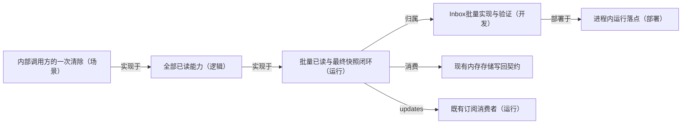

---
derived_from:
  artifact: component-blueprint@1
  component_id: Inbox
  blueprint_id: inbox-batch-read
  revision: 2
  source_fingerprint: sha256:ac71d45289bde10d63d724f2f48010c3771cef9b114b49e9e3780a4bdf5733c9
  artifact_sha256: sha256:cabbc8186593fd768f3f098d58b02a7dcf5865ed6456f99eed1865348a01e33a
  change_units:
    - change_unit_id: mark-all-read
      binding: bound
      identity_neutral_digest: c88f46e3f3f89cc9b83390fcb4c5d547a608d0f956572eb3a7a9f0d126399143
projection: component-blueprint-review@12
---

# 通知收件箱：一次标记全部已读

<a id="design-626c75657072696e743a696e626f782d62617463682d72656164"></a>
> 评审说明需更新；旧说明未作为当前方案展示，正文按当前已有字段展示。

阅读入口：先阅读方案、旅程、关键流程和交付安排；类型、方法、完整分支与验收全文见同文档的[技术与追溯参考](#reference)。

<a id="summary"></a>
## 1 方案摘要

新增markAllRead()，同步改变当前全部未读并返回实际数量；正数保存一次，再向每个现有订阅者一次最终快照；0不写不发。

施工安排见[施工与上线](#delivery)。

<a id="background"></a>
## 2 背景、目标与边界

调用方已有读取、单条已读、内存写回和订阅。

**当前问题**：只能逐条标记；循环单条方法会多次写入并推送中间快照。

**方案定位**：Inbox模块内部同步能力，沿已有入口、MemoryStorage及InboxProjection。

**目标**：闭合批量状态、存储和订阅，保持原行为。

**成功衡量**：

- 精确计数、保留字段和顺序、正数一次写回。
- 空、全已读、重复调用为0且无副作用。
- 最终快照、同对象重载及原操作/取消行为通过真实测试。

**本次范围**

- 公开实例markAllRead
- InboxStore与现有存储和消费者
- host-only TypeScript/Node真实验证

**不做什么**

- UI、图片、设备、HarmonyOS构建验收
- 网络、数据库、账号或跨进程耐久
- 跨store实例自动同步
- 提交、打包、发布、版本或验收能力修改

<a id="terms"></a>
## 3 术语

**通知收件箱**：保存消息和已读状态，公开读取、写回和订阅的进程内部件。

<a id="journey"></a>
## 4 用户旅程与界面

### 内部调用方的一次清除

1. 调用markAllRead()；正数一次写回并最终通知；0静默；同步返回数量。
2. 读取、单条已读、重建store或取消订阅；保留原有行为。

**含未读**：正数与一次最终快照。

**空或全已读**：0，无写入和通知。

<a id="solution"></a>
## 5 整体方案

定义公开能力、模型和内部存储契约。

新增markAllRead(): number，保留原模型和方法。

仅扩展原InboxStore方法，无新模块/依赖。

<a id="flows"></a>
## 6 关键流程

### batch-read

<a id="design-67726170683a73657175656e63653a62617463682d72656164"></a>
时序图 sequence:batch-read 已过期，请由设计责任方重建：revision\_mismatch；decision\_fingerprint\_mismatch；explicitly\_stale。

<a id="data"></a>
## 7 数据与存储

**inbox-messages**：既有Message及read状态。

**隔离**：沿用store和storage实例隔离；无账号体系或跨实例同步。

**有效期**：同一MemoryStorage对象生命周期。

**清理**：cancel移除listener；dispose取消订阅。无新增数据清理接口。

**安全**：内存明文；无数据库、安全等级、加密、唯一索引或迁移，不冒称平台能力。id/text不改，不新增去重。

<a id="decisions"></a>
## 8 关键取舍

<a id="design-6465636973696f6e3a62617463682d6f6e6365"></a>
### 在状态拥有者内一次完成

| 关切 | 结论 |
| --- | --- |
| 选了什么 | InboxStore统计并修改全部未读，正数save一次后每个listener一次最终副本；0直接返回。|
| 理由 | 消息和listener原本同属InboxStore；一次完整写回满足原需求并避免中间状态。|

被否方案：

| 方案 | 被否理由/缺陷 |
| --- | --- |
| 循环markRead(id) | 每条都会保存和发布，违反一次最终快照。<br>多次写入和中间快照。|

<a id="design-6465636973696f6e3a6578697374696e672d7365616d73"></a>
### 复用公开入口、存储和消费者

| 关切 | 结论 |
| --- | --- |
| 选了什么 | 新增InboxStore.markAllRead(): number即通过已有index.ts导出和createInbox实例公开；复用MemoryStorage及InboxProjection，不增加抽象或配置。|
| 理由 | 现有同步存储/订阅可承载需求，无替换提供者或新外部边界。|

被否方案：

| 方案 | 被否理由/缺陷 |
| --- | --- |
| 新建批量服务和第二缓存/通道 | 制造平行状态与同步责任。<br>额外状态和接线。|

<a id="recovery"></a>
## 9 失败与恢复

### batch-read

**处理**：同一MemoryStorage重建store可load；现有同步异常直接传播，listener异常发生在save之后，不回滚或自动补发。

**重试**：正常重复调用按read幂等，不新增异常重试队列。

**limitation**：进程退出内存对象消失，不保证跨进程恢复。

<a id="quality"></a>
## 10 质量与安全

**compatibility**：保留原签名、字段、副本、同步订阅及取消语义。

**performance**：遍历消息修改计数；正数save一次，每个listener一次副本。成本随消息数和订阅者数增长，不增加缓存。

**security**：不新增数据、日志或外部传输；无UI，主题/无障碍不适用。

<a id="delivery"></a>
## 11 施工与上线

### mark-all-read

在既有InboxStore内完成公开markAllRead()能力，把准确计数、一次存储写回和一次最终快照作为同一交付单元，验证静默幂等、重载及原接口兼容，避免留下状态改变而存储或消费者未接通的中间态。

- 经已有公开入口调用无参同步markAllRead(): number，混合与全未读输入返回精确改变数；空、全已读及重复调用返回0且静默。
- InboxStore保持唯一实例状态拥有者，全部修改完成后只调用一次真实MemoryStorage.save；保留原字段和顺序及list副本，零改变不保存。
- save同步返回后每个当前listener仅收到一次全量最终独立副本，InboxProjection重算为0；取消listener和dispose后的Projection不再更新，原单条订阅语义保留。
- 同一MemoryStorage对象重建store时load恢复最终结果且不增加写入；原单条无效或重复操作静默，批量重复幂等，不引入吞错、回滚、补发或跨进程耐久承诺。

模块分工：Inbox。

- Inbox批量实现与验证（责任方：Inbox）

未声明上游依赖。

安全中间态：只有一个完整垂直切片，无后继CU依赖。完成时公开入口、状态、真实内存写回及现有消费者共同通过host-only类型检查和真实Node测试，原接口继续可用；未完成时不宣称部分能力交付。plan登记具体测试写集与实际注册名，UT产生执行证据；无UI、设备、网络、提交或发布。

精确映射见 [施工单元参考](#design-756e69743a6d61726b2d616c6c2d72656164)。

### 文件与目录

```text
└── 02-Feature/Inbox/src/main/ets/
    └── InboxStore.ts
```

<a id="acceptance"></a>
## 12 验收

### 全部已读能力

功能结果：[AC-1](#design-616363657074616e63653a766965773a6c6f676963616c2f6e6f64653a62617463682d726561642f63726974657269613a41432d31)；[AC-2](#design-616363657074616e63653a766965773a6c6f676963616c2f6e6f64653a62617463682d726561642f63726974657269613a41432d32)；[AC-3](#design-616363657074616e63653a766965773a6c6f676963616c2f6e6f64653a62617463682d726561642f63726974657269613a41432d33)；[AC-4](#design-616363657074616e63653a766965773a6c6f676963616c2f6e6f64653a62617463682d726561642f63726974657269613a41432d34)；[AC-5](#design-616363657074616e63653a766965773a6c6f676963616c2f6e6f64653a62617463682d726561642f63726974657269613a41432d35)；[AC-6](#design-616363657074616e63653a766965773a6c6f676963616c2f6e6f64653a62617463682d726561642f63726974657269613a41432d36)。

<a id="questions"></a>
## 13 待补问题

### 必须关注的评审问题

- 持久化重载仅指同一MemoryStorage对象，进程退出会丢失数据。
- listener抛错保持既有同步传播及迭代中止，不保证异常回调场景完整投递。


<a id="reference"></a>
## 技术与追溯参考

部件 Inbox · 蓝图 inbox-batch-read · revision 2 · 准入 通过

本文根据 canonical 蓝图与当前施工单元确定性生成，文首保留精确来源身份。是否通过设计交接见 readiness；施工授权、映射与完成结论由原责任阶段确认。可选说明缺失或过期不改变这些结论。

参考保留全部声明；不从名称、目录或数组顺序推断调用、依赖与未声明存储设计。正文的验收链接按来源目标与条目编号定位。

### A 字段与类型

<a id="review-summary-details"></a>
#### 原概述与目标

| 关切 | 设计说明 |
| --- | --- |
| 背景 | 调用方已有读取、单条已读、内存写回和订阅。 |
| 问题 | 只能逐条标记；循环单条方法会多次写入并推送中间快照。 |
| 本次改变 | 新增markAllRead()，同步改变当前全部未读并返回实际数量；正数保存一次，再向每个现有订阅者一次最终快照；0不写不发。 |
| 整体定位 | Inbox模块内部同步能力，沿已有入口、MemoryStorage及InboxProjection。 |
| 范围 | 公开实例markAllRead；InboxStore与现有存储和消费者；host-only TypeScript/Node真实验证 |
| 不做什么 | UI、图片、设备、HarmonyOS构建验收；网络、数据库、账号或跨进程耐久；跨store实例自动同步；提交、打包、发布、版本或验收能力修改 |

| 目标 | 目标说明 | 成功衡量 |
| --- | --- | --- |
| batch-read | 闭合批量状态、存储和订阅，保持原行为。 | 精确计数、保留字段和顺序、正数一次写回。<br>空、全已读、重复调用为0且无副作用。<br>最终快照、同对象重载及原操作/取消行为通过真实测试。 |

<a id="review-terms"></a>
#### 完整术语

| 术语 | 含义 | 模块 | 易混项 | 确认依据 |
| --- | --- | --- | --- | --- |
| 通知收件箱 | 保存消息和已读状态，公开读取、写回和订阅的进程内部件。 | Inbox | 无 | doc/glossary.yaml#通知收件箱 |

#### 必须关注的评审问题

见正文[必须关注的评审问题](#questions)。

#### 领域模型、字段与枚举

<a id="design-6d6f64656c3a766965773a646576656c6f706d656e742f6e6f64653a696e626f782d696d706c656d656e746174696f6e2f4d657373616765"></a>
内容承载于：[Inbox批量实现与验证](#design-766965773a646576656c6f706d656e742f6e6f64653a696e626f782d696d706c656d656e746174696f6e) · 契约设计

#### Message · 接口

模块 未记录；文件 02-Feature/Inbox/src/main/ets/Message.ts

| 字段 | 类型 | 必需 | 约束/说明 |
| --- | --- | --- | --- |
| id | string | 是 | 既有标识，不修改或增加唯一索引。 |
| text | string | 是 | 既有正文，原样保留。 |
| read | boolean | 是 | 仅false转true计数，已有true不改变。 |

未记录：可空；默认值；补充约束；验证引用；来源。

### B 接口与存储明细

#### 本部件实际消费或提供的操作与 DTO

<a id="design-636f6e74726163743a696e626f782d73746f72616765"></a>
#### 现有内存存储写回契约

操作：MemoryStorage.save · existing · internal；责任方 Inbox；需要方 batch-read

<a id="design-64746f3a696e626f782d73746f726167652f726571756573745f64746f"></a>
**请求 DTO：StorageSaveArguments**

来源：[request\_dto](../../../../doc/features/inbox-batch-read/blueprint/internal-storage-contract.yaml#/request_dto)
验证引用：[AC-1](#design-616363657074616e63653a766965773a6c6f676963616c2f6e6f64653a62617463682d726561642f63726974657269613a41432d31)；[AC-2](#design-616363657074616e63653a766965773a6c6f676963616c2f6e6f64653a62617463682d726561642f63726974657269613a41432d32)；[AC-5](#design-616363657074616e63653a766965773a6c6f676963616c2f6e6f64653a62617463682d726561642f63726974657269613a41432d35)

| 字段 | 类型 | 语义 | 来源 |
| --- | --- | --- | --- |
| messages | Message\[\] | 完整消息数组，保持id、text、read和顺序；save逐条浅复制。 | doc/features/inbox-batch-read/blueprint/internal-storage-contract.yaml#/request\_dto/fields/0 |

未记录：必需；可空；默认值；约束；验证引用。

<a id="design-64746f3a696e626f782d73746f726167652f726573706f6e73655f64746f"></a>
**响应 DTO：StorageSaveVoid**

来源：[response\_dto](../../../../doc/features/inbox-batch-read/blueprint/internal-storage-contract.yaml#/response_dto)
验证引用：[AC-1](#design-616363657074616e63653a766965773a6c6f676963616c2f6e6f64653a62617463682d726561642f63726974657269613a41432d31)；[AC-2](#design-616363657074616e63653a766965773a6c6f676963616c2f6e6f64653a62617463682d726561642f63726974657269613a41432d32)；[AC-5](#design-616363657074616e63653a766965773a6c6f676963616c2f6e6f64653a62617463682d726561642f63726974657269613a41432d35)

映射：

| 映射 | 类型 | 源字段 | 目标字段 | 规则 |
| --- | --- | --- | --- | --- |
| messages-copy | 直接映射 | messages | MemoryStorage.messages | 整体替换为逐条浅副本，不追加、不排序、不改id/text。 |

错误：现有MemoryStorage无业务错误码或外部I/O失败，不增加重试或回滚；同步异常沿原链传播。
来源：[errors](../../../../doc/features/inbox-batch-read/blueprint/internal-storage-contract.yaml#/errors)
验证：[AC-1](#design-616363657074616e63653a766965773a6c6f676963616c2f6e6f64653a62617463682d726561642f63726974657269613a41432d31)；[AC-2](#design-616363657074616e63653a766965773a6c6f676963616c2f6e6f64653a62617463682d726561642f63726974657269613a41432d32)；[AC-5](#design-616363657074616e63653a766965773a6c6f676963616c2f6e6f64653a62617463682d726561642f63726974657269613a41432d35)
幂等：save每次调用均增加writes，不负责去重；InboxStore依据当前read状态判空，零改变不调用save，无需幂等键。
来源：[idempotency](../../../../doc/features/inbox-batch-read/blueprint/internal-storage-contract.yaml#/idempotency)
验证：[AC-1](#design-616363657074616e63653a766965773a6c6f676963616c2f6e6f64653a62617463682d726561642f63726974657269613a41432d31)；[AC-2](#design-616363657074616e63653a766965773a6c6f676963616c2f6e6f64653a62617463682d726561642f63726974657269613a41432d32)；[AC-5](#design-616363657074616e63653a766965773a6c6f676963616c2f6e6f64653a62617463682d726561642f63726974657269613a41432d35)
非功能要求：保持同步进程内数组副本；正数只写一次。无数据库、版本迁移、加密级别、账号体系或跨进程耐久保证。
来源：[nfr](../../../../doc/features/inbox-batch-read/blueprint/internal-storage-contract.yaml#/nfr)
验证：[AC-1](#design-616363657074616e63653a766965773a6c6f676963616c2f6e6f64653a62617463682d726561642f63726974657269613a41432d31)；[AC-2](#design-616363657074616e63653a766965773a6c6f676963616c2f6e6f64653a62617463682d726561642f63726974657269613a41432d32)；[AC-5](#design-616363657074616e63653a766965773a6c6f676963616c2f6e6f64653a62617463682d726561642f63726974657269613a41432d35)


| 模块 | DSL 分层 | 形式 | 变化 | 目录 |
| --- | --- | --- | --- | --- |
| Inbox | 02-Feature | HAR | 修改 | 02-Feature/Inbox |

模块依赖：无。

<a id="design-696e746572666163653a766965773a646576656c6f706d656e742f6e6f64653a696e626f782d696d706c656d656e746174696f6e2f496e626f7853746f7265"></a>
接口 InboxStore · 未记录 / main · 02-Feature/Inbox/src/main/ets/InboxStore.ts

| 方法 | 参数 | 返回 | 异步 | 职责/失败语义 |
| --- | --- | --- | --- | --- |
| list | 无 | Message\[\] | 否 | 逐条复制返回。 |
| markRead | id: string | boolean | 否 | 保留原行为。 |
| markAllRead | 无 | number | 否 | 同步返回false转true数量；正数save一次、每个listener一次最终副本；0不写不发。 |
| subscribe | listener: (messages: Message\[\]) =&gt; void | () =&gt; void | 否 | 保留不重放和取消语义。 |

<a id="design-696e746572666163653a766965773a646576656c6f706d656e742f6e6f64653a696e626f782d696d706c656d656e746174696f6e2f4d656d6f727953746f72616765"></a>
接口 MemoryStorage · 未记录 / main · 02-Feature/Inbox/src/main/ets/MemoryStorage.ts

| 方法 | 参数 | 返回 | 异步 |
| --- | --- | --- | --- |
| load | 无 | Message\[\] | 否 |
| save | messages: Message\[\] | void | 否 |

未记录：职责/失败语义。

<a id="design-696e746572666163653a766965773a646576656c6f706d656e742f6e6f64653a696e626f782d696d706c656d656e746174696f6e2f496e626f7850726f6a656374696f6e"></a>
接口 InboxProjection · 未记录 / main · 02-Feature/Inbox/src/main/ets/InboxProjection.ts

| 方法 | 参数 | 返回 | 异步 |
| --- | --- | --- | --- |
| dispose | 无 | void | 否 |

组件 InboxStore · state-store · 02-Feature/Inbox/src/main/ets/InboxStore.ts

拥有消息与listeners并执行批量能力。

| 状态/属性 | 类型 |
| --- | --- |
| messages | Message\[\] |

组件 MemoryStorage · memory-storage · 02-Feature/Inbox/src/main/ets/MemoryStorage.ts

复用同步load/save副本存储。

组件 InboxProjection · subscription-consumer · 02-Feature/Inbox/src/main/ets/InboxProjection.ts

复用快照未读数消费及dispose。

| 消费模块 | 提供模块 | 需修改 | 入口 |
| --- | --- | --- | --- |
| Inbox | Inbox | 否 | createInbox |

未记录：职责/失败语义；宿主声明。

#### 运行流与状态明细

<a id="design-766965773a72756e74696d652f666c6f773a62617463682d72656164"></a>
##### batch-read

数据域：inbox-messages；契约：contract:inbox-storage；开发责任：view:development/node:inbox-implementation

触发：

| 类型 | 时机 | 幂等 |
| --- | --- | --- |
| public\_method | 调用方显式同步调用markAllRead() | 按read状态统计，零改变跳过写回和通知。 |

首次加载：storage-load · 构造store同步load；Projection先list再subscribe。；责任方 Inbox；范围 同一MemoryStorage完整Message\[\]，无账号过滤。；新鲜度 构造时load副本；活跃store对自身实例状态负责，不增跨实例同步。

权威状态：view:runtime/node:store；持久化 contract:inbox-storage；投影/缓存 view:runtime/node:projection；调和 活跃store拥有实例状态；save完整副本；同storage新store构造load；Projection由list与订阅重算。
状态责任方：view:runtime/node:store；状态 含未读；全部已读或空

写入与发布：

| 写入 | 类型 | 持久化 | 发布 | 恢复 |
| --- | --- | --- | --- | --- |
| mark-all | synchronous | contract:inbox-storage | publication:final-snapshot | recovery:reload |

| 发布 | 时机 | 载荷 |
| --- | --- | --- |
| final-snapshot | 正数改变且save同步返回之后。 | 完整最终Message\[\]，原id/text/顺序保留且read=true；每个listener独立副本。 |

订阅与消费者：

| 订阅 | 发布 | 消费者 | 建立/解除 | 快照/重放 | 清理 | 顺序 |
| --- | --- | --- | --- | --- | --- | --- |
| projection-sub | publication:final-snapshot | consumer:unread-projection | InboxProjection构造时subscribe。 / dispose调用cancel。 | subscribe不重放；首次由list提供快照。 | 取消函数从Set移除原listener，不额外通知。 | 原Set同步迭代，每个listener一次最终副本。 |
| caller-sub | publication:final-snapshot | consumer:caller-listener | 调用方subscribe。 / 调用返回的cancel函数。 | subscribe不重放；首次由list提供快照。 | 取消函数从Set移除原listener，不额外通知。 | 原Set同步迭代，每个listener一次最终副本。 |

| 消费者 | 首次加载 | 更新 |
| --- | --- | --- |
| unread-projection | initial-load:storage-load | publication:final-snapshot |
| caller-listener | initial-load:storage-load | publication:final-snapshot |

失败与恢复：reload

| 恢复关切 | 处理 |
| --- | --- |
| 失败处理 | 同一MemoryStorage重建store可load；现有同步异常直接传播，listener异常发生在save之后，不回滚或自动补发。 |
| 重试 | 正常重复调用按read幂等，不新增异常重试队列。 |

生命周期：

全表共同依据：02-Feature/Inbox/src/main/ets/MemoryStorage.ts；02-Feature/Inbox/src/main/ets/InboxStore.ts。

| 场景 | 覆盖裁决 |
| --- | --- |
| 冷启动 | 已覆盖 |
| 热恢复 | 不适用 |
| 页面挂载 | 不适用 |
| 页面卸载 | 不适用 |
| 账号切换 | 不适用 |
| 进程重建 | 不适用 |
| 后台写入 | 不适用 |

验证关注：[AC-1](#design-616363657074616e63653a766965773a6c6f676963616c2f6e6f64653a62617463682d726561642f63726974657269613a41432d31)；[AC-2](#design-616363657074616e63653a766965773a6c6f676963616c2f6e6f64653a62617463682d726561642f63726974657269613a41432d32)；[AC-3](#design-616363657074616e63653a766965773a6c6f676963616c2f6e6f64653a62617463682d726561642f63726974657269613a41432d33)；[AC-4](#design-616363657074616e63653a766965773a6c6f676963616c2f6e6f64653a62617463682d726561642f63726974657269613a41432d34)；[AC-5](#design-616363657074616e63653a766965773a6c6f676963616c2f6e6f64653a62617463682d726561642f63726974657269613a41432d35)；[AC-6](#design-616363657074616e63653a766965773a6c6f676963616c2f6e6f64653a62617463682d726561642f63726974657269613a41432d36)

未记录：触发；快照/语义；消费语义；处理。

内容承载于：[批量已读与最终快照闭环](#design-766965773a72756e74696d652f666c6f773a62617463682d72656164) · 契约设计

#### 施工状态与有序步骤

状态 Message\[\]；持有者 InboxStore；作用域 未记录；责任方 view:runtime/node:store

| 顺序 | 行为 |
| --- | --- |
| 1 | 调用方从index.ts取得createInbox(storage)，工厂同步构造InboxStore；构造函数调用MemoryStorage.load返回副本，工厂返回store。 |
| 2 | InboxProjection先store.list初始化未读数，再store.subscribe注册listener；普通listener也可注册并保存取消函数。subscribe本身不重放。 |
| 3 | 调用方同步调用store.markAllRead()，无参数。InboxStore遍历当前messages，累计read=false项并置为true；保留id/text/数量/顺序。 |
| 4 | 计数为0，直接向原调用方返回0；跳过save和全部listener，消费者保持原值。 |
| 5 | 计数大于0，InboxStore只调用一次MemoryStorage.save(messages)；存储增加writes一次并保存逐条副本；等待同步返回void后才通知。不得循环调用markRead。 |
| 6 | InboxStore按原Set迭代对每个当前listener调用一次listener(this.list())，各自取得独立最终列表副本；所有read=true。InboxProjection回调重算unreadCount=0。 |
| 7 | 全部正常回调返回后，InboxStore向原调用方返回累计改变数；再次调用返回0且无副作用。 |
| 8 | 取消函数从Set删除原listener；Projection.dispose调用cancel；之后不再更新。新Projection仍先list再subscribe。 |
| 9 | 同一MemoryStorage对象重新createInbox时构造load恢复已保存结果，不写不发；原有另一store实例不会自动同步，保持实例隔离边界。 |
| 10 | MemoryStorage无外部I/O失败。若同步依赖或listener抛错则按原链传播，不吞错、重试或回滚；listener抛错时存储已更新，后续listener可能未执行。正常回调是完整投递的运行前提。 |

生命周期触发：createInbox(storage)；markAllRead()；subscribe(listener)；cancel()；InboxProjection.dispose()；同一storage重建store

失败与恢复见 [批量已读与最终快照闭环](#design-766965773a72756e74696d652f666c6f773a62617463682d72656164)。

### C 完整验收

内容承载于：[全部已读能力](#design-766965773a6c6f676963616c2f6e6f64653a62617463682d72656164) · 验收设计

<a id="design-616363657074616e63653a766965773a6c6f676963616c2f6e6f64653a62617463682d726561642f63726974657269613a41432d31"></a>
<a id="design-616363657074616e63653a766965773a6c6f676963616c2f6e6f64653a62617463682d726561642f63726974657269613a41432d32"></a>
<a id="design-616363657074616e63653a766965773a6c6f676963616c2f6e6f64653a62617463682d726561642f63726974657269613a41432d33"></a>
<a id="design-616363657074616e63653a766965773a6c6f676963616c2f6e6f64653a62617463682d726561642f63726974657269613a41432d34"></a>
<a id="design-616363657074616e63653a766965773a6c6f676963616c2f6e6f64653a62617463682d726561642f63726974657269613a41432d35"></a>
<a id="design-616363657074616e63653a766965773a6c6f676963616c2f6e6f64653a62617463682d726561642f63726974657269613a41432d36"></a>
功能验收：

| AC | 优先级/功能 | 验收标准 | 验证步骤（按序） | 预期 | 分层/关注点 | 已有流程关联 | CU 谓词直接引用 |
| --- | --- | --- | --- | --- | --- | --- | --- |
| AC-1 | P0 / — | 批量修改、准确计数与单次写回 | 1. 经index.ts创建含两条未读和一条已读的store；另覆盖全未读输入。<br>2. 调用markAllRead，检查返回值、列表和storage.writes。 | 混合输入返回2；全部read=true，id/text/数量/顺序不变；writes仅增加1。全未读输入返回其消息数。 | 单元测试；UT：混合、全未读、实际计数和数据保留 | 未声明；无 UI 依据时由 spec 不冲突补充 | mark-all-read/batch-behavior；mark-all-read/state-owner-and-storage |
| AC-2 | P0 / — | 空和全部已读保持静默 | 1. 分别创建空列表与全部已读列表，注册计数listener。<br>2. 调用markAllRead，比较writes、通知次数和列表。 | 两种情况均返回0；零写入、零通知，列表不变。 | 单元测试；UT：分别覆盖两个零改变分支 | 未声明；无 UI 依据时由 spec 不冲突补充 | mark-all-read/batch-behavior；mark-all-read/state-owner-and-storage |
| AC-3 | P0 / — | 重复调用幂等 | 1. 含未读时调用markAllRead。<br>2. 再次调用，比较累积writes和通知数。 | 第二次返回0，写入和每个订阅者的通知次数不再增加。 | 单元测试；UT：首次成功后的无副作用重复调用 | 未声明；无 UI 依据时由 spec 不冲突补充 | mark-all-read/batch-behavior；mark-all-read/state-owner-and-storage；mark-all-read/reload-and-compatibility |
| AC-4 | P0 / — | 一次最终快照传播至所有现有消费者 | 1. 注册至少两个listener和InboxProjection；listener内核storage.load已全部已读。<br>2. 调用markAllRead，记录每个listener的快照。<br>3. 修改一个收到的快照对象，再检查store和其它listener快照。 | 每个listener恰好一次全量最终快照，无中间状态；save先完成；Projection未读数为0；副本修改不污染store或其它listener。 | 单元测试；UT：多消费者、保存先于通知、一次最终快照及副本隔离 | 未声明；无 UI 依据时由 spec 不冲突补充 | mark-all-read/final-consumers |
| AC-5 | P0 / — | 同一存储对象重载 | 1. 完成批量操作后用同一MemoryStorage重新createInbox。<br>2. 检查新旧列表、storage.load及writes。 | 重建store读回全部已读及原id/text/顺序；load不增加writes；仅同一对象内重载。 | 单元测试；UT：初始化与存储副本恢复 | 未声明；无 UI 依据时由 spec 不冲突补充 | mark-all-read/reload-and-compatibility |
| AC-6 | P0 / — | 原操作与取消订阅兼容 | 1. 检查list返回副本；未知和已读id的markRead返回false且静默，未读id返回true且只写/通知一次。<br>2. 仍有未读时取消一个listener并dispose一个Projection，再调用markAllRead。 | 原有列表和单条已读行为保持；取消者和已dispose Projection不更新，剩余订阅者正常收到最终快照。 | 单元测试；UT：list、markRead、cancel及Projection.dispose直接回归 | 未声明；无 UI 依据时由 spec 不冲突补充 | mark-all-read/state-owner-and-storage；mark-all-read/final-consumers；mark-all-read/reload-and-compatibility |

### D 全部用例分支与界面调用

#### 用例、数据边界与分支

内容承载于：[批量已读与最终快照闭环](#design-766965773a72756e74696d652f666c6f773a62617463682d72656164) · 用例设计

#### 用例 inbox\_batch\_read

无UI的内部调用；ui\_bindings为空，不制造界面；使用具名公开入口驱动。

编排入口：InboxStore；文件 02-Feature/Inbox/src/main/ets/InboxStore.ts

| 状态集合 |
| --- |
| Idle |

未声明阶段相邻流转；只列已有阶段。

| 状态字段 | 类型 |
| --- | --- |
| messages | Message\[\] |

数据边界：storage · MemoryStorage · storage

| 方法 | 参数 | 返回 | 异步 |
| --- | --- | --- | --- |
| load | 无 | Message\[\] | 否 |
| save | Message\[\] | void | 否 |

主路径及分支去向：

| 分支 | 条件 | 关联验收 |
| --- | --- | --- |
| changed | 混合或全未读，一次写回后最终通知。 | [AC-1](#design-616363657074616e63653a766965773a6c6f676963616c2f6e6f64653a62617463682d726561642f63726974657269613a41432d31)；[AC-4](#design-616363657074616e63653a766965773a6c6f676963616c2f6e6f64653a62617463682d726561642f63726974657269613a41432d34) |
| empty | 空列表静默。 | [AC-2](#design-616363657074616e63653a766965773a6c6f676963616c2f6e6f64653a62617463682d726561642f63726974657269613a41432d32) |
| already\_read | 全部已读静默。 | [AC-2](#design-616363657074616e63653a766965773a6c6f676963616c2f6e6f64653a62617463682d726561642f63726974657269613a41432d32) |
| repeat | 首次改变后再次静默。 | [AC-3](#design-616363657074616e63653a766965773a6c6f676963616c2f6e6f64653a62617463682d726561642f63726974657269613a41432d33) |
| reload | 同一存储对象重建。 | [AC-5](#design-616363657074616e63653a766965773a6c6f676963616c2f6e6f64653a62617463682d726561642f63726974657269613a41432d35) |
| compatibility | 列表、单条成功/无效/重复，取消后批量。 | [AC-6](#design-616363657074616e63653a766965773a6c6f676963616c2f6e6f64653a62617463682d726561642f63726974657269613a41432d36) |

**分支 changed 的行为与去向**

| 关切 | 声明内容 |
| --- | --- |
| 动作顺序 | createInbox；subscribe；markAllRead |
| 阶段去向 | Idle |
| 端口调用 | storage.load；storage.save |
| 预期状态 | allRead：true；saveDelta：1 |
| 不得调用 | 无 |

**分支 empty 的行为与去向**

| 关切 | 声明内容 |
| --- | --- |
| 动作顺序 | createInbox；subscribe；markAllRead |
| 阶段去向 | Idle |
| 端口调用 | storage.load |
| 预期状态 | changed：0；saveDelta：0；notifications：0 |
| 不得调用 | storage.save |

**分支 already\_read 的行为与去向**

| 关切 | 声明内容 |
| --- | --- |
| 动作顺序 | createInbox；subscribe；markAllRead |
| 阶段去向 | Idle |
| 端口调用 | storage.load |
| 预期状态 | changed：0；saveDelta：0；notifications：0 |
| 不得调用 | storage.save |

**分支 repeat 的行为与去向**

| 关切 | 声明内容 |
| --- | --- |
| 动作顺序 | createInbox；subscribe；markAllRead；markAllRead |
| 阶段去向 | Idle |
| 端口调用 | storage.load；storage.save |
| 预期状态 | secondChanged：0；totalSaveDelta：1 |
| 不得调用 | 无 |

**分支 reload 的行为与去向**

| 关切 | 声明内容 |
| --- | --- |
| 动作顺序 | createInbox；markAllRead；createInbox；list |
| 阶段去向 | Idle |
| 端口调用 | storage.load；storage.save；storage.load |
| 预期状态 | allRead：true |
| 不得调用 | 无 |

**分支 compatibility 的行为与去向**

| 关切 | 声明内容 |
| --- | --- |
| 动作顺序 | createInbox；list；subscribe；markRead；markRead；markRead；dispose；markAllRead |
| 阶段去向 | Idle |
| 端口调用 | storage.load；storage.save；storage.save |
| 预期状态 | cancelledConsumerUnchanged：true |
| 不得调用 | 无 |

全表共同外部桩：无。

| 分支 | 本地桩 | 本地预期 |
| --- | --- | --- |
| changed | 无 | storage.load；storage.save |
| empty | 无 | storage.load |
| already\_read | 无 | storage.load |
| repeat | 无 | storage.load；storage.save |
| reload | 无 | storage.load；storage.save；storage.load |
| compatibility | 无 | storage.load；storage.save；storage.save |

### E 施工精确映射

#### 声明文件（完整施工写集）

<a id="design-66696c653a30322d466561747572652f496e626f782f7372632f6d61696e2f6574732f496e626f7853746f72652e7473"></a>
<a id="design-7772697465733a766965773a646576656c6f706d656e742f6e6f64653a696e626f782d696d706c656d656e746174696f6e"></a>
全表声明来源：[Inbox批量实现与验证](#design-766965773a646576656c6f706d656e742f6e6f64653a696e626f782d696d706c656d656e746174696f6e)。

| 文件 |
| --- |
| 02-Feature/Inbox/src/main/ets/InboxStore.ts |

#### 文件用途与已声明关联

| 文件 | 已声明用途或关联 |
| --- | --- |
| [02-Feature/Inbox/src/main/ets/InboxStore.ts](#design-66696c653a30322d466561747572652f496e626f782f7372632f6d61696e2f6574732f496e626f7853746f72652e7473) | 拥有消息与listeners并执行批量能力。；接口：[InboxStore](#design-696e746572666163653a766965773a646576656c6f706d656e742f6e6f64653a696e626f782d696d706c656d656e746174696f6e2f496e626f7853746f7265) |

<a id="design-756e69743a6d61726b2d616c6c2d72656164"></a>
#### mark-all-read

在既有InboxStore内完成公开markAllRead()能力，把准确计数、一次存储写回和一次最终快照作为同一交付单元，验证静默幂等、重载及原接口兼容，避免留下状态改变而存储或消费者未接通的中间态。

来源绑定：已绑定。

交付结果：

| 谓词 | 职责 | 交付语义 | 提供项 | 验证关注 |
| --- | --- | --- | --- | --- |
| batch-behavior | 行为责任 | 经已有公开入口调用无参同步markAllRead(): number，混合与全未读输入返回精确改变数；空、全已读及重复调用返回0且静默。 | batch-read-complete | [AC-1](#design-616363657074616e63653a766965773a6c6f676963616c2f6e6f64653a62617463682d726561642f63726974657269613a41432d31)；[AC-2](#design-616363657074616e63653a766965773a6c6f676963616c2f6e6f64653a62617463682d726561642f63726974657269613a41432d32)；[AC-3](#design-616363657074616e63653a766965773a6c6f676963616c2f6e6f64653a62617463682d726561642f63726974657269613a41432d33) |
| state-owner-and-storage | 主责 | InboxStore保持唯一实例状态拥有者，全部修改完成后只调用一次真实MemoryStorage.save；保留原字段和顺序及list副本，零改变不保存。 | batch-read-complete | [AC-1](#design-616363657074616e63653a766965773a6c6f676963616c2f6e6f64653a62617463682d726561642f63726974657269613a41432d31)；[AC-2](#design-616363657074616e63653a766965773a6c6f676963616c2f6e6f64653a62617463682d726561642f63726974657269613a41432d32)；[AC-3](#design-616363657074616e63653a766965773a6c6f676963616c2f6e6f64653a62617463682d726561642f63726974657269613a41432d33)；[AC-6](#design-616363657074616e63653a766965773a6c6f676963616c2f6e6f64653a62617463682d726561642f63726974657269613a41432d36) |
| final-consumers | 消费方 | save同步返回后每个当前listener仅收到一次全量最终独立副本，InboxProjection重算为0；取消listener和dispose后的Projection不再更新，原单条订阅语义保留。 | batch-read-complete | [AC-4](#design-616363657074616e63653a766965773a6c6f676963616c2f6e6f64653a62617463682d726561642f63726974657269613a41432d34)；[AC-6](#design-616363657074616e63653a766965773a6c6f676963616c2f6e6f64653a62617463682d726561642f63726974657269613a41432d36) |
| reload-and-compatibility | 恢复责任 | 同一MemoryStorage对象重建store时load恢复最终结果且不增加写入；原单条无效或重复操作静默，批量重复幂等，不引入吞错、回滚、补发或跨进程耐久承诺。 | batch-read-complete | [AC-3](#design-616363657074616e63653a766965773a6c6f676963616c2f6e6f64653a62617463682d726561642f63726974657269613a41432d33)；[AC-5](#design-616363657074616e63653a766965773a6c6f676963616c2f6e6f64653a62617463682d726561642f63726974657269613a41432d35)；[AC-6](#design-616363657074616e63653a766965773a6c6f676963616c2f6e6f64653a62617463682d726561642f63726974657269613a41432d36) |

| 提供项 | 交付说明 |
| --- | --- |
| batch-read-complete | 公开实例markAllRead()同步完成当前全部未读项修改并返回实际改变数；正数保存一次并向每个现有正常返回的listener发送一次独立最终快照，零改变无写入或通知，保留原读取、单条已读、同存储对象重载和取消订阅行为。 |

显式依赖：

未声明上游依赖。

可修改模块：Inbox。

| 修改责任方 | 写入范围 | 设计引用 |
| --- | --- | --- |
| Inbox | [InboxStore.ts](#design-66696c653a30322d466561747572652f496e626f782f7372632f6d61696e2f6574732f496e626f7853746f72652e7473) | view:development/node:inbox-implementation |

前置条件：

| 说明 | 依据 |
| --- | --- |
| 复用已准入蓝图及原需求的六项AC、内部存储契约和运行闭环；正式CU准入、身份及范围仍由原consumer和runtime派生。 | doc/requirement.md；doc/features/inbox-batch-read/blueprint/component-blueprint.yaml |
| 公开index.ts返回InboxStore实例；MemoryStorage同步复制读写，InboxProjection消费list与subscribe，沿现有接缝复用。 | 02-Feature/Inbox/index.ts；02-Feature/Inbox/src/main/ets/InboxStore.ts；02-Feature/Inbox/src/main/ets/MemoryStorage.ts；02-Feature/Inbox/src/main/ets/InboxProjection.ts |

保留约束：

| 说明 | 依据 |
| --- | --- |
| 只把read=false改为true，保留id、text、数量和顺序；list、storage和各listener保持独立副本，不引入平行状态或跨store同步。 | acceptance:AC-1；acceptance:AC-4；acceptance:AC-5；acceptance:AC-6 |
| 保留list、markRead返回与副作用、subscribe不重放和cancel/dispose清理；重载仅限同一MemoryStorage对象，沿用既有同步异常传播。 | acceptance:AC-5；acceptance:AC-6 |
| 空、全部已读和成功后重复调用返回0，写入及全部订阅者通知次数保持不变。 | acceptance:AC-2；acceptance:AC-3 |

安全中间态：只有一个完整垂直切片，无后继CU依赖。完成时公开入口、状态、真实内存写回及现有消费者共同通过host-only类型检查和真实Node测试，原接口继续可用；未完成时不宣称部分能力交付。plan登记具体测试写集与实际注册名，UT产生执行证据；无UI、设备、网络、提交或发布。
构建：acceptance:AC-1；兼容：acceptance:AC-6；恢复：[AC-3](#design-616363657074616e63653a766965773a6c6f676963616c2f6e6f64653a62617463682d726561642f63726974657269613a41432d33)；[AC-5](#design-616363657074616e63653a766965773a6c6f676963616c2f6e6f64653a62617463682d726561642f63726974657269613a41432d35)

设计与执行阻塞项：无。

设计引用：

- [全部已读能力](#design-766965773a6c6f676963616c2f6e6f64653a62617463682d72656164)
- [批量已读与最终快照闭环](#design-766965773a72756e74696d652f666c6f773a62617463682d72656164)
- [Inbox批量实现与验证](#design-766965773a646576656c6f706d656e742f6e6f64653a696e626f782d696d706c656d656e746174696f6e)
- [内部调用方的一次清除](#design-766965773a7363656e6172696f732f6e6f64653a62617463682d6a6f75726e6579)
- [进程内运行落点](#design-766965773a6465706c6f796d656e742f6e6f64653a6e6f64652d70726f63657373)
- [现有内存存储写回契约](#design-636f6e74726163743a696e626f782d73746f72616765)
- [在状态拥有者内一次完成](#design-6465636973696f6e3a62617463682d6f6e6365)
- [复用公开入口、存储和消费者](#design-6465636973696f6e3a6578697374696e672d7365616d73)
- [消息状态拥有者](#design-766965773a72756e74696d652f6e6f64653a73746f7265)
- [既有订阅消费者](#design-766965773a72756e74696d652f6e6f64653a70726f6a656374696f6e)
- [scenario-capability](#design-72656c6174696f6e3a7363656e6172696f2d6361706162696c697479)
- [capability-flow](#design-72656c6174696f6e3a6361706162696c6974792d666c6f77)
- [flow-owner](#design-72656c6174696f6e3a666c6f772d6f776e6572)
- [flow-storage](#design-72656c6174696f6e3a666c6f772d73746f72616765)
- [flow-consumer](#design-72656c6174696f6e3a666c6f772d636f6e73756d6572)
- [implementation-process](#design-72656c6174696f6e3a696d706c656d656e746174696f6e2d70726f63657373)

验证关注：[AC-1](#design-616363657074616e63653a766965773a6c6f676963616c2f6e6f64653a62617463682d726561642f63726974657269613a41432d31)；[AC-2](#design-616363657074616e63653a766965773a6c6f676963616c2f6e6f64653a62617463682d726561642f63726974657269613a41432d32)；[AC-3](#design-616363657074616e63653a766965773a6c6f676963616c2f6e6f64653a62617463682d726561642f63726974657269613a41432d33)；[AC-4](#design-616363657074616e63653a766965773a6c6f676963616c2f6e6f64653a62617463682d726561642f63726974657269613a41432d34)；[AC-5](#design-616363657074616e63653a766965773a6c6f676963616c2f6e6f64653a62617463682d726561642f63726974657269613a41432d35)；[AC-6](#design-616363657074616e63653a766965773a6c6f676963616c2f6e6f64653a62617463682d726561642f63726974657269613a41432d36)

合并所得声明集合：

| 内容 | 本 CU 整体继承的编号/文件 |
| --- | --- |
| AC | [AC-1](#design-616363657074616e63653a766965773a6c6f676963616c2f6e6f64653a62617463682d726561642f63726974657269613a41432d31)；[AC-2](#design-616363657074616e63653a766965773a6c6f676963616c2f6e6f64653a62617463682d726561642f63726974657269613a41432d32)；[AC-3](#design-616363657074616e63653a766965773a6c6f676963616c2f6e6f64653a62617463682d726561642f63726974657269613a41432d33)；[AC-4](#design-616363657074616e63653a766965773a6c6f676963616c2f6e6f64653a62617463682d726561642f63726974657269613a41432d34)；[AC-5](#design-616363657074616e63653a766965773a6c6f676963616c2f6e6f64653a62617463682d726561642f63726974657269613a41432d35)；[AC-6](#design-616363657074616e63653a766965773a6c6f676963616c2f6e6f64653a62617463682d726561642f63726974657269613a41432d36) |
| BD | — |
| NFR | — |
| contracts.files 声明写集 | 1 个文件；[InboxStore.ts](#design-66696c653a30322d466561747572652f496e626f782f7372632f6d61696e2f6574732f496e626f7853746f72652e7473) |
| 用例 | inbox\_batch\_read |

未记录：BD（本 CU 整体继承的编号/文件）；NFR（本 CU 整体继承的编号/文件）。

### F 需求追溯

#### 需求追溯总表

| 需求项 | 类型 | 原始来源 |
| --- | --- | --- |
| batch-capability | requirement | doc/requirement.md |
| quiet-idempotency | invariant | doc/requirement.md |
| final-snapshot | requirement | doc/requirement.md |
| compatibility | invariant | doc/requirement.md |
| bounded-delivery | goal | doc/requirement.md |

- batch-capability：[来源](../../../../doc/requirement.md)
- quiet-idempotency：[来源](../../../../doc/requirement.md)
- final-snapshot：[来源](../../../../doc/requirement.md)
- compatibility：[来源](../../../../doc/requirement.md)
- bounded-delivery：[来源](../../../../doc/requirement.md)

| 需求项 | 蓝图登记地址 | 当前 CU 直接引用 |
| --- | --- | --- |
| batch-capability | [全部已读能力](#design-766965773a6c6f676963616c2f6e6f64653a62617463682d72656164) | mark-all-read |
| batch-capability | [批量已读与最终快照闭环](#design-766965773a72756e74696d652f666c6f773a62617463682d72656164) | mark-all-read |
| batch-capability | [Inbox批量实现与验证](#design-766965773a646576656c6f706d656e742f6e6f64653a696e626f782d696d706c656d656e746174696f6e) | mark-all-read |
| batch-capability | [现有内存存储写回契约](#design-636f6e74726163743a696e626f782d73746f72616765) | mark-all-read |
| quiet-idempotency | [全部已读能力](#design-766965773a6c6f676963616c2f6e6f64653a62617463682d72656164) | mark-all-read |
| quiet-idempotency | [批量已读与最终快照闭环](#design-766965773a72756e74696d652f666c6f773a62617463682d72656164) | mark-all-read |
| final-snapshot | [批量已读与最终快照闭环](#design-766965773a72756e74696d652f666c6f773a62617463682d72656164) | mark-all-read |
| final-snapshot | [既有订阅消费者](#design-766965773a72756e74696d652f6e6f64653a70726f6a656374696f6e) | mark-all-read |
| compatibility | [全部已读能力](#design-766965773a6c6f676963616c2f6e6f64653a62617463682d72656164) | mark-all-read |
| compatibility | [批量已读与最终快照闭环](#design-766965773a72756e74696d652f666c6f773a62617463682d72656164) | mark-all-read |
| compatibility | [既有订阅消费者](#design-766965773a72756e74696d652f6e6f64653a70726f6a656374696f6e) | mark-all-read |
| bounded-delivery | [Inbox批量实现与验证](#design-766965773a646576656c6f706d656e742f6e6f64653a696e626f782d696d706c656d656e746174696f6e) | mark-all-read |
| bounded-delivery | [进程内运行落点](#design-766965773a6465706c6f796d656e742f6e6f64653a6e6f64652d70726f63657373) | mark-all-read |

### G 质询、决定与稳定地址

<a id="reader-source-details"></a>
#### 决策精确声明

##### 在状态拥有者内一次完成

| 关切 | 声明 |
| --- | --- |
| 正文解释 | [在状态拥有者内一次完成](#design-6465636973696f6e3a62617463682d6f6e6365) |
| 类型 | 设计取舍 |
| 状态 | 已授权裁决 |
| 责任方 | Inbox |

##### 复用公开入口、存储和消费者

| 关切 | 声明 |
| --- | --- |
| 正文解释 | [复用公开入口、存储和消费者](#design-6465636973696f6e3a6578697374696e672d7365616d73) |
| 类型 | 设计取舍 |
| 状态 | 已授权裁决 |
| 责任方 | Inbox |

<a id="review-quality"></a>
#### 质量属性与数据生命周期

| 要求 | 类别 | 要求说明 | 落点 | 来源 | 验证引用 |
| --- | --- | --- | --- | --- | --- |
| compatibility | compatibility | 保留原签名、字段、副本、同步订阅及取消语义。 | view:development/node:inbox-implementation | doc/requirement.md | [AC-5](#design-616363657074616e63653a766965773a6c6f676963616c2f6e6f64653a62617463682d726561642f63726974657269613a41432d35)；[AC-6](#design-616363657074616e63653a766965773a6c6f676963616c2f6e6f64653a62617463682d726561642f63726974657269613a41432d36) |
| work | performance | 遍历消息修改计数；正数save一次，每个listener一次副本。成本随消息数和订阅者数增长，不增加缓存。 | view:runtime/flow:batch-read | doc/requirement.md | [AC-1](#design-616363657074616e63653a766965773a6c6f676963616c2f6e6f64653a62617463682d726561642f63726974657269613a41432d31)；[AC-2](#design-616363657074616e63653a766965773a6c6f676963616c2f6e6f64653a62617463682d726561642f63726974657269613a41432d32)；[AC-4](#design-616363657074616e63653a766965773a6c6f676963616c2f6e6f64653a62617463682d726561642f63726974657269613a41432d34) |
| privacy | security | 不新增数据、日志或外部传输；无UI，主题/无障碍不适用。 | view:development/node:inbox-implementation | doc/requirement.md | [AC-1](#design-616363657074616e63653a766965773a6c6f676963616c2f6e6f64653a62617463682d726561642f63726974657269613a41432d31)；[AC-6](#design-616363657074616e63653a766965773a6c6f676963616c2f6e6f64653a62617463682d726561642f63726974657269613a41432d36) |

<a id="review-data-domains"></a>
#### 数据用途与生命周期

| 数据域 | 用途 | 有效期 | 隔离 | 清理 | 安全 | 使用流 |
| --- | --- | --- | --- | --- | --- | --- |
| inbox-messages | 既有Message及read状态。 | 同一MemoryStorage对象生命周期。 | 沿用store和storage实例隔离；无账号体系或跨实例同步。 | cancel移除listener；dispose取消订阅。无新增数据清理接口。 | 内存明文；无数据库、安全等级、加密、唯一索引或迁移，不冒称平台能力。id/text不改，不新增去重。 | batch-read |

#### 风险、缺口与诊断

准入 通过；切片 batch-read；阻塞 无

#### 来源不可用与降级影响

| 来源能力 | 可用 | 实际处置 |
| --- | --- | --- |
| current-facts-discovery | — | — |
| se-manual-contracts | — | — |
| app-design-lens | — | — |
| independent-design-questioning | — | — |
| conventions-knowledge | 否 | 不适用 |
| component-assets | 否 | 不适用 |

未记录：可用；实际处置。

#### 设计内容与表达诊断（非阻断）

- $.review\_summary.reader\_guide.source\_digest：评审说明需更新：来源摘要缺失或与当前设计不同；按当前设计字段展示。

#### App 根问题

| 问题 | 回答 | 裁决 | 依据 |
| --- | --- | --- | --- |
| 模块边界是什么？ | 仅Inbox职责内增量，无新模块/DSL/依赖。 | 已据证回答 | doc/module-catalog.yaml；framework.config.json |
| 哪些能力通过接缝消费？ | 已有index.ts工厂返回InboxStore；新增实例方法，复用MemoryStorage，不引入远程协议。 | 已据证回答 | 02-Feature/Inbox/index.ts；02-Feature/Inbox/src/main/ets/InboxStore.ts |
| 功能开关如何影响本切片？ | 源码没有开关；兼容增量不增加配置。 | 已据证回答 | 02-Feature/Inbox/index.ts；02-Feature/Inbox/src/main/ets/InboxStore.ts |
| 谁生产、谁消费数据？ | 调用方提供种子，Store修改，MemoryStorage保存，Projection与普通listener消费。 | 已据证回答 | 02-Feature/Inbox/src/main/ets/MemoryStorage.ts；02-Feature/Inbox/src/main/ets/InboxProjection.ts |
| 生命周期有哪些触发？ | 构造load，显式批量调用，subscribe/cancel与dispose；没有平台生命周期。 | 已据证回答 | 02-Feature/Inbox/src/main/ets/InboxStore.ts；02-Feature/Inbox/src/main/ets/InboxProjection.ts |
| 谁拥有状态？ | 每个InboxStore拥有实例messages/listeners；Projection仅派生计数。 | 已据证回答 | 02-Feature/Inbox/src/main/ets/InboxStore.ts；02-Feature/Inbox/src/main/ets/InboxProjection.ts |
| 如何初始化？ | store构造load，Projection先list再subscribe；subscribe不自动重放。 | 已据证回答 | 02-Feature/Inbox/src/main/ets/InboxStore.ts；02-Feature/Inbox/src/main/ets/InboxProjection.ts |
| 如何发布与订阅？ | 全部修改并save返回后，每个当前listener一次最终副本；0不发；取消从Set删除。 | 已据证回答 | doc/requirement.md；02-Feature/Inbox/src/main/ets/InboxStore.ts |
| 界面如何刷新？ | 没有UI；实际Projection沿快照计算unreadCount。 | 已据证回答 | doc/requirement.md；02-Feature/Inbox/src/main/ets/InboxProjection.ts |
| 进程如何恢复？ | 同一MemoryStorage重建store可load；真实进程退出内存消失，无跨进程耐久。 | 已据证回答 | 02-Feature/Inbox/src/main/ets/MemoryStorage.ts；doc/architecture.md |

#### 独立质询

| 范围 | 问题 | 裁决 | 回答 |
| --- | --- | --- | --- |
| view:logical | 公开批量能力是否保持原数据模型、精确计数与零改变契约？ | 已据证回答 | 是。目标接口为已有InboxStore实例新增同步markAllRead(): number；仅false转true计数，保留id/text/数量/顺序。AC-1至AC-3覆盖正数一次写回、零改变静默与幂等，AC-6保留旧操作；这是设计义务，尚非实现通过证据。 |
| view:runtime | 状态变更、保存、发布与返回的完整顺序及异常边界是否明确？ | 已据证回答 | 是。ordered\_steps先完成全部状态变更，零改变直接返回；正数save同步返回后逐listener发布独立最终副本，正常回调结束才返回计数。异常沿既有同步链传播，保存后listener抛错可能中断后续投递；蓝图明确保留此既有边界，没有承诺异常完整投递。 |
| flow:batch-read | 运行流和嵌入state\_management是否描述同一条生产、存储、订阅与恢复链？ | 已据证回答 | 是。两处均以store为状态拥有者，mark-all关联final-snapshot和reload；projection-sub与caller-sub分别指向unread-projection与caller-listener；两消费者均以storage-load初始化、final-snapshot更新。保存先于发布，取消从原Set删除，同对象重建load；运行对象标识及传播边逐项一致。 |
| view:development | 实现落点和公开接缝是否真实存在，是否需要新增模块或出口？ | 已据证回答 | InboxStore.ts为产品改动落点；index.ts已导出InboxStore且createInbox返回实例，因此实例新增方法即可公开。MemoryStorage、Message及InboxProjection均存在，可直接复用；没有新增模块、依赖或平行状态源。测试文件和注册名留待plan/UT产生，没有预填执行结果。 |
| view:deployment | verified\_unchanged是否有事实支持，是否暗中增加进程、设备或耐久能力？ | 已据证回答 | 已核实不变。architecture.md明确现有进程内库、MemoryStorage和Node验收；MemoryStorage源码只保存对象内数组副本，没有磁盘或远程接缝。新增方法仍在同一进程和对象拓扑内运行，不涉及部署、设备、网络或跨进程耐久；architecture.json与framework.config.json现有architecture完全一致。 |
| view:scenarios | 正常、空、全已读、重复、重载和取消是否都能追到验收？ | 已据证回答 | 是。批量旅程对应逻辑能力及运行流；typed use\_cases覆盖changed、empty、already\_read、repeat、reload、compatibility六分支。AC-1还要求全未读，AC-4要求多个listener和Projection、保存先于通知与副本隔离，AC-6覆盖取消和原操作。没有UI旅程或设备验收。 |
| relation:scenario-capability | 场景是否确由所引用的公开能力实现，而非另设界面或服务？ | 已据证回答 | batch-journey指向batch-read逻辑节点；旅程调用markAllRead并继续使用既有操作，与需求一致。入口返回InboxStore实例，既有接口可承接该调用，无需新增UI或服务。 |
| relation:capability-flow | 逻辑能力是否完整落到批量运行流，包括静默和最终快照？ | 已据证回答 | batch-read逻辑节点通过capability-flow指向同名runtime flow；该flow具备计数、零改变跳过、一次save和最终发布步骤，对应AC-1至AC-4，未以循环单条markRead替代批量契约。 |
| relation:flow-owner | 运行流的实施责任是否与真实状态拥有者及获准模块一致？ | 已据证回答 | flow-owner和development\_owner\_ref均指向Inbox的inbox-implementation节点；该节点落点InboxStore.ts。源码中messages与listeners由InboxStore独占，Catalog确认Inbox负责进程内状态、存储与订阅，未转移责任至消费者。 |
| relation:flow-storage | 存储关系是否引用真实签名，且没有将save误作幂等机制？ | 已据证回答 | flow-storage指向inbox-storage；登记契约和源码均为同步save(Message\[\]): void、逐条浅复制且每次writes增加。零改变和重复静默由Store按read状态判断，存储不去重；持久化仅为同一对象重载。 |
| relation:flow-consumer | 运行流是否真正接入已有消费者并保留取消行为？ | 已据证回答 | flow-consumer指向projection节点，flow同时列普通caller-listener消费者。InboxProjection原先先list初始化，再subscribe重算unreadCount并由dispose取消；批量流复用该发布路径，AC-4与AC-6要求验证正常消费和取消后的静默。 |
| relation:implementation-process | 实现与部署节点之间是否引入未经授权的平台运行依赖？ | 已据证回答 | implementation-process把Inbox实现落在既有node-process节点。架构说明明确TypeScript/Node且无UI或设备执行；接口、内存存储和同步订阅均在进程内，没有新增服务、平台能力或发布动作。 |
| app\_lens:module\_boundaries | 本次模块范围和依赖方向是否符合既有架构？ | 已据证回答 | 仅Inbox模块内新增能力。Catalog将UI/device/network排除于职责外；framework.config.json及只读architecture.json均为02-Feature、main、index.ts出口，没有新增模块或依赖边，也无需架构配置变更。 |
| app\_lens:capability\_seams | 公开入口是否足以暴露markAllRead，存储接缝是否仍兼容？ | 已据证回答 | index.ts导出InboxStore并由createInbox返回其实例；新增实例方法足以公开。原构造参数仍是MemoryStorage，同步load/save不变；没有另设远程协议、工厂或外观层。 |
| app\_lens:feature\_flags | 是否存在必须接入的开关或新增配置义务？ | 已据证回答 | 已读入口及Store没有能力开关，需求只要求兼容的新增内部方法，蓝图不增加开关或配置。该范围不需要迁移或分批发布，保持现有入口即可。 |
| app\_lens:data\_producers\_consumers | 消息、保存副本和派生计数的数据生产消费关系是否清楚？ | 已据证回答 | 调用方提供MemoryStorage种子，Store经load持有副本并修改read，save保存完整副本；Projection和普通listener消费最终快照。模型只有id/text/read，保持字段和顺序；没有第二缓存或外部生产者。 |
| app\_lens:lifecycle\_triggers | 初始化、调用、订阅、取消和销毁触发是否覆盖且无虚构平台事件？ | 已据证回答 | 构造同步load，显式markAllRead触发批量，subscribe登记、cancel移除、Projection.dispose调用cancel。运行流列明这些触发，同对象重建复用load；无页面、账号切换、系统后台或设备生命周期。 |
| app\_lens:state\_owners | 谁负责可写状态、订阅集合和派生状态，是否制造平行真源？ | 已据证回答 | InboxStore拥有本实例messages与listeners，MemoryStorage保存写回副本，Projection仅派生unreadCount。活跃实例无跨store自动同步承诺，与现有构造load语义一致；批量仍由原拥有者执行。 |
| app\_lens:initialization | 首次读取和首次订阅是否会多写或重复推送？ | 已据证回答 | Store构造仅load；Projection先list取得初值再subscribe，subscribe只向Set添加listener而不重放。蓝图保留该顺序，重建store不写不发，首次消费者值来自列表而非新通知机制。 |
| app\_lens:publication\_subscription | 正数一次最终快照、零改变静默、隔离和取消是否有完整设计？ | 已据证回答 | 正数在一次save返回后按原Set同步迭代，每个当前listener调用一次this.list()取得独立最终副本；零改变不进入save和发布。cancel移除原listener，dispose复用cancel。AC-4验证多个消费者和快照隔离，AC-6验证取消。listener抛错仍沿旧链传播，不新增吞错或补发义务。 |
| app\_lens:ui\_refresh | 是否错误引入UI刷新义务，已有消费者如何更新？ | 已据证回答 | 需求明确不引入UI。实际消费者InboxProjection按订阅快照重算unreadCount；批量最终快照应使其归零，dispose后保持原值。AC-4和AC-6验证该消费行为，不以界面、图片或设备作为验收。 |
| app\_lens:process\_recovery | 重载与真正进程恢复是否被准确区分？ | 已据证回答 | MemoryStorage仅在同一对象内保留数组，重建Store从该对象load可恢复批量结果；进程退出对象消失。蓝图将process\_recreation列为不适用，并在恢复限制中明确无跨进程耐久，没有以Node进程重启冒充持久化验收。 |
| terminology:current\_scope\_items | 当前范围条目中的业务术语是否都落到已有权威模块，是否伪造确认？ | 已据证回答 | 五个current\_scope\_items均围绕通知收件箱、批量已读、静默幂等、最终快照、兼容和边界。唯一模块术语通知收件箱在glossary精确映射Inbox，Catalog职责和源码一致；discovery保留exact\_glossary\_match，未伪称用户另行确认。持久化重载明确为同一MemoryStorage对象；其余为该模块API及验收语义，无新增模块术语或未知归属。 |

#### 编号速查

| 编号 | 类别 | 主责来源 |
| --- | --- | --- |
| AC-1 | 功能验收 | [AC-1](#design-616363657074616e63653a766965773a6c6f676963616c2f6e6f64653a62617463682d726561642f63726974657269613a41432d31) |
| AC-2 | 功能验收 | [AC-2](#design-616363657074616e63653a766965773a6c6f676963616c2f6e6f64653a62617463682d726561642f63726974657269613a41432d32) |
| AC-3 | 功能验收 | [AC-3](#design-616363657074616e63653a766965773a6c6f676963616c2f6e6f64653a62617463682d726561642f63726974657269613a41432d33) |
| AC-4 | 功能验收 | [AC-4](#design-616363657074616e63653a766965773a6c6f676963616c2f6e6f64653a62617463682d726561642f63726974657269613a41432d34) |
| AC-5 | 功能验收 | [AC-5](#design-616363657074616e63653a766965773a6c6f676963616c2f6e6f64653a62617463682d726561642f63726974657269613a41432d35) |
| AC-6 | 功能验收 | [AC-6](#design-616363657074616e63653a766965773a6c6f676963616c2f6e6f64653a62617463682d726561642f63726974657269613a41432d36) |
| inbox\_batch\_read | 用例 | [批量已读与最终快照闭环](#design-766965773a72756e74696d652f666c6f773a62617463682d72656164) |
| Message | 领域模型 | [Message](#design-6d6f64656c3a766965773a646576656c6f706d656e742f6e6f64653a696e626f782d696d706c656d656e746174696f6e2f4d657373616765) |

#### 稳定设计地址

- blueprint:inbox-batch-read：[inbox-batch-read](#design-626c75657072696e743a696e626f782d62617463682d72656164)
- view:logical：[逻辑视图](#design-766965773a6c6f676963616c)
- view:logical/node:batch-read：[全部已读能力](#design-766965773a6c6f676963616c2f6e6f64653a62617463682d72656164)
- view:runtime：[运行时视图](#design-766965773a72756e74696d65)
- view:runtime/node:store：[消息状态拥有者](#design-766965773a72756e74696d652f6e6f64653a73746f7265)
- view:runtime/node:projection：[既有订阅消费者](#design-766965773a72756e74696d652f6e6f64653a70726f6a656374696f6e)
- view:runtime/flow:batch-read：[批量已读与最终快照闭环](#design-766965773a72756e74696d652f666c6f773a62617463682d72656164)
- view:development：[开发视图](#design-766965773a646576656c6f706d656e74)
- view:development/node:inbox-implementation：[Inbox批量实现与验证](#design-766965773a646576656c6f706d656e742f6e6f64653a696e626f782d696d706c656d656e746174696f6e)
- view:deployment：[部署视图](#design-766965773a6465706c6f796d656e74)
- view:deployment/node:node-process：[进程内运行落点](#design-766965773a6465706c6f796d656e742f6e6f64653a6e6f64652d70726f63657373)
- view:scenarios：[场景视图](#design-766965773a7363656e6172696f73)
- view:scenarios/node:batch-journey：[内部调用方的一次清除](#design-766965773a7363656e6172696f732f6e6f64653a62617463682d6a6f75726e6579)
- relation:scenario-capability：[scenario-capability](#design-72656c6174696f6e3a7363656e6172696f2d6361706162696c697479)
- relation:capability-flow：[capability-flow](#design-72656c6174696f6e3a6361706162696c6974792d666c6f77)
- relation:flow-owner：[flow-owner](#design-72656c6174696f6e3a666c6f772d6f776e6572)
- relation:flow-storage：[flow-storage](#design-72656c6174696f6e3a666c6f772d73746f72616765)
- relation:flow-consumer：[flow-consumer](#design-72656c6174696f6e3a666c6f772d636f6e73756d6572)
- relation:implementation-process：[implementation-process](#design-72656c6174696f6e3a696d706c656d656e746174696f6e2d70726f63657373)
- decision:batch-once：[在状态拥有者内一次完成](#design-6465636973696f6e3a62617463682d6f6e6365)
- decision:existing-seams：[复用公开入口、存储和消费者](#design-6465636973696f6e3a6578697374696e672d7365616d73)
- contract:inbox-storage：[现有内存存储写回契约](#design-636f6e74726163743a696e626f782d73746f72616765)

通过 /component-design 提出意见。

### H 4+1 与章节对照

| 建模视图 | 正文阅读位置 |
| --- | --- |
| 场景（+1） | [用户旅程与界面](#journey)、[验收](#acceptance) |
| 逻辑 | [整体方案](#solution)、[数据与存储](#data) |
| 运行时 | [关键流程](#flows)、[失败与恢复](#recovery) |
| 开发 | [整体方案](#solution)、[施工与上线](#delivery) |
| 部署 | [质量与安全](#quality)、[施工与上线](#delivery) |

#### 场景视图（+1）

<a id="design-766965773a7363656e6172696f73"></a>
定义正常、静默、重载和取消场景。

| 适用性 | 本次影响 | 当前 | 目标 | 变化/依据 |
| --- | --- | --- | --- | --- |
| 适用 | 有变化 | 调用方逐条标记。 | 一次操作得到数量与最终快照。 | 在既有状态、存储与订阅链路增加批量已读。 |

<a id="design-766965773a7363656e6172696f732f6e6f64653a62617463682d6a6f75726e6579"></a>
| 设计对象 | 模块/责任方 | 当前 | 目标 |
| --- | --- | --- | --- |
| 内部调用方的一次清除 | — / Inbox | 需要逐条操作。 | 一次完成，零改变静默。 |

未记录：依据。

#### 逻辑视图

<a id="design-766965773a6c6f676963616c"></a>
定义公开能力、模型和内部存储契约。

| 适用性 | 本次影响 | 当前 | 目标 | 变化/依据 |
| --- | --- | --- | --- | --- |
| 适用 | 有变化 | 仅list、markRead和subscribe。 | 新增markAllRead(): number，保留原模型和方法。 | 在既有状态、存储与订阅链路增加批量已读。 |

<a id="design-766965773a6c6f676963616c2f6e6f64653a62617463682d72656164"></a>
| 设计对象 | 模块/责任方 | 当前 | 目标 |
| --- | --- | --- | --- |
| 全部已读能力 | — / Inbox | 逐条已读。 | 一次批量返回计数，正数写回并最终发布，零改变静默。 |

未记录：依据。

#### 运行时视图

<a id="design-766965773a72756e74696d65"></a>
描述状态、写回、发布、消费与清理。

| 适用性 | 本次影响 | 当前 | 目标 | 变化/依据 |
| --- | --- | --- | --- | --- |
| 适用 | 有变化 | 单条修改后save并通知。 | 全部修改完成后一次save及最终通知。 | 在既有状态、存储与订阅链路增加批量已读。 |

<a id="design-766965773a72756e74696d652f6e6f64653a73746f7265"></a><a id="design-766965773a72756e74696d652f6e6f64653a70726f6a656374696f6e"></a>
| 设计对象 | 模块/责任方 | 当前 | 目标 | 依据 |
| --- | --- | --- | --- | --- |
| 消息状态拥有者 | — / Inbox | InboxStore拥有messages/listeners。 | 同一拥有者增加批量操作。 | view:logical/node:batch-read；contract:inbox-storage |
| 既有订阅消费者 | — / Inbox | 先list再subscribe计算未读数。 | 同样消费批量最终快照；dispose不变。 | view:logical/node:batch-read |

#### 开发视图

<a id="design-766965773a646576656c6f706d656e74"></a>
约束模块、文件和接口。

| 适用性 | 本次影响 | 当前 | 目标 | 变化/依据 |
| --- | --- | --- | --- | --- |
| 适用 | 有变化 | Inbox已有公开导出、存储和消费者。 | 仅扩展原InboxStore方法，无新模块/依赖。 | 在既有状态、存储与订阅链路增加批量已读。 |

<a id="design-766965773a646576656c6f706d656e742f6e6f64653a696e626f782d696d706c656d656e746174696f6e"></a>
| 设计对象 | 模块/责任方 | 当前 | 目标 | 依据 |
| --- | --- | --- | --- | --- |
| Inbox批量实现与验证 | Inbox / Inbox | 已有单条已读。 | 增加markAllRead并验证完整链路。 | view:logical/node:batch-read；contract:inbox-storage；decision:batch-once；decision:existing-seams |

#### 部署视图

<a id="design-766965773a6465706c6f796d656e74"></a>
核实固有进程拓扑和重载边界。

| 适用性 | 本次影响 | 当前 | 目标 | 变化/依据 |
| --- | --- | --- | --- | --- |
| 适用 | 已核实未变 | 同一Node进程内Inbox及MemoryStorage对象。 | 同一Node进程内Inbox及MemoryStorage对象。 | doc/architecture.md；02-Feature/Inbox/src/main/ets/MemoryStorage.ts |

<a id="design-766965773a6465706c6f796d656e742f6e6f64653a6e6f64652d70726f63657373"></a>
核实未变：doc/architecture.md。

#### 本部件落点与外部参与方

| 参与方 | 职责 | 输入 | 输出 | 不负责范围 | 失败影响 |
| --- | --- | --- | --- | --- | --- |
| 进程内运行落点 | 执行入口、状态、存储和消费者。 | MemoryStorage对象 | 计数与快照 | 设备、网络、跨进程存储 | 进程退出丢失内存；无迁移或发布。 |

#### 外部契约与关系的本侧责任

| 契约 | 责任方 | 本侧需要方 | 认领 CU |
| --- | --- | --- | --- |
| inbox-storage | Inbox | batch-read | mark-all-read |

#### 各视图的显式联系

<a id="design-72656c6174696f6e3a7363656e6172696f2d6361706162696c697479"></a><a id="design-72656c6174696f6e3a6361706162696c6974792d666c6f77"></a><a id="design-72656c6174696f6e3a666c6f772d6f776e6572"></a><a id="design-72656c6174696f6e3a666c6f772d73746f72616765"></a><a id="design-72656c6174696f6e3a666c6f772d636f6e73756d6572"></a><a id="design-72656c6174696f6e3a696d706c656d656e746174696f6e2d70726f63657373"></a>
| 关系 | 起点 | 终点 | 类型 | 责任方 | 认领 CU |
| --- | --- | --- | --- | --- | --- |
| scenario-capability | view:scenarios/node:batch-journey | view:logical/node:batch-read | 由其实现 | Inbox | mark-all-read |
| capability-flow | view:logical/node:batch-read | view:runtime/flow:batch-read | 由其实现 | Inbox | mark-all-read |
| flow-owner | view:runtime/flow:batch-read | view:development/node:inbox-implementation | 由其持有 | Inbox | mark-all-read |
| flow-storage | view:runtime/flow:batch-read | contract:inbox-storage | 消费 | Inbox | mark-all-read |
| flow-consumer | view:runtime/flow:batch-read | view:runtime/node:projection | updates | Inbox | mark-all-read |
| implementation-process | view:development/node:inbox-implementation | view:deployment/node:node-process | 部署于 | Inbox | mark-all-read |



##### 内部调用方的一次清除

| 旅程步骤 | 阶段 | 前置条件 | 用户动作 | 系统行为 |
| --- | --- | --- | --- | --- |
| invoke | 批量操作 | 普通listener正常返回。 | 调用markAllRead() | 正数一次写回并最终通知；0静默；同步返回数量。 |
| continue | 继续使用 | 无 | 读取、单条已读、重建store或取消订阅 | 保留原有行为。 |

| 适用人群/路径 | 差异 |
| --- | --- |
| 含未读 | 正数与一次最终快照。 |
| 空或全已读 | 0，无写入和通知。 |

| 逻辑对象/契约 | 运行流 | 开发落点 | 部署落点 |
| --- | --- | --- | --- |
| view:logical/node:batch-read；contract:inbox-storage | view:runtime/flow:batch-read；view:runtime/node:projection | view:development/node:inbox-implementation | view:deployment/node:node-process |
