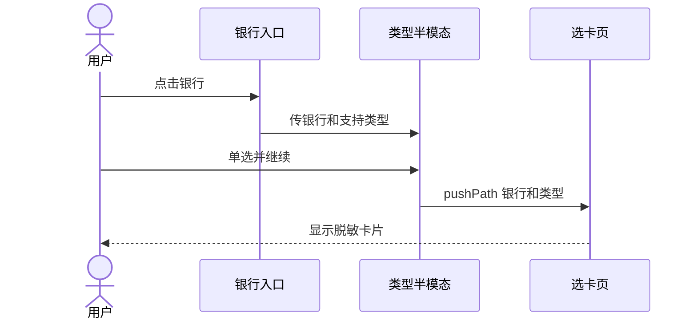
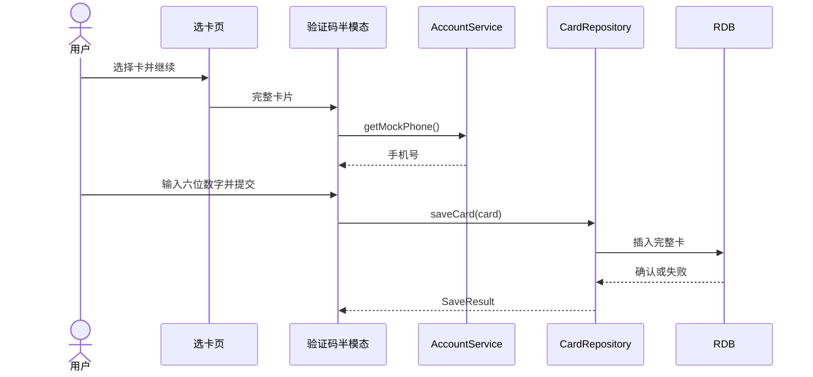
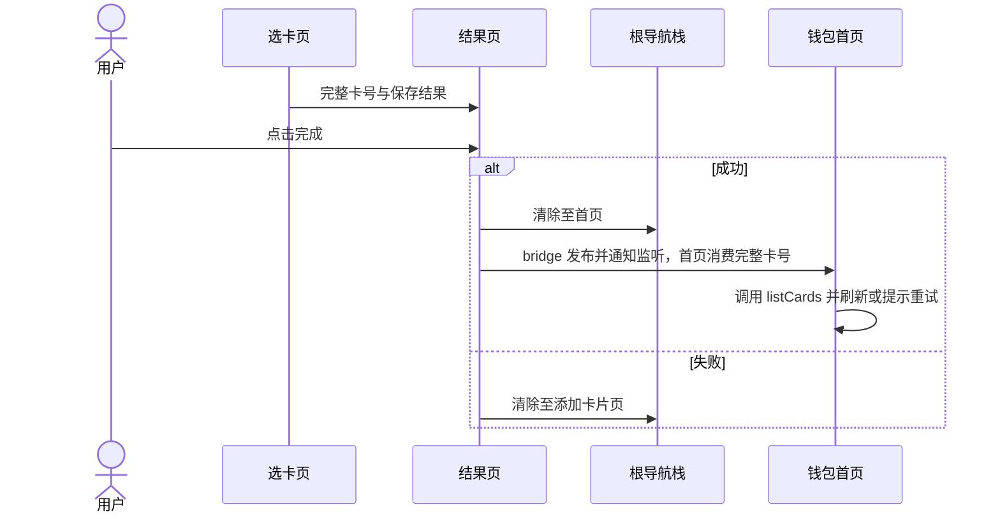
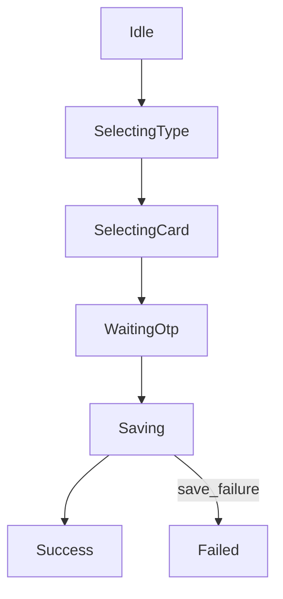

---
derived_from:
  artifact: component-blueprint@1
  component_id: WalletMain
  blueprint_id: bc-openCard-2
  revision: 1
  source_fingerprint: sha256:4c82211aa67c77e94b8c39adee0a9447f5b054336d760cee4f3fe5c9454c68df
  artifact_sha256: sha256:26d85017e627f3d9dee0b91aa12bc179109f7487542aca3893328c60af6ad024
  change_units: []
projection: component-blueprint-review@12
---

# 银行卡开卡

<a id="design-626c75657072696e743a62632d6f70656e436172642d32"></a>
阅读入口：先阅读方案、旅程、关键流程和交付安排；类型、方法、完整分支与验收全文见同文档的[技术与追溯参考](#reference)。

<a id="summary"></a>
## 1 方案摘要

从两个银行入口选择卡类型和卡片，模拟验证码后持久化并按结果清栈。

<a id="background"></a>
## 2 背景、目标与边界

现有银行入口提示暂不支持。

<a id="terms"></a>
## 3 术语

**添加卡片页面**：卡种总入口 AddCardEntryPage，失败返回此页，区别于银行列表。

**添加银行卡页面**：AddBankCardPage 银行列表，从卡种总入口进入。

**全部银行**：AllBanksPage，由 AddBankCardPage 进入的完整银行列表。

**卡片大类**：银行卡、交通卡、门禁卡等顶层分类，银行卡记录为 bank。

**卡类型**：同一银行卡下储蓄卡或信用卡，与卡片大类不同。

**钱包首页**：Phone 根 Navigation 中的 HomeTabPage，非卡包和添卡页。

<a id="journey"></a>
## 4 用户旅程与界面

### journey

1. 从首页或卡包进入添卡并选择银行卡；展示银行列表，可进入全部银行
2. 选择银行和卡类型；展示支持类型并跳转选卡
3. 选择卡片并同意协议；打开验证码半模态
4. 输入六位验证码并提交；等待保存并将完整卡号和结果交结果页
5. 点击完成；成功回首页并携带卡号；失败回添加卡片页

**AddBankCardPage**：银行入口及类型弹层

**AllBanksPage**：全部银行入口及类型弹层

**BankTypeSheet**：按银行支持类型单选并继续

**BankCardSelectionPage**：筛选并展示脱敏卡，单选与协议

**OtpSheet**：手机号、验证码、倒计时及提交

**AddCardResultPage**：按保存结果渲染并完成清栈

**HomeTabPage**：消费一次性成功卡号

<a id="solution"></a>
## 5 整体方案

卡类型、卡片和持久化契约

卡类型、卡片和持久化契约

在既有模块分层中扩展

<a id="flows"></a>
## 6 关键流程

### 选择银行和卡片

两个现有银行入口均打开类型选择；继续后选卡页按银行和类型加载 mock 卡。

[设计依据](#reader-guide-source-1)

<a id="design-67726170683a73656c656374696f6e2d73657175656e6365"></a>
完整调用时序：银行与选卡



### 验证和保存

验证码页读取账号 mock 手机号并启动倒计时。输入六位数字后等待仓库确认，失败同样保留原始卡号。

[设计依据](#reader-guide-source-2)

<a id="design-67726170683a736176652d73657175656e6365"></a>
完整调用时序：验证与保存



### 结果与完成

结果页接收完整卡号和结果；成功清栈后通知首页消费一次性卡号并查询数据库，失败返回添加卡片页。首页重建也查询，读取失败提示并可重试。

[设计依据](#reader-guide-source-3)

<a id="design-67726170683a726573756c742d73657175656e6365"></a>
完整调用时序：结果与清栈



<a id="decisions"></a>
## 8 关键取舍

<a id="design-6465636973696f6e3a726573756c742d64657374696e6174696f6e"></a>
### result-destination

| 关切 | 结论 |
| --- | --- |
| 选了什么 | 本次成功回钱包首页并携带完整卡号；失败回最初添卡入口。银行卡详情页是后续工作。|
| 理由 | 需求规格第6条明确规定本次与未来详情页的时间范围；页面说明中的详情页去向按该条件解释。|

被否方案：

未记录；不推测被否选择。

<a id="design-6465636973696f6e3a6d6f636b2d70686f6e65"></a>
### mock-phone

| 关切 | 结论 |
| --- | --- |
| 选了什么 | 账号域增设独立 mock 手机号并经公开出口消费。|
| 理由 | 现有账号 mock 只有脱敏邮箱，不能满足短信页手机号展示。|

被否方案：

未记录；不推测被否选择。

<a id="design-6465636973696f6e3a77616c6c65742d7061676573"></a>
### wallet-pages

| 关切 | 结论 |
| --- | --- |
| 选了什么 | 选型结果：自定义实现；选型目标：[implementation](#design-766965773a646576656c6f706d656e742f6e6f64653a696d706c656d656e746174696f6e) |
| 理由 | 沿用现有入口与首页，按本次业务新增选卡和结果页面；通用组件按源码适配。|

被否方案：

未记录；不推测被否选择。

<a id="recovery"></a>
## 9 失败与恢复

### open-card

**处理**：初始化、插入或重复卡失败均携原全卡号进入失败结果页；提交锁定返回直至结果。进程重建丢弃瞬态，首页挂载调用 listCards 查询已提交数据，不推断未确认结果；查询异常保留展示并提示重试，不视为空库。

**重试**：用户可从入口重新发起；验证码到时可重发

边界验收：[BD-1](#design-616363657074616e63653a766965773a7363656e6172696f732f6e6f64653a6a6f75726e65792f626f756e6461726965733a42442d31)；[BD-2](#design-616363657074616e63653a766965773a7363656e6172696f732f6e6f64653a6a6f75726e65792f626f756e6461726965733a42442d32)。

<a id="delivery"></a>
## 11 施工与上线

尚未拆分。

### 文件与目录

```text
├── 01-Product/Phone/src/main/ets/pages/
│   └── index.ets
├── 02-Feature/WalletMain/src/main/
│   ├── ets/
│   │   ├── data/
│   │   │   ├── model/
│   │   │   │   ├── AddCardResultParams.ets
│   │   │   │   ├── BankCard.ets
│   │   │   │   ├── BankInfo.ets
│   │   │   │   └── SaveResult.ets
│   │   │   └── repository/
│   │   │       ├── BankRepository.ets
│   │   │       └── CardRepository.ets
│   │   ├── domain/flow/
│   │   │   └── OpenCardFlow.ets
│   │   ├── index.ets
│   │   ├── presentation/
│   │   │   ├── components/
│   │   │   │   ├── BankTypeSheet.ets
│   │   │   │   └── OtpSheet.ets
│   │   │   └── pages/
│   │   │       ├── AddBankCardPage.ets
│   │   │       ├── AddCardResultPage.ets
│   │   │       ├── AllBanksPage.ets
│   │   │       ├── BankCardSelectionPage.ets
│   │   │       └── HomeTabPage.ets
│   │   └── shared/
│   │       ├── HomeLaunchBridge.ets
│   │       └── constant/
│   │           └── BankConstants.ets
│   └── resources/base/element/
│       ├── color.json
│       └── string.json
└── 04-BusinessBase/AccountManager/src/main/ets/domain/service/
    └── AccountService.ets
```

<a id="acceptance"></a>
## 12 验收

### journey

功能结果：[AC-1](#design-616363657074616e63653a766965773a7363656e6172696f732f6e6f64653a6a6f75726e65792f63726974657269613a41432d31)；[AC-2](#design-616363657074616e63653a766965773a7363656e6172696f732f6e6f64653a6a6f75726e65792f63726974657269613a41432d32)；[AC-3](#design-616363657074616e63653a766965773a7363656e6172696f732f6e6f64653a6a6f75726e65792f63726974657269613a41432d33)；[AC-4](#design-616363657074616e63653a766965773a7363656e6172696f732f6e6f64653a6a6f75726e65792f63726974657269613a41432d34)；[AC-5](#design-616363657074616e63653a766965773a7363656e6172696f732f6e6f64653a6a6f75726e65792f63726974657269613a41432d35)；[AC-6](#design-616363657074616e63653a766965773a7363656e6172696f732f6e6f64653a6a6f75726e65792f63726974657269613a41432d36)；[AC-7](#design-616363657074616e63653a766965773a7363656e6172696f732f6e6f64653a6a6f75726e65792f63726974657269613a41432d37)。

失败与边界：[BD-1](#design-616363657074616e63653a766965773a7363656e6172696f732f6e6f64653a6a6f75726e65792f626f756e6461726965733a42442d31)；[BD-2](#design-616363657074616e63653a766965773a7363656e6172696f732f6e6f64653a6a6f75726e65792f626f756e6461726965733a42442d32)。

<a id="questions"></a>
## 13 待补问题

### 术语假定

| 术语 | 当前假定解释 | 确认情况 |
| --- | --- | --- |
| 添加卡片页面 | 卡种总入口 AddCardEntryPage，失败返回此页，区别于银行列表。| 作者自行假定，待确认 |
| 添加银行卡页面 | AddBankCardPage 银行列表，从卡种总入口进入。| 作者自行假定，待确认 |
| 全部银行 | AllBanksPage，由 AddBankCardPage 进入的完整银行列表。| 作者自行假定，待确认 |
| 卡片大类 | 银行卡、交通卡、门禁卡等顶层分类，银行卡记录为 bank。| 作者自行假定，待确认 |
| 卡类型 | 同一银行卡下储蓄卡或信用卡，与卡片大类不同。| 作者自行假定，待确认 |
| 钱包首页 | Phone 根 Navigation 中的 HomeTabPage，非卡包和添卡页。| 作者自行假定，待确认 |

完整术语与来源见[术语参考](#review-terms)。


<a id="reference"></a>
## 技术与追溯参考

部件 WalletMain · 蓝图 bc-openCard-2 · revision 1 · 准入 阻塞

本文根据 canonical 蓝图与当前施工单元确定性生成，文首保留精确来源身份。是否通过设计交接见 readiness；施工授权、映射与完成结论由原责任阶段确认。可选说明缺失或过期不改变这些结论。

参考保留全部声明；不从名称、目录或数组顺序推断调用、依赖与未声明存储设计。正文的验收链接按来源目标与条目编号定位。

### A 字段与类型

<a id="review-summary-details"></a>
#### 原概述与目标

| 关切 | 设计说明 |
| --- | --- |
| 背景 | 现有银行入口提示暂不支持。 |
| 问题 | — |
| 本次改变 | 从两个银行入口选择卡类型和卡片，模拟验证码后持久化并按结果清栈。 |
| 整体定位 | — |
| 范围 | — |
| 不做什么 | — |

未记录：问题（设计说明）；整体定位（设计说明）；范围（设计说明）；不做什么（设计说明）。

<a id="review-terms"></a>
#### 完整术语

| 术语 | 含义 | 模块 | 易混项 | 确认依据 |
| --- | --- | --- | --- | --- |
| 添加卡片页面 | 卡种总入口 AddCardEntryPage，失败返回此页，区别于银行列表。 | WalletMain | 钱包主功能内其他页面或卡分类 | doc/module-catalog.yaml |
| 添加银行卡页面 | AddBankCardPage 银行列表，从卡种总入口进入。 | WalletMain | 钱包主功能内其他页面或卡分类 | doc/module-catalog.yaml |
| 全部银行 | AllBanksPage，由 AddBankCardPage 进入的完整银行列表。 | WalletMain | 钱包主功能内其他页面或卡分类 | doc/module-catalog.yaml |
| 卡片大类 | 银行卡、交通卡、门禁卡等顶层分类，银行卡记录为 bank。 | WalletMain | 钱包主功能内其他页面或卡分类 | doc/module-catalog.yaml |
| 卡类型 | 同一银行卡下储蓄卡或信用卡，与卡片大类不同。 | WalletMain | 钱包主功能内其他页面或卡分类 | doc/module-catalog.yaml |
| 钱包首页 | Phone 根 Navigation 中的 HomeTabPage，非卡包和添卡页。 | WalletMain | 钱包主功能内其他页面或卡分类 | doc/module-catalog.yaml |

#### 领域模型、字段与枚举

<a id="design-6d6f64656c3a766965773a646576656c6f706d656e742f6e6f64653a696d706c656d656e746174696f6e2f42616e6b43617264"></a>
内容承载于：[implementation](#design-766965773a646576656c6f706d656e742f6e6f64653a696d706c656d656e746174696f6e) · 契约设计

#### BankCard · 接口

模块 未记录；文件 02-Feature/WalletMain/src/main/ets/data/model/BankCard.ets

| 字段 | 类型 | 必需 | 约束/说明 |
| --- | --- | --- | --- |
| fullCardNumber | string | 是 | 完整卡号；界面仅显示前四后四 |
| category | string | 是 | 卡片大类，银行卡为 bank |
| bankName | string | 是 | 银行名称 |
| bankCardType | string | 是 | 储蓄卡或信用卡 |
| addedAt | number | 是 | 添加时间，Unix 毫秒 |
| huaweiPayStatus | string | 是 | 华为支付开通状态，初始未开通 |
| unionPayStatus | string | 是 | 银联手机闪付开通状态，初始未开通 |
| transactions | string | 是 | 交易记录 JSON，初始空数组 |

未记录：可空；默认值；补充约束；验证引用；来源。

<a id="design-6d6f64656c3a766965773a646576656c6f706d656e742f6e6f64653a696d706c656d656e746174696f6e2f53617665526573756c74"></a>


#### SaveResult · 接口

模块 未记录；文件 02-Feature/WalletMain/src/main/ets/data/model/SaveResult.ets

| 字段 | 类型 | 必需 | 约束/说明 |
| --- | --- | --- | --- |
| success | boolean | 是 | 仅数据库确认写入成功为 true |

未记录：可空；默认值；补充约束；验证引用；来源。

<a id="design-6d6f64656c3a766965773a646576656c6f706d656e742f6e6f64653a696d706c656d656e746174696f6e2f41646443617264526573756c74506172616d73"></a>


#### AddCardResultParams · 接口

模块 未记录；文件 02-Feature/WalletMain/src/main/ets/data/model/AddCardResultParams.ets

| 字段 | 类型 | 必需 | 约束/说明 |
| --- | --- | --- | --- |
| fullCardNumber | string | 是 | 完整原始卡号，包括失败时 |
| success | boolean | 是 | 保存结果 |

未记录：可空；默认值；补充约束；验证引用；来源。

### B 接口与存储明细

#### 本部件实际消费或提供的操作与 DTO

<a id="design-636f6e74726163743a636172642d73746f7265"></a>
#### card-store

操作：saveCard · 1 · internal；责任方 WalletMain；需要方 开卡流程

<a id="design-64746f3a636172642d73746f72652f726571756573745f64746f"></a>
**请求 DTO：saveCardrequest\_dto**

来源：[request\_dto](../../../../doc/features/bc-openCard-2/blueprint/component-blueprint.yaml#/contracts/0/request_dto)
验证引用：doc/features/原始需求/1-2-银行卡/原始需求.md

| 字段 | 类型 | 必需 | 语义 | 来源 |
| --- | --- | --- | --- | --- |
| fullCardNumber | string | 是 | 完整卡号；界面仅显示前四后四 | doc/features/bc-openCard-2/blueprint/component-blueprint.yaml#/contracts/0/request\_dto/fields/0 |
| category | string | 是 | 卡片大类，银行卡为 bank | doc/features/bc-openCard-2/blueprint/component-blueprint.yaml#/contracts/0/request\_dto/fields/1 |
| bankName | string | 是 | 银行名称 | doc/features/bc-openCard-2/blueprint/component-blueprint.yaml#/contracts/0/request\_dto/fields/2 |
| bankCardType | string | 是 | 储蓄卡或信用卡 | doc/features/bc-openCard-2/blueprint/component-blueprint.yaml#/contracts/0/request\_dto/fields/3 |
| addedAt | number | 是 | 添加时间，Unix 毫秒 | doc/features/bc-openCard-2/blueprint/component-blueprint.yaml#/contracts/0/request\_dto/fields/4 |
| huaweiPayStatus | string | 是 | 华为支付开通状态，初始未开通 | doc/features/bc-openCard-2/blueprint/component-blueprint.yaml#/contracts/0/request\_dto/fields/5 |
| unionPayStatus | string | 是 | 银联手机闪付开通状态，初始未开通 | doc/features/bc-openCard-2/blueprint/component-blueprint.yaml#/contracts/0/request\_dto/fields/6 |
| transactions | string | 是 | 交易记录 JSON，初始空数组 | doc/features/bc-openCard-2/blueprint/component-blueprint.yaml#/contracts/0/request\_dto/fields/7 |

未记录：可空；默认值；约束；验证引用。

<a id="design-64746f3a636172642d73746f72652f726573706f6e73655f64746f"></a>
**响应 DTO：saveCardresponse\_dto**

来源：[response\_dto](../../../../doc/features/bc-openCard-2/blueprint/component-blueprint.yaml#/contracts/0/response_dto)
验证引用：doc/features/原始需求/1-2-银行卡/原始需求.md

| 字段 | 类型 | 必需 | 语义 | 来源 |
| --- | --- | --- | --- | --- |
| success | boolean | 是 | 持久化确认结果 | doc/features/bc-openCard-2/blueprint/component-blueprint.yaml#/contracts/0/response\_dto/fields/0 |

映射：

| 映射 | 类型 | 源字段 | 目标字段 | 规则 |
| --- | --- | --- | --- | --- |
| request\_dto-fullCardNumber | 直接映射 | fullCardNumber | fullCardNumber | 完整卡号；界面仅显示前四后四 |
| request\_dto-category | 直接映射 | category | category | 卡片大类，银行卡为 bank |
| request\_dto-bankName | 直接映射 | bankName | bankName | 银行名称 |
| request\_dto-bankCardType | 直接映射 | bankCardType | bankCardType | 储蓄卡或信用卡 |
| request\_dto-addedAt | 直接映射 | addedAt | addedAt | 添加时间，Unix 毫秒 |
| request\_dto-huaweiPayStatus | 直接映射 | huaweiPayStatus | huaweiPayStatus | 华为支付开通状态，初始未开通 |
| request\_dto-unionPayStatus | 直接映射 | unionPayStatus | unionPayStatus | 银联手机闪付开通状态，初始未开通 |
| request\_dto-transactions | 直接映射 | transactions | transactions | 交易记录 JSON，初始空数组 |
| response\_dto-success | 直接映射 | success | success | 持久化确认结果 |

错误：存储失败返回失败
来源：[errors](../../../../doc/features/bc-openCard-2/blueprint/component-blueprint.yaml#/contracts/0/errors)
验证：doc/features/原始需求/1-2-银行卡/原始需求.md
幂等：完整卡号唯一，重复返回失败
来源：[idempotency](../../../../doc/features/bc-openCard-2/blueprint/component-blueprint.yaml#/contracts/0/idempotency)
验证：doc/features/原始需求/1-2-银行卡/原始需求.md
非功能要求：不记录完整卡号或手机号
来源：[nfr](../../../../doc/features/bc-openCard-2/blueprint/component-blueprint.yaml#/contracts/0/nfr)
验证：doc/features/原始需求/1-2-银行卡/原始需求.md

未记录：可空；默认值；约束；验证引用。

<a id="design-636f6e74726163743a6d6f636b2d70686f6e65"></a>
#### mock-phone

操作：getMockPhone · 1 · internal；责任方 AccountManager；需要方 开卡流程

<a id="design-64746f3a6d6f636b2d70686f6e652f726571756573745f64746f"></a>
**请求 DTO：getMockPhonerequest\_dto**

来源：[request\_dto](../../../../doc/features/bc-openCard-2/blueprint/component-blueprint.yaml#/contracts/1/request_dto)
验证引用：doc/features/原始需求/1-2-银行卡/原始需求.md

<a id="design-64746f3a6d6f636b2d70686f6e652f726573706f6e73655f64746f"></a>
**响应 DTO：getMockPhoneresponse\_dto**

来源：[response\_dto](../../../../doc/features/bc-openCard-2/blueprint/component-blueprint.yaml#/contracts/1/response_dto)
验证引用：doc/features/原始需求/1-2-银行卡/原始需求.md

| 字段 | 类型 | 必需 | 语义 | 来源 |
| --- | --- | --- | --- | --- |
| phone | string | 是 | 账号域 mock 手机号；返回值本身为字符串 | doc/features/bc-openCard-2/blueprint/component-blueprint.yaml#/contracts/1/response\_dto/fields/0 |

映射：

| 映射 | 类型 | 源字段 | 目标字段 | 规则 |
| --- | --- | --- | --- | --- |
| response\_dto-phone | 直接映射 | phone | phone | 账号域 mock 手机号；返回值本身为字符串 |

错误：读取不到时明确失败
来源：[errors](../../../../doc/features/bc-openCard-2/blueprint/component-blueprint.yaml#/contracts/1/errors)
验证：doc/features/原始需求/1-2-银行卡/原始需求.md
幂等：只读
来源：[idempotency](../../../../doc/features/bc-openCard-2/blueprint/component-blueprint.yaml#/contracts/1/idempotency)
验证：doc/features/原始需求/1-2-银行卡/原始需求.md
非功能要求：不记录完整卡号或手机号
来源：[nfr](../../../../doc/features/bc-openCard-2/blueprint/component-blueprint.yaml#/contracts/1/nfr)
验证：doc/features/原始需求/1-2-银行卡/原始需求.md

未记录：可空；默认值；约束；验证引用。

#### 持久化表结构

表结构来自根级接口契约；领域模型见字段与类型，存储约束和编码保留此处原始声明。

##### card-store 的存储设计

| 存储关切 | 声明 |
| --- | --- |
| 数据库 | wallet\_cards.db |
| 版本 | 1 |
| 安全级别 | — |
| 加密 | — |

未记录：安全级别（声明）；加密（声明）。

###### 表 cards

| 表关切 |
| --- |
| 主键 |
| 约束 |
| 升级策略 |
| 来源 |

columns 未能表达（应为对象数组）。


未记录：主键（声明）；约束（声明）；升级策略（声明）；来源（声明）。

<a id="design-696e746572666163653a766965773a646576656c6f706d656e742f6e6f64653a696d706c656d656e746174696f6e2f436172645265706f7369746f7279"></a>
接口 CardRepository · 未记录 / 未记录 · 02-Feature/WalletMain/src/main/ets/data/repository/CardRepository.ets

| 方法 | 参数 | 返回 | 职责/失败语义 |
| --- | --- | --- | --- |
| saveCard | card: BankCard | Promise&lt;SaveResult&gt; | 完整卡号唯一，等待持久化后返回成功或失败；保留现有分类接口。 |
| listCards | 无 | Promise&lt;BankCard\[\]&gt; | 查询所有已提交卡及完整字段，成功无记录返回空数组；打开、查询或解析失败拒绝 Promise，调用方提示并可重试，不将失败映射为空数组。 |

未记录：异步。

<a id="design-696e746572666163653a766965773a646576656c6f706d656e742f6e6f64653a696d706c656d656e746174696f6e2f42616e6b5265706f7369746f7279"></a>
接口 BankRepository · 未记录 / 未记录 · 02-Feature/WalletMain/src/main/ets/data/repository/BankRepository.ets

| 方法 | 参数 | 返回 | 职责/失败语义 |
| --- | --- | --- | --- |
| getMockCards | bankId: string；cardType: string | BankCard\[\] | 返回银行与类型匹配的 1–2 张 mock 卡。 |

未记录：异步。

<a id="design-696e746572666163653a766965773a646576656c6f706d656e742f6e6f64653a696d706c656d656e746174696f6e2f4163636f756e7453657276696365"></a>
接口 AccountService · 未记录 / 未记录 · 04-BusinessBase/AccountManager/src/main/ets/domain/service/AccountService.ets

| 方法 | 参数 | 返回 | 职责/失败语义 |
| --- | --- | --- | --- |
| getMockPhone | 无 | Promise&lt;string&gt; | 返回独立账号 mock 手机号，保留现有 getUserProfile 与公开出口。 |

未记录：异步。

<a id="design-696e746572666163653a766965773a646576656c6f706d656e742f6e6f64653a696d706c656d656e746174696f6e2f486f6d654c61756e6368427269646765"></a>
接口 HomeLaunchBridge · 未记录 / 未记录 · 02-Feature/WalletMain/src/main/ets/shared/HomeLaunchBridge.ets

| 方法 | 参数 | 返回 | 职责/失败语义 |
| --- | --- | --- | --- |
| publishAddedCard | fullCardNumber: string | void | 结果页成功时发布一次性载荷 |
| consumeAddedCard | 无 | string &#124; undefined | 首页原子取出并清除载荷，无载荷返回 undefined。 |
| subscribeAddedCard | listener: () =&gt; void | void | 首页挂载时注册通知回调并立即检查已存在载荷；卸载时解除监听，避免重复通知或悬空回调。 |
| unsubscribeAddedCard | listener: () =&gt; void | void | 移除对应监听，不丢弃尚未消费的载荷。 |

组件 AddBankCardPage · 页面 · 02-Feature/WalletMain/src/main/ets/presentation/pages/AddBankCardPage.ets

银行入口及类型弹层

组件 AllBanksPage · 页面 · 02-Feature/WalletMain/src/main/ets/presentation/pages/AllBanksPage.ets

全部银行入口及类型弹层

组件 BankTypeSheet · 对话框 · 02-Feature/WalletMain/src/main/ets/presentation/components/BankTypeSheet.ets

按银行支持类型单选并继续

组件 BankCardSelectionPage · 页面 · 02-Feature/WalletMain/src/main/ets/presentation/pages/BankCardSelectionPage.ets

筛选并展示脱敏卡，单选与协议

组件 OtpSheet · 对话框 · 02-Feature/WalletMain/src/main/ets/presentation/components/OtpSheet.ets

手机号、验证码、倒计时及提交

组件 AddCardResultPage · 页面 · 02-Feature/WalletMain/src/main/ets/presentation/pages/AddCardResultPage.ets

按保存结果渲染并完成清栈

组件 HomeTabPage · 页面 · 02-Feature/WalletMain/src/main/ets/presentation/pages/HomeTabPage.ets

消费一次性成功卡号

组件 OpenCardFlow · coordinator · 02-Feature/WalletMain/src/main/ets/domain/flow/OpenCardFlow.ets

选择、倒计时、提交和结果状态

| 消费模块 | 提供模块 | 需修改 | 入口 |
| --- | --- | --- | --- |
| Phone | WalletMain | 是 | buildBankCardSelectionPage / buildAddCardResultPage |
| WalletMain | AccountManager | 是 | AccountService.getMockPhone |

未记录：异步。

#### 运行流与状态明细

<a id="design-766965773a72756e74696d652f666c6f773a6f70656e2d63617264"></a>
##### open-card

数据域：card-data；契约：contract:card-store；开发责任：view:development/node:implementation

触发：

| 类型 | 时机 | 幂等 |
| --- | --- | --- |
| 用户点击银行 | 两入口点击时 | 同一时刻只打开一个选择流程 |
| 提交验证码 | 六位数字后 | 提交中锁定；卡号唯一 |

首次加载：mock-load · 读取银行及卡片 mock；责任方 BankRepository；范围 所选银行和卡类型；新鲜度 每次进入

权威状态：contract:card-store；持久化 本机 RDB；投影/缓存 view:runtime/node:flow-owner；调和 写入失败不宣称成功；进程恢复以 RDB 为准
状态责任方：view:runtime/node:flow-owner；状态 选择类型；选择卡；验证码倒计时；写入中；结果

写入与发布：

| 写入 | 发布 | 恢复 |
| --- | --- | --- |
| save | publication:result | recovery:save-failure |

| 发布 | 载荷 |
| --- | --- |
| result | AddCardResultParams { fullCardNumber: string, success: boolean } |
| home | HomeCardHandoff { fullCardNumber: string } |

订阅与消费者：

| 订阅 | 发布 | 消费者 | 建立/解除 | 快照/重放 | 清理 | 顺序 |
| --- | --- | --- | --- | --- | --- | --- |
| home-handoff | publication:home | consumer:home-page | 首页 aboutToAppear 注册监听并检查待消费载荷 / 首页 aboutToDisappear 注销监听 | 未挂载时保留单个待消费载荷，注册后立即检查 | consumeAddedCard 原子取出并清除载荷，销毁时清理监听 | 成功清栈后发布；先注册再检查，通知及检查均原子消费，避免重复；查询以最新请求结果为准 |

| 消费者 | 首次加载 | 更新 |
| --- | --- | --- |
| result-page | initial-load:mock-load | publication:result |
| home-page | initial-load:mock-load | publication:home |

失败与恢复：save-failure

| 恢复关切 | 处理 |
| --- | --- |
| 失败处理 | 初始化、插入或重复卡失败均携原全卡号进入失败结果页；提交锁定返回直至结果。进程重建丢弃瞬态，首页挂载调用 listCards 查询已提交数据，不推断未确认结果；查询异常保留展示并提示重试，不视为空库。 |
| 重试 | 用户可从入口重新发起；验证码到时可重发 |

生命周期：

全表共同依据：doc/features/原始需求/1-2-银行卡/原始需求.md。

| 场景 | 覆盖裁决 |
| --- | --- |
| 冷启动 | 已覆盖 |
| 热恢复 | 已覆盖 |
| 页面挂载 | 已覆盖 |
| 页面卸载 | 已覆盖 |
| 账号切换 | 不适用 |
| 进程重建 | 已覆盖 |
| 后台写入 | 不适用 |

验证关注：doc/features/原始需求/1-2-银行卡/原始需求.md

未记录：触发；类型；持久化；时机；快照/语义；消费语义；处理。

内容承载于：[flow-owner](#design-766965773a72756e74696d652f6e6f64653a666c6f772d6f776e6572) · 契约设计

#### 施工状态与有序步骤

状态 未记录；持有者 未记录；作用域 未记录；责任方 未记录

| 顺序 | 行为 |
| --- | --- |
| 1 | AddBankCardPage 或 AllBanksPage 的 handleSelectBank(bank) 打开 BankTypeSheet，bank 含 id/name/supportedTypes；默认两种，单选。 |
| 2 | BankTypeSheet.confirm(type) 在已选择时调用 NavPathContext.stack().pushPath({name: BankCardSelectionPage, param: {bankId, bankName, cardType}})，弹层关闭。 |
| 3 | Phone 的 navDestinationMap(name, param) 分发 WalletMain 导出的 buildBankCardSelectionPage(param)；选卡页调用 BankRepository.getMockCards(bankId, cardType): BankCard\[\]，显示前四后四，选择卡并确认协议。 |
| 4 | BankCardSelectionPage 打开 OtpSheet，传所选完整 BankCard；OtpSheet 调用 AccountService.getInstance().getMockPhone(): Promise&lt;string&gt; 显示账号 mock 手机号，读取失败提示并允许重试，不提交。 |
| 5 | OtpSheet 首次打开模拟发送并记录单调时钟截止点 now+60s，tick 根据截止点计算剩余秒数；恢复时重算，未到截止禁重发，到期可重新发送并重设截止点；仅六位数字可提交。 |
| 6 | OtpSheet.confirmOtp(code) 取得同步提交锁，冻结取消及返回，调用 CardRepository.saveCard(card): Promise&lt;SaveResult&gt; 并等待；插入成功返回 success=true，初始化/唯一约束/写入失败返回 success=false，不依赖持久记录取得卡号。 |
| 7 | 选卡页持有的原始 card.fullCardNumber 与 SaveResult.success 构造 AddCardResultParams，通过 NavPathContext.stack().pushPath({name: AddCardResultPage, param}) 交给 Phone 分发及结果页；无论失败与否均传完整卡号。 |
| 8 | 结果页禁止系统返回及侧滑；完成成功将完整卡号经一次性 HomeLaunchBridge 交给 HomeTabPage，删除 AddCardEntryPage 起本次所有目的页及可能的 CardPackPage 以回根首页；完成失败 popToIndex(本次 AddCardEntryPage 索引)，保留该页，移除 AddBankCardPage、AllBanksPage 和后续页面。 |
| 9 | 成功完成时先把完整卡号暂存到完成处理回调，清栈后调用 HomeLaunchBridge.publishAddedCard(fullCardNumber)，随后清除该临时值；桥保存一次性载荷并同步通知已注册首页监听器；首页 aboutToAppear 注册监听并立即检查待消费载荷，aboutToDisappear 取消监听。监听回调调用 consumeAddedCard 原子取出并清空，交首页处理后不留全卡号；未挂载时载荷保留至注册，进程死亡则丢弃。 |
| 10 | 首页首次挂载及进程重建时调用 CardRepository.listCards(): Promise&lt;BankCard\[\]&gt; 读取全部已提交卡；收到成功交接后再次调用并等待，成功以数据库结果刷新卡状态，空数组仅表示查询成功且无卡；打开或查询失败 Promise 拒绝，保留既有展示、提示加载失败并允许重试，不伪称无卡或添卡失败。重复刷新以最新请求结果为准。 |
| 11 | 非提交时取消弹层清验证码/计时器，返回选卡或银行入口；返回选卡页销毁该页选择；提交中等待结果，禁止离开和再次提交。销毁页面取消 tick 并使迟到回调失效；结果交接消费后清除临时卡号，首页消费后清除一次性载荷。 |
| 12 | 进程被杀不恢复 OTP/临时选择或伪造结果；下次进入首页重新读取 RDB：提交前中断无记录，提交后中断可能已有记录，以查询为准；用户可重新发起，重复卡返回失败结果。 |

生命周期触发：—

### C 完整验收

内容承载于：[journey](#design-766965773a7363656e6172696f732f6e6f64653a6a6f75726e6579) · 验收设计

<a id="design-616363657074616e63653a766965773a7363656e6172696f732f6e6f64653a6a6f75726e65792f63726974657269613a41432d31"></a>
<a id="design-616363657074616e63653a766965773a7363656e6172696f732f6e6f64653a6a6f75726e65792f63726974657269613a41432d32"></a>
<a id="design-616363657074616e63653a766965773a7363656e6172696f732f6e6f64653a6a6f75726e65792f63726974657269613a41432d33"></a>
<a id="design-616363657074616e63653a766965773a7363656e6172696f732f6e6f64653a6a6f75726e65792f63726974657269613a41432d34"></a>
<a id="design-616363657074616e63653a766965773a7363656e6172696f732f6e6f64653a6a6f75726e65792f63726974657269613a41432d35"></a>
<a id="design-616363657074616e63653a766965773a7363656e6172696f732f6e6f64653a6a6f75726e65792f63726974657269613a41432d36"></a>
<a id="design-616363657074616e63653a766965773a7363656e6172696f732f6e6f64653a6a6f75726e65792f63726974657269613a41432d37"></a>
<a id="design-616363657074616e63653a766965773a7363656e6172696f732f6e6f64653a6a6f75726e65792f626f756e6461726965733a42442d31"></a>
<a id="design-616363657074616e63653a766965773a7363656e6172696f732f6e6f64653a6a6f75726e65792f626f756e6461726965733a42442d32"></a>
功能验收：

| AC | 优先级/功能 | 验收标准 | 验证步骤（按序） | 预期 | 分层/关注点 | 已有流程关联 | CU 谓词直接引用 |
| --- | --- | --- | --- | --- | --- | --- | --- |
| AC-1 | P0 / — | 两个银行入口按银行支持的类型打开单选半模态 | 1. 从钱包首页进入添加卡片并按对应入口执行：两个银行入口按银行支持的类型打开单选半模态<br>2. 检查状态、数据及返回路径 | 两个入口均按银行支持类型展示；默认 mock 银行均显示储蓄卡与信用卡，单选且未选不可继续。 | 单测与真机；UT：选择、验证和保存结果的业务状态及输入输出；device：页面、交互与路由；数据边界由 UT 验证 | 未声明；无 UI 依据时由 spec 不冲突补充 | 未登记直接谓词引用 |
| AC-2 | P0 / — | 银行及卡类型筛选 mock 卡，展示前四后四并同意协议 | 1. 从钱包首页进入添加卡片并按对应入口执行：银行及卡类型筛选 mock 卡，展示前四后四并同意协议<br>2. 检查状态、数据及返回路径 | 银行和类型各有 1–2 张 mock 卡，界面只显示前四后四，选一张并同意后可继续。 | 单测与真机；UT：选择、验证和保存结果的业务状态及输入输出；device：页面、交互与路由；数据边界由 UT 验证 | 未声明；无 UI 依据时由 spec 不冲突补充 | 未登记直接谓词引用 |
| AC-3 | P0 / — | 打开时假发送并倒计时60秒，六位数字后才可继续，归零允许重发 | 1. 从钱包首页进入添加卡片并按对应入口执行：打开时假发送并倒计时60秒，六位数字后才可继续，归零允许重发<br>2. 检查状态、数据及返回路径 | 打开即模拟发送并倒计时 60 秒；期间不可重发，归零可重发；仅六位数字启用下一步。 | 单测与真机；UT：选择、验证和保存结果的业务状态及输入输出；device：页面、交互与路由；数据边界由 UT 验证 | 未声明；无 UI 依据时由 spec 不冲突补充 | 未登记直接谓词引用 |
| AC-4 | P0 / — | 保存完整卡号和卡片详情到 RDB，记录结果并向结果页传全卡号 | 1. 从钱包首页进入添加卡片并按对应入口执行：保存完整卡号和卡片详情到 RDB，记录结果并向结果页传全卡号<br>2. 检查状态、数据及返回路径 | 保存成功完整字段可从 RDB 读取且 transactions 初值为 JSON 字符串 \[\]；初始化、写入或重复失败均将原完整卡号和失败结果交结果页。首页重建查询已提交数据，查询失败提示重试而非视为空库。 | 单测与真机；UT：选择、验证和保存结果的业务状态及输入输出；device：页面、交互与路由；数据边界由 UT 验证 | 未声明；无 UI 依据时由 spec 不冲突补充 | 未登记直接谓词引用 |
| AC-5 | P0 / — | 结果页禁止返回，仅完成退出；成功清理开卡流程到首页并传卡号，失败回添加卡片页 | 1. 从钱包首页进入添加卡片并按对应入口执行：结果页禁止返回，仅完成退出；成功清理开卡流程到首页并传卡号，失败回添加卡片页<br>2. 检查状态、数据及返回路径 | 结果页按成功或失败展示图标、文案及提示，无标题和返回箭头且屏蔽返回与侧滑；完成成功回首页携带完整卡号，失败回 AddCardEntryPage。常驻首页通过订阅消费成功卡号一次并刷新，重挂载不重复消费。 | 单测与真机；UT：选择、验证和保存结果的业务状态及输入输出；device：页面、交互与路由；数据边界由 UT 验证 | 未声明；无 UI 依据时由 spec 不冲突补充 | 未登记直接谓词引用 |
| AC-6 | P0 / — | 沿用已有导航机制，验证新旧页面互跳和原路由 | 1. 从钱包首页进入添加卡片并按对应入口执行：沿用已有导航机制，验证新旧页面互跳和原路由<br>2. 检查状态、数据及返回路径 | 原有入口及其他页面往返不受损；两个银行入口均完成成功和失败的正确清栈。 | 单测与真机；UT：选择、验证和保存结果的业务状态及输入输出；device：页面、交互与路由；数据边界由 UT 验证 | 未声明；无 UI 依据时由 spec 不冲突补充 | 未登记直接谓词引用 |
| AC-7 | P0 / — | 四页面按原始参考图布局，结果页不做 NFC 激活 | 1. 从钱包首页进入添加卡片并按对应入口执行：四页面按原始参考图布局，结果页不做 NFC 激活<br>2. 检查状态、数据及返回路径 | 类型半模态、选卡页、验证码半模态及结果页分别对照原图 3、4、5、6；协议为文本，结果含引导图，不实现 NFC 激活。 | 单测与真机；UT：选择、验证和保存结果的业务状态及输入输出；device：页面、交互与路由；数据边界由 UT 验证 | 未声明；无 UI 依据时由 spec 不冲突补充 | 未登记直接谓词引用 |

边界验收：

| BD | 优先级 | 异常场景 | 处理 | 可见结果/预期 | 分层/关注点 | CU 谓词直接引用 |
| --- | --- | --- | --- | --- | --- | --- |
| BD-1 | P0 | RDB 失败也进入失败结果页并保留完整卡号；防止重复提交。 | RDB 失败也进入失败结果页并保留完整卡号；防止重复提交。 | RDB 失败也进入失败结果页并保留完整卡号；防止重复提交。 | 未记录；未记录关注点 | 未登记直接谓词引用 |
| BD-2 | P0 | 验证码为空、非数字或不足六位不可提交；倒计时期间不可重发。 | 验证码为空、非数字或不足六位不可提交；倒计时期间不可重发。 | 验证码为空、非数字或不足六位不可提交；倒计时期间不可重发。 | 未记录；未记录关注点 | 未登记直接谓词引用 |

### D 全部用例分支与界面调用

<a id="design-75693a766965773a72756e74696d652f666c6f773a6f70656e2d636172642f6f70656e5f63617264"></a>
#### 用例 open\_card 的界面与交互

内容承载于：[open-card](#design-766965773a72756e74696d652f666c6f773a6f70656e2d63617264) · 用例设计

| 界面/交互 | 职责 | 用户动作与调用 | 订阅 |
| --- | --- | --- | --- |
| AddBankCardPage | 入口 | 点击银行 → flow.selectBank | flow.state.phase |
| AllBanksPage | 入口 | 点击银行 → flow.selectBank | flow.state.phase |
| BankTypeSheet | 对话框 | 选择类型并继续 → flow.selectType | flow.state.phase |
| BankCardSelectionPage | 过程 | 选择卡并继续 → flow.selectCard | flow.state.phase |
| OtpSheet | 对话框 | 输入验证码并提交 → flow.confirmOtp | flow.state.phase |
| AddCardResultPage | 结果 | 点击完成 → flow.finish | flow.state.phase |

#### 用例、数据边界与分支


#### 用例 open\_card

两个银行入口选择类型和卡、验证后保存并交接结果

编排入口：OpenCardFlow；文件 02-Feature/WalletMain/src/main/ets/domain/flow/OpenCardFlow.ets

| 状态集合 |
| --- |
| Idle |
| SelectingType |
| SelectingCard |
| WaitingOtp |
| Saving |
| Success |
| Failed |

阶段流转（展示基准：success；基准已出现的边不标标签，其余边标分支，完整来源见下方分支表）：



| 状态字段 | 类型 |
| --- | --- |
| fullCardNumber | string |
| remainingSeconds | number |
| success | boolean |

界面职责、动作、调用与订阅见 [用例 open\_card 的交互表](#design-75693a766965773a72756e74696d652f666c6f773a6f70656e2d636172642f6f70656e5f63617264)。

数据边界：banks · BankRepository · storage

| 方法 | 参数 | 返回 | 异步 |
| --- | --- | --- | --- |
| getMockCards | string；string | BankCard\[\] | 否 |

数据边界：account · AccountService · system

| 方法 | 参数 | 返回 | 异步 |
| --- | --- | --- | --- |
| getMockPhone | 无 | Promise&lt;string&gt; | 是 |

数据边界：cards · CardRepository · storage

| 方法 | 参数 | 返回 | 异步 |
| --- | --- | --- | --- |
| saveCard | BankCard | Promise&lt;SaveResult&gt; | 是 |
| listCards | 无 | Promise&lt;BankCard\[\]&gt; | 是 |

主路径及分支去向：

| 分支 | 条件 | 关联验收 |
| --- | --- | --- |
| success | 有效选择和六位数字，保存成功 | [AC-1](#design-616363657074616e63653a766965773a7363656e6172696f732f6e6f64653a6a6f75726e65792f63726974657269613a41432d31)；[AC-2](#design-616363657074616e63653a766965773a7363656e6172696f732f6e6f64653a6a6f75726e65792f63726974657269613a41432d32)；[AC-3](#design-616363657074616e63653a766965773a7363656e6172696f732f6e6f64653a6a6f75726e65792f63726974657269613a41432d33)；[AC-4](#design-616363657074616e63653a766965773a7363656e6172696f732f6e6f64653a6a6f75726e65792f63726974657269613a41432d34)；[AC-5](#design-616363657074616e63653a766965773a7363656e6172696f732f6e6f64653a6a6f75726e65792f63726974657269613a41432d35)；[AC-6](#design-616363657074616e63653a766965773a7363656e6172696f732f6e6f64653a6a6f75726e65792f63726974657269613a41432d36)；[AC-7](#design-616363657074616e63653a766965773a7363656e6172696f732f6e6f64653a6a6f75726e65792f63726974657269613a41432d37) |
| save\_failure | 数据库初始化、写入或重复卡失败，仍交完整卡号 | [AC-4](#design-616363657074616e63653a766965773a7363656e6172696f732f6e6f64653a6a6f75726e65792f63726974657269613a41432d34)；[AC-5](#design-616363657074616e63653a766965773a7363656e6172696f732f6e6f64653a6a6f75726e65792f63726974657269613a41432d35)；[BD-1](#design-616363657074616e63653a766965773a7363656e6172696f732f6e6f64653a6a6f75726e65792f626f756e6461726965733a42442d31) |
| invalid\_otp | 少于六位或非数字，倒计时内不可重发 | [AC-3](#design-616363657074616e63653a766965773a7363656e6172696f732f6e6f64653a6a6f75726e65792f63726974657269613a41432d33)；[BD-2](#design-616363657074616e63653a766965773a7363656e6172696f732f6e6f64653a6a6f75726e65792f626f756e6461726965733a42442d32) |
| cancel | 提交前取消并清理临时数据 | [AC-1](#design-616363657074616e63653a766965773a7363656e6172696f732f6e6f64653a6a6f75726e65792f63726974657269613a41432d31)；[AC-2](#design-616363657074616e63653a766965773a7363656e6172696f732f6e6f64653a6a6f75726e65792f63726974657269613a41432d32) |

**分支 success 的行为与去向**

| 关切 | 声明内容 |
| --- | --- |
| 动作顺序 | selectBank；selectType；selectCard；confirmOtp |
| 阶段去向 | Idle；SelectingType；SelectingCard；WaitingOtp；Saving；Success |
| 端口调用 | banks.getMockCards；account.getMockPhone；cards.saveCard |
| 预期状态 | — |
| 不得调用 | — |

**分支 save\_failure 的行为与去向**

| 关切 | 声明内容 |
| --- | --- |
| 动作顺序 | selectBank；selectType；selectCard；confirmOtp |
| 阶段去向 | Idle；SelectingType；SelectingCard；WaitingOtp；Saving；Failed |
| 端口调用 | banks.getMockCards；account.getMockPhone；cards.saveCard |
| 预期状态 | — |
| 不得调用 | — |

**分支 invalid\_otp 的行为与去向**

| 关切 | 声明内容 |
| --- | --- |
| 动作顺序 | selectBank；selectType；selectCard |
| 阶段去向 | Idle；SelectingType；SelectingCard |
| 端口调用 | banks.getMockCards；account.getMockPhone |
| 预期状态 | — |
| 不得调用 | — |

**分支 cancel 的行为与去向**

| 关切 | 声明内容 |
| --- | --- |
| 动作顺序 | selectBank；selectType；selectCard |
| 阶段去向 | Idle；SelectingType；SelectingCard |
| 端口调用 | banks.getMockCards |
| 预期状态 | — |
| 不得调用 | — |

未记录：预期状态（声明内容）；不得调用（声明内容）。

### E 施工精确映射

#### 声明文件（完整施工写集）

<a id="design-66696c653a30322d466561747572652f57616c6c65744d61696e2f7372632f6d61696e2f6574732f646174612f6d6f64656c2f42616e6b496e666f2e657473"></a>
<a id="design-66696c653a30322d466561747572652f57616c6c65744d61696e2f7372632f6d61696e2f6574732f646174612f6d6f64656c2f42616e6b436172642e657473"></a>
<a id="design-66696c653a30322d466561747572652f57616c6c65744d61696e2f7372632f6d61696e2f6574732f646174612f6d6f64656c2f41646443617264526573756c74506172616d732e657473"></a>
<a id="design-66696c653a30322d466561747572652f57616c6c65744d61696e2f7372632f6d61696e2f6574732f646174612f7265706f7369746f72792f42616e6b5265706f7369746f72792e657473"></a>
<a id="design-66696c653a30322d466561747572652f57616c6c65744d61696e2f7372632f6d61696e2f6574732f646174612f7265706f7369746f72792f436172645265706f7369746f72792e657473"></a>
<a id="design-66696c653a30322d466561747572652f57616c6c65744d61696e2f7372632f6d61696e2f6574732f646f6d61696e2f666c6f772f4f70656e43617264466c6f772e657473"></a>
<a id="design-66696c653a30322d466561747572652f57616c6c65744d61696e2f7372632f6d61696e2f6574732f70726573656e746174696f6e2f636f6d706f6e656e74732f42616e6b5479706553686565742e657473"></a>
<a id="design-66696c653a30322d466561747572652f57616c6c65744d61696e2f7372632f6d61696e2f6574732f70726573656e746174696f6e2f636f6d706f6e656e74732f4f747053686565742e657473"></a>
<a id="design-66696c653a30322d466561747572652f57616c6c65744d61696e2f7372632f6d61696e2f6574732f70726573656e746174696f6e2f70616765732f41646442616e6b43617264506167652e657473"></a>
<a id="design-66696c653a30322d466561747572652f57616c6c65744d61696e2f7372632f6d61696e2f6574732f70726573656e746174696f6e2f70616765732f416c6c42616e6b73506167652e657473"></a>
<a id="design-66696c653a30322d466561747572652f57616c6c65744d61696e2f7372632f6d61696e2f6574732f70726573656e746174696f6e2f70616765732f42616e6b4361726453656c656374696f6e506167652e657473"></a>
<a id="design-66696c653a30322d466561747572652f57616c6c65744d61696e2f7372632f6d61696e2f6574732f70726573656e746174696f6e2f70616765732f41646443617264526573756c74506167652e657473"></a>
<a id="design-66696c653a30322d466561747572652f57616c6c65744d61696e2f7372632f6d61696e2f6574732f70726573656e746174696f6e2f70616765732f486f6d65546162506167652e657473"></a>
<a id="design-66696c653a30322d466561747572652f57616c6c65744d61696e2f7372632f6d61696e2f6574732f7368617265642f486f6d654c61756e63684272696467652e657473"></a>
<a id="design-66696c653a30322d466561747572652f57616c6c65744d61696e2f7372632f6d61696e2f6574732f7368617265642f636f6e7374616e742f42616e6b436f6e7374616e74732e657473"></a>
<a id="design-66696c653a30322d466561747572652f57616c6c65744d61696e2f7372632f6d61696e2f6574732f696e6465782e657473"></a>
<a id="design-66696c653a30342d427573696e657373426173652f4163636f756e744d616e616765722f7372632f6d61696e2f6574732f646f6d61696e2f736572766963652f4163636f756e74536572766963652e657473"></a>
<a id="design-66696c653a30312d50726f647563742f50686f6e652f7372632f6d61696e2f6574732f70616765732f696e6465782e657473"></a>
<a id="design-66696c653a30322d466561747572652f57616c6c65744d61696e2f7372632f6d61696e2f7265736f75726365732f626173652f656c656d656e742f737472696e672e6a736f6e"></a>
<a id="design-66696c653a30322d466561747572652f57616c6c65744d61696e2f7372632f6d61696e2f7265736f75726365732f626173652f656c656d656e742f636f6c6f722e6a736f6e"></a>
<a id="design-66696c653a30322d466561747572652f57616c6c65744d61696e2f7372632f6d61696e2f6574732f646174612f6d6f64656c2f53617665526573756c742e657473"></a>
<a id="design-7772697465733a766965773a646576656c6f706d656e742f6e6f64653a696d706c656d656e746174696f6e"></a>
全表声明来源：[implementation](#design-766965773a646576656c6f706d656e742f6e6f64653a696d706c656d656e746174696f6e)。

| 文件 |
| --- |
| 02-Feature/WalletMain/src/main/ets/data/model/BankInfo.ets |
| 02-Feature/WalletMain/src/main/ets/data/model/BankCard.ets |
| 02-Feature/WalletMain/src/main/ets/data/model/AddCardResultParams.ets |
| 02-Feature/WalletMain/src/main/ets/data/repository/BankRepository.ets |
| 02-Feature/WalletMain/src/main/ets/data/repository/CardRepository.ets |
| 02-Feature/WalletMain/src/main/ets/domain/flow/OpenCardFlow.ets |
| 02-Feature/WalletMain/src/main/ets/presentation/components/BankTypeSheet.ets |
| 02-Feature/WalletMain/src/main/ets/presentation/components/OtpSheet.ets |
| 02-Feature/WalletMain/src/main/ets/presentation/pages/AddBankCardPage.ets |
| 02-Feature/WalletMain/src/main/ets/presentation/pages/AllBanksPage.ets |
| 02-Feature/WalletMain/src/main/ets/presentation/pages/BankCardSelectionPage.ets |
| 02-Feature/WalletMain/src/main/ets/presentation/pages/AddCardResultPage.ets |
| 02-Feature/WalletMain/src/main/ets/presentation/pages/HomeTabPage.ets |
| 02-Feature/WalletMain/src/main/ets/shared/HomeLaunchBridge.ets |
| 02-Feature/WalletMain/src/main/ets/shared/constant/BankConstants.ets |
| 02-Feature/WalletMain/src/main/ets/index.ets |
| 04-BusinessBase/AccountManager/src/main/ets/domain/service/AccountService.ets |
| 01-Product/Phone/src/main/ets/pages/index.ets |
| 02-Feature/WalletMain/src/main/resources/base/element/string.json |
| 02-Feature/WalletMain/src/main/resources/base/element/color.json |
| 02-Feature/WalletMain/src/main/ets/data/model/SaveResult.ets |

#### 文件用途与已声明关联

| 文件 | 已声明用途或关联 |
| --- | --- |
| [02-Feature/WalletMain/src/main/ets/data/model/BankInfo.ets](#design-66696c653a30322d466561747572652f57616c6c65744d61696e2f7372632f6d61696e2f6574732f646174612f6d6f64656c2f42616e6b496e666f2e657473) | 未声明用途或接口/模型关联 |
| [02-Feature/WalletMain/src/main/ets/data/model/BankCard.ets](#design-66696c653a30322d466561747572652f57616c6c65744d61696e2f7372632f6d61696e2f6574732f646174612f6d6f64656c2f42616e6b436172642e657473) | 声明模型：[BankCard](#design-6d6f64656c3a766965773a646576656c6f706d656e742f6e6f64653a696d706c656d656e746174696f6e2f42616e6b43617264) |
| [02-Feature/WalletMain/src/main/ets/data/model/AddCardResultParams.ets](#design-66696c653a30322d466561747572652f57616c6c65744d61696e2f7372632f6d61696e2f6574732f646174612f6d6f64656c2f41646443617264526573756c74506172616d732e657473) | 声明模型：[AddCardResultParams](#design-6d6f64656c3a766965773a646576656c6f706d656e742f6e6f64653a696d706c656d656e746174696f6e2f41646443617264526573756c74506172616d73) |
| [02-Feature/WalletMain/src/main/ets/data/repository/BankRepository.ets](#design-66696c653a30322d466561747572652f57616c6c65744d61696e2f7372632f6d61696e2f6574732f646174612f7265706f7369746f72792f42616e6b5265706f7369746f72792e657473) | 接口：[BankRepository](#design-696e746572666163653a766965773a646576656c6f706d656e742f6e6f64653a696d706c656d656e746174696f6e2f42616e6b5265706f7369746f7279) |
| [02-Feature/WalletMain/src/main/ets/data/repository/CardRepository.ets](#design-66696c653a30322d466561747572652f57616c6c65744d61696e2f7372632f6d61696e2f6574732f646174612f7265706f7369746f72792f436172645265706f7369746f72792e657473) | 接口：[CardRepository](#design-696e746572666163653a766965773a646576656c6f706d656e742f6e6f64653a696d706c656d656e746174696f6e2f436172645265706f7369746f7279) |
| [02-Feature/WalletMain/src/main/ets/domain/flow/OpenCardFlow.ets](#design-66696c653a30322d466561747572652f57616c6c65744d61696e2f7372632f6d61696e2f6574732f646f6d61696e2f666c6f772f4f70656e43617264466c6f772e657473) | 选择、倒计时、提交和结果状态 |
| [02-Feature/WalletMain/src/main/ets/presentation/components/BankTypeSheet.ets](#design-66696c653a30322d466561747572652f57616c6c65744d61696e2f7372632f6d61696e2f6574732f70726573656e746174696f6e2f636f6d706f6e656e74732f42616e6b5479706553686565742e657473) | 按银行支持类型单选并继续 |
| [02-Feature/WalletMain/src/main/ets/presentation/components/OtpSheet.ets](#design-66696c653a30322d466561747572652f57616c6c65744d61696e2f7372632f6d61696e2f6574732f70726573656e746174696f6e2f636f6d706f6e656e74732f4f747053686565742e657473) | 手机号、验证码、倒计时及提交 |
| [02-Feature/WalletMain/src/main/ets/presentation/pages/AddBankCardPage.ets](#design-66696c653a30322d466561747572652f57616c6c65744d61696e2f7372632f6d61696e2f6574732f70726573656e746174696f6e2f70616765732f41646442616e6b43617264506167652e657473) | 银行入口及类型弹层 |
| [02-Feature/WalletMain/src/main/ets/presentation/pages/AllBanksPage.ets](#design-66696c653a30322d466561747572652f57616c6c65744d61696e2f7372632f6d61696e2f6574732f70726573656e746174696f6e2f70616765732f416c6c42616e6b73506167652e657473) | 全部银行入口及类型弹层 |
| [02-Feature/WalletMain/src/main/ets/presentation/pages/BankCardSelectionPage.ets](#design-66696c653a30322d466561747572652f57616c6c65744d61696e2f7372632f6d61696e2f6574732f70726573656e746174696f6e2f70616765732f42616e6b4361726453656c656374696f6e506167652e657473) | 筛选并展示脱敏卡，单选与协议 |
| [02-Feature/WalletMain/src/main/ets/presentation/pages/AddCardResultPage.ets](#design-66696c653a30322d466561747572652f57616c6c65744d61696e2f7372632f6d61696e2f6574732f70726573656e746174696f6e2f70616765732f41646443617264526573756c74506167652e657473) | 按保存结果渲染并完成清栈 |
| [02-Feature/WalletMain/src/main/ets/presentation/pages/HomeTabPage.ets](#design-66696c653a30322d466561747572652f57616c6c65744d61696e2f7372632f6d61696e2f6574732f70726573656e746174696f6e2f70616765732f486f6d65546162506167652e657473) | 消费一次性成功卡号 |
| [02-Feature/WalletMain/src/main/ets/shared/HomeLaunchBridge.ets](#design-66696c653a30322d466561747572652f57616c6c65744d61696e2f7372632f6d61696e2f6574732f7368617265642f486f6d654c61756e63684272696467652e657473) | 接口：[HomeLaunchBridge](#design-696e746572666163653a766965773a646576656c6f706d656e742f6e6f64653a696d706c656d656e746174696f6e2f486f6d654c61756e6368427269646765) |
| [02-Feature/WalletMain/src/main/ets/shared/constant/BankConstants.ets](#design-66696c653a30322d466561747572652f57616c6c65744d61696e2f7372632f6d61696e2f6574732f7368617265642f636f6e7374616e742f42616e6b436f6e7374616e74732e657473) | 未声明用途或接口/模型关联 |
| [02-Feature/WalletMain/src/main/ets/index.ets](#design-66696c653a30322d466561747572652f57616c6c65744d61696e2f7372632f6d61696e2f6574732f696e6465782e657473) | 未声明用途或接口/模型关联 |
| [04-BusinessBase/AccountManager/src/main/ets/domain/service/AccountService.ets](#design-66696c653a30342d427573696e657373426173652f4163636f756e744d616e616765722f7372632f6d61696e2f6574732f646f6d61696e2f736572766963652f4163636f756e74536572766963652e657473) | 接口：[AccountService](#design-696e746572666163653a766965773a646576656c6f706d656e742f6e6f64653a696d706c656d656e746174696f6e2f4163636f756e7453657276696365) |
| [01-Product/Phone/src/main/ets/pages/index.ets](#design-66696c653a30312d50726f647563742f50686f6e652f7372632f6d61696e2f6574732f70616765732f696e6465782e657473) | 未声明用途或接口/模型关联 |
| [02-Feature/WalletMain/src/main/resources/base/element/string.json](#design-66696c653a30322d466561747572652f57616c6c65744d61696e2f7372632f6d61696e2f7265736f75726365732f626173652f656c656d656e742f737472696e672e6a736f6e) | 未声明用途或接口/模型关联 |
| [02-Feature/WalletMain/src/main/resources/base/element/color.json](#design-66696c653a30322d466561747572652f57616c6c65744d61696e2f7372632f6d61696e2f7265736f75726365732f626173652f656c656d656e742f636f6c6f722e6a736f6e) | 未声明用途或接口/模型关联 |
| [02-Feature/WalletMain/src/main/ets/data/model/SaveResult.ets](#design-66696c653a30322d466561747572652f57616c6c65744d61696e2f7372632f6d61696e2f6574732f646174612f6d6f64656c2f53617665526573756c742e657473) | 声明模型：[SaveResult](#design-6d6f64656c3a766965773a646576656c6f706d656e742f6e6f64653a696d706c656d656e746174696f6e2f53617665526573756c74) |

### F 需求追溯

#### 需求追溯总表

| 需求项 | 类型 | 原始来源 |
| --- | --- | --- |
| entry | requirement | doc/features/原始需求/1-2-银行卡/原始需求.md |
| selection | requirement | doc/features/原始需求/1-2-银行卡/原始需求.md |
| otp | requirement | doc/features/原始需求/1-2-银行卡/原始需求.md |
| storage | requirement | doc/features/原始需求/1-2-银行卡/原始需求.md |
| navigation | requirement | doc/features/原始需求/1-2-银行卡/原始需求.md |
| compatibility | requirement | doc/features/原始需求/1-2-银行卡/原始需求.md |
| visual | requirement | doc/features/原始需求/1-2-银行卡/原始需求.md |

- entry：[来源](../../../../doc/features/%E5%8E%9F%E5%A7%8B%E9%9C%80%E6%B1%82/1-2-%E9%93%B6%E8%A1%8C%E5%8D%A1/%E5%8E%9F%E5%A7%8B%E9%9C%80%E6%B1%82.md)
- selection：[来源](../../../../doc/features/%E5%8E%9F%E5%A7%8B%E9%9C%80%E6%B1%82/1-2-%E9%93%B6%E8%A1%8C%E5%8D%A1/%E5%8E%9F%E5%A7%8B%E9%9C%80%E6%B1%82.md)
- otp：[来源](../../../../doc/features/%E5%8E%9F%E5%A7%8B%E9%9C%80%E6%B1%82/1-2-%E9%93%B6%E8%A1%8C%E5%8D%A1/%E5%8E%9F%E5%A7%8B%E9%9C%80%E6%B1%82.md)
- storage：[来源](../../../../doc/features/%E5%8E%9F%E5%A7%8B%E9%9C%80%E6%B1%82/1-2-%E9%93%B6%E8%A1%8C%E5%8D%A1/%E5%8E%9F%E5%A7%8B%E9%9C%80%E6%B1%82.md)
- navigation：[来源](../../../../doc/features/%E5%8E%9F%E5%A7%8B%E9%9C%80%E6%B1%82/1-2-%E9%93%B6%E8%A1%8C%E5%8D%A1/%E5%8E%9F%E5%A7%8B%E9%9C%80%E6%B1%82.md)
- compatibility：[来源](../../../../doc/features/%E5%8E%9F%E5%A7%8B%E9%9C%80%E6%B1%82/1-2-%E9%93%B6%E8%A1%8C%E5%8D%A1/%E5%8E%9F%E5%A7%8B%E9%9C%80%E6%B1%82.md)
- visual：[来源](../../../../doc/features/%E5%8E%9F%E5%A7%8B%E9%9C%80%E6%B1%82/1-2-%E9%93%B6%E8%A1%8C%E5%8D%A1/%E5%8E%9F%E5%A7%8B%E9%9C%80%E6%B1%82.md)

| 需求项 | 蓝图登记地址 | 当前 CU 直接引用 |
| --- | --- | --- |
| entry | [journey](#design-766965773a7363656e6172696f732f6e6f64653a6a6f75726e6579) | 无 CU 直接引用 |
| entry | [open-card](#design-766965773a72756e74696d652f666c6f773a6f70656e2d63617264) | 无 CU 直接引用 |
| selection | [journey](#design-766965773a7363656e6172696f732f6e6f64653a6a6f75726e6579) | 无 CU 直接引用 |
| selection | [open-card](#design-766965773a72756e74696d652f666c6f773a6f70656e2d63617264) | 无 CU 直接引用 |
| otp | [journey](#design-766965773a7363656e6172696f732f6e6f64653a6a6f75726e6579) | 无 CU 直接引用 |
| otp | [open-card](#design-766965773a72756e74696d652f666c6f773a6f70656e2d63617264) | 无 CU 直接引用 |
| storage | [journey](#design-766965773a7363656e6172696f732f6e6f64653a6a6f75726e6579) | 无 CU 直接引用 |
| storage | [open-card](#design-766965773a72756e74696d652f666c6f773a6f70656e2d63617264) | 无 CU 直接引用 |
| navigation | [journey](#design-766965773a7363656e6172696f732f6e6f64653a6a6f75726e6579) | 无 CU 直接引用 |
| navigation | [open-card](#design-766965773a72756e74696d652f666c6f773a6f70656e2d63617264) | 无 CU 直接引用 |
| compatibility | [journey](#design-766965773a7363656e6172696f732f6e6f64653a6a6f75726e6579) | 无 CU 直接引用 |
| compatibility | [open-card](#design-766965773a72756e74696d652f666c6f773a6f70656e2d63617264) | 无 CU 直接引用 |
| visual | [journey](#design-766965773a7363656e6172696f732f6e6f64653a6a6f75726e6579) | 无 CU 直接引用 |
| visual | [open-card](#design-766965773a72756e74696d652f666c6f773a6f70656e2d63617264) | 无 CU 直接引用 |

### G 质询、决定与稳定地址

<a id="reader-source-details"></a>
#### 读者说明完整来源

<a id="reader-guide-source-1"></a>
##### 选择银行和卡片

| 完整来源位置 |
| --- |
| /design\_views/2/runtime\_data\_flows/0/ordered\_steps |

图引用：selection-sequence

<a id="reader-guide-source-2"></a>
##### 验证和保存

| 完整来源位置 |
| --- |
| /design\_views/2/runtime\_data\_flows/0/ordered\_steps |

图引用：save-sequence

<a id="reader-guide-source-3"></a>
##### 结果与完成

| 完整来源位置 |
| --- |
| /design\_views/2/runtime\_data\_flows/0/ordered\_steps |

图引用：result-sequence

#### 已有 DSL 演进与组件选型

| 决策 | 主责说明 |
| --- | --- |
| wallet-pages | [wallet-pages](#design-6465636973696f6e3a77616c6c65742d7061676573) |

#### 决策精确声明

##### result-destination

| 关切 | 声明 |
| --- | --- |
| 正文解释 | [result-destination](#design-6465636973696f6e3a726573756c742d64657374696e6174696f6e) |
| 类型 | — |
| 状态 | 已授权裁决 |
| 责任方 | WalletMain |

未记录：类型（声明）。

##### mock-phone

| 关切 | 声明 |
| --- | --- |
| 正文解释 | [mock-phone](#design-6465636973696f6e3a6d6f636b2d70686f6e65) |
| 类型 | — |
| 状态 | 已授权裁决 |
| 责任方 | AccountManager |

未记录：类型（声明）。

##### wallet-pages

| 关切 | 声明 |
| --- | --- |
| 正文解释 | [wallet-pages](#design-6465636973696f6e3a77616c6c65742d7061676573) |
| 类型 | 组件选型 |
| 状态 | 已授权裁决 |
| 责任方 | WalletMain |

<a id="review-quality"></a>
#### 质量属性与数据生命周期

部件级质量属性未记录；精确阈值见已有 NFR。

<a id="review-data-domains"></a>
#### 数据用途与生命周期

数据生命周期未记录。

#### 风险、缺口与诊断

准入 阻塞；切片 未记录；阻塞 blueprint\_questioning\_provider\_missing

#### 来源不可用与降级影响

| 来源能力 | 可用 | 实际处置 |
| --- | --- | --- |
| current-facts-discovery | — | — |
| se-manual-contracts | — | — |
| app-design-lens | — | — |
| independent-design-questioning | — | — |
| conventions-knowledge | 否 | 不适用 |

未记录：可用；实际处置。

#### App 根问题

| 问题 | 回答 | 裁决 | 依据 |
| --- | --- | --- | --- |
| 模块边界是什么？ | WalletMain 管理页面与卡数据，AccountManager 提供账号 mock 手机，Phone index 注册两个新 builder；通过各模块 index.ets 出口。 | 已据证回答 | doc/features/原始需求/1-2-银行卡/原始需求.md；01-Product/Phone/src/main/ets/pages/index.ets；04-BusinessBase/AccountManager/src/main/ets/domain/service/AccountService.ets |
| 哪些能力通过接缝消费？ | AccountService.getMockPhone(): Promise&lt;string&gt; 独立于 getUserProfile；CardRepository.saveCard(BankCard): Promise&lt;SaveResult&gt;，失败不需要数据库 ID；listCards(): Promise&lt;BankCard\[\]&gt; 返回已提交完整记录，查询异常拒绝并提示重试，空数组仅表示成功无记录。 | 已据证回答 | doc/features/原始需求/1-2-银行卡/原始需求.md；01-Product/Phone/src/main/ets/pages/index.ets；04-BusinessBase/AccountManager/src/main/ets/domain/service/AccountService.ets |
| 功能开关如何影响本切片？ | 本次不新增开关；保留既有入口和其他路由。 | 已据证回答 | doc/features/原始需求/1-2-银行卡/原始需求.md |
| 谁生产、谁消费数据？ | 选卡页持有完整 BankCard；保存结束后以 AddCardResultParams 将原卡号和成功标志交结果页；成功完成以 HomeLaunchBridge 在清栈后发布；首页挂载注册监听并立即检查待消费载荷，回调原子消费清除，未挂载保留至注册；随后查询 RDB 刷新。 | 已据证回答 | doc/features/原始需求/1-2-银行卡/原始需求.md；01-Product/Phone/src/main/ets/pages/index.ets；04-BusinessBase/AccountManager/src/main/ets/domain/service/AccountService.ets |
| 生命周期有哪些触发？ | 打开即模拟发送，单调时钟截止点 60 秒；恢复重算，销毁取消 tick 和迟到回调；提交期间禁止返回直至保存结果。 | 已据证回答 | doc/features/原始需求/1-2-银行卡/原始需求.md；01-Product/Phone/src/main/ets/pages/index.ets；04-BusinessBase/AccountManager/src/main/ets/domain/service/AccountService.ets |
| 谁拥有状态？ | OpenCardFlow/当前页面持有瞬态选择、OTP 和提交锁；结果页持有结果参数；首页一次性消费；数据库是已提交数据唯一真源。 | 已据证回答 | doc/features/原始需求/1-2-银行卡/原始需求.md；01-Product/Phone/src/main/ets/pages/index.ets；04-BusinessBase/AccountManager/src/main/ets/domain/service/AccountService.ets |
| 如何初始化？ | 以应用 UIAbilityContext 调用 getRdbStore；首次以事务创建 cards 和版本 1，建表/打开失败返回保存失败；升级在事务内迁移并保留原数据，失败回滚且不降版或删库。 设计采用应用私有 RDB，SecurityLevel.S1、encrypt=true；不记录全卡号或验证码日志。实际 SDK StoreConfig 类型已在本机 SDK 声明 securityLevel 与 encrypt（API 9）；目标兼容 API 21。设备实际加密开库尚未验证，施工时验证，失败不得静默降级，返回设计责任方。交易记录默认值使用 SQL 单引号字面量 '\[\]' 并显式写入。 | 已据证回答 | doc/features/原始需求/1-2-银行卡/原始需求.md；01-Product/Phone/src/main/ets/pages/index.ets；04-BusinessBase/AccountManager/src/main/ets/domain/service/AccountService.ets |
| 如何发布与订阅？ | Phone 根路由分发两个新页面；成功清栈后 bridge 发布并通知首页监听，首页挂载时订阅及检查待消费值、卸载取消订阅，消费原子清除并触发 listCards；失败仅回 AddCardEntryPage。 | 已据证回答 | doc/features/原始需求/1-2-银行卡/原始需求.md；01-Product/Phone/src/main/ets/pages/index.ets；04-BusinessBase/AccountManager/src/main/ets/domain/service/AccountService.ets |
| 界面如何刷新？ | 选择、协议、6 位输入、倒计时与提交锁驱动按钮；结果根据 success 切换图标、标题和提示。四页面分别对照原图 3–6，协议纯文本。 | 已据证回答 | doc/features/原始需求/1-2-银行卡/原始需求.md；01-Product/Phone/src/main/ets/pages/index.ets；04-BusinessBase/AccountManager/src/main/ets/domain/service/AccountService.ets |
| 进程如何恢复？ | 进程重建丢弃验证码、交接和临时选择，首页挂载调用 listCards 查询 RDB；查询异常保留既有展示并提示重试，不能伪称空库。写入前无记录，提交后可能已有记录，不伪造成功，重复添加按唯一约束失败。 | 已据证回答 | doc/features/原始需求/1-2-银行卡/原始需求.md；01-Product/Phone/src/main/ets/pages/index.ets；04-BusinessBase/AccountManager/src/main/ets/domain/service/AccountService.ets |

#### 编号速查

| 编号 | 类别 | 主责来源 |
| --- | --- | --- |
| AC-1 | 功能验收 | [AC-1](#design-616363657074616e63653a766965773a7363656e6172696f732f6e6f64653a6a6f75726e65792f63726974657269613a41432d31) |
| AC-2 | 功能验收 | [AC-2](#design-616363657074616e63653a766965773a7363656e6172696f732f6e6f64653a6a6f75726e65792f63726974657269613a41432d32) |
| AC-3 | 功能验收 | [AC-3](#design-616363657074616e63653a766965773a7363656e6172696f732f6e6f64653a6a6f75726e65792f63726974657269613a41432d33) |
| AC-4 | 功能验收 | [AC-4](#design-616363657074616e63653a766965773a7363656e6172696f732f6e6f64653a6a6f75726e65792f63726974657269613a41432d34) |
| AC-5 | 功能验收 | [AC-5](#design-616363657074616e63653a766965773a7363656e6172696f732f6e6f64653a6a6f75726e65792f63726974657269613a41432d35) |
| AC-6 | 功能验收 | [AC-6](#design-616363657074616e63653a766965773a7363656e6172696f732f6e6f64653a6a6f75726e65792f63726974657269613a41432d36) |
| AC-7 | 功能验收 | [AC-7](#design-616363657074616e63653a766965773a7363656e6172696f732f6e6f64653a6a6f75726e65792f63726974657269613a41432d37) |
| BD-1 | 边界验收 | [BD-1](#design-616363657074616e63653a766965773a7363656e6172696f732f6e6f64653a6a6f75726e65792f626f756e6461726965733a42442d31) |
| BD-2 | 边界验收 | [BD-2](#design-616363657074616e63653a766965773a7363656e6172696f732f6e6f64653a6a6f75726e65792f626f756e6461726965733a42442d32) |
| open\_card | 用例 | [open-card](#design-766965773a72756e74696d652f666c6f773a6f70656e2d63617264) |
| BankCard | 领域模型 | [BankCard](#design-6d6f64656c3a766965773a646576656c6f706d656e742f6e6f64653a696d706c656d656e746174696f6e2f42616e6b43617264) |
| SaveResult | 领域模型 | [SaveResult](#design-6d6f64656c3a766965773a646576656c6f706d656e742f6e6f64653a696d706c656d656e746174696f6e2f53617665526573756c74) |
| AddCardResultParams | 领域模型 | [AddCardResultParams](#design-6d6f64656c3a766965773a646576656c6f706d656e742f6e6f64653a696d706c656d656e746174696f6e2f41646443617264526573756c74506172616d73) |

#### 稳定设计地址

- blueprint:bc-openCard-2：[bc-openCard-2](#design-626c75657072696e743a62632d6f70656e436172642d32)
- view:scenarios：[场景视图](#design-766965773a7363656e6172696f73)
- view:scenarios/node:journey：[journey](#design-766965773a7363656e6172696f732f6e6f64653a6a6f75726e6579)
- view:logical：[逻辑视图](#design-766965773a6c6f676963616c)
- view:logical/node:card-domain：[card-domain](#design-766965773a6c6f676963616c2f6e6f64653a636172642d646f6d61696e)
- view:runtime：[运行时视图](#design-766965773a72756e74696d65)
- view:runtime/node:flow-owner：[flow-owner](#design-766965773a72756e74696d652f6e6f64653a666c6f772d6f776e6572)
- view:runtime/flow:open-card：[open-card](#design-766965773a72756e74696d652f666c6f773a6f70656e2d63617264)
- view:development：[开发视图](#design-766965773a646576656c6f706d656e74)
- view:development/node:implementation：[implementation](#design-766965773a646576656c6f706d656e742f6e6f64653a696d706c656d656e746174696f6e)
- view:development/node:account-phone：[account-phone](#design-766965773a646576656c6f706d656e742f6e6f64653a6163636f756e742d70686f6e65)
- view:deployment：[部署视图](#design-766965773a6465706c6f796d656e74)
- view:deployment/node:device：[device](#design-766965773a6465706c6f796d656e742f6e6f64653a646576696365)
- relation:journey-runtime：[journey-runtime](#design-72656c6174696f6e3a6a6f75726e65792d72756e74696d65)
- relation:flow-development：[flow-development](#design-72656c6174696f6e3a666c6f772d646576656c6f706d656e74)
- decision:result-destination：[result-destination](#design-6465636973696f6e3a726573756c742d64657374696e6174696f6e)
- decision:mock-phone：[mock-phone](#design-6465636973696f6e3a6d6f636b2d70686f6e65)
- decision:wallet-pages：[wallet-pages](#design-6465636973696f6e3a77616c6c65742d7061676573)
- contract:card-store：[card-store](#design-636f6e74726163743a636172642d73746f7265)
- contract:mock-phone：[mock-phone](#design-636f6e74726163743a6d6f636b2d70686f6e65)

通过 /component-design 提出意见。

### H 4+1 与章节对照

| 建模视图 | 正文阅读位置 |
| --- | --- |
| 场景（+1） | [用户旅程与界面](#journey)、[验收](#acceptance) |
| 逻辑 | [整体方案](#solution)、数据与存储（正文无此部分） |
| 运行时 | [关键流程](#flows)、[失败与恢复](#recovery) |
| 开发 | [整体方案](#solution)、[施工与上线](#delivery) |
| 部署 | 质量与安全（正文无此部分）、[施工与上线](#delivery) |

#### 场景视图（+1）

<a id="design-766965773a7363656e6172696f73"></a>
两入口至结果完整旅程

| 适用性 | 本次影响 | 当前 | 目标 | 变化/依据 |
| --- | --- | --- | --- | --- |
| 适用 | 有变化 | 银行点击暂不支持 | 两入口至结果完整旅程 | 两入口至结果完整旅程 |

<a id="design-766965773a7363656e6172696f732f6e6f64653a6a6f75726e6579"></a>
| 设计对象 | 模块/责任方 | 当前 | 目标 |
| --- | --- | --- | --- |
| journey | — / WalletMain | 两处点击提示暂不支持 | 两处统一选类型，选具体卡、短信验证、落库、结果页；取消返回原页面 |

未记录：依据。

#### 逻辑视图

<a id="design-766965773a6c6f676963616c"></a>
卡类型、卡片和持久化契约

| 适用性 | 本次影响 | 当前 | 目标 | 变化/依据 |
| --- | --- | --- | --- | --- |
| 适用 | 有变化 | 银行展示与账号展示 | 卡类型、卡片和持久化契约 | 卡类型、卡片和持久化契约 |

<a id="design-766965773a6c6f676963616c2f6e6f64653a636172642d646f6d61696e"></a>
| 设计对象 | 模块/责任方 | 当前 | 目标 |
| --- | --- | --- | --- |
| card-domain | — / WalletMain | BankInfo 不含卡类型或卡片，账号仅含脱敏邮箱 | 银行支持类型与 mock 卡；完整卡号仅在数据域，视图脱敏；账号提供独立 mock 手机号；CardRepository 保存并读取完整 BankCard，交易记录初始为 JSON 字符串 \[\]。 |

未记录：依据。

#### 运行时视图

<a id="design-766965773a72756e74696d65"></a>
选择、验证、保存及结果清栈

| 适用性 | 本次影响 | 当前 | 目标 | 变化/依据 |
| --- | --- | --- | --- | --- |
| 适用 | 有变化 | 银行点击终止 | 选择、验证、保存及结果清栈 | 选择、验证、保存及结果清栈 |

<a id="design-766965773a72756e74696d652f6e6f64653a666c6f772d6f776e6572"></a>
| 设计对象 | 模块/责任方 | 当前 | 目标 | 依据 |
| --- | --- | --- | --- | --- |
| flow-owner | — / WalletMain | 入口只展示银行，无选卡与落库流程 | 流程状态归 WalletMain，结果按存储操作完成与否决定，结果页接管离开行为 | view:scenarios/node:journey；contract:card-store |

#### 开发视图

<a id="design-766965773a646576656c6f706d656e74"></a>
在既有模块分层中扩展

| 适用性 | 本次影响 | 当前 | 目标 | 变化/依据 |
| --- | --- | --- | --- | --- |
| 适用 | 有变化 | 现有银行页和账号服务 | 在既有模块分层中扩展 | 在既有模块分层中扩展 |

<a id="design-766965773a646576656c6f706d656e742f6e6f64653a696d706c656d656e746174696f6e"></a><a id="design-766965773a646576656c6f706d656e742f6e6f64653a6163636f756e742d70686f6e65"></a>
| 设计对象 | 模块/责任方 | 当前 | 目标 | 依据 |
| --- | --- | --- | --- | --- |
| implementation | WalletMain / WalletMain | WalletMain 银行入口与 AccountManager 账号服务已存在 | WalletMain 负责流程、页面、mock 卡与持久化；AccountManager 通过公开出口提供 mock 手机号；遵守模块分层 | view:logical/node:card-domain；view:runtime/flow:open-card |
| account-phone | AccountManager / AccountManager | UserProfile 有 displayAccount 脱敏邮箱，无手机号 | AccountService 对外提供 mock 手机号供验证码页展示，兼容现有登录展示 | view:scenarios/node:journey；contract:mock-phone |

#### 部署视图

<a id="design-766965773a6465706c6f796d656e74"></a>
本机增加 RDB，无远端服务

| 适用性 | 本次影响 | 当前 | 目标 | 变化/依据 |
| --- | --- | --- | --- | --- |
| 适用 | 有变化 | 本机 HAP 和 HAR | 本机增加 RDB，无远端服务 | 本机增加 RDB，无远端服务 |

<a id="design-766965773a6465706c6f796d656e742f6e6f64653a646576696365"></a>
| 设计对象 | 模块/责任方 | 当前 | 目标 |
| --- | --- | --- | --- |
| device | — / WalletMain | 应用在 Phone HAP 内运行，钱包与账号为 HAR | 仍在同一 HAP 内使用本机 RDB；无需服务部署或真实短信 |

未记录：依据。

#### 本部件落点与外部参与方

| 参与方 |
| --- |
| device |

未记录：职责；输入；输出；不负责范围；失败影响。

#### 外部契约与关系的本侧责任

| 契约 | 责任方 | 本侧需要方 | 认领 CU |
| --- | --- | --- | --- |
| card-store | WalletMain | 开卡流程 | 无 CU 直接引用 |
| mock-phone | AccountManager | 开卡流程 | 无 CU 直接引用 |

#### 各视图的显式联系

<a id="design-72656c6174696f6e3a6a6f75726e65792d72756e74696d65"></a><a id="design-72656c6174696f6e3a666c6f772d646576656c6f706d656e74"></a>
| 关系 | 起点 | 终点 | 类型 | 责任方 | 认领 CU |
| --- | --- | --- | --- | --- | --- |
| journey-runtime | view:scenarios/node:journey | view:runtime/flow:open-card | 由其实现 | WalletMain | 无 CU 直接引用 |
| flow-development | view:runtime/flow:open-card | view:development/node:implementation | implemented\_by | WalletMain | 无 CU 直接引用 |


##### journey

| 旅程步骤 | 阶段 | 前置条件 | 用户动作 | 系统行为 |
| --- | --- | --- | --- | --- |
| J1 | 入口 | 无 | 从首页或卡包进入添卡并选择银行卡 | 展示银行列表，可进入全部银行 |
| J2 | 类型选择 | 无 | 选择银行和卡类型 | 展示支持类型并跳转选卡 |
| J3 | 选卡 | 无 | 选择卡片并同意协议 | 打开验证码半模态 |
| J4 | 验证保存 | 无 | 输入六位验证码并提交 | 等待保存并将完整卡号和结果交结果页 |
| J5 | 完成 | 无 | 点击完成 | 成功回首页并携带卡号；失败回添加卡片页 |

| 逻辑对象/契约 | 运行流 | 开发落点 | 部署落点 |
| --- | --- | --- | --- |
| view:logical/node:card-domain | view:runtime/flow:open-card | view:development/node:implementation | view:deployment/node:device |
