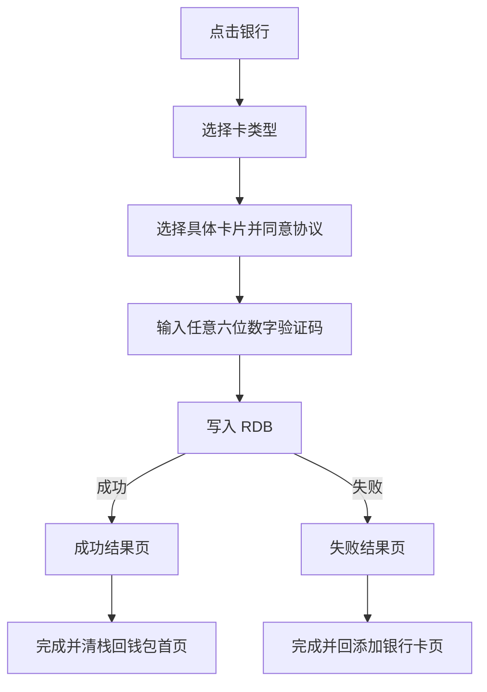

# 银行卡开卡后续流程 — 需求规格

> 模块标识：`bc-openCard-2/open-card-flow`
> 版本：v1.0 · 状态：已确认 · 日期：2026-09-19

## 0. 术语映射表

| 原始术语 | 权威模块 | 所属层 | 置信度 | 易混项 | 用户确认 |
|---|---|---|---|---|---|
| 银行卡开卡、添加银行卡、全部银行、卡候选、验证码、RDB 卡数据 | WalletMain | 02-Feature | high | AccountManager 只提供账号资料 | [x] |
| 账号 mock 手机号 | AccountManager | 04-BusinessBase | high | WalletMain 只展示与编排 | [x] |
| 根导航目的页注册 | Phone | 01-Product | high | WalletMain 仍拥有页面实现 | [x] |

## 1. 功能概述

在既有添加银行卡和全部银行页面之后，提供卡类型选择、具体银行卡选择、短信验证、RDB 持久化和添加结果闭环。

## 2. Scope 声明

```yaml
in_scope_modules: [WalletMain, AccountManager, Phone]
out_of_scope_modules: [CommUI, CommFunc]
rationale: |
  WalletMain 拥有开卡页面、mock 数据、RDB 与业务导航；AccountManager 仅补账号 mock 手机号；Phone 仅登记根 Navigation destination。
  复用 CommFunc 的 NavPathContext 和系统 ArkUI 组件，不修改公共基座。银行卡详情页与首页读库展示不在本轮。
```

### Visual Handoff

```yaml
ui_change: new_or_changed
fidelity_target: pixel_1to1
asset_acquisition_mode: approximate
visual_handoff:
  kind: screenshot_pack
  authoritative_refs:
    - { id: card_type_sheet_ref, path: doc/features/原始需求/1-2-银行卡/3-点击任意银行拉起添卡选卡半模态.jpg }
    - { id: bank_card_selection_ref, path: doc/features/原始需求/1-2-银行卡/4-点击信用卡或储蓄卡后拉起选卡页面.jpg }
    - { id: sms_sheet_ref, path: doc/features/原始需求/1-2-银行卡/5-选中某张卡片后拉起短信验证.jpg }
    - { id: result_ref, path: doc/features/原始需求/1-2-银行卡/6-短信验证完成后结果页.jpg }
```

## 3. 目标用户与使用场景

| 场景 | 描述 |
|---|---|
| S1 | 用户从添加银行卡或全部银行选择银行，选择卡类型与具体卡，输入任意 6 位数字验证码完成添加 |
| S2 | RDB 写入失败时仍进入失败结果页，并仅通过“完成”返回添加银行卡页 |

## 4. 功能清单

| 编号 | 优先级 | 功能 |
|---|---|---|
| F1 | P0 | 两个银行列表入口拉起同一选卡类型半模态，储蓄卡/信用卡单选 |
| F2 | P0 | 按银行和类型展示 1–2 张 mock 卡，UI 只显示前四后四 |
| F3 | P0 | 短信半模态自动发送、60 秒倒计时、重发和六位数字校验 |
| F4 | P0 | 完整卡数据写入 RDB，字段覆盖卡号、类别、银行、时间、支付状态和交易记录 |
| F5 | P0 | 成功/失败结果页禁返回；完成时按结果清理流程栈 |
| F6 | P0 | 老路由和两个银行入口不受损 |

## 5. 页面/界面描述

### 5.1 选择卡类型半模态

底部圆角半模态，上方标题“选择卡类型”和关闭按钮；白色卡片展示银行 logo/名称及储蓄卡、信用卡单选；下方提示、协议文本和蓝色“同意并继续”。

### 5.2 选择具体卡片页

全屏页，标题为银行名称；提示文字下展示同类型 1–2 张卡。卡号仅显示 `前四 **** **** 后四`，单选后勾选协议并点击“下一步”。

### 5.3 输入验证码半模态

展示从 AccountManager 获取并掩码的手机号。打开即触发一次模拟发送，按钮显示 60 秒倒计时；归零后显示“重新发送”。输入框仅接受 6 位数字，满足后下一步可用。

### 5.4 添加结果页

无标题/返回按钮，系统返回事件被消费。成功展示绿色状态、成功文案和扫码支付插画；失败展示失败状态。仅“完成”可退出。成功 `clear(false)` 回钱包首页；失败 `popToIndex(AddBankCardPage 锚点,false)`。

## 6. 业务流程图



## 7. 异常/边界场景

| 编号 | 场景 | 处理 |
|---|---|---|
| E1 | 未选择卡类型/具体卡或未同意协议 | 继续按钮不可用 |
| E2 | 验证码含非数字或不足/超过 6 位 | 输入过滤为最多 6 位数字，下一步不可用 |
| E3 | 倒计时中重复发送 | 忽略；归零后才可重发并重置 60 秒 |
| E4 | 数据库打开、建表或插入失败 | 不泄漏卡号到日志，进入失败结果页 |
| E5 | 快速重复点击下一步 | 提交锁保证至多一次插入与一次跳转 |
| E6 | 结果页系统返回/侧滑 | 消费返回事件，页面保持不变 |

## 8. 非功能性需求

- PAN 中间位不得出现在 UI 或日志；完整 PAN 只进入本地路由参数和 RDB。
- 点击到可见状态变化目标 ≤300ms；RDB 单次插入 ≤500ms。
- 页面 detach 时清理短信倒计时定时器。
- 新增可点击区域不小于 44vp，文本使用 fp 资源。

## 9. 验收标准

- [ ] AC-1：两个银行列表点击任一银行均拉起对应银行的卡类型半模态。
- [ ] AC-2：卡类型只能单选，mock 银行默认同时支持储蓄卡和信用卡。
- [ ] AC-3：具体卡片页展示 1–2 张候选卡，掩码正确而内部仍保留完整卡号。
- [ ] AC-4：验证码自动发送、倒计时、重发和 6 位数字门禁正确。
- [ ] AC-5：成功插入 RDB 的记录包含全部必需字段，两个支付状态初始为 false，交易记录为 `[]`。
- [ ] AC-6：无论 RDB 成败都进入相应结果页并携带完整卡号。
- [ ] AC-7：结果页不可返回；成功完成回钱包首页，失败完成回 AddBankCardPage，流程页均不可回退再见。
- [ ] AC-8：既有 CardPack→AddCardEntry→AddBankCard→AllBanks 路由链保持正常。
- [ ] AC-9：四个新界面与参考图在结构、文案、颜色、间距和状态上保持一致。

## 10. 明确不做

- 银行卡详情页、首页从 RDB 读取并展示新卡、NFC 激活、真实短信与真实银行接口。
