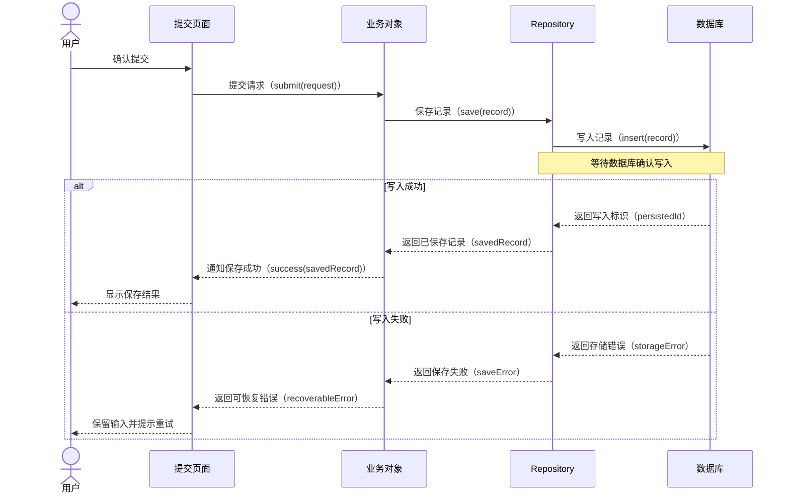

# App Component Blueprint 内部工作流

验收分层按行为风险选择：业务逻辑与可隔离异常用 UT，真实 UI/导航及平台集成用设备证据；both 分别说明两层覆盖，不能默认全部两层重复验证。复用 acceptance 的 ut_layer/device_focus 与既有 flow/接口说明，不增加第二份覆盖表。

由 [`/component-design`](../project/component-design/SKILL.md) 或合法内部消费者引用，负责 App 部件发现、设计、质询、准入与调和；不登记独立 Skill、不提供公开 command。蓝图是一次演进的设计权威，本流程不创建 CU、P2 ready set 或 P3 closure。

只有一种蓝图协议，内容深度由真实影响面派生；当前仅支持 `hmos-app` / App design lens，其它 component type 明确返回 unsupported / missing design lens。

> 真实宿主的正式需求在进入蓝图前，材料准入与缺失路由见
> [真实宿主准入与回灌契约](./real-host-admission-and-feedback.md)（适用范围内）；
> 宿主侧三条接缝的适配细则见
> [宿主适配指南](../../docs/operations/component-design-host-adaptation.md)。

## 正式产物

唯一机器 SSOT（演进工作区布局，硬切无兼容）：

```text
<features_dir>/<blueprint_id>/blueprint/component-blueprint.yaml
```

`<features_dir>` 为 `paths.features_dir`（默认 `doc/features`，经框架解析，不硬编码）。`blueprint_id` 是稳定路径标识，必须是单个安全路径段（`^[A-Za-z0-9][A-Za-z0-9._-]*$`）；一次演进定名后不改，不为展示名改名。`component_id` 保留在 YAML 与所有 ref 中做所有权/一致性核验，**不再充当任何路径键**。不得用 feature 身份定位，不扫描 legacy 目录，不回退旧根 `blueprint/component/`，不建立 registry。同目录默认生成评审投影 `component-blueprint.review.md`，`derived_from` 绑定 canonical 蓝图和有效 CU 内容，同页展示需求、方案、运行流程、契约、拆分与显式依赖、安全中间态、替代关系、风险验收；不承载 readiness/run/完成状态，不反向覆盖 YAML。

## 静态 provider 顺序

1. `current-facts-discovery`：读取产品需求、代码、schema、接口、配置、测试及 architecture/catalog/code-graph；当前事实逐项保留 provenance 和冲突。
2. `conventions-knowledge`（optional）：按 `paths.conventions`（缺失用 `doc/conventions.md`）解析；文件存在时必读全文，只把真正适用的 `##` id 交给既有 facts/provenance；默认未启用记 `not_applicable`，显式配置却不可读记 `unknown|degraded`。
3. `se-manual-contracts`：消费 SE/授权 owner 的 operation、DTO、mapping、错误、幂等和 NFR；来源不可达时保持 unknown，不编造字段。
4. `app-design-lens`：回答模块边界、能力接缝、feature flag、生产者/消费者、生命周期、state owner、初始化、发布订阅、UI refresh、进程恢复十个根问题。
5. `independent-design-questioning`：草稿文档生成后，在隔离上下文先读首屏/正文答八问，再核适用视图、关系、flow、根问题，以及适用惯例是否已被相关视图/decision 引用；不继承父上下文 YAML/设计摘要，不提前读 YAML，编写方不得自证。

provider 固定内置并消费同一协议；id 必须唯一，requirement 只允许 `required|optional`，权威与来源规则不得由蓝图作者覆盖。不得动态加载、注册第二个全局 provider 真源，亦不得写 Goal events/receipt/evidence 或 P2/P3 状态。

## 工作流

### 1. 发现与权威分位

先消费 component-design 入口给出的原生路径与可选 design knowledge，实际打开原文；六个静态 provider 是职责与校验接缝，不是自动执行器。catalog/glossary/CodeGraph 进入 current-facts-discovery，惯例与组件仍走各自专业 reader；lens 和独立质询不充当事实源。按本次实际读取登记 `discovery.inputs.knowledge_assets`，不复制为统一知识库。

先按 `blueprint_id` 读取已有 canonical 蓝图，遵循 `/component-design` 的请求范围：只读不写 canonical，草稿从未完成的设计/质询继续，已有 admitted 蓝图不因重入自动调和。

- 当前事实优先引用代码/schema/接口/配置/测试；知识资产提供稳定背景，不覆盖本次事实。当前范围的 requirement/goal/invariant/high-risk 必须在 `discovery.inputs.current_scope_items` 形成带稳定 id、可解析 source ref、provenance 和项目内来源实际原始字节 hash 的闭集；revision 可附加但不能替代 hash，并由 `discovery.requirement_traceability` 双向一一映射到真实蓝图稳定地址。
- `requirement-source-materialization@1` 只处理正式需求来源；接口契约继续逐段消费原 `source_ref`，直接人工/inline/本地来源保留。同一原文可被多个消费者引用，不扩大其 authority。
- 稳定权威决定引用实际承载结论的已有资产，将精确 `文件#模块名/术语/组件id/节点id/标题` 写入 `decision.knowledge_refs`，文件同时在 `discovery.inputs.knowledge_assets`。未来目标不提前写成当前画像。实现后才成立的结论，在相关 run 收口后按原写入授权由 catalog/glossary、CodeGraph、conventions、组件或 extension writer 归位，再由 P1 owner 经 reconciliation 补引用/所需 revision，随后 design preparation 升 CU 指针后 closure。相同已确认决定不重问，未变引用不重复升版；具体授权/刷新边界见[知识读取与维护](../../docs/concepts/skill-contracts.md#知识读取与维护)。
- 惯例文件存在时完整读取，只把适用条目写入 `discovery.facts`：`provenance.source_kind: convention`、`source_ref: <配置路径>#<id>`、`evidence_strength: authoritative`。视图节点与 decision 继续用既有 `provenance` / `verification_refs` 引用同一 source ref；禁止新增 conventions 专用字段。
- **术语事实**（替代 CU-bound spec 的二次术语确认）：从当前范围抽出的业务名词逐条写入 `discovery.facts`：`subject: term:<原始术语>`，`value: {canonical_module, confidence: high|medium|low, easily_confused_with: []}`，`provenance.source_kind: glossary|catalog`。`canonical_module` 须为获准模块（catalog ∪ 本蓝图 add_module / move_module / retire_module 声明）；`high` 只能由 glossary 精确命中且模块一致时直确认；`medium|low` 须按 `spec.terminology`（[用户确认 UX](./user-confirmation-ux.md) §3.4）当场确认并记 `extraction_method: user_confirmed`，headless 自动继续记 `headless_assumed`（WARN、入 must-review、不得记 `user_confirmed`、不回写 glossary，见 §9.2）。未确认且只被远期切片使用的术语，可登记 `open_decision` gap（`needed_by` = 远期切片，`verification_refs` 含该 `term:` subject）停放；同一术语仍被当前切片需要（有当前切片或 `status: blocker` 的 gap 引用）时不得停放。检查 id `terminology_facts_confirmed`。`user_confirmed` 事实 admitted 后按 spec Step 1.5 第 6 条回写 glossary。
- 同一语义冲突时保留双方 source ref 与 owner，禁止 last-write-wins。
- 外部契约按 `contract_id` 建 operation→request/response DTO→mapping→error/idempotency/NFR 链；逐段解析项目内 `source_ref` 指向的权威文件/fragment 并真实比对，来源缺失或语义不同即 blocker。
- mapping 只验证权威 wire 字段和显式转换/派生边；禁止将 wire DTO 与领域模型逐字段同形比较。

### 2. 写入同一蓝图

标题与固定说明、新写叙述（含 App 根问题及独立质询的回答、问题和结论）用中文，保留 API、类型、路径原名。决定与 `generated_graphs` 使用现有 `label` 写中文名称，稳定 `decision_id/graph_id` 不变；缺 label 沿原回退，不自动翻译或新增缺 label 检查。`review_summary` 分别写背景、问题、目标与成功衡量、方案改变、整体定位、范围/非范围；不要全塞 summary。原字段已可读就直接使用；仅改表达时优先用 §5 的可选 `review_summary.reader_guide`，不复制权威明细或另建总览真源。修改原字段仍是设计修订，会使说明摘要过期，也可能改变整蓝图引用的 CU 摘要，须沿既有修订与调和。renderer 只编排已有方案。current/target/delta、decision rationale、CU purpose/谓词/安全中间态都写实际含义。真实决策的被否方案使用 `alternatives`；不为凑说明新造会产生 closure 义务的 decision。

写作和质询共用七问：①需求与范围/非范围是什么；②当前问题是什么；③方案如何工作；④哪些模块负责；⑤关键选择为什么；⑥分几步、各交付什么、依赖与中间态是否安全；⑦风险/待决项和验证是什么。除核对原始证据外，评审者应能从文档回答；展示遗漏修 renderer，设计缺口交 owner 在现有字段补足并遵循 revision/权责，不以“未记录”宣称新设计质量通过。此为写作指引，不增加必填检查或人工批准。

**按 4+1 完成可评审设计**：App lens 回答十个根问题时分别使用本问题的真实依据，不复制同一个通用答案。场景（+1）描述目标用户、前提、旅程、人群差异并追到其它视图；逻辑表达能力边界、实体字段/枚举、操作/DTO/映射/错误/幂等；运行表达触发→首次加载→权威/状态→写入/发布→订阅消费→失败恢复，附完整调用步骤、设计期生成的时序图及用例分支；开发表达已消费 DSL 分层、真实目录/文件、组件/接口职责和已声明持久化设计；部署表达实际落点与外部责任、配套顺序及兼容性。核实未变只写结论与依据，未知、不适用、未记录分别说明。取舍、异常、部件质量属性、数据生命周期与 AC/BD/NFR 展开到能审查约束、失败与代价的粒度。代码骨架不入蓝图；图由下述同源设计生成，不替代步骤或分支。

**设计期 typed 内容**：被 CU `design_refs` 引用的目标在设计期写入已有 `acceptance`、`contracts`、`use_cases`。acceptance 挂 scenarios/logical 等设计目标，包含 ID、优先级、步骤/预期、分层与 focus；contracts 挂 development 节点/runtime flow，包含真实模块目录、根级 module_dependencies、模型字段、接口签名、组件、files 写集和状态；**整个 contracts.change_unit 由 plan 在 Feature contracts.yaml 生成**。use_cases 挂 runtime flow，包含阶段、UI/数据边界、命名调用、主路径/分支去向、预期和 linked_acceptance，分支新写 expected_port_calls。目标 provenance 仍须满足已有 authoritative 要求，作者写内容不等于拥有外部裁决权。详见[蓝图设计输入](../../docs/concepts/blueprint-design-inputs.md)。

**共享不是切片过滤**：引用一个目标就整体继承其设计内容。CU-A 引 S+A、CU-B 引 S+B：S 只放双方共同验收、共同合法写入文件/模型/用例；A/B 专属验收、files、用例放独占目标，设计节点保持语义稳定，不因 CU 身份变化复制版本节点。数组按既有行身份去重并合并，同行身份不同内容报 authority_content_conflict；对象不逐键拼接，module_dependencies/navigation/resource_keys/acceptance.flows 等分别集中在一个承载目标，重复声明只有全内容相等才接受。change_unit 属于 plan 的 Feature 产物，不进入蓝图设计投影，完整映射仍由 plan 原门校验。不能用 predicate 或模块范围过滤误继承内容，合法文件先后交叠不新增门禁。AC/BD 普通 ID 在一次 CU 机器投影中唯一（沿原行身份）；文档按“来源目标 + 编号”展示，不吞不同目标各自 AC-1，不新加全蓝图唯一门禁。

**P0 真机分工**：无 ui-spec 依据时，只写 ID、优先级、步骤、预期、ut_layer 与 ut_focus/device_focus；不编 linked_flow、checkpoint、屏幕流程或元素 ID。spec 获得真实 UI 依据后沿“不冲突补充”补缺键，保留蓝图已有预期与全部权威键；需要改已声明内容就回 owner 修订。不得删掉整份 acceptance 绕过 P0 门。feature/source 由 provider 推导，plan 通过 canonical resolver 取得 change_unit_ref 并生成映射，设计期不写 contracts.change_unit。

**写作位置一致**：review_summary.title 写可读需求标题，summary 解释本次改变；通用 decision 获准结论写 conclusion，rationale 只写原因，特定 kind 保留自身结论字段。术语在 `term:` 事实的 `value.meaning` 结合 glossary 已有说明与需求语境提炼；sample_usage 只作示例消歧，不机械当定义。模型字段 description 写单位、约束与语义。flow publications.payload 表达已声明载荷，failure_recovery.handling/retry 分别写失败处理与重试；根 `contracts[].table_schema` 保留表/列/约束、默认值和来源。不得把已有真实内容写成“未记录”，存量 rationale 不由 renderer 推定成结论。旧 expected_boundary_calls 由共同加载/归一化入口兼容；与 expected_port_calls 同时冲突时披露，不选边或丢弃。

物理表结构按已发布的根 `contracts[].table_schema` 内容约定承载。其它结构位置误写 `table_schema` 时，既有展示诊断仅 WARN 指出实际路径和正确位置；作者回原设计承载修订，框架不自动搬数据、不猜字段别名、不扩 schema，不影响 admission/readiness。合法根级单表/库级形状不报错位，没有该字段不告缺失，说明/引用/代码字符串中的同名词不是错位；其它独立 BLOCKER 仍按原规则处理。

**设计深度问题，沿现有承载回答**：逐项检查真实需求与来源，不用一句“已考虑”或通用模板作答；不增加字段、机器阻断或独立质询 scope，也不降低原 typed、来源、授权、准入和 P0 检查。

| 关切 | 写作与质询内容 | 现有主责承载 |
|---|---|---|
| 术语 | 业务词意味着什么、与易混项如何区分？结合原说明与需求提炼，不用置信度/模块代替定义，不把示例用法机械复制成定义 | discovery.facts 的 term.value.meaning，保留原 provenance/确认语义 |
| 存储 | 实际库名/版本、安全级别与是否加密是什么？主键/唯一约束如何避免重复，升级如何兼容，敏感字段如何保存/清理？有真实设计才写，未定如实未知 | 根 contracts[].table_schema 按[双形状内容约定](../../docs/concepts/blueprint-design-inputs.md#存储内容约定)写单表或库级 tables[]，配 data_domains.security；库级事实仍在该子树，不新增数据库配置字段，不从类型推断索引/事务 |
| 完整调用 | 谁调用谁、参数/结果是什么、何处等待，写入确认如何返回，关键失败在哪里分叉，成功后的完成/导航/消费者如何接上？页面、业务对象、Repository、真实 helper 和数据库分别保留角色；双入口和导航调用者依真实设计 | flow 承载的 contracts.state_management[].ordered_steps（string[]），typed components/interfaces、根契约/存储、恢复和用例提供同源细节；设计生成与质询按下述步骤 |
| 失败与中断 | 逐项核真实依赖失败及返回、取消、selection 丢失、OTP 中断后的状态/恢复。先把已有说明归回正文主责位置，真实缺失才补；mock/本地场景不编外部故障或新业务 | acceptance.boundaries、flow.failure_recovery 及用例分支；已有失败/恢复责任不改 |
| 错误与幂等 | 约定错误与恢复动作是什么，幂等键及作用范围是什么？涉及跨会话重复卡时，策略、主键/唯一约束及重复提交结果是否一致？缺外部权威不编错误码 | 既有 errors/idempotency、triggers、table_schema、boundaries/use_cases；保持外部契约权威 |
| 质量 | 兼容、安全隐私、UX（深浅色/无障碍）、打点、性能分别有何结论/落点？不涉及给实际理由，不为凑量化而造阈值 | quality_attributes；安全/清理关联 data_domains，精确阈值/预期仍在 acceptance |
| 页面与完成后去向 | 哪些真实页面/交互承担场景，已有截图如何对应，完成/返回后的 J5/JR1/JR2 等去向文本是否可读且保留？不把文字去向或共享动作当路由依据 | components.kind/useCases.ui_bindings、已登记图片引用和 journey_steps；不新增导航字段 |

App lens 的十个现有问题分别承接上述关切：module_boundaries/capability_seams 核真实职责与错误边界；feature_flags 核已有兼容策略；data_producers_consumers/state_owners/initialization 核存储、安全与幂等；lifecycle_triggers/process_recovery 核真实中断与恢复；publication_subscription/ui_refresh 核页面、更新、UX 与已有打点/性能结论。按真实关联回答，不为每个根问题复制整张表；不涉及说明理由，不能因此豁免原根问题的证据与 disposition。

#### 完整调用设计与时序图

1. **先写可投影调用设计**：在 runtime flow 承载的 `contracts.state_management[].ordered_steps` 逐条用字符串写明调用方、被调用方/操作、参数及结果、等待/回调、条件和失败处理。typed components/interfaces/data_models 与根 contracts 的 operation/DTO/errors/idempotency/table_schema 提供同源签名和存储事实；flow 的权威、发布、消费者及恢复说明补闭环。保留 flow.ordered_steps 时同次同步。不能只在 Mermaid 补设计，也不把 string[] 改对象或另造交互 DSL。
2. **同次设计调用生成图**：设计 agent 据上述事实生成根 `generated_graphs` 的 `format: mermaid`、`source_view_id: runtime`、`graph_id/content/node_refs/relation_refs`。实现时序按一个界面步骤或一次跨层交互拆图、拆说明小节，不把从入口、选择、校验、保存到结果/完成的全过程称为“一件事”。一次保存可完整跨页面、业务对象、Repository、实际 helper/数据库并沿调用链返回，确认落库后才成功，不按每个方法或 ordered_step 机械拆图；成功完成与失败退出分别解释，可在同图用分支表示，不要求两张图。例子分为“打开验证码”“提交、保存并显示结果”“结果页点击完成后清栈、首页刷新”三个界面步骤，分别说明、配图；保存链本身不按层拆。调用返回是返回值或回调回到调用方，不包含用户之后点击完成引发的导航返回。每段写清触发、结果、前后交接、失败从哪个调用分叉及返回谁，保留等待、调用返回与完成/导航/实际消费者；完整调用事实仍留 ordered_steps 与参考。每张图使用既有 generated_graphs/derived_results，再由 guide 小节的 graph_ids 就近放置，不新增图字段或数量硬门。没有 helper 不造层数，异步/回调据实表达，双入口不画用户直连业务，也不把所有 navStack 调用归给 coordinator。中文角色、动作与消息意图在前，代码名必要时括注。
3. **复用现有派生身份**：同 graph_id 对应既有 `derived_results.result_id`，以现有图派生 kind、input_revision/source_fingerprint/decision_fingerprint/status 绑定并复用 `evaluateDerivedConclusionFreshness`。node_refs 指向真实 flow 和参与对象的承载地址，可多角色共用一承载目标；数据库引用现有数据节点或根存储契约。relation_refs 只引用已有关系，可为空，不为每个箭头新增顶层 relation 或 closure 义务，不造 table: 地址、独立 mmd 真源、sequence_diagrams 或 interactions 字段/schema。
4. **原 runtime/flow scope 独立质询**：逐段对照步骤、typed 签名/参数、根契约、恢复与用例，核调用者、返回、等待、关键分支及完成链与图一致。接口映射须与模型字段一致，不同图中的调用责任须一致，由原作者与既有质询核源；本批不新增机器语义检查。user_sequence/expected_port_calls/not_called 是核对材料，其自身不声明完整调用者与交错关系，renderer 不从它们猜箭头。parser/引用 PASS 仅证明可表达，不证明设计语义一致，不新增自动自然语言比较器。正常新设计默认交付此图；缺图不加机器门禁，也不能声称该项人读验收完整。
5. **修订同步生成**：调用/接口/恢复设计变化时，owner 按原权责与 revision 规则重生成受影响图和派生身份，之后发布同一蓝图并重建文档。不能只换来源戳冒充重核。renderer 只校验并原样展示 content，按 flow 引用放入对应运行章节；缺对应 derived_results 或 stale 的时序图原位提示重建、不展示、不改变 readiness，旧 flowchart 不加迁移门槛。

支持的 `sequenceDiagram` 最小子集：`participant`/`actor` 声明（可带 `as` 标签）、调用 `->>`、返回 `-->>`、`Note over`、`alt/else/end`、空行和 `%%` 注释。检查声明重复、消息/注记端点、分支块配对及原 node_refs/relation_refs 地址。不扩 activation/loop/par/HTML/include/主题；确需并发而子集不足时保留步骤并披露，不能假画串行。

默认先画用户旅程总览和角色关系图；只有一两步的简单旅程或一两个角色的简单协作，可分别说明原因后省略对应总览，不设机器图数门。两类总览可讲完整旅程或整体责任，不套用实现时序的逐步骤拆图要求；不能把大幅实现时序改名“总览”来适用该例外。两类总览也由设计作者写入既有 `generated_graphs`，复用派生身份，以 `graph_ids` 放在对应导读旁。旅程边只取明确的旅程顺序，角色关系边只取已声明调用或责任关系，不能混淆用户流转、代码调用与归属含义，也不从名称或目录猜线。中文角色、动作和消息意图在前，类名/方法必要时括注。当前 flowchart 子集仅支持 `flowchart`/`graph` 加方向声明、ASCII 节点 id、`id["标签"]`、`-->`、`-->|标签|`；不支持 `{}` 判断、`subgraph` 或注释。flowchart 图内不能有空行。

时序图自身问题全部 WARN；未声明关系引用（`relation_refs` 缺省或空数组）的作者展示图，超子集、坏端点或坏地址也只 WARN，在对应 `graph_ids` 放置点说明原因且不展示，不能经 sourceGaps、投影 invalid 或其它汇总阻断 admission/readiness。声明了 `relation_refs` 的关系结构图保持原 BLOCKER，真实关系、canonical、契约与来源缺陷仍走原检查。非时序图只有 `relation_refs` 缺省或显式 `[]` 才按作者展示图处理；写出键后留空会解析成 `null`，仍按关系结构图口径校验，发现问题时为 BLOCKER。

以下只示意语法与粒度，生成时替换成已写设计，不作为宿主事实：



六类可选表达仅有以下增量，缺失不补事实、坏形状只 WARN，蓝图 schema 不变：

| 位置 | 可选内容 |
| --- | --- |
| review_summary | background/problem/positioning；goals[{goal_id,statement,success_measures[]}]/in_scope[]/non_goals[] |
| decision | alternatives[{option,rejected_reason,defect}]，只解释被否方案 |
| term: 事实的 value | meaning，复用已有 glossary 定义 |
| scenarios 节点 | journey_steps[{step_id,stage,user_action,system_behavior,preconditions[]}]；path_variants[{user_type,difference}] |
| deployment 节点/视图 | responsibilities[]/inputs[]/outputs[]/not_responsible_for[]/failure_impact；rollout[{order,unit,depends_on[],note}]；coordination[{counterpart,relation}] |
| 蓝图根 | quality_attributes[{qa_id,category,requirement,landing,source_ref,verification_refs[]}]；data_domains[{data_domain_id,usage,retention,isolation,cleanup,security}] |

flow.data_domain_refs 与 data_domains 使用同一标识。精确阈值/预期继续归 acceptance，不另维护 NFR 真源。contracts.data_models.fields 的可选 description/source_ref 字符串表达字段约束与来源，现有透传不变；展示按 §5 统一取值，真实非法形状如实诊断，不把有值假报缺失、不新增校验。所有新增 source_ref 只引用设计期已有来源，不指向本 CU 将新建的文件，也不扩大写权限。持久化只用已有 contracts 模型/表级契约、data_domains.security、source_of_truth 和叙述表达实际设计，不猜索引/事务，不增第七类字段。实际打点属于本部件时可写 quality_attributes 并关联既有验收/落点；外部运营配套写 coordination，无依据不造按钮 ID 或 BI 协议。Visual Handoff 仍由 spec 沿真实视觉职责完成。

canonical YAML 根对象含 `component_id`、`blueprint_id`、`revision`、`source_fingerprint`、`decision_fingerprint`、整体 provenance，以及 `review_summary`、`design_views`、`decisions_and_gaps`。根/discovery `source_fingerprint` 必须只由规范化 discovery facts 与 current-scope source identity/provenance/revision/hash 重算一致；requirement→blueprint mapping 不进入该指纹，其变化由 revision、artifact hash 和下游 input fingerprint 捕获。所有稳定对象保留 owner、provenance、verification refs；语义替换使用新 id 并记录 `supersedes`。

`evolution_candidate` 的 `human_decision` 只能是 `establish_seam|keep_direct`。前者必须以四个互不复用、同时进入 decision tests 的精确 `closure_proofs` 绑定契约兼容、Provider 替换、缺失/失败与 Consumer no-bypass 证明；后者只保留普通施工语义并记录再提取条件。

4+1 使用固定 view id：`logical`、`runtime`、`development`、`deployment`、`scenarios`。前四项中除 deployment 外，对可执行 App 均为 applicable；deployment 即使不适用也保留证据化裁决。

**deployment 按部件固有运行拓扑裁决**：平台、进程、独立持久化和外部边界决定适用性，不随单次需求切换；本次演进影响仍由 evolution_impact 单独表达。适用 deployment 按既有 requiredQuestioningScopes 进入独立质询。外部参与方节点只记当前事实，current_state=target_state、无 delta；根级 contracts 只登记本部件实际消费/提供的接口，由消费 CU design_refs 认领本侧契约与指向外部节点的 relation，并提供本侧证据。外部方自身未消费的施工，阻挡切片时用 gap + CU blocker 说明解除条件，其余用 coordination/rollout，不建根 contract、不代其宣称完成。deployment 适用时，纯本地场景也必须在 deployment_refs 引本部件自己的实际运行节点，外部节点不能替代本部件落点。

**两个正交维度（M7）**：`applicability`（部件类型固有适用性，二值 `applicable|not_applicable`，`not_applicable` 仍仅限 deployment）与 `evolution_impact`（本次演进影响，`changed|verified_unchanged`，**只由 applicable 视图携带**）互相独立，不得合并成三态枚举。

- `applicable` + `changed`：全量义务（非 unknown 的 current/target/delta、≥1 可寻址节点、verification_refs）；
- `applicable` + `verified_unchanged`：必须带 `unchanged_evidence`（`evidence_refs` 非空 + `current_state_ref`）与非 unknown 当前态，据此**免除** target/delta 与节点义务；该视图内任一节点声明本次 delta 即失败（不变声明不得掩盖真实变化）；其质询义务是**核实不变声明与依据**，只接受 `answered_with_evidence`；
- **至少一个 `applicable` + `changed` 视图**；全部 `verified_unchanged` = 本次不构成演进，fail-closed；
- 六类 runtime flow 触发条件**只对 `runtime` = `changed` 评估**。

**条件式设计义务**（只在对应事实被发现时触发）：

| 发现 | 义务 |
|---|---|
| 多个 CU | 完成 CU 边界与关系分析（真实依赖、共享资源、可并行性、独立性）；**只有事实要求时**才生成 `requires` 与顺序约束，不得为记录先后伪造依赖边 |
| 共享部件级设计决策 | 只在蓝图裁决一次，各 CU 经 `design_refs` 消费；不在多个 Feature plan 各裁一次 |
| “单独绿 ≠ 整体完成” | Component closure 追加真实组装与组合证据义务 |
| （通用，单/多 CU 都适用） | 每个 CU 的 `safe_intermediate_state` |

**模块归属与架构影响（spec/plan 只投影）**：

- `applicable` + `changed` 的 development 视图，每个节点**必须**填 `module`（缺失 `blueprint_node_module_missing`），且须为获准模块 = module-catalog 当前模块 ∪ 本蓝图 `add_module` / `move_module` / `retire_module` 决策声明的模块（否则 `blueprint_node_module_unadmitted`；catalog 不可读 `blueprint_node_module_unresolved`）。`owner` 仍是责任方，不承载模块身份。CU `touches[].design_ref` 指向的节点 `module` 去重即该 CU 的可修改模块集合。
- 架构变化用 `kind: architecture_impact` 决策表达，**一条决策一个变化项**，复合变化拆多条；每条带 `change`、条件字段、`rationale` 及既有 `owner` / `provenance` / `verification_refs` / `status`（change 非法、条件字段 / rationale / owner / verification_refs 缺失或层不在 DSL 即 `blueprint_architecture_impact_invalid`）：

  | `change` | 条件字段 | 生效与归位 |
  |---|---|---|
  | `add_module` | `module`、`layer`（∈ 当前 DSL `outer_layers`） | 施工期作获准目标模块；CU 落地后 closure 归位 catalog |
  | `retire_module` | `module` | catalog 不提前退役；CU 落地后 closure 归位（已移出 catalog 只 WARN 核对拼写） |
  | `move_module` | `module`、`from_layer`、`to_layer`（均 ∈ DSL） | 施工期按 `to_layer` 判依赖；closure 归位 |
  | `responsibility_rewrite` | `module`（获准模块） | 实现验证后 closure 归位 catalog 职责 |
  | `dependency_edge` | `from`、`to`（模块名或外层 id）、`direction: add\|remove` | 施工前 DSL 须已达目标许可（add 已允许、remove 已不允许）且决策 `decided_with_authority`，否则相关 CU 不得施工 |
  | `dsl_other` | `affected_items[]` | 只登记不机检，施工前须经权威批准落盘 |

  `verified_unchanged` 的 development 不得有该类决策（`blueprint_view_unchanged_masks_change`）。蓝图期不改 catalog 与 DSL；DSL 只经 framework-init 既有获准路径（预设 / 手工编辑 config 后重跑 UPDATE）改写。

### 3. 运行时流与跨视图检查

逐项裁决六类 flow 触发条件。触发时记录 source-of-truth/reconciliation、trigger idempotency、initial-load freshness、state owner、mutation/publication/subscription cleanup、consumer、failure/recovery、证据和验证引用，并覆盖 cold start、warm resume、page attach/detach、account switch、process recreation、background write。闭环关键集合不得为空；局部 id 唯一，mutation/subscription/consumer 的引用必须解析到真实 flow 对象。

scenario 必须追到 logical/runtime/development 以及适用 deployment；runtime flow 必须追到 logical contract 和 development owner。缺边作为 frontier，不用图或标题补齐。

### 4. 质询、准入与调和

- 派出独立质询前，原设计 agent 先完成可渲染事实/图草稿、说明及摘要，按 §5 执行 `--write-review --json`；不要求先通过含质询结果的完整准入。读者不继承父上下文 YAML 或设计事实摘要，先只读已生成首屏/正文答八问，正文止于“技术与追溯参考”入口，八问作答前不读同文档参考区或 YAML，之后再核参考/YAML；之后才从 canonical YAML 派生原 scope，唯一覆盖每个 view/relation/runtime flow 和十个 App 根问题，逐项给出 evidence、disposition、frontier fingerprint、owner 和 verification refs。
- 在同一批既有 scope 内按 §2 深度问题实读 4+1 与 typed 细节：核术语定义、存储安全/主键/升级、真实失败/中断、错误/跨会话幂等和质量结论，检查来源、共享继承/写集、本侧外部证据与验收关系；runtime/flow 逐段核完整调用、等待、返回、失败及完成链与 generated_graphs 一致。区分已有内容展示遗漏与真实设计缺失，不因标题齐全、parser PASS 或一段 summary 宣称充分；不新增平行 scope/缺字段门禁、不豁免既有检查。
- 供人评审的蓝图交付（含仅定稿蓝图、尚无 CU）把 §5 的首屏/正文阅读合并到这次独立质询，再按原 scope 定向核源。问题沿既有质询输出/报告记录，八问适用缺口由作者在一轮定向修订中处理，仍未解决则明确披露、不冒称阅读通过；涉及需求明示行为的修订须对照原文，未授权偏离列待确认。交付前重渲并读成品，不另起阅读管线、不循环到评分达标。纯说明润色不要求重做原设计质询；事实错误回原设计字段并沿原修订/准入规则处理。
- root questions、contracts/design refs readiness 和 admission status 由实际质询/App lens 及 checker 结果派生，不接受自报布尔值。
- 当前切片依赖的 unknown 必须 blocker；远期 open decision 必须有 owner、needed-by 和解除条件。
- 仅重入、查看或重跑 checker 不增加 revision；意见、建议与未接受反馈不自动触发修订。接受新事实、权威裁决或解决冲突后，才按既有调和规则生成新 revision，不回写旧 revision。
- 决策/契约版本/视图适用性变化时，只把 P1 自身派生结果标 stale 并按新 revision 重算；历史保留 provenance。
- 下游发现 `component_blueprint_ref` 的 revision/source_fingerprint/artifact_sha256 不匹配时，在各自权威内重新派生；P1 不代写 ready/closure。

### 5. 写作、检查与本地交付

designOnly 不调用依赖未来 plan.design_ref_mappings 的 componentProjectionErrors，有组件索引/合法 typed UI 设计不要求提前写 change_unit；plan 及后续组件映射检查保持完整、组件选型设计原门不变，不新增设计期替代检查。

组件索引文件在场时，CU 的 design_refs 须包含当前闭包目标对应的全部 component_asset_selection 决定；接受/readiness 返回缺失地址时，由设计 Agent 据原 message 修候选并重验，不让 plan 自行选型，也不由接受器自动补引用。

供人评审的蓝图交付默认包含同目录 `component-blueprint.review.md`，仅定稿蓝图、尚无 CU 也适用；已有 canonical CU 同页展示需求、方案、职责、施工拆分、显式依赖、安全中间态、替代关系及风险验收。Maison 自动收集 CU，宿主无需自拼 CU 附件；不把 readiness、run 或完成状态写入设计正文。

### 按评审问题写说明

4+1 继续用于建模、覆盖与质询；正文按方案摘要、背景/目标/边界、术语、用户旅程与界面、整体方案、关键流程、数据与存储、关键取舍、失败与恢复、质量与安全、施工与上线、验收、待补问题组织，无意义的空小节可省略。参考按字段与类型、接口与存储明细、完整验收、全部用例分支、施工精确映射、需求追溯、质询与稳定地址、4+1 与章节对照查询。

先完成已有事实与图，background/problem/summary、current/target/delta 和 decision conclusion/rationale 等原字段已可读就直接用，不强制每个小节另建 guide。仅改表达或需跨字段解释时，由原设计 agent 在同一任务优先写可选 guide；修改原字段属于设计修订，会使说明摘要过期，也可能改变整蓝图引用的 CU 摘要。新事实必须先回原承载，guide 仅解释已记录事实。仅补说明时从 canonical 蓝图、CU 与已登记设计材料继续，不重新发现产品源码、不启动施工。

首屏先面向不了解项目代码的评审人讲清现状、变化、用户得到的结果与范围；不要靠框架阶段术语或类名代替说明。产品非目标说明产品不做什么，本次只执行设计则是阶段状态，两者分开。摘要中的施工安排只链接第 11 节，不重复 CU 目的全文。

第 8 节“关键取舍”固定为作者开场加 canonical 决策逐项呈现：名称、选择、理由、已有被否方案；组件选型无 label 时优先显示已解析 target_ref 节点的 label/name（已有中文目标名直接使用），缺时沿原名称/id 回退；按[组件资产五级选型](../../docs/concepts/component-assets.md#五级选型)显示中文，未知值保留。custom 缺少 component_ref 属正常状态，不显示“组件：未记录”，已有引用仍保留。所选方案的代价只展示已有来源，不能把被否方案的缺陷反推为所选代价，也不为没有 alternatives 的决定补造被否方案；被否理由/缺陷相同只显示一次，不同则分列或分行保留，避免“。；”拼接。`decisions` guide 只作开场，不替代逐项内容，不靠 prose 指向实际不存在的正文条目；参考只留决策身份、来源、状态等元数据及正文回链，不重复决策正文。第 13 节“待补问题”固定在作者说明后列出当前 `headless_assumed` 术语、`review_summary.must_review` 与带真实状态的 `gaps`，不要求作者重复登记术语才显示。`questions` guide 不遮蔽这些事实，不把假定写成已确认、把未决写成已裁决或把已解决项冒充待处理；这些展示不自动变成 blocker。

```yaml
review_summary:
  reader_guide:
    source_digest: sha256:<使用下方命令计算后记录>
    sections:
      - section: solution
        title: 整体方案与责任边界
        prose: |
          解释来源中已有的职责与取舍，不在这里维护字段或验收全文。
        source_refs:
          - /design_views/1/runtime_data_flows/0/ordered_steps
        graph_ids:
          - sequence:submit
```

上面的路径与图名仅示形状，须替换为当前蓝图的真实位置。`section` 取 `summary|background|terms|journey|solution|flows|data|decisions|recovery|quality|delivery|acceptance|questions`；方案摘要优先原 summary，使用 guide.summary 时不重复打印原段落。同位置可有多个小节，按作者顺序讲述。`source_refs` 是蓝图内 JSON Pointer，不是新稳定设计地址；验收主题可引用 acceptance 对象、三类数组或完整单项，以该来源集合限定编号归属，不必逐 ID 堆来源，不得借其它目标的同号条目补链接。`graph_ids` 引已有 generated_graphs，放在最相关小节旁；放在第 4 节本身不算错误。同图首次引用绘制、后续位置保留图名回链，不另设章节优先级；prose 不另存 Mermaid 或截图。无效引用只诊断并跳过受影响部分，图仍沿自身 freshness 判断。

按每节要回答的问题选来源，只引用支撑本节说法的位置；不要每节都附同一批决策或全景来源。正文设计依据用一个入口追到该节完整参考来源，不堆多个同名“方案取舍依据”链接。验收编号仍逐项链接正确的完整条目，来源可按上述集合限定。

界面设计有已登记截图时，每个界面写一个 `journey` 小节，解释用户在这里做什么、系统如何反馈，再跟对应截图。该小节的 `source_refs` 精确指向 canonical 中包含这张已登记图片路径的单个登记项，或只含此图路径的来源对象；不要引用包含全部截图的数组/整个场景，也不要从图片文件名猜界面。作者自行核读图片与设计后对应，一张图片只展示一次，其余位置链接；不新增图片字段，不在 prose 手写图片路径。

正文角色说明由设计 agent 依据已有职责、状态归属、接口与调用事实归纳：讲清谁接收请求、负责什么、向谁交接及返回什么，类名只作代码对照。类/方法目录不能充当角色说明，完整签名与方法清单留参考。旅程讲用户交互，整体方案讲组件责任边界，关键流程讲调用和返回，施工讲 CU 交付；相同组件职责在主责小节解释一次，其余只引用，不在这些章节重复整份描述。各流程小节在图前说明触发、读图重点、结果与下一段衔接，再放相应 graph_ids；不要把多张图集中堆到段尾。

prose 使用普通 Markdown 段落、列表与代码名称，不写 Markdown 标题；章节层级由 section/title 决定。误写的标题会保留文字、降为加粗段落并给 WARN，代码块内的 `#` 保留。段落写完整因果，首次解释代码角色，避免斜杠串、省略主语和“已实读/F1 已修复”等过程话术。导航清理应在已有规则支持下举前后页面栈，说明保留/移除哪些页面及返回行为，不只写“清栈”；不要编造原设计未声明的页面或路由。存储安全级别（如 S4）与是否加密分开解释，不把级别自动等同于加密。验收主题标注原 AC/BD/NFR 编号并指向同文档完整条目，不另编号。

失败与恢复用 `recovery` 小节 `guide.prose` 的 Markdown 短表作速查：每行说明发生什么、用户看到什么、数据是否保存、如何继续，并写出实际 BD 编号，`source_refs` 指对应单项或包含它的 acceptance 集合及所需恢复事实，编号最终链接到该来源目标的完整条目；短表只解释已有预期，不改精确 BD 预期，也不补造重试、回退或数据保存行为。材料不能回答的单元格明确未定，列入待补问题。

**仅示例，非业务要求**：给定事实是“用户点击保存；Repository 写入成功才通知页面；写入失败保留输入”。坏写法：“保存/成功/失败由 Repo 处理”。好写法：“用户点击保存后，页面等待 Repository 写入。写入成功才显示保存完成；失败时保留输入，供用户重试。”示例只说明怎样写清主体、顺序与结果。

施工文字留在 CU `purpose`、`provides[].description`、`target_predicates[].description`、`safe_intermediate_state.description` 等原字段，用完整句子说明目的、实际交付和完成此步后的安全状态，不写缩写串或省略责任主体。润色保持原职责、谓词含义、提供承诺、依赖、精确写集与身份不变；已接受 CU 只能按[未完成 CU 内容修订](../../docs/concepts/blueprint-design-inputs.md#未完成-cu-内容修订)的资格与既有 consumer API 提交候选，不直接改 canonical，也不为润色修改已完成或退役 CU。renderer 取当前有效 CU 集合，guide 不固化 CU 数量、ID、修订或先后依赖；增加/修订/替代 CU 只刷新施工段与参考。正文只用一份合并目录树解释文件落点与已有用途，CU 段按实际继承范围链接精确参考，不再复制文件清单。文件用途取已有组件职责或链接接口明细，目录树要能还原全部精确 files 路径，目录不扩大授权。素材不足写清问题与缺少的依据，不填平未知。

### 摘要、渲染与读成品

原设计 agent 在同一任务完成可渲染的事实/图草稿与说明并复核后，在 `framework/harness` 使用独立只读入口；先写说明、摘要并渲染草稿，再派既有独立质询，不另派专职写作 agent：

```bash
npm run check:component-blueprint -- --project-root <宿主根> --blueprint <blueprint-id> --reader-guide-digest
```

stdout 为一行 `sha256:<64hex>`；加 `--json` 得 `reader_guide_source_digest`、`canonical_path`、`artifact_sha256`。命令只加载 canonical 并计算，不运行完整 validator、不写文件、不自动盖章；不能与 `--write-review` 等操作模式混用。作者把结果写入 guide.source_digest，再执行下方 `--write-review --json`，**实际打开生成的 Markdown/预览，以正常阅读宽度读成品**，核图前导读、图文位置、角色与消息是否看清、调用返回/段间交接、引用及图片可见性。需放大才能看清的图应回设计按子问题拆分；放大、图语法通过或生成成功都不能替代普通宽度的可读验收。普通正文汉字间、中文全角标点后多余空格与成功衡量句末拼接由 renderer 统一处理，不靠改用 YAML 字面块规避。按实际阅读问题修订，不设参与者/消息/分支数量硬门。

已有 canonical CU 时，即使只补说明也会改变蓝图精确 SHA。盖好说明摘要后，先运行 `npm run check:change-unit -- --project-root <宿主根> --blueprint <blueprint-id> --readiness --json`，复用既有指针调和与文档物化；非 busy 后再读成品。不要手改 CU 指针或来源戳，也不要把调和前的“待升版”施工部分当成交接结果；该入口不启动施工。

摘要按当前解析蓝图 stableStringify/SHA256 计算，只剔除根 revision、derived_results 和 review_summary 内 reader_guide/authored_by/questioning/admission/reconciliation；其余事实、图内容及数组顺序保留，只按精确位置剔除。它仅判说明可展示，不是施工证据。无 guide 时文首提示“尚未补写评审说明”并展示当前字段；事实变化或摘要缺失/错误时提示“评审说明需更新”，回退当前字段与完整参考。仅升 revision 或更新质询/准入记录不要求改稿，图仍沿原 freshness。草稿同 revision 改事实也须复核说明；摘要保守按整份说明失效，不要求逐段依赖图。

每次供人评审的蓝图交付复用 §4 独立读者，以不了解项目代码的评审人视角先**只读首屏**，复述现状、变化、结果与范围，再只看正文回答下列八问，逐项指出答案所在章节和仍看不懂的位置；读者不继承父上下文 YAML/设计摘要，正文止于“技术与追溯参考”入口，八问作答前不读同文档参考区或 YAML，之后再核参考/YAML，不用框架经验或作者口头解释替正文补全含义：

1. 能否在约十分钟内讲清方案？
2. 关键取舍和被否方案是什么？
3. 完整调用链怎样工作，谁负责什么？
4. 存储、安全与账号隔离怎样实现？
5. 失败、中断和恢复怎样处理？
6. 施工怎样拆分，中间状态是否安全？
7. 开发具体改哪些文件，各自什么用途？
8. 怎样验收，分别对应哪些原验收条目？

读者明确指出缺少图示解释的关键链路、放错章节的图、只有一段且未回答本章问题的位置；段落少本身不自动失败。使用宿主已有预览能力核普通宽度图像；没有图像时仍从评审 Markdown 内 Mermaid 源核实现时序是否按一个界面步骤或一次跨层交互拆分，指出混讲的独立问题和应拆段落及衔接，不提前读 YAML、不跳过整项图审查。用户旅程总览、角色关系图可讲端到端，不套用实现时序拆分要求；全过程实现时序不属此例外，不用参与者数量代替判断。仅字号、布局、是否需放大标“未核验”，不以语法通过或图源审查冒充视觉通过，不新增预览依赖或门禁。

完成上述阅读后才按原 scope 定向核源，核关键说法、图箭头和编号归属。八问指出的适用缺口，作者须在这一轮定向修订中处理，或明确保留为未解决、如实报告而不冒称阅读通过；不能将未解释的取舍、调用或恢复归为“非关键表达”略过。请求仅到蓝图、尚无 CU 时如实说明未拆分或本次不涉及，不为凑八问擅自开工。按实际来源变化复核摘要，交付前重渲读成品，不加评分、次数/通过状态、用户签字或停机原因。真实事实/授权错误仍交原责任方解决。十分钟是阅读体验问题，不是计时门禁；readiness 与阅读效果分别报告。

修安全、导航或其它质询时，换实现仍须满足原需求。若修订涉及需求明示的携带数据、完成跳转或清栈行为，作者须回需求原文复核，沿原承载同步调用、旅程、恢复及数据生命周期；核谁持有、谁接收、何时清理，也覆盖失败时没有写入标识的情形，不限定用明文路由参数交接。必要偏离沿既有未决决定/待确认写明原要求、拟变更、理由和影响，无用户或既有明确授权不得标成已裁决，读者建议本身不构成变更授权；不能用安全优化名义静默删掉原交付行为。

首次写作在原设计任务内完成；局部修改按变化复核，不盲目全文重写。接受 CU、readiness、指针调和、B1 发布与只读/发布校验只做确定性刷新或诊断，新增模型调用为 0，不自动写 guide 或盖摘要。B1 agent 只改简报授权的草稿位置，可按事实变化与 source_refs 定向阅读说明，但公开摘要命令只读 canonical，不能为草稿盖章；框架之后登记的根 provenance 也参与摘要，会使发布前摘要失效。当前公开 B1 流程保留原说明摘要，发布后显示“评审说明需更新”并展示当前事实；不扩大授权、不因观感停止 run。后续由设计 owner 复核已发布 canonical，再沿正常写作入口记录摘要与读成品。

需要记录本次阅读成本时，沿既有报告记录起止时间、总耗时，以及写作/独立阅读/定向修订的 agent 调用次数；底层模型请求数可见则记录，不可见标明。工具调用数不冒充模型调用数，不另建计费仪表、A/B 或预算状态。

交接 readiness 在指针调和非 busy 后，对全部未退役（含已完成）且原设计 constructable 的 CU 调用现有 deriveBlueprintSkillInput 默认只读模式，分别检查 canonical acceptance/contracts/use_cases。Feature 的阶段 use-cases.yaml 不反向参与设计投影；它与当前设计未对齐时，由既有定义缺口和 plan 对齐门交 plan 重建，不要求设计 owner 修正已合法的蓝图。absent 不新增缺字段门禁，明确缺口与 spec/plan 补设计责任；canonical 内容 invalid 复用现有 authority_* 原因令 perUnit blocked/not-ready。另一类 absent 不得漏掉坏 use_cases，未来 plan 映射缺失不使设计未就绪。正常交接不物化 Feature acceptance/contracts/use-cases，不产 phase PASS/receipt；spec/plan 直接消费推导输入并各写本阶段产物，投影带用例时 plan 必须写 use-cases.yaml 供业务 UT，required_outputs 不只看文件已存在。prepare-blueprint-design CLI 保留当前投影导出用途，不承担未发布旧交接数据的迁移兼容。

当前 spec/plan 的带戳产物可作不冲突补充。canonical CU 通过原校验后指针照常升版；只有冻结的完整绑定能证明设计/CU 契约等价时，才更新该 Feature 来源身份并保留补充原字节。plan 尚未冻结、重写后未再次冻结，或内容变化不能证明等价时，该 Feature 文件保持原字节，由既有绑定/输入缺口交回 spec/plan，不让兄弟 CU 因缺少冻结记录阻断整批升版。真实写入失败和依赖并发变化仍按原事务回滚；readiness 继续只读评估，不选择 CU 或启动 Goal。

人读文档按目标展示 canonical typed 内容，逐 CU 用投影共用的纯选取/合并函数保留实际继承范围；完整 AC/BD/NFR、files 与施工精确映射在同文档参考查询，正文验收主题和 CU 用来源限定编号/链接保留范围与冲突。身份为“来源目标 + 条目编号”，不同目标各自 AC-1 不全局去重。身份、准入、来源及机制声明集中参考入口，说明缺失/过期提示在文首。正文链接标签优先已有 label/name/含义，缺时短 ID，稳定锚点与链接目标保留。框架状态枚举用中文，API/类型/自由业务状态保原名，不凭名称补业务结论。

所有单元格共用取值规则：string/number/bool/list 保真，false/0 非空；已知业务键用专用格式，陌生业务键只一层键值、不递归 dump。直接数组及业务对象的数组值支持一层扁平记录，业务键值为字符串、数字、布尔值或 null 时按原顺序逐项显示“键：值”，记录间清楚分隔。含更深对象/数组的成员仅自身保留结构占位，其它扁平成员仍展示；不特判 errors 字段或增加别名。标量数组、显式空字符串、null、空集合保持原区别，Markdown 转义及链接保护沿用原规则。机制元数据按所在结构排除，来源/验证引用留原列，不全局删同名业务键；有值不假报未记录。不产表头空表/整空列，每节一行集中真正源缺项，缺失、明确未知、明确不适用分开；空值不推不适用。

整体方案只编排已有事实与有效说明，不重复打印 summary；跨视图图只 canonical relations。运行阶段节点取 state_model.phases，边仅各 branch.expected_phase_seq 相邻项，按起止对去重保留全部分支来源，首分支作具名基准不假定到 Success 已含完成；模块图仅 contracts 根级 module_dependencies，声明模块补层级/变化、其余仅名称，替代同内容依赖表，不合成冲突并集。三类确定性图复用 flowchart/parser，逐边追真实来源，不按 phases 排列造边、状态/模块名不伪装稳定地址；结构/CU 依赖图仍限显式关系/requires。实现时序按 §2 的界面步骤或一次跨层交互拆分，拆分后由各小节 graph_ids 放到导读附近；同图首次引用绘制，后续引用保留可读图名回链，坏图/过期图回链指向原位说明，完整调用与用例分支仍在参考。界面截图按上述精确 source_refs 就近展示，未建立对应时如实保留集中查询；页面清单/旅程去向表不推路由，每张登记图片一次，其余链接，不从共享动作生成页面导航图。

同源 DTO/模型须核字段、语义、约束和来源才复用，required/nullable 独立、差异保留，同名不判等；UI 动作、完全相同恢复、验收及 files 在主责处完整展示，其余链接，CU 精确范围/多源关联不能丢、touches 不替代 files。不全局删相同列，指定说明列至少三行内容/链接全同才可提表前。显式空集合显示“无”，仅来源键对象才称“仅来源信息”；缺项汇总只处理 renderer 标记，不改作者标题/正文。布尔含义列是/否、框架枚举仅在消费字段中文化，未知值/业务状态/API 保原样。

文档不运行完整投影门、不读取 Feature 的 use-cases.yaml、需求原文或外部 catalog，不用 touches/predicate 估算或过滤集合；图片仅输出已登记引用，不将外部图像字节作为新设计事实/新绑定输入。隔离重渲染复制图片并保相对路径，以实际可见验证引用。canonical 可确定架构相关集合时沿用原 identityNeutralDigest；某层级相关性依赖外部 catalog 才能确定时省略摘要，精确 CU 绑定/集合仍可展示，不承诺 carry-forward。待升版集合写“待指针升版后显示”；无效 canonical 图不展示并说明原因。共享夹具与[完整样例](../../docs/operations/samples/blueprint-review-projection.valid.md)不代表真实宿主验收，后续端到端验收独立。

隔离 A 原样保留 canonical/CU/图片只验展示，B 另存补完整调用步骤/图及派生身份的设计变体、明确增量并走原 runtime 质询，不混入 A、不承诺无数据凭空四图；这些既有隔离与前轮实读通过记录保留，不作为新需求默认流程已通过的依据。本轮由用户在 SimulatedWalletForHmos-br 干净基线集成发布件，沿相同话术和任务边界从需求开始，原设计 agent 同次完成设计、说明、草稿渲染、既有独立质询及一轮修订后重渲；不另派写作 agent 产样稿，不修改当前宿主稿或重置现场。开发方仅可在只读隔离副本验证确定性展示，设计发现仍可按原授权读取必要源码；设计专项不等于产品施工闭环。

**本次调用改了 canonical 蓝图或 CU 内容，结束前必须重建**：继续草稿、质询/准入写回、局部修改、新增/替代 CU、正式修订均适用，不以 admitted 或 revision 增加作触发条件。新增 CU 仍经 consumer 接受，不能直接写 canonical。接受、readiness、持锁整批调和与 B1 已自动调用同一物化入口；agent 直接改蓝图后执行：

```bash
cd framework/harness
npm run check:component-blueprint -- --project-root <宿主根> --blueprint <blueprint-id> --write-review --json
```

同轮检查返回的条目内容 WARN 须按 canonical 路径和缺键名回原 acceptance/contracts/use_cases 修正，再沿既有一轮定向修订重渲；未解决则如实披露。该接点与原消费入口共用逐条自身规则，三类材料互不短路、同一物理路径不重复报告，不自动改 canonical 或加字段别名。AC/BD 保留 id/priority/description 及原分层/focus 要求；AC 使用 testable/verification_steps/expected_result，BD 使用 scenario/handling/expected_behavior，NFR 使用 id/metric/threshold/unit/description，这五项均为非空字符串，数值阈值也写为字符串（如 `threshold: "2"`）；模型使用 name/file/kind 与字段 name/type/required，接口使用 class/file/methods 及方法 name/params/return，用例保留 schema_version、coordinator、ui_bindings 的 ui/role/user_actions、动作 trigger/calls、state_model.phases 和分支 scenario/linked_acceptance 等原结构。精确字段以 [acceptance](../../specs/artifact-schemas/acceptance.schema.yaml)、[contracts](../../specs/artifact-schemas/contracts.schema.yaml)、[use-cases](../../specs/artifact-schemas/use-cases.schema.yaml) 已发布契约及原运行校验为准；artifact schema 只描述兼容身份/形状，不是完整语义必填表。用例按适用 profile 已发布的[业务 UT 用例模板](../../profiles/hmos-app/skills/business-ut/templates/use-cases-schema.md)和原消费规则填写，不在本指引写死版本值。不从 TS 类型追加必填。集合/子字段形状沿 SpecLoader 原规则，保持缺失/null 原处理，不新增 state_management.data/holder 等必填。

该 WARN 不要求有 CU、Feature 或整图合并，不检查 contracts.files 授权、criteria 全局非空、跨条目冲突、用例引用解析或 CU/flow 映射。feature/source 由派生补写，schema_version 不自动补；最终 use-cases 产物必须有版本，合法分散片段可由其中一个提供，不逐片段强制。蓝图存在非空用例条目数组，且全部可消费 use_cases map 片段（包括根 blueprint 直接目标上的片段）均未按原消费者的有无判定提供 schema_version 时，只报一条 WARN，定位首个含用例片段并说明整图扫描边界。无用例内容或任一片段提供版本（含仅供合并的版本片段）不报；不新增版本值/类型检查、不实现合并器，也不保证具体 CU 选中了供版本片段。没有材料或合法分散片段不因此被要求补齐整份 Feature 产物。原拆 CU、readiness 和后续阶段仍按原 id、级别与责任检查，WARN 不豁免其 BLOCKER，也不改变 admission/readiness。

草稿可生成，显示真实准入与未决项；仅待质询不妨碍供人阅读，不要求伪填 admitted 或质询结果。`--write-review --json` 的整体 checker 状态/退出码与 `review_document` 分别报告：checker FAIL 时文档仍可能 current/refreshed，不能一概判未生成，也不能以生成成功冒称准入通过。真实解析、来源及其它设计错误仍按原规则处理，不吞 BLOCKER。生成不会改 YAML、升 revision、重签 CU 或重新质询；不与材料检查模式混用。查看/解释使用无参 checker 的只读文档状态，缺失/过期如实披露；用户明确要求补生成时直接重建。

生成失败保留 canonical 与原 readiness/接受结果，只重试物化。供人评审的蓝图交付最终回复必须链接当前文档并概述变化与未决项，单独报告已派生的 readiness；失败时明确文档未交付/过期，不声称交付完成。文档结果看整个尝试最终状态：内部已刷新而外层同字节未写仍是已刷新，最后失败不得被先前成功遮盖。


在消费者工程的 `framework/harness` 中运行：

```bash
npm run check:component-blueprint -- --project-root <宿主根> --blueprint <blueprint-id>
```

需要解析稳定切片时，传入序列化 `component_blueprint_ref`。target 支持 `blueprint|view|node|relation|flow|decision|contract`；只有 node/flow 强制 `view_id`，decision/contract 是顶层稳定对象，contract 以 `contract_id` 寻址。resolver 在返回 target 前必须先通过 canonical schema/完整性门。蓝图/评审投影/closure 投影同处工作区 `blueprint/` 目录。

生成图沿原 parser/引用校验及 §2 子集：时序图与 relation_refs 缺省/空数组的作者展示图自身问题只 WARN，在原位说明且不展示，不阻断 admission/readiness；声明 relation_refs 的关系结构图仍 BLOCKER。未生成图不加门，但不证明人读已完整；生成图可解析也不替代结构化完整性。

## 完成边界

checker 无 BLOCKER，独立质询完成，当前切片可施工，P1 派生结果与当前 revision/fingerprint 一致。此结果只代表 P1 蓝图完成，不代表 P2 Change Unit 或 P3 Component closure 完成。

## 组件资产 App lens（b9）

新依赖边的人类裁决遵循 [用户确认 UX](./user-confirmation-ux.md)。

沿 [组件资产 SSOT](../../docs/concepts/component-assets.md) 消费配置的 index/catalog。development 或涉 UI 的 logical/scenarios 视图 changed 时，先读完整库存与策展卡，live 检索候选调用点，再按语义同一性、增量兼容、影响规模、变体轴判五级。每个页面/UI development 节点形成 component_asset_selection decision；节点沿既有 kind/decorator/navigation 信号并声明使用模块 module，target_ref 指该节点。provenance 指 index/catalog 证据，component_ref 指定义；owner/verification_refs 齐全。verified_unchanged development 不产生选型。

同一 providers[] 必有静态 optional component-assets 卡。冻结 authority_rule = `Source is component fact authority; curation is human selection guidance.`，source_rule = `Selection evidence cites the configured component index or catalog; component_ref identifies the asset.`。definition=共享 UI 资产输入，consumer=builder/lens/questioning，provider=静态 index/catalog reader；missing_behavior=诚实 unknown/degraded/not_applicable，replacement_behavior=同源重扫并使相关 P1 结果过期，exit_behavior=丢临时检索保留 provenance，conflict_behavior=源码优先且保留策展冲突，writes=[canonical_blueprint_input]。

无 UI 维度可 not_applicable；有 UI 缺索引必须 unknown|degraded + unknown gap（verification_refs 含 provider:component-assets），owner/needed_by/unlock_condition 齐全。远期 open_decision 可继续，当前切片依赖则 blocker，不伪造选型。依赖预检复用 componentDependencyAllowed；顺序换选>plan 声明下沉>用户批新边。DSL 未获批准不能自改；未决新边保留 open_decision/blocker 和引用该 decision 的 gap，获批后更新正确 DSL 与决定。Story publication 由同一 renderer 输出四个选型字段并跑 --projection。
